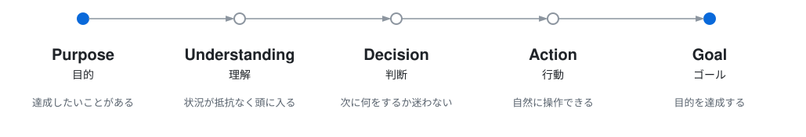

# Flow Design

**Design the journey, not just the interface.**

A design philosophy for effortless understanding and intuitive interaction.

<picture>
  <source media="(prefers-color-scheme: dark)" srcset="docs/diagrams/journey-dark.svg">
  
</picture>

画面ではなく、目的からゴールまでをデザインする。ユーザーは画面を見るためではなく、目的を達成するためにソフトウェアを使うからである。

## 考え方

デザインとは、複雑さを設計者が引き受け、ユーザーには自然な理解・判断・行動を提供することである。

目指すのは、情報が抵抗なく頭に入り、迷うことなく行動でき、自然に目的を達成できる体験である。

シンプルさは、情報や機能を削ることではない。理解と目的達成に必要な負荷を削ることである。そのため、要素を減らすかどうかは「目的達成までの総負荷が減るか」で判断する。

機能性だけでなく、美しさと心地よさも追求する。

この思想は、特定のプロダクト、フレームワーク、AI エージェントに依存しない。

## 原則

### Cognitive Ease — 認知負荷の最小化

- 理解、探索、判断、記憶に必要な負荷を最小化する。
- ユーザーにソフトウェアの使い方を学習させない。
- 減らすのは情報量ではなく、理解に必要な労力である。
- 必要な情報は、必要なタイミングで提示する。

### Logic — 論理性

- すべての設計判断に理由を持たせる。
- 情報の関係性に基づいて構造を決める。
- コンポーネントではなく、ユーザーの目的を起点にする。
- システム内部の構造をそのまま UI に露出させない。

### Flow — 理解と行動の流れ

- 目的からゴールまでの体験全体を設計する。
- 情報を並べるのではなく、理解する順序を設計する。
- ユーザーの思考順序と情報の提示順序を一致させる。
- 体験にストーリーを持たせる。
- スクロールを無理に減らさず、自然な情報の流れを優先する。

### Semantic Economy — 意味の経済性

- 見ればわかることを文章で説明しない。
- 見出しと説明文で同じ意味を繰り返さない。
- 意味のない装飾、アイコン、バッジ、カードを置かない。
- 理解、判断、行動、美的体験のいずれにも寄与しない要素は削除する。
- ただし、必要な説明やアクセシビリティのための重複は許容する。

「顧客管理」という見出しの下に「顧客情報を管理できます。」と書き添えない。見出しだけで意味が伝わっている。

### Linguistic Clarity — 言葉の明快さ

- ユーザーが普段使う自然な言葉を使う。
- 難解な熟語、一般的でない言葉、不必要な英語や略語を避ける。
- 文字数の短さより、理解しやすさを優先する。
- 対象ユーザーに共通認識がある専門用語は、積極的に使う。
- 操作ボタンには、押した結果がわかる名前を付ける。

| 避ける | 使う |
| --- | --- |
| 事業概況 | 事業の状況 |
| 検索条件の初期化 | 条件をリセット |
| 対象レコードが存在しません | データがありません |

### Familiarity — 共通認識

- 既存のアイコン、操作パターン、言葉の共通認識を活用する。
- 独自の操作方法を不用意に導入しない。
- 同じ意味には同じ表現を使う。
- 初めて使うユーザーでも直感的に操作できることを重視する。

### Interaction Efficiency — 操作効率

- クリック数、画面遷移、入力、待ち時間、記憶の負荷を減らす。
- よく使う機能には、すぐにたどり着けるようにする。
- クリック数そのものより、目的達成までの総負荷を減らすことを優先する。
- 重大な操作には、誤操作を防ぐために必要な手順を残す。

### Functional Integrity — 機能的完全性

ここまでの原則は、要素や手順を減らす方向に働く。この原則は、減らしすぎを防ぐためにある。

- 美しさやシンプルさのために、必要な機能を削除しない。
- 安全性、実用性、アクセシビリティを犠牲にしない。
- 情報や操作を隠すことで、かえって利用者の負荷を増やさない。

## 見た目の基準

### Quiet Elegance

静かで上品な画面にする。派手な装飾ではなく、秩序、調和、細部の精度によって美しさをつくる。

### Whitespace

余白を豊かに取る。余白は、情報の関係性、グループ、視覚的な階層を表す手段として使う。

### Spatial Organization

情報を区切るときは、次の順に手段を検討する。

1. 余白
2. 文字の階層
3. 細い境界線
4. 背景色
5. カード・コンテナ

カードを禁止するのではなく、使う理由を求める。

### Bold Typography

重要度に応じて、文字の大きさに大胆な差を付ける。すべての情報を同じように強調しない。

### Soft Geometry

柔らかな角丸を好む。ただし、すべてを過剰に丸くせず、要素の役割と大きさに合わせて調整する。

### Intentional Color

ブランドカラーや意味のある色を積極的に使う。色ごとの役割を明確にし、画面全体の静けさを損なわない。

### Rhythm & Balance

整列、余白、強弱、比率によって視覚的なリズムをつくる。同じ形のカードを均一に並べない。

### Natural Motion

自然で心地よいアニメーションを使う。動きは状態の変化や位置関係を伝えるためのもので、操作を妨げてはならない。動きを減らすアクセシビリティ設定にも対応する。

## 進め方

見た目から始めず、目的から順に決めていく。

1. **Purpose** — ユーザーの目的を定義する。
2. **User** — ユーザーの知識、経験、置かれた状況を理解する。
3. **Structure** — 必要な情報と、その関係性を整理する。
4. **Flow** — 理解・判断・行動の順序を設計する。
5. **Interaction** — 操作と状態の遷移を設計する。
6. **Visual** — 余白、文字、色、形、動きを設計する。
7. **Implementation** — 実装する。
8. **Review** — 実際にできあがったものを確認し、改善する。

## 避けること

| パターン | 反する原則・基準 |
| --- | --- |
| あらゆる情報をカードで囲む | Spatial Organization |
| 意味の薄いバッジやアイコンを多用する | Semantic Economy |
| 理由なくグラデーションや影を使う | Logic, Quiet Elegance |
| 見出しと同じ意味の説明文を添える | Semantic Economy |
| 簡単なことを難しい言葉で表す | Linguistic Clarity |
| すべての情報を同じ重要度で表す | Bold Typography |
| 思考の順序を無視した均一なグリッドを使う | Flow, Rhythm & Balance |
| 主要な機能をメニューの奥に隠す | Interaction Efficiency |
| テンプレートやコンポーネントを起点に設計する | Logic |
| シンプルさを理由に必要な機能を削る | Functional Integrity |
| 操作や理解を妨げるアニメーションを使う | Natural Motion |

## このリポジトリ

現在は、思想と原則を定義する段階にある。今後、AI エージェントが再現できるデザインシステムへ発展させることを目標にしている。具体的なデザイントークン、コンポーネント、技術スタックはまだ定めていない。

図は [draw.io](https://www.drawio.com/) で作成している。編集用のファイルは `docs/diagrams/*.drawio`、README に掲載しているのはそこから書き出した SVG である。

ライセンスは未定。
