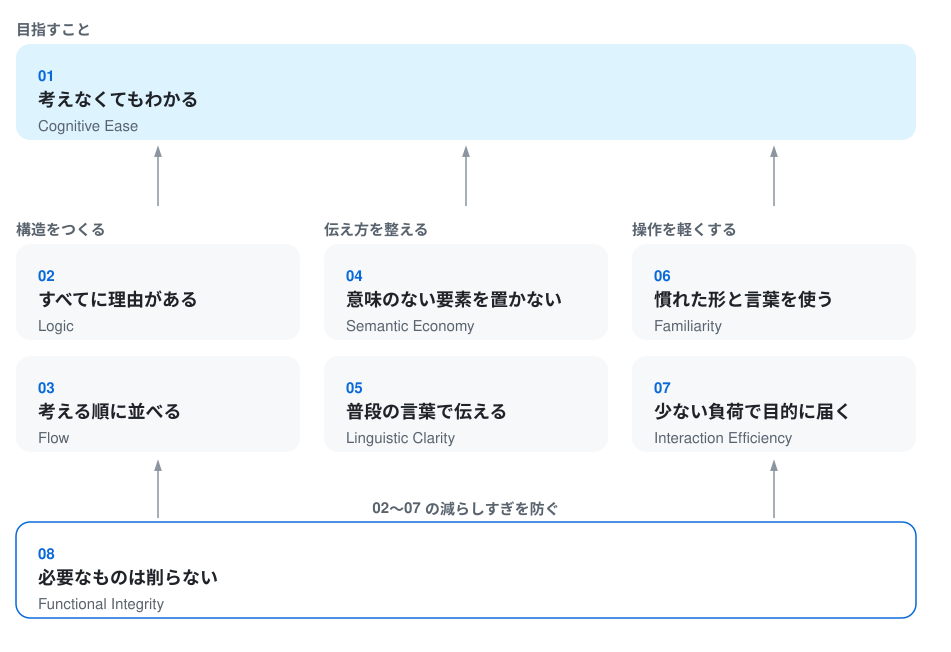
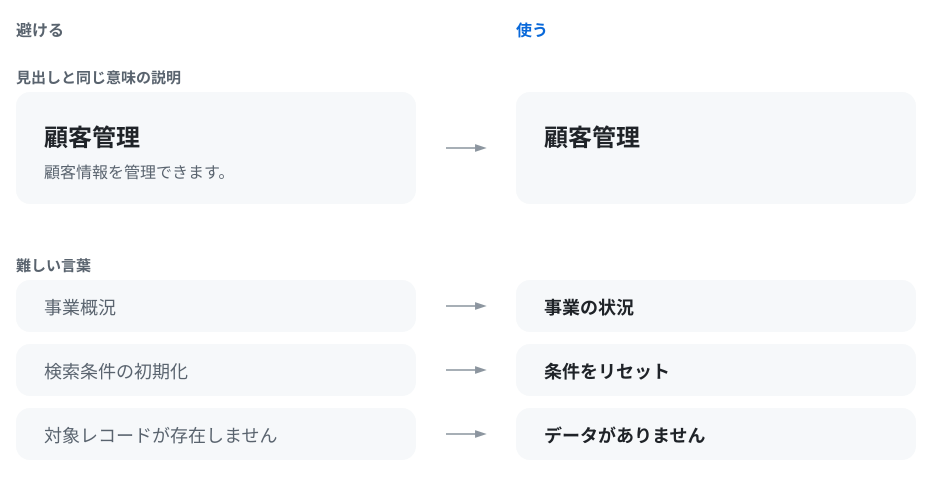
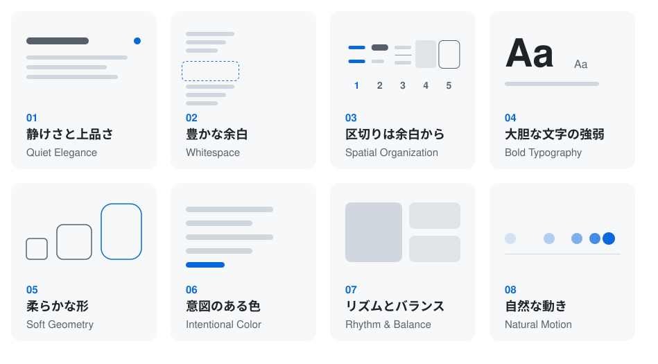
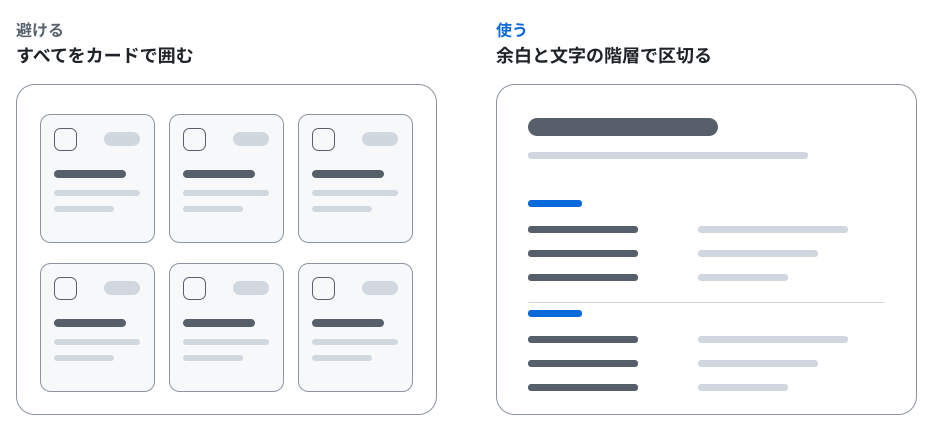
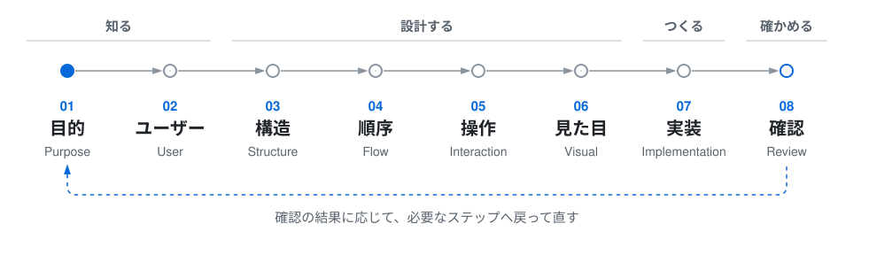

# Flow Design

**Design the journey, not just the interface.**

A design philosophy for effortless understanding and intuitive interaction.

<picture>
  <source media="(prefers-color-scheme: dark)" srcset="docs/diagrams/journey-dark.svg">
  
</picture>

画面ではなく、目的からゴールまでをデザインする。ユーザーは画面を見るためではなく、目的を達成するためにソフトウェアを使うからである。

## デザイン思想

デザインとは、複雑さを設計者が引き受け、ユーザーには自然な理解・判断・行動を提供することである。

目指すのは、情報が抵抗なく頭に入り、迷うことなく行動でき、自然に目的を達成できる体験である。

シンプルさは、情報や機能を削ることではない。理解と目的達成に必要な負荷を削ることである。要素を減らすかどうかは、目的達成までの総負荷が減るかどうかで判断する。

機能性だけでなく、美しさと心地よさも追求する。

この思想は、特定のプロダクト、フレームワーク、AI エージェントに依存しない。

## 8つの設計原則

<picture>
  <source media="(prefers-color-scheme: dark)" srcset="docs/diagrams/principles-dark.svg">
  
</picture>

### 01 考えなくてもわかる

Cognitive Ease（認知負荷の最小化）

理解、探索、判断、記憶に必要な負荷を最小にする。ユーザーにソフトウェアの使い方を学ばせない。減らすのは情報の量ではなく、理解に必要な労力である。必要な情報は、必要なときに示す。

### 02 すべてに理由がある

Logic（論理性）

すべての設計判断に理由を持たせる。構造は、情報どうしの関係から決める。起点はコンポーネントではなく、ユーザーの目的である。システム内部の構造を、そのまま画面に出さない。

### 03 考える順に並べる

Flow（理解と行動の流れ）

目的からゴールまでの体験全体を設計する。情報を並べるのではなく理解する順序を設計し、ユーザーが考える順序と情報を示す順序を一致させる。体験にはストーリーを持たせる。スクロールを無理に減らすより、自然な情報の流れを優先する。

### 04 意味のない要素を置かない

Semantic Economy（意味の経済性）

見ればわかることを文章で説明しない。見出しと説明文で同じ意味を繰り返さない。理解、判断、行動、美しさのいずれにも役立たない装飾、アイコン、バッジ、カードは置かない。

ただし、必要な説明と、アクセシビリティのための重複は残す。

### 05 普段の言葉で伝える

Linguistic Clarity（言葉の明快さ）

ユーザーが普段使う言葉を選び、難しい熟語、一般的でない言葉、不要な英語や略語を避ける。文字数の短さより、わかりやすさを優先する。一方で、対象ユーザーが共通して理解している専門用語は積極的に使う。ボタンには、押した結果がわかる名前を付ける。

<picture>
  <source media="(prefers-color-scheme: dark)" srcset="docs/diagrams/wording-dark.svg">
  
</picture>

### 06 慣れた形と言葉を使う

Familiarity（共通認識）

すでに広く知られているアイコン、操作のパターン、言葉を活用し、独自の操作方法を不用意に持ち込まない。同じ意味には、同じ表現を使う。初めて使う人でも直感的に操作できることを重視する。

### 07 少ない負荷で目的に届く

Interaction Efficiency（操作効率）

クリック、画面の移動、入力、待ち時間、覚えておくことを減らす。よく使う機能には、すぐにたどり着けるようにする。優先するのはクリック数そのものではなく、目的達成までの総負荷を減らすことである。

ただし、重大な操作には、誤操作を防ぐために必要な手順を残す。

### 08 必要なものは削らない

Functional Integrity（機能的完全性）

02〜07 は、要素や手順を減らす方向に働く。この原則は、減らしすぎを防ぐためにある。

美しさやシンプルさのために、必要な機能を削除しない。安全性、実用性、アクセシビリティを犠牲にしない。情報や操作を隠すことで、かえって負荷を増やさない。

## 8つの美的基準

<picture>
  <source media="(prefers-color-scheme: dark)" srcset="docs/diagrams/visual-language-dark.svg">
  
</picture>

### 01 静けさと上品さ

Quiet Elegance

派手な装飾ではなく、秩序、調和、細部の精度によって美しさをつくる。

### 02 豊かな余白

Whitespace

情報の関係、まとまり、階層を、まず余白で表す。そのための余白を惜しまない。

### 03 区切りは余白から

Spatial Organization

情報を区切る手段は、余白 → 文字の階層 → 細い線 → 背景色 → カード・コンテナの順に検討する。カードは禁止しないが、使う理由を求める。

<picture>
  <source media="(prefers-color-scheme: dark)" srcset="docs/diagrams/layout-dark.svg">
  
</picture>

### 04 大胆な文字の強弱

Bold Typography

重要度に応じて文字の大きさに大胆な差を付け、すべてを同じように強調しない。

### 05 柔らかな形

Soft Geometry

柔らかな角丸を好む。ただし過剰に丸めず、要素の役割と大きさに合わせて調整する。

### 06 意図のある色

Intentional Color

ブランドカラーや意味のある色を積極的に使う。色ごとの役割を明確にし、画面全体の静けさを保つ。

### 07 リズムとバランス

Rhythm & Balance

整列、余白、強弱、比率で視覚的なリズムをつくる。同じ形のカードを均一に並べない。

### 08 自然な動き

Natural Motion

動きは状態の変化や位置の関係を伝えるために使い、操作を妨げない。動きを減らすアクセシビリティ設定にも対応する。

## 8つの設計ステップ

見た目から始めず、目的から順に決めていく。

<picture>
  <source media="(prefers-color-scheme: dark)" srcset="docs/diagrams/process-dark.svg">
  
</picture>

| | ステップ | すること |
| --- | --- | --- |
| 01 | 目的 | ユーザーの目的を定義する。 |
| 02 | ユーザー | ユーザーの知識、経験、置かれた状況を理解する。 |
| 03 | 構造 | 必要な情報と、その関係を整理する。 |
| 04 | 順序 | 理解・判断・行動の順序を設計する。 |
| 05 | 操作 | 操作と状態の移り変わりを設計する。 |
| 06 | 見た目 | 余白、文字、色、形、動きを設計する。 |
| 07 | 実装 | 01〜06 で決めたことを実装する。 |
| 08 | 確認 | 実際にできあがったものを確認し、改善する。 |

## 11の避けるべきパターン

| | パターン | 反する原則・基準 |
| --- | --- | --- |
| 01 | あらゆる情報をカードで囲む | 基準 03 区切りは余白から |
| 02 | 意味の薄いバッジやアイコンを多用する | 原則 04 意味のない要素を置かない |
| 03 | 理由なくグラデーションや影を使う | 原則 02 すべてに理由がある 基準 01 静けさと上品さ |
| 04 | 見出しと同じ意味の説明文を添える | 原則 04 意味のない要素を置かない |
| 05 | 簡単なことを難しい言葉で表す | 原則 05 普段の言葉で伝える |
| 06 | すべての情報を同じ重要度で表す | 基準 04 大胆な文字の強弱 |
| 07 | 考える順序を無視した均一なグリッドを使う | 原則 03 考える順に並べる 基準 07 リズムとバランス |
| 08 | 主要な機能をメニューの奥に隠す | 原則 07 少ない負荷で目的に届く |
| 09 | テンプレートやコンポーネントを起点に設計する | 原則 02 すべてに理由がある |
| 10 | シンプルさを理由に必要な機能を削る | 原則 08 必要なものは削らない |
| 11 | 操作や理解を妨げるアニメーションを使う | 基準 08 自然な動き |

## このリポジトリについて

思想、原則、デザイントークンを定め、コンポーネント（39 種、v0.1）と Patterns（27 種）を作った。Components の段階は、全体統合検品（[integration-review.md](docs/web/components/integration-review.md)）を終えて完了した。Patterns は、全体の統合の検品（[Patterns Integration Review](docs/web/patterns/integration-review.md)）を終え、最終のレビューを待っている。実機（iOS Safari、Android）とスクリーンリーダー（VoiceOver、NVDA）による検品は、まだ行っていない。

### ロードマップ

| | 段階 | 状態 |
| --- | --- | --- |
| 1 | Philosophy（思想、原則） | 完了 |
| 2 | Technology Stack | 完了 |
| 3 | Design Tokens v0.1 | 完了 |
| 4 | Components v0.1（39 種） | 完了 |
| 5 | Patterns（27 種。複数のコンポーネントを組み合わせた画面の型） | v0.1 確定候補（Integration Review 完了・最終レビュー待ち） |
| 6 | Pages（Reference Pages。Registry の第 4 層） | 設計済み・未実装（初期の 20 種類） |
| 7 | Registry & Gallery | 予定 |
| 8 | Agent Skills | 予定 |
| 9 | Benchmarks | 予定 |

Registry は、Design Tokens、Components、Patterns、Pages の 4 つの層で構成する。Pages は第 4 層で、Components と Patterns を組み合わせた業務の画面の参照の実装である。初期の 20 種類（Dashboard 2、Data Management 4、Analytics 3、Workflows 2、Settings 3、Authentication & Onboarding 4、Administration 2）は設計を終え、まだ実装していない。

今後、AI エージェントが再現できるデザインシステムへ発展させることを目標にしている。

### Patterns

Components が個々の UI の部品であるのに対し、Patterns はユーザーの目的を達成するための部品の組み合わせと、その判断基準である。再利用できるコードは `registry/patterns/`、資料は `docs/web/patterns/` に置く。

| グループ | 内容 | 状態 |
| --- | --- | --- |
| App Structure | App Shell、Navigation、Page Header、Page Layout、Section Layout（[app-structure.md](docs/web/patterns/app-structure.md)） | v0.1 確定（2026-11-26）。Integration Review で横断の修正を行った |
| Data Browsing | Search & Filter、List & Detail、Bulk Actions、View Switching、Data States（[data-browsing.md](docs/web/patterns/data-browsing.md)） | v0.1 確定候補（main に統合済み。グループの最終レビューは行っていない。Integration Review 完了・最終レビュー待ち） |
| Forms & Workflows | Form Layout、Create & Edit、Unsaved Changes、Confirmation、Multi-step Workflow、Import & Export（[forms-and-workflows.md](docs/web/patterns/forms-and-workflows.md)） | v0.1 確定候補（設計と実装の方針は承認済み。Integration Review 完了・最終レビュー待ち） |
| Data Analysis | Metric Overview、Dashboard Layout、Analysis Filters、Period Comparison、Drill-down（[data-analysis.md](docs/web/patterns/data-analysis.md)） | v0.1 確定候補（設計と実装の方針は承認済み。Integration Review 完了・最終レビュー待ち） |
| System & Account | Authentication、Settings、Onboarding、Permission States、System States、Notifications（[system-and-account.md](docs/web/patterns/system-and-account.md)） | v0.1 確定候補（設計と実装の方針は承認済み。Integration Review 完了・最終レビュー待ち） |

Web で実装するときの技術構成は [Web 技術スタック](docs/web/stack.md)、余白・文字・色などの値は [デザイントークン v0.1](docs/web/tokens.md)、コンポーネントは [コンポーネント](docs/web/components/README.md)、画面の構造の Patterns は [App Structure](docs/web/patterns/app-structure.md)、一覧の検索と閲覧の Patterns は [Data Browsing](docs/web/patterns/data-browsing.md)、登録・編集と手続きの Patterns は [Forms & Workflows](docs/web/patterns/forms-and-workflows.md)、分析とダッシュボードの Patterns は [Data Analysis](docs/web/patterns/data-analysis.md)、認証、設定、権限、障害、通知などの共通の体験の Patterns は [System & Account](docs/web/patterns/system-and-account.md) にまとめている。Pattern をまたぐ状態の管理、hook の選び方、横断の検品、Pages への引き継ぎは [Patterns Integration Review](docs/web/patterns/integration-review.md) にまとめている。

図は [draw.io](https://www.drawio.com/) で作成している。正本は `docs/diagrams/*.drawio` で、そこから書き出したライト用とダーク用の SVG を掲載している。`.drawio` は `scripts/diagrams/gen.py`（Advanced Components の図は `gen_advanced.py`、Data Display の図は `gen_data_display.py`、App Structure の図は `gen_app_structure.py`、Data Browsing の図は `gen_data_browsing.py`、Forms & Workflows の図は `gen_forms_workflows.py`、Data Analysis の図は `gen_data_analysis.py`、System & Account の図は `gen_system_account.py` と `sa_*.py`、Patterns Integration Review の図は `gen_patterns_integration.py`）で生成し、`scripts/diagrams/build.sh` で SVG まで書き出せる。

ライセンスは未定。
