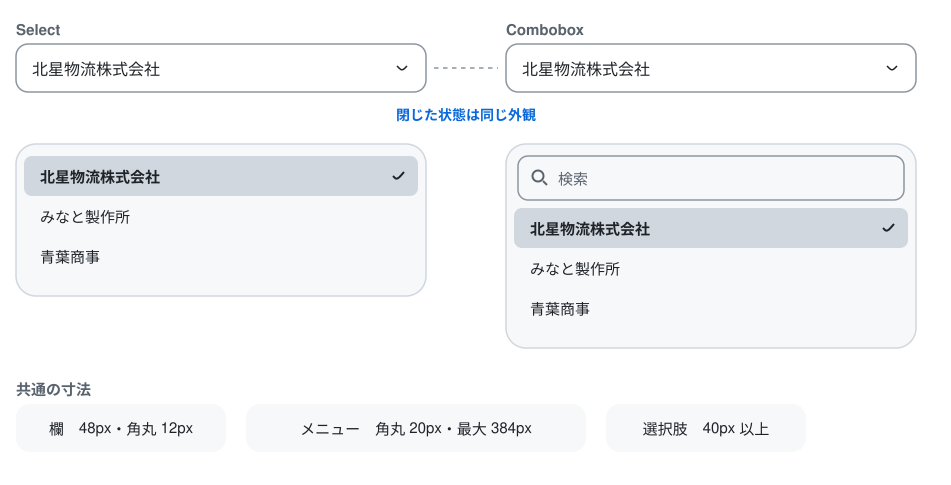
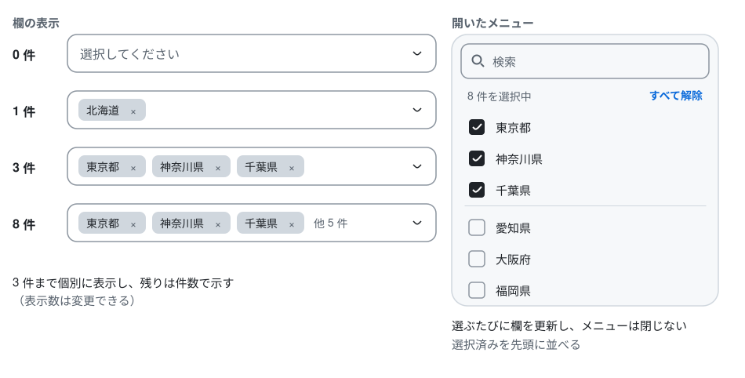
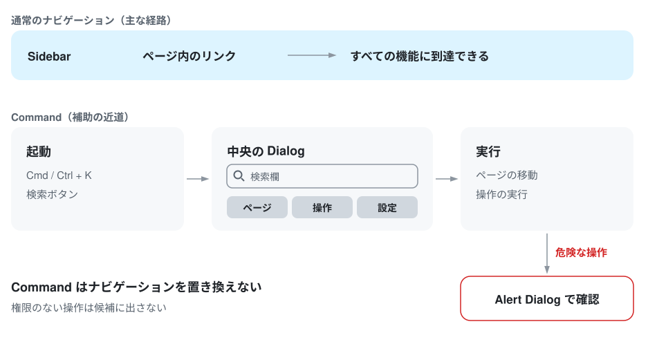
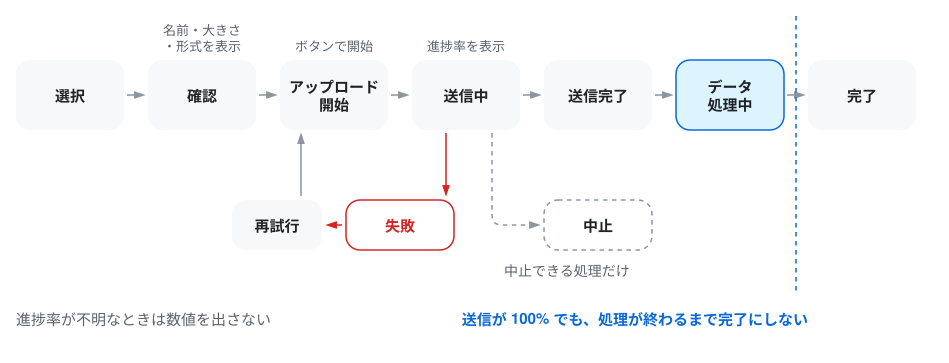
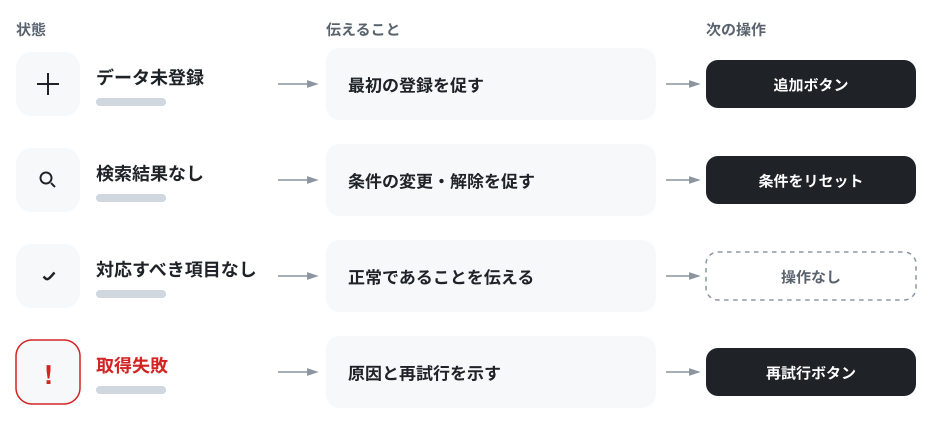

# Advanced Components の判断基準

Combobox、Multi Select、Command、Calendar、Date Picker、File Upload、Empty に共通する判断基準。個別の仕様は各コンポーネントの資料を参照する。

| コンポーネント | 資料 |
| --- | --- |
| Combobox | [combobox.md](combobox.md) |
| Multi Select | [multi-select.md](multi-select.md) |
| Command | [command.md](command.md) |
| Calendar | [calendar.md](calendar.md) |
| Date Picker | [date-picker.md](date-picker.md) |
| File Upload | [file-upload.md](file-upload.md) |
| Empty | [empty.md](empty.md) |

これらは複雑な機能を持つ。複雑さはコンポーネントが引き受け、ユーザーには既存のコンポーネントと同じ操作、確かめやすい結果、少ない操作回数を提供する。

## 1. 選択系コンポーネントの使い分け

<picture>
  <source media="(prefers-color-scheme: dark)" srcset="../../diagrams/advanced-choice-dark.svg">
  
</picture>

| 目的 | 使うもの |
| --- | --- |
| 単一選択 | Select |
| 検索が有効な単一選択 | Combobox |
| 少数の複数選択 | Checkbox |
| 多数の複数選択 | Multi Select |
| 即時反映の ON/OFF | Switch |
| 操作候補からの選択 | Dropdown Menu |
| 機能や情報への高速アクセス | Command |

- 単一選択は、選択肢が少なくても Select を使う（[forms.md](forms.md#単一選択は-select-を優先する)）。Combobox は、検索によって選択肢に早く届く場合に使う。目安は、選択肢が 1 画面のメニューに収まらない（およそ 10 件を超える）か、名前の一部や読みで探すことが多い場合である。
- Radio Group は、既存の画面と表現をそろえる場合だけに使う。
- 複数選択は、選択肢をすべて並べても画面の流れを妨げない数なら Checkbox を使う。検索が必要な数なら Multi Select を使う。
- どの選択系でも、閉じた状態で選んだ結果を確認できるようにする。

## 2. 検索付きの選択の共通構造

<picture>
  <source media="(prefers-color-scheme: dark)" srcset="../../diagrams/combobox-structure-dark.svg">
  
</picture>

Combobox と Multi Select は、Select と同じ欄とメニューを使い、メニューの中に検索欄を置く。入力欄そのものを検索欄にする構成は、Flow Design の標準にしない。

- 閉じた状態は Select と同じ外観になり、選択肢の数が増えて Select から Combobox に変えても、フォームの見た目が変わらない。
- 欄に表示されるのは、いつも確定した値である。検索中の文字と見分ける必要がない。
- 検索欄はメニューの中にあるため、Escape や外側のクリックで閉じると検索文字列が消え、確定した値は残る。

### 検索文字列と確定した値

<picture>
  <source media="(prefers-color-scheme: dark)" srcset="../../diagrams/combobox-state-dark.svg">
  
</picture>

| | 検索文字列（`inputValue`） | 確定した値（`value`） |
| --- | --- | --- |
| 変わるとき | 検索欄に入力したとき | 項目を選んだとき |
| 閉じたとき | 破棄する | 残る |
| フォームで送信 | しない | する（`name`） |

文字を入力しただけで値を変えない。存在しない項目を自由入力で登録しない。新規作成を許可する場合だけ、「新しい項目を追加」の項目を明示的に置く（[combobox.md](combobox.md#新規作成)）。

### 検索の方法

- 標準の絞り込みは部分一致である。大文字と小文字、全角と半角、カタカナとひらがなを区別しない（`registry/lib/search.ts`）。
- 選択肢に `keywords` を持たせると、読みや別名でも探せる（例：「東京都」を「とうきょう」「tokyo」で探す）。
- 検索文字列を空白で区切ると、すべての語を含む項目に絞り込む。
- 日本語の IME で変換中の文字では絞り込まず、確定した文字で絞り込む（Base UI）。Android では、IME が入力中の文字をすべて変換中として扱うため、変換中も絞り込む（Base UI の仕様）。
- サーバー側で検索する場合は `filter={null}` にして、`useComboboxSearch` を使う。入力が止まってから 300ms 後に検索し、新しい検索を始めると前の検索の結果を捨てる。読み込み中、結果なし、取得失敗を区別して示す。
- 検索のアルゴリズムと API の通信は、製品が決める。コンポーネントは、受け取った項目だけを表示し、項目を生成しない。

## 3. Multi Select の選択済みの表示

<picture>
  <source media="(prefers-color-scheme: dark)" srcset="../../diagrams/multi-select-display-dark.svg">
  
</picture>

- 欄には 3 件までを個別に表示し、残りを「他 N 件」で示す。表示する件数は `displayLimit` で変える。
- 個別に表示した項目には、解除のボタン（32 × 32px）を付ける。ボタンは欄のトリガーの外に置き、button を入れ子にしない。
- メニューを開くと、選択済みの項目を先頭に並べ、件数と「すべて解除」を示す。すべての選択内容を、メニューの中で確かめて解除できる。
- 選ぶたびに欄の表示を更新し、メニューは閉じない。確定ボタンは置かない。重い処理が続く場合だけ、製品が適用ボタンを置いてよい。

## 4. Command と通常のナビゲーション

<picture>
  <source media="(prefers-color-scheme: dark)" srcset="../../diagrams/command-navigation-dark.svg">
  
</picture>

- Command は、知っている機能へ早く届くための近道である。Sidebar などの主要なナビゲーションを削除する理由にしない。
- ショートカットを知らない人のために、検索ボタンなどの起動手段を画面に置く。
- 権限のない操作は候補に含めない。危険な操作は、選んだ後に Alert Dialog で確かめ、Command から直接実行しない。

## 5. 日付

<picture>
  <source media="(prefers-color-scheme: dark)" srcset="../../diagrams/calendar-states-dark.svg">
  
</picture>

<picture>
  <source media="(prefers-color-scheme: dark)" srcset="../../diagrams/date-picker-input-dark.svg">
  
</picture>

### 日付だけの値の扱い

| 項目 | 扱い |
| --- | --- |
| 画面の中の値 | ローカル時刻の 0 時の `Date`。年月日だけを使い、時刻は使わない |
| バックエンドに渡す値 | `"YYYY-MM-DD"` の文字列（`toDateString`）。`toISOString()` は使わない。UTC に変換され、日本時間の 0 時が前日になるため |
| 「今日」 | 指定したタイムゾーンの年月日（`todayIn("Asia/Tokyo")`）。省略時はブラウザのタイムゾーン |
| 期間の端 | 開始日と終了日の両方を含む。日時の範囲に変換する場合は、製品の業務のタイムゾーンで「開始日 0 時以上、終了日の翌日 0 時未満」にする |
| 不正な入力 | 別の日付に変換しない。形式の誤りと、存在しない日付を区別して示す |
| 開始日と終了日の逆転 | エラーにし、自動で入れ替えない |

日付の処理は `registry/lib/date.ts` にまとめている。月末、年末、うるう年は、年月日から `Date` を作り、繰り越しが起きたら存在しない日付として扱う（`makeDate`）。

### プリセット

よく使う期間がある画面だけに置く。すべての Date Picker に置かない。内容は製品が選ぶ（`dateRangePresets`）。

| プリセット | 期間（今日が 2026/11/25 水曜日、月曜始まりの場合） |
| --- | --- |
| 今日 | 2026/11/25〜2026/11/25 |
| 今週 | 2026/11/23〜2026/11/25（週の始まりから今日まで） |
| 今月 | 2026/11/01〜2026/11/25（月の始まりから今日まで） |
| 先月 | 2026/10/01〜2026/10/31 |
| 過去7日間 | 2026/11/19〜2026/11/25（今日を含む 7 日） |
| 過去30日間 | 2026/10/27〜2026/11/25（今日を含む 30 日） |
| 今年 | 2026/01/01〜2026/11/25（年の始まりから今日まで） |

固定の日付は使わず、表示するたびに今日から計算する。

## 6. ファイルの登録

<picture>
  <source media="(prefers-color-scheme: dark)" srcset="../../diagrams/file-upload-flow-dark.svg">
  
</picture>

- ファイルを選ぶことと送信することを分け、送信はアップロードボタンで始める。プロフィール画像やチャットの添付など、選んだらすぐに送るのが自然な用途は例外とする。
- 送信の完了（`uploaded`）と、サーバーのデータ処理の完了（`done`）を区別する。
- クライアント側の検証は、早く知らせるためのものである。形式、内容、大きさ、認証・認可の最終的な検証はサーバーが行う。拡張子や MIME Type だけで安全とみなさない。

## 7. 空の状態

<picture>
  <source media="(prefers-color-scheme: dark)" srcset="../../diagrams/empty-states-dark.svg">
  
</picture>

取得の失敗を、データが 0 件の状態として表示しない。0 件のときは Empty、取得に失敗したときは Empty の `status="error"` か Alert を使う。

| 場面 | 使うもの |
| --- | --- |
| 一覧や表の領域そのものが、データの代わりに空になる | Empty |
| 取得に失敗し、一覧の領域にデータを表示できない | Empty（`status="error"`）。原因と再試行を示す |
| 画面の一部の取得に失敗したが、ほかの内容は使える | Alert |
| 操作の結果を一時的に伝える | Toast |

## 8. 共通の実装

| 項目 | 実装 |
| --- | --- |
| 部品 | Combobox と Multi Select は Base UI の Combobox、Command は Base UI の Autocomplete と Flow Design の Dialog、Calendar は react-day-picker、Date Picker は Flow Design の Input、Popover、Drawer、Calendar |
| 状態の管理 | すべて `value` と `onValueChange` で外から制御できる。省略すると内部で持つ |
| フォーム | `name` を指定すると、隠れた入力欄で値を送信する。Multi Select は選んだ ID ごと、Date Picker は `"YYYY-MM-DD"` |
| 製品の責務 | 検索の方法、API の通信、保存、ルーティング、権限、ファイルの処理 |
| メニューの見た目 | Combobox と Multi Select のメニューは Select と同じ（角丸 20px、`shadow-menu`、180ms の開閉） |
| キー操作のハイライト | [overlays.md](overlays.md#6-キー操作のハイライト) の規則に従う。検索欄にフォーカスを残したまま `aria-activedescendant` で移るため、`data-highlighted` の選択肢の内側に `focus-ring`（2px、offset −2px）を付け、ポインターを動かしている間は `data-pointer` で消す |
| 重なり順 | Combobox と Multi Select のメニューは、アンカーに付いて浮かぶ要素として `z-50`。Command は Dialog に従う（`z-40`） |
| モバイル | Date Picker は 768px 未満で Drawer を使い、Calendar を 1 か月だけ表示する（[overlays.md](overlays.md#4-モバイルでの使い分け)） |
| 動きを減らす設定 | 大きさと回転の動きを止める。Command は Dialog に従う |

### 依存パッケージ

| パッケージ | 使う部品 | 選んだ理由 |
| --- | --- | --- |
| `react-day-picker`（v10） | Calendar | shadcn/ui の Calendar と同じ。WCAG 2.1 AA への対応、キーボード操作、ロケール、単一・複数・期間の選択を持つ |
| `date-fns`（v4） | Calendar、日付の処理 | react-day-picker が使う日付の処理。shadcn/ui の Calendar の依存と同じ |

shadcn/ui の Command は `cmdk` を使う。`cmdk` は Radix UI のパッケージに依存するため、Base UI を使う Flow Design では採用しない。Base UI の Autocomplete が、絞り込み、キーボード操作、`aria-activedescendant` による候補の移動を提供するため、追加のパッケージなしで同じ部品名の Command を作れる。

### 実装上の注意

shadcn/ui の `tailwind.css` は `data-selected:` を `[data-selected="true"]` として定義している。Base UI は選択中の項目に値のない `data-selected` を付けるため、`data-selected:` のクラスは一致しない。Advanced Components では、選択中の見た目を `aria-selected:` で指定している。

## 9. 検品

`preview/tests/advanced.spec.ts` で、次を確認している。

| 項目 | 確認すること |
| --- | --- |
| トークン | 高さ、角丸、文字、境界線、影、背景が、各資料の値と一致する |
| 検索 | メニューの中の検索、検索文字列と値の分離、Escape と外側のクリックでの破棄、部分一致、読み、別名、全角 |
| IME | 変換中は絞り込まず、確定した文字で絞り込む（Chromium の CDP。Android の User-Agent は対象外） |
| サーバー側の検索 | 300ms 後の検索、読み込み中、結果なし、取得失敗、古い結果で上書きしないこと |
| Multi Select | 個別表示と件数、解除とフォーカスの移動、即時反映、上限、重複しないこと、検索結果にない選択済みの項目 |
| Command | ボタンとショートカット、IME の変換中と別の修飾キーに反応しないこと、Enter で実行、Escape とフォーカスの復帰、危険な操作の確認 |
| Calendar | 開始曜日、今日と選択中の区別、選択不可、複数、期間、年月の移動、月末、年末、うるう年、タイムゾーン |
| Date Picker | 直接入力と Calendar の同期、下書きと確定、存在しない日付、範囲の制限、開始日と終了日の逆転、プリセット、`YYYY-MM-DD` の送信、UTC より遅いタイムゾーン、モバイルの Drawer |
| File Upload | クリック、キーボード、ドラッグ＆ドロップ、形式・大きさ・件数の制限、明示的な開始、状態の順序、進捗率の不明、失敗、再試行、中止、長いファイル名 |
| Empty | 各状態、操作の有無、タイトルだけ、狭い領域、長い文章 |
| 共通 | 横方向のスクロールがないこと、名前のない操作がないこと、button の入れ子がないこと、ブランドカラーの変更、動きを減らす設定 |

自動の検品で確認できるのは、属性、計算後のスタイル、操作の結果までである。実機の Safari と、実際のスクリーンリーダーでの読み上げは確認していない。
