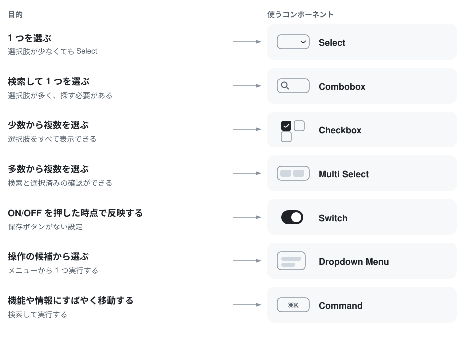
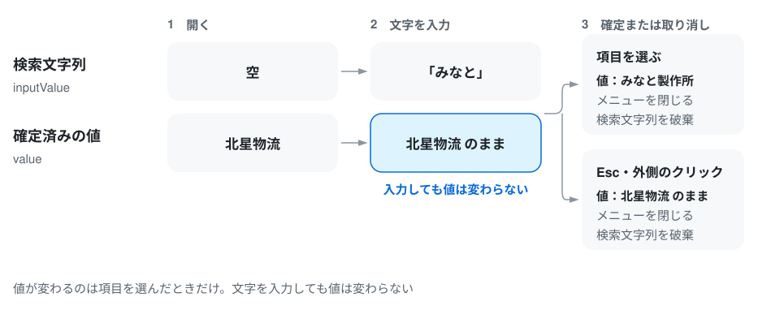
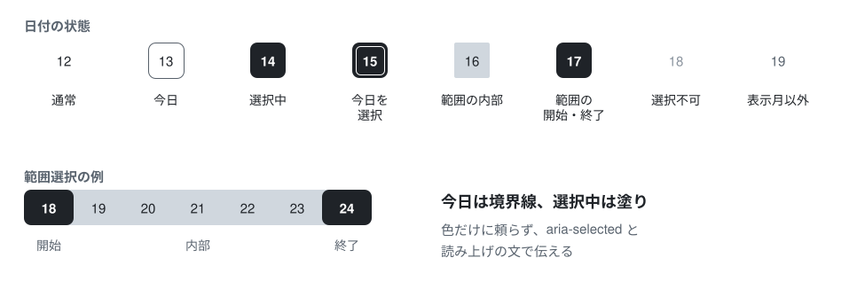
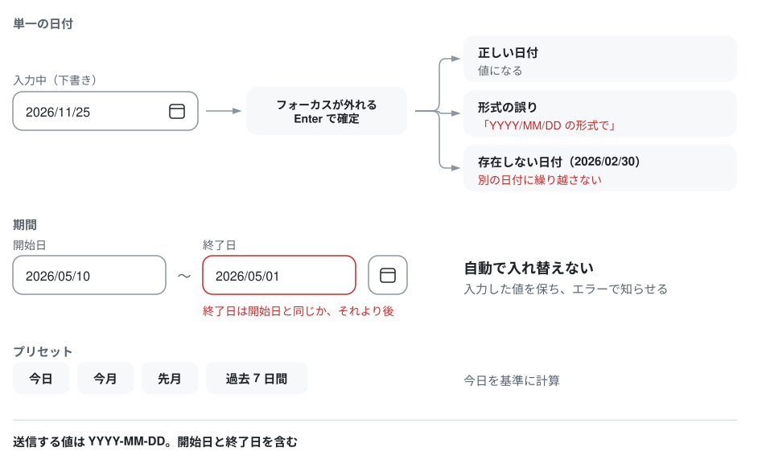

# Advanced Components の判断基準

Combobox、Multi Select、Command、Calendar、Date Picker、File Upload、Empty に共通する判断基準。個別の仕様は各コンポーネントの資料を参照する。

| コンポーネント | 資料 |
| --- | --- |
| Combobox | [combobox.md](combobox.md) |
| Multi Select | [multi-select.md](multi-select.md) |
| Command | [command.md](command.md) |
| Calendar | [calendar.md](calendar.md) |
| Date Picker | [date-picker.md](date-picker.md) |
| File Upload | [file-upload.md](file-upload.md) |
| Empty | [empty.md](empty.md) |

これらは複雑な機能を持つ。複雑さはコンポーネントが引き受け、ユーザーには既存のコンポーネントと同じ操作、確かめやすい結果、少ない操作回数を提供する。

## 1. 選択系コンポーネントの使い分け

<picture>
  <source media="(prefers-color-scheme: dark)" srcset="../../diagrams/advanced-choice-dark.svg">
  
</picture>

| 目的 | 使うもの |
| --- | --- |
| 単一選択 | Select |
| 検索が有効な単一選択 | Combobox |
| 少数の複数選択 | Checkbox |
| 多数の複数選択 | Multi Select |
| 即時反映の ON/OFF | Switch |
| 操作候補からの選択 | Dropdown Menu |
| 機能や情報への高速アクセス | Command |

- 単一選択は、選択肢が少なくても Select を使う（[forms.md](forms.md#単一選択は-select-を優先する)）。Combobox は、検索によって選択肢に早く届く場合に使う。
- Combobox に切り替える目安は、選択肢がおよそ 10 件を超えるか、名前の一部や読みで探すことが多い場合である。10 件は厳密な上限ではなく、判断の目安である。選択肢が 10 件以下でも、名前を覚えている取引先のように検索で探すことが自然な場合は Combobox を使ってよい。
- Radio Group は、既存の画面と表現をそろえる場合だけに使う。
- 複数選択は、選択肢をすべて並べても画面の流れを妨げない数なら Checkbox を使う。検索が必要な数なら Multi Select を使う。
- どの選択系でも、閉じた状態で選んだ結果を確認できるようにする。

## 2. 検索付きの選択の共通構造

<picture>
  <source media="(prefers-color-scheme: dark)" srcset="../../diagrams/combobox-structure-dark.svg">
  
</picture>

Combobox と Multi Select は、Select と同じ欄とメニューを使い、メニューの中に検索欄を置く。入力欄そのものを検索欄にする構成は、Flow Design の標準にしない。

- 閉じた状態は Select と同じ外観になり、選択肢の数が増えて Select から Combobox に変えても、フォームの見た目が変わらない。
- 欄に表示されるのは、いつも確定した値である。検索中の文字と見分ける必要がない。
- 検索欄はメニューの中にあるため、Escape や外側のクリックで閉じると検索文字列が消え、確定した値は残る。

### 検索文字列と確定した値

<picture>
  <source media="(prefers-color-scheme: dark)" srcset="../../diagrams/combobox-state-dark.svg">
  
</picture>

| | 検索文字列（`inputValue`） | 確定した値（`value`） |
| --- | --- | --- |
| 変わるとき | 検索欄に入力したとき | 項目を選んだとき |
| 閉じたとき | 破棄する | 残る |
| フォームで送信 | しない | する（`name`） |

文字を入力しただけで値を変えない。存在しない項目を自由入力で登録しない。新規作成を許可する場合だけ、「新しい項目を追加」の項目を明示的に置く（[combobox.md](combobox.md#新規作成)）。

### 検索の仕様

| 項目 | 仕様 |
| --- | --- |
| 一致の方法 | 部分一致（`registry/lib/search.ts` の `matchesSearch`）。検索文字列を空白で区切ると、すべての語を含む項目に絞り込む |
| そろえる表記 | Unicode の NFKC で全角の英数字と記号を半角に、半角のカタカナを全角にそろえる。大文字と小文字を区別しない。カタカナをひらがなにそろえる。連続する空白を 1 つにする |
| 対象 | 項目の `label` と `keywords`（読み、別名、ローマ字など）。例：「東京都」は「とうきょう」「トウキョウ」「TOKYO」「ｔｏｋｙｏ」で見つかる |
| 対象にしないこと | 漢字の読みの推測、表記の揺れの吸収（「斉藤」と「斎藤」など）、あいまいな一致。必要な場合は、製品が `keywords` に入れるか、`filter` を差し替える |
| 独自の方法 | `filter` に関数を渡す（Base UI の `filter` と同じ形）。サーバー側で検索する場合は `filter={null}` にする |

### 非同期の検索の責務

`useComboboxSearch` は、サーバー側の検索の状態だけを管理する。API の通信と検索の方法は製品が `search` に渡す。

| 場面 | `useComboboxSearch` の動き |
| --- | --- |
| 入力が続いている | 最後の入力から 300ms（`debounce`）待ってから 1 回だけ `search` を呼ぶ。待っている間に入力が変わったら、前の待ちを取り消す |
| 前の検索がまだ返っていない | 新しい検索を始めるときに、前の検索の `AbortSignal` を中断する。前の検索の結果が後から返っても、表示しない |
| メニューを閉じた | 検索文字列が空になるため、検索中のものを中断し、状態を `idle` にする。遅れて返った結果は表示しない |
| 部品が画面から消えた（アンマウント） | 検索中のものを中断する。遅れて返った結果で状態を更新しない |
| 失敗した | 状態を `error` にする。`retry` で同じ検索文字列をもう一度検索する |
| `minLength` より短い | 検索しない（`idle`） |

製品の責務は次のとおりである。

- API の通信、認証、検索の方法、件数の上限。中断できる API なら、`signal` を `fetch` などに渡す。中断できない API でも、古い結果は表示されない
- 選んだ項目が新しい検索の結果に含まれない場合に、`items` に残すこと（Combobox）。Multi Select は、選んだ項目の表示名を部品が覚えている
- サーバー側の検索の結果に含まれない項目を、部品は生成しない。読み込んでいない項目を、まとめて選ぶ操作も提供しない

### Enter と IME

| 操作 | 動き |
| --- | --- |
| 選択肢をハイライトしてから Enter | その選択肢を選ぶ |
| ハイライトがない状態で Enter | 何も選ばずにメニューを閉じる。値は変わらない |
| IME の変換を確定する Enter | 選ばない（Base UI は `keyCode` 229 と `isComposing` の Enter を無視する） |
| IME の変換中 | 絞り込まない。変換を確定した文字で絞り込む（`compositionend`） |

### Android の IME の制約

Base UI は、Android では `compositionstart` を扱わず、変換中の文字でも入力のたびに絞り込む（`@base-ui/react` 1.9 の `ComboboxInput`、mui/base-ui#2942）。Android の一部のキーボード（予測変換を有効にした Samsung のキーボードなど）は、入力中の文字をすべて変換中として扱い、変換中を除くと、いつまでも絞り込まれないためである。

影響の範囲は次のとおりである。

- Android では、変換前のひらがなで絞り込まれる。`keywords` に読みを入れておくと、変換前でも候補が出る
- サーバー側の検索では、変換中の文字でも `search` が呼ばれる。300ms の待ちで回数は減るが、変換前の文字の検索が起きる
- 変換の確定の Enter で選択肢を選ばないことは、Android でも同じである（`keyCode` 229）
- 自動の検品では、Android の User-Agent の project（mobile）で、IME の変換中の検品を対象外にしている。実機の Android では確認していない

## 3. Multi Select の選択済みの表示

<picture>
  <source media="(prefers-color-scheme: dark)" srcset="../../diagrams/multi-select-display-dark.svg">
  
</picture>

- 欄には 3 件までを個別に表示し、残りを「他 N 件」で示す。表示する件数は `displayLimit` で変える。
- 個別に表示した項目には、解除のボタン（32 × 32px）を付ける。ボタンは欄のトリガーの外に置き、button を入れ子にしない。
- メニューを開くと、選択済みの項目を先頭に並べ、件数と「すべて解除」を示す。すべての選択内容を、メニューの中で確かめて解除できる。
- 選ぶたびに欄の表示を更新し、メニューは閉じない。確定ボタンは置かない。重い処理が続く場合だけ、製品が適用ボタンを置いてよい。
- すべての選択済みの項目に、名前と解除の手段がある。欄に表示した項目は解除のボタン（名前は「〇〇を解除」）、「他 N 件」に含まれる項目はメニューの選択肢（`aria-selected`）で解除する。トリガーの中身には、すべての項目の名前を支援技術向けに入れる。
- 解除のボタンは 32 × 32px で、隣の解除のボタンとは 8px 以上離れ、開閉のアイコンの領域（右端 48px）と重ならない。項目の名前の部分を押すとメニューが開き、解除はしない。WCAG 2.5.8 の最小（24px）は満たすが、指での操作の推奨（44〜48px）より小さい。誤って押しにくいよう、解除はボタンの領域に限っている。

## 4. Command と通常のナビゲーション

<picture>
  <source media="(prefers-color-scheme: dark)" srcset="../../diagrams/command-navigation-dark.svg">
  
</picture>

- Command は、知っている機能へ早く届くための近道である。Sidebar などの主要なナビゲーションを削除する理由にしない。
- ショートカットを知らない人のために、検索ボタンなどの起動手段を画面に置く。
- 権限のない操作は候補に含めない。危険な操作は、選んだ後に Alert Dialog で確かめ、Command から直接実行しない。権限の確認と、操作の実際の実行は製品の責務である。
- ショートカット（`useCommandShortcut`）は、ほかのショートカットと競合しないよう、次の場合に反応しない：IME の変換中、キーの長押しによる繰り返し、ほかの処理が `preventDefault` したキー、Shift・Alt の併用、別の修飾キー、contenteditable の中、Command 以外の Overlay が開いている間。input と textarea の中では反応する。キーの変更（`key`）と解除（`enabled`）は製品が行う。同じキーが複数登録された場合は、最後に登録されたものだけが反応する。

## 5. 日付

<picture>
  <source media="(prefers-color-scheme: dark)" srcset="../../diagrams/calendar-states-dark.svg">
  
</picture>

### 日付だけの値の扱い

| 項目 | 扱い |
| --- | --- |
| 画面の中の値 | ローカル時刻の 0 時の `Date`。年月日だけを使い、時刻は使わない |
| バックエンドに渡す値 | `"YYYY-MM-DD"` の文字列（`toDateString`）。`toISOString()` は使わない。UTC に変換され、日本時間の 0 時が前日になるため |
| 「今日」 | 指定したタイムゾーンの年月日（`todayIn("Asia/Tokyo")`）。省略時はブラウザのタイムゾーン |
| 期間の端 | 開始日と終了日の両方を含む |
| 不正な入力 | 別の日付に変換しない。形式の誤りと、存在しない日付を区別して示す |
| 開始日と終了日の逆転 | エラーにし、自動で入れ替えない |

### 対応する範囲

| 項目 | 範囲と扱い |
| --- | --- |
| 年 | 西暦 1 年 1 月 1 日〜9999 年 12 月 31 日（先発グレゴリオ暦、`MIN_YEAR`、`MAX_YEAR`）。0 年は `Intl.DateTimeFormat` が「紀元前 1 年」として表示し、`"YYYY-MM-DD"` と往復できないため扱わない |
| 0〜99 年 | `new Date(y, m, d)` は 0〜99 年を 1900 年代として扱う。`makeDate` は `setFullYear` で年月日を同時に設定し、そのまま扱う（4 年 2 月 29 日は 0004-02-29） |
| うるう年 | 4 で割り切れる年。ただし 100 で割り切れる年は平年、400 で割り切れる年はうるう年（1900 年は平年、2000 年はうるう年） |
| 存在しない日付 | 2 月 30 日、13 月、0 日などは、別の日付に繰り越さずに `undefined`（入力欄では `nonexistent`） |
| 夏時間 | 日付は年月日だけで扱うため、夏時間の切り替えの日も日付は変わらない。0 時が存在しない日（2018 年までのブラジルなど）は `Date` が 1 時になるが、年月日は同じ |
| 不正な値 | Invalid Date は、`formatDate` と `toDateString` で `""`、Date Picker の `value` では未入力として扱う。不正な `timeZone` と Invalid Date の `now` を渡した `todayIn` は、誤った日付を返さずに `RangeError` を投げる |
| Calendar の年のドロップダウン | 既定は今日の 100 年前〜10 年後。`startMonth`、`endMonth` で変える |

### 入力の形式

形式の妥当性（`format`）と、日付としての妥当性（`nonexistent`）を分けて判定する（`parseDateInput`）。全角の数字と記号は半角にそろえ、前後の空白は無視する。

| ロケール | 受け付ける形式 | 例 |
| --- | --- | --- |
| すべて | ISO 8601 の `YYYY-MM-DD`（月と日は 1〜2 桁） | 2026-11-25 |
| ja-JP | 表示形式（区切りは「/」） | 2026/11/25、2026/1/5 |
| ja-JP | 区切りのない 8 桁 | 20261125 |
| ja-JP | 年月日の漢字（「日」は省略できない） | 2026年11月25日 |
| en-US | 表示形式（月、日、年） | 11/25/2026 |
| de-DE | 表示形式（日、月、年） | 25.11.2026 |
| ko-KR | 表示形式。末尾の「.」は省略できる。区切りのない 8 桁 | 2026. 11. 25.、20261125 |

- ロケールの表示形式は `Intl.DateTimeFormat` から作る。年が先のロケール（ja-JP、zh-CN、ko-KR など）では、区切りのない 8 桁も受け付ける。
- 次は `format` とする：区切りの混在（2026/11-25）、空の区切り（2026//11/25）、先頭や末尾の余分な区切り（/2026/11/25、2026/11/25/）、表示形式と違う区切り（ja-JP の 2026.11.25）、年が 4 桁でない（26/11/25）、月や日が 3 桁以上、時刻つき（2026/11/25 10:00）。

### フォームの送信

<picture>
  <source media="(prefers-color-scheme: dark)" srcset="../../diagrams/date-picker-input-dark.svg">
  
</picture>

| 場面 | 送信される値と妥当性 |
| --- | --- |
| 正しい日付を入力し、確定の前に送信した | 入力中の日付（`"YYYY-MM-DD"`）。送信の直前に確定し、表示もそろえる |
| 不正な日付を入力したまま送信した | `""`。以前に確定した日付は送信しない。`form.checkValidity()` は `false` |
| 範囲外、選べない日 | `""`。`checkValidity()` は `false` |
| 終了日が開始日より前 | 入力した 2 つの日付。`checkValidity()` は `false`（終了日の欄） |
| 片側だけの期間 | 入力した側だけ。もう一方は `""`。`checkValidity()` は `true` |
| `required` で未入力 | `""`。`checkValidity()` は `false`（見える入力欄の `valueMissing`） |
| `disabled` | 送信しない（値を持つ入力欄も無効になる） |
| `readOnly` | 確定した日付を送信する |
| Enter | 確定してから、通常の入力欄と同じくフォームの送信を続ける。IME の変換の確定の Enter では確定しない |
| フォームの reset | `defaultValue` に戻り、エラーも消える |

- 値と妥当性は、画面に表示しない入力欄（`data-slot="date-picker-value"`）が持つ。`type="hidden"` は妥当性の検証の対象外のため、見えない text の入力欄にしている。見える入力欄の id を `data-for` に持つ。
- 見える入力欄（Base UI の Field.Control）には `setCustomValidity` を設定しない。Base UI の Field が入力のたびに妥当性を読み、描画の前の古い値でエラーを表示し続けるためである。
- `noValidate` のないフォームは、ブラウザが送信を止め、見える入力欄にフォーカスを移してエラーを表示する。
- Flow Design のフォームは `noValidate` を使い、エラーの概要を自前で表示する（[forms.md](forms.md#4-エラー)）。この場合、製品は送信の前に `form.checkValidity()` を確かめる。Date Picker のエラーを無視して送信する使い方は提供しない。

```tsx
const onSubmit = (e: FormEvent<HTMLFormElement>) => {
  e.preventDefault()
  const form = e.currentTarget
  if (!form.checkValidity()) {
    // エラーの概要を表示し、最初の項目にフォーカスを移す。Date Picker の値の入力欄は data-for で見える入力欄をたどる
    return
  }
  const data = new FormData(form) // contract_date=2026-04-01
}
```

### 日時の検索条件への変換

終了日を含む期間を、日時の検索条件（API の `from`、`to` など）に変換するのは製品の責務である。

- 業務のタイムゾーン（例：Asia/Tokyo）を決め、「開始日の 0 時以上、終了日の翌日の 0 時未満」にする。終了日の 23:59:59 までとすると、23:59:59.5 などの記録が漏れる。
- 夏時間のある地域では、1 日が 23 時間や 25 時間になる。時刻に 24 時間を足すのではなく、日付に 1 日を足してから 0 時にする。
- バックエンドが日付の型（SQL の `DATE` など）を持つ場合は、`"YYYY-MM-DD"` をそのまま渡し、日時に変換しない。

### プリセット

よく使う期間がある画面だけに置く。すべての Date Picker に置かない。内容は製品が選ぶ（`dateRangePresets`）。

| プリセット | 期間（今日が 2026/11/25 水曜日、月曜始まりの場合） |
| --- | --- |
| 今日 | 2026/11/25〜2026/11/25 |
| 今週 | 2026/11/23〜2026/11/25（週の始まりから今日まで） |
| 今月 | 2026/11/01〜2026/11/25（月の始まりから今日まで） |
| 先月 | 2026/10/01〜2026/10/31 |
| 過去7日間 | 2026/11/19〜2026/11/25（今日を含む 7 日） |
| 過去30日間 | 2026/10/27〜2026/11/25（今日を含む 30 日） |
| 今年 | 2026/01/01〜2026/11/25（年の始まりから今日まで） |

固定の日付は使わず、表示するたびに今日から計算する。

## 6. ファイルの登録

<picture>
  <source media="(prefers-color-scheme: dark)" srcset="../../diagrams/file-upload-flow-dark.svg">
  
</picture>

- ファイルを選ぶことと送信することを分け、送信はアップロードボタンで始める。プロフィール画像やチャットの添付など、選んだらすぐに送るのが自然な用途は例外とする。
- 送信の完了（`uploaded`）と、サーバーのデータ処理の完了（`done`）を区別する。100% の表示の後も、処理が終わるまでは処理中として示す。
- クライアント側の検証は、早く知らせるためのものである。形式、内容、大きさ、認証・認可の最終的な検証はサーバーが行う。拡張子や MIME Type だけで安全とみなさない。

| 項目 | コンポーネント | 製品 |
| --- | --- | --- |
| 選択 | クリック、キーボード、ドラッグ＆ドロップ。同じファイルの選び直し（input の値を毎回空にする） | |
| 選択時の検証 | 形式、1 ファイルの大きさ、件数（選んでいる件数を含む）、重複（名前、大きさ、更新日時が同じ） | サーバーでの検証 |
| 状態 | 8 つの状態の表示。中止と再試行のボタン（コールバックを渡したときだけ） | 状態の決定。UI は成功を推測しない |
| 送信 | 行わない | API の通信、保存先、認証・認可、マルウェアの検査、内容の検証、データ処理 |
| 連続した操作 | | 同じファイルの送信を重ねて始めない |
| 中止 | 中止できる処理にだけボタンを出す（`onCancel`） | 実際の中止。中止の後に届いた完了の通知を無視する（送信を始めるたびに番号を変え、古い通知を捨てる） |
| 再試行 | 失敗と中止のときのボタン（`onRetry`） | 再試行の処理と回数の制限 |

ファイルの大きさは 1 KB = 1,024 バイト、1 MB = 1,024 KB で計算し、「B」「KB」「MB」「GB」「TB」で表示する（`formatFileSize`）。100 未満は小数点以下 1 桁、100 以上は整数に丸める（例：120,000 バイトは「117 KB」、11,534,336 バイトは「11 MB」）。製品が上限を示す文言（「10 MB まで」）も、同じ基準で計算する。

## 7. 空の状態

<picture>
  <source media="(prefers-color-scheme: dark)" srcset="../../diagrams/empty-states-dark.svg">
  
</picture>

取得の失敗を、データが 0 件の状態として表示しない。0 件のときは Empty、取得に失敗したときは Empty の `status="error"` か Alert を使う。

| 場面 | 使うもの |
| --- | --- |
| 一覧や表の領域そのものが、データの代わりに空になる | Empty |
| 取得に失敗し、一覧の領域にデータを表示できない | Empty（`status="error"`）。原因と再試行を示す |
| 画面の一部の取得に失敗したが、ほかの内容は使える | Alert |
| 操作の結果を一時的に伝える | Toast |

## 8. 共通の実装

| 項目 | 実装 |
| --- | --- |
| 部品 | Combobox と Multi Select は Base UI の Combobox、Command は Base UI の Autocomplete と Flow Design の Dialog、Calendar は react-day-picker、Date Picker は Flow Design の Input、Popover、Drawer、Calendar |
| 状態の管理 | すべて `value` と `onValueChange` で外から制御できる。省略すると内部で持つ |
| フォーム | `name` を指定すると、隠れた入力欄で値を送信する。Combobox と Multi Select は選んだ値（Multi Select は ID ごと）、Date Picker は `"YYYY-MM-DD"`（[フォームの送信](#フォームの送信)） |
| 製品の責務 | 検索の方法、API の通信、保存、ルーティング、権限、ファイルの処理 |
| メニューの見た目 | Combobox と Multi Select のメニューは Select と同じ（角丸 20px、`shadow-menu`、180ms の開閉） |
| キー操作のハイライト | [overlays.md](overlays.md#6-キー操作のハイライト) の規則に従う。検索欄にフォーカスを残したまま `aria-activedescendant` で移るため、`data-highlighted` の選択肢の内側に `focus-ring`（2px、offset −2px）を付け、ポインターを動かしている間は `data-pointer` で消す |
| 重なり順 | Combobox と Multi Select のメニューは、アンカーに付いて浮かぶ要素として `z-50`。Command は Dialog に従う（`z-40`） |
| モバイル | Date Picker は 768px 未満で Drawer を使い、Calendar を 1 か月だけ表示する（[overlays.md](overlays.md#4-モバイルでの使い分け)） |
| 動きを減らす設定 | 大きさと回転の動きを止める。Command は Dialog に従う |

### 依存パッケージ

| パッケージ | 使う部品 | 選んだ理由 |
| --- | --- | --- |
| `react-day-picker`（v10） | Calendar | shadcn/ui の Calendar と同じ。WCAG 2.1 AA への対応、キーボード操作、ロケール、単一・複数・期間の選択を持つ |
| `date-fns`（v4） | Calendar、日付の処理 | react-day-picker が使う日付の処理。shadcn/ui の Calendar の依存と同じ |

shadcn/ui の Command は `cmdk` を使う。`cmdk` は Radix UI のパッケージに依存するため、Base UI を使う Flow Design では採用しない。Base UI の Autocomplete が、絞り込み、キーボード操作、`aria-activedescendant` による候補の移動を提供するため、追加のパッケージなしで同じ部品名の Command を作れる。

### shadcn/ui との互換性

| コンポーネント | shadcn/ui | Flow Design |
| --- | --- | --- |
| Combobox | 同じ部品名（`Combobox`、`ComboboxTrigger`、`ComboboxValue`、`ComboboxContent`、`ComboboxInput`、`ComboboxList`、`ComboboxItem`、`ComboboxGroup`、`ComboboxLabel`、`ComboboxCollection`、`ComboboxEmpty`、`ComboboxSeparator`）。Base UI の Combobox | 検索欄をメニューの中に置く（shadcn/ui は入力欄が欄そのもの）。`ComboboxChips` 系は提供せず、複数選択は Multi Select にする。`ComboboxCreateItem`、`ComboboxStatus`、`useComboboxSearch` を追加 |
| Multi Select | 同じ部品はない | Flow Design が定める |
| Command | 同じ部品名（`Command`、`CommandDialog`、`CommandInput`、`CommandList`、`CommandEmpty`、`CommandGroup`、`CommandItem`、`CommandSeparator`、`CommandShortcut`）。cmdk | Base UI の Autocomplete。`CommandItem` の `onSelect`、`CommandGroup` の `heading` は同じ。`items` で候補を渡す点が cmdk と違う。`useCommandShortcut`、`useCommandShortcutLabel` を追加 |
| Calendar | 同じ部品名（`Calendar`、`CalendarDayButton`）。react-day-picker | 月曜始まりと年月のドロップダウンを既定にする。`timeZone` は「今日」だけに使う |
| Date Picker | 部品はなく、Popover と Calendar の組み合わせの例 | `DatePicker`、`DateRangePicker` を定める |
| File Upload | 同じ部品はない | Flow Design が定める |
| Empty | 同じ部品名（`Empty`、`EmptyHeader`、`EmptyMedia`、`EmptyTitle`、`EmptyDescription`、`EmptyContent`） | `status` を追加。`EmptyMedia` の `variant="icon"` の大きさを 64px / 32px にする |

### 実装上の注意

shadcn/ui の `tailwind.css` は `data-selected:` を `[data-selected="true"]` として定義している。Base UI は選択中の項目に値のない `data-selected` を付けるため、`data-selected:` のクラスは一致しない。Advanced Components と Select（v0.1 の確定の作業で修正）では、選択中の見た目を `aria-selected:` で指定している。

### SSR と Hydration

`preview/tests/ssr-advanced.spec.ts`（`npm run test:ssr`）で、次を確かめている。Next.js などのフレームワークでの検品は、Registry & Gallery の段階で行う。

| 項目 | 確かめていること |
| --- | --- |
| サーバーでの描画 | Node.js（`window` と `document` がない環境）で、7 種類の部品を `react-dom/server` で描画できる。同じ入力から毎回同じ HTML になる |
| `use client` の境界 | hook とイベントを使う 6 つのファイル（Combobox、Multi Select、Command、Calendar、Date Picker、File Upload）の先頭に `"use client"` がある。Empty はサーバーの部品として使える |
| 日付、ロケール、タイムゾーン | 固定した日付（`today`、`defaultMonth`、`defaultValue`）で描画した HTML を、サーバーと違うタイムゾーン（America/Los_Angeles、Pacific/Kiritimati）のブラウザで Hydration しても、不一致にならず、送信する値もずれない |
| ショートカットの表示 | サーバーと Hydration の間は表示せず（`useCommandShortcutLabel` が `null`）、Hydration の後に「⌘K」か「Ctrl+K」にする |
| モバイルの Calendar | サーバーでは Popover として描画し、Hydration の後の画面の幅で、Popover か Drawer で開く |
| ファイル入力 | `<input type="file">` と選択のボタンを、Hydration の前から描画する |

サーバーで描画する製品は、「今日」に依存する部品に `today`（Calendar、Date Picker の `calendarProps.today`）を渡す。サーバーとブラウザで「今日」を別々に計算すると、タイムゾーンや日付の変わり目で HTML が食い違う。

## 9. 検品

| ファイル | 確認すること |
| --- | --- |
| `preview/tests/advanced.spec.ts` | 部品の見た目、操作、状態、フォームとの連携（下の表） |
| `preview/tests/date.spec.ts` | `registry/lib/date.ts`。うるう年、100 年・400 年の境界、0001〜0099 年、月末、12 月と翌年 1 月、不正な年月日、入力の形式、7 つのタイムゾーン（夏時間、UTC+14、UTC−11 を含む）、指定したタイムゾーンの深夜の前後、不正な Date と timeZone、プリセット。Node.js で実行する |
| `preview/tests/ssr-advanced.spec.ts` | SSR と Hydration（上の「SSR と Hydration」） |

`advanced.spec.ts` で確認していること：

| 項目 | 確認すること |
| --- | --- |
| トークン | 高さ、角丸、文字、境界線、影、背景が、各資料の値と一致する |
| 検索 | メニューの中の検索、検索文字列と値の分離、Escape と外側のクリックでの破棄、部分一致、読み、別名、全角 |
| Enter と IME | ハイライトのない Enter で選ばない。変換中は絞り込まず、変換の確定の Enter で選ばない（Chromium の CDP。Android の User-Agent は対象外） |
| サーバー側の検索 | 300ms の待ちで入力をまとめること、読み込み中、結果なし、取得失敗、再試行、古い結果で上書きしないこと、閉じた後とアンマウントの後に遅れて返った結果 |
| Multi Select | 個別表示と件数、すべての選択済みの項目の名前と解除の手段、解除とフォーカスの移動、タッチでの解除ボタンの大きさと重なり、即時反映、上限、重複しないこと、検索結果にない選択済みの項目 |
| Command | ボタンとショートカット、キーの変更と解除、IME の変換中、長押しの繰り返し、`preventDefault` 済みのキー、input と contenteditable、別の Overlay、複数の Command、Enter で実行、Escape とフォーカスの復帰、危険な操作の確認と取り消し |
| Calendar | 開始曜日、今日と選択中の区別、選択不可、複数、期間、年月の移動、月末、年末、うるう年、タイムゾーン |
| Date Picker | 直接入力と Calendar の同期、下書きと確定、存在しない日付、範囲の制限、開始日と終了日の逆転、片側だけの期間、プリセットと制約、フォームの送信（不正な入力、確定の前の送信、Enter、required、disabled、readOnly、外からの値の変更、reset）、UTC より遅いタイムゾーン、モバイルの Drawer、IME の変換の確定の Enter |
| File Upload | クリック、キーボード、ドラッグ＆ドロップ、複数回のドロップ、重複、選び直し、形式・大きさ・件数の制限、明示的な開始、連続した開始の操作、状態の順序、進捗率の不明、失敗、再試行、中止、中止の後の遅れた完了の通知、長いファイル名 |
| Empty | 各状態、操作の有無、タイトルだけ、狭い領域、長い文章 |
| Select（回帰） | 選択中の選択肢だけが太さ 500。キーでハイライトした選択肢の太さは変わらない |
| 共通 | 横方向のスクロールがないこと、名前のない操作がないこと、button の入れ子がないこと、ページで捕捉されなかった例外がないこと（`page-errors.ts`）、ブランドカラーの変更、動きを減らす設定 |

自動の検品で確認できるのは、属性、計算後のスタイル、操作の結果までである。実機の Safari、実機の Android、実際のスクリーンリーダーでの読み上げは確認していない。
