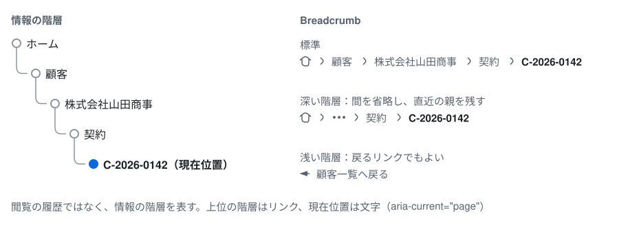

# Breadcrumb

現在位置と、上位の階層との関係を示す。

| | |
| --- | --- |
| 実装 | [`registry/components/ui/breadcrumb.tsx`](../../../registry/components/ui/breadcrumb.tsx) |
| 元にした実装 | shadcn/ui の Breadcrumb（Base UI 版、base-nova スタイル） |
| 依存 | `@base-ui/react`、`lucide-react`、[`cn()`](../../../registry/lib/utils.ts) |
| 状態 | 初期実装 |

## 1. Purpose

ユーザーが、いま見ている情報がどの階層にあるかを把握し、上位の階層へ戻れるようにする。Breadcrumb は閲覧の履歴ではなく、情報の階層を表す。

## 2. Usage

<picture>
  <source media="(prefers-color-scheme: dark)" srcset="../../diagrams/breadcrumb-hierarchy-dark.svg">
  
</picture>

| 場面 | 使うもの |
| --- | --- |
| 3 階層以上の詳細の画面 | Breadcrumb（ホームのアイコン＋階層） |
| 一覧と詳細の 2 階層だけ | 「顧客一覧へ戻る」のリンクでもよい |
| 単純な一覧の画面、Sidebar で現在位置が十分にわかる画面 | 置かない |
| 深い階層 | 間の階層を省略する。現在位置と直近の親は残す |

## 3. Anatomy

| 部分 | 役割 |
| --- | --- |
| `Breadcrumb` | `<nav>`。名前の既定は「パンくずリスト」。画面の言語に合わせて `aria-label` を変える |
| `BreadcrumbList` | `<ol>` |
| `BreadcrumbItem` | `<li>` |
| `BreadcrumbLink` | 上位の階層へのリンク。`render` で製品のリンクを渡す |
| `BreadcrumbPage` | 現在位置。`aria-current="page"` を付けた文字 |
| `BreadcrumbSeparator` | 区切り。Lucide の `ChevronRight`。支援技術には伝えない |
| `BreadcrumbEllipsis` | 省略した階層。`label` の文を支援技術に伝える |

| 項目 | 値 | トークン |
| --- | --- | --- |
| 文字 | 14px | `text-ui` |
| アイコン（ホーム、区切り） | 16px | `size-4` |
| 上位の階層 | `muted-foreground`。ホバーで `foreground` と下線 | |
| 現在位置 | `foreground`、太さ 500 | `font-medium` |
| 要素の間 | 8px | `gap-2` |
| 項目の高さ | 32px 以上 | `min-h-8` |
| 背景、境界線、影 | なし | |

ホームのアイコンには、アクセシブルな名前を付ける（`aria-label="ホーム"`）。

## 4. Variants

| 種類 | 構成 |
| --- | --- |
| 標準 | ホームのアイコン、上位の階層、現在位置 |
| 省略 | ホームのアイコン、`BreadcrumbEllipsis`、直近の親、現在位置 |
| 戻るリンク | 「顧客一覧へ戻る」のような 1 つのリンク。Breadcrumb のコンポーネントは使わない |

## 5. Behavior

- 上位の階層はリンクにする。現在位置はリンクにしない。shadcn/ui の `BreadcrumbPage` は `role="link"` と `aria-disabled="true"` を付けるが、Flow Design は付けない。現在位置は押せるリンクではないためである。
- 区切りは `aria-hidden="true"`。順序は `<ol>` で伝わる。
- 長いラベルは省略せずに折り返す（`flex-wrap`）。横幅を超えない。
- モバイルでは、`max-sm:hidden` などで間の階層を隠し、`BreadcrumbEllipsis` を表示する。
- `BreadcrumbEllipsis` を `render={<button type="button" />}` にすると、省略した階層を表示する操作になる。フォームの中で送信しないよう、`type="button"` を付ける。表示した後は、ボタンがなくなるため、表示した最初の階層へフォーカスを移す（[プレビュー](../../../preview/src/pages/navigation/breadcrumb-page.tsx)）。
- ルーティングのライブラリに依存しない。

```tsx
<Breadcrumb>
  <BreadcrumbList>
    <BreadcrumbItem>
      <BreadcrumbLink href="/" aria-label="ホーム"><House /></BreadcrumbLink>
    </BreadcrumbItem>
    <BreadcrumbSeparator />
    <BreadcrumbItem>
      <BreadcrumbLink render={<Link href="/customers" />}>顧客</BreadcrumbLink>
    </BreadcrumbItem>
    <BreadcrumbSeparator />
    <BreadcrumbItem>
      <BreadcrumbPage>株式会社山田商事</BreadcrumbPage>
    </BreadcrumbItem>
  </BreadcrumbList>
</Breadcrumb>
```

## 6. Anti-patterns

| 避ける | 理由 | 代わりに |
| --- | --- | --- |
| 閲覧の履歴を並べる | 階層がわからない。同じ画面でも経路で表示が変わる | 情報の階層を並べる |
| 現在位置をリンクにする | 押しても同じ画面が開く | `BreadcrumbPage` にする |
| 直近の親まで省略する | 1 つ上に戻れない | 現在位置と直近の親を残す |
| 単純な一覧の画面にも置く | Sidebar と同じことを繰り返す（原則 04） | 置かない |
| 背景や枠で囲む | 装飾が増える | 文字だけにする |
| ホームのアイコンに名前を付けない | 支援技術で何のリンクかわからない | `aria-label="ホーム"` |
