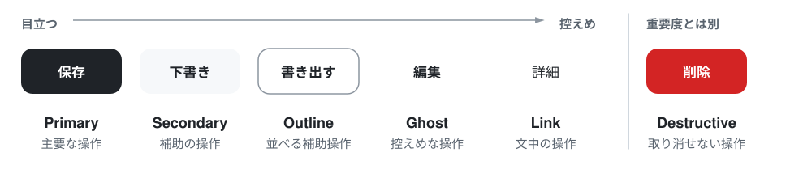
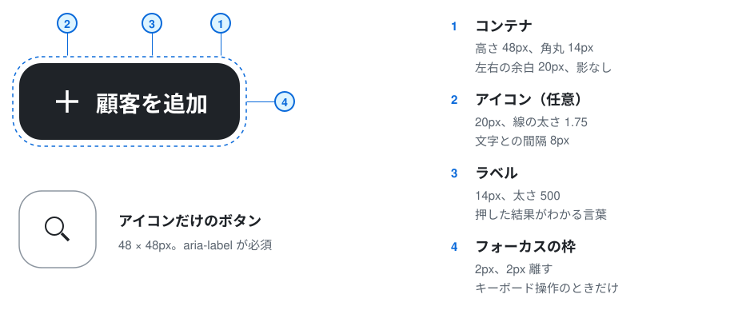

# Button

処理を実行するための操作。ページの移動にはリンクを使う。

| | |
| --- | --- |
| 実装 | [`registry/components/ui/button.tsx`](../../../registry/components/ui/button.tsx) |
| 元にした実装 | shadcn/ui の Button（Base UI 版、base-nova スタイル） |
| 依存 | `@base-ui/react`、`class-variance-authority`、`lucide-react`、[`cn()`](../../../registry/lib/utils.ts) |
| 状態 | v0.1 確定 |

## 1. Purpose

ユーザーが、押した結果を予測して、迷わずに処理を実行できるようにする。

ボタンの見た目は、操作の重要度を表す。画面の中で何が主要な操作かが、読まなくてもわかる状態を目指す（原則 01、03）。

## 2. Usage

### 使う場面

| 場面 | 使うもの |
| --- | --- |
| 保存、送信、削除などの処理を実行する | Button |
| 別のページへ移動する | リンク（`<a>`）。ボタンと同じ見た目が必要な場合は `buttonVariants()` を付ける |
| 文章の中で処理を実行する | `variant="link"` の Button |

Base UI の Button はボタンとしての役割（`role="button"`、キー操作、無効の状態）を持つ。リンクの役割を持つ `<a>` を Button で描画しない。

### 種類の選び方

<picture>
  <source media="(prefers-color-scheme: dark)" srcset="../../diagrams/button-hierarchy-dark.svg">
  
</picture>

| 種類 | 判断の基準 |
| --- | --- |
| Primary | 最も重要な操作。1 つの操作グループに原則 1 つ |
| Secondary | 次に重要な操作。補助操作の標準 |
| Outline | 操作できる範囲を、線で明確に示す必要がある補助操作 |
| Ghost | 控えめな操作。ツールバーや表の行のように、繰り返し並ぶ操作 |
| Link | 文章の中の操作 |
| Destructive | 削除など、取り消せない危険な操作 |

補助操作に迷った場合は Secondary を使う。Outline を使うのは、境界線に意味がある場合だけにする。たとえば、`muted` の面の上では Secondary の面が背景と同じ色になり、押せる範囲がわからなくなるため、Outline を使う。必要のない境界線は増やさない（美的基準 03）。

### 大きさの選び方

| 大きさ | `size` | 高さ | 文字 | 角丸 | 使う場面 |
| --- | --- | ---: | ---: | ---: | --- |
| Compact | `xs` / `icon-xs` | 32px | 14px | 8px | 高密度の表、行の中の操作 |
| Small | `sm` / `icon-sm` | 40px | 14px | 12px | フィルター、ツールバーなど画面の補助的な操作 |
| Default | `default` / `icon` | 48px | 14px | 14px | 標準。フォーム、ダイアログ |
| Large | `lg` / `icon-lg` | 56px | 16px | 14px | 画面の目的そのものになる操作（申し込みなど） |

文字の太さは、すべての大きさで 500 である。Large の文字は `text-body`（16px）を使う。アイコンだけの `icon-lg` は文字を持たないため、文字の指定を変えていない。

同じ操作グループの中では、大きさをそろえる。タッチ操作が主な画面では Default 以上を使う。

### ラベル

- 押した結果がわかる言葉にする。「OK」「実行」ではなく「請求書を送信」「保存する」。
- 対象が複数ありうる場合は、対象を含める（「山田商事を削除」）。
- 一般的に認識されるアイコン（検索、追加、削除、ダウンロードなど）だけを、文字なしで使う。それ以外のアイコンには文字を添える。

#### 同じ意味の操作の名前

同じ意味の操作には同じ言葉を使い、意味が違う操作は別の言葉にする。ラベルは、押すと何が起きるかを示す。

| 意味 | ラベル | 備考 |
| --- | --- | --- |
| 結果が不明な保存（1 件、設定、フォーム）が保存されたかを調べる | 「保存されたかを確認」。登録（新規作成）は「登録されたかを確認」 | 同じ保存を送り直さず、サーバーの値を取得する |
| 結果が不明な一括操作、取り込み、時間のかかる処理、保存以外の 1 回だけの操作（接続の解除、パスワードの変更、削除の予約など）の状態を調べる | 「状態を確認」 | 同じ処理を送り直さない |
| 取得（読み取り）の失敗の後にもう一度取得する | 「再試行」 | 失敗の後だけに使う |
| 失敗の後ではなく、利用者が意図して最新の内容を取得し直す | 「最新の情報に更新」 | 「再取得」「最新の状態を取得」などと呼び分けない |
| フォームの保存ボタン | 「保存する」（登録は「登録する」） | 「保存」だけ、「変更を保存」にしない。「担当者を変更」のように結果が具体的な操作は、その名前のままにする |

## 3. Anatomy

<picture>
  <source media="(prefers-color-scheme: dark)" srcset="../../diagrams/button-anatomy-dark.svg">
  
</picture>

図は Default の大きさを示している。

| 部分 | トークン |
| --- | --- |
| 高さ | `h-control`（`--control-height`）など、Sizing の段階 |
| 角丸 | `rounded-lg`（`--radius`）。Compact は `rounded-sm`、Small は `rounded-md` |
| 文字 | `text-ui` と `font-medium`。Large は `text-body` |
| アイコン | `size-5`、線の太さは `--icon-stroke-width` |
| 間隔 | `gap-2` |
| フォーカス | `focus-visible:focus-ring` |
| 状態の変化 | `duration-(--duration-fast)`、`ease-standard` |

DOM は、Base UI の `<button>` の中に、ラベルとアイコンを入れる `data-slot="button-content"` と、処理中だけ表示する `data-slot="button-spinner"` を置く。

## 4. Variants

### 種類

| 種類 | `variant` | 面 | 文字 | ホバー | 押下 |
| --- | --- | --- | --- | --- | --- |
| Primary | `default` | `primary` | `primary-foreground` | `bg-primary/90` | `bg-primary/80` |
| Secondary | `secondary` | `secondary` | `secondary-foreground` | 面に文字色を 6% 混ぜる | 12% 混ぜる |
| Outline | `outline` | `background`、枠は `input` | `foreground` | 面を `accent` にする | `accent` に文字色を 6% 混ぜる |
| Ghost | `ghost` | なし | `foreground` | 面を `accent` にする | `accent` に文字色を 6% 混ぜる |
| Destructive | `destructive` | `destructive` | `destructive-foreground` | 面を 10% 暗くする | 20% 暗くする |
| Link | `link` | なし。常に下線 | `primary` | 下線を 2px にする | なし |

`variant` の名前は shadcn/ui と同じである。Primary は `variant="default"` で指定する。

Primary のホバーと押下は、`primary` の透明度を下げて表す。標準のライトテーマでは、面が明るくなる。透明度で表すため、実際の色は下にある面によって変わる。`primary` を変える製品は、置く面の上で、通常、ホバー（90%）、押下（80%）の 3 つの状態の文字のコントラストを確認する（[tokens.md](../tokens.md#ブランドと書体の変更)）。

| `primary` の例 | 通常 | ホバー | 押下 | 判定 |
| --- | ---: | ---: | ---: | --- |
| #262626（標準） | 15.13 | 11.08 | 7.89 | 使える |
| #1e40af | 8.72 | 6.83 | 5.30 | 使える |
| #6d28d9 | 7.10 | 5.88 | 4.77 | 使える |
| #1d4ed8 | 6.70 | 5.47 | 4.42 | 押下が 4.5 に届かないため、使えない |

数値は白い背景の上で、`primary-foreground` が #ffffff の場合である。

Link は、周りの文章と色だけで区別しないように、常に下線を付ける（WCAG 1.4.1）。

### 状態

| 状態 | 表し方 |
| --- | --- |
| 通常 | 種類ごとの面と文字 |
| ホバー | 種類の表を参照。120ms で変化する |
| 押下 | ホバーよりさらに面を変える。位置や大きさは変えない |
| フォーカス | キーボードで移動したときだけ `focus-ring` を表示する |
| 無効 | `disabled`。透明度 50%、ポインターは `not-allowed`。フォーカスできない |
| Focusable Disabled | `disabled` と `focusableWhenDisabled`。見た目は無効と同じ（透明度 50%、ポインターは `not-allowed`）。`aria-disabled="true"` を付け、フォーカスできる。押せない。キーボードで移動したときは `focus-ring` を表示する |
| 処理中 | `loading`。ラベルを透明にし、同じ位置にスピナーを表示する。押せないが、フォーカスは保つ |

無効にする場合は、押せない理由を近くの文字で示す。理由を示せない場合は、押せる状態のままにして、押したときに理由を示す方がよい。

#### Focusable Disabled

フォーカスと実行の可否で、次の 4 つを区別する。

| 状態 | フォーカス | 実行 |
| --- | --- | --- |
| 通常 | できる | できる |
| 無効（Disabled） | できない | できない |
| Focusable Disabled | できる | できない |
| 処理中（Loading） | 保つ | 二重に実行できない |

- 操作できない理由を、キーボードや支援技術の利用者に伝える必要がある場合に使う。例：フォームの保存ボタン（必須の項目がそろい、検証が成功するまで押せない。[Create & Edit](../patterns/create-and-edit.md#focusable-disabled)）。Tab で移ったときに、押せない理由を説明として聞ける。
- 次を設定する。
  - `disabled` と `focusableWhenDisabled`（Button が `aria-disabled="true"` を付ける。ネイティブの `disabled` は付けない）。
  - `aria-describedby`：押せない理由の文の id。理由がない間も参照先の要素を残す。
  - フォーカスの表示：Button の `focus-visible:focus-ring` をそのまま使う（消さない）。
- クリック、Enter、Space では実行されない（Base UI がクリックを取り消す）。フォームの送信のボタンに使う場合は、送信の処理の側でも条件を確かめる。`form.requestSubmit()` などのボタンを経由しない送信は、Button では防げないためである。
- 1 行の入力欄での Enter（ブラウザの暗黙の送信）も、ボタンへのクリックが取り消されるため送信にならない。Enter で送信する場合は、製品がフォームの `onKeyDown` で扱う（Patterns の `submitOnEnter`）。
- 理由の文を示せない場合は使わない。押せない理由がわからないまま、フォーカスだけが止まる。
- 無効（Disabled）の仕様は変わらない。理由を伝える必要がない無効のボタンは、これまでどおり `disabled` だけを指定する。
- Focusable Disabled は、Forms & Workflows v0.1 の最終調整で、この表に追記した。

## 5. Behavior

### キー操作

Tab で移動し、Enter と Space で実行する。Base UI の Button が担う。

### 処理中（`loading`）

`loading` を指定すると、Button は内部で `disabled` と `focusableWhenDisabled` を指定する。Base UI は、ネイティブの `disabled` ではなく `aria-disabled="true"` を付け、フォーカスできる状態を保ったままクリックを取り消す。

| 確認したこと | 結果 |
| --- | --- |
| クリック、Enter、Space での再実行 | 実行されない |
| フォームの送信（ボタンのクリック、入力欄での Enter） | 二重に送信されない |
| フォーカス | ボタンに残る。入力欄で Enter を押した場合は入力欄に残る |
| アクセシブルな名前 | ラベルのまま変わらない |
| 見た目 | ラベルを透明にし、スピナーを表示する。幅と高さは変わらない |
| 動きを減らす設定 | スピナーは回転しないが、表示は残る |
| 完了後 | `aria-busy` が外れ、もう一度実行できる |

Button が担うのは、処理中の再実行を防ぐことと、`aria-busy="true"` を付けることまでである。多くのスクリーンリーダーは、フォーカスしたボタンの `aria-busy` の変化を読み上げない。製品は次を担う。

- 処理の開始、完了、失敗を、`role="status"` などのライブリージョンの文字で知らせる（例：「招待を送信しています」「招待を送信しました」）。
- 失敗した場合は、原因と次の操作を文字で示す。
- `onSubmit` などの処理の側でも、処理中に同じ処理を始めない。`form.requestSubmit()` のように、ボタンを経由しない送信は Button では防げないためである。

### その他

- **長いラベル**：省略せずに折り返す。高さは `min-height` で指定しているため、折り返した分だけ高くなる。日本語は `word-break: auto-phrase` で文節の区切りで折り返す（対応するブラウザのみ）。
- **アイコンだけのボタン**：`size` が `icon-*` のとき、`aria-label` か `aria-labelledby` を TypeScript の型で必須にしている。
- **確認の手順**：取り消せる操作には確認のダイアログを出さない。取り消せない操作だけ、結果を文章で示して確認する（原則 07）。

### リンクに Button の見た目を付ける

`buttonVariants()` は、Button と同じクラスを返す。ページを移動する `<a>` に付ける。

| 確認したこと | 結果 |
| --- | --- |
| 役割 | `link` のまま。`href` を持ち、新しいタブで開ける |
| 移動 | クリックと Enter で移動する |
| Outline の境界線 | `input` の色、1px で表示される |
| Ghost のホバー | 面が `accent` になる |
| キーボードのフォーカス | `focus-ring` が表示される |
| 長いラベル | 折り返す |

`<a>` には、`loading` と `disabled` がない。処理を実行する操作には、見た目が同じでも Button を使う。

```tsx
import { Button, buttonVariants } from "@/components/ui/button"

<Button>保存する</Button>
<Button variant="secondary"><Download />書き出す</Button>
<Button size="icon" variant="ghost" aria-label="検索"><Search /></Button>
<Button type="submit" loading={saving}>保存する</Button>
<a href="/customers" className={buttonVariants({ variant: "outline" })}>顧客一覧へ</a>
```

## 6. Anti-patterns

| 避ける | 理由 | 代わりに |
| --- | --- | --- |
| 1 つの操作グループに Primary を 2 つ以上置く | どれが主要な操作かわからない（原則 03） | 主要な操作だけ Primary にし、他は Secondary にする |
| 理由なく Outline を並べる | 意味のない境界線が増える（美的基準 03） | Secondary にする |
| `muted` の面の上に Secondary を置く | 面と同じ色になり、押せる範囲がわからない | Outline にする |
| 「OK」「実行」「はい」などのラベル | 押した結果がわからない（原則 05） | 「請求書を送信」のように結果を示す |
| 意味が共有されていないアイコンだけのボタン | アイコンの意味を推測させる（原則 06） | 文字を添える |
| 取り消せない操作を Primary にする | 通常の操作と区別できない | Destructive にする |
| ページの移動に Button を使う | リンクとして扱えない（新しいタブで開けない、支援技術がリンクと認識しない） | `<a>` に `buttonVariants()` を付ける |
| 取り消せる操作に確認のダイアログを出す | 手順が増える（原則 07） | 実行後に取り消しの手段を示す |
| 処理中にボタンを消す、ラベルを短い言葉に変える | 周りの配置が動き、フォーカスが失われる | `loading` を使う |
| フォーカスの枠を消す | キーボードで操作できなくなる（原則 08） | `focus-ring` を残す |
| `className` で高さを 32px 未満にする | 押しにくくなる | Compact（32px）までにする |
