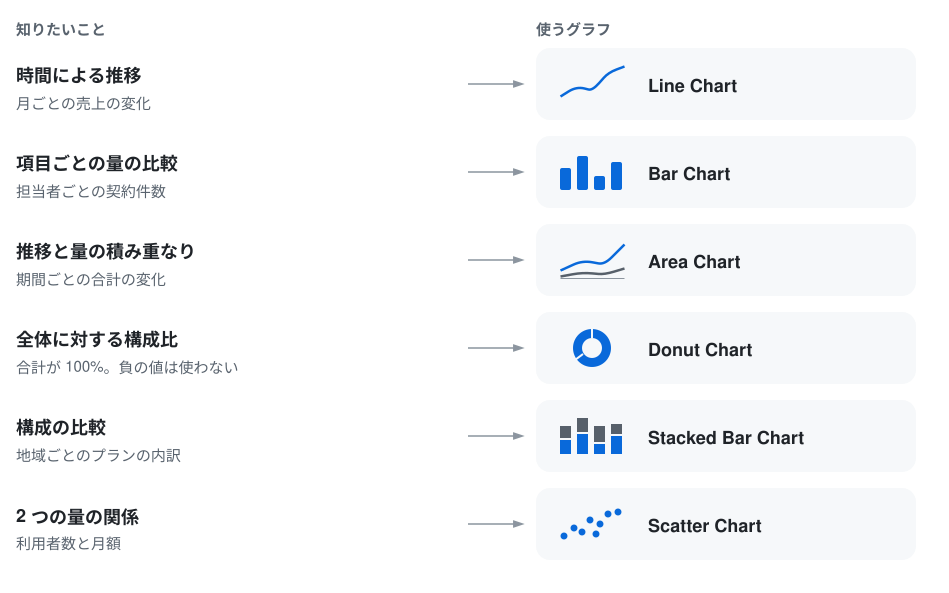
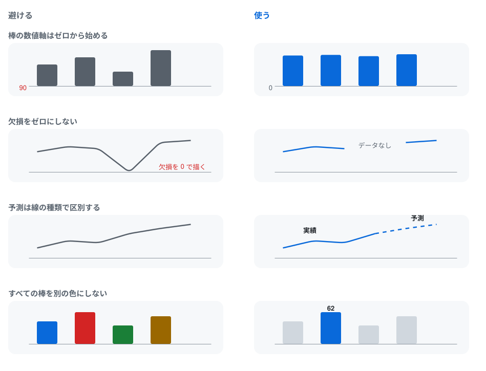

# Chart

数値の推移、比較、構成比、関係を、誤解を生まない形で示す。Recharts と、shadcn/ui の Chart と同じ仕組みの共通部品を組み合わせる。

| | |
| --- | --- |
| 実装 | [`registry/components/ui/chart.tsx`](../../../registry/components/ui/chart.tsx) |
| 元にした実装 | shadcn/ui の Chart（Recharts 3） |
| 状態 | 初期実装 |

Data Display に共通する判断基準は [data-display.md](data-display.md) にまとめている。実装の例は [`preview/src/pages/data-display/charts.tsx`](../../../preview/src/pages/data-display/charts.tsx) にある。

## 1. Purpose

ユーザーが、表の数値を読み比べなくても、変化の向き、差の大きさ、全体に対する割合を正しく理解し、次の判断に移れるようにする。グラフの装飾よりも、データを正確に解釈できることを優先する。

## 2. Usage

<picture>
  <source media="(prefers-color-scheme: dark)" srcset="../../diagrams/chart-choice-dark.svg">
  
</picture>

| グラフ | 使う場面 | Recharts の部品 |
| --- | --- | --- |
| Line Chart | 時間による推移 | `LineChart`、`Line` |
| Bar Chart | 項目ごとの量の比較。負の値を含む増減 | `BarChart`、`Bar` |
| Area Chart | 推移と量の積み重なり | `AreaChart`、`Area`（`stackId`） |
| Donut Chart | 全体に対する構成比。合計に意味があり、負の値がない | `PieChart`、`Pie`（`innerRadius`） |
| Stacked Bar Chart | 項目ごとの構成の比較 | `BarChart`、`Bar`（`stackId`） |
| Scatter Chart | 2 つの量の関係 | `ScatterChart`、`Scatter` |

- 6 種類を 1 つの Chart コンポーネントの Variant にしない。Recharts の部品を組み立て、`chart.tsx` は共通の部品と値だけを提供する。
- 数値を 1 つだけ示す場合や、項目が 2 つだけの比較は、グラフにせず数値と文字で示す。
- グラフには、目的がわかる見出しと、単位、期間、対象の説明を添える。
- グラフと同じ数値を `ChartDataTable` で確認できるようにする。

## 3. Anatomy

| 部分 | 値 | 指定 |
| --- | --- | --- |
| 背景 | 透明 | `bg-transparent` |
| 補助線 | 横線だけ、`border` の色 | `chartStyles.grid`（`vertical: false`） |
| 軸 | 文字だけ（軸の線と目盛りの線を省く）、12px、`muted-foreground` | `chartStyles.axis`、`text-caption` |
| 折れ線 | 2px。データ点は通常は表示せず、ホバーとフォーカスで半径 4px の点を表示する | `chartStyles.line` |
| 予測の線 | 2px の破線（6px と 4px の繰り返し） | `chartStyles.forecastLine` |
| 棒 | 値の側の角を 4px 丸める | `chartStyles.barRadius` |
| Tooltip | 角丸 12px、`popover` の面、1px の `border`、`shadow-popover`、文字 12px。数値は `tabular-nums` | Overlay の Popover と同じ面、線、影 |
| 凡例 | 文字 12px、`muted-foreground`。系列の印は Tooltip と同じ形 | `ChartLegendContent` |
| 動き | 240ms、`ease-out` | `chartAnimation` |
| 外枠、影 | なし | |

### 部品

| 部品 | 役割 |
| --- | --- |
| `ChartContainer` | `config` の色を `--color-<key>` として出力し、`ResponsiveContainer` で親の幅に合わせる。既定の縦横比は 16:9（`aspect-video`） |
| `ChartConfig` | 系列ごとの `label`、`color`（または `theme`）、`icon`。Flow Design で `indicator`（`dot`、`line`、`dashed`）を追加した |
| `ChartTooltip`、`ChartTooltipContent` | Tooltip。`valueFormatter` で単位を付ける（例：`(v) => \`${v}万円\``） |
| `ChartLegend`、`ChartLegendContent` | 凡例 |
| `ChartDataTable` | グラフと同じ数値の表（Table の `compact`）。値がない場合は「—」と「データなし」 |
| `chartAnimation`、`chartStyles` | 系列と軸に展開して使う値 |

## 4. Variants

### 配色

| 場面 | 色 |
| --- | --- |
| 系列が 1 つ | 1 色（`var(--chart-1)` など） |
| 特定の項目を強調する | 強調する項目を `var(--primary)` などの色、それ以外をニュートラル（`var(--border-strong)` など） |
| 複数の系列、構成比 | `chart-1`〜`chart-5` を系列ごとに使う |

- 色は `ChartConfig` の `color` で指定し、系列は `var(--color-<key>)` で参照する。製品は `config` の値か、`--chart-*` の上書きで配色を変えられる。
- 装飾のために、すべての棒を別の色にしない。
- `success`、`warning`、`destructive` などの状態の色は、値が状態を表す場合（目標の達成、エラーの件数など）だけに使う。
- 色だけで系列を区別しない。凡例、値の文字、線の種類（実線と破線、`indicator`）を組み合わせる。
- 装飾のためのグラデーションと 3D の表現は使わない。

### データの表し方

<picture>
  <source media="(prefers-color-scheme: dark)" srcset="../../diagrams/chart-honesty-dark.svg">
  
</picture>

| 内容 | 表し方 |
| --- | --- |
| 棒の数値軸 | 0 を含める。負の値を含む場合は 0 の位置に `ReferenceLine` を引く |
| 折れ線の軸の範囲 | 変化を読む目的に合わせて調整してよい。範囲を軸の文字で示し、差を誇張しない |
| 欠損値 | 0 に置き換えない。`connectNulls={false}`（既定）で線を途切れさせ、説明か注記で「データなし」と示す |
| 実績と予測 | 予測を破線（`chartStyles.forecastLine`）にし、凡例と Tooltip でも区別する |
| 途中の集計 | 確定値と区別する必要がある場合は、注記か線の種類で示す |
| 構成比 | Donut Chart は合計が全体を表す場合だけに使う。負の値を含むデータに使わない |
| 比較の条件 | 期間、対象、単位をそろえる |

## 5. Behavior

- `ChartContainer` に `aria-label` か `aria-labelledby` を渡すと `role="figure"` になり、グラフの目的が名前になる。説明は `aria-describedby` で関連付ける。
- Recharts 3 の `accessibilityLayer`（既定で有効）により、グラフの `svg` が `role="application"` と `tabindex="0"` でフォーカスを受け取り、← → キーでデータ点を移動して Tooltip を表示する。フォーカスの表示は `focus-ring` にしている。
- Recharts はこの `svg` に名前を付けないため、`ChartContainer` は自身の `aria-label`、`aria-labelledby`、`aria-describedby` を `svg` にも付ける。キーボードでフォーカスを移したときに、グラフの目的が伝わる。
- タッチ端末では、グラフに触れた位置の値を Tooltip で表示する。
- Tooltip だけに重要な数値を任せない。見出しや説明に要点を書き、`ChartDataTable` で全ての数値を確認できるようにする。プレビューでは「数値を表で見る」（`details`）の中に置いている。
- 動きは `chartAnimation` の 240ms。Recharts の `isAnimationActive` は既定の `"auto"` のままにする。`"auto"` は OS の動きを減らす設定（`prefers-reduced-motion: reduce`）を検出し、動きを止める。
- グラフの大きさは親の要素に合わせる。高さは `className` で指定する（例：`aspect-auto h-64 w-full`）。
- 描画する幅が足りない場合は、`fallback` と `minWidth` を渡す。幅が `minWidth`（px）より狭いと、グラフの代わりに `fallback`（要約や表など）を表示する。
- 長い軸の文字や多数のデータ点は、`interval="preserveStartEnd"` と `minTickGap` で目盛りの文字を間引き、Y 軸の `width` を値の桁に合わせる。数値や軸の文字が描画の範囲の外で切れないようにする。
- 項目名を省けない棒グラフ（地域名など）は、640px 未満の幅では横向き（`layout="vertical"`）にし、項目名を縦軸に並べる。項目名を間引いたり、重ねたりしない。プレビューの地域別の棒グラフで、項目名が重ならないことと、棒が 0 の位置から伸びることを検品している。
- 軸の文字の色は、Recharts 3.10 が目盛りの文字を `.recharts-cartesian-axis-tick-labels` の下に描くため、`.recharts-cartesian-axis-tick-value` を直接指定して `muted-foreground` にしている（shadcn/ui の `.recharts-cartesian-axis-tick text` の指定は、この版では一致しない）。

```tsx
const config = {
  actual: { label: "実績", color: "var(--chart-1)", indicator: "line" },
  forecast: { label: "予測", color: "var(--chart-1)", indicator: "dashed" },
} satisfies ChartConfig

<ChartContainer config={config} aria-labelledby={titleId} aria-describedby={descId} className="aspect-auto h-64 w-full">
  <LineChart data={data}>
    <CartesianGrid {...chartStyles.grid} />
    <XAxis dataKey="month" {...chartStyles.axis} />
    <YAxis {...chartStyles.axis} width={56} />
    <ChartTooltip content={<ChartTooltipContent valueFormatter={(v) => `${v}万円`} />} />
    <ChartLegend content={<ChartLegendContent />} />
    <Line dataKey="actual" stroke="var(--color-actual)" {...chartStyles.line} {...chartAnimation} />
    <Line dataKey="forecast" stroke="var(--color-forecast)" {...chartStyles.forecastLine} {...chartAnimation} />
  </LineChart>
</ChartContainer>
```

## 6. Anti-patterns

| 避ける | 理由 | 代わりに |
| --- | --- | --- |
| 棒の数値軸を 0 以外から始める | 差が実際より大きく見える | 0 を含める |
| 欠損を 0 で描く、線でつなぐ | 測っていない値を実測のように見せる | 線を途切れさせ、「データなし」と示す |
| 実績と予測を同じ線で続ける | 予測を確定した値と誤解する | 破線と凡例で区別する |
| すべての棒を別の色にする | 色に意味があるように見え、比べたい差が目立たない | 1 色。強調する項目だけ色を変える |
| 色だけで系列を区別する | 色の見分けにくい人に伝わらない | 凡例、値の文字、線の種類 |
| 装飾のグラデーション、3D、影 | 値の読み取りを妨げる | 平らな塗り |
| 構成比でない数値や負の値を Donut Chart にする | 全体に対する割合として読めない | Bar Chart |
| Tooltip にだけ数値を置く | ホバーできない人が数値を確認できない | 見出し、説明、`ChartDataTable` |
| グラフを Card で囲み、影を付ける | 区切りの手段が重なる | 余白と見出しで区切る |

## 未解決

### グラフの色（chart-1〜chart-5）

`chart-1`〜`chart-5` は v0.1 で値を決めておらず、shadcn/ui の neutral テーマの既定値が入っている（[tokens.md](../tokens.md#4-color色)）。今回はトークンを変更していない。oklch から sRGB に変換し、WCAG 2 のコントラスト比を計算した結果は次のとおりである（色域外の値は 0〜1 に切り詰めた）。

| トークン | oklch | sRGB | `background`（#ffffff）との比 | `muted`（#f5f5f5）との比 |
| --- | --- | --- | ---: | ---: |
| `chart-1` | 0.646 0.222 41.116 | #f54900 | 3.59 | 3.29 |
| `chart-2` | 0.6 0.118 184.704 | #009689 | 3.66 | 3.36 |
| `chart-3` | 0.398 0.07 227.392 | #104e64 | 9.12 | 8.36 |
| `chart-4` | 0.828 0.189 84.429 | #ffb900 | 1.72 | 1.58 |
| `chart-5` | 0.769 0.188 70.08 | #fe9a00 | 2.15 | 1.97 |

- `chart-4` と `chart-5` は、グラフの要素に必要な非テキストのコントラスト（WCAG 1.4.11、3:1）を、白の背景でも `muted` の上でも下回る。
- `chart-4` と `chart-5` は色相が 84° と 70° で近く、2 色の間のコントラスト比は 1.25 である。並べた系列を色で区別しにくい。`chart-1`（41°）と `chart-5` の比も 1.67 である。
- 改善案：`chart-4` と `chart-5` を、白の背景で 3:1 以上になる明度（oklch の L を 0.65 程度以下）にし、`chart-1`〜`chart-3` と色相を 60° 以上離す。値はトークンの検討として別に決め、`scripts/tokens/check-contrast.mjs` で oklch を扱えるようにしてから検証する。
- それまでの間、プレビューの「使う」例のグラフは 3 系列までにし、`chart-1`〜`chart-3` だけを使っている。`chart-4` と `chart-5` は「避ける」例（すべての棒を別の色にする、グラデーション）だけに使っている。
