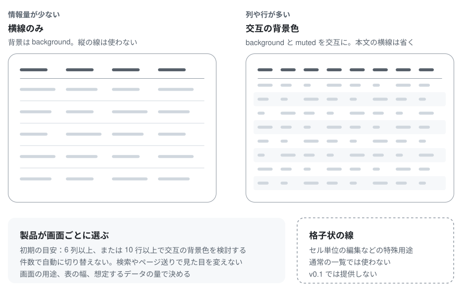
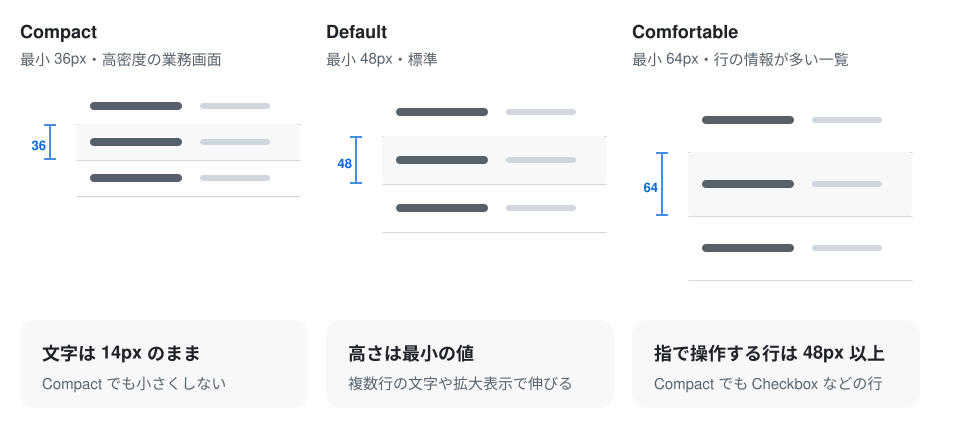
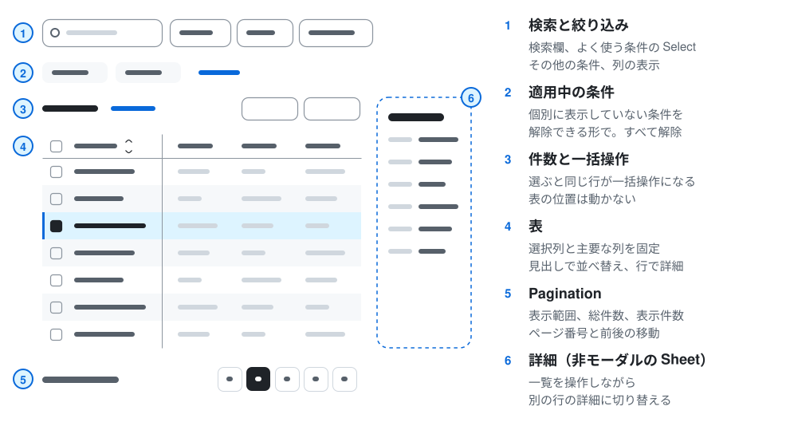
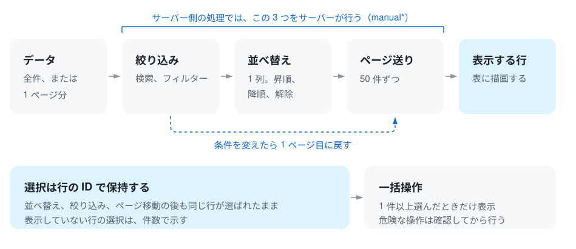
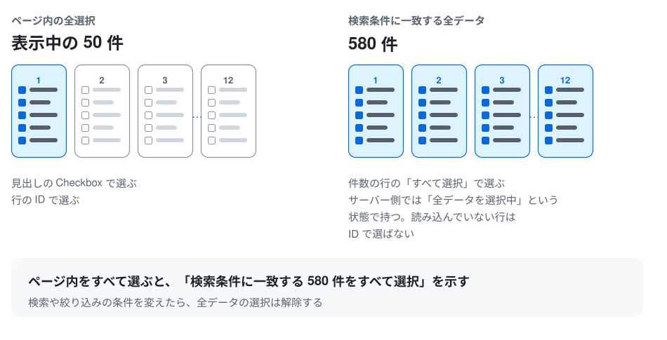
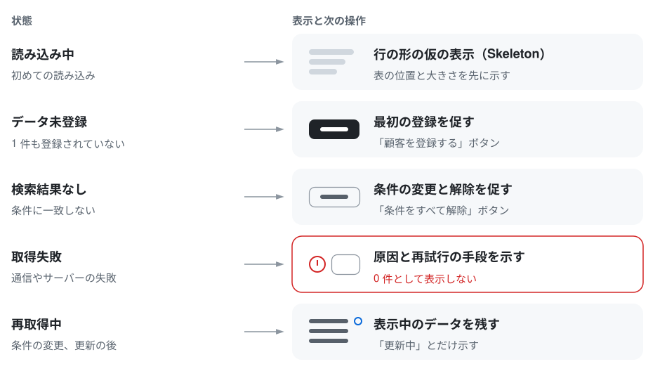
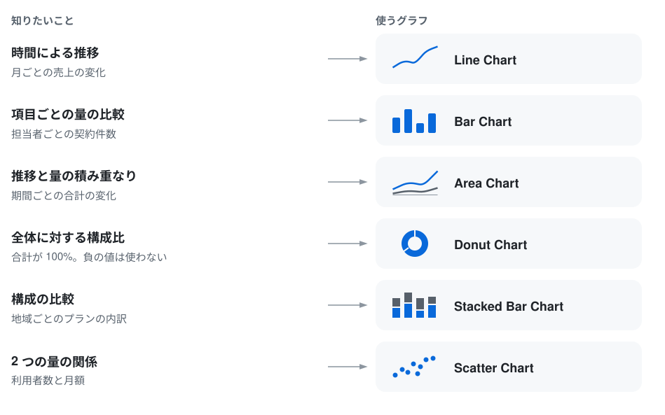
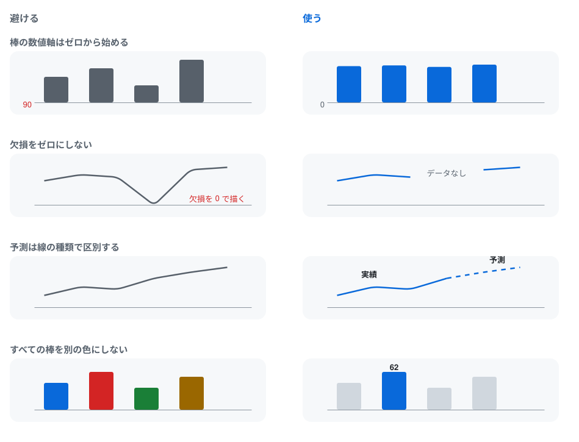

# Data Display の判断基準

Table、Data Table、Pagination、Chart に共通する判断基準。個別の仕様は各コンポーネントの資料を参照する。

| コンポーネント | 資料 | 状態 |
| --- | --- | --- |
| Table | [table.md](table.md) | v0.1 確定 |
| Data Table | [data-table.md](data-table.md) | v0.1 確定 |
| Pagination | [pagination.md](pagination.md) | v0.1 確定 |
| Chart | [chart.md](chart.md) | v0.1 確定 |

データを表示すること自体を目的にしない。ユーザーが必要な情報を見つけ、判断し、次の操作へ移れることを目的にする。大量の情報を扱えることと、考えなくても読めることを両立させる。

## 1. 横線と交互の背景色

<picture>
  <source media="(prefers-color-scheme: dark)" srcset="../../diagrams/table-style-dark.svg">
  
</picture>

| 情報量 | `variant` | 表し方 |
| --- | --- | --- |
| 列や行が少ない | `lines` | 薄い横線だけ。背景は `background`。縦の線は使わない |
| 列や行が多い | `striped` | `background` と `muted` を交互にする。本文の横線は省き、見出しの下の線は残す |

- 6 列以上、または 10 行以上を、交互の背景色を検討する初期の目安とする。この数値で機械的に決めない。
- 画面の用途、表の幅、情報の密度、想定するデータの量から、製品が画面ごとに `variant` を指定する。
- 件数で自動に切り替えない。検索、絞り込み、ページ送りで表示件数が変わるたびに見た目が変わると、同じ一覧が別のものに見えるため。
- 格子状の線は、セル単位の編集など明確な理由がある場合の特殊用途とする。v0.1 では提供しない。
- 表を Card で囲まない。独立した表として区別する必要がある場合だけ、外枠（`bordered`、角丸 12px、1px の線）を付ける。

## 2. 情報の密度

<picture>
  <source media="(prefers-color-scheme: dark)" srcset="../../diagrams/table-density-dark.svg">
  
</picture>

| `density` | 行の最小の高さ | 使う場面 |
| --- | ---: | --- |
| `compact` | 36px | 多くの行を一度に見比べる業務画面 |
| `default` | 48px | 標準 |
| `comfortable` | 64px | 1 行に複数行の情報がある一覧、タッチ操作が主な画面 |

- 文字の大きさは変えない。密度は余白と行の高さで調整する。
- 行の高さは最小の値であり、複数行の文字や拡大表示で伸びる。
- 指で操作する端末では、操作できる行を 48px 以上にする。Checkbox などの押せる範囲は、上下の行と重ならないようにする。

## 3. Data Table の構造

<picture>
  <source media="(prefers-color-scheme: dark)" srcset="../../diagrams/data-table-anatomy-dark.svg">
  
</picture>

ユーザーが考える順に、上から「探す（検索と絞り込み）→ 確かめる（適用中の条件と件数）→ 読む（表）→ 移る（ページ送り）」と並べる。

- 頻繁に使う条件は個別に表示し、それ以外の条件は Popover か Sheet にまとめる。
- 適用中の条件として示すのは、個別に表示していない条件だけにする。Select の値を重複して並べない。
- 件数と一括操作は同じ行に置く。行を選んでも表の位置は動かない。
- 一覧から詳細を確認する場合は、非モーダルの Sheet を使う。複雑な詳細や URL で直接開く詳細は、専用のページにする。
- 機能を提供することと、すべての機能を常に表示することは別である。画面に必要な操作だけを置く。

## 4. 検索、絞り込み、並べ替え、一括操作の関係

<picture>
  <source media="(prefers-color-scheme: dark)" srcset="../../diagrams/data-table-flow-dark.svg">
  
</picture>

| 段階 | クライアント側 | サーバー側 |
| --- | --- | --- |
| 絞り込み | TanStack Table が行う | 製品がサーバーに要求する（`manualFiltering`） |
| 並べ替え | TanStack Table が行う | 製品がサーバーに要求する（`manualSorting`） |
| ページ送り | TanStack Table が行う | 製品がサーバーに要求する（`manualPagination`、`rowCount`） |

- 大量のデータを無条件にブラウザへ読み込まない。件数が多い一覧は、サーバー側の処理にする。
- 特定のバックエンド、API、データベースに依存させない。表の状態は `state` と `on*Change` で製品が持つ。
- サーバー側の検索では、入力が止まってから要求し（debounce）、古い要求の応答で表示を上書きしない。IME の変換中は検索しない。
- 条件を変えたら 1 ページ目に戻す。
- 並べ替えは 1 列を標準とする。複数列の並べ替えは、業務上必要な場合だけ有効にする。
- 選択は行の ID で保持する。並べ替え、絞り込み、ページ移動の後も同じ行が選ばれたままになる。表示していない行の選択は件数で示す。

## 5. ページ内の全選択と全データの選択

<picture>
  <source media="(prefers-color-scheme: dark)" srcset="../../diagrams/selection-scope-dark.svg">
  
</picture>

| | ページ内の全選択 | 検索条件に一致する全データの選択 |
| --- | --- | --- |
| 操作 | 見出しの Checkbox | ページ内をすべて選んだ後に示す「検索条件に一致する 580件をすべて選択」 |
| 範囲 | 表示中のページの行 | 検索と絞り込みに一致するすべての行 |
| 持ち方 | 行の ID | クライアント側は行の ID。サーバー側は「全データを選択中」という状態 |
| 条件を変えたとき | ID の選択は残る | 解除する |

- ページ内の全選択を、全データの選択と混同しない。範囲が違うことを、件数の文で示す。
- サーバー側のページ送りでは、読み込んでいない行を、現在のページの全選択によって選ばない。
- 一部を選んでいるとき、見出しの Checkbox は Indeterminate にする。
- 削除などの危険な一括操作は、Alert Dialog で件数と結果を示して確認する。

## 6. データの状態

<picture>
  <source media="(prefers-color-scheme: dark)" srcset="../../diagrams/data-states-dark.svg">
  
</picture>

| 状態 | 表示 | 次の操作 |
| --- | --- | --- |
| 初回の読み込み | Skeleton（行の形） | 待つ。選択の操作は受け付けない |
| データ未登録 | 登録されていないことと、登録した後に表示されるもの | 最初の登録 |
| 検索結果なし | 条件に一致しないこと | 条件の変更、解除 |
| 取得失敗 | 取得できなかったことと原因（Empty の `status="error"`） | 再試行。一括操作は受け付けない |
| 再取得中 | 表示中のデータと「更新中」 | 待つ、または操作を続ける |

- 取得に失敗した状態を 0 件として表示しない。データがないと誤解され、再試行の手段がなくなる。
- 検索結果なしとデータ未登録を混同しない。次にすべき操作が異なる。
- 再取得の間は、必要に応じて表示中のデータを残す。表を空にすると、位置と比較の手がかりがなくなる。
- 独立した Empty コンポーネントは今回の対象外とし、Data Table の中では `DataTableMessage` を使う。

## 7. グラフの選び方

<picture>
  <source media="(prefers-color-scheme: dark)" srcset="../../diagrams/chart-choice-dark.svg">
  
</picture>

- グラフの種類は、ユーザーが知りたいこと（推移、比較、構成比、関係）から選ぶ。見た目の好みや画面の空きから選ばない。
- 数値が 1 つだけ、または項目が 2 つだけの比較は、グラフにせず数値と文字で示す。
- 6 種類を 1 つの Chart コンポーネントの Variant にせず、Recharts の部品を組み立てる（[chart.md](chart.md)）。

## 8. 誤解を生まないグラフ

<picture>
  <source media="(prefers-color-scheme: dark)" srcset="../../diagrams/chart-honesty-dark.svg">
  
</picture>

- 棒グラフの数値軸は 0 を含める。負の値も正しく表す。
- 折れ線グラフの軸の範囲は、分析の目的に合わせて調整してよい。範囲を操作して差を誇張しない。
- 欠損値を 0 に置き換えない。欠損の部分を、実測した連続のデータとして描かない。
- 単位、期間、対象を明示する。比較する対象の条件をそろえる。
- 実績と予測を区別する。必要に応じて、途中の集計と確定した値を区別する。
- 単一の系列は 1 色にする。特定の対象を強調する場合は、それ以外をニュートラルの色にする。
- 色だけに頼らず、凡例、値の文字、線の種類で系列を区別する。
- 装飾のためのグラデーション、3D、影を使わない。
- Tooltip だけに重要な数値を任せない。同じ数値を表でも確認できるようにする。

## 9. ページ送り

- 表示範囲と、取得できる場合は総件数を示す（「51–100 / 580件」）。
- 初めの表示件数は 50 件、選択肢は 25 / 50 / 100 件にする。
- 取得していない総件数、ページ数、現在の位置を推測して表示しない。総件数の取得に時間がかかる場合は、カーソルによる前後の移動を使う。
- 業務データの一覧では、無限スクロールを標準にしない。
- 詳細は [pagination.md](pagination.md)。

## 10. 狭い画面

- 列を無理に縮めない。表の中だけを横にスクロールし、ページ全体を横にスクロールさせない。
- 優先度の低い列を隠し、隠した情報を行の詳細で確認できるようにする。
- グラフは親の幅に合わせる。描画する幅が足りない場合は、要約や表などの代わりの表示にする（`ChartContainer` の `fallback`）。
- 操作できる範囲を 48px 以上にする。

## 11. 他のコンポーネントとの関係

| コンポーネント群 | 使う部品 | 状態 |
| --- | --- | --- |
| Forms | Checkbox（行の選択、複数選択の条件、列の表示）、Select（単一選択の条件、表示件数）、Input（検索欄）、Field | 統合済み |
| Button | 一括操作、再試行、ページ送り | 統合済み |
| Overlay | Sheet（行の詳細、`mode="view"`）、Popover（その他の条件、列の表示）、Alert Dialog（危険な一括操作の確認）、Dropdown Menu（行の操作） | 接続済み |
| Feedback | Skeleton（読み込み中）、Toast（操作の結果） | 接続済み |
| Advanced | Empty（データ未登録、検索結果なし、取得失敗） | 接続済み |
| Navigation & Layout | 業務ダッシュボードの画面の構成（カードで囲まず、余白と見出しで区切る方針） | 方針に従っている。Sidebar などの部品は使っていない |

依存するコンポーネントは独自に実装していない。Overlay と Feedback が main に統合された後に接続した（[data-table.md](data-table.md#他のコンポーネントとの接続)）。
