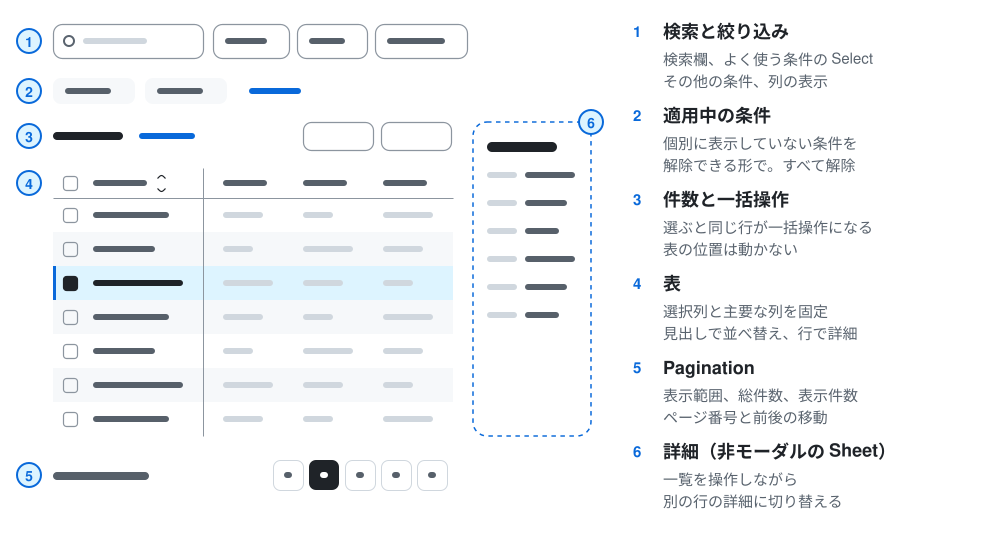
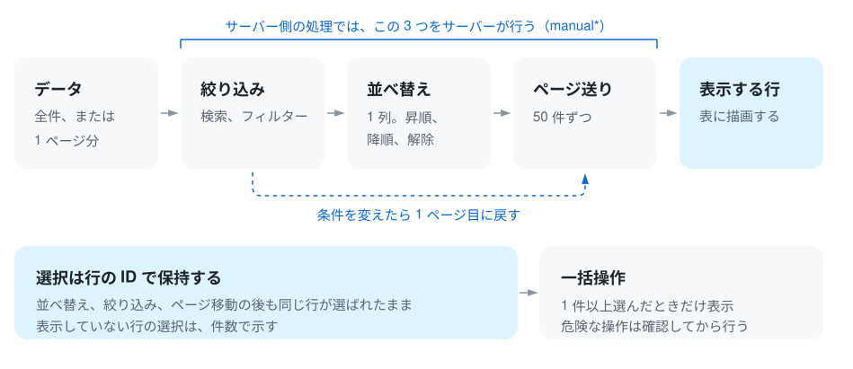
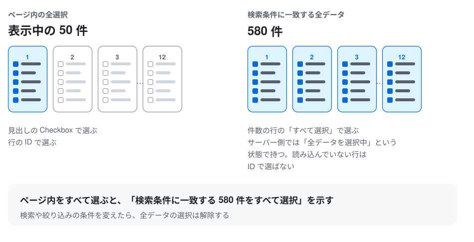

# Data Table

多くのデータから必要な行を見つけ、判断し、次の操作へ移るための一覧。TanStack Table と、[Table](table.md)、Checkbox、Input、Select、[Pagination](pagination.md) を組み合わせる。

| | |
| --- | --- |
| 実装 | [`registry/components/ui/data-table.tsx`](../../../registry/components/ui/data-table.tsx) |
| 元にした実装 | shadcn/ui の Data Table の手順（TanStack Table を使う） |
| 状態 | 初期実装 |

Data Display に共通する判断基準は [data-display.md](data-display.md) にまとめている。

## 1. Purpose

ユーザーが、検索、絞り込み、並べ替えで必要な行を見つけ、詳細を確認し、選んだ行にまとめて操作できるようにする。表示すること自体ではなく、発見、判断、次の操作までの負荷を減らすことを目的にする。

## 2. Usage

- 1 つの万能なコンポーネントにはしない。製品は TanStack Table の `useTable` で表の状態を持ち、画面に必要な部品だけを並べる。
- 機能を登録することと、操作を画面に表示することを分ける。`dataTableFeatures` はすべての機能を登録するが、使わない操作の部品は置かない。

| 機能 | 方針 | 部品 |
| --- | --- | --- |
| 検索 | 標準 | `DataTableSearch` |
| 絞り込み | 標準 | Select（単一選択）、Checkbox（複数選択）、`DataTableAppliedFilters` |
| 並べ替え | 標準 | `DataTableColumnHeader` |
| ページ送り | 標準 | `DataTablePagination` |
| 行の選択、一括操作 | 必要なとき | `DataTablePageCheckbox`、`DataTableRowCheckbox`、`DataTableSelectionBar` |
| 列の表示・非表示、並び替え、固定 | 必要なとき | `DataTableColumnOptions` |
| 列の幅の変更 | 必要なとき | `DataTableResizeHandle`（`DataTable` が見出しに置く） |
| 行の詳細 | 標準 | `DataTable` の `onRowOpen`、`DataTableRowTrigger` |
| CSV の出力、権限、API 通信、検索の処理 | 製品の責務 | なし |
| セルの中での編集 | 特殊用途（対象外） | なし |

- 頻繁に使う条件は Select などで一覧の上に個別に表示する。それ以外の条件は Popover か Sheet にまとめる。
- 詳細が複雑な場合や、URL で直接開く必要がある場合は、詳細を専用のページにする。

### TanStack Table v9

TanStack Table は v9（`@tanstack/react-table` 9.3）を使う。v9 は 2026 年 8 月から安定版であり、v8 の `useReactTable` ではなく `useTable` で表を作る。v9 では、使う機能（`rowSortingFeature` など）と処理（`createSortedRowModel()` など）を `tableFeatures()` で登録する。

部品は `dataTableFeatures` で作った表（`DataTableInstance<TData>`）を受け取る。v9 の表の型は、登録した機能の組み合わせについて不変（`in out`）であり、機能の組み合わせが異なる表を同じ部品に渡せない。そのため、Flow Design の機能の組み合わせを `dataTableFeatures` として 1 つに決め、部品の型をこれに合わせている。製品で機能を追加する場合は、コピーした `data-table.tsx` の `dataTableFeatures` に追加する。

```tsx
const table = useTable({
  ...dataTableDefaults,
  features: dataTableFeatures,
  columns,          // モジュールの最上位か useMemo で作り、描画のたびに作り直さない
  data,
  getRowId: (row) => row.id,
  state: { sorting, pagination, rowSelection },
  onSortingChange: setSorting,
  onPaginationChange: setPagination,
  onRowSelectionChange: setRowSelection,
})
```

`dataTableDefaults` は次の設定である。

| 設定 | 値 | 理由 |
| --- | --- | --- |
| `enableMultiSort` | `false` | 並べ替えは 1 列だけにする。Shift を押しながら見出しを押しても複数の列にならない |
| `enableSortingRemoval` | `true` | 昇順 → 降順 → 解除 の順に切り替える |
| `enableRowRangeSelection` | `false` | Checkbox の `onCheckedChange` が修飾キーを渡さないため、Shift による範囲の選択を使わない |
| `columnResizeMode` | `"onChange"` | 列の幅を、ドラッグの間に変える |

列の名前や配置は、列の定義の `meta`（`DataTableColumnMeta`）に書く。

| `meta` | 用途 |
| --- | --- |
| `label` | 列の表示切り替え、並べ替えの読み上げ、列幅の名前。`label` のない列（選択、行の操作）は列の設定の対象にしない |
| `align` | セルの配置（`left`、`center`、`right`）。金額と数量は `right` |
| `headerClassName`、`cellClassName` | 見出しとセルに追加するクラス |

## 3. Anatomy

<picture>
  <source media="(prefers-color-scheme: dark)" srcset="../../diagrams/data-table-anatomy-dark.svg">
  
</picture>

| 部分 | 部品 | 値 |
| --- | --- | --- |
| 検索欄 | `DataTableSearch` | Input（高さ 48px）、左に 20px の検索のアイコン、`type="search"` |
| 個別の条件 | Select | 欄の中に「契約状況：契約中」のように名前と値を表示する |
| 適用中の条件 | `DataTableAppliedFilters` | 高さ 32px（指の操作では 40px）、角丸 8px、`secondary` の面。「すべて解除」は Button の `ghost`、`xs` |
| 件数と一括操作の行 | `DataTableSelectionBar` | 最小の高さ 48px（`min-h-12`）。件数の文字は 14px、太さ 500 |
| 表 | `DataTable` | [Table](table.md) と同じ。見出し 40px、行 48px |
| 並べ替えのボタン | `DataTableColumnHeader` | 高さ 32px、角丸 8px、文字 12px・太さ 500、16px のアイコン |
| 列幅の区切り | `DataTableResizeHandle` | 幅 16px、見出しの高さ。2px × 20px の `border-strong` の線。見出しのホバー、フォーカス、指の操作の端末で表示する。列幅は `layout="fixed"` のときだけ描画に反映されるため、`auto` の表には区切りを表示しない |
| 固定した列の端 | `DataTable` | 1px の `border` の線 |
| ページ送り | `DataTablePagination` | [Pagination](pagination.md) の `PaginationControls` |

## 4. Variants

### クライアント側とサーバー側の処理

| | クライアント側 | サーバー側 |
| --- | --- | --- |
| `data` | 全件 | 現在のページの行だけ |
| 絞り込み、並べ替え、ページ送り | TanStack Table が行う | `manualFiltering`、`manualSorting`、`manualPagination` を `true` にし、製品がサーバーに要求する |
| 総件数 | 絞り込み後の行の数（`table.getRowCount()`） | `rowCount` に渡す。わからない場合は渡さない |
| 絞り込み中かどうか | 表の状態（`globalFilter`、`columnFilters`）から判断する | `DataTable` の `filtered` で渡す |

- `manual*` は、表がその処理を行わないという指定であり、サーバーへの要求は行わない。要求は製品が行う。
- サーバー側で総件数を取得しない場合は `rowCount` を渡さない。`DataTablePagination` は総件数とページ数を表示せず、`hasNextPage` で次のページの有無を受け取る。
- 検索の遅延（debounce）と、古い要求の応答による上書きの防止は、製品が行う。プレビューの例（[`customer-table.tsx`](../../../preview/src/pages/data-display/customer-table.tsx)）は、入力が止まってから 300ms 後に要求し、要求ごとの番号が最新でない応答を捨て、`AbortController` で前の要求を中止する。

### データの状態

`DataTable` の `status` と、行の数で表示を変える（[data-display.md](data-display.md#6-データの状態)）。

| 状態 | 指定 | 表示 |
| --- | --- | --- |
| 読み込み中 | `status="loading"` | `loadingRowCount` 行の Skeleton（Feedback）。表に `aria-busy="true"`、読み上げの領域に「読み込み中」 |
| データ未登録 | `status="ready"`、0 行、絞り込みなし | `empty` |
| 検索結果なし | `status="ready"`、0 行、絞り込みあり | `noResults` |
| 取得失敗 | `status="error"` | `error`。`DataTableMessage tone="error"` は Feedback の Alert（`destructive`、`role="alert"`）で原因と再試行を示す。行を 0 件として表示しない |
| 再取得中 | `status="refreshing"` | 表示中の行を残す。表に `aria-busy="true"`。件数の行に `DataTableRefreshing` を置く |

`empty`、`noResults`、`error` には `DataTableMessage` を使う。`title`、`description`、`action`（Button）を渡し、`tone="error"` ではアイコンと `role="alert"` が付く。表示は表の本文の 1 行で、横にスクロールしても表示中の範囲に残る（`sticky`）。

### 表の幅

| `layout` | 列の幅 | 使う場面 |
| --- | --- | --- |
| `auto`（既定） | 内容に合わせる | 列の幅の変更と列の固定を使わない |
| `fixed` | TanStack Table の `size`（px）。最後の列が残りの幅を受け持つ | 列の幅の変更、列の固定 |

列の固定は、固定した列の位置（`getStart`）を `size` から計算するため、`fixed` で使う。

## 5. Behavior

### 検索と絞り込み

<picture>
  <source media="(prefers-color-scheme: dark)" srcset="../../diagrams/data-table-flow-dark.svg">
  
</picture>

- 検索欄は一覧の上に置き、プレースホルダーに検索の対象を書く（「会社名で検索」）。名前は `label`（既定はプレースホルダー）で `aria-label` に入る。
- `DataTableSearch` は、IME で変換中の入力では `onValueChange` を呼ばず、変換を確定したとき（`compositionend`）に呼ぶ。同じ値では呼ばない。「すべて解除」などで `value` が外から変わると、欄の表示を合わせる。
- 条件を変えたら、最初のページに戻す。プレビューでは `autoResetPageIndex: false` にし、条件を変える処理の中でページを 0 にしている。
- `DataTableAppliedFilters` には、Popover や Sheet にまとめた条件だけを渡す。個別に表示している Select の値は、欄の中に見えているため重複して並べない。
- 条件のボタンを押すと、その条件を解除し、同じ位置のボタン（なければ前のボタン、最後は「すべて解除」）にフォーカスを移す。
- `onClearAll` を渡すと「すべて解除」を表示する。検索と個別の条件も含めて解除する。

### 並べ替え

- `DataTableColumnHeader` は、並べ替えできる列では `button`、できない列では文字だけを表示する。
- 押すたびに 昇順 → 降順 → 解除 と切り替わる。初めの向きは列の `sortDescFirst` で決める（金額や件数など、大きい順に見ることが多い列は `true`）。
- `sortDescFirst` を指定しない場合、TanStack Table は最初の行の値が文字列の列を昇順から、それ以外（数値、日付）を降順から始める。更新日のように近い順に見る日付の列には `sortDescFirst: false` を明示する。
- 現在の向きは、`th` の `aria-sort`（`ascending` / `descending`）とアイコン（ArrowUp / ArrowDown）で示す。`aria-sort` は並べ替え中の列にだけ付ける。並べ替えできるが並べ替えていない列は、ChevronsUpDown のアイコンで示す。
- 並べ替えを変えると、読み上げの領域（`role="status"`）に「月額で降順に並べ替えました」と入る。`aria-sort` の変化は、支援技術によっては読み上げられないため。
- 金額と日付は、数値（`sortFn: "basic"`）と日付（`sortFn: "datetime"`）で並べ替える。文字列として並べ替えない。値がない行は `sortUndefined: "last"` で最後に置く。

### 行の詳細

- `onRowOpen` を渡すと、行を押したときに詳細を開く。行は `interactive` になり、ホバーの面とポインターの形が付く。
- 次の場合は、行を押しても詳細を開かない。
  - 行の中の操作要素（`a[href]`、`button`、`input`、`label`、`[role=checkbox]`、`[role=separator]` など）と、`data-row-click-ignore` を付けた要素を押した場合
  - 文字を選択した場合（選択の範囲が行の中にある）
  - Portal（Select のメニューなど）の中を押した場合。React のツリーを通って行に届くため、DOM の位置で除く
  - 左ボタン以外で押した場合
- キーボードでは、行の主要な列（会社名など）に置いた `DataTableRowTrigger` で詳細を開く。`aria-haspopup="dialog"` と、詳細を表示中かどうかの `aria-expanded` が付く。
- 詳細がない行は `canOpenRow` で `false` を返す。その行は押せる見た目にならない。
- 詳細を表示中の行は `activeRowId` で渡す。行に `aria-current="true"` と先頭のセルの 2px の線が付く。
- 一覧から詳細を確認する場合は、非モーダルの Sheet（Overlay の `Sheet mode="view"`）を使う。一覧を操作しながら、別の行の詳細に切り替えられる。

### 行の選択と一括操作

<picture>
  <source media="(prefers-color-scheme: dark)" srcset="../../diagrams/selection-scope-dark.svg">
  
</picture>

- 選択は行の ID（`getRowId`）で管理する。配列の位置で管理しないため、並べ替えやページ移動で別の行が選ばれない。
- `DataTablePageCheckbox` は、表示中のページの行だけを選ぶ。一部を選んでいるときは Indeterminate（`aria-checked="mixed"`）になる。v9 の `getIsSomePageRowsSelected()` は「1 件以上」を表すため、`getIsAllPageRowsSelected()` と組み合わせて判定している。
- 選択はページ移動と絞り込みの後も残る。`getSelectionSummary(table)` で、すべての選択の件数（`selectedCount`）と、いま表示していない件数（`hiddenCount`）を求め、`DataTableSelectionBar` に「3件を選択中（表示していない 2件を含む）」と示す。
- ページ内をすべて選んだとき、`selectAll` を渡すと「検索条件に一致する 580件をすべて選択」を示す。
  - クライアント側：`table.toggleAllRowsSelected(true)` で、絞り込み後のすべての行を ID で選ぶ。
  - サーバー側：読み込んでいない行は ID で選べないため、「条件に一致する全データを選択中」という状態を製品が持つ（`allSelected`）。条件を変えたら解除する。一括操作は、ID の一覧ではなく条件でサーバーに要求する。
- `DataTableSelectionBar` は 1 件以上選んだときだけ表示する。件数を示す行と同じ位置に置き、選択の有無で表の位置が動かないようにする。
- 狭い画面では、一括操作のボタンをアイコンだけにし（`<span className="max-sm:sr-only">` で文字を支援技術に残す）、件数、選択の解除と同じ 1 行に収める。2 行に折り返すと、押した行が指の下で動く。検品では、1 件目を選んだときの表の位置が変わらないことを確認している。
- 「選択を解除」で選択をすべて解除する。
- 選んだ行の面は、交互の背景色より優先する（[table.md](table.md#行の状態)）。
- 削除などの危険な一括操作は、Alert Dialog で件数と結果を示して確認する。Alert Dialog の統合前のプレビューでは、件数の行の中で確認している。

### 列の設定

- `DataTableColumnOptions` は、列の表示・非表示（Checkbox）、左端への固定（`aria-pressed` のボタン）、左右への移動（ボタン）を並べる。Popover などの中に置く。
- 並び替えはドラッグに頼らず、ボタンで行う。移動した後も、押したボタンにフォーカスを残す。固定した列は移動できない。
- 識別に必要な列（会社名など）は、列の定義で `enableHiding: false` にする。Checkbox は選択済みのまま無効になり、「（常に表示）」と示す。
- 列の幅は、`DataTableResizeHandle` をドラッグするか、フォーカスして ← → キーで 16px ずつ（Shift を押すと 64px ずつ）変える。Enter とダブルクリックで元の幅に戻す。`role="separator"` で、`aria-valuenow` に現在の幅が入る。幅は `minSize`（既定 80px）から `maxSize`（既定 640px）の範囲になる。
- ユーザーごとの列の設定の保存は、製品が行う。

### 狭い画面

- 表の中だけを横にスクロールする。列を無理に縮めず、ページ全体を横にスクロールさせない。
- 優先度の低い列は、`columnVisibility` で初めから隠してよい。隠した情報は行の詳細で確認できるようにする。
- 固定する列の幅は、狭い画面では小さくし、横にスクロールする範囲を残す。
- 指で操作する端末では、操作できる行と、列の設定と行の操作のボタンを 48px 以上にする。

## 6. Anti-patterns

| 避ける | 理由 | 代わりに |
| --- | --- | --- |
| すべての機能を 1 つのコンポーネントの props で切り替える | 使わない操作まで画面に出やすく、変更も難しい | 部品を組み合わせる |
| すべての操作を常に表示する | 画面に必要のない操作が判断の負荷になる | 画面に必要な部品だけを置く |
| 選択を配列の位置で管理する | 並べ替えやページ移動で別の行が選ばれる | `getRowId` で ID を使う |
| ページ内の全選択で、検索条件に一致する全データを選んだように扱う | 意図しない行に一括操作が行われる | 「検索条件に一致する全件を選択」を分けて示す |
| サーバー側で、読み込んでいない行を ID で選んだことにする | 選ばれる範囲が実際のデータと一致しない | 「全データを選択中」の状態を持つ |
| 一括操作のバーを表の上に新しく差し込む | 選ぶたびに表の位置が動く | 件数の行と同じ位置に置く |
| 取得に失敗したときに 0 件と表示する | データがないと誤解される | `status="error"` と再試行 |
| 検索結果なしとデータ未登録を同じ表示にする | 次にすべき操作が異なる | `noResults` と `empty` を分ける |
| IME の変換中に検索する | 変換前の文字で検索され、結果が何度も入れ替わる | `DataTableSearch` |
| 行の中のボタンを押したときに詳細も開く | 意図しない操作が起きる | `DataTable` の行のクリックの判定に任せる |
| 列の並び替えと幅の変更をドラッグだけにする | キーボードとタッチで操作できない | ボタンと矢印キー |
| 業務の一覧で無限スクロールを標準にする | 現在の位置と全体の量がわからない | Pagination |

## 他のコンポーネントとの接続

Overlay と Feedback のコンポーネントが main に統合された後に接続した。Data Table の部品は、これらを独自に実装していない。

| 用途 | 使うコンポーネント | 接続した場所 |
| --- | --- | --- |
| 行の詳細 | Sheet（`mode="view"`、非モーダル） | プレビューの `CustomerDetail`。閉じた後は `finalFocus` で、開いた行の会社名のボタンにフォーカスを戻す |
| その他の条件、列の表示 | Popover | プレビューの一覧の上の設定。閉じた後はボタンにフォーカスが戻る |
| 危険な一括操作の確認 | Alert Dialog | プレビューの一括削除。件数を見出しに含め、実行のボタンに件数を書く |
| 行の操作 | Dropdown Menu | プレビューの行の「…」。メニューの項目は Portal に描かれ、行の詳細を開かない |
| 操作の結果 | Toast | プレビューの一括削除、メールの作成、ID のコピー |
| 読み込み中 | Skeleton | `DataTable` の `status="loading"` |
| 取得失敗 | Alert | `DataTableMessage` の `tone="error"` |

- 閲覧の Sheet は一覧の右側を覆う。行の詳細を開いたまま別の行を押す操作は、Sheet に覆われていない左側の列（会社名など）で行う。主要な列を左に置き、固定する。
- 狭い画面では Sheet が画面の幅になるため、別の行を見るときは詳細を閉じてから選ぶ。
