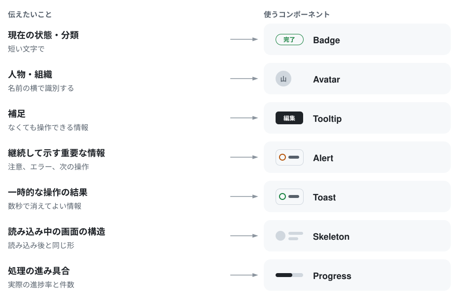

# Feedback コンポーネントの判断基準

Badge、Avatar、Tooltip、Alert、Toast、Skeleton、Progress に共通する判断基準。目的は、必要な状態や結果を明確に伝えながら、作業を妨げないことである。

| コンポーネント | 資料 |
| --- | --- |
| Badge | [badge.md](badge.md) |
| Avatar | [avatar.md](avatar.md) |
| Tooltip | [tooltip.md](tooltip.md) |
| Alert | [alert.md](alert.md) |
| Toast | [toast.md](toast.md) |
| Skeleton | [skeleton.md](skeleton.md) |
| Progress | [progress.md](progress.md) |

## 1. 使い分け

<picture>
  <source media="(prefers-color-scheme: dark)" srcset="../../diagrams/feedback-choice-dark.svg">
  
</picture>

| 迷う組み合わせ | 判断の基準 |
| --- | --- |
| Alert と Toast | 画面を離れるまで残す必要があれば Alert。数秒で消えてよい結果なら Toast |
| Toast と画面の変化 | 結果が画面に表れる（一覧に行が増えるなど）なら、Toast は出さなくてよい |
| Alert と FieldError | 入力項目に固有のエラーは FieldError。フォーム全体や画面全体の問題は Alert |
| Skeleton と Progress | 画面の構造を示すなら Skeleton。処理の量や残りを示すなら Progress |
| Tooltip と文字 | 操作に必要な説明は画面に文字で書く。Tooltip は補足だけ |

## 2. 重複を避ける

同じ情報を複数の Feedback で重ねて伝えない。重ねる場合は、それぞれの役割を決める。

| 例 | 役割の分け方 |
| --- | --- |
| 一括送信の失敗 | Toast で結果を知らせ、失敗した行は Badge で一覧に残す。重大な失敗を Toast だけに頼らない |
| 読み込みの失敗 | Skeleton を消し、失敗の文と次の操作を表示する。Skeleton を出し続けない |
| 送付先が未設定の顧客 | Alert で件数と次の操作を示し、該当する行は Badge で示す |

## 3. 色と意味

| 意味 | 色 | Badge | Alert / Toast のアイコン |
| --- | --- | --- | --- |
| 一般 | `muted-foreground` | Neutral | Info |
| 成功、完了 | `success` | Success | CircleCheck |
| 注意 | `warning` | Warning | TriangleAlert |
| エラー、失敗 | `destructive` | Destructive | CircleAlert |
| 情報、処理中 | `info` | Info | Info |

- 背景は無彩色にし、意味は色の付いた文字、境界線、アイコンと文章で示す。淡い背景や塗りつぶしを標準にしない。
- 色だけで伝えない。必ず文字で状態を書く。
- 同じ意味には同じ色を使う。状態ではない分類に、成功や危険の色を使わない。
- 色は Design Tokens の値で、白い背景の上で文字は 4.5:1、アイコンは 3:1 以上である（[tokens.md](../tokens.md#コントラスト)）。

## 4. 支援技術への伝え方

| コンポーネント | 伝え方 |
| --- | --- |
| Badge、Avatar | 文字として読み上げる。Avatar は隣に名前があれば読み上げない |
| Tooltip | 見える補足。名前は `aria-label` などで別に付ける |
| Alert | 最初から表示するものは role なし。操作の結果として表示する重要なエラーは `role="alert"`、成功は `role="status"` |
| Toast | Base UI が読み上げ用の領域で知らせる。失敗（priority high）は即時、それ以外は他の読み上げを妨げない |
| Skeleton | 読み上げない（`aria-hidden`）。親要素の `aria-busy` と、状態の文字で知らせる |
| Progress | `role="progressbar"`、`aria-valuenow`。不明のときは `aria-valuenow` を出さない |

## 5. 動き

| コンポーネント | 動き | 動きを減らす設定 |
| --- | --- | --- |
| Tooltip | 120ms で表示・非表示 | 透明度だけで変化する |
| Toast | 180ms で表示・非表示 | 透明度だけで変化し、位置は動かない |
| Skeleton | 1.8 秒周期の明滅 | 止まる |
| Progress | 値の変化を 240ms で追う。不明は帯が流れる | 値は即時に変わり、不明の帯は中央で止まる |
