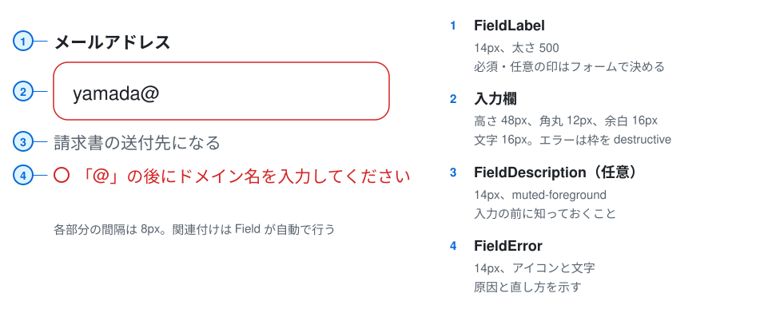

# Field

ラベル、説明、入力欄、エラーを、同じ構造と同じ関連付けで組み合わせる。

| | |
| --- | --- |
| 実装 | [`registry/components/ui/field.tsx`](../../../registry/components/ui/field.tsx) |
| 元にした実装 | shadcn/ui の Field（名前と構造）、Base UI の Field と Fieldset（関連付け） |
| 状態 | v0.1 確定 |

## 1. Purpose

すべての入力項目で、見た目と支援技術への伝わり方をそろえる。ラベル、説明、エラーと入力欄の関連付けを、製品が個別に書かなくてよいようにする。

## 2. Usage

- 入力系コンポーネントは、原則として Field の中に置く。
- 検証の規則は持たない。エラーの有無は `invalid`、文字は `FieldError` で製品が渡す。
- 必須・任意の印をどちらに付けるかはフォームが決める（[forms.md](forms.md#3-必須と任意)）。

## 3. Anatomy

<picture>
  <source media="(prefers-color-scheme: dark)" srcset="../../diagrams/field-anatomy-dark.svg">
  
</picture>

| 部品 | 役割 | 元の要素 |
| --- | --- | --- |
| `Field` | 1 つの項目。`invalid`、`disabled`、`name` を受け取る | Base UI `Field.Root` |
| `FieldLabel` | ラベル。入力欄と自動で関連付ける | Base UI `Field.Label`（描画は `Label`） |
| `FieldDescription` | 補足。`aria-describedby` に入る | Base UI `Field.Description` |
| `FieldError` | エラー。アイコンと文字。`aria-describedby` に入る | Base UI `Field.Error` |
| `FieldContent` | 横に並べるとき、ラベルと説明をまとめる | `div` |
| `FieldItem` | Checkbox や Radio の選択肢を 1 つずつ囲む | Base UI `Field.Item` |
| `FieldSet`、`FieldLegend` | 項目のまとまりと、その名前 | Base UI `Fieldset` |
| `FieldGroup` | 項目を 16px の間隔で並べる | `div` |
| `FieldRequiredMark`、`FieldOptionalMark` | 必須の `*`、任意の「任意」 | `span` |

### 互換のために提供する部品

shadcn/ui のコードを移すときのために提供する。Flow Design の新しいフォームでは使わない。

| 部品 | 役割 | Flow Design での標準 |
| --- | --- | --- |
| `FieldSeparator` | 線で項目を区切る。文字を添えられる（「または」など） | 区切りは余白（`FieldGroup`、`FieldSet` の間隔）で表す（美的基準 03） |
| `FieldTitle` | ラベルではない見出し | `FieldLabel` と `FieldLegend` を使う。使う場合は、操作要素に `aria-labelledby` で名前を付ける |

`FieldLegend` は、まとまりの見出しには `variant="legend"`（20px）、選択肢のグループ名には `variant="label"`（14px、500）を使う。

## 4. Variants

| `orientation` | 並び | 使うもの |
| --- | --- | --- |
| `vertical`（既定） | ラベル、入力欄、説明、エラーを上から 8px 間隔で並べる | Input、Textarea、Select |
| `horizontal` | 操作部品とラベルを横に並べ、行の高さを 48px 以上にする。行全体が押せる範囲になる | Checkbox、Switch |

## 5. Behavior

- `FieldLabel` を押すと、入力欄にフォーカスが移る。Checkbox と Switch は切り替わる。
- `Field` の `invalid` を指定すると、入力欄に `aria-invalid="true"` と `data-invalid` が付き、枠が `destructive` になる。
- `FieldDescription` と `FieldError` の id は、入力欄の `aria-describedby` に自動で入る。
- `disabled` を指定すると、中の入力欄とラベルが無効の見た目になる。
- `FieldError` に文字を渡したときは常に表示する（Base UI の `match={true}`）。文字を渡さない場合は、Base UI の検証結果に従う。

```tsx
<Field name="email" invalid={!!error}>
  <FieldLabel>メールアドレス</FieldLabel>
  <Input type="email" required autoComplete="email" />
  <FieldDescription>請求書の送付先になる</FieldDescription>
  {error && <FieldError>{error}</FieldError>}
</Field>
```

## 6. Anti-patterns

| 避ける | 理由 | 代わりに |
| --- | --- | --- |
| エラーをフォームの上にだけ表示する | どの項目の問題かわからない | 入力欄の直下に `FieldError` を置く。概要は補助として使う |
| `id` と `htmlFor` を手で書き、Field を使わない | 関連付けの漏れが起きる | Field を使う |
| Field に検証の規則を組み込む | 製品ごとの規則が部品に混ざる | 規則は製品が持ち、`invalid` で渡す |
