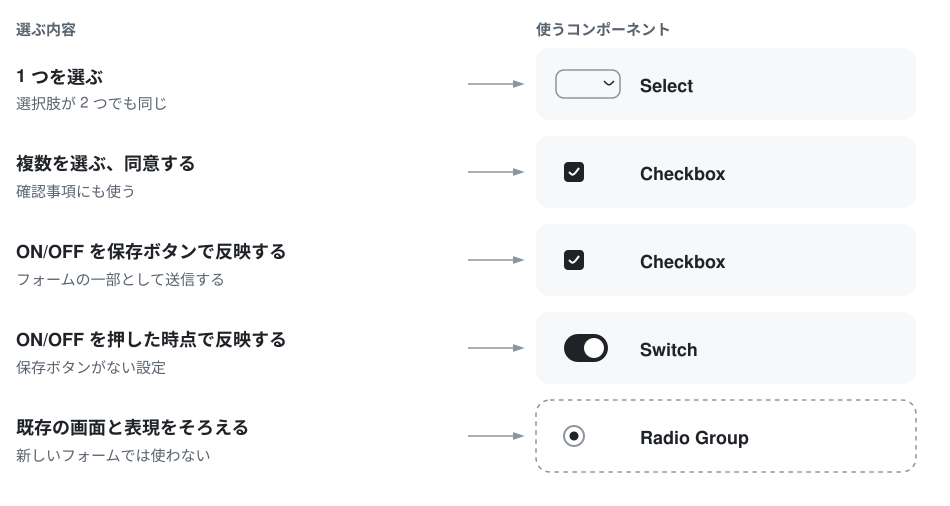
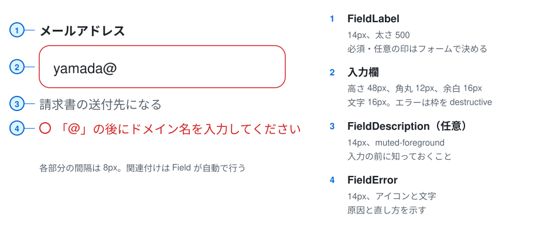
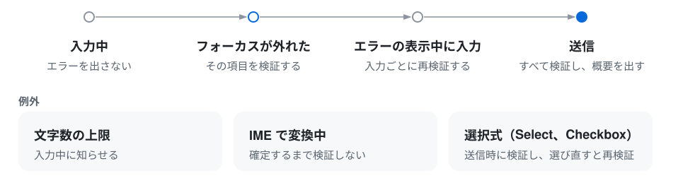

# 入力系コンポーネントの判断基準

Input、Textarea、Label、Select、Checkbox、Radio Group、Switch、Field に共通する判断基準。個別の仕様は各コンポーネントの資料を参照する。

| コンポーネント | 資料 |
| --- | --- |
| Field | [field.md](field.md) |
| Label | [label.md](label.md) |
| Input | [input.md](input.md) |
| Textarea | [textarea.md](textarea.md) |
| Select | [select.md](select.md) |
| Checkbox | [checkbox.md](checkbox.md) |
| Radio Group | [radio-group.md](radio-group.md) |
| Switch | [switch.md](switch.md) |

## 1. コンポーネントの選び方

<picture>
  <source media="(prefers-color-scheme: dark)" srcset="../../diagrams/form-choice-dark.svg">
  
</picture>

### 単一選択は Select を優先する

選択肢が 2 つしかない場合も、原則として Select を使う。

- 選んだ結果が 1 つの欄に残り、フォームを見直すときに確認しやすい（原則 01）。
- フォームの中で単一選択の表現がそろい、選び方を学び直さなくてよい（原則 06）。
- 選択肢の数が変わっても、画面の構造が変わらない。

選択肢の数だけを理由に Radio Group へ変えない。検索が必要なほど選択肢が多い場合は、[Combobox](combobox.md) を使う。

### Checkbox と Switch の違い

| | Checkbox | Switch |
| --- | --- | --- |
| 反映 | 保存ボタンで、フォームとまとめて反映する | 押した時点で反映する |
| 用途 | 複数選択、同意、確認事項、フォームの中の ON/OFF | 設定画面の ON/OFF |
| 失敗したとき | 送信時のエラーとして示す | 元の状態に戻し、原因と次の操作を文字で示す（製品の責務） |

保存ボタンのあるフォームに Switch を置くと、押した時点で反映されたように見える。そのため Checkbox を使う。

## 2. 構造

<picture>
  <source media="(prefers-color-scheme: dark)" srcset="../../diagrams/field-anatomy-dark.svg">
  
</picture>

- ラベルは入力欄の上に置く。左に置くのは、横幅が十分にあり、項目の数が多い設定画面など、上下の移動を減らす理由がある場合に限る。
- プレースホルダーをラベルの代わりにしない。入力を始めると消え、何の欄かわからなくなる。
- 余白は、項目の間を 16px（`FieldGroup`）、関連するまとまりの間を 24〜32px（`FieldSet` を並べる）にする。

## 3. 必須と任意

必須と任意のうち、少ない方に印を付ける。フォーム全体で表現をそろえ、フォームの上に凡例を置く。

| フォームの状況 | 印 | 凡例の例 |
| --- | --- | --- |
| 必須の項目が多い | 任意の項目に「任意」（`FieldOptionalMark`） | 「任意」と書かれていない項目は必須です。 |
| 任意の項目が多い | 必須の項目に `*`（`FieldRequiredMark`） | * は必須の項目です。 |

- どちらを使うかはフォームが決める。Field やコンポーネントは決めない。
- 必須の項目には `required` を付ける。支援技術は「必須」と読み上げるため、`*` は読み上げない（`aria-hidden`）。
- 「任意」はラベルの一部として読み上げられる（例：「電話番号 任意」）。

## 4. エラー

- 入力欄の枠を `destructive` にし、入力欄の直下に `FieldError` で文字を示す。アイコンを添え、色だけで伝えない。
- 原因と直し方を書く。「入力が正しくありません」ではなく「「@」の後にドメイン名を入力してください（例：yamada@example.com）」。
- Field の `invalid` を指定すると、入力欄に `aria-invalid="true"` が付き、`FieldError` の文字が `aria-describedby` で入力欄の説明になる。
- 長いフォームでは、送信時にエラーの概要をフォームの上に表示し、フォーカスを移す。概要の各項目から、該当する入力欄へ移動できるようにする（[フォームの例](../../../preview/src/pages/forms/customer-form-page.tsx)）。

### エラーの読み上げ

| 場面 | 知らせ方 | 担当 |
| --- | --- | --- |
| すべてのエラー | 入力欄の `aria-invalid="true"` と、`aria-describedby` による `FieldError` の文。入力欄に戻ったときに読み上げられる | コンポーネント（Field） |
| フォーカスが外れたときに新しく出たエラー | フォームに 1 つ置いた `aria-live="polite"` の領域に、エラーの文を入れる | 製品 |
| 送信時のエラー | エラーの概要（`role="alert"`）だけで知らせる。個別のエラーは知らせない | 製品 |

- `FieldError` には `role="alert"` を付けない。送信時に多くのエラーが一度に読み上げられ、概要と重複するため。
- 表示中のエラーと同じ文は、もう一度は知らせない。入力中の再検証と、IME の変換中は知らせない。
- 実装の例は [フォームの例](../../../preview/src/pages/forms/customer-form-page.tsx) の `announce` を参照する。

自動の検品で確認できるのは、属性（`aria-live`、`aria-invalid`、`aria-describedby`、`role`）と、読み上げ領域に入る文の内容と回数までである。実際にスクリーンリーダーがどう読み上げるか（VoiceOver、NVDA など）は、人が確認する必要がある。

## 5. 検証のタイミング

<picture>
  <source media="(prefers-color-scheme: dark)" srcset="../../diagrams/form-validation-dark.svg">
  
</picture>

- 何も入力せずにフォーカスが通り過ぎただけの項目には、エラーを出さない。
- IME で変換中の文字は、入力イベントの `isComposing` で判定して検証しない。`compositionend` で確定した値を検証する。
- 選択式の項目は、開閉の操作でフォーカスが移るため、フォーカスが外れたときには検証しない。
- 検証の規則は製品が持つ。コンポーネントは検証をしない。Base UI の Field の `validate` を使うか、製品の処理で `invalid` と `FieldError` を渡す。フォーム管理のライブラリには依存しない。

## 6. 押せる範囲

Checkbox、Radio、Switch を Field（`orientation="horizontal"`）や `FieldItem` の中に置くと、行全体が押せる範囲になる。

- 行の高さは `min-h-control`（48px）以上。ラベルの `after` 疑似要素が行を覆い、本体、ラベル、行の余白のどこを押しても、その項目だけが切り替わる。
- 範囲は行の中に収まるため、縦に並べても隣の行と重ならない。高密度の画面で `--control-height` を小さくした場合も、行の高さに合わせて範囲が小さくなる。
- 横に並べる場合は、項目の間を 16px（`gap-x-4`）以上あける。
- Field の外に単独で置いた本体は、`after` 疑似要素で 48×48px に広げる。表の中など、隣の操作要素との間が 48px より狭い場所では、本体を `FieldItem` で囲むか、セルを押せる範囲にする。
- タッチ操作では、ブラウザが押した位置を近くの操作要素へ補正することがある。

## 7. 共通の見た目

| 項目 | 値 | トークン |
| --- | --- | --- |
| 入力欄の高さ | 48px | `h-control` |
| 角丸 | 12px | `rounded-md` |
| 左右の余白 | 16px | `px-4` |
| 入力文字、プレースホルダー | 16px、太さ 400 | `text-body` |
| 背景、境界線 | `background`、1px の `input` | `bg-background`、`border-input` |
| フォーカス | 2px の線 | `focus-visible:focus-ring` |
| 状態の変化 | 120ms | `duration-(--duration-fast)` |
| ラベル、説明、エラー | 14px | `text-ui` |
| Checkbox、Radio、Switch の行 | 48px 以上。行全体が押せる範囲 | `min-h-control` |

入力文字を 16px にすることで、iOS の Safari がフォーカス時に画面を拡大しない。
