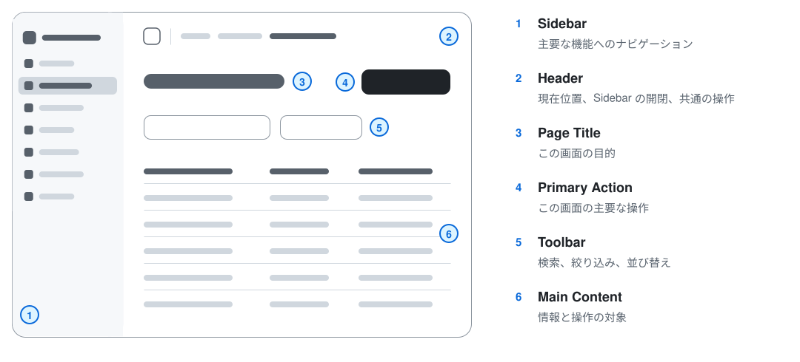
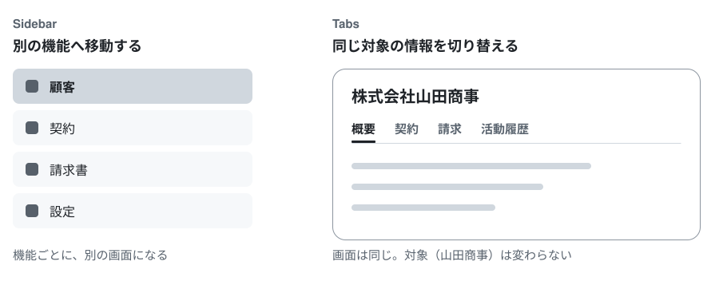
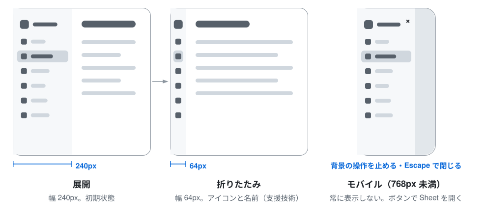
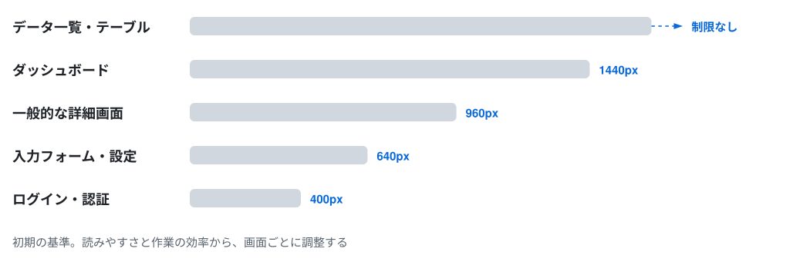
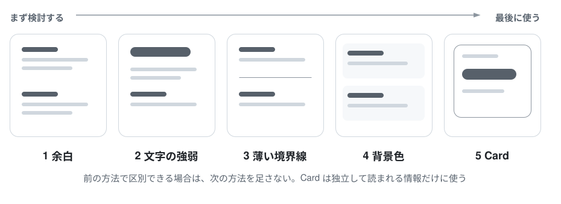

# Navigation & Layout の判断基準

Sidebar、Tabs、Breadcrumb、Card、Accordion、Separator に共通する、画面の構造の判断基準。個別の仕様は各コンポーネントの資料を参照する。

| コンポーネント | 資料 | 役割 |
| --- | --- | --- |
| Sidebar | [sidebar.md](sidebar.md) | 主要な機能へのナビゲーション |
| Tabs | [tabs.md](tabs.md) | 同じ対象の情報の切り替え |
| Breadcrumb | [breadcrumb.md](breadcrumb.md) | 上位の階層との関係 |
| Card | [card.md](card.md) | 独立した意味を持つ情報のまとまり |
| Accordion | [accordion.md](accordion.md) | 選んで読む情報の開閉 |
| Separator | [separator.md](separator.md) | 内容が変わる境目 |

目指すのは、ユーザーが現在位置を把握し、情報を自然な順序で理解し、目的の機能へ迷わず到達できる画面である。情報を整理するために要素を増やすのではなく、情報の配置で理解しやすくする（原則 03、04）。

ここで定めるのは判断の基準である。ページのテンプレートと Layout のコンポーネントは、Patterns の段階で作る。

## 1. 業務アプリケーションの基本の構造

<picture>
  <source media="(prefers-color-scheme: dark)" srcset="../../diagrams/nav-structure-dark.svg">
  
</picture>

| 部分 | 役割 | 使うもの |
| --- | --- | --- |
| Sidebar | 主要な機能へのナビゲーション | Sidebar |
| Header | 現在位置、Sidebar の開閉、検索やお知らせなどの共通の操作 | `SidebarTrigger`、Breadcrumb、Button |
| Page Title | この画面の目的 | `text-page-title` の `<h1>` |
| Primary Action | この画面の主要な操作。1 つにする | Button（Primary） |
| Toolbar | 検索、絞り込み、並び替え | Input、Select、Button |
| Main Content | 情報と操作の対象 | 画面による |

- 必要のない部分は置かない。たとえば、絞り込みのない詳細の画面には Toolbar を置かない。
- 画面のタイトルだけで目的が明らかな場合は、説明文を省く。
- Sidebar を中心にした構造を標準とする。Header と Sidebar に同じナビゲーションを重ねて置かない。
- 機能が少ないサービスや、一般消費者向けの Web サイトでは、上部のナビゲーションでもよい。

### Sidebar、Tabs、Breadcrumb の分担

<picture>
  <source media="(prefers-color-scheme: dark)" srcset="../../diagrams/tabs-sidebar-dark.svg">
  
</picture>

| 問い | 使うもの |
| --- | --- |
| 別の機能へ移動するか | Sidebar |
| 同じ対象の、種類の異なる情報を切り替えるか | Tabs |
| 上位の階層との関係を示す必要があるか | Breadcrumb（3 階層以上）、戻るリンク（2 階層） |
| Sidebar だけで現在位置がわかるか | Breadcrumb を置かない |

### Sidebar の表示

<picture>
  <source media="(prefers-color-scheme: dark)" srcset="../../diagrams/sidebar-states-dark.svg">
  
</picture>

## 2. 内容の最大幅

<picture>
  <source media="(prefers-color-scheme: dark)" srcset="../../diagrams/content-width-dark.svg">
  
</picture>

| 画面の種類 | 最大幅の初期値 | クラスの例 | 理由 |
| --- | ---: | --- | --- |
| データ一覧・テーブル | 制限なし | `max-w-none` | 列が多く、横幅をすべて使う |
| ダッシュボード | 1440px | `max-w-[1440px]` | 広い画面で KPI が離れすぎないようにする |
| 一般的な詳細画面 | 960px | `max-w-[960px]` | 項目の名前と値の距離を保つ |
| 入力フォーム・設定 | 640px | `max-w-[640px]` | 入力欄の幅を、入力する内容の長さに近づける |
| ログイン・認証 | 400px | `max-w-[400px]` | 1 つの目的に集中させる |

これらは厳密な制約ではなく、読みやすさと作業の効率を考えた初期の基準である。値はトークンにしていない。画面の種類ごとの値であり、コンポーネントが参照する値ではないためである。

## 3. 余白

| 関係 | 値 | クラスの数値 |
| --- | ---: | --- |
| ページの内側（デスクトップ） | 24px | `px-6` |
| ページの内側（モバイル） | 16px | `px-4` |
| 関連する要素の間 | 8〜16px | `2`〜`4` |
| 情報のグループの間 | 24〜32px | `6`〜`8` |
| セクションの間 | 32〜48px | `8`〜`12` |

値は [Spacing](../tokens.md#1-spacing余白) の 13 段階から選ぶ。情報の密度が高い場合も、文字を必要以上に小さくして解決しない。行の高さ（`--table-row-height`）や、表示する項目の選び方で調整する。

## 4. 情報の区切り方

<picture>
  <source media="(prefers-color-scheme: dark)" srcset="../../diagrams/separation-order-dark.svg">
  
</picture>

1. 余白
2. 文字の大きさと太さ
3. 薄い境界線（[Separator](separator.md)）
4. 背景色
5. [Card](card.md)

前の方法で区別できる場合は、次の方法を足さない（美的基準 03「区切りは余白から」）。Card は KPI、商品、企業など、独立して読まれる情報だけに使う。

## 5. スクロール

- 自然な縦方向のスクロールを優先する。画面の中に、必要のないスクロールの領域を作らない。
- Sidebar と長い内容のように、独立したスクロールに意味がある場合は許容する。Sidebar は `sticky` で画面の高さに固定し、項目が多い場合は Sidebar の中だけがスクロールする。
- 横幅が足りない表は、表の領域だけを横にスクロールする。ページ全体を横にスクロールさせない。
- 固定の Header や Footer で主要な内容を隠さない。[業務アプリの例](../../../preview/src/pages/navigation/app-page.tsx) では Header を固定せず、内容と一緒にスクロールする。

## 6. 確認できる例

[プレビュー](README.md#プレビュー) の「業務アプリの例」（`#/app`）は、顧客管理と契約管理を想定した画面である。6 つのコンポーネント、Button、Form Components、Sheet を組み合わせている。

| ページ | 画面の種類 | 最大幅 |
| --- | --- | --- |
| `#/app?page=home` | ダッシュボード | 1440px |
| `#/app?page=customers` | データ一覧 | 制限なし |
| `#/app?page=customer&id=yamada` | 詳細 | 960px |
| `#/app?page=settings` | 設定 | 640px |

ルーティングと、Sidebar の開閉の状態の保存（`localStorage`）は、この画面（製品）が持つ。コンポーネントは特定のルーティングやストレージに依存しない。
