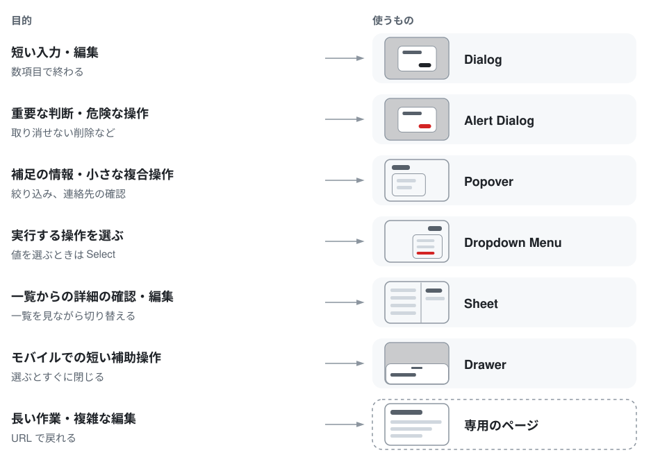
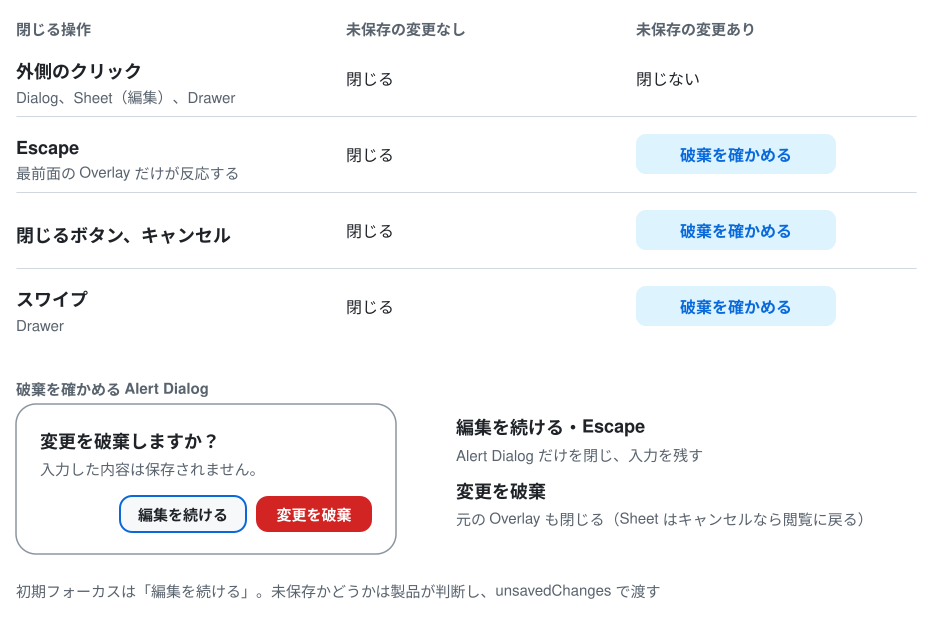
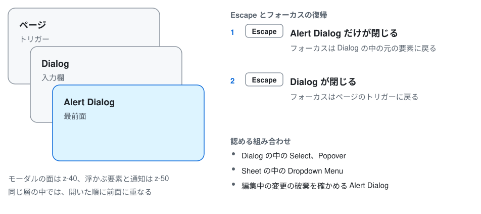
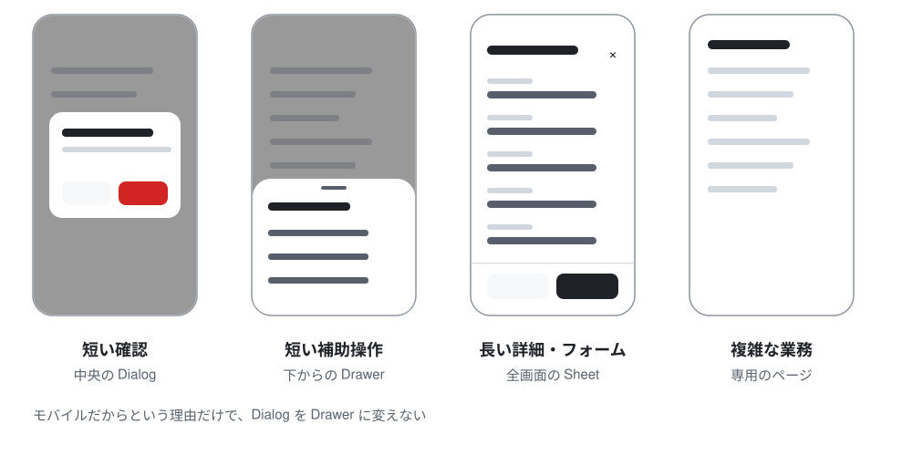

# Overlay の判断基準

Dialog、Alert Dialog、Popover、Dropdown Menu、Sheet、Drawer に共通する判断基準。個別の仕様は各コンポーネントの資料を参照する。

| コンポーネント | 資料 |
| --- | --- |
| Dialog | [dialog.md](dialog.md) |
| Alert Dialog | [alert-dialog.md](alert-dialog.md) |
| Popover | [popover.md](popover.md) |
| Dropdown Menu | [dropdown-menu.md](dropdown-menu.md) |
| Sheet | [sheet.md](sheet.md) |
| Drawer | [drawer.md](drawer.md) |

Overlay は、今の作業の上に重ねて表示する。重ねるほど、ユーザーの作業と思考を中断する。必要以上に中断しないことを、すべての判断の基準にする。

## 1. コンポーネントの選び方

<picture>
  <source media="(prefers-color-scheme: dark)" srcset="../../diagrams/overlay-choice-dark.svg">
  
</picture>

| 目的 | 使うもの |
| --- | --- |
| 短い入力・編集 | Dialog |
| 重要な判断・危険な操作 | Alert Dialog |
| 補足の情報・小さな複合操作 | Popover |
| 実行する操作を選ぶ | Dropdown Menu |
| 一覧からの詳細の確認・編集 | Sheet |
| モバイルでの短い補助操作 | Drawer |
| 長い作業・複雑な編集 | 専用のページ |

### 既存のコンポーネントとの違い

| コンポーネント | 用途 |
| --- | --- |
| Select | 入力する値を選ぶ。選んだ結果が欄に残り、フォームとして送信される |
| Dropdown Menu | 実行する操作を選ぶ。選ぶと閉じ、値は残らない |
| [Tooltip](tooltip.md) | 短い補足を読む。中に操作を置かない。タッチ操作では開かない |
| Popover | 関連する情報を確かめ、いくつかの操作を行う。Button、Input、Checkbox を置ける |

## 2. 閉じる操作と未保存の変更

<picture>
  <source media="(prefers-color-scheme: dark)" srcset="../../diagrams/overlay-closing-dark.svg">
  
</picture>

| コンポーネント | 外側のクリック | Escape | 明示的な閉じる操作 |
| --- | --- | --- | --- |
| Dialog | 未保存の変更がなければ閉じる | 閉じる | 閉じるボタン、キャンセル |
| Alert Dialog | 閉じない | キャンセルとして閉じる | キャンセル（必須） |
| Popover | 閉じる | 閉じる | 原則不要 |
| Dropdown Menu | 閉じる | 閉じる | 不要 |
| Sheet | 閲覧：閉じない。編集：未保存の変更がなければ閉じる | 閉じる | 閉じるボタン |
| Drawer | 未保存の変更がなければ閉じる | 閉じる | 閉じるボタン |

- 未保存かどうかは製品が判断し、Dialog、Sheet、Drawer の `unsavedChanges` で渡す。コンポーネントは入力の内容を見て推測しない。
- `unsavedChanges` が `true` のとき、外側のクリックでは閉じない。Escape、閉じるボタン、`DialogClose` などのキャンセル、Drawer のスワイプでは閉じずに `onDiscardRequest` を呼ぶ。製品はそこで、破棄を確かめる Alert Dialog を開く。
- 外側のクリックで確認を出さないのは、閉じる意図のない操作（押し間違い、一覧を押したつもりの操作）である可能性が高いためである。
- 保存の後などに製品が `open` を `false` にした場合は、`unsavedChanges` に関係なく閉じる。
- `unsavedChanges` が `true` の間、閉じずに止めた要求は `onOpenChange` に渡さない。閉じる理由ごとに製品が個別に制御する場合は、`unsavedChanges` を使わず、Base UI の `onOpenChange` の `eventDetails.reason` と `eventDetails.cancel()` を使う。
- ブラウザの戻る操作が続いた場合など、取り消せない閉じる要求（`eventDetails.cancel()` が効かない要求）は、`unsavedChanges` に関係なく閉じる。

```tsx
const [confirm, setConfirm] = useState(false)

<Dialog open={open} onOpenChange={setOpen} unsavedChanges={dirty} onDiscardRequest={() => setConfirm(true)}>
  <DialogContent>
    {/* ... */}
    <AlertDialog open={confirm} onOpenChange={setConfirm}>
      <AlertDialogContent size="sm">
        <AlertDialogHeader>
          <AlertDialogTitle>変更を破棄しますか？</AlertDialogTitle>
          <AlertDialogDescription>入力した内容は保存されません。</AlertDialogDescription>
        </AlertDialogHeader>
        <AlertDialogFooter>
          <AlertDialogCancel>編集を続ける</AlertDialogCancel>
          <AlertDialogAction variant="destructive" onClick={() => { setConfirm(false); reset(); setOpen(false) }}>
            変更を破棄
          </AlertDialogAction>
        </AlertDialogFooter>
      </AlertDialogContent>
    </AlertDialog>
  </DialogContent>
</Dialog>
```

## 3. 入れ子とフォーカスの復帰

<picture>
  <source media="(prefers-color-scheme: dark)" srcset="../../diagrams/overlay-nesting-dark.svg">
  
</picture>

モーダルの入れ子は、原則として避ける。次の組み合わせは認める。

- Dialog の中の Select、Popover
- Sheet の中の Dropdown Menu
- 編集中の変更の破棄を確かめる Alert Dialog

入れ子にした場合の動きは Base UI が担う。

- Escape には最前面の Overlay だけが反応する。
- 閉じた後、フォーカスは開く前にフォーカスがあった要素に戻る。
- 入れ子の Alert Dialog は背景を重ねて描かない。背後の Dialog と Sheet は、面を 10% 暗くして最前面を区別する（`data-nested-dialog-open`）。

破棄を確かめる Alert Dialog は、入れ子として扱われるよう、元の Overlay の中（`DialogContent` などの子）に置く。

## 4. モバイルでの使い分け

<picture>
  <source media="(prefers-color-scheme: dark)" srcset="../../diagrams/overlay-mobile-dark.svg">
  
</picture>

| 内容 | 使うもの |
| --- | --- |
| 短い確認 | 中央の Dialog、Alert Dialog |
| 短い補助操作 | 下からの Drawer |
| 長い詳細・フォーム | 全画面の Sheet（480px 以上の幅の Sheet は、画面の幅が足りないと全画面になる） |
| 複雑な業務 | 専用のページ |

- 全画面の Sheet と Drawer は、ヘッダーとフッターを固定し、内容だけをスクロールする。
- 画面の端に接する部分は、`env(safe-area-inset-*)` の分だけ余白を足す。iOS で Safe Area の値を得るには、製品の `<meta name="viewport">` に `viewport-fit=cover` が必要である。
- タッチ操作で Dialog を開いたときは、入力欄ではなく Dialog 自体にフォーカスを移す（Base UI の既定）。意図せずソフトウェアキーボードが開くのを防ぐ。
- Drawer は Base UI の `VirtualKeyboardProvider` で、フォーカスした入力欄をキーボードに隠れない位置に保つ。

## 5. 共通の実装

| 項目 | 実装 |
| --- | --- |
| Portal | すべて `<body>` の直下に表示する。テーマの変数は `:root` から継承する |
| 重なり順 | すべて `z-50` の 1 つ。開いた順に DOM の後ろへ追加され、後から開いたものが前面になる。z-index を上げて重なりを直さない |
| 背景 | 黒 40%、ぼかしなし。Dialog、Alert Dialog、Sheet（編集）、Drawer で同じ |
| フォーカス | モーダルは開くと中に移し、閉じ込め、閉じると戻す（Base UI） |
| スクロール | モーダルは背景のスクロールを止める。Popover と閲覧の Sheet は止めない |
| 画面の端 | Popover と Dropdown Menu は、画面の端から 8px 以内に入らないよう、位置と向きを変える（`collisionPadding`） |
| 動き | 開閉は Base UI の `data-starting-style` と `data-ending-style` による CSS の transition。動きを減らす設定では、大きさと位置を変えない |
| 名前と説明 | タイトルが `aria-labelledby`、説明が `aria-describedby` に入る（Base UI） |

ブランドカラーなどの変数を、画面の一部の要素だけに設定すると、Portal に表示する Overlay には届かない。変数は `:root` か `<html>` に設定する。画面の一部だけテーマを変える場合は、Portal の `container` に、その要素を指定する。

| 種類 | 時間 | トークン |
| --- | --- | --- |
| Dialog、Alert Dialog、Sheet、Drawer | 240ms | `--duration-slow`（動きを減らす設定では 0ms） |
| Popover、Dropdown Menu | 180ms | `--duration-normal`（動きを減らす設定では、大きさを変えず透明度だけで開閉する） |

## 6. 検品

`preview/tests/overlays.spec.ts` で、次を確認している。

| 項目 | 確認すること |
| --- | --- |
| トークン | 角丸、余白、影、背景、境界線、開閉の時間が、トークンの値と一致する |
| フォーカス | 初期フォーカス、閉じ込め、Escape、閉じた後の復帰 |
| 背景 | モーダルは背景を押せず、ホイールでスクロールしない。Popover と閲覧の Sheet は背景を操作できる |
| 未保存の変更 | 外側のクリックで閉じない。Escape、閉じるボタン、キャンセル、スワイプで破棄を確かめる |
| 入れ子 | Escape が最前面だけを閉じる。重なり順が開いた順になる |
| 画面の端 | Popover と Dropdown Menu が画面からはみ出さない |
| 幅 | Dialog の 4 段階と Sheet の 3 段階。狭い画面での縮み方 |
| 動きを減らす設定 | 大きさと位置の動きが止まる |
| ブランドの変更 | Portal の中のボタンが `--primary` に従い、4.5:1 以上を保つ |
