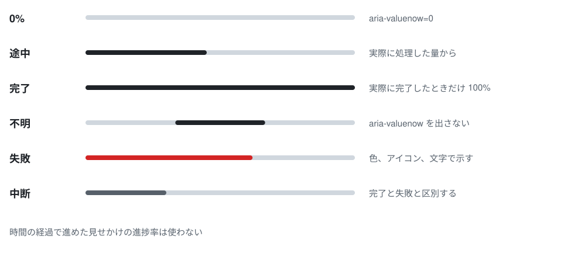

# Progress

処理の進み具合を伝える。

| | |
| --- | --- |
| 実装 | [`registry/components/ui/progress.tsx`](../../../registry/components/ui/progress.tsx) |
| 元にした実装 | shadcn/ui の Progress（Base UI 版）。円形は Base UI の Progress で作った |
| 状態 | 初期実装 |

## 1. Purpose

ユーザーが、処理がどこまで進み、あとどれだけかかるかを判断できるようにする。

## 2. Usage

- 進捗率は、実際に処理した量から出す。時間の経過で進める見せかけの進捗率は使わない。
- 処理件数など、具体的な情報も併記する（例：「25 / 40 件」）。
- 100% は、実際に処理が完了したときだけ表示する。
- 進捗率がわからない場合は、不明の表示（`value={null}`）にする。
- 完了、失敗、中断を区別する。失敗は色だけでなく、アイコンと文字で示す。
- 円形は、スペースが限られる場合の補助的な形式として使う。

<picture>
  <source media="(prefers-color-scheme: dark)" srcset="../../diagrams/progress-states-dark.svg">
  
</picture>

## 3. Anatomy

| 部分 | 値 | トークン |
| --- | --- | --- |
| バー | 高さ 8px、Full Radius | `h-2`、`rounded-full` |
| 進捗の色 | `primary`（トラックとの差 12:1 以上） | `bg-primary` |
| トラック | ニュートラル | `bg-border` |
| ラベル | 14px、太さ 500 | `ProgressLabel` |
| 進捗率 | 14px、`tabular-nums` | `ProgressValue` |

| 円形 | `size` | 線の太さ | 中央の文字 |
| --- | --- | --- | --- |
| 48px | `sm` | 4px | 12px |
| 64px | `default` | 6px | 14px |
| 96px | `lg` | 8px | 20px |

## 4. Variants

| 状態 | 指定 | 表し方 |
| --- | --- | --- |
| 途中、完了 | `value`（0〜100） | `primary`。完了は Base UI が `data-complete` を付ける |
| 不明 | `value={null}` | 幅 1/3 の帯が流れる。`aria-valuenow` を出さない |
| 失敗 | `status="error"` | `destructive`。アイコンと文字を添える |
| 中断 | `status="paused"` | `muted-foreground`。文字を添える |

## 5. Behavior

- `role="progressbar"`、`aria-valuenow`、`aria-valuemin`、`aria-valuemax` は Base UI が付ける。名前は `ProgressLabel`、ラベルがない円形は `aria-label` で付ける。
- 円形の中央の進捗率は、`aria-valuenow` と重複するため読み上げない。
- 値の変化は 240ms で追う。動きを減らす設定では即時に変わる。
- 不明の帯の動きは Web Animations API で作る。CSS のキーフレームをテーマに追加しないため。動きを減らす設定では動かさず、中央に表示する。

```tsx
<Progress value={Math.floor((done / total) * 100)}>
  <ProgressLabel>請求書を送信しています</ProgressLabel>
  <ProgressValue>{() => `${done} / ${total} 件`}</ProgressValue>
</Progress>
```

## 6. Anti-patterns

| 避ける | 理由 | 代わりに |
| --- | --- | --- |
| 時間で進めて 99% で止める | 実際の処理と関係がなく、信頼を損なう | 実際の量から出すか、不明の表示 |
| 不明なのに 0% や架空の値を出す | 支援技術に誤った値が伝わる | `value={null}` |
| 失敗を色だけで示す | 色を見分けられない人に伝わらない | アイコンと文字を添える |
| 完了前に 100% を出す | 終わったと誤解する | 完了したときだけ 100% |
