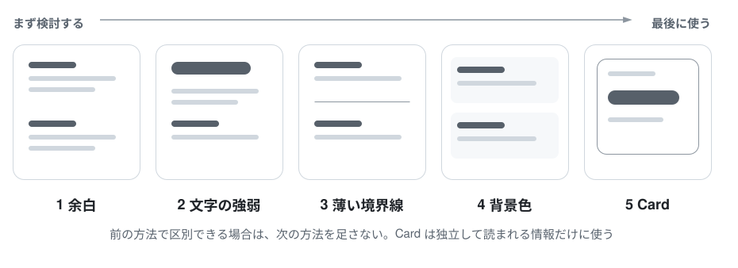

# Separator

論理的に異なる情報や、操作のグループを区切る。

| | |
| --- | --- |
| 実装 | [`registry/components/ui/separator.tsx`](../../../registry/components/ui/separator.tsx) |
| 元にした実装 | shadcn/ui の Separator（Base UI 版、base-nova スタイル） |
| 依存 | `@base-ui/react`、[`cn()`](../../../registry/lib/utils.ts) |
| 状態 | v0.1 確定 |

## 1. Purpose

内容が変わる境目を、余白と文字の強弱だけでは伝えられない場合に、薄い線で示す。

## 2. Usage

<picture>
  <source media="(prefers-color-scheme: dark)" srcset="../../diagrams/separation-order-dark.svg">
  
</picture>

情報を区切る方法は、次の順に検討する。前の方法で区別できる場合は、次の方法を足さない（美的基準 03「区切りは余白から」）。

1. 余白
2. 文字の大きさと太さ
3. 薄い境界線（Separator）
4. 背景色
5. Card

| 場面 | 使うもの |
| --- | --- |
| 関係の近い項目どうし | 余白 |
| 内容が変わる境目（基本情報と補足など） | 横の Separator |
| ツールバーの操作のグループの境目 | 縦の Separator |

## 3. Anatomy

| 項目 | 値 | トークン |
| --- | --- | --- |
| 太さ | 1px | `h-px`、`w-px` |
| 色 | `border` | `bg-border` |
| 影、グラデーション | なし | |

`border` は白の上で 1.26:1 であり、識別に必要な線の基準（3:1）に届かない。Separator は装飾の区切りであり、操作の範囲を示す枠には使わない（[tokens.md](../tokens.md#5-border境界線)）。

## 4. Variants

| 指定 | 支援技術 | 使う場面 |
| --- | --- | --- |
| 既定 | `role="separator"`、`aria-orientation` | 前後で内容や操作のグループが変わる、意味のある区切り |
| `decorative` | `role="none"`。区切りとして伝えない | 見た目を整えるだけの線 |
| `orientation="vertical"` | `aria-orientation="vertical"` | 横に並ぶ操作の間 |

`decorative` は Flow Design で追加した。Base UI の Separator は常に `role="separator"` を付けるためである。shadcn/ui の Radix 版にある `decorative` と同じ名前にしている。

## 5. Behavior

- 状態と操作を持たない。フックを使わないため、サーバーコンポーネントとして描画できる。
- 既定の Separator はアクセシビリティツリーに `separator` として現れ、`decorative` の Separator は現れない。
- 縦の Separator は、親の高さに合わせて伸びる（`self-stretch`）。高さを指定する場合は `className` の `h-6` と `self-center` などで上書きできる。

```tsx
<Separator className="my-8" />
<Separator orientation="vertical" className="h-6 self-center" />
<Separator decorative />
```

## 6. Anti-patterns

| 避ける | 理由 | 代わりに |
| --- | --- | --- |
| 関係の近い項目の間すべてに線を引く | 線が増え、どこで内容が変わるのかわからない | 余白でまとめる |
| 余白と文字の強弱で足りるのに線を足す | 区切りが重なる（原則 04） | 線を置かない |
| 影やグラデーションの線 | 装飾になる | 1px の `border` |
| 線で操作の範囲を示す | `border` は 3:1 に届かない | 枠のある部品（`input`、`border-strong`）を使う |
| 見た目だけの線を区切りとして伝える | 支援技術で区切りが増える | `decorative` を付ける |
