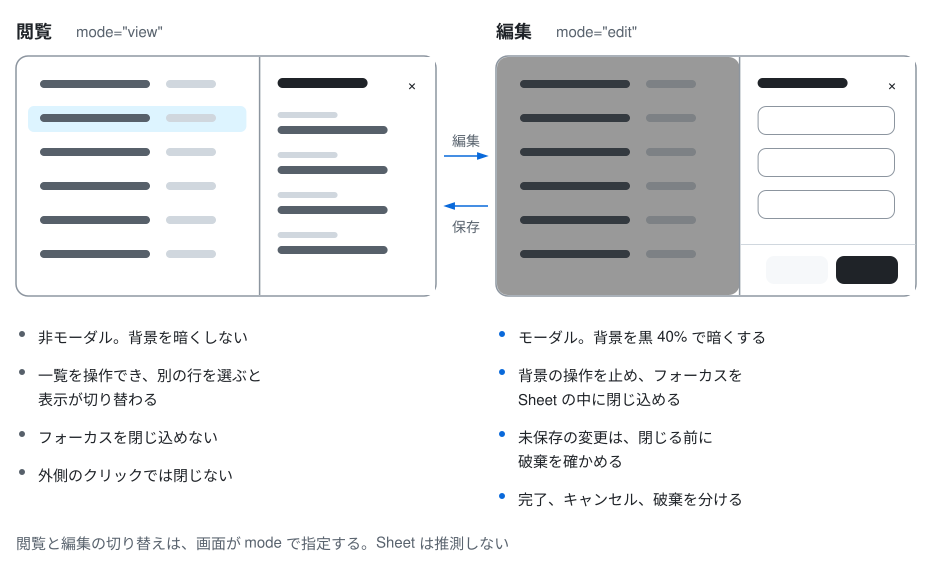

# Sheet

一覧などの元の画面との関係を保ったまま、詳細の確認や編集を行う。

| | |
| --- | --- |
| 実装 | [`registry/components/ui/sheet.tsx`](../../../registry/components/ui/sheet.tsx) |
| 元にした実装 | shadcn/ui の Sheet（Base UI 版。Base UI の Dialog を使う） |
| 依存 | `@base-ui/react`、`lucide-react`、[Button](button.md)、[`cn()`](../../../registry/lib/utils.ts) |
| 状態 | 初期実装 |

## 1. Purpose

ユーザーが、一覧を見ながら詳細を確かめ、別の項目へ表示を切り替えられるようにする。編集するときは、他の操作と混ざらないように背景を止める。

## 2. Usage

- 一覧から詳細を表示する場合は、Dialog より Sheet を優先する。一覧が見えたままになり、別の行を選ぶと表示が切り替わる。
- 複雑な編集、URL で直接開く必要がある情報、長い作業は、専用のページにする。
- モバイルでは画面全体に広がる。長い詳細やフォームに使う（[overlays.md](overlays.md#4-モバイルでの使い分け)）。

### 閲覧と編集

<picture>
  <source media="(prefers-color-scheme: dark)" srcset="../../diagrams/sheet-modes-dark.svg">
  
</picture>

| | 閲覧（`mode="view"`） | 編集（`mode="edit"`、既定） |
| --- | --- | --- |
| モーダル | しない | する |
| 背景 | 暗くしない。一覧を操作できる | 黒 40%。背景の操作を止める |
| フォーカス | 閉じ込めない | Sheet の中に閉じ込める |
| 背景のスクロール | 止めない | 止める |
| 外側のクリック | 閉じない（別の行を選べるようにする） | 未保存の変更がなければ閉じる |
| Escape、閉じるボタン | 閉じる | 未保存の変更がなければ閉じる。あれば破棄を確かめる |

- `mode` は製品が指定する。Sheet は内容から推測しない。
- 既定は `edit`。shadcn/ui の Sheet と同じくモーダルで動く。一覧の詳細を表示するときは、`mode="view"` を指定する。
- 閲覧から編集に切り替えるときは、Sheet を閉じずに `mode` を変える。保存したら `view` に戻す。

## 3. Anatomy

| 部分 | 値 | トークン |
| --- | --- | --- |
| 面（`SheetContent`） | 右から開く（既定）。高さは画面全体。`background` | `bg-background` |
| 境界線 | 元の画面と接する側だけに 1px | `border-l`（右から開くとき） |
| 角丸 | なし（画面の端に接するため） | |
| ヘッダー（`SheetHeader`） | 固定。余白 24px。タイトル 20px、600 | `px-6 pt-6`、`text-heading` |
| 内容（`SheetBody`） | この部分だけスクロールする | `overflow-y-auto` |
| フッター（`SheetFooter`） | 固定。上に 1px の線。右寄せで、主要な操作を右に置く | `border-t` |
| 閉じるボタン | 右上、Lucide の X | [Button](button.md) の `icon-sm` |
| 開閉 | 240ms、画面の外から移動する | `duration-(--duration-slow)` |

- 画面の上端と下端に接するヘッダーとフッターは、`env(safe-area-inset-top)`、`env(safe-area-inset-bottom)` の分だけ余白を足す。
- フッターがないときは、`SheetBody` の下の余白に `env(safe-area-inset-bottom)` を足す。

```tsx
<Sheet mode={mode} open={selected !== null} onOpenChange={(open) => !open && close()}
  unsavedChanges={dirty} onDiscardRequest={() => setConfirm(true)}>
  <SheetContent>
    <SheetHeader>
      <SheetTitle>{selected.name}</SheetTitle>
      <SheetDescription>顧客 ID {selected.id}</SheetDescription>
    </SheetHeader>
    <SheetBody>{/* 詳細、または入力欄 */}</SheetBody>
    {mode === "edit" && (
      <SheetFooter>
        <Button variant="secondary" onClick={cancel}>キャンセル</Button>
        <Button type="submit">変更を保存</Button>
      </SheetFooter>
    )}
  </SheetContent>
</Sheet>
```

## 4. Variants

| `size` | 幅 | 使う場面 |
| --- | ---: | --- |
| `sm` | 360px | 絞り込みの条件など、短い内容 |
| `default` | 480px | 標準。顧客の詳細など |
| `lg` | 640px | 表や長い文章を含む詳細 |

- 画面の幅が足りないときは、画面の幅全体に広がる。
- 幅は `size` で指定する。`className` の `max-w-*` では変わらない（`size` の指定の方が優先される）。
- `side` は shadcn/ui と同じく `top`、`right`（既定）、`bottom`、`left`。上下から開く場合は、内容に合わせた高さで、画面の 90% までにする。

## 5. Behavior

| 操作 | 閲覧 | 編集 |
| --- | --- | --- |
| 開く | フォーカスを Sheet の中に移す | 同じ |
| 一覧の別の行を押す | 閉じずに、表示を切り替える | 背景を押せない |
| Tab | Sheet の外にも移れる | Sheet の中だけを移る |
| Escape | 閉じる | 閉じる。未保存の変更があれば破棄を確かめる |
| 閉じた後 | フォーカスを開く前の要素に戻す | 同じ |

- 閲覧から編集に切り替えたとき、フォーカスは製品が移す。プレビューでは、ポインターが精密な端末（`pointer: fine`）では最初の入力欄に、タッチの端末では見出しに移している。意図せずソフトウェアキーボードが開くのを防ぐためである。
- 閲覧の Sheet は一覧の一部を覆う。一覧の重要な列（名前など）は左に置く。
- 中に Dropdown Menu を置ける。Escape はメニューだけを閉じる。
- 入れ子の Alert Dialog が開いている間は、面を 10% 暗くする。
- 動きを減らす設定では、移動せずに表示し、開閉の時間を 0ms にする。

## 6. Anti-patterns

| 避ける | 理由 | 代わりに |
| --- | --- | --- |
| 一覧の詳細を中央の Dialog で開く | 一覧が隠れ、別の行を見るたびに閉じて開き直す | 閲覧の Sheet にする |
| 編集中の Sheet を、外側のクリックで閉じられるようにする | 一覧を押したつもりで、入力が失われる | `mode="edit"` と `unsavedChanges` を使う |
| 閲覧の Sheet で背景を暗くする | 一覧を操作できないように見える | `mode="view"` にする |
| 閲覧と編集を、入力欄にフォーカスしたかどうかで自動で切り替える | ユーザーが今どちらにいるのかわからない | 「編集」ボタンで明示的に切り替える |
| 複雑な編集や長い作業を Sheet で行う | URL で戻れず、閉じたときに失うものが大きい | 専用のページにする |
