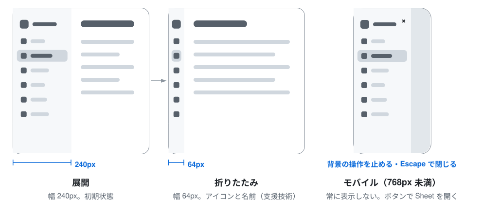

# Sidebar

業務アプリケーションの主要なナビゲーション。現在位置を示し、目的の機能へ迷わず移動できるようにする。

| | |
| --- | --- |
| 実装 | [`registry/components/ui/sidebar.tsx`](../../../registry/components/ui/sidebar.tsx)、[`registry/hooks/use-mobile.ts`](../../../registry/hooks/use-mobile.ts) |
| 元にした実装 | shadcn/ui の Sidebar（Base UI 版、base-nova スタイル） |
| 依存 | `@base-ui/react`、`class-variance-authority`、`lucide-react`、[Button](button.md)、[Input](input.md)、[Separator](separator.md)、[Tooltip](tooltip.md)、[Skeleton](skeleton.md)、Sheet（Overlay Components）、[`cn()`](../../../registry/lib/utils.ts) |
| 状態 | 初期実装 |

画面全体の構造の中での役割は [Navigation & Layout](navigation-layout.md) を参照する。

## 1. Purpose

ユーザーが、いまどの機能を使っているかを把握し、別の機能へ少ない負荷で移動できるようにする（原則 01、07）。

## 2. Usage

### 使う場面

| 場面 | 使うもの |
| --- | --- |
| 業務アプリケーションの主要な機能を切り替える | Sidebar（標準） |
| 機能が少ないサービス、一般消費者向けの Web サイト | 上部のナビゲーションでもよい |
| 同じ対象の、種類の異なる情報を切り替える | [Tabs](tabs.md) |
| 上位の階層との関係を示す | [Breadcrumb](breadcrumb.md) |

Header と Sidebar に同じナビゲーションを重ねて置かない。

### 項目の整理

- 業務を行う順序と、機能の意味で並べる（例：顧客 → 商談 → 契約 → 請求書 → 入金）。
- 階層は 2 つまで。項目が増えた場合は、階層を深くする前に、意味のあるグループ（`SidebarGroup` と `SidebarGroupLabel`）に分ける。
- 項目、現在位置、ユーザーの情報はコンポーネントに書かない。製品が渡す。

## 3. Anatomy

<picture>
  <source media="(prefers-color-scheme: dark)" srcset="../../diagrams/sidebar-states-dark.svg">
  
</picture>

| 部分 | 役割 |
| --- | --- |
| `SidebarProvider` | 開閉の状態（`open`、`onOpenChange`、`defaultOpen`）とモバイルの判定を持つ |
| `Sidebar` | 本体。`collapsible`（`icon` / `offcanvas` / `none`）、`side`、`variant` |
| `SidebarHeader` | 製品名、ワークスペースの切り替えなど |
| `SidebarContent` | スクロールする領域。`<nav aria-label="メインメニュー">` で囲んでから `SidebarGroup` を置く |
| `SidebarGroup`、`SidebarGroupLabel` | 意味のまとまりと、その名前 |
| `SidebarMenu`、`SidebarMenuItem`、`SidebarMenuButton` | 項目。現在位置は `isActive` |
| `SidebarMenuSub`、`SidebarMenuSubItem`、`SidebarMenuSubButton` | 2 階層目 |
| `SidebarMenuBadge`、`SidebarMenuAction`、`SidebarGroupAction` | 件数、項目ごとの操作 |
| `SidebarMenuSkeleton` | 項目を取得している間の表示。項目と同じ 44px の高さ。[Skeleton](skeleton.md) を使う |
| `SidebarFooter` | 設定、ユーザーの情報 |
| `SidebarTrigger` | 開閉のボタン。Header に置く |
| `SidebarRail` | Sidebar の端を押して開閉する補助（ポインター操作のみ） |
| `SidebarInset` | 主要な内容の領域（`<main>`） |
| `useSidebar()` | `state`、`open`、`setOpen`、`openMobile`、`setOpenMobile`、`isMobile`、`toggleSidebar` |

| 項目 | 値 | トークン |
| --- | --- | --- |
| 幅（展開） | 240px | `--sidebar-width` |
| 幅（折りたたみ） | 64px | `--sidebar-width-icon` |
| 幅（モバイル） | 288px（画面の幅 − 48px まで） | |
| 背景 | 薄いニュートラル | `bg-sidebar`（`--sidebar`） |
| メインとの境界線 | なし | |
| 項目の高さ | 44px、タッチ操作では 48px | `min-h-11`、`pointer-coarse:min-h-12` |
| 項目の角丸 | 8px | `rounded-sm` |
| 文字 | 14px | `text-ui` |
| アイコン | 20px | `size-5` |
| アイコンと文字の間 | 12px | `gap-3` |
| 内側の余白 | 12px（Sidebar の左右、項目の左右） | `px-3` |
| グループの名前 | 12px、太さ 500、`muted-foreground` | `text-caption` |
| 折りたたみの動き | 320ms | `--duration-layout` |

## 4. Variants

### 項目の状態

| 状態 | 面 | 文字とアイコン | 太さ |
| --- | --- | --- | --- |
| 通常 | なし | `muted-foreground` | 400 |
| ホバー | `sidebar-accent` を `sidebar` に 50% 混ぜた面 | `sidebar-accent-foreground` | 400 |
| 押下 | `sidebar-accent` | `muted-foreground` | 400 |
| 現在位置（`isActive`） | `sidebar-accent` | `sidebar-accent-foreground` | 600 |
| フォーカス | 状態の面のまま、`focus-ring` | | |
| 無効 | 透明度 50%、`cursor-not-allowed` | | |

- 現在位置は、ブランドカラーの塗りと、左側の線で示さない。強い色は画面の内容より先に目に入るためである（美的基準 06）。
- `isActive` を指定すると `aria-current="page"` が付く。
- 色だけで状態を伝えないよう、現在位置は面、文字の色、太さの 3 つで示す。

### 折りたたみ（`collapsible`）

| 値 | 動作 |
| --- | --- |
| `icon`（Flow Design の既定） | 64px にし、アイコンだけを表示する。すべての主要な機能へ移動できる |
| `offcanvas` | 画面の外へ隠す。shadcn/ui の既定。隠れている間はフォーカスできない |
| `none` | 開閉しない |

shadcn/ui の既定は `offcanvas` である。Flow Design は、折りたたんでも主要な機能へ移動できるよう `icon` を既定にしている。

### 配置（`variant`）

`sidebar` を標準とする。`floating` と `inset` は shadcn/ui との互換のために残している。どちらも影を付けない。

## 5. Behavior

### 開閉と状態の保存

- 初期状態は展開（`defaultOpen` の既定は `true`）。
- 状態を保存する場合は、`open` と `onOpenChange` で状態を製品が持ち、製品の方法（Cookie、`localStorage`、サーバー）で保存する。shadcn/ui の実装は開閉のたびに Cookie を書き込むが、Flow Design は書き込まない。ストレージの実装に依存させないためである。
- Ctrl / ⌘ + B で開閉する。入力欄、テキストエリア、セレクト、`contenteditable`、`role="textbox"` の中では反応しない。太字などの操作と重ならないようにするためである。キーを押し続けたときの繰り返しと、他の処理が `preventDefault()` したキー操作も無視する。
- 折りたたみは幅の transition（320ms）で行う。中身は開閉の時点で配置を切り替え、幅の変化の途中で文字を折り返し直さない。メインの内容は Sidebar の幅に合わせて動き、縦の位置は変わらない。
- 動きを減らす設定では、`--duration-layout` が 0ms になり、すぐに切り替わる。

### 折りたたみ時

- 項目の名前は `sr-only` で視覚的に隠し、アクセシブルな名前として残す。
- `SidebarMenuButton` に `tooltip` を指定すると、折りたたみ時だけ、ポインターを 700ms 重ねたときとキーボードでフォーカスしたときに、項目の名前を右側の [Tooltip](tooltip.md) で表示する。展開時とモバイルでは表示しない。Tooltip は視覚的な補助であり、項目の名前は Tooltip がなくても支援技術に伝わる。
- グループの名前は透明にし、高さを残す。アイコンの縦の位置が変わらないようにするためである。
- 2 階層目の項目は表示しない。親の項目を押したら、展開して子の項目を表示する（[プレビュー](../../../preview/src/pages/navigation/app-sidebar.tsx)）。
- 子の項目が現在位置の場合は、親の項目を現在位置の面で示す。

### モバイル（768px 未満）

- Sidebar を常に表示しない。`SidebarTrigger`（「メニューを開く」、`aria-expanded`）で、Overlay Components の Sheet として開く。
- 背景の操作を止め、フォーカスを Sheet の中に閉じ込め、Escape で閉じる。閉じるとフォーカスは `SidebarTrigger` に戻る。これらは Sheet が担う。
- Sheet の名前は `mobileTitle`（既定は「メニュー」）。閉じるボタンの名前は「メニューを閉じる」。
- 上下左右の Safe Area の分だけ内側に余白を取る。
- 移動した後に閉じるのは製品が担う。リンクの `onClick` で `setOpenMobile(false)` を呼ぶ。

### ルーティング

コンポーネントはルーティングのライブラリに依存しない。項目のリンクは `render` で渡す。

```tsx
<SidebarMenuButton isActive={pathname === "/customers"} render={<Link href="/customers" />}>
  <Building2 />
  <span>顧客</span>
</SidebarMenuButton>
```

### 読み込み中

項目を取得している間は、`SidebarMenuSkeleton` を `SidebarMenuItem` の中に置く。Skeleton は `aria-hidden` のため、読み込み中であることは、親の `aria-busy="true"` と、`role="status"` の文字で伝える（[skeleton.md](skeleton.md)）。

## 6. Anti-patterns

| 避ける | 理由 | 代わりに |
| --- | --- | --- |
| 現在位置をブランドカラーで塗る | 画面で最も目立ち、内容より先に目に入る（美的基準 06） | `sidebar-accent` の面、文字の色、太さで示す |
| 現在位置に左側の線を付ける | 装飾が増える。面と太さで足りる（原則 04） | 面と太さで示す |
| 背景で区別できるのに境界線を引く | 区切りが重なる（美的基準 03） | 背景だけで区別する |
| Header にも同じナビゲーションを置く | どちらを使うか迷う | Sidebar にまとめる |
| 3 階層以上にする | 目的の機能を探す手間が増える（原則 07） | 意味のあるグループに分ける |
| 項目の名前を省略記号で切る | 読めない | 折り返す |
| 折りたたむと一部の機能に移動できない | 必要な機能を削る（原則 08） | すべての主要な機能をアイコンで残す |
| 開閉の状態をコンポーネントの中で保存する | 製品の保存の方法と重なる | `open` と `onOpenChange` で製品が保存する |
