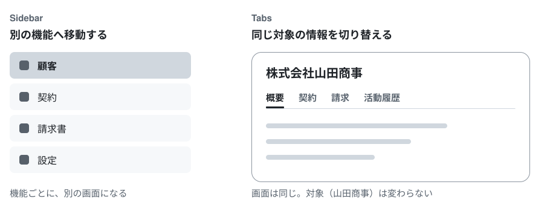

# Tabs

同じ対象について、種類の異なる情報や表示の領域を切り替える。

| | |
| --- | --- |
| 実装 | [`registry/components/ui/tabs.tsx`](../../../registry/components/ui/tabs.tsx) |
| 元にした実装 | shadcn/ui の Tabs（Base UI 版、base-nova スタイル） |
| 依存 | `@base-ui/react`、`class-variance-authority`、[`cn()`](../../../registry/lib/utils.ts) |
| 状態 | v0.1 確定 |

## 1. Purpose

1 つの対象の情報を、画面を移動せずに種類ごとに見られるようにする。対象が変わらないことを、画面の構造で伝える（原則 03）。

## 2. Usage

<picture>
  <source media="(prefers-color-scheme: dark)" srcset="../../diagrams/tabs-sidebar-dark.svg">
  
</picture>

| 場面 | 使うもの |
| --- | --- |
| 1 社の顧客の概要、契約、請求、活動履歴を切り替える | Tabs |
| 同じグラフの集計の期間（月、四半期、年）を切り替える | Tabs（塗りつぶし型） |
| 関係のない主要な機能を切り替える | [Sidebar](sidebar.md) |
| 入力、確認、完了のような操作の手順 | 進み具合の表示と「次へ」の操作 |

- タブの数を必要以上に増やさない。増え続ける場合は、情報の構造を見直す。
- 横幅が足りない場合は、文字を小さくせず、横にスクロールする。

## 3. Anatomy

| 部分 | 役割 |
| --- | --- |
| `Tabs` | 選択中の値（`value`、`defaultValue`、`onValueChange`）と向き（`orientation`） |
| `TabsList` | タブの並び。`variant`、`activateOnFocus`。`aria-label` で名前を付ける |
| `TabsTrigger` | 1 つのタブ（`role="tab"`） |
| `TabsContent` | 表示の領域（`role="tabpanel"`）。`keepMounted` |

| 項目 | 値 | トークン |
| --- | --- | --- |
| 高さ | 48px | `h-12` |
| 文字 | 14px、太さ 500（すべてのタブ） | `text-ui`、`font-medium` |
| 選択中の文字 | `foreground` | |
| 選択されていない文字 | `muted-foreground` | |
| 選択中の下線 | 2px、`foreground`、文字の幅 | |
| 下の線 | 1px、`border` | |
| タブの間 | 24px | `gap-6` |
| 内容との間 | 24px | `gap-6` |
| 状態の変化 | 120ms | `--duration-fast` |
| 影 | なし | |

選択されていないタブも太さを 500 にしている。選択の切り替えで太さを変えると、タブの幅が変わり、隣のタブの位置が動くためである。

## 4. Variants

| 種類 | `variant` | 位置付け | 見た目 |
| --- | --- | --- | --- |
| 下線型 | `line`（省略時） | Flow Design の標準 | 文字の色と 2px の下線 |
| 塗りつぶし型 | `default` | shadcn/ui との互換。例外として使う | `muted` の面の中で、選択中を `background` の面と `input` の枠で示す |

shadcn/ui では、`variant` を省略すると塗りつぶし型になる。Flow Design では、省略すると下線型になる。shadcn/ui のコードを移したときに、塗りつぶし型を明示していない Tabs は下線型に変わる。

塗りつぶし型は、小さな表示形式の切り替えなど、理由がある場合だけ使う。選択中のタブには、識別に必要な枠（`input`、3:1 以上）を付ける。面の色の差（`background` と `muted`）だけでは 3:1 に届かないためである。

### 状態

| 状態 | 表し方 |
| --- | --- |
| 選択中 | `aria-selected="true"`、文字の色、下線 |
| ホバー | 文字を `foreground` にする |
| フォーカス | `focus-ring`。スクロールの領域の中に 4px の余白を取り、線が切れないようにしている |
| 無効 | `disabled`。透明度 50%。矢印キーでフォーカスは移るが、選択されない |

## 5. Behavior

### キー操作

| キー | 動作 |
| --- | --- |
| Tab | タブの並びに入る。選択中のタブにフォーカスが移る。もう一度押すと表示の領域へ移る |
| ← → | 前後のタブへ移る。端では反対の端へ移る |
| Home、End | 最初、最後のタブへ移る |
| Enter、Space | フォーカスしているタブを選ぶ（手動で選ぶ場合） |

### 自動で選ぶか、手動で選ぶか

| 方法 | 指定 | 使う場面 |
| --- | --- | --- |
| 自動（既定） | `activateOnFocus`（既定 `true`） | 表示がすぐに切り替わる内容 |
| 手動 | `activateOnFocus={false}` | データの取得などで、表示に時間がかかる内容 |

Base UI の既定は手動である。Flow Design は、表示がすぐに切り替わる場合に操作の手数が少ない自動を既定にしている。

### 非表示の領域（`keepMounted`）

`TabsContent` の `keepMounted` の既定は `true`。非表示の領域も DOM に残し、`hidden` 属性で隠す。

| 確認したこと | 結果 |
| --- | --- |
| 表示 | 非表示の領域は表示されない |
| キーボード | Tab で非表示の領域の中の要素にフォーカスが移らない |
| 支援技術 | 非表示の領域はアクセシビリティツリーから外れる。表示の領域は、対応するタブの名前を `aria-labelledby` で持つ |
| 入力内容 | タブを切り替えても、入力した値が残る |
| フォームの送信 | 非表示の領域の入力欄の値も送信される |
| フォーカスの移動 | 表示の領域の中にフォーカスがある状態で、製品が `value` を変えて別のタブを選んだ場合は、選ばれたタブへフォーカスを移す |
| 上書き | `keepMounted={false}` で、選ばれていない領域を DOM から外す |

`keepMounted` が担うのは、DOM と入力欄の値を残すことまでである。次は製品が担う。

- **非表示の領域の処理**：データの取得、重いグラフの描画、定期的な更新などは、非表示の間も動き続ける。必要な場合は、選ばれたタブだけで処理を始めるか、`keepMounted={false}` にする。表示に時間がかかる内容では、手動で選ぶ方式（`activateOnFocus={false}`）を使う。
- **状態の管理**：`keepMounted={false}` にした場合や、画面を離れても値を残す場合は、値を製品の状態として持つ。
- **複数のタブに分かれたフォームの検証**：非表示のタブの入力欄にエラーがあっても、ユーザーには見えない。ブラウザの標準の検証（`required` など）は、非表示の入力欄にフォーカスを移せず、何も示さずに送信を止める場合がある。フォームに `noValidate` を付けて製品の処理で検証し、エラーの概要に、該当するタブを開いて入力欄へフォーカスを移すリンクを置く（[プレビュー](../../../preview/src/pages/navigation/tabs-page.tsx) の `KeepForm`）。

### 横スクロール

タブの並びは、横幅を超えると横にスクロールする。矢印キーで移ったタブは、ブラウザが表示の範囲に入るようにスクロールする。文字は折り返さない。スクロールの領域の内側に 4px の余白を取り、フォーカスの線（2px、2px 離す）が欠けないようにしている。

### フォーカスと選択

- フォーカスは `focus-ring`、選択は文字の色と下線で示す。手動で選ぶ方式では、フォーカスしているタブと選ばれているタブが別になるが、表し方が違うため区別できる。
- 選択を切り替えても、タブの並びの位置と大きさは変わらない（すべてのタブが太さ 500）。

### SSR と Hydration

`tabs.tsx` は、フォーカスを移す処理にフックを使うため `"use client"` を付けている。サーバーでの描画では `window` と `document` を参照しない。

### 動き

色と透明度の変化だけを使い、位置の動きはない。動きを減らす設定でも見た目は変わらない。

```tsx
<Tabs defaultValue="overview">
  <TabsList aria-label="山田商事の情報">
    <TabsTrigger value="overview">概要</TabsTrigger>
    <TabsTrigger value="contracts">契約</TabsTrigger>
  </TabsList>
  <TabsContent value="overview">…</TabsContent>
  <TabsContent value="contracts">…</TabsContent>
</Tabs>
```

## 6. Anti-patterns

| 避ける | 理由 | 代わりに |
| --- | --- | --- |
| 関係のない主要な機能を Tabs で並べる | アプリケーションのナビゲーションと区別がつかない | Sidebar を使う |
| 操作の手順を Tabs で表す | 順番を飛ばして選べ、進み具合がわからない | 進み具合の表示と「次へ」の操作 |
| 文字を小さくして収める | 読みにくくなる | 横スクロールにする、構造を見直す |
| 選択中だけ太字にする | 幅が変わり、隣のタブが動く | すべて 500 にし、色と下線で示す |
| 理由なく塗りつぶし型を使う | 画面の中で操作が目立ちすぎる | 下線型を使う |
| 非表示のタブの入力内容を消す | 入力をやり直させる（原則 08） | `keepMounted` を残す |
