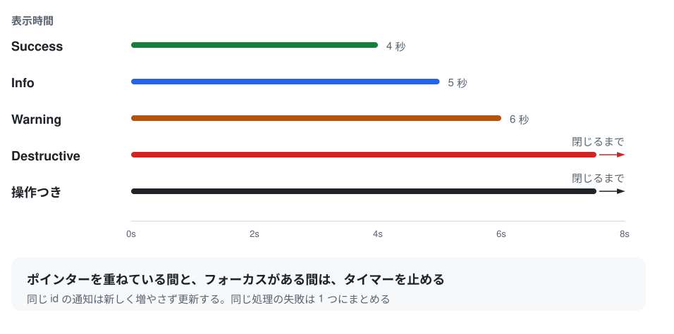

# Toast

操作の結果などを一時的に知らせる。

| | |
| --- | --- |
| 実装 | [`registry/components/ui/toast.tsx`](../../../registry/components/ui/toast.tsx) |
| 元にした実装 | Base UI の Toast（shadcn/ui の推奨は Sonner） |
| 状態 | v0.1 確定 |

## 1. Purpose

ユーザーの作業を止めずに、画面に表れない処理の結果を知らせる。

## 2. Usage

- バックグラウンドの送信など、結果が画面に表れない操作に使う。画面の変化で結果がわかる場合は出さない。
- 重要な情報を、自動で消える Toast だけに頼らない。重大なエラーは画面にも残す（一覧の Badge、Alert など）。
- 同じ内容の通知は `id` を指定して 1 つにする。同じ処理で起きた大量の通知は 1 つにまとめる。
- ユーザーのフォーカスを移さない。

### ライブラリの選定

| | Base UI の Toast（採用） | Sonner（shadcn/ui の推奨） |
| --- | --- | --- |
| 追加の依存 | なし（`@base-ui/react` に含まれる） | `sonner`、`next-themes` |
| 重複の統合 | 同じ `id` で更新する | 同じ `id` で更新する |
| キーボード | F6 で通知の領域へ移動する | ホットキーで移動する |
| 他のコンポーネントとの関係 | Tooltip、Select などと同じ Base UI | 別の仕組み |

依存を増やさず、Button などと同じ Base UI の仕組み（`render`、データ属性）で作れるため、Base UI の Toast を採用した。

## 3. Anatomy

| 部分 | 値 | トークン |
| --- | --- | --- |
| 面 | 背景 `background`、境界線 1px `border`、角丸 12px、余白 16px | `rounded-md`、`p-4` |
| 影 | `shadow-popover` | |
| アイコン | 20px、種類の色 | `size-5` |
| 文字 | タイトル 14px・500、説明 14px | `text-ui` |
| 操作 | Secondary の Button（Small） | |
| 閉じる | Ghost のアイコンボタン（Compact）、「通知を閉じる」 | |
| 幅 | デスクトップ 360px、モバイルは画面の幅 − 32px | `sm:w-90` |
| 位置 | デスクトップ：右下、端から 24px。モバイル：下中央、端から 16px | |
| 表示・非表示 | 180ms | `duration-(--duration-normal)` |

複数の通知は 8px の間隔で縦に並べ、新しい通知を下に置く。

### 表示上限

同時に表示するのは 3 件まで（`ToastProvider` の `limit`）。上限に達したとき、`useToast` は次のように扱う。自動で消えない通知（失敗、操作つき）を、成功などの一時的な通知で隠さないためである。

| 表示中の通知 | 新しい通知 | 動き |
| --- | --- | --- |
| 自動で消える通知を含む | どれでも | 最も古い自動で消える通知を閉じ、新しい通知を表示する |
| すべて自動で消えない通知 | 自動で消える通知 | 新しい通知は表示しない（`toast()` は `undefined` を返す） |
| すべて自動で消えない通知 | 自動で消えない通知 | Base UI が最も古い通知を一時的に隠す（`data-limited`、`inert`）。表示中の通知が閉じると、再び表示される |

- 同じ処理の成功は、同じ `id` で 1 つの通知にまとめる（件数を更新する）。
- 重大なエラーと、必要な操作は Toast だけに頼らない。製品は、画面の中でも状態（一覧の Badge、Alert など）と操作を示す。上限で表示されない成功の結果も、画面の状態で確認できるようにする。
- 過去の通知を一覧で見返す機能（通知センター）は提供しない。

## 4. Variants

| 種類 | 表示時間 | 読み上げ |
| --- | --- | --- |
| Neutral | 5 秒 | 他の読み上げを妨げない |
| Success | 4 秒 | 他の読み上げを妨げない |
| Info | 5 秒 | 他の読み上げを妨げない |
| Warning | 6 秒 | 他の読み上げを妨げない |
| Destructive | 閉じるまで | 即時（`priority: "high"`） |
| 操作つき | 閉じるか、操作するまで | 種類に従う |

<picture>
  <source media="(prefers-color-scheme: dark)" srcset="../../diagrams/toast-timing-dark.svg">
  
</picture>

## 5. Behavior

- ポインターを重ねている間と、通知の領域にフォーカスがある間は、自動で消えるタイマーを止める。
- キーボードの操作（Base UI 1.9 で確認）：

| 操作 | 動き |
| --- | --- |
| F6 | 通知の領域へフォーカスが移る |
| もう一度 F6、Shift+F6 | 移らない。通知の領域にフォーカスが残る |
| Tab / Shift+Tab | 通知、操作のボタン、閉じるボタンの間を移る |
| Esc（通知にフォーカスがあるとき） | その通知を閉じ、通知を出した操作の位置にフォーカスが戻る |
| 操作のボタン | 操作を実行し、その通知を閉じる |

Base UI の資料には「もう一度 F6 を押すと元の位置に戻る」とあるが、Base UI 1.9 では戻らなかった。独自のキー操作は追加していない。通知の領域から戻るには、Esc で通知を閉じるか、Tab で通知の外へ移動する。
- 失敗の通知（`priority: "high"`）は、Base UI が読み上げ用の領域（`aria-live`）で即時に知らせる。重複して読み上げないため、見た目の通知は F6 で移動するまで支援技術から隠れる。操作つきの失敗の通知でも、同じ操作を画面の別の場所に用意する。
- 画面下に固定の操作（ナビゲーション、送信ボタンなど）がある場合は、`--toast-offset-bottom` にその高さを指定して、通知を上にずらす。iPhone などの Safe Area の分は自動で空ける（`env(safe-area-inset-bottom)`）。
- 動きを減らす設定では、位置を動かさず、透明度だけで表示・非表示する。

```tsx
// アプリ全体を ToastProvider で囲み、Toaster を 1 つ置く
<ToastProvider>
  <App />
  <Toaster />
</ToastProvider>

const { toast } = useToast()
toast({ variant: "success", title: "請求書を送信しました" })
toast({ id: "bulk-failed", variant: "destructive", title: `${n} 件を送信できませんでした` })
```

### 実際のスクリーンリーダーで未確認の事項

自動の検品では、属性（`role`、`aria-live`、`aria-hidden`、`inert`）と、読み上げ用の領域に入る文までを確認した。次は未確認である。

- 失敗の通知のタイトルと説明が、VoiceOver や NVDA で即時に読み上げられるか
- 操作つきの通知で、操作のボタンの名前がどう伝わるか（読み上げ用の領域には含まれない）
- F6 で通知の領域へ移ったときの読み上げ

## 6. Anti-patterns

| 避ける | 理由 | 代わりに |
| --- | --- | --- |
| 画面の変化でわかる結果に毎回出す | 注意を奪う | 出さない |
| 重大なエラーを Toast だけで伝える | 消えると確認できない | 画面にも残す |
| 同じ通知を何件も重ねる | 内容が読めない | `id` で 1 つにまとめる |
| 通知にフォーカスを移す | 作業が中断される | フォーカスは移さない |
