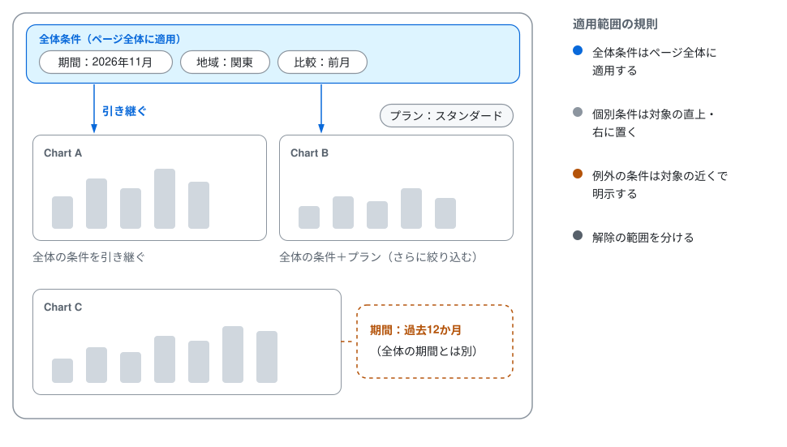
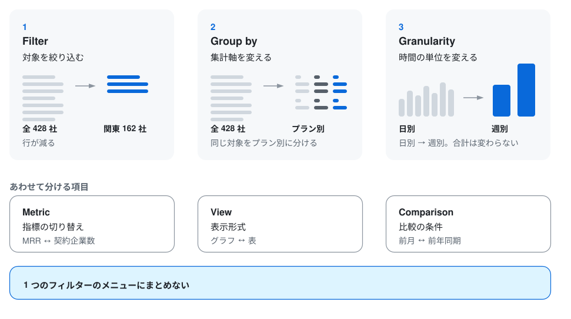
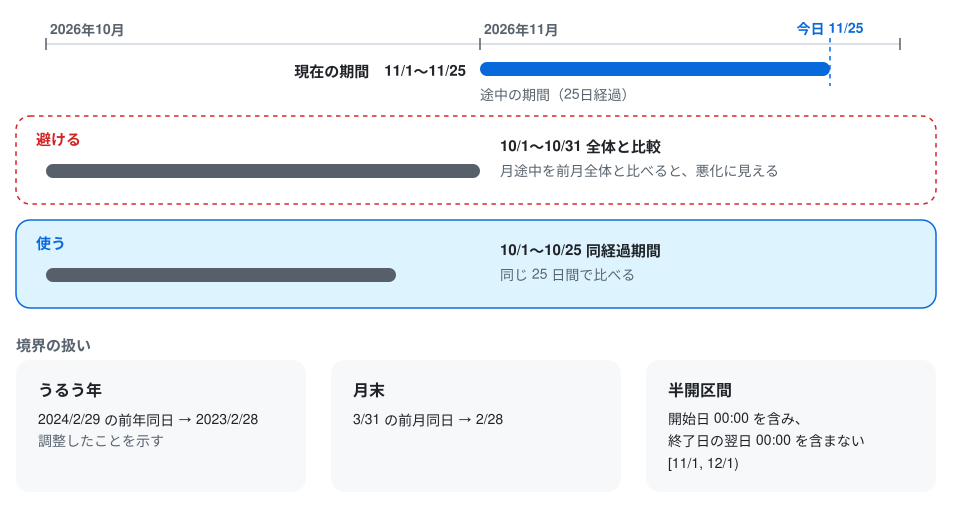

# Analysis Filters

分析の対象と期間を決め、全体条件と個別条件の適用範囲を明確にする。

状態：初期実装（レビュー前） ・ 実装：[`registry/patterns/analysis-query.ts`](../../../registry/patterns/analysis-query.ts)（`useAnalysisQuery`、`scopeFilters`、`useCrossFilter`）、[`analysis-period.ts`](../../../registry/patterns/analysis-period.ts)、[`analysis-controls.tsx`](../../../registry/patterns/analysis-controls.tsx) ・ 全体：[Data Analysis](data-analysis.md)

## 目的

利用者が、いま何を、どの期間で、どの単位で見ているかを、考えなくてもわかるようにする（原則 01）。絞り込み、集計の軸、集計単位を別の操作として示し、条件の適用範囲を誤認させない（原則 02、08）。

## 使用条件

期間や対象を変えて集計を見る、すべての分析の画面に使う。Data Browsing の [Search & Filter](search-and-filter.md)（一覧の検索と絞り込み）の規則を引き継ぎ、期間、集計単位、比較、適用範囲を加える。

## 構成

<picture>
  <source media="(prefers-color-scheme: dark)" srcset="../../diagrams/filter-scope-dark.svg">
  
</picture>

| 部分 | 置く場所 | 部品 |
| --- | --- | --- |
| 全体条件（期間、比較、よく使う絞り込み） | Page Header の直下（`role="group"`、「ページ全体の条件」） | `AnalysisPeriodFilter`、`ComparisonSelect`、Select |
| 使う頻度の低い条件 | 「その他の条件」の Popover、Sheet、モバイルの Drawer | `useFilterDraft`（Search & Filter） |
| 適用中の隠れた条件 | 全体条件の下の Chip | `DataTableAppliedFilters` |
| 個別条件、集計単位、表示の設定 | 対象のグラフや表の見出しの右 | `AnalysisRegion` の `actions`、`GranularitySelect` |
| 例外の条件の説明 | 対象の見出しの下 | `AnalysisScopeNote` |

### 操作の区別

<picture>
  <source media="(prefers-color-scheme: dark)" srcset="../../diagrams/analysis-operations-dark.svg">
  
</picture>

| 操作 | 意味 | 持つ場所 |
| --- | --- | --- |
| Filter | 分析の対象を絞り込む（行が減る） | `AnalysisQuery.filters` |
| Group by | 集計の軸を変える（同じ対象を分ける） | 領域ごと（製品） |
| Granularity | 時間の単位を変える（合計は変わらない） | `AnalysisQuery.granularity` |
| Metric | 表示する指標を切り替える | 領域ごと（製品） |
| View | 表示の形式を変える（グラフ、表） | 領域ごと（製品） |
| Comparison | 比べる条件を変える | `AnalysisQuery.comparison`、表だけの比較は領域ごと |

すべてを 1 つのフィルターのメニューにまとめない。絞り込みの継承と、集計単位などの表示の設定を混同しない。

## バリエーション

| 種類 | 使う場面 |
| --- | --- |
| すぐに適用（既定） | ほとんどの条件。プリセットの期間、Select |
| まとめて適用 | 複雑な条件、重い集計。「適用する」と「キャンセル」（`useFilterDraft`）。キャンセルで未適用の変更を破棄する |
| 期間の指定 | 「この期間で集計」で適用する。開始日と終了日がそろい、正しい順序で、選べる範囲の中のときだけ押せる（`AnalysisPeriodFilter`） |
| 監視の期間 | 過去 15 分、1 時間、24 時間など、時間の単位の期間（製品が定義する） |

## 動作

### 分析の対象の期間（`AnalysisPeriodFilter`、`resolvePeriod`）

- 既存の Date Picker（`DateRangePicker`）と Calendar を使う。プリセットと期間の指定を併用する。
- プリセットは、製品の分析の目的に必要なものだけを渡す（`presets`）。用意しているもの：今日、昨日、今週、先週、今月、先月、過去7日間、過去30日間、過去90日間、過去12か月（先月まで）、今四半期、前四半期、今年、今年度、前年度。
- 期間の指定は「この期間で集計」で適用する。開始日と終了日は欄ごとに確定するため、すぐに適用すると、片方の日付だけを変えた途中の期間で集計し、手動で選んだ集計単位を失う（独立したレビューの指摘）。入力中は「適用中の期間：…」と「入力した期間は、まだ適用していません」を示し、「元に戻す」で入力を破棄できる。
- 選べる範囲は `min`（データのある最初の日）と `max`（既定は今日）で制限する。
- 終了日が今日より後の固定の期間（URL などから渡された期間）は、今日までに切り詰め（`truncated`）、「2026/12/31までの指定のうち、今日まで」と示す。未来の日を欠損や 0 として集計しない。開始日が今日より後の期間は不正（`future`）。
- 期間の単位（同経過期間の比較、目標、期間の経過に使う）は、期間が暦の単位と一致する場合だけ決まる。単位の初日から最終日まで（確定した単位）か、単位の初日から今日まで（途中の単位）。9/1〜11/25 や 11/5〜11/20 は単位を持たない。
- 開始日と終了日はどちらも期間に含む（画面の表示）。

### 相対期間と固定の期間

| 種類 | 値 | 保存した後 |
| --- | --- | --- |
| 相対期間 | `{ kind: "relative", id: "this-month" }` | 使う時点の「今日」から解決する。翌月は、その月の「今月」になる |
| 固定の期間 | `{ kind: "absolute", from: "2026-11-01", to: "2026-11-25" }` | 変わらない |

再現が必要な共有の URL や報告には、固定の期間を使う。相対期間を共有する場合は、集計の基準日（`today`）を URL に含める方法もある。Drill-down で詳細へ引き継ぐ期間は、固定の期間にする（[drill-down.md](drill-down.md)）。

### 初期の期間

分析の目的から決める（事業の状況は「今月」、顧客維持の分析は確定した「過去12か月（先月まで）」、監視は「直近 15 分」）。

### 集計単位（`availableGranularities`、`defaultGranularity`、`reconcileGranularity`）

期間と集計単位は別に持つ。初期値の目安：

| 期間の長さ | 初期値 | 使える単位（目安） |
| --- | --- | --- |
| 1 日 | 時間別 | 時間別、日別 |
| 2〜62 日 | 日別 | 7 日以内は時間別も |
| 63〜92 日 | 週別 | 日別、週別、月別 |
| 93〜366 日 | 月別 | 週別、月別、四半期別 |
| それより長い | 月別 | 月別、四半期別、年別 |

使える単位は、区間の数が 2 以上 400 以下のもの（時間別は 7 日以内）。固定の規則ではなく、製品は `maxBuckets` で変えられる。

- 手動で選んだ集計単位は、期間を変えても使える限り維持する。
- 使えなくなった場合だけ初期値に変え、`notice`（`role="status"`）で知らせる（「期間に合わせて、集計単位を「週別」から「時間別」に変えました」）。
- 集計単位を変えても、期間の合計は変わらない（区間は期間の中だけを数える）。期間の境界で切られた区間は `partial`、今日を含む区間は `inProgress`。

### 全体条件と個別条件（`scopeFilters`）

- 原則として、個別条件は全体条件を引き継ぎ、さらに対象を絞り込む。
- 全体条件と重ならない場合（全体がライト、グラフがスタンダード）は `conflict` を返す。全体条件を黙って上書きしたり、条件を外して全件を表示したりしない。
- 全体の期間と異なる期間を使う領域（過去 24 か月の推移など）は、`AnalysisScopeNote kind="override"` で対象の近くに示す。
- 同じ条件の選択欄を、各グラフに繰り返し置かない。

### 条件の表示

- 期間とよく使う条件は常に表示する。
- 使う頻度の低い条件は Popover や Sheet にまとめ、適用中の隠れた条件だけを Chip で示す。見えている条件を Chip で重ねて示さない。
- 全体条件と個別条件の解除の範囲を分ける（全体の「すべて解除」で、表だけの条件は解除しない）。

### Cross-filtering（`useCrossFilter`）

- 分析に意味がある場合だけ提供する。
- 選んだ要素（`aria-pressed`）、影響を受ける領域（「契約期間別の内訳と、解約した企業の一覧に適用しています」）、現在の条件（Chip）、解除の方法（Chip のボタン、同じ要素をもう一度選ぶ）を示す。
- 選択元の領域には適用しない（`forRegion(id)` は選択元に `null` を返す）。選択元のグラフが自身の絞り込みで消えない。
- ホバーだけで選ばない。キーボード（Enter、Space）とタッチで選べるボタンにする。グラフの要素を直接押す場合も、同じ選択を一覧のボタンからできるようにする。
- `resetKey`（全体条件、ワークスペース）が変わったら解除する。
- Drill-down と区別する（[drill-down.md](drill-down.md)）。

### 適用のタイミングと非同期の処理

- 原則はすぐに適用する（プリセット、Select）。期間の指定は、途中の期間で集計しないよう、適用の操作で確定する。不完全な条件で集計しない。
- 入力中の条件と、適用中の条件を区別して示す。
- 古い要求の応答で、新しい条件の結果を上書きしない（`useBrowseData` の要求ごとの番号と中止）。

### 集計の期間の正確性

<picture>
  <source media="(prefers-color-scheme: dark)" srcset="../../diagrams/period-alignment-dark.svg">
  
</picture>

| 項目 | 定義 |
| --- | --- |
| タイムゾーン | 「今日」は製品が `todayIn(timeZone)` で求め、`context.today` に渡す。バックエンドの時刻は `toInstantRange(range, timeZone)` |
| 週の始まり | `context.weekStartsOn`（既定 1：月曜日。Calendar と同じ） |
| 暦月と会計期間 | `context.fiscalYearStartMonth`（既定 1）。四半期と年度はこの月から数える（2026年度 Q3 など） |
| 期間の端 | 画面では開始日と終了日の両方を含む。バックエンドへは半開区間 `[開始日の 0 時, 終了日の翌日の 0 時)` |
| 相対期間の基準の時刻 | `context.today`（この部品は現在時刻を直接読まない） |
| 途中の期間 | 今日を含む期間は `inProgress`。比較は同経過期間（Period Comparison） |
| 集計の基準の時刻 | 製品が示す（「2026/11/25時点」） |

- 1 日を常に 24 時間とみなさない。夏時間の地域では 23 時間や 25 時間になる（`hoursInDay`）。0 時が存在しない日は、その日の最初の時刻を開始にする。
- 未来、未確定、欠損を 0 として扱わない。

```ts
toInstantRange({ from: 2026/11/01, to: 2026/11/30 }, "Asia/Tokyo")
// { start: "2026-11-01T00:00:00+09:00", end: "2026-12-01T00:00:00+09:00" }
toInstantRange(同じ期間, "America/Los_Angeles")
// { start: "2026-11-01T00:00:00-07:00", end: "2026-12-01T00:00:00-08:00" }（11/1 に標準時へ戻る）
```

### 条件の保持と共有

- 詳細から戻ったら、元の条件を復元する（Drill-down）。
- 関係のある分析のページの間では、必要に応じて条件を引き継ぐ（事業の状況 → 顧客維持の分析に、同じ期間を固定の日付で渡す）。
- URL への反映、保存した分析の条件は許容する。URL と保存の処理は製品の責務（`query` と `onQueryChange` で制御する）。
- 個人情報や機密性の高い条件を、無条件に URL に入れない。
- アカウントやワークスペースを変えたら、古い条件とデータを持ち越さない（`useBrowseData` の `scopeKey`、`useCrossFilter` の `resetKey`）。

### モバイル

- 期間を優先して常に表示する。
- そのほかの条件は、必要に応じて Drawer や Sheet にまとめる。
- 適用中の条件と、その解除の方法を確かめられるようにする。

## アンチパターン

| 避ける | 理由 | 代わりに |
| --- | --- | --- |
| 期間、集計単位、指標、表示形式を 1 つのフィルターのメニューにまとめる | 何が対象を変えるのかわからない | 操作を分け、置く場所で区別する |
| 各グラフに同じ期間の選択欄を置く | どれが全体の条件かわからない | 全体の条件は 1 か所 |
| 例外の期間を示さない | 全体の期間の結果と誤認する | 対象の近くに「ページの期間とは別」 |
| 個別条件で全体条件を黙って上書きする | 適用範囲を誤認する | `conflict` を示す |
| 終了日を入力する前、片方の日付だけを変えた時点で集計する | 無意味な再集計と、意図しない期間の結果の表示 | 適用の操作で確定する |
| 未来の日を含む期間をそのまま集計する | 未来の日が 0 や欠損として数えられる | 今日までに切り詰め、そのことを示す |
| 手動で選んだ集計単位を、期間の変更のたびに初期値に戻す | 選び直す負荷 | 使える限り維持する |
| 集計単位を黙って変える | 気づかずに読み違える | `notice` で知らせる |
| 選択元のグラフも Cross-filtering で絞り込む | 選んだ要素以外が消え、選び直せない | 選択元には適用しない |
| ホバーで Cross-filtering を実行する | 意図せず条件が変わる | 押して選ぶ |
| 1 日を 24 時間として期間を計算する | 夏時間の日に 1 時間ずれる | 暦の日付と半開区間 |

## 状態管理

```ts
type AnalysisQuery<F> = {
  period: AnalysisPeriod          // 相対期間か固定の期間
  granularity: Granularity        // hour | day | week | month | quarter | year
  granularityMode: "auto" | "manual"
  comparison: ComparisonMode      // none | previous-period | previous-month | previous-quarter | previous-year | custom
  comparisonCustom: { from: DateString; to: DateString } | null
  filters: F                      // 絞り込み（製品が定義する）
}
```

`useAnalysisQuery` は適用済みの条件だけを持ち、次を返す。

| 値 | 内容 |
| --- | --- |
| `period` | 解決した期間（`range`、`days`、`inProgress`、`unit`、`label`） |
| `comparison` | 解決した比較期間（[period-comparison.md](period-comparison.md)） |
| `granularities` | 現在の期間で使える集計単位 |
| `notice` | 集計単位を自動で変えたことの知らせ |
| `setPeriod(p)` | 期間を適用する。不正な期間は適用せず `false` |
| `setGranularity`、`setComparison`、`setFilters`、`resetFilter`、`resetFilters` | 条件の変更 |
| `activeFilterKeys` | 既定値から変わっている絞り込み |
| `key` | 取得の条件のキー。相対期間は解決した日付で表す |

Registry の部品は、どの状態も保存しない（URL、ストレージに依存しない）。

### 選択肢を固定する理由

`GranularitySelect` と `ComparisonSelect` は、選択肢の一覧を期間によって入れ替えず、使えない選択肢を無効（`disabled`）にする。Base UI の Select は、選択肢の一覧が変わった時点で現在の値が一覧にないと、値を最初の値に戻す（`onValueChange` を呼ぶ）。一覧を入れ替えると、この処理が変更の前の値で走り、利用者が選んでいない値に変わる（検証の途中で確認した事象）。

## アクセシビリティ

| 対象 | 指定 |
| --- | --- |
| 全体条件と個別条件 | 名前の付いたグループ（`role="group"`） |
| 操作の名前 | 目に見える名前（「期間」「比較」「集計単位」）を `aria-labelledby` で関連付ける |
| 解決した期間 | 比較の Select の `aria-describedby` に比較期間の文 |
| 集計単位の自動の変更 | `role="status"` |
| 期間の入力の誤り | 入力欄に関連付けた文（Date Picker の仕様） |
| Cross-filtering | `aria-pressed` のボタン。解除は Chip のボタン（「選択中のプラン：スタンダードの条件を解除」） |

## データの正確性

- 期間は暦の日付で数える（`differenceInCalendarDays`）。
- 会計期間、週の始まり、タイムゾーンを、Date Picker と同じ値で渡す。
- 集計単位の区間は期間の中だけを数え、合計を変えない。

## 製品側の責務

- 分析の目的に合うプリセットの選択と、初期の期間。
- タイムゾーン、週の始まり、会計年度の定義、「今日」の算出。
- URL への同期、保存した分析の条件、権限。
- 集計の処理（半開区間で受け取る）。

## 実装例

```tsx
const a = useAnalysisQuery<Filters>({
  defaultQuery: { period: { kind: "relative", id: "last-12-months" }, comparison: "previous-year", filters: { regions: [], terms: [] } },
  context: { today: todayIn("Asia/Tokyo"), weekStartsOn: 1, fiscalYearStartMonth: 4 },
  onQueryChange: (q) => syncToUrl(q), // 製品の責務
})

<div role="group" aria-label="ページ全体の条件">
  <AnalysisPeriodFilter value={a.query.period} onValueChange={a.setPeriod} presets={["last-12-months", "this-fiscal-year", "last-month"]} resolved={a.period} context={context} />
  <ComparisonSelect value={a.query.comparison} onValueChange={(m) => a.setComparison(m)} options={["previous-year", "previous-period", "none"]} comparison={a.comparison} />
</div>

<AnalysisRegion
  title="解約率の推移"
  actions={<GranularitySelect value={a.query.granularity} onValueChange={a.setGranularity} options={a.granularities} />}
  conditions={a.notice && <p role="status">{a.notice}</p>}
  status={trend.status}
>…</AnalysisRegion>

// Cross-filtering と個別条件
const cross = useCrossFilter({ resetKey: JSON.stringify(a.query.filters) })
const sel = cross.forRegion("by-term")
const scoped = sel ? scopeFilters(a.query.filters, { plans: [sel.value] }) : { status: "ready", filters: a.query.filters }
```

プレビュー：`#/analysis-filters`、`#/analysis-app?page=retention`。
