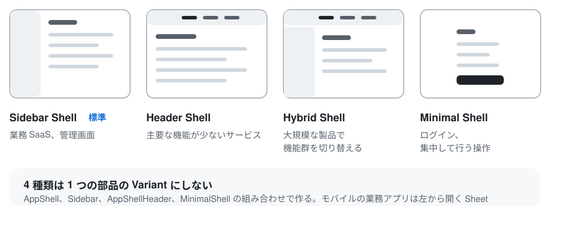
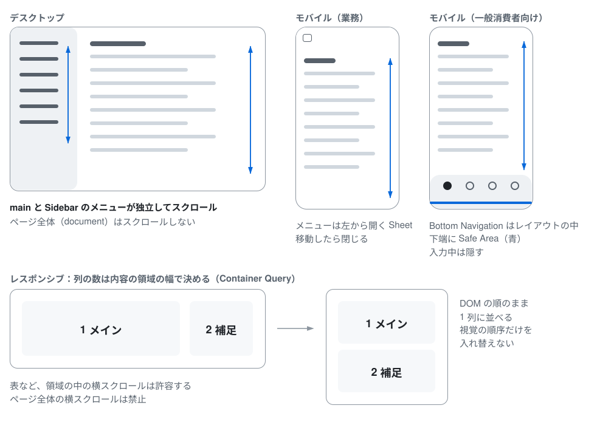

# App Shell

製品の画面全体の骨組み。ナビゲーション、メインの内容、スクロールの領域の関係を決める。

状態：初期実装 ・ 実装：[`registry/patterns/app-shell.tsx`](../../../registry/patterns/app-shell.tsx) ・ 全体：[App Structure](app-structure.md)

## 目的

利用者が、どの画面にいても同じ場所でナビゲーションと内容を見つけられるようにする。画面の構造を覚える負荷を減らし（原則 01、06）、主要な機能へ少ない操作で移動できるようにする（原則 07）。

## 使用条件

<picture>
  <source media="(prefers-color-scheme: dark)" srcset="../../diagrams/app-shell-types-dark.svg">
  
</picture>

| 構造 | 使う場面 | 組み立て方 |
| --- | --- | --- |
| Sidebar Shell（標準） | 業務 SaaS、管理画面。機能が多く、機能の間を頻繁に移動する | `AppShell` + `Sidebar` + `AppShellBody` + `AppShellMain` |
| Header Shell | 主要な機能が少ない（目安 5 個以下）サービス | `AppShell keyboardShortcut={false}` + `AppShellBody`。`AppShellHeader` に上部のナビゲーション。モバイルは左から開く `Sheet` |
| Hybrid Shell | 大規模な製品で、機能群（営業、請求、分析など）を切り替える | `AppShellHeader` で機能群、`Sidebar` で選んだ機能群の機能 |
| Minimal Shell | ログイン、認証、集中して行う操作（取り込み、見積もりの作成など） | `MinimalShell`。ナビゲーションを置かず、作業を終える操作（閉じる）だけを置く |

迷った場合は Sidebar Shell を選ぶ。Header Shell で機能が増えたら、上部のナビゲーションを増やさず Sidebar Shell に移る。

## 構成

### Sidebar Shell

| 部分 | 仕様 |
| --- | --- |
| Sidebar | 展開時 240px、折りたたみ時 64px。背景は `sidebar` トークン（薄いニュートラル）で、メインとの境界線は引かない（[Sidebar](../components/sidebar.md)） |
| Sidebar の上部 | 製品名（ホームへのリンク）。デスクトップでは折りたたみのボタン（`SidebarTrigger`）を置ける |
| Sidebar の中央 | メインメニュー（[Navigation](navigation.md)）。内容が収まらない場合は `SidebarContent` が独立してスクロールする |
| Sidebar の下部 | 製品の設定とアカウント |
| グローバルヘッダー（`AppShellHeader`） | 全画面に共通の操作（検索、お知らせ、機能群の切り替え）がある場合だけ置く。デスクトップで不要な場合も、モバイルではメニューを開くボタンのために置く（`className="md:hidden"`） |
| メイン（`AppShellMain`） | `<main>`。縦にスクロールする唯一の領域 |

### 領域とスクロール

<picture>
  <source media="(prefers-color-scheme: dark)" srcset="../../diagrams/scroll-regions-dark.svg">
  
</picture>

- `AppShell` は画面の高さを `100dvh` に固定し、`overflow: hidden` にする。document はスクロールしない。
- `AppShellMain`（`<main>`）だけが縦にスクロールする（`overflow-y: auto`、`overscroll-behavior: contain`）。
- Sidebar のメニューは `SidebarContent` の中で独立してスクロールする。
- ナビゲーションとヘッダーは `position: fixed` で内容に重ねず、レイアウトの中に置く。そのため、メインの内容の操作対象を隠さない。

## 設計の判断基準

- 構造は機能の数と移動の頻度で選び、見た目の好みで選ばない（原則 02）。
- グローバルヘッダーは、置く理由（全画面に共通の操作）がある場合だけ置く（原則 04）。Sidebar と同じナビゲーションをヘッダーに重ねない。
- 製品名を Sidebar とヘッダーの両方に置かない（Hybrid Shell ではヘッダーに置く）。
- アカウントと製品の設定は、業務の流れの外にあるため Sidebar の下部に置く。

## 操作とレスポンシブ

| 幅 | Sidebar Shell の表示 |
| --- | --- |
| 768px（`md`）以上 | Sidebar を常に表示する。`SidebarTrigger`、`SidebarRail`（ポインターだけ）、Ctrl / ⌘ + B で展開と折りたたみを切り替える |
| 768px 未満 | Sidebar を表示せず、`AppShellHeader` のボタンで左から開く Sheet にする。項目を選んで移動したら閉じる |

- 一般消費者向けで、主要な機能が 3〜5 個のサービスでは、モバイルで Bottom Navigation を使ってよい（[Navigation](navigation.md#bottom-navigation)）。
- 高さは `100dvh`。モバイルのブラウザの表示領域の変化に追従する。
- Safe Area：ヘッダーの上（`--app-safe-top`）、Bottom Navigation の下（`--app-safe-bottom`）、左右（`--app-safe-left`、`--app-safe-right`）に余白を取る。既定値は `env(safe-area-inset-*)`。768px 以上（横向きのスマートフォンを含む）でも左右の値を保つ。デスクトップの Sidebar が左端にある場合は、main の左の余白を取らない。製品の HTML に `viewport-fit=cover` が必要。
- ソフトウェアキーボード：Bottom Navigation は、タッチ操作の端末で文字の入力欄にフォーカスがある間は隠す。ヘッダーは main の外にあるため、入力欄の上に重ならない。

## アクセシビリティ

| 項目 | 実装 |
| --- | --- |
| ランドマーク | `AppShellHeader` は `<header>`、メインメニューは `<nav aria-label="メインメニュー">`、`AppShellMain` は `<main>`。main は画面に 1 つ |
| スキップリンク | `AppShell` の最初の要素。最初の Tab で左上に表示する。押すと main にフォーカスを移す（`tabindex="-1"`）。URL のハッシュは変えない |
| キーボード | Sidebar の開閉は `SidebarTrigger` と Ctrl / ⌘ + B。折りたたみ時の子の項目は Dropdown Menu（[Navigation](navigation.md)） |
| 移動の後のフォーカス | `AppShellMain` の `pageKey` が変わったら、main を先頭までスクロールし、ページの h1 にフォーカスを移す（`focusOnNavigate`、既定は `"heading"`）。h1 がなければ main。モバイルのメニューから移動した場合は、Sheet が閉じてから移す。最初の表示では動かさない |
| モバイルのメニュー | Sheet の中にフォーカスを閉じ込め、Escape で閉じてメニューのボタンへ戻す（Sidebar と Sheet の仕様） |
| SSR と Hydration | サーバーでは window と document を参照しない。サーバーの HTML はデスクトップの表示で、Hydration の後にモバイルの表示へ切り替わる。モバイルの幅では、Hydration の前も CSS（`md` 未満で非表示）で Sidebar を隠す |
| 動きを減らす設定 | Sidebar の幅の変化は `--duration-layout` で、動きを減らす設定では 0ms |

## 実装例

```tsx
import { SidebarTrigger } from "@/components/ui/sidebar"
import { AppShell, AppShellBody, AppShellHeader, AppShellMain } from "@/patterns/app-shell"

export function ProductShell({ pathname, children }) {
  const [open, setOpen] = useState(true) // 保存は製品の方法で
  return (
    <AppShell sidebarOpen={open} onSidebarOpenChange={setOpen}>
      <ProductSidebar />
      <AppShellBody>
        <AppShellHeader className="md:hidden">
          <SidebarTrigger />
          製品名
        </AppShellHeader>
        <AppShellMain pageKey={pathname}>{children}</AppShellMain>
      </AppShellBody>
    </AppShell>
  )
}
```

Sidebar を置かない構成（Header Shell、Bottom Navigation だけの製品）では、`keyboardShortcut={false}` を渡す。既定のままでは、開く対象のない Ctrl / ⌘ + B を受け取り、ブラウザの既定の操作（ブックマークの表示など）を止める。

Hybrid Shell は、ヘッダーを Sidebar の外に置き、Sidebar の高さを残りの領域に合わせる（`className="h-full"`）。

```tsx
<AppShell>
  <div className="flex h-full min-h-0 w-full flex-col">
    <AppShellHeader>{/* 機能群の切り替え */}</AppShellHeader>
    <div className="flex min-h-0 flex-1">
      <Sidebar className="h-full">…</Sidebar>
      <AppShellBody>
        <AppShellMain pageKey={pathname}>…</AppShellMain>
      </AppShellBody>
    </div>
  </div>
</AppShell>
```

Minimal Shell：

```tsx
<MinimalShell header={<ProductName />}>
  <PageLayout width="compact" align="center">…</PageLayout>
</MinimalShell>
```

プレビュー：`#/app-shell`、`#/structure-app?page=home`、`#/shell-examples?type=header`（`hybrid`、`minimal`、`bottom`）。

## アンチパターン

| 避けること | 理由 |
| --- | --- |
| ヘッダーとフッターを `position: fixed` で内容に重ねる | 内容とフォーカスした要素が隠れる。Safe Area とキーボードの扱いも難しくなる |
| ページの中に縦のスクロールの領域を増やす（入れ子の領域） | ホイールやスワイプがどこに効くかわからなくなる |
| 同じナビゲーションを Sidebar とヘッダーに重ねて置く | 移動先の候補が 2 か所に増え、選ぶ負荷が増える |
| 業務アプリのモバイルに、6 個以上の項目の Bottom Navigation を置く | 項目が入りきらず、アイコンだけの項目になる。Sheet のメニューを使う |
| 目的のないグローバルヘッダー（製品名だけ）をデスクトップに置く | 縦の領域を使うだけで、判断と操作に役立たない |

## 製品側の責務

- ルーティング、現在地の判定、認証、権限、データの取得。
- Sidebar の開閉の状態の保存（cookie、localStorage、サーバー）。`AppShell` は `sidebarOpen` と `onSidebarOpenChange` で状態を受け取るだけで、保存しない。
- `pageKey` に、ページを表す値（パス、ルートの名前と id など）を渡す。同じページの中の状態（Tabs など）では変えない。
- 戻る・進むでのスクロールの復元。document ではなく main がスクロールするため、ブラウザとルーターの既定の復元（`window.scrollY`）は効かない。必要な場合は、`useAppShell().mainRef` の `scrollTop` を履歴の項目ごとに保存し、戻ったときに設定する。その場合は `scrollOnNavigate={false}` にする。
- viewport の meta の `viewport-fit=cover`。キーボードの表示で画面の高さを変える場合は `interactive-widget=resizes-content`。
- ページの移動の前の未保存の変更の確認（Forms & Workflows で扱う）。
- 認証の前の画面（ログイン）では Minimal Shell を使い、メインメニューを表示しない。
