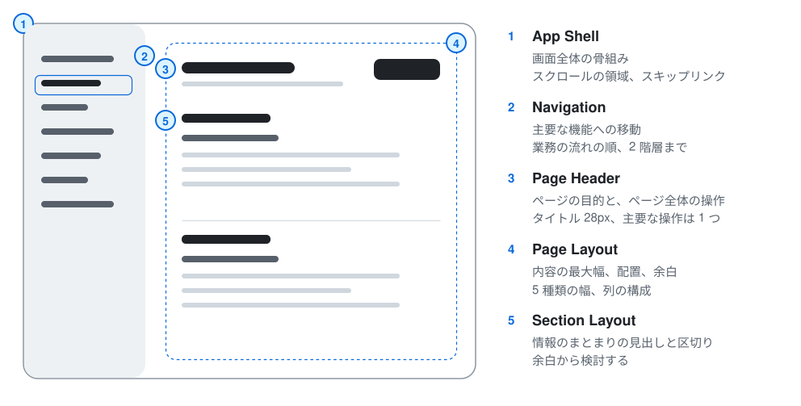

# App Structure

製品の画面全体の構造を決める Patterns のグループ。App Shell、Navigation、Page Header、Page Layout、Section Layout の 5 種類からなる。

状態：初期実装（レビュー前。v0.1 確定ではない）

<picture>
  <source media="(prefers-color-scheme: dark)" srcset="../../diagrams/app-structure-dark.svg">
  
</picture>

## Components と Patterns の違い

Components は個々の UI の部品である。Patterns は、ユーザーの目的を達成するための部品の組み合わせと、その判断基準である。

Patterns では、次を重視する。

- ユーザーが考える順番と業務の流れ
- 情報の関係性と視覚的な階層
- 操作の負荷
- 必要最低限の構造
- 製品ごとの拡張性

すべてを巨大な汎用コンポーネントにまとめない。再利用できるコード、組み合わせの例、設計の資料を使い分ける。製品に固有のルーティング、認証、権限、API、データの取得には依存しない。

## 5 種類

| Pattern | 目的 | 資料 | 再利用できるコード（`registry/patterns/`） |
| --- | --- | --- | --- |
| App Shell | 画面全体の骨組み、スクロールの領域 | [app-shell.md](app-shell.md) | `app-shell.tsx`：`AppShell`、`AppShellBody`、`AppShellHeader`、`AppShellMain`、`MinimalShell`、`useAppShell` |
| Navigation | 主要な機能への移動 | [navigation.md](navigation.md) | `sidebar-nav.tsx`：`SidebarNav`、`SidebarNavItem`、`SidebarNavParent`、`findNavTrail`<br>`bottom-nav.tsx`：`BottomNav`、`BottomNavItem` |
| Page Header | ページの目的と、ページ全体の操作 | [page-header.md](page-header.md) | `page-header.tsx`：`PageHeader`、`PageHeaderContent`、`PageHeaderTitle`、`PageHeaderDescription`、`PageHeaderActions` |
| Page Layout | 内容の最大幅、配置、余白、列 | [page-layout.md](page-layout.md) | `page-layout.tsx`：`PageLayout`、`PageColumns` |
| Section Layout | 情報のまとまりの見出し、間隔、区切り方 | [section-layout.md](section-layout.md) | `section-layout.tsx`：`Section`、`SectionHeader`、`SectionHeading`、`SectionTitle`、`SectionDescription`、`SectionActions`、`SectionStack` |

### コードと資料の区分

| 区分 | 内容 | 理由 |
| --- | --- | --- |
| 再利用できるコード | 上の表の部品 | 寸法、ランドマーク、フォーカス、スクロール、見出しの階層は、製品ごとに書き直すと誤りやすい。Registry で品質を保つ |
| 組み合わせの例（プレビュー） | Header Shell、Hybrid Shell、上部のナビゲーション、アカウントのメニュー、営業管理の検証画面 | 構造は製品の機能の数と情報で変わる。部品の Variant にせず、組み合わせ方を示す |
| 設計の資料だけ | 並び順、階層の深さ、区切り方の順序、Card を使う理由、Breadcrumb を置く条件 | 画面ごとの判断であり、コードでは決められない |

App Shell の 4 種類（Sidebar、Header、Hybrid、Minimal）は、1 つの部品の Variant にしていない。`AppShell`、`Sidebar`、`AppShellHeader`、`MinimalShell` の組み合わせで作る。

## 使い方の流れ

1. 機能の数と移動の頻度から、App Shell の構造を選ぶ（[app-shell.md](app-shell.md)）。業務アプリケーションは Sidebar Shell。
2. 業務の流れの順にナビゲーションの項目を並べる（[navigation.md](navigation.md)）。
3. 画面の目的から、Page Layout の幅を選ぶ（[page-layout.md](page-layout.md)）。一覧は Full Width、詳細と設定は Standard、登録は Focused。
4. Page Header にタイトルと主要な操作を置く（[page-header.md](page-header.md)）。
5. 内容を Section に分け、余白から区切り方を検討する（[section-layout.md](section-layout.md)）。

```tsx
<AppShell sidebarOpen={open} onSidebarOpenChange={saveOpen}>
  <Sidebar>
    <SidebarContent>
      <SidebarNav groups={groups} currentId={currentId} onNavigate={go} />
    </SidebarContent>
  </Sidebar>
  <AppShellBody>
    <AppShellHeader className="md:hidden">
      <SidebarTrigger />
      製品名
    </AppShellHeader>
    <AppShellMain pageKey={pathname}>
      <PageLayout width="standard">
        <PageHeader>
          <PageHeaderContent>
            <PageHeaderTitle>株式会社山田商事</PageHeaderTitle>
          </PageHeaderContent>
          <PageHeaderActions>
            <Button>編集</Button>
          </PageHeaderActions>
        </PageHeader>
        <SectionStack>
          <Section>
            <SectionHeader>
              <SectionTitle>契約</SectionTitle>
            </SectionHeader>
            …
          </Section>
        </SectionStack>
      </PageLayout>
    </AppShellMain>
  </AppShellBody>
</AppShell>
```

## プレビュー

`npm run preview:dev` で開き、上部の「Patterns：App Structure」から選ぶ。

| ページ | URL | 内容 |
| --- | --- | --- |
| App Shell | `#/app-shell` | 4 種類の構造、iframe で操作できる例（デスクトップとモバイルの幅） |
| Navigation | `#/navigation` | 子の項目の開閉、折りたたみ、長いメニュー名、並び順と階層の比較、Bottom Navigation |
| Page Header | `#/page-header` | 一覧、詳細、設定、分析の例、領域の幅による配置、Sticky、アンチパターン |
| Page Layout | `#/page-layout` | 5 種類の幅、適用範囲、列の再配置、スクロール |
| Section Layout | `#/section-layout` | 区切り方の順序、見出しの階層、余白、Card、折りたたみ |
| 営業管理の検証画面 | `#/structure-app?page=home` | 5 種類を組み合わせた業務アプリケーション。ダッシュボード（`home`）、顧客一覧（`customers`）、顧客詳細（`customer&id=C-00002`）、顧客登録（`customer-new`）、設定（`settings`）、ログイン（`login`）。`&long=1` で長いメニュー名とタイトル |
| Shell の例 | `#/shell-examples?type=header` | `header`、`hybrid`、`minimal`、`bottom`（Bottom Navigation）、`layout`（ページ幅の切り替え） |

営業管理の検証画面は App Structure の検証のためのものであり、正式な Pages の実装ではない。業務の内容の画面（商談、見積もりなど）は、タイトルだけを置いている。

プレビューのページは、Registry の `@/patterns/*` と `@/components/ui/*` を読み込み、複製しない。例のデータは `preview/src/data/` にあり、Registry には含めない。

## 製品の責務（共通）

- ルーティング、現在地の判定、認証、権限、データの取得
- Sidebar の開閉の状態の保存
- ページの移動を表す値（`AppShellMain` の `pageKey`）を渡すこと
- 戻る・進むでのスクロールの復元（main がスクロールするため、ルーターの既定の復元は効かない。[app-shell.md](app-shell.md#製品側の責務)）
- viewport の meta（`viewport-fit=cover`）
- ページの移動の前の未保存の変更の確認（Forms & Workflows で扱う）

## 独自に判断した事項

指示書に定めのない点を、次のように決めた。レビューで見直す。

| 事項 | 判断 | 理由 |
| --- | --- | --- |
| スクロールの領域 | 画面の高さを `100dvh` に固定し、document をスクロールさせず、`<main>` だけを縦にスクロールさせる | 指示書の「メインコンテンツの領域を独立してスクロールさせる」に従う。代わりに、ブラウザとルーターの既定のスクロールの復元が効かず、iOS Safari でアドレスバーが縮まない。復元は製品の責務として資料に書いた |
| 移動の後のフォーカス | `pageKey` が変わったら、main を先頭に戻し、ページの h1 にフォーカスを移す。モバイルのメニューから移動した場合は、メニューが閉じてから移す | 支援技術の利用者に、新しいページの名前を伝える。メニューを閉じたときの Base UI のフォーカスの戻し（メニューのボタン）より後に移す必要がある |
| スキップリンク | URL のハッシュを変えず、`focus()` で main に移す | ハッシュでルーティングする製品（このプレビューを含む）でも、ページが変わらない |
| デスクトップのグローバルヘッダー | 検証画面では置かない。折りたたみのボタンを Sidebar の上部に置く | 全画面に共通の操作がないため（「必要な場合のみ」）。モバイルでは、メニューを開くボタンのために置く |
| Page Header の配置の切り替え | タイトルに 20rem を残せない場合に、操作をタイトルの下へ移す（flex の折り返し） | 画面の幅ではなく領域の幅で判断でき、Sidebar の開閉に追従する |
| Section の見出しの階層 | `Section` の入れ子から h2〜h6 を決め、大きさは h2 が 24px、h3 以下が 20px | 文字の大きさだけで見出しを表さない。開発者が見出しの要素を選び間違えない |
| 列の切り替え | Container Query（`@container`）。メインと補足は 56rem 以上で横に並べる | Sidebar の開閉で変わる内容の幅に追従する |
| 最大幅の単位 | rem（90rem、60rem、40rem、25rem）。既定の文字の大きさ（16px）で 1440px、960px、640px、400px | ブラウザの文字の大きさの設定を大きくした利用者に、1 行の文字数を保つ |
| Safe Area | `--app-safe-top` などの CSS 変数を経由する（既定は `env(safe-area-inset-*)`） | 製品が値を調整でき、検品で擬似的な値を与えられる |
| Bottom Navigation と入力 | タッチ操作の端末（`pointer: coarse`）で文字の入力欄にフォーカスがある間は隠す | ソフトウェアキーボードの上に固定の要素が残り、入力の領域が狭くなるのを防ぐ |
| 子の項目の自動の展開 | 現在地がグループに入ったときに開く。グループの中で移動しても、利用者が閉じた状態は変えない | 「現在地を含むグループは自動展開」と「任意に開閉できる」を両立する |

## 検品

- 実施日：2026-11-26
- 環境：macOS（Darwin 25.6）、Node.js 26.10.0、Playwright 1.65.1（Chromium 159、WebKit 27.x）
- 実機（iOS Safari、Android）とスクリーンリーダー（VoiceOver、NVDA）による検品は行っていない

| 対象 | 検品（`preview/tests/`） |
| --- | --- |
| 資料のページ（5） | `app-structure.spec.ts`：名前、h1 が 1 つ、横スクロールなし。App Shell の iframe の切り替え |
| App Shell | main が 1 つ、document が縦にも横にもスクロールしない（7 画面）。320、390、768、1024、1280、1920、2560px の幅で横スクロールなしと余白（16px / 24px）。main の独立したスクロール、スキップリンク、動きを減らす設定 |
| Navigation | Sidebar の 240px / 64px、面、境界線なし、開閉の状態の保存。移動の後の h1 へのフォーカスと先頭へのスクロール、現在地。グループの自動の展開と任意の開閉、親への移動。折りたたみ時の Dropdown Menu（キーボード）。長いメニュー名。ブランドカラー。モバイルの Sheet（左から開く、移動で閉じる、移動の後のフォーカス）、Safe Area |
| Page Header | 28px / 600、説明 14px と間 8px、操作の間 8px、内容との間 32px、Primary が 1 つ。領域の幅による操作の移動。Sticky の境界線、`scroll-padding-top`、隠れた位置のボタンへのフォーカス |
| Page Layout | 1920px での 5 種類の幅と左寄せ、ログインの中央寄せ。幅の切り替えの例の測定。Container Query による列の切り替え（領域の幅と Sidebar の開閉）。表の領域の中だけの横スクロール |
| Section Layout | 見出しの階層と大きさ、`aria-labelledby`。見出しと内容 24px、セクションの間 48px。閉じても入力値が残ること、エラーの表示とフォーカス |
| Bottom Navigation | 4 項目、現在地、48px 以上、ブランドカラーで塗らない、最後の内容が隠れない、Safe Area（擬似的な値 34px）、入力中に隠れる。デスクトップで表示しない |
| Shell の例 | Header Shell（上部のナビゲーションとモバイルの Sheet）、Hybrid Shell（機能群の切り替え、Sidebar の高さ）、Minimal Shell（ナビゲーションなし、中央寄せ） |
| SSR と Hydration | `ssr-app-structure.spec.ts`：window と document なしの描画、決定的な HTML、見出しの階層、現在地のグループが開いた HTML、Hydration の不一致なし、Hydration の後の移動とフォーカス、Hydration の前の CSS による表示（Sidebar、最大幅、余白、Bottom Navigation）。`registry/patterns` の `"use client"` の境界 |

`app-structure.spec.ts` と `ssr-app-structure.spec.ts` は `npm run test:components` に含まれる。Patterns だけを実行する場合は `npm run test:patterns`。

結果は「検証の結果」に記録する。

### 検証の結果

独立したレビューの指摘への対処の後の、最終の状態での結果。

| 確認 | 結果 |
| --- | --- |
| `npm run typecheck` | 成功（exit 0） |
| `npm run preview:build` | 成功（exit 0）。チャンクの大きさの警告は従来どおり（範囲外） |
| `npm run test:tokens` | 成功（failed 0） |
| `npm run test:ssr` | 72 件成功（App Structure の 16 件を含む） |
| `npm run test:components`（1 回目） | 1651 件成功、195 件 skip、失敗 0 件（8.1 分、4 ワーカー） |
| `npm run test:components`（2 回目、続けて実行） | 1651 件成功、195 件 skip、失敗 0 件（8.2 分、4 ワーカー） |

- 対処の前の一括の実行：1633 件成功、189 件 skip、失敗 0 件。
- 追加した skip は、既存の規則によるもの（`webkit` と `webkit-mobile` の `@webkit` のないテスト、デスクトップだけ・モバイルだけの表示、ハードウェアキーボードの操作）。既存のテストの削除、skip の追加、許容誤差の拡大はしていない。
- 記録された例外は、Vite の HMR の接続のコンソールのエラー（SSR の検品）と、2 回目の実行の `overlays.spec.ts` の既存のテスト（`webkit-mobile`）での WebKit の座標が NaN のイベント（既存の条件で環境の事象と判定）だけである。製品の例外とコンソールのエラーは 0 件。
- 1 回目の実行の後に、スクリーンショットを撮るテストだけを変更した（Chart の動きの途中を撮らないよう、動きを減らす設定で撮る）。変更の後、そのテストを `desktop` と `mobile` で実行して成功した。

スクリーンショット（`preview/screenshots/<project>/`、Git の管理外）：`structure-*.png`（検証画面の 6 画面、折りたたみ、モバイルのメニュー）、`shell-*.png`（Shell の例）、`pattern-*.png`（資料のページ）を、Chromium の 1280×900 と Pixel 7 で撮り、目視で確かめた。WebKit と実機での目視の確認は行っていない。

### 独立したレビュー

別のエージェントが、実装の結論を渡さずに、差分、資料、スクリーンショットを 8 つの設計原則と 8 つの美的基準で確かめた。指摘は高 1 件、中 10 件、低 15 件。

| 指摘 | 対処 |
| --- | --- |
| 高：ホームの「30 日以内に更新」が、表示を 6 件に切った後の件数（6 件）を示していた。正しくは 15 件 | 絞り込んだすべての件数を示し、一覧の下に「ほか 9件」と、すべてを見るリンクを置いた。検品を追加した |
| 中：ページ幅の切り替えの例で、選択中を Primary の塗りで示していた | ナビゲーションの現在地と同じニュートラルの面と太さ 600 にした |
| 中：項目が 1 つのグループ（分析）に見出しを付けていた | 見出しを外した |
| 中：商談の件数「18」の意味が伝わらず、支援技術からも隠れていた | `badgeLabel` を追加し、「進行中 18 件」を名前に続けて読み上げる |
| 中：すべての Section が `aria-labelledby` を持ち、region のランドマークが増えすぎる。見出しがない場合は存在しない id を参照する | `landmark` を付けた Section だけに付ける |
| 中：設定の Tab「メンバー」の内容がプランだった | Tab を「プラン」にした |
| 中：ホームの期間の Select が内容と連動していなかった | 売上の指標を期間で切り替える |
| 中：Sidebar のない Shell でも Ctrl / ⌘ + B を受け取る | 例で `keyboardShortcut={false}` を渡し、資料に書いた。検品を追加した |
| 中：顧客の詳細で、補足の列の見出しがメインと同じ大きさ。セクションの間が 32px で、すべてに線がある | 補足の列を h3・20px にし（支援技術にだけ示す h2 の下）、メインは 48px の余白だけで区切った |
| 中：「次にすること」が状態と日付を考慮していなかった | 解約済み、休止中、試用中、更新日の未定、過去、未来で文を分けた |
| 中：検品の弱い点（常に成立する判定、Sticky と AppShellMain の組み合わせの未検品、固定の待機） | main 以外の縦のスクロールの領域がないことを数える判定、スキップリンクの位置、SectionStack の間隔、SSR の画面での Sticky と `scroll-padding-top`、条件の待機に置き換えた |
| 低：製品名のリンクの修飾キー、機能群の `aria-current`、折りたたみ時の親の現在地、Safe Area の左右、Sticky の境界線の時期、アイコンの不一致、押しても何も起きない操作、名前の重複（補足）、不明な id、余白の個別の調整、SSR の画面の nav の名前、`__pycache__` | 対処した |
| 低：`afterMobileMenuClosed` が Sidebar の Sheet だけを待つ | 変更していない。Header Shell の Sheet から移動した後も h1 にフォーカスが移ることを検品で確かめた（Base UI 1.9 の挙動に依存する） |
| 低：Sticky の Page Header を 1 つの領域に 2 つ置くと、`scroll-padding-top` を上書きし合う | 変更していない。1 つの領域に 1 つまでと資料に書いた |
| 低：モバイルの顧客の一覧で、表が横にスクロールできる手がかりが見えない | 変更していない。Table（Components）の既存の仕様の範囲。次のレビューで扱う |

### 未検証の事項

| 項目 | 状況 |
| --- | --- |
| 実機の iOS Safari | 未検証。`100dvh`、Safe Area（`env()` の実際の値）、ソフトウェアキーボードの表示中の main のスクロールと Bottom Navigation を、実機で確かめていない。Safe Area は CSS 変数に擬似的な値を与えて確かめた |
| Android の実機 | 未検証。`interactive-widget` の既定（resizes-visual）でのキーボードの表示を含む |
| VoiceOver、NVDA | 未検証。ランドマーク、`aria-current`、`aria-expanded`、移動の後の h1 へのフォーカスを、Playwright の属性とフォーカスの検品で確かめている |
| スクロールの復元 | 部品では行わない（製品の責務）。プレビューの検証画面も、移動のたびに先頭へ戻る |
| Next.js での導入 | 未検証。`"use client"` の境界は規則で確かめている |
| ページの移動での未保存の変更の確認 | Forms & Workflows で扱う |
