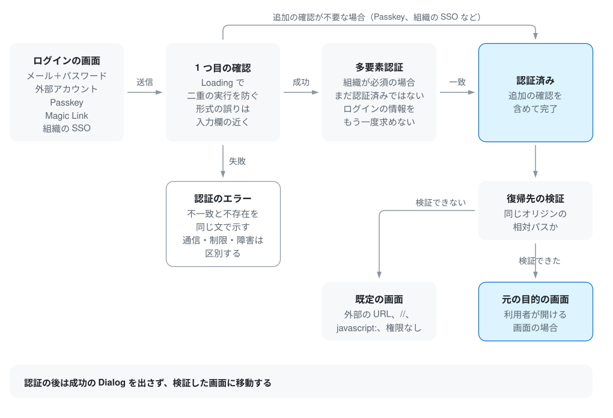
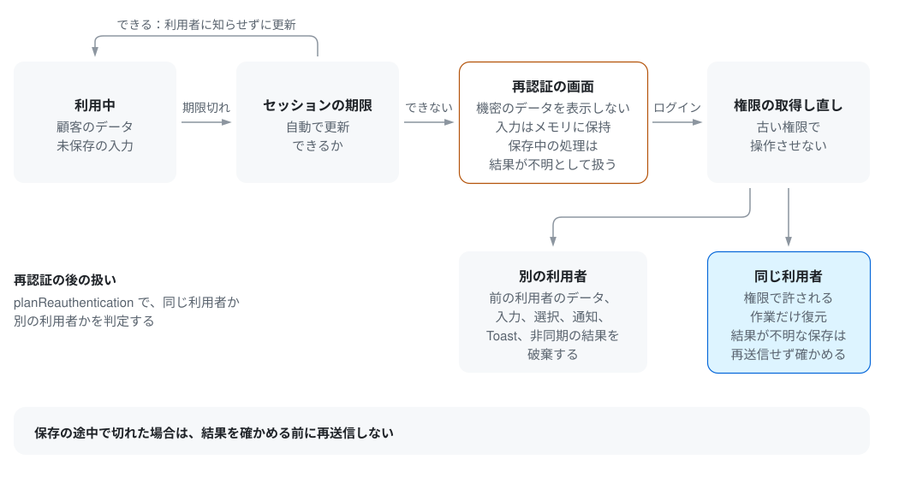

# Authentication

ログイン、多要素認証、新規登録、メールの確認、パスワードの再設定、セッション切れの再認証、ログアウトとアカウントの切り替えを、必要最低限の手順で安全に行う。

状態：v0.1 確定候補（設計と実装の方針は承認済み。Patterns Integration Review の前） ・ 実装：[`auth-layout.tsx`](../../../registry/patterns/auth-layout.tsx)、[`password-input.tsx`](../../../registry/patterns/password-input.tsx)、[`verification-code-input.tsx`](../../../registry/patterns/verification-code-input.tsx)、[`auth-feedback.tsx`](../../../registry/patterns/auth-feedback.tsx)、[`auth-flow.ts`](../../../registry/patterns/auth-flow.ts) ・ 全体：[System & Account](system-and-account.md)

## 目的

利用者が、製品を使い始める前と使っている途中の認証を、考えなくても終えられるようにする（原則 01、07）。認証のために不要な入力や判断を求めない。一方で、アカウントの存在の開示、外部の URL への移動、別の利用者のデータの混在、確認できていない処理を成功として示すことを防ぐ（原則 08）。

## 使用条件

- 認証の前の画面（ログイン、新規登録、パスワードの再設定、メールの確認）と、認証の途中の画面（多要素認証）。
- 利用中にセッションが切れた場合の再認証。
- ログアウトと、アカウントやワークスペースの切り替え。

実際の認証、認可、セッションの管理、メールの送信は製品の基盤が行う。この Pattern は、画面の構成、入力、状態の扱い、判断の基準を定める。

## 構成

<picture>
  <source media="(prefers-color-scheme: dark)" srcset="../../diagrams/auth-flow-dark.svg">
  
</picture>

| 部分 | 内容 | 部品 |
| --- | --- | --- |
| 画面全体 | ナビゲーションのない画面。高さ、スクロール、スキップリンク、`<main>` | 既存の `MinimalShell`（App Structure） |
| 配置 | ロゴ、見出し、説明、フォーム、補助の操作。フォームの最大幅は 400px | `AuthLayout` |
| 入力 | メールアドレス、パスワード、確認コード、同意 | `Field`、`Input`、`Checkbox`（Components）、`PasswordInput`、`VerificationCodeInput` |
| フォーム全体のエラー | 認証情報の不一致、通信の失敗、試行回数の制限、障害、期限切れ | `AuthFormError` |
| 処理の知らせ | 「メールを送信しました」「パスワードを変更しました」など | `AuthStatus` |
| 判断 | 復帰先、メールアドレスの最小限の確認、コードの整形と確認、パスワードの確認（ログインと新規の設定）、再認証の後の扱い | `auth-flow.ts` |
| 破棄の確認 | 未保存の変更がある場合のログアウトと切り替え | `AlertDialog`（プレビューの `DiscardAlert`。統合時に Unsaved Changes に置き換える） |

### レイアウト

- 既存の Minimal Shell を使う。`AuthLayout` は Shell の中身の配置だけを持つため、Minimal Shell の全画面にも、資料のページの枠の中にも置ける（資料のページでは、`h-dvh` の Shell と 2 つ目の `<main>` を置けない）。
- フォームの最大幅は 400px（`max-w-100`）で、中央に置く。背景は製品の標準の背景（`bg-background`）。
- 製品を識別できるロゴ（製品名を含む）を、見出しの上に置く。
- Primary Button は全幅（`w-full`）。外部アカウントなどの補助の方式は、Outline の全幅のボタンにする。
- 高さを固定しない。画面の高さが足りない場合は、Minimal Shell の `<main>` が上から並べてスクロールする（中央に寄せたまま上を切らない）。
- 既存の利用者のログインのたびに、製品の紹介を表示しない。

## バリエーション

### 配置

| `variant` | 使う場合 | 狭い幅（コンテナが 48rem 未満） |
| --- | --- | --- |
| `minimal`（既定） | ほとんどの製品 | そのまま |
| `card` | 境界に意味がある場合。背景に画像や色がある、ほかの内容と並ぶなど | そのまま（境界線と余白） |
| `split` | ブランドや製品の価値を伝える必要がある場合（新規登録が多い製品など） | 横の面（`aside`）を表示せず、フォームだけにする |

判定は画面の幅ではなく、`AuthLayout` の幅（Container Query `@container/auth`）で行う。

### 認証方式

すべての方式を標準の必須にしない。製品と利用者に合う方式を優先して示し、組織のポリシーで方式が指定されている場合はそれに従う。

| 方式 | 使う場合 | 画面の構成 |
| --- | --- | --- |
| メールアドレス＋パスワード | 多くの製品の標準 | メールアドレス、パスワード、「パスワードを忘れた場合」、全幅の「ログイン」 |
| 外部アカウント（Google、Microsoft など） | 利用者が業務でそのアカウントを使っている場合 | 「または」の区切りの下に、Outline の全幅のボタン。組織のポリシーで禁止されている場合は表示しない |
| Passkey | 対応する端末と利用者が多い場合 | Outline の全幅のボタン。端末の所持と生体認証などを確かめるため、追加の確認を省いてよい（製品が判断する） |
| Magic Link | ログインの頻度が低く、パスワードを覚えさせたくない製品 | メールアドレスと「ログイン用のリンクを送る」。送信後は、アカウントの有無を区別しない文で知らせる |
| 組織の SSO | 組織が認証基盤を指定している場合 | 「組織の SSO でログイン」だけ。その組織のログインでは、ほかの方式を表示しない |
| 多要素認証 | 組織のポリシー、扱うデータの重要度で必要な場合 | 1 つ目の確認の後の画面。確認コードの入力欄は 1 つ |

プレビューの例（`signInMethodsFor`）は、`model.ts` の `orgSettings` に従う。本社営業部（`requireMfa: true`、`allowSocialLogin: true`）はパスワード、外部アカウント、Passkey と多要素認証、西日本営業部（`requireSso: true`、`allowSocialLogin: false`）は組織の SSO だけを示す。実際の認証プロバイダーには依存しない。

### 画面

| 画面 | 構成 |
| --- | --- |
| ログイン | 方式、フォーム全体のエラー、処理の知らせ、アカウントの作成（任意） |
| 多要素認証 | 方式ごとの説明（送信先や桁数）、1 つの確認コードの入力欄、再送信（送信する方式だけ）、別の方法（登録している方式だけ）、ログインに戻る |
| 新規登録 | メールアドレス、新しいパスワード（要件を入力の前から示す）、利用規約への同意（必須）、お知らせの受け取り（任意。初期は未選択） |
| メールの確認 | 送信後の説明、再送信（サーバーが間隔を制限する）、メールアドレスの変更 |
| パスワードの再設定 | 申請、送信後（アカウントの有無を区別しない）、リンクの期限切れ・無効、新しいパスワード |
| 再認証 | 前の利用者のメールアドレスを固定したログイン、「別のアカウントでログイン」 |

## 動作

### 入力

- 既存の Field と Input を使う。検証のタイミングは [forms.md](../components/forms.md#5-検証のタイミング) に従う（入力中は示さず、フォーカスが外れたときと送信時に確かめる。IME で変換中は確かめない）。
- 必要な入力が揃うまで要求を送らない。ボタンは押せる状態のままにし、押したときに入力欄の近くに理由を示し、最初の誤りの欄にフォーカスを移す（[button.md](../components/button.md) の「無効にする場合は理由を示す」）。
- `autocomplete`：ログインと新規登録のメールアドレスは `username`、パスワードは `current-password`（ログイン）と `new-password`（新規登録、再設定）、確認コードは `one-time-code`、連絡先としてのメールアドレス（再設定の申請、アドレスの変更）は `email`。
- メールアドレスは `type="email"`（モバイルのキーボード）にし、フォームに `noValidate` を付けて、ブラウザの形式の検証を使わない。`checkEmailFormat` は明らかな誤り（空、「@」がない、全角の「＠」、「@」の前後が空、空白）だけを知らせる。`user@localhost`、国際化ドメイン、「+」を含むアドレスを拒否しない。
- 自動入力、パスワードマネージャー、コピー＆ペーストを妨げない（`paste` を取り消さない、`maxLength` で切り詰めない）。
- パスワードの確認は、用途（`checkPasswordInput` の `purpose`）で分ける。どちらも値を変換しない（前後の空白を取り除かない、文字を正規化しない）。

| `purpose` | 使う欄 | 確かめること |
| --- | --- | --- |
| `current` | ログイン、再認証 | 空かどうかだけ。製品の `requirements` を渡しても使わない（以前の方針で作ったパスワードでログインできるように）。空白だけのパスワードも空として扱わない |
| `new` | 新規登録、パスワードの再設定、変更 | 空かどうかと、製品が定義した `requirements` |
- 新しいパスワードの再入力欄を機械的に置かない。表示の切り替えで確かめられるため省く。再設定の画面には、対象のアカウント（ユーザー名）を読み取り専用の欄で置き、パスワードマネージャーがどのアカウントのパスワードかを判断できるようにする。

### パスワードの表示

- 初期状態は非表示。切り替えのボタンは入力欄の右端に置き、`type="button"` でフォームを送信しない。
- 名前は「パスワードを表示」で固定し、状態を `aria-pressed` で伝える。
- 切り替えても入力値を変えない。入力欄にフォーカスがあった場合は、フォーカスと選択の範囲を戻す。ポインターで押した場合は、入力欄からフォーカスを移さない。

### 新しいパスワードの要件

- 要件は製品が `PasswordRequirement`（`id`、`label`、`test`）で定義し、`evaluatePasswordRequirements` で達成の状態を求める。Registry は文字の種類の規則を持たない。
- 要件は入力の前から一覧で示し、入力欄の説明（`aria-describedby`）として関連付ける。達成の状態は、アイコンと色だけでなく文字（読み上げの「達成」「未達成」）でも伝える。入力ごとに読み上げさせない。
- サーバーでも同じ方針を確かめる（クライアントの確認だけに頼らない）。

### 認証のエラー

| 種類（`AuthErrorKind`） | 表示する場所 | 色 | 次の行動 |
| --- | --- | --- | --- |
| `invalid-input`（入力の形式） | 入力欄の近く（`FieldError`） | destructive | 直し方を示す |
| `invalid-credentials`（認証情報の不一致） | フォーム全体（`AuthFormError`） | destructive | 「パスワードを再設定する」 |
| `network`（通信の失敗） | フォーム全体 | destructive | もう一度試す（同じボタン） |
| `rate-limited`（試行回数の制限） | フォーム全体 | warning | 時間をおく、パスワードを再設定する |
| `service-unavailable`（認証のサービスの障害） | フォーム全体 | warning | 入力の誤りではないことと、時間をおくこと |
| `expired`（コード、リンク、確認の途中の期限切れ） | フォーム全体 | warning | 新しいコード、やり直し |

- 認証情報の不一致とアカウントの不存在を区別できない文にする（「メールアドレスまたはパスワードが正しくありません」）。
- エラーを示してもフォーカスを移さない。送信した位置で読み上げを聞き、そのまま入力を直せる。
- 実際のアカウントの列挙の対策、試行回数の制限、応答の時間と内容の安全性は、バックエンドの責務である。

### 多要素認証

- 確認コードの入力欄は 1 つ。桁ごとの見た目（間隔）は許容するが、入力欄を分けない。
- 値は文字列のまま扱う（先頭の 0 を失わない）。桁数を固定せず、`maxLength` で切り詰めない。
- 整形（`normalizeVerificationCode`）で、製品の認証コードの意味を変えない。既定では、区切り（半角・全角の空白、ハイフンと「ー」などの横線）を取り除くだけで、次の変換は製品が指定した場合だけ行う。

| 指定 | 既定 | 製品が指定する場合 |
| --- | --- | --- |
| `separators` | `"remove"`（区切りを取り除く） | 区切りに意味があるコードでは `"keep"` |
| `fullWidth` | `"keep"`（全角の英数字を変えない） | 全角の数字・英字を半角と同じ意味として扱う製品は `"convert"` |
| `uppercase` | `false`（大文字・小文字を変えない） | 大文字・小文字を区別しないコード（リカバリーコードなど）だけ `true` |

- 想定外の文字（数字のコードの英字、記号、変換していない全角の文字）は取り除かない。取り除くと、利用者が入力したものと異なるコードを送信するため。送信の前に `checkVerificationCode`（`format`、`length`）で確かめ、入力欄の近くに示す（「確認コードは数字だけで入力してください」）。
- 桁数の超過は、切り詰めずに送信の前に示す（「確認コードは 6 桁で入力してください（入力：7 桁）」）。要求を送らない。
- 大文字・小文字を区別するコードでは、`uppercase` を指定しない。この場合、入力欄は `autoCapitalize="none"` になり、モバイルのキーボードが先頭の文字を大文字にしない。
- IME の変換中（`compositionstart` から `compositionend` まで）は、値を整えず、`onValueChange` と `onComplete` を呼ばない。確定したときに 1 回整える。
- 自動入力（`autocomplete="one-time-code"`）とペーストは、通常の入力と同じく整える。自動で送信する場合は、`length` と `onComplete` を渡す。`onComplete` は確定した値の文字数が `length` と一致したときに、同じ値で 1 回だけ呼ぶ。自動で送信するかは製品が決める（プレビューは初期状態で送信しない）。
- 再送信は、送信する方式（SMS、メール）を提供する場合だけ示す。間隔はサーバーが制限し、待ち時間をボタンの近くに文字で示す。
- 代替の方式（認証アプリ、SMS、リカバリーコード）は、利用者が登録している方式だけを示す。リカバリーコードを発行していない利用者には、その方式を示さない。
- 確認の結果を反映する範囲は、確認の ID、方式、送信したコードの世代とする（プレビューの `useAuthAction(scope)` に `${challenge.id}:${method}:${issue}` を渡す）。次の応答は、届いても画面に反映しない。
  - 方式を変えた後に届いた、前の方式の確認の結果と、SMS の送信の結果（送信の応答で方式を SMS に戻さない）。
  - コードを再送信した後に届いた、前のコードの確認の結果（新しいコードの画面に「正しくありません」を出さない）。
  - 前の方式・前のコードの確認が実行中でも、新しい方式・新しいコードの確認を始められる（古い操作の Loading で新しい操作を止めない）。
- 前の方式の確認がサーバーで成功していた場合も、その結果は反映しない。プレビューの模擬のサーバーでは、その確認の ID はサーバーで使用済みになり、次の確認は「確認の有効期限が切れました」になる（最初からログインし直す）。実際の挙動は製品の認証基盤による。
- コードの誤りは、残りの回数とともにフォーム全体に示す。上限に達した場合や確認の有効期限が切れた場合は、入力を止め、「ログインに戻る」を示す。
- 多要素認証の途中で、ログインの情報（パスワード）をもう一度入力させない。1 つ目の確認が済んだら、パスワードを state に残さない。
- 追加の確認が完了するまで、認証済みとして扱わない（`onAuthenticated` を呼ばない）。

### 新規登録

- 利用の開始に必要な情報（メールアドレス、パスワード、必要な同意）だけを尋ねる。名前、会社、利用目的は Onboarding か実際の利用時に移す。
- 利用規約への同意（必須）と、お知らせの受け取り（任意、初期は未選択）を分ける。
- 招待のリンクから開いた場合は、招待したメールアドレスを固定し、招待した人とワークスペースを示す。招待のトークンでアドレスを確認済みとして扱える場合は、確認のメールを省く（製品の判断）。法令、本人確認、契約上必要な手続きは省略しない。
- 登録済みのメールアドレスでも、未登録の場合と同じ画面と文にする（登録済みであることは、そのアドレスへのメールで知らせる）。

### メールの確認とパスワードの再設定

- 送信後の画面の文は、実際に送ったメールの内容と矛盾させない。登録済みと未登録で同じ文にする（「メールを送信しました。メールの案内に従って、登録を完了してください」）。
- 再設定の申請では、アカウントの有無を開示しない（「〜がアカウントに登録されている場合は、リンクを送信しました」）。
- 実際に送信できなかったメールを、送信済みとして表示しない。送信に失敗した場合は、失敗を示し、「送信」の操作を残す。
- リンクの期限切れと無効（使用済み）を区別し、再設定のリンクを送り直す操作を示す。
- 新しいパスワードを設定した後は、多要素認証を省かないよう、ログインの画面に戻して「パスワードを変更しました」と知らせる（成功の Dialog を出さない）。

### 認証処理と遷移

- 認証中は Button の `loading` を使う。加えて、要求の開始を ref で同期的に判定し、Enter の連打やボタンの連続の押下で二重に送信しない。
- 認証の後は、元の目的の画面への復帰を優先する。`resolveReturnTo` で復帰先を検証する。詳細は次の「復帰先の検証」。
- 認証の後に、不要な成功の Dialog を出さない。

### 復帰先の検証

方針：安全性を確定できない値は許可しない。固定の回数の復号で危険な形を探すのではなく、受け付ける条件をすべて満たす値だけを受け付ける。

`toSafeReturnPath(raw, { maxLength, maxDecodeRounds })` は、次をすべて満たす場合だけ `raw` をそのまま返し、それ以外は `null` を返す。

| 条件 | 拒否する値の例 |
| --- | --- |
| 文字列で、長さが 1 以上 `maxLength`（既定 2048）以下。不正な `maxLength`（NaN、0 以下）は既定値にする | 非文字列、`""`、2049 文字以上 |
| `/` で始まり、`//` で始まらない（スキームと相対のパスを含まない） | `https://evil.example/`、`javascript:alert(1)`、`//evil.example`、`w/hq/home` |
| バックスラッシュを含まない | `/\evil.example` |
| 制御文字（C0、DEL、C1）と、見た目に現れない書式の文字（双方向の制御、ゼロ幅、行と段落の区切り、BOM）を含まない。前後の空白も、解析で値が変わるため拒否される | `/\t/evil.example`、`/w/\u202ehq`、` /w/hq/home` |
| ドットのセグメント（`.`、`..`。`%2e` を含む）を含まない | `/w/hq/../hq/home`、`/w/%2e%2e/x`、`/.//evil.example` |
| WHATWG URL として解析（`new URL(raw, "https://…invalid")`）しても、オリジンが変わらず、`pathname + search + hash` が `raw` と一致する（正規の形） | エンコードしていない空白・日本語・`'` を含む値 |
| `decodeURIComponent` を値が変わらなくなるまで繰り返す（最大 `maxDecodeRounds` 回、既定 4 回）。各段階が上の条件（オリジンの確認を含む）を満たし、互換の分解（NFKC）の後も満たす | `/%2F%2Fevil.example`、`/%252F%252Fevil.example`、`/a/%2e%2e%2f%2fevil.example`、`/%EF%BC%8Fevil.example`（全角の「／」） |
| 復号が例外にならない（不完全なエンコード、不正な UTF-8 のバイト列） | `/w/hq/customers?q=100%`、`/w/hq/%ZZ`、`/w/%C0%AF` |
| 上限の回数の復号で、値が変わらなくなる | 5 回以上エンコードした `/` |

- 受け付けた場合に返す値は `raw` と同じ文字列で、検証の後に別の変換をしない（検証した値と、実際に移動する値を一致させる）。そのため、`/a/../b` を `/b` に直して受け付けることはしない。
- 製品は、`encodeURIComponent` でエンコードした正規の値を復帰先に入れる。エンコードしていない日本語や空白を含む値は拒否される（既定の画面に移動する）。
- 既知の制約：`%` を文字として含む値（`?q=100%25`）は、1 回の復号の後に不完全なエンコード（`100%`）になるため拒否する。復号を繰り返すルーターでの安全性を確定できないため。

`resolveReturnTo(raw, { fallback, isAllowed, maxLength?, maxDecodeRounds? })` の規則：

| 場合 | 結果 |
| --- | --- |
| `raw` が空、`null`、`undefined` | `fallback`（`reason: "missing"`） |
| `toSafeReturnPath` で拒否 | `fallback`（`reason: "unsafe"`）。`isAllowed` を呼ばない |
| `isAllowed(path)` が `true` | `accepted`（`path` は `isAllowed` に渡した値と同じ） |
| `isAllowed(path)` が `true` 以外（`false`、`undefined`、`"yes"` などの truthy な値を含む） | `fallback`（`reason: "not-allowed"`） |
| `isAllowed` が例外を投げた、関数ではない | `fallback`（`reason: "check-failed"`） |
| `fallback` 自体が `toSafeReturnPath` で拒否される | 移動先は定数の `SAFE_DEFAULT_RETURN_PATH`（`"/"`）。結果に `invalidFallback: true` を付ける |

- `isAllowed` は必須。内部のパスであることだけで、その画面を開いてよいと判断しない。ワークスペースの所属、画面ごとの閲覧権限、存在しない画面の扱いを製品が判断する。別のワークスペースへの移動も `isAllowed` で判断する（プレビューの `canOpenPath` は、所属していないワークスペースと権限のない画面に `false` を返す）。
- `fallback` は `isAllowed` に渡さない。製品は、利用者が常に開ける画面か、開けない場合を自ら扱う画面（ワークスペースの選択など）を渡す。
- 製品に固有の遷移先が安全かどうかは、この関数では判断できない。任意の URL に移動する内部のエンドポイント（`/redirect?to=`、`/logout?next=` など）、別のアプリを開く画面、ダウンロードを始める画面は、製品が `isAllowed` で拒否する（製品の責務）。
- 拒否した場合は既定の画面に移動する。拒否した値（外部の URL）を画面に表示しない。理由（`reason`）は記録と案内に使う。
- クライアントの判定は表示と移動のためのもの。移動した先の画面の認可は、サーバーが要求ごとに確かめる。

### セッション切れ

<picture>
  <source media="(prefers-color-scheme: dark)" srcset="../../diagrams/session-reauth-dark.svg">
  
</picture>

- 安全に自動で更新できる場合は、利用者に知らせずに更新する。画面に何も表示しない。
- 再認証が必要な場合は、機密のデータを画面から取り除いてから案内する。再認証の画面の背後に、データを表示し続けない（重ねて隠すのではなく、描画しない）。
- 再認証の画面では、前の利用者のメールアドレスを固定し、「別のアカウントでログイン」を置く。多要素認証が必要な組織では、再認証でも求める。
- 再認証の後は、権限を取得し直してから内容を表示する。同じ利用者であることだけを理由に、以前の作業を復元しない。2 段階で決める。
  1. `planReauthentication({ previousUserId, userId, previousWorkspaceId, workspaceId, hasUnconfirmedMutation })` が候補を返す。どの場合も `restoreWork: false`。
  2. 同じ利用者（`kind: "same-user"`）の場合は、製品が `checks` の項目を現在の認可で確かめ、その結果（`ReauthVerification`）を `decideReauthenticationRestore(plan, verification)` に渡して最終的に決める。

| 候補（`kind`） | 扱い | 破棄するもの（`discard`） |
| --- | --- | --- |
| `different-user`（前の利用者がわからない場合を含む） | 復元しない。前の利用者の保存の結果を、新しい利用者の権限で照会したり再送信したりしない | 入力、認証情報、通知、キャッシュ、非同期処理の結果、結果が不明な保存 |
| `different-workspace`（同じ利用者で、別の組織） | 前の作業をそのまま復元しない。前のワークスペースのデータを照会しない | 入力、通知、キャッシュ、非同期処理の結果、結果が不明な保存 |
| `same-user` | `checks`（アカウント、ワークスペース、閲覧権限、編集権限、対象のデータ、結果が不明な保存）を確かめる | 最終の判断で決める |

`decideReauthenticationRestore` の判断（上から順に適用する。`true` と確かめた項目だけを許可として扱い、確かめていない項目や `true` 以外の値は許可しない）：

| 確かめた結果 | `restoreWork` | `showTarget` | `allowEdit` | 理由（`reason`） |
| --- | --- | --- | --- | --- |
| アカウントが違う（`sameAccount` が true ではない） | false | false | false | `different-account`（別の利用者と同じく破棄する） |
| ワークスペースが違う | false | false | false | `different-workspace` |
| 閲覧できない | false | false | false | `no-view-permission`（対象と保持した入力を表示しない。保存の結果も照会しない） |
| 対象のデータがない | false | false | false | `target-missing` |
| 対象のデータが変わった | false | true | 編集の権限による | `target-changed`（入力を自動で復元しない。製品が差分を示すなどする） |
| 編集できない | false | true | false | `no-edit-permission`（読み取り専用で表示し、入力を破棄する） |
| 結果が不明な保存を照会できていない | false | true | false | `pending-unresolved`（同じ保存を繰り返させない。照会をやり直す） |
| すべて確かめた | true | true | true | なし |

- 保存の途中でセッションが切れ、応答が届かなかった場合は、結果が不明として扱う。再認証の後に、再送信せずにサーバーの状態を照会して確かめる。保存されていれば「保存されていたことを確かめました」、されていなければ入力を戻して、もう一度保存するよう案内する（自動で再送信しない）。
- 保存の結果の照会にも、現在の認可が必要である。照会は再認証で発行した現在のセッションで行い、サーバーはその時点の閲覧の権限で応答を決める。閲覧の権限を失った利用者には、保存されたかどうかも返さない（プレビューの `loadNote` は、セッションと `customers.view` を確かめる）。
- プレビューの例（`#/authentication` の「セッション切れと再認証」）は、「再認証の後の権限」（変わらない、編集の権限がなくなる、閲覧の権限がなくなる）と「再認証の後のワークスペース」（同じ、別のワークスペース）を切り替えて確かめられる。

### ログアウトとアカウントの切り替え

- 通常のログアウトでは、確認の Dialog を表示しない。ログアウトを Destructive の赤にしない（取り消せない破壊的な操作ではない）。
- 未保存の変更がある場合だけ、破棄を確かめる（Unsaved Changes。初期実装ではプレビューの `DiscardAlert`）。アカウントとワークスペースの切り替えも同じ。
- アカウント、ワークスペース、認証の状態が変わった場合は、次を前のスコープから引き継がない。Data Browsing v0.1 のスコープの境界（`scopeKey`）と同じ考え方を使う。

| 対象 | 扱い |
| --- | --- |
| データ | 破棄して、新しいスコープで取得する（`useBrowseData` の `scopeKey`） |
| 選択、フィルター、検索語 | 破棄する（スコープごとに部品を作り直す、`key={scope}`） |
| 未保存の入力 | 破棄する（未保存の変更がある場合は、切り替えの前に確認する） |
| 権限 | 新しいスコープで取得し直す |
| 通知 | 新しいスコープのものに置き換える |
| Toast | 前のスコープで出したものを閉じる |
| 非同期処理の結果 | 開始したスコープの最新の処理の結果だけを反映する（`useScopeGuard`。A → B → A でも反映しない） |

## アンチパターン

| 避ける | 理由 | 代わりに |
| --- | --- | --- |
| すべての認証方式を並べる | 選ぶ負荷が増え、組織のポリシーに反する方式も示す | 製品と組織に合う方式だけ |
| ログインのたびに製品の紹介を表示する | 既存の利用者の操作を遅らせる | 紹介は新規登録や Split の横の面だけ |
| 確認コードの入力欄を桁ごとに分ける | ペースト、自動入力、削除、読み上げが分かれる | 1 つの入力欄 |
| コードを数値に変換する、`maxLength` で切る | 先頭の 0 を失う、空白入りのペーストが途中で切れる | 文字列のまま整える |
| コードの想定外の文字を取り除いて送る、既定で大文字や半角にする | 利用者が入力したものと異なるコードを送る。大文字・小文字を区別するコードが一致しなくなる | 区切りだけを取り除き、変換は製品が指定する。想定外の文字は送信の前に示す |
| IME の変換中にコードを整える、自動で送信する | 未確定の文字を送る、変換を妨げる | 確定してから整え、送信する |
| 「このメールアドレスは登録されていません」 | アカウントの有無を開示する | 不一致と不存在を同じ文に |
| 形式の誤りをフォームの上にまとめて示す | どの欄を直すかわからない | 入力欄の近く |
| 過剰なメールアドレスの形式の検証 | 有効なアドレスを拒否する | 明らかな誤りだけ |
| ログインの欄に新規のパスワードの規則を適用する | 以前の規則で作ったパスワードでログインできない | 空でなければ送信する |
| パスワードの再入力欄を機械的に置く | 入力の負荷が増える | 表示の切り替え |
| 切り替えのボタンが `type="submit"` | 押すとフォームが送信される | `type="button"` |
| 送信できなかったメールを「送信しました」 | 届かないメールを待たせる | 送信の結果を示す |
| 復帰先の URL をそのまま使う | 外部のサイトへ誘導される（オープンリダイレクト） | `resolveReturnTo` |
| 復帰先を正規化してから使う、内部のパスであることだけで受け付ける | 検証した値と移動する値が異なる。権限のない画面や別のワークスペースに移動する | 正規の形だけを受け付け、`isAllowed` で確かめる |
| 同じ利用者であることだけで、再認証の後に作業を復元する | 別の組織のデータや、閲覧の権限を失った情報を表示する | 現在の認可で確かめてから（`decideReauthenticationRestore`） |
| 多要素認証の前に認証済みとして扱う | 追加の確認を省いて画面に入れる | 完了まで未認証 |
| 認証の後に成功の Dialog | 目的の画面に着くまでの操作が増える | そのまま移動する |
| 再認証の画面の背後に機密のデータを残す | 認証されていない状態で読める | 描画しない |
| 保存の途中で切れた要求を無条件に再送信する | 二重に保存される | 結果を確かめてから |
| ログアウトの確認の Dialog、赤のログアウト | 破壊的でない操作を重く見せる | 未保存の変更がある場合だけ確認 |
| アカウントを切り替えても前の選択や Toast を残す | 別のスコープに操作が適用される | スコープごとに破棄する |

## 状態管理

| 状態 | 持つ場所 | 内容 |
| --- | --- | --- |
| 画面の段階 | 製品（プレビューは `SignInScreen` の内部） | 資格情報の入力、多要素認証、リンクの送信後 |
| 認証の状態 | 製品 | 未認証、追加の確認が必要、認証済み。追加の確認が完了するまで認証済みにしない |
| 入力 | 画面の state（メモリ） | パスワードとコードは、ストレージ、URL、ログ、分析、永続化した下書きに書かない |
| 要求の状態 | 画面（`useAuthAction` の例） | 実行中の操作。キーごとに ref の Ticket で二重の実行を防ぎ、scope（多要素認証では確認の ID・方式・コードの世代）が変わった後とアンマウントの後の結果を反映しない（`useScopeGuard`） |
| エラー | 画面 | 入力欄ごとの誤りと、フォーム全体の `AuthFormErrorValue`（`id` で読み上げ直す） |
| セッション | 製品 | 有効、自動で更新中、期限切れ、再認証の後の確認中 |
| 保持した作業 | 製品（メモリ） | 未保存の入力、結果が不明な保存。再認証の後に `planReauthentication` の候補と、現在の認可で確かめた結果（`decideReauthenticationRestore`）で扱いを決める |
| スコープ | 製品 | アカウント × ワークスペース。変わったら世代を進める（`useScopeGuard`） |

認証（Authentication）、認可（Authorization）、契約（Entitlement）、スコープ、保存の状態（Mutation State）は別々に持つ（[system-and-account.md](system-and-account.md)）。1 つの Boolean や 1 つの error で表さない。

## アクセシビリティ

| 用途 | 指定 |
| --- | --- |
| フォーム全体のエラー | 常に置いた `role="alert"` の領域（`AuthFormError`）。空の間は `sr-only` で配置から外す（`display: none` にしない） |
| 処理の知らせ | 常に置いた `role="status"`（`AuthStatus`） |
| フォーカスが外れたときの入力の誤り | フォームに 1 つ置いた `aria-live="polite"` の領域 |
| 送信時の入力の誤り | 最初の誤りの欄にフォーカスを移す |
| パスワードの表示 | 名前は固定、状態は `aria-pressed` |
| 新しいパスワードの要件 | 入力欄の説明（`aria-describedby`）。達成の状態を文字でも示す |
| 確認コード | 1 つの入力欄、`inputmode="numeric"`、`autocomplete="one-time-code"`。桁数は説明の文で伝える |
| 別の方法 | `aria-expanded` を付けたボタンで一覧を開閉する |
| Loading | Button の `loading`（フォーカスを保ち、`aria-disabled` で押せない） |
| 再認証の後 | フォーカスを奪わない。復元や確認の結果は `role="status"` で知らせる |

- モバイルでは Split を解除し、フォームを先に示す。ソフトウェアキーボードが表示されても、Minimal Shell の `<main>` がスクロールし、入力欄と送信のボタンに届く。
- 入力文字は 16px（Input の既定）で、iOS の Safari の拡大を起こさない。
- 動きを減らす設定では、Spinner の回転を止める（`motion-safe:animate-spin`）。

## セキュリティ上の注意

- パスワード、確認コード、リカバリーコードを、LocalStorage、SessionStorage、URL、履歴の状態（`history.state`）、ログ（コンソール）、分析のイベント、永続化した下書きに含めない。1 つ目の確認が済んだら、パスワードを state から消す。
- パスワードの欄は `spellCheck={false}`。表示中（`type="text"`）にスペルチェックの対象にしない。
- 復帰先は `resolveReturnTo` で検証し、拒否した値を表示しない。復帰先のワークスペースと権限はサーバーでも確かめる（クライアントの判定は表示のためのもの）。
- 未認証の利用者に、アカウントの存在を開示しない（ログイン、新規登録、再設定、Magic Link）。応答の内容だけでなく、応答の時間の差も製品の責務で抑える。
- セッションが切れている間は、機密のデータを描画しない。
- 再認証で別の利用者になった場合は、前の利用者のデータ、入力、認証情報、通知、キャッシュ、非同期処理の結果、結果の確認を破棄する。同じ利用者でも、別の組織になった場合と閲覧の権限を失った場合は、前の作業を復元しない。
- Passkey や組織の SSO で多要素認証を省くかは、製品とセキュリティの方針で決める。
- パスワードマネージャーの拡張機能が、入力欄の右端に独自のアイコンを置く場合がある。切り替えのボタンと重なる場合の調整は、実際の拡張機能で確かめる（初期実装では未確認）。

## 製品側の責務

- 認証の処理（パスワード、コード、トークン、Passkey、外部プロバイダー、SSO の検証）、試行回数の制限、アカウントの列挙の対策、応答の安全性。
- メールの送信、トークンの発行・検証、期限の管理、再送信の制限。
- セッションの発行、更新、破棄、キャッシュの削除、ほかのタブとの同期。
- パスワードの方針（`PasswordRequirement` の定義と、サーバーでの確認）。
- 組織のポリシーによる方式の選択（`signInMethodsFor` は例）。
- API のエラーを `AuthErrorKind` に対応させること。
- 復帰先の権限の判定（`isAllowed`。ワークスペースの所属、画面ごとの閲覧権限、別のワークスペースへの移動）と、実際の画面の移動（ルーター）。製品に固有の遷移先（任意の URL に移動する内部のエンドポイントなど）の検証。復帰先に入れる値のエンコード（`encodeURIComponent`）。
- 確認コードの仕様（桁数、文字の種類、大文字・小文字を区別するか、全角の文字を同じ意味として扱うか）を `normalizeVerificationCode` と `checkVerificationCode` に指定すること。自動で送信する場合の二重の送信の防止。
- 再認証の後の、現在の認可による確認（アカウント、ワークスペース、閲覧権限、編集権限、対象のデータ）と、結果が不明な保存の照会（照会の API。現在の認可で応答する）。`decideReauthenticationRestore` の `discard` に従って破棄すること。
- 法令、本人確認、契約上必要な手続き。

## 実装例

```tsx
<MinimalShell>
  <AuthLayout logo={<ProductLogo />} title="ログイン">
    <div className="flex flex-col gap-6">
      <AuthStatus>{status}</AuthStatus>
      <AuthFormError error={error} />
      <form noValidate onSubmit={submit} className="flex flex-col gap-6">
        <FieldGroup>
          <Field invalid={!!emailError}>
            <FieldLabel>メールアドレス</FieldLabel>
            <Input type="email" autoComplete="username" value={email} onChange={…} onBlur={…} />
            {emailError && <FieldError>{emailError}</FieldError>}
          </Field>
          <Field>
            <FieldLabel>パスワード</FieldLabel>
            <PasswordInput autoComplete="current-password" value={password} onChange={…} />
          </Field>
        </FieldGroup>
        <Button type="submit" className="w-full" loading={pending}>ログイン</Button>
      </form>
    </div>
  </AuthLayout>
</MinimalShell>
```

```tsx
// 認証の後の移動先
const destination = resolveReturnTo(searchParams.get("returnTo"), {
  fallback: `/w/${defaultWorkspace}/home`, // 不正な場合は "/"（invalidFallback: true）
  // 必須。ワークスペースの所属と閲覧権限（製品の関数）。任意の URL に移動する内部のエンドポイントもここで拒否する
  isAllowed: (path) => canOpen(user, path) && !path.startsWith("/redirect"),
})
router.replace(destination.path) // 検証した値そのもの

// 確認コード（製品の指定：6 桁の数字、全角の数字は半角と同じ意味）
<VerificationCodeInput value={code} onValueChange={setCode} format="numeric" fullWidth="convert" />
const check = checkVerificationCode(code, { format: "numeric", length: 6 }) // 送信の前に確かめる（切り詰めない）

// パスワード
checkPasswordInput(password, { purpose: "current" }) // ログイン：空かどうかだけ
checkPasswordInput(password, { purpose: "new", requirements }) // 新規の設定：製品の要件

// 再認証の後
const plan = planReauthentication({ previousUserId, userId, previousWorkspaceId, workspaceId, hasUnconfirmedMutation })
if (plan.kind !== "same-user") discardAll(plan.discard) // 入力、認証情報、通知、キャッシュ、非同期の結果…
else {
  const access = await fetchAccess({ signal }) // 現在の認可
  const pending = plan.confirmPending && access.canView ? await querySaveResult({ signal }) : undefined // 照会も現在の認可で。再送信しない
  const decision = decideReauthenticationRestore(plan, {
    sameAccount: session.userId === previousUserId,
    sameWorkspace: session.workspaceId === previousWorkspaceId,
    canView: access.canView,
    canEdit: access.canEdit,
    target: await checkTarget({ signal }), // "unchanged" | "changed" | "missing"
    pendingMutation: pending,
  })
  discard(decision.discard)
  if (decision.restoreWork) restoreDraft()
}
```

プレビュー：`#/authentication`（レイアウト、ログインと認証方式、多要素認証、新規登録とメールの確認、パスワードの再設定、復帰先の検証、セッション切れと再認証、ログアウトとアカウントの切り替え）。画面の部品は `preview/src/pages/system-account/auth-screens.tsx`、模擬のサーバーは `preview/src/data/system-account/auth-server.ts`（`window.__fdSaAuthServer`）。

## コードと資料の区分

| 区分 | 内容 | 理由 |
| --- | --- | --- |
| Registry のコード | `AuthLayout`、`PasswordInput`、`VerificationCodeInput`、`AuthFormError`、`AuthStatus`、`authErrorCopy`、`resolveReturnTo`、`toSafeReturnPath`、`SAFE_DEFAULT_RETURN_PATH`、`checkEmailFormat`、`normalizeVerificationCode`、`checkVerificationCode`、`evaluatePasswordRequirements`、`checkPasswordInput`、`planReauthentication`、`decideReauthenticationRestore` | 復帰先の検証、コードの整形、フォーカスと選択の保持、読み上げの領域、再認証の後の判定は、製品ごとに書き直すと誤りやすい |
| 組み合わせの例（プレビュー） | ログイン、多要素認証、新規登録、メールの確認、パスワードの再設定（申請、送信後、リンクの問題、新しいパスワード）、再認証の各画面（`auth-screens.tsx`）、セッション切れとログアウトの例（`authentication-page.tsx`） | 画面の段階と方式の組み合わせは、製品の認証基盤で変わる。1 つの巨大な認証の部品にしない |
| 設計の資料だけ | 方式の選び方、Card と Split を使う条件、エラーの種類と表示の場所、スコープの境界で破棄するもの | 製品ごとの判断で、コードでは決められない |
| 製品の責務 | 認証、セッション、メール、トークン、方針、権限の判定、ルーター | 製品の基盤に依存する |

認証のフローの状態を持つ hook（`useSignIn` など）は Registry に置かなかった。画面の段階、方式、API の形が製品の認証基盤（ライブラリ、OIDC、自社の API）で大きく異なり、1 つの hook にすると特定の基盤に寄るため。プレビューの `useAuthAction(scope)`（キーごとの二重の実行の防止、scope が変わった後の古い応答の破棄、アンマウントの後の結果の破棄、終了時の `release`）は、既存の `useScopeGuard` と Button の `loading` の組み合わせで足りる。

## 独自に判断した事項

| 判断 | 理由 |
| --- | --- |
| `AuthLayout` を Minimal Shell と分けた | 資料のページでは `h-dvh` の Shell と 2 つ目の `<main>` を置けない。Shell の高さとスクロールは既存の `MinimalShell` に任せる |
| Split の解除をコンテナの幅（48rem）で判定する | 資料の枠、Dialog、狭い Shell の中でも同じ判定にするため。画面の幅のメディアクエリでは枠の中で誤る |
| 送信のボタンを無効にせず、押したときに理由を示す | button.md の「理由を示せない場合は押せる状態のまま」に従う。要求は送らないため「実行を制限」を満たす |
| 切り替えのボタンの名前を固定し、`aria-pressed` で状態を伝える | 名前と状態の両方を変えると、押した結果がわかりにくい |
| 確認コードの誤りをフォーム全体のエラーにした | 認証情報の不一致はフォーム全体という 3.6 の規則に合わせた。入力欄にも `aria-invalid` を付ける |
| 試行回数の制限、障害、期限切れを warning にした | Destructive の赤は本当のエラーに限る。利用者の操作の誤りではない |
| コードの整形は区切りを取り除くだけにし、想定外の文字を取り除かない（v0.1 で変更） | 初期実装は数字以外をすべて取り除いていたため、「12a456」が「12456」として送信された（製品のコードの意味を変える）。想定外の文字は送信の前に入力欄の近くで示す |
| 全角の英数字の変換を既定にしない（v0.1 で変更） | 全角と半角を同じ意味として扱うかは、製品のコードの仕様で決まる。プレビューの製品は `fullWidth: "convert"` を指定している |
| `toSafeReturnPath` は、拒否する形を探すのではなく、受け付ける条件をすべて満たす値だけを受け付ける（v0.1 で変更） | 初期実装は 3 回までの復号で危険な形を探していた。復号の回数、ルーターの正規化の違いで確認から漏れる値をなくすため、値が変わらなくなるまで復号し、上限で確定しない値、不完全なエンコード、正規の形でない値を拒否する |
| 受け付けた値を変換せずに返す（v0.1 で変更） | 初期実装は解析した後の値（`/a/../b` → `/b`）を返していた。検証した値と移動する値を一致させるため、正規化で値が変わる入力は拒否する |
| `%` の後が 16 進数でない形を拒否する（v0.1 で変更） | 初期実装は「100%」を受け付けていた。復号を繰り返すルーターでの結果を確定できないため。`%` を含む検索の条件は既定の画面に移動する（既知の制約） |
| `isAllowed` を必須にした（v0.1 で変更） | 内部のパスであることだけで閲覧を許可しないため。例外と true 以外の値は拒否する |
| 再認証の後の判断を、候補（`planReauthentication`）と最終の判断（`decideReauthenticationRestore`）に分けた（v0.1 で変更） | 初期実装は `permissionsStillAllow` の 1 つの真偽値で復元を決めていた。アカウント、ワークスペース、閲覧と編集の権限、対象のデータ、結果が不明な保存を別々に確かめるため |
| 復帰先の値にバックスラッシュを含むパスは、検索語であっても拒否する | 安全側に倒す。必要な製品は、検索語を復帰先から外して渡す |
| 新しいパスワードの設定の後は自動でログインしない | 自動でログインすると多要素認証を省くことになるため。ログインの画面で「パスワードを変更しました」と知らせる |
| Passkey と組織の SSO では、プレビューの多要素認証を省いた | Passkey は所持と生体認証などを確かめ、SSO は組織の基盤が多要素認証を行うため（製品の判断の例として示す） |
| 新規登録の送信後の文を「メールを送信しました。メールの案内に従って、登録を完了してください」にした | 登録済みのアドレスには確認のメールではなく「登録済み」のお知らせを送るため、両方に正確な文にした |
| ログアウトの後は、プレビューでは「ログアウトしました」を `role="status"` で知らせる | 成功の Dialog の代わり。実際の製品ではログインの画面に移動する |
| リカバリーコードの大文字・小文字の扱いを、プレビューで切り替えられるようにした | Registry の既定は大文字にしない（区別するコードの意味を変えない）。プレビューの製品の既定は「区別しない」（`uppercase: true`。サーバーも大文字にそろえて比べる）。「区別する」では入力のまま送る |

## 統合時に確認する事項

- Forms & Workflows の Form Layout、Create & Edit の入力仕様（検証のタイミング、エラーの概要、読み上げ）と、`EmailField` の例の動作を合わせる。統合の前は Components の forms.md に従った。
- Unsaved Changes：ログアウトと切り替えの確認は、プレビューの `DiscardAlert` を使っている。統合時に Unsaved Changes の部品と文言に置き換える。
- Confirmation：再認証、ログアウトに確認の Dialog を使わない方針が、Confirmation の判断基準と一致するか。
- Settings：セキュリティの設定（パスワードの変更、多要素認証の登録、Passkey の登録）の画面で `PasswordInput` と `VerificationCodeInput` を使う場合の構成。
- System States：認証のサービスの障害（`service-unavailable`）を、System Banner と同時に示す場合の重複の扱い。
- Notifications：セキュリティの通知（新しい端末からのログイン）と、ログイン・再認証の関係。
- Permission States：復帰先の権限の判定（`canOpenPath` の例）と、`access.ts` の判定を共通にするか。
- 統合の検証画面では、`AuthShell`（Minimal Shell の全画面）の中に各画面を置き、`headingLevel={1}`（既定）にする。

## 検品

`preview/tests/system-account-auth.spec.ts`（ブラウザ）、`preview/tests/system-account-auth-logic.spec.ts`（ブラウザを使わない）。

| 対象 | 確かめること |
| --- | --- |
| 資料のページ（@webkit） | h1 が 1 つ、操作の名前、横スクロールなし、比較の見本が inert、320px |
| Minimal、Card、Split | 400px 以下、中央、全幅の Primary Button、ロゴ、Card の境界、Split の横の面（狭い幅・モバイルでは非表示） |
| 高さが足りない画面 | 枠の中のスクロール、先頭から表示、最後の操作に届く、320 × 480 のページで送信のボタンに届く |
| 入力の検証と IME | 空の送信で入力欄の近くに誤り・最初の欄にフォーカス・要求なし、フォーカスが外れたときの検証と読み上げ、有効な珍しいアドレスを拒否しない、IME の変換中の値を変えない・自動で送信しない（Chromium の CDP） |
| autocomplete | `username`、`current-password`、`new-password`、`email`、`one-time-code`、`inputmode`、`maxlength` なし、paste を取り消さない |
| パスワードの表示 | 初期は非表示、値・フォーカス・選択の範囲の保持、`type="button"`、`aria-pressed`、Enter と Space、送信しない（@webkit） |
| ログインと新規のパスワードの違い | ログインは短いパスワード・空白だけのパスワードも送信し、前後の空白を取り除かない、新規登録は要件の誤りで送信しない、要件を入力の前から示し説明として関連付ける（ブラウザと純粋な関数の両方） |
| 認証失敗の安全な表示 | 不一致と不存在で同じ文、役割 alert、次の行動、フォーカスを移さない、通信・制限・障害の区別と色 |
| 確認コード | ペースト（空白・ハイフン・全角）、クリップボード（Chromium）、自動入力（値の置き換えの input イベント）、先頭の 0、桁数の超過（切り詰めず送信しない）、想定外の文字（取り除かず送信しない）、大文字・小文字を区別するリカバリーコード（大文字にしない、`autocapitalize="none"`）、期限切れ、試行回数の上限、再送信の間隔、代替の方式とリカバリーコードは登録した方式だけ |
| 二重実行の防止 | Enter の連打と Loading 中の押下で要求が 1 回（ログイン、確認コードの自動送信）。応答の保留と解放で順序を決める |
| 古い応答 | コードの再送信の後に届いた前のコードの確認の結果、方式の変更の後に届いた確認と送信の結果を反映しない（応答の保留と解放、AbortSignal に従わないサーバー） |
| メールの確認と再設定 | 送信後、再送信（サーバーの制限）、アドレスの変更、リンクを開く、送信の失敗を送信済みにしない、登録済みと未登録で同じ文、期限切れ・使用済みのリンク、新しいパスワードの後にログインの画面で知らせる |
| 目的の画面への復帰 | 多要素認証の完了まで未認証、完了後に元の画面、Dialog なし（@webkit） |
| 不正な復帰先 | 純粋な関数：指示書の列挙した 14 種類（通常の内部パス、外部 URL、プロトコル相対、バックスラッシュ、制御文字、ドットのセグメント、多重エンコード、正規化の後に外部 URL になる形、不完全なエンコード、長すぎるパス、不正な fallback、権限のない内部ページ、別のワークスペースへの移動、`isAllowed` の例外）を表形式で確かめ、表がすべての種類を含むことも確かめる。ブラウザ：外部の URL、`//`、`javascript:`、エンコードした形、バックスラッシュ、権限のない画面、復帰先の表 |
| セッション切れ | 機密のデータを描画しない（@webkit）、自動の更新を表示しない |
| 同じ利用者での再認証 | 権限を取得し直してから復元、編集の権限がない場合は復元しない、閲覧の権限がない場合は対象と入力を表示せず保存の結果を照会しない、別のワークスペースでは復元せず前のワークスペースのデータを照会しない、保存の途中で切れた場合に再送信せず結果を確かめる。純粋な関数：同じ利用者の候補は復元しない、確かめた項目ごとの判断、確かめていない値を許可しない |
| 別の利用者での認証 | 前の利用者の入力とデータを表示しない、破棄の対象（入力、認証情報、通知、キャッシュ、非同期の結果、結果が不明な保存） |
| ログアウト | 確認なし、Destructive の色でない、`role="status"` で知らせる |
| 未保存の変更との連携 | 未保存の変更がある場合だけ破棄の確認、編集を続けると入力が残る |
| スコープの境界 | アカウントの切り替えで検索語・選択・入力を破棄、A → B → A で古い結果の Toast を出さない（書き出しの応答を保留し、A → B → A の後に解放する）、切り替えで前の Toast を閉じる、AbortSignal を無視する応答とアンマウントの後の応答を反映しない |
| 認証情報の永続化 | LocalStorage、SessionStorage、Cookie、URL、`history.state`、IndexedDB、コンソール、要求の記録に、パスワード、確認コード、リカバリーコード、新規登録と再設定のパスワードがない（ログイン、多要素認証、新規登録、再設定、再認証の操作の後） |
| Reduced Motion | Loading の Spinner が回転しない |

応答の順序に依存する検品は、模擬のサーバーの保留と解放（`window.__fdSaAuthServer` の `hold[kind]`、`heldCount(kind)`、`release(kind)`）で順序を決める。固定の応答時間や待ち時間を前提にしない（v0.1 で、二重の送信、画面を離れた後の応答、A → B → A、Reduced Motion の検品を書き換えた）。再送信の間隔（`resendCooldownMs`）の検品だけは、サーバーの制限の時間そのものを確かめるため、実際の時間の経過を待つ。

実機（iOS Safari、Android Chrome）、実際のパスワードマネージャー、SMS のコードの実際の自動入力、実際の IME（CDP の `Input.imeSetComposition` で再現した Chromium だけ）、スクリーンリーダー（VoiceOver、NVDA）による検品は行っていない。読み上げは属性と領域の内容まで、自動入力は `autocomplete` の属性と、値の置き換えの input イベントの再現までを確かめている。
