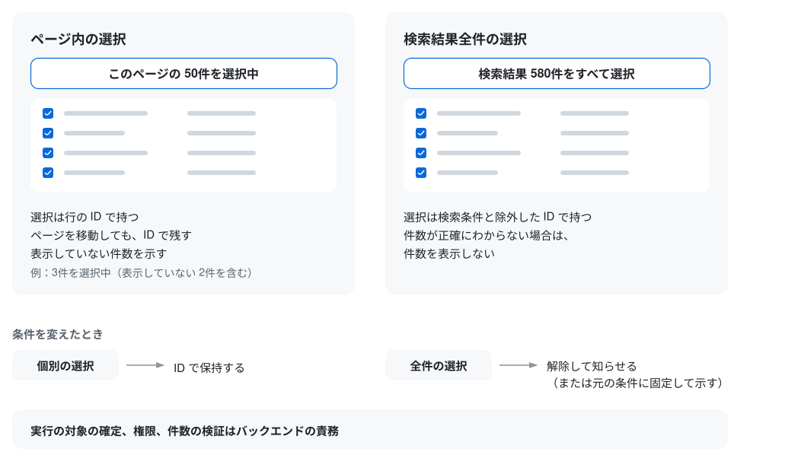
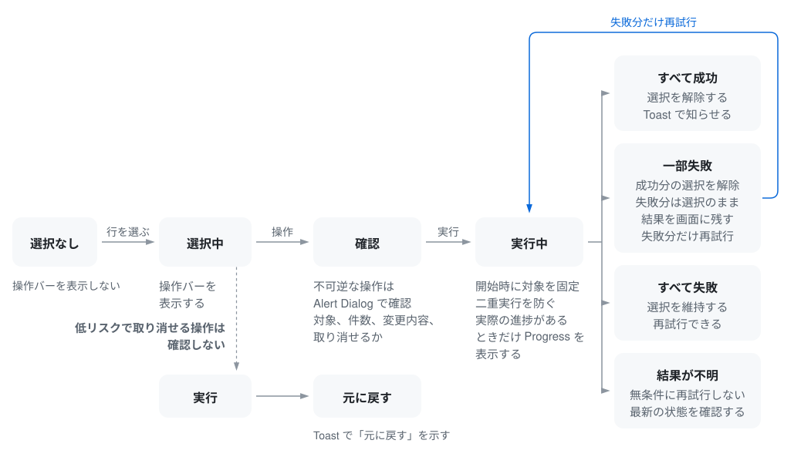

# Bulk Actions

選んだ複数の行に、まとめて操作する。

状態：初期実装 ・ 実装：[`registry/patterns/bulk-selection.ts`](../../../registry/patterns/bulk-selection.ts)、[`registry/patterns/bulk-actions.tsx`](../../../registry/patterns/bulk-actions.tsx) ・ 全体：[Data Browsing](data-browsing.md)

## 目的

同じ操作を 1 行ずつ繰り返す負荷を減らす（原則 07）。選択の範囲、実行の対象、結果を正確に伝え、意図しない行への操作と、重複した実行を防ぐ（原則 08）。

## 使用条件

複数の行に同じ操作を行う業務がある場合だけ置く。行の選択の Checkbox は、一括操作がない一覧には置かない。

## 構成

| 部分 | 部品 | 仕様 |
| --- | --- | --- |
| 選択の列 | `DataTablePageCheckbox`、`DataTableRowCheckbox`（Data Table） | 見出しの Checkbox は、表示中のページの選択できる行だけを対象にする。一部を選んでいるときは Indeterminate |
| 一括操作のバー | `DataTableSelectionBar`（Data Table） | 件数の行と同じ位置に置く。1 件以上選んだときだけ表示する。選択件数と「選択を解除」を示す |
| 一括操作 | Button（Secondary、Ghost）、Dropdown Menu | よく使う操作を 1〜3 個直接置き、その他はメニューにまとめる |
| 確認 | Alert Dialog | 不可逆な操作だけ |
| 実行中 | `BulkRunStatus` | 操作の名前と件数。実際の進捗がある場合だけ Progress |
| 結果 | `BulkResultAlert` | 完了、失敗、結果が不明の件数、失敗した行と理由、失敗した行だけの再試行 |
| 選択と実行の状態 | `useBulkSelection`、`useBulkAction` | 下の「状態管理」 |

### ページ内の選択と全件の選択

<picture>
  <source media="(prefers-color-scheme: dark)" srcset="../../diagrams/bulk-selection-scope-dark.svg">
  
</picture>

### 一括操作の状態の遷移

<picture>
  <source media="(prefers-color-scheme: dark)" srcset="../../diagrams/bulk-action-states-dark.svg">
  
</picture>

## 判断基準

### 操作のバー

- 検索とフィルターを残し、Table の直上（件数の行と同じ位置）に置く。選択の有無で表の位置が動かない（`DataTableSelectionBar` の `min-h-12` と、件数の行の置き換え）。
- 選択が 0 件のときは表示しない。
- 選択件数と、選択の解除を示す。

### 全件の選択

- 検索結果の全件の選択は、ページ内の全選択とは別の、明示的な操作にする。ページ内をすべて選んだときに「検索条件に一致する 580件をすべて選択」を示す。
- 選択の対象を文で区別する（「20件を選択中」「検索条件に一致する 580件をすべて選択中」「検索条件に一致する 580件のうち 578件を選択中」）。
- 正確な件数を確認できない場合は、架空の件数を示さない（「検索条件に一致するすべてのデータを選択」「検索条件に一致するすべてのデータを選択中」）。
- サーバー側の全件の選択は、検索条件と、外した行の ID で持つ（`useBulkSelection` の `all`）。選択の対象の確定、権限の確認、件数の検証、実際の処理の対象の固定は、バックエンドの責務である。

### 条件を変えたときの選択

- ID で選んだ行は、フィルター、ソート、ページを変えても ID で残す。
- いま表示していない選択の件数を示す（「3件を選択中（表示していない 2件を含む）」）。算出できない場合（全件の選択で総件数がわからない場合）は、推測した値を示さない（`hiddenCount` が `null`）。
- 全件の選択は、ID の選択とは別に持つ。条件を変えて選択の対象が暗黙に広がったり、変わったりしないよう、次のどちらかの方式にする。
  - 解除を明示する方式（実装）：条件を変えたら全件の選択を解除し、「検索条件を変更したため、検索結果全件の選択を解除しました」と示す（`notice`、`role="status"`）。
  - 元の条件に固定する方式（資料だけ）：選んだときの条件を保ったまま、「元の条件（契約中・関東）の 580件を選択中」と示す。表示中の行と選択の対象が一致しないため、表の Checkbox の表示と、実行の対象の説明を別に設計する必要がある。
- 別のワークスペースやアカウントに選択を持ち越さない（`scopeKey` が変わったら、すべて解除する）。

### 選択と詳細の表示

- 一括操作の選択（行の面の色、`data-state="selected"`）と、詳細を表示中の行（先頭のセルの線、`aria-current`）を、別の状態として持つ。
- 選択は安定したレコードの ID で持ち、配列の位置で持たない。
- Data Table の選択の見た目（v0.1）を変えない。

### 操作の配置

- よく使う操作を 1〜3 個直接置き、その他は Dropdown Menu にまとめる。
- Secondary と Ghost を基本にする。危険な操作は、既存の Destructive の仕様（文字の色、Dropdown Menu の `variant="destructive"`）を使う。
- 実行できない操作は無効にする。表示中の行が最新の条件の結果と確定していない間（再取得中、取得失敗）は、`DataTableSelectionBar` の `disabled` で一括操作を受け付けない。選択の解除は受け付ける。

### 確認

影響の範囲、取り消せるか、対象から、確かめ方を選ぶ。

| 操作 | 確かめ方 |
| --- | --- |
| 削除などの不可逆な操作 | Alert Dialog。見出しに件数、説明に対象（先頭の 3 件の名前と残りの件数、または検索条件）、変更の内容、取り消せないことを書く。実行のボタンに操作と件数を書く（「12件を削除する」） |
| 取り消せる低リスクの操作（担当者の変更） | 確認を挟まずに実行し、すべて完了した場合は Toast の「元に戻す」で取り消せる |

「本当によろしいですか？」だけで確認を済ませない。

### 実行と結果

- 二重実行を防ぐ。`useBulkAction` の `start` は、実行中の呼び出しを無視する（ボタンの無効化より前に、同じ描画の中の 2 回目の押下も止める）。
- 実行を始めた時点で対象を固定する（`selection.snapshot()` を `start` に渡す）。実行中に選択や検索条件を変えても、処理の対象は変わらない。
- 実際の進捗を取得できる場合だけ、進捗を示す（`reportProgress`）。呼ばない場合は、進捗率を示さない。
- 成功した行の選択を解除する。失敗した行は選択したまま残す（`selection.settle(summary)`）。全件の選択を実行した場合は、失敗した行だけを ID で選んだ状態にする。
- 全件の選択の実行で、要求そのものが失敗した（処理されていない、`requestError.outcome` が `failed`）場合は、選択をそのまま残し、同じ対象で「もう一度実行」できる。
- 失敗した行だけを、同じ操作の内容（`summary.payload`）で再試行できる（`retryFailed`）。再試行しても解決しない失敗（`retryable: false`、権限不足など）は、再試行の対象から除く。再試行の間は、前の結果の表示を残す。
- 実行の間にスコープ（アカウント、ワークスペース）が変わった場合は、実行の待機を中止し、結果を表示せず、新しいスコープの選択を変えない（`useBulkAction` の `scopeKey`、`BulkTarget` の `scope`）。
- 成功の件数と失敗の件数を分けて示す。
- 処理の結果が不明な場合（通信の切断など）は、無条件に再試行しない。再試行のボタンを置かず、「最新の状態を確認」を置く。結果が不明な行は、同じ操作の重複を防ぐため選択を解除し、結果の表示に件数を残す。
- 成功した処理を重複して実行しない。実際の API の実行と冪等性の保証は製品の責務である。
- すべて完了した場合は、選択を解除し、Toast で知らせる（担当者の変更は「元に戻す」を示す。「元に戻す」も `useBulkAction` で実行し、結果を同じ規則で示す）。
- 重要な部分失敗を Toast だけで伝えない。失敗や結果の不明を含む場合は、`BulkResultAlert` を一覧の上に置き、利用者が閉じるまで残す。

## 状態管理

| 状態 | hook | 内容 |
| --- | --- | --- |
| 選択 | `useBulkSelection({ queryKey, query, scopeKey, visibleIds, total })` | `rowSelection` と `onRowSelectionChange` を `useTable` に渡す。`count`、`hiddenCount`、`pageAllSelected`、`allMatching`、`excludedIds`、`notice` |
| 実行の対象 | `selection.snapshot()` | `{ kind: "ids", ids }` か `{ kind: "query", query, queryKey, excludedIds, expectedCount }` |
| 実行 | `useBulkAction({ run, onSettled, scopeKey })`、`start(action, target, payload)` | `running`（操作と固定した対象）、`progress`、`summary`（`payload`、`succeeded`、`failed`、`unknown`、`requestError`） |
| 結果の反映 | `selection.settle(summary)` | 完了と結果が不明の行の選択を解除し、失敗の行を残す。要求そのものが失敗した場合と、スコープが変わった場合は変えない |

- `queryKey` には、ページ番号を含めない（ページを移動しても全件の選択を解除しない）。検索語とフィルターから作る。
- 要求そのものが失敗した場合は、製品が `BulkRequestError(message, "failed" | "unknown")` を投げる。ID で選んだ対象は、その結果を行ごとに割り当てる。全件の選択では、対象の ID がわからないため、`requestError` として扱う。

## レスポンシブ

- 狭い画面では、選択中だけ、一括操作のバーを画面の下に置いてよい。検証画面では、main の中の `sticky` の要素として置く。内容の流れの中に場所を取るため、最後の行、Pagination、フォームの操作を隠さない。
- 下の余白は Safe Area を含める（`--app-safe-bottom`）。
- 多数の操作は Drawer か Dropdown Menu にまとめる。危険な操作は文字を残す（Data Table の仕様）。
- Drawer の中の操作の結果は、Drawer の中に示す。Components の全体統合検品で、狭い画面で Drawer の下部の操作に Toast が重なることを確認している（`toast.md`）。画面の下に一括操作のバーを置く間は、バーの高さを `--toast-offset-bottom` に設定し、Toast をバーの上に表示する。

## アクセシビリティ

- 選択件数の文は `aria-live="polite"`（`DataTableSelectionBar`）。
- 全件の選択の解除の知らせは `role="status"`。
- 実行の開始は、製品が常に置いている読み上げの領域（`aria-live`）で 1 回だけ伝える。`BulkRunStatus` は表示と同時に挿入されるため、`role="status"` を付けない。進捗は Progress の値で伝える。
- 結果は、失敗を含む場合は `BulkResultAlert` の `role="alert"`、すべて完了した場合は Toast。
- 押したボタンが消えた場合は、フォーカスを `<body>` に落とさない。実行を始めたときは `BulkRunStatus`（`tabIndex={-1}`）、すべて完了した後は表の最初の行の名前のボタン（なければ検索欄）、失敗を含む場合は結果の表示へ移す。
- 実際のスクリーンリーダーでの読み上げの回数と順序は、確かめていない（`data-browsing.md` の「未検証の事項」）。

## 実装例

```tsx
const selection = useBulkSelection({
  queryKey: JSON.stringify({ search: q.search, filters: q.filters }),
  query: q,
  scopeKey: workspaceId,
  visibleIds: rows.map((r) => r.id),
  total, // 正確な総件数。わからない場合は null
})
const action = useBulkAction<Query, Patch>({
  scopeKey: workspaceId,
  run: (target, { signal, reportProgress, payload }) => api.bulkUpdate(target, payload, { signal, onProgress: reportProgress }),
  onSettled: (summary) => {
    selection.settle(summary)
    reload()
  },
})

<DataTableSelectionBar
  selectedCount={selection.mode === "ids" ? (selection.count ?? 0) : 0}
  hiddenCount={selection.hiddenCount ?? 0}
  onClearSelection={selection.clear}
  disabled={data.status !== "ready"}
  selectAll={{
    matchingCount: total ?? undefined,
    pageAllSelected: selection.pageAllSelected,
    allSelected: selection.allMatching,
    excludedCount: selection.excludedIds.length,
    onSelectAll: selection.selectAllMatching,
  }}
>
  {action.running ? (
    <BulkRunStatus action={action.running.action} count={…} progress={action.progress} />
  ) : (
    <Button variant="secondary" size="sm" onClick={() => action.start("担当者の変更", selection.snapshot(), { owner })}>担当者を変更</Button>
  )}
</DataTableSelectionBar>
{action.summary && (action.summary.failed.length > 0 || action.summary.unknown.length > 0 || action.summary.requestError) && (
  <BulkResultAlert summary={action.summary} getItemLabel={nameOf} onRetryFailed={action.retryFailed} onCheckLatest={reload} onDismiss={action.dismiss} />
)}
```

プレビュー：`#/bulk-actions`、`#/browsing-app?page=customers`（下部の「検証用の操作」で結果を切り替える）。

## アンチパターン

| 避ける | 理由 | 代わりに |
| --- | --- | --- |
| 選択を配列の位置で持つ | 並べ替えやページの移動で、別の行が選ばれる | 行の ID |
| ページ内の全選択を、検索結果の全件の選択として扱う | 意図しない行に操作が及ぶ | 全件の選択を別の明示的な操作にする |
| 条件を変えても全件の選択を残し、対象を新しい条件に合わせる | 選択の対象が暗黙に広がる | 解除して知らせる、または元の条件に固定して示す |
| 総件数がわからないのに件数を示す | 判断を誤らせる | 件数を示さない |
| バーを表の上に新しく差し込む | 選ぶたびに表の位置が動く | 件数の行と同じ位置に置く |
| すべての操作を Primary で並べる | どれが重要かわからない | Secondary と Ghost、その他はメニュー |
| 「本当によろしいですか？」だけの確認 | 対象と影響がわからない | 対象、件数、変更の内容、取り消せるかを書く |
| 実行中に選択を変えると対象が変わる | 意図しない行に操作が及ぶ | 開始時に対象を固定する |
| 進捗がわからないのに進捗率を示す | 誤った見通しを与える | 進捗率を示さない |
| 部分失敗を Toast だけで伝える | どの行が失敗したかを確かめられない | 結果を一覧の上に残す |
| 結果が不明な行を、自動で、または同じボタンで再試行させる | 重複して実行される | 最新の状態の確認を促す |
| 別のワークスペースに選択を持ち越す | 別の範囲のデータに操作が及ぶ | `scopeKey` で解除する |

## 製品側の責務

- 一括操作の API の実行、冪等性の保証、成功した処理の重複の防止。
- 全件の選択の対象の確定（検索条件と除外した ID から）、権限の確認、件数の検証、処理の対象の固定（バックエンド）。
- 行ごとの結果（成功、失敗と理由、再試行できるか、結果の不明）を返すこと。
- 実際の進捗を取得できる場合の報告。
- 「元に戻す」の処理（変更の前の値の保持）。
