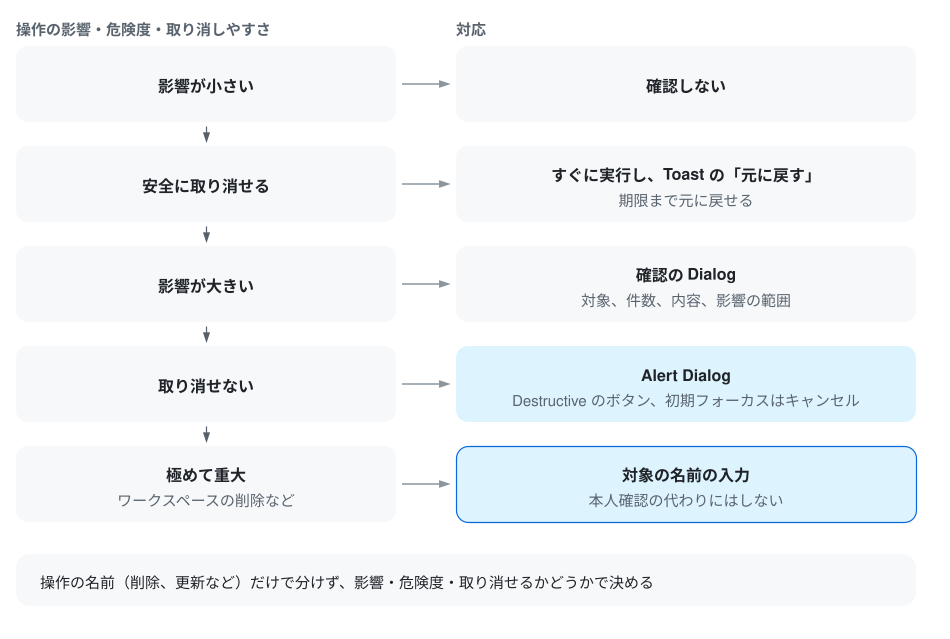

# Confirmation

操作の前に確かめるか、実行した後に取り消せるようにするかを決める。

状態：初期実装 ・ 実装：[`registry/patterns/confirm-action.tsx`](../../../registry/patterns/confirm-action.tsx) ・ 全体：[Forms & Workflows](forms-and-workflows.md)

## 目的

誤った操作による損失を防ぐ（原則 08）。同時に、影響の小さい操作や取り消せる操作に、不要な確認を挟まない（原則 07）。確認では、対象と影響を、判断に必要な分だけ示す（原則 01、04）。

## 使用条件

データを変える操作のすべてで、確認の要否を決める。影響の範囲、危険の大きさ、取り消せるかで判断し、操作の名前（削除、更新など）だけで機械的に分けない。

## 構成

| 部分 | 部品 | 仕様 |
| --- | --- | --- |
| 確認の Dialog | `ConfirmActionDialog` | Alert Dialog の寸法、配置、動き、アクセシビリティをそのまま使う |
| 見出し | `title` | 操作と対象（「3件の顧客を削除しますか？」） |
| 説明 | `description` | 影響の範囲と、取り消せるか |
| 対象の一覧 | `children` | 先頭の 3 件の名前と「ほか N件」など |
| 実行のボタン | `confirmLabel`、`retryLabel`、`variant` | 操作と件数（「3件を削除」）。失敗の後は `retryLabel`（「もう一度削除」） |
| キャンセル | `cancelLabel`（既定「キャンセル」） | Secondary。初期フォーカス |
| 追加の確認 | `confirmationText`、`confirmationLabel` | 対象の名前の入力。一致するまで実行できない |
| 対象の変化 | `targetKey`、`changedNotice` | 開いている間に対象が変わったら警告（Alert の warning）を示す |
| 実行の失敗 | `onConfirm` が `{ error }` を返す | Dialog を閉じずに、原因を Alert（destructive、`role="alert"`）で示す |
| 取り消し | `useUndoableAction({ windowMs })` の `run` | 実行の結果と「元に戻す」を Toast で示す |

<picture>
  <source media="(prefers-color-scheme: dark)" srcset="../../diagrams/confirm-undo-dark.svg">
  
</picture>

## バリエーション

| 操作 | 確かめ方 | 例（プレビュー） |
| --- | --- | --- |
| 影響が小さい | 確かめない。結果を Toast かインラインで知らせる | 一覧の名前の変更（`#/confirmation`） |
| 安全に取り消せる | 確かめずに実行し、Toast の「元に戻す」を示す（`useUndoableAction`） | 顧客のアーカイブ（`#/forms-app?page=customers` の行のメニュー） |
| 影響が大きい | 確認の Dialog（`variant="default"`、実行のボタンは Primary） | 3件の請求書の送信 |
| 取り消せない | 確認の Dialog（`variant="destructive"`、実行のボタンは Destructive） | 担当者の削除、選んだ顧客の削除 |
| 極めて重大 | `confirmationText` で対象の名前の入力を求める | ワークスペースの削除（`#/forms-app?page=settings`） |

## 動作

### 確認の Dialog

- 必要に応じて、対象、件数、操作の内容、影響の範囲、取り消せるかを示す。「確認」「本当によろしいですか？」だけにしない。
- 同じ情報を見出し、説明、ボタンで不必要に繰り返さない（見出しに件数と操作、説明に影響と取り消せるか、ボタンに操作と件数）。
- 初期フォーカスはキャンセル（Alert Dialog の既定）。名前の入力を求める場合は入力欄。実行のボタンに初期フォーカスを置かないため、開いた直後の Enter で実行されない。
- Escape はキャンセル。外側のクリックでは実行も閉じることもしない。
- 名前の入力欄での Enter は何もしない（`preventDefault`）。実行は実行のボタンだけで行う。

### 実行と失敗

- 実行中は、実行のボタンを Loading にし、キャンセル、Escape で閉じない（結果がわからなくなるため）。`onConfirm` の二重の呼び出しを止める。
- 失敗したら Dialog を閉じず、原因を Dialog の中に示す。同じ Dialog から、もう一度実行できる（`retryLabel`）。`onConfirm` が例外を投げた場合も失敗として扱い、「実行できませんでした。時間をおいて、もう一度実行してください。」を示す。
- 成功したら Dialog を閉じる。完了の知らせは製品が Toast かインラインで示す。不要な完了の Dialog を置かない。
- 実行の前の確認、処理中の表示（Loading）、実行の後の結果を分ける。

### 処理の対象

- 対象の考え方は、Data Browsing の [Bulk Actions](bulk-actions.md) と同じにする。確認の時点の対象と、実際の処理の対象を一致させる。
- `targetKey` に、対象を表すキー（ID の一覧、件数、条件から作る）を渡す。開いている間に `targetKey` が変わったら、「表示している間に、対象が変わりました。内容を確かめてから実行してください。」を示し、名前の入力をやり直させる。
- `onConfirm` には、実行のボタンを押した時点で表示していた `targetKey` を渡す。製品は、実行する対象がこのキーと一致するかを確かめる。古い確認の内容で別の対象を実行しない。
- 例：選んだ顧客の削除では、確認の間にほかの利用者がアーカイブした顧客を対象から除き、件数と名前を描き直す。`targetKey` は対象の ID を並べた文字列で、`onConfirm` はそこから削除する ID を決める（「検証用の操作」で再現できる）。
- 権限、対象の範囲、整合性の最後の検証はバックエンドの責務である。

### 追加の確認

- アカウントやワークスペースの完全な削除など、極めて影響の大きい操作では、対象の名前の入力を求めてよい。
- 入力した文字が一致するまで、実行のボタンを無効にする。比較では前後の空白を除き、全角と半角の違いを NFKC でそろえる。一致しない文字を入力している間は「入力した文字が一致していません」を示す。
- セキュリティのために必要な場合は、再認証や承認の流れを使う（製品の責務）。対象の名前の入力を、本人確認や権限の確認の代わりにしない。
- 同じ確認の Dialog を繰り返し表示しない。

### 取り消し（Undo）

- 実際に安全に取り消せる場合だけ使う。取り消しの処理（バックエンド）は製品が持ち、`undo` に渡す。
- `run({ perform, undo, title, undoneTitle, … })` は、`perform` が成功したら、結果（`title`）と「元に戻す」を Toast で示す。失敗したら「実行できませんでした」の Toast を示す。
- 1 回の実行ごとに、別の通知と別の取り消しを持つ。続けて実行しても、別の操作を取り消さない。
- 取り消せる期限（`windowMs`、既定 10000ms）と、実際に取り消せる期間を一致させる。期限でタイマーが通知を閉じる。取り消しの時点でも `Date.now()` で期限を確かめ、ポインターを重ねて通知が残った場合も、期限の後は「元に戻せる時間を過ぎました」を示して受け付けない（`expiredDescription` で、ほかの戻し方を書く）。
- 取り消しに失敗したら「元に戻せませんでした」の Toast で示す。その通知の「元に戻す」は閉じるが、期限の中であれば `run` が返す `handle.undo` で、もう一度取り消せる。
- Toast は消えるため、重要な戻す手段を Toast だけにしない。画面にも戻す手段を置く（例：アーカイブ済みの顧客の一覧の「元に戻す」）。

### 危険な操作の配置

- 低い頻度の危険な操作は、Dropdown Menu の末尾などに分ける（区切り線の後、`variant="destructive"`）。
- 設定の画面では、独立した Section（区切り線、`divider`）に置いてよい。ボタンは Secondary の形で文字を Destructive の色にする。
- 大きな赤い枠や、過剰な警告の表現を標準にしない。

## アンチパターン

| 避ける | 理由 | 代わりに |
| --- | --- | --- |
| 操作の名前だけで確認の要否を決める | 取り消せる削除にも確認が出る。影響の大きい更新に確認が出ない | 影響、危険の大きさ、取り消せるかで決める |
| 「本当によろしいですか？」だけの確認 | 対象と影響がわからない | 対象、件数、内容、影響、取り消せるか |
| 実行のボタンに初期フォーカスを置く | 開いた直後の Enter で実行される | キャンセルに初期フォーカス |
| 外側のクリックで実行する、閉じる | 意図しない結果になる | Alert Dialog の既定（閉じない） |
| 失敗したら Dialog を閉じる | 失敗に気付かない。対象を選び直す必要がある | 閉じずに原因を示し、再試行できる |
| 確認の後に対象が変わっても、そのまま実行する | 確かめていない対象に操作が及ぶ | 変化を示し、表示していた対象で実行する |
| 名前の入力を本人確認の代わりにする | 権限のない利用者も実行できる | 再認証、承認 |
| 取り消せない操作に「元に戻す」を示す | 戻せると誤解させる | 取り消せる場合だけ Undo |
| Toast の表示の期間と、取り消せる期間が異なる | 押しても戻せない、または戻せるのに手段がない | 期限で閉じ、期限を確かめる |
| 戻す手段を Toast だけにする | 見逃すと戻せない | 画面にも戻す手段を置く |
| 確認の後に完了の Dialog を出す | 閉じる操作が増える | Toast かインラインの表示 |
| 危険な操作を大きな赤い枠で囲む | 画面の静けさを損ない、警告に慣れさせる | 分けた位置と Destructive の文字 |

## 状態管理

| 状態 | 持つ場所 | 内容 |
| --- | --- | --- |
| 開閉 | 製品（`open`、`onOpenChange`） | 実行中は `onOpenChange` を呼ばない |
| 実行中 | `ConfirmActionDialog` | 二重の実行を止める印と、Loading の表示 |
| 失敗 | `ConfirmActionDialog` | 原因の文。開き直すと消える |
| 名前の入力 | `ConfirmActionDialog` | 開き直すと消える。対象が変わったら消える |
| 開いたときの対象 | `ConfirmActionDialog` | 開いたときの `targetKey`。実行に成功したら、そのときの値にする |
| 取り消し | `useUndoableAction` | 実行ごとの通知の id、期限（`expiresAt`）、状態（`open`、`undoing`、`done`）、タイマー。アンマウントでタイマーを止める |

`run` は `{ ok: true, handle: { expiresAt, undo } }` か `{ ok: false }` を返す。`undo()` は、期限を過ぎた場合、すでに取り消した場合、失敗した場合に false を返す。

## アクセシビリティ

- Alert Dialog（`role="alertdialog"`）。見出しと説明は `AlertDialogTitle` と `AlertDialogDescription` で関連付ける。
- 初期フォーカスはキャンセル（名前の入力を求める場合は入力欄）。
- 名前の入力欄は Field のラベル（「確認のため「本社営業部」と入力してください」など）で名前を持つ。
- 失敗の原因は `role="alert"`。対象の変化の警告は Alert の warning。
- 取り消しの結果、失敗、期限の後の知らせは Toast（Components の Toast の読み上げ）。

## 製品側の責務

- 実行、取り消しの API と冪等性。
- `targetKey` の作り方と、`onConfirm` に渡された対象と実行する対象の一致の確認。
- 権限、対象の範囲、整合性の最後の検証（バックエンド）。
- 再認証、承認の流れ。
- 完了の知らせ（Toast、一覧の上の表示）と、Toast の外に置く戻す手段。

## 実装例

```tsx
const targets = selectedIds.filter((id) => rows.some((r) => r.id === id)) // 現在も存在する行だけ

<ConfirmActionDialog
  open={open}
  onOpenChange={setOpen}
  variant="destructive"
  title={`${targets.length}件の顧客を削除しますか？`}
  description="削除した顧客は元に戻せません。契約と請求の履歴も表示できなくなります。残す必要がある場合は、アーカイブを使ってください。"
  confirmLabel={`${targets.length}件を削除`}
  retryLabel="もう一度削除"
  targetKey={[...targets].sort().join(",")}
  onConfirm={async ({ targetKey }) => {
    const ids = (targetKey ?? "").split(",").filter(Boolean) // 表示していた対象
    const result = await api.deleteCustomers(ids)
    if (result.error) return { error: result.error }
    toast({ variant: "success", title: `${ids.length}件の顧客を削除しました` })
  }}
>
  <ul>{names.slice(0, 3).map((n) => <li key={n}>{n}</li>)}{names.length > 3 && <li>ほか {names.length - 3}件</li>}</ul>
</ConfirmActionDialog>

// 対象の名前の入力
<ConfirmActionDialog
  open={deleting}
  onOpenChange={setDeleting}
  variant="destructive"
  title="ワークスペース「本社営業部」を削除しますか？"
  description="顧客、契約、請求、取り込みの履歴を含む、すべてのデータを削除します。削除したデータは元に戻せません。"
  confirmationText="本社営業部"
  confirmLabel="ワークスペースを削除"
  onConfirm={() => api.deleteWorkspace(workspaceId)}
/>

// 取り消せる操作
const undo = useUndoableAction()
const archive = (c: Customer) =>
  undo.run({
    perform: () => api.archiveCustomer(c.id),
    undo: (id) => api.restoreCustomer(id),
    title: `${c.name}をアーカイブしました`,
    undoneTitle: `${c.name}を元に戻しました`,
    expiredDescription: "アーカイブ済みの顧客の一覧から戻せます",
  })
```

プレビュー：`#/confirmation`、`#/forms-app?page=customers`（下部の「検証用の操作」で実行と取り消しの結果を切り替える）、`#/forms-app?page=settings`（ワークスペースの削除）。
