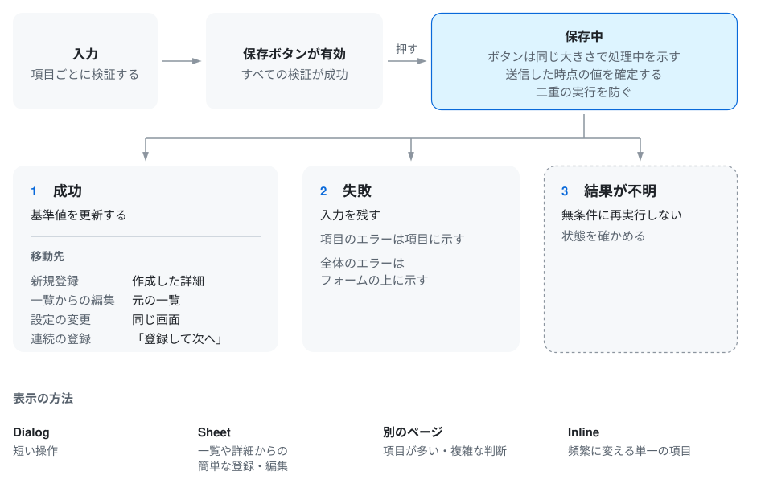
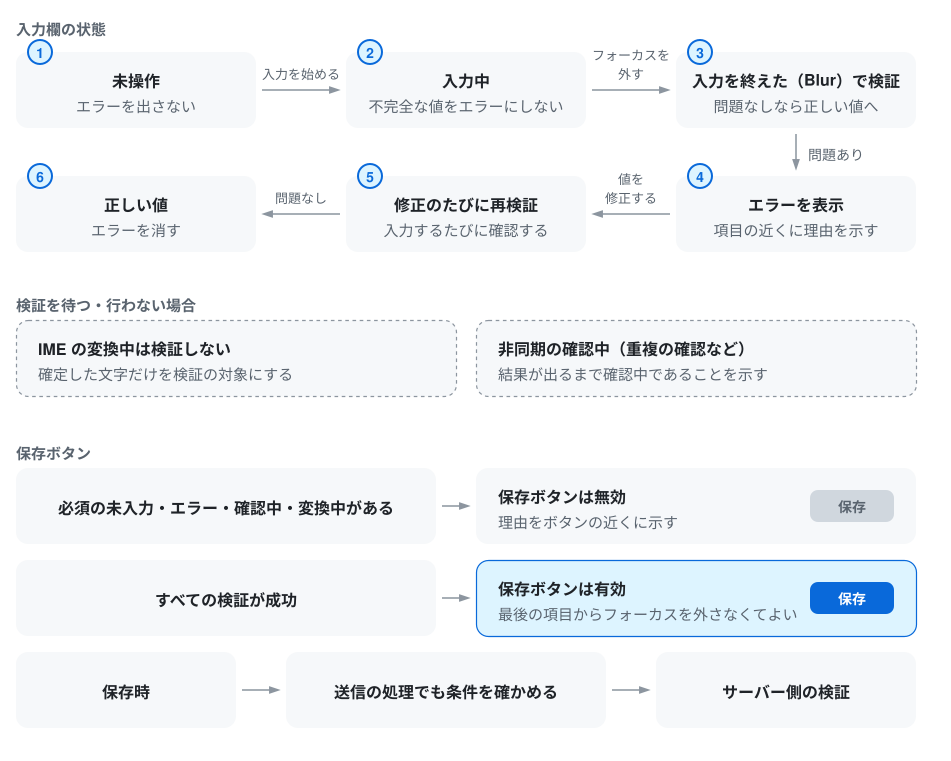

# Create & Edit

データを登録し、編集し、保存する。保存ボタンを押せる条件と、保存の結果を正確に伝える。

状態：初期実装 ・ 実装：[`registry/patterns/form-state.ts`](../../../registry/patterns/form-state.ts)、[`registry/patterns/save-modes.ts`](../../../registry/patterns/save-modes.ts) ・ 全体：[Forms & Workflows](forms-and-workflows.md)

## 目的

入力の問題を、入力した場所で、入力を終えた時点で伝える（原則 01、03）。長いフォームで保存ボタンを押した後にエラーの場所まで戻る負荷をなくす（原則 07）。入力した内容を失わせず、実際の保存の状態と画面の表示を一致させる（原則 08）。

## 使用条件

データの登録、編集、設定の変更のすべてで使う。登録と編集では、フォームの構造、項目の順序、まとまりをできるだけ同じにする。登録と更新の処理、権限、変更できる項目は、製品が分ける。

## 構成

| 部分 | 部品 | 仕様 |
| --- | --- | --- |
| フォームの状態 | `useFormState({ initialValues, fields })` | 下の「状態管理」 |
| 項目の定義 | `FormFields<V>`（`label`、`required`、`requiredMessage`、`isEmpty`、`validate`、`validateAsync`、`active`、`normalize`） | 検証の規則の中身は製品が書く |
| 文字の入力欄 | `form.inputProps(name)` を Input、Textarea に渡す | `name`、`value`、`required`、`onChange`、`onCompositionStart`、`onCompositionEnd`、`onBlur` |
| 選択式の項目 | `form.setValue(name, value, { commit: true })` | Select、Checkbox、日付。選んだ時点で入力を終えたとみなす |
| エラー | `form.error(name)` を FieldError に渡す | 表示する時点のエラーだけを返す |
| 保存ボタン | Button（Primary、`loading`、`disabled={!form.canSubmit}`、`focusableWhenDisabled`、`aria-describedby`） | 文言は操作の結果（「登録する」「保存する」「担当者を変更」） |
| 保存できない理由 | `SaveBlockerNotice`（`blockers`、`detail`、`onFocusField`） | 保存ボタンの近く（[form-layout.md](form-layout.md)） |
| フォーム全体のエラー | Alert（`role="alert"`） | `form.formError`。保存ボタンの上 |
| 送信の処理 | `form.handleSubmit(save, { onBlocked, onSuccess })` | form の `onSubmit` に渡す |
| 即時保存 | `useInstantSave` | 独立した Switch、単一の項目 |
| 自動保存 | `useAutosave` | 文書、メモなどの継続的な入力 |

### 登録・編集・保存の流れ

<picture>
  <source media="(prefers-color-scheme: dark)" srcset="../../diagrams/create-edit-flow-dark.svg">
  
</picture>

## バリエーション

### 表示の方法

項目の数だけで機械的に決めない。操作の内容で選ぶ。

| 表示の方法 | 用途 | 例（プレビュー） |
| --- | --- | --- |
| Dialog | 少数の項目で終わる短い操作 | 担当者の追加（`#/create-edit`） |
| Sheet | 一覧や詳細からの簡単な登録・編集 | 連絡先の変更（`#/forms-app?page=customer&id=cu-1`） |
| 別のページ | 項目が多い、複雑な判断を伴う操作 | 顧客の登録と編集（`page=customer-new`、`page=customer-edit`） |
| Inline | 頻繁に変える単一の項目 | 社内のメモ（顧客の詳細） |

- 閲覧の Sheet と編集の Sheet の区別は、Data Browsing の方針（[list-and-detail.md](list-and-detail.md)）を保つ。
- 閲覧が主な目的の画面では、閲覧と編集を分ける（詳細のページ → 「編集」）。設定の画面など、変更が主な目的の画面は、最初から編集できる状態にしてよい。

### 保存の方式

| 方式 | 用途 | 部品 | 動作 |
| --- | --- | --- | --- |
| 明示的な保存 | 通常の業務のフォーム | `useFormState` | 保存ボタンで保存する |
| 即時保存 | 独立した Switch、単一の項目 | `useInstantSave({ value, save })` | 切り替えた時点で保存する。保存中は次の変更を受け付けない（`change` が false を返す。操作部品を `disabled={pending}` にする）。失敗したら、サーバーが最後に受け付けた値に戻し、`failed` にする |
| 自動保存 | 文書、メモなどの継続的な入力 | `useAutosave({ value, save, delayMs })` | 入力が止まってから（既定 1000ms）保存する。`saved`、`unsaved`、`saving`、`failed` を区別する。保存中に値が変わったら、保存の後に最新の値をもう一度保存する。失敗したら、値が変わるか `retry()` を呼ぶまで自動で繰り返さない |

即時保存の失敗の例：「保存できなかったため、元の設定に戻しました。もう一度切り替えてください」（`#/forms-app?page=settings`、「即時保存を失敗させる」）。

## 動作

### 保存ボタンの有効と無効

**必須の項目の入力が終わり、クライアント側で必要な検証がすべて成功するまで、保存ボタンを無効にする。**

これは利用者が明示的に決めた設計の方針である。入力に不備がある状態で保存ボタンを押させ、そこで初めてエラーを示す方式は、標準にしない。入力を終えた時点で、その場で問題を伝える。ただし、まだ操作していない入力欄に、最初の表示からエラーを示さない。

- 保存の可否（`canSubmit`）と、エラーを表示する時点を分ける。`canSubmit` は、表示に関係なく、表示しているすべての項目の検証が成功し、非同期の検証の結果が出て、IME の変換中の項目がなく、保存中でないときだけ true になる。
- 最後の項目からフォーカスを外さなくても、正しい値を入力した時点で保存ボタンが有効になる（Blur していない正しい最後の項目で、保存を止めない）。
- 保存できない理由が見ただけでわからない場合は、保存ボタンの近くに理由を示す（`SaveBlockerNotice`）。未入力と入力の途中の項目は「あと N 項目を入力すると保存できます」、エラーを表示している項目は「N 項目に修正が必要です」、両方あれば「未入力の項目が N つ、修正が必要な項目が N つあります」、非同期の検証を待つ間は「顧客コードを確認しています」。
- 長いフォームでは、`detail` で該当する項目へ移動するボタンを置く。理由が 3 項目以下（`detailLimit`）なら項目ごとに並べ（「会社名（未入力）」）、超える場合は「最初の項目（会社名）へ移動」だけを置く。
- エラーを色だけで示さない（FieldError のアイコンと文字）。
- 送信の処理でも条件を確かめる（`handleSubmit`）。ボタンの `disabled` だけに頼らない。Enter キー、`requestSubmit`、プログラムからの送信でも、保存できない状態では保存の処理を呼ばない。
- 保存ボタンを `focusableWhenDisabled` で無効にしている間は、1 行の入力欄での Enter（ブラウザの暗黙の送信）が submit にならない。Base UI が、無効のボタンへのクリックを止めるためである。form の `onKeyDown` に `submitOnEnter(event, save)` を指定し、Enter を送信の処理に渡す。保存できない場合は、すべての項目のエラーを表示し、最初の問題の項目へフォーカスを移す。IME の変換を確定する Enter、Textarea の Enter、修飾キー付きの Enter は対象にしない。
- サーバー側でしかわからない重複、同時の編集、権限の変更などのエラーは、保存の後に項目かフォーム全体のエラーとして示す（`FormSaveResult` の `invalid`）。

### 検証のタイミング

<picture>
  <source media="(prefers-color-scheme: dark)" srcset="../../diagrams/form-validation-states-dark.svg">
  
</picture>

| 状態 | 動作 | 実装（`useFormState`） |
| --- | --- | --- |
| 未操作 | エラーを表示しない | `error(name)` は null。保存できない理由は `missing` として数える |
| 最初の入力中 | 入力の途中の不完全な値（「yamada@」など）をエラーとして示さない | 検証の結果は `canSubmit` に反映するが、表示しない（理由の種類は `incomplete`） |
| 入力を終えた・Blur | すぐに検証して示す | `blur(name)` で、値を変えた項目だけ表示の対象にする。選択式の項目は `setValue` の `commit: true` |
| エラーの表示の後 | 修正に応じて再検証する | 描画のたびに現在の値から計算するため、入力のたびにエラーが変わり、正しくなると消える |
| IME の変換中 | 検証を止める | 変換中の項目は `error` が null。非同期の検証を始めない。`canSubmit` は false。`compositionend` の確定した値を検証する |
| 必要な非同期の検証中 | 保存ボタンを無効にする | 同期の検証が成功した値だけを、入力が止まってから（`asyncDebounceMs`、既定 400ms）確かめる。結果を待つ間は理由の種類が `checking` |
| すべての項目の検証が成功 | 保存ボタンを有効にする | `canSubmit` が true |
| 保存時 | 最後の検証とサーバー側の検証を行う | `handleSubmit` は描画の前の値ではなく最新の状態で確かめる。サーバーの `invalid` の結果を項目に示す |

- 非同期の検証の結果は値ごとに持つ。値を変えたら前の値の確認を中止し（`AbortSignal`）、古い値の応答で現在の値の結果を上書きしない。
- 非同期の検証の通信に失敗した場合は `unverified` にし、保存を止めない。保存の時点でサーバーが確かめる。
- 空の任意の項目は検証しない。空とみなす値は、既定で null、undefined、空白だけの文字列、空の配列、false（`isEmpty` で変える）。

### 保存中

- 既存の Button の Loading の仕様を使う（`loading`）。ボタンの寸法を保ち、`aria-busy` を付ける。
- 二重の実行を防ぐ。`handleSubmit` は保存中の呼び出しを無視する（同じ描画の中の 2 回目の送信も止める）。
- 送信した時点の値を確定し、保存の処理に渡す（`submittedValues`）。保存中も入力は変えられる。保存中に変えた項目は、保存の後も未保存として残す（「保存中に変えた内容は、まだ保存していません」）。
- 通常の短い保存で、ページ全体を読み込み中の表示にしない。
- 実際の保存が成功するまで、保存済みと示さない。

### 保存の失敗

| 結果（`FormSaveResult`） | 意味 | 表示 |
| --- | --- | --- |
| `{ status: "invalid", fieldErrors, formError }` | サーバー側の検証で保存できなかった（重複、権限の変更、同時の編集） | 項目のエラーを該当する項目にすぐ表示する。その項目の値を変えるまで、保存を止める。全体の文は `formError` |
| `{ status: "failed", formError }` | 保存されていない（通信の失敗、サーバーの障害） | フォームの上の Alert（destructive）。入力は残す。保存の処理が例外を投げた場合も、この結果として扱う |
| `{ status: "unknown", formError }` | 保存されたかわからない（時間切れ、応答の前の切断） | Alert（warning）。`canSubmit` が false になり、`handleSubmit` も保存の処理を呼ばない（Enter、`requestSubmit`、「保存して移動」を含む）。状態を確かめる操作（「登録されているか確認」）を置き、保存されていれば `markSaved`、保存されていなければ `clearFormError` を呼ぶ |

- 原因と次の操作を書く（例：「サーバーに接続できませんでした。入力した内容は残っています。時間をおいて、もう一度保存してください。」）。

### 保存の成功の後

- 基準値を、サーバーが保存した値（`values` を返した場合）にする。保存中に変えていない項目は、サーバーが正規化した値（前後の空白を除く、メールアドレスの小文字など）にそろえる。
- `onSuccess(saved, { changedWhileSaving })`：保存中に値が変わり、未保存の変更が残っている場合は `changedWhileSaving` が true になる。この場合、保存の後の移動を行わない（移動の確認を開くと、「変更を破棄」で入力が消えるため）。
- 結果が不明（`unknown`）の場合、`submittedValues` にその保存で送信した値を残す。状態を確かめるときは、現在の値ではなく送信した値で照合し、保存されていれば `markSaved(送信した値)` を呼ぶ。送信の後に変えた値は未保存のまま残る。
- 次の作業の目的で移動先を決める。

| 操作 | 移動先 | 例 |
| --- | --- | --- |
| 新規の登録 | 作成したデータの詳細 | 顧客の登録 → 顧客の詳細（`replace`。見出しにフォーカス） |
| 一覧からの編集 | 元の一覧、閲覧の状態 | `from=list` は顧客の一覧、`from=detail` は顧客の詳細 |
| 設定の変更 | 現在の画面に留まる | 設定の各フォーム |
| 続けての登録 | 必要な場合だけ「登録して次へ」 | フォームを空にして、最初の項目にフォーカス |

- 一覧に戻る場合は、Data Browsing の一覧の位置の復元（[list-and-detail.md](list-and-detail.md)）を保つ。
- 利用者が別の移動を求めている間（「保存して移動」など）は、その移動を優先する（例では `nav.pending()` を確かめてから移動する）。

### 完了の知らせ

- 通常は Toast かインラインの表示にする（「株式会社山田商事を登録しました」）。保存のたびに完了の Dialog を出さない。
- 重要な手続き（契約の登録など）では、専用の完了の表示を置いてよい（[multi-step-workflow.md](multi-step-workflow.md)）。

### 既存の資料との関係

- [forms.md](../components/forms.md) の「5. 検証のタイミング」は、送信したときにすべてを検証し、エラーの概要を示す流れを示している。業務の標準のフォームでは、この資料の方針（検証が成功するまで保存ボタンを押せない）を使う。保存できない状態で Enter キー（`submitOnEnter`）や `requestSubmit` などによる送信が行われた場合は、`handleSubmit` がすべての項目のエラーを表示し、`onBlocked` に理由を渡す。例のフォームは最初の項目にフォーカスを移し、保存ボタンの近くの `SaveBlockerNotice` を概要として使う（フォームの上の `role="alert"` の概要は置いていない）。forms.md にも同じ内容を追記した。
- [button.md](../components/button.md) の「無効にする場合は、押せない理由を近くの文字で示す」に従い、理由を保存ボタンの近くに示す。button.md の「無効」の状態は「フォーカスできない」としているが、保存ボタンには `focusableWhenDisabled` を付け、Tab で移ったときに理由を説明として聞けるようにした（[forms-and-workflows.md](forms-and-workflows.md#独自に判断した事項)、レビューで確認する）。

## アンチパターン

| 避ける | 理由 | 代わりに |
| --- | --- | --- |
| 保存ボタンを押させてから初めてエラーを示す | 長いフォームでエラーの場所まで戻る必要がある | 検証が成功するまで無効にし、入力を終えた時点で示す |
| 最初の表示から、未操作の項目にエラーを示す | 何もしていないのに失敗を示される | 入力を終えた項目だけに示す |
| 入力中の不完全な値をエラーにする | 入力の途中で注意をそらす | Blur か、エラーの表示の後の再検証 |
| 最後の項目から離れるまで保存ボタンを有効にしない | 正しく入力しても保存できない | 描画のたびに計算する（`canSubmit`） |
| 押せない理由を示さずに無効にする | 何をすればよいかわからない | `SaveBlockerNotice` と `aria-describedby` |
| ボタンの `disabled` だけで送信を止める | Enter キーやプログラムからの送信で保存される | `handleSubmit` で確かめる |
| 古い非同期の検証の応答を使う | 現在の値に別の値の結果が付く | 値と組で照合する |
| 保存中にページ全体を読み込み中の表示にする | 入力した内容が見えなくなる | Button の `loading` |
| 保存の失敗で入力を消す | 入力をやり直す必要がある | 入力を残し、原因と次の操作を示す |
| 結果が不明な保存を、同じボタンで再実行させる | 二重に登録される | 状態を確かめる操作を置く |
| 保存のたびに完了の Dialog を出す | 毎回閉じる操作が増える | Toast かインラインの表示 |
| 「送信」「OK」のような文言 | 押した結果がわからない | 「登録する」「保存する」「担当者を変更」 |

## 状態管理

`useFormState` は、次の状態を分けて持つ。

| 状態 | 値 | 内容 |
| --- | --- | --- |
| 入力欄の操作の履歴 | `isInteracted(name)` | 利用者が値を変えた項目。フォーカスしただけでは含めない |
| 現在の入力値 | `values` | 製品の型のまま |
| 入力の妥当性 | `canSubmit`、`blockers` | 現在の値から描画のたびに計算する。理由の種類は `missing`、`incomplete`、`invalid`、`checking` |
| エラーの表示 | `error(name)` | 表示の対象の項目だけ。サーバーの検証のエラーはすぐに表示する |
| 未保存の変更 | `isDirty`、`dirtyFields`、`baseline` | 基準値との比較（`normalize` と `stableKey`） |
| 非同期の検証 | `asyncStatus(name)` | `idle`、`pending`、`validating`、`valid`、`invalid`、`unverified` |
| 保存の処理 | `status`、`submitting`、`submittedValues`、`formError` | `idle`、`submitting`、`succeeded`、`failed`、`unknown` |
| IME の変換 | `composing` | 変換中の項目がある |

操作：

| 関数 | 用途 |
| --- | --- |
| `setValue(name, value, { composing?, commit? })` | 値を変える。`commit` は選択式の項目 |
| `blur(name)`、`compositionStart(name)` | 入力を終えた、変換を始めた（`inputProps` が呼ぶ） |
| `reveal(names)`、`revealAll()` | 指定した項目のエラーを表示する（ステップの項目だけ、保存を試みた） |
| `reset(values?)` | 値と基準値を置き換え、操作の履歴、エラー、保存の状態を消す（別のレコード、続けての登録） |
| `discard()` | 値を基準値に戻す（未保存の変更の破棄） |
| `markSaved(values)` | 別の経路で保存した値を基準値にする（下書き、即時保存との組み合わせ） |
| `captureEdits(names)`、`applyAutofill(token, patch)` | 自動補完の応答で、利用者の修正を上書きしない |
| `getSubmitValues()` | 送信する値。表示していない項目を含めない |
| `handleSubmit(save, { onBlocked, onSuccess })` | 送信の処理。保存できた場合だけ true を返す Promise |
| `clearFormError()` | フォーム全体のエラーを消す |

hook が持たないもの：検証の規則の中身、サーバー側の検証、保存の API、保存の後の移動、Toast、入力欄の id とフォーカスの移動。

## アクセシビリティ

- 保存ボタンは無効の間も Tab で移れる（`focusableWhenDisabled`、`aria-disabled="true"`）。`aria-describedby` で `SaveBlockerNotice` の文を説明にする。理由がないときも要素を残し、参照先を保つ。編集のフォームで変更がない間は、`unchanged` で「変更がありません。変更すると保存できます」を支援技術にだけ伝える。
- エラーは Field の `invalid` で入力欄に `aria-invalid` を付け、FieldError の文を説明にする。FieldError に `role="alert"` を付けない（[forms.md](../components/forms.md) のエラーの読み上げ）。
- フォーム全体のエラーは Alert の `role="alert"`。
- 非同期の検証の状態と自動補完の結果は、項目の FieldDescription の `role="status"` で伝える（「登録済みのコードと重ならないかを確かめています」「このコードは使えます」）。
- 保存できない状態での送信では、最初の問題の項目にフォーカスを移す（`onBlocked` と `focusFormControl`）。
- 新規の登録の後は、作成した詳細の見出しにフォーカスが移る（`AppShellMain` の `pageKey`）。「登録して次へ」の後は、最初の項目にフォーカスを移す。
- 即時保存と自動保存の状態は、FieldDescription の `role="status"` で伝える。

## 製品側の責務

- 検証の規則（`validate`、`validateAsync`）と、エラーの文（原因と直し方）。
- サーバー側の検証（重複、同時の編集、権限の変更）と、結果を `FormSaveResult` で返すこと。
- 保存の API、冪等性、時間切れの扱い（応答しない処理を `failed` か `unknown` として返す）。
- 結果が不明な場合の状態の確認の方法（例では、同じ顧客コードの顧客を探す）。
- 保存の後の移動と Toast。
- 登録と更新の処理、権限、変更できる項目の分離。

## 実装例

```tsx
const fields: FormFields<CustomerValues> = {
  kind: { label: "種類", required: true },
  company: { label: "会社名", required: true, active: (v) => v.kind === "corporate", normalize: (v) => v.trim() },
  code: {
    label: "顧客コード",
    required: true,
    validate: (v) => (/^C-\d{4}$/.test(v) ? null : "顧客コードは「C-」と 4 桁の数字で入力してください（例：C-0123）"),
    validateAsync: (v, _all, { signal }) => api.checkCustomerCode(v, { signal }), // 重複なら文を返す
  },
  email: { label: "メールアドレス", required: true, normalize: (v) => v.trim().toLowerCase(), validate: emailRule },
  plan: { label: "契約プラン", required: true, requiredMessage: "契約プランを選んでください" },
  // …
}
const form = useFormState<CustomerValues>({ initialValues: emptyCustomer, fields })
const save = form.handleSubmit((values) => api.createCustomer(values), {
  onBlocked: (blockers) => blockers[0] && focusFormControl(`new-${blockers[0].name}`),
  onSuccess: (saved) => {
    toast({ variant: "success", title: `${saved.company}を登録しました` })
    navigate(`/customers/${saved.id}`, { replace: true })
  },
})
const unknown = form.status === "unknown"

<form noValidate onSubmit={(e) => void save(e)}>
  <Field invalid={!!form.error("code")}>
    <FieldLabel>顧客コード</FieldLabel>
    <Input {...form.inputProps("code")} id="new-code" className="max-w-48" />
    {form.error("code") ? <FieldError>{form.error("code")}</FieldError> : <FieldDescription role="status">{codeStatusText(form.asyncStatus("code"))}</FieldDescription>}
  </Field>
  …
  {form.formError && <Alert variant={unknown ? "warning" : "destructive"} role="alert">…</Alert>}
  <FormActions sticky notice={<SaveBlockerNotice id="new-notice" blockers={form.blockers} hidden={form.submitting || form.composing} detail onFocusField={(n) => focusFormControl(`new-${n}`)} />}>
    <Button type="button" variant="secondary" onClick={cancel} disabled={form.submitting}>キャンセル</Button>
    <Button type="submit" loading={form.submitting} disabled={!form.canSubmit} focusableWhenDisabled aria-describedby="new-notice">登録する</Button>
  </FormActions>
</form>
```

即時保存：

```tsx
const s = useInstantSave<boolean>({ value: saved, save: (next) => api.saveSetting("notify-renewal", next) })
<Switch checked={s.value} onCheckedChange={(v) => s.change(v)} disabled={s.pending} />
```

プレビュー：`#/create-edit`、`#/forms-app?page=customer-new`、`#/forms-app?page=settings`（下部の「検証用の操作」で保存の結果を切り替える）。
