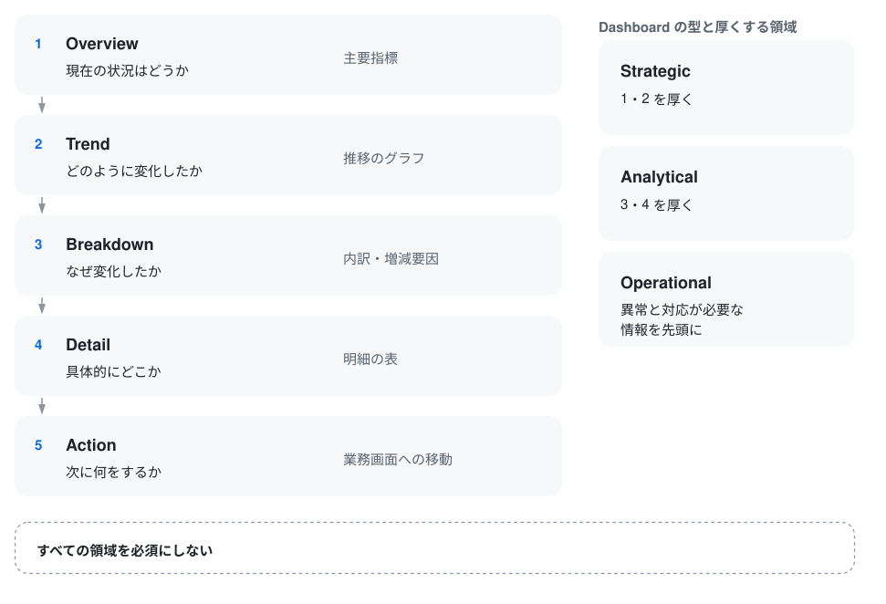

# Dashboard Layout

分析の画面を、利用者が考える順に並べる。

状態：v0.1 確定候補（最終レビュー前） ・ 実装：[`registry/patterns/analysis-region.tsx`](../../../registry/patterns/analysis-region.tsx)（`AnalysisRegion`、`AnalysisScopeNote`）、App Structure の [Page Layout](page-layout.md)、[Section Layout](section-layout.md) ・ 全体：[Data Analysis](data-analysis.md)

## 目的

利用者が、現在の状況から、変化、要因、具体的なデータ、次の行動へと、考える順に読み進められるようにする（原則 03）。情報の重要度と関係を、位置、大きさ、余白で示す（基準 02、04、07）。

## 使用条件

複数の指標、グラフ、表を 1 つの画面で組み合わせ、判断や監視をする画面に使う。1 つのグラフや表だけの画面は、通常のページの構成で足りる。

ダッシュボードの全体を 1 つの部品にしない。Page Layout、Page Header、Section Layout、`AnalysisRegion`、Metric、Chart、Table を組み合わせる。

## 構成

<picture>
  <source media="(prefers-color-scheme: dark)" srcset="../../diagrams/dashboard-flow-dark.svg">
  
</picture>

| 順 | 領域 | 利用者の問い | 内容 |
| --- | --- | --- | --- |
| 1 | Overview | 現在の状況はどうか | 主要な指標、目標（[metric-overview.md](metric-overview.md)） |
| 2 | Trend | どのように変化したか | 推移のグラフ、期間の比較（[period-comparison.md](period-comparison.md)） |
| 3 | Breakdown | なぜ変化したか | 内訳、増減の要因 |
| 4 | Detail | 具体的にどこか | 明細の表（[drill-down.md](drill-down.md)） |
| 5 | Action | 次に何をするか | 業務画面への移動、残りの目標 |

すべての領域を必須にしない。製品と目的に合わせて選ぶ。

### `AnalysisRegion`

1 つの分析の領域。Section Layout の `Section` に、領域ごとのデータの状態と、領域に適用する条件の表示を加える。

| 引数 | 内容 |
| --- | --- |
| `title`、`description` | 見出し（h2 か h3）と補足 |
| `actions` | この領域だけの操作（集計単位、表示形式、この表だけの比較）。見出しの右に置く |
| `conditions` | 全体条件と異なる条件（`AnalysisScopeNote`）。見出しの下に置く |
| `status` | `useBrowseData` の `status`。`loading` は Skeleton を 200ms 遅らせて示す。`refreshing` は前の内容を薄くせずに残し、200ms 後から見出しの右に「更新中」と `staleLabel` を示す |
| `staleLabel` | 再取得の間に表示している前の結果の条件（「2026/11/01〜2026/11/25・関東・月別の結果（前の条件）」）。どの条件の結果かを誤認させない。表示中の結果の集計に実際に使った条件（ワークスペースのスコープと個別条件を加えた後の絞り込み、集計単位、タイムゾーン）から作る。製品は、取得の結果にその条件を含めて返す（取得の条件のキーの文字列を読み直して推測しない。キーには、スコープで加えた条件や、領域ごとの集計単位が含まれない場合がある）。文は省略せずに折り返し、領域の `aria-describedby` で関連付ける（`title` 属性だけに頼らない。タッチ、キーボード、支援技術で全文を確かめられる） |
| `error` | 領域の取得の失敗（`DataRegionError`）。`variant: "warning"` は前の内容を残す、既定は前の条件の内容を表示しない |
| `divider` | 前の領域との間の細い線（Section Layout の `divider`） |

## バリエーション

### 3 つの型

固定のテンプレートではなく、設計の判断の基準として使う。

| 型 | 目的 | 厚くする領域 | 検証画面 |
| --- | --- | --- | --- |
| Strategic Dashboard | 経営・意思決定 | Overview、Trend | `#/analysis-app?page=business`（事業の状況） |
| Analytical Dashboard | 分析・原因の究明 | Breakdown、Detail | `#/analysis-app?page=retention`（顧客維持の分析） |
| Operational Dashboard | 業務・リアルタイムの監視 | 異常と対応が必要な情報を先頭に置く | `#/analysis-app?page=operations`（処理の監視） |

### Chart と Table の配置

| 配置 | 使う場面 | 部品 |
| --- | --- | --- |
| 全幅 | 長い期間の推移、列の多い表 | 領域の中にそのまま置く |
| 均等な複数の列 | 同じ重要度の情報を比べる。高さ、軸の範囲、単位をそろえる | `PageColumns layout="equal"` |
| メイン＋補足 | 主要なグラフと、その内訳や件数 | `PageColumns layout="main-aside"` |
| Chart＋Table | 傾向から具体的なデータへ進む | グラフの下に数値の表 |

画面を埋めるためだけに複数の列にしない。列の切り替えは、画面の幅ではなく内容の幅（Container Query）で行う。

## 動作

### 区切り

Section Layout の優先順位を守る：余白 → 文字の強弱 → 細い線 → 背景 → Card。グラフや指標を機械的に Card で囲まない。Card を入れ子にしない。

### 幅と余白

| 項目 | 値 |
| --- | --- |
| 最大幅 | Page Layout の Wide（1440px）。列の多い監視の表は Full（上限なし）を許容する |
| ページの余白 | デスクトップ 24px、モバイル 16px（Page Layout） |
| 並べたグラフの間 | 24px 以上（`PageColumns` は 32px） |
| 関連する情報の間 | 16〜24px |
| セクションの間 | 48px（`SectionStack spacing="section"`） |
| 大きな分析の章の間 | 64〜96px（`spacing="chapter"`） |

### グラフの高さ

目安：補助のグラフ 96〜160px、標準 240〜320px、主要なグラフ 320〜480px。軸の文字、凡例、データの量、読みやすさで決め、固定の値を機械的に使わない（検証画面の MRR の推移は 320px、解約率の推移は 256px）。

### 監視の指標

監視の画面では、上限がサービスごとに異なる値を 1 つにまとめない。全体のエラー率や「最も遅い応答時間」は、通常の状態でも特定のサービス（メールの送信など）の値になり、異常を示さない。検証画面では「エラー率が上限を超えたサービス」の数と名前、対応が必要なアラートの数、処理件数を示す。独立して取得する領域（口座振替）は、その領域の集計の時刻を示す（ページ上部の更新の時刻とずれることがあるため）。

### 操作の位置

- ページ全体の条件（期間、比較、全体の絞り込み）は、Page Header の直下に、名前の付いたグループ（`role="group"`、「ページ全体の条件」）として置く。
- 領域だけの操作は、その領域の見出しの右（`actions`）。
- 適用の範囲は [analysis-filters.md](analysis-filters.md) に従う。

### スクロール

- ダッシュボードの全体を 1 画面に収めることを目標にしない。
- 最初の表示では、ページの目的（タイトル）、主要な指標、分析の対象の期間、重要な異常や対応が必要な情報を優先する。
- 詳しい情報は、自然なスクロールで確かめられるようにする。入れ子のスクロールの領域を作らない（表の横スクロールは表の領域の中だけ）。
- 常時表示する監視のモニターは例外とする。

### データの取得と更新

- 独立した領域は、個別に読み込み、再取得、エラーを示す（領域ごとの `useBrowseData`）。一部の失敗で、ほかの領域を隠さない。
- 比べる必要のある指標（同じ時点の MRR、契約企業数、売上）は、1 回の要求で取得し、集計の時点をそろえる（検証画面の「主要な指標」）。
- 古い結果を残す場合は、内容を薄くしない（数値と文字のコントラストを保つ）。200ms 後から、見出しの右に「更新中」と、表示中の結果の条件（`staleLabel`）を文字で示す。短い再取得では示さない。
- `staleLabel` は省略せずに折り返す。狭い画面では見出しの下で 2 行以上になる場合がある（表示の出し入れで、見出しの部分の高さが変わる）。1 行に省略して `title` で全文を示す方式は、タッチの操作と支援技術で全文を確かめられないため使わない（v0.1 の最終調整の仕様から変更。理由と影響は [data-analysis.md](data-analysis.md) の「Patterns Integration Review での仕様の変更」）。
- ページの期間と別の期間を使う領域（過去 24 か月の推移）も、`staleLabel` を示す（「過去 24 か月と今後 3 か月・関東の結果（前の条件）」）。
- 安全性に必要な操作の制限は、表示を遅らせず、`useBrowseData` の `status`（変更の操作は `canOperate`）ですぐに行う。
- アカウント、ワークスペース、権限の境界をまたいだ古い結果は表示しない（`useBrowseData` の `scopeKey`。変わった時点で初回の読み込みに戻る）。
- リアルタイムの更新は、値をその場で書き換え、行の順序、フォーカス、スクロールの位置を変えない。新しい項目（アラート）は件数を示し、利用者が押したときに一覧へ加える。自動の更新を止められるようにする。

### カスタマイズ

- 製品が合理的な初期の構成を設計する。
- 追加、削除、並び替え、大きさの変更は、利用者ごとに分析の目的が異なる場合だけ検討する。提供する場合は、設定の保存と、標準の構成への復元を用意する。
- ドラッグ＆ドロップによるダッシュボードの編集は、この段階では扱わない。

### モバイル

- 考える順と優先順位を保ったまま、複数の列を 1 列にする。
- グラフを読めない大きさまで縮めない（棒グラフの項目名が長い場合は横向きにする。Chart の資料）。
- 表の横スクロールは表の領域の中だけ。

## アンチパターン

| 避ける | 理由 | 代わりに |
| --- | --- | --- |
| 同じ大きさの Card を均一なグリッドに並べる | 考える順と重要度が伝わらない | 考える順の縦の流れと、大きさの差 |
| すべてのグラフを Card で囲み、影を付ける | 区切りの手段が重なる | 余白、見出し、細い線 |
| 画面を埋めるために列を増やす | 関係のない情報が並び、比べてしまう | 情報の関係で列を決める |
| 並べたグラフの軸の範囲が異なる | 差を誤って読む | 軸と単位をそろえる |
| 全体を 1 画面に詰め込む | グラフが小さく読めない | 自然なスクロール |
| 1 つの領域の失敗でページ全体をエラーにする | 使える情報まで見えなくなる | 領域ごとのエラーと再試行 |
| 再取得のたびに領域を空にする | 読めない、領域が縮む | 前の内容を残し、更新中と前の条件を文字で示す |
| 再取得中の内容を薄く（opacity）する | 数値と文字のコントラストが下がる | 更新中の表示を別に置く |
| リアルタイムの更新で一覧の先頭に項目を差し込む | 読んでいる位置とフォーカスが動く | 件数を示し、押したときに加える |
| 機能しない装飾のボタン（「詳細」「…」） | 押しても何も起きない | 実際の操作だけを置く |

## 状態管理

| 状態 | 持つ場所 |
| --- | --- |
| ページ全体の条件 | `useAnalysisQuery`（[analysis-filters.md](analysis-filters.md)） |
| 領域のデータ | 領域ごとの `useBrowseData`（Data States） |
| 領域だけの設定（この表の比較、並び順） | 領域の製品のコード（`useState` など） |
| Cross-filtering の選択 | `useCrossFilter` |
| リアルタイムの更新 | 製品（検証画面は更新の回数を外部のストアに持つ） |

## アクセシビリティ

| 対象 | 指定 |
| --- | --- |
| 領域 | 見出し（h2、h3）を持つ `section`。見出しの一覧から移動できる |
| 読み込み、再取得 | 領域の `aria-busy` |
| 再取得中の表示中の条件 | `staleLabel` の文を、表示している間だけ領域の `aria-describedby` で参照する。文は省略せずに折り返す（`title` 属性に頼らない） |
| 領域のエラー | `role="alert"`。失敗した領域の中に残す（Toast だけで伝えない） |
| ページ全体の条件 | `role="group"` と名前 |
| グラフ | 目的の名前（`aria-label`、`aria-labelledby`）と、数値の表（「数値を表で見る」）。Tabs と Accordion の非表示の内容の中のグラフは、表示されるまで描かない（Chart の `ChartContainer`。プレビュー：`#/dashboard-layout` の「タブと折りたたみの中のグラフ」） |
| リアルタイムの更新 | 更新のたびに読み上げない。新しいアラートの件数はボタンの名前で示す |
| 集計単位の自動の変更 | `role="status"` の文 |

## データの正確性

- 同じ画面で比べる指標は、同じ集計の時点の値にする。
- 古い結果を表示している間は、現在の条件の結果と区別する。
- 全体の期間と異なる期間の領域（MRR の過去 24 か月の推移）は、`AnalysisScopeNote kind="override"` で「ページの期間とは別」と示す。

## 製品側の責務

- 初期の構成、指標とグラフの選択、カスタマイズの保存。
- データの取得（API）、集計の時点の管理、リアルタイムの通信。
- 監視の閾値とアラートの判定。

## 実装例

```tsx
<PageLayout width="wide">
  <PageHeader>…<PageHeaderTitle>事業の状況</PageHeaderTitle>…</PageHeader>
  <div role="group" aria-label="ページ全体の条件">
    <AnalysisPeriodFilter … />
    <ComparisonSelect … />
  </div>
  <SectionStack spacing="section">
    <AnalysisRegion title="主要な指標" status={overview.status} error={overview.status === "error" ? { title: "主要な指標を取得できませんでした", onRetry: overview.reload } : null}>
      <MetricGroup>…</MetricGroup>
    </AnalysisRegion>
    <AnalysisRegion title="MRR の推移" divider status={trend.status} conditions={<AnalysisScopeNote kind="override">期間：過去 24 か月（ページの期間とは別）</AnalysisScopeNote>}>
      <MrrTrendChart … />
    </AnalysisRegion>
    <AnalysisRegion title="MRR の増減の内訳" divider status={bridge.status}>
      <PageColumns layout="main-aside">…</PageColumns>
    </AnalysisRegion>
  </SectionStack>
</PageLayout>
```

プレビュー：`#/dashboard-layout`、`#/analysis-app?page=business`、`?page=retention`、`?page=operations`。
