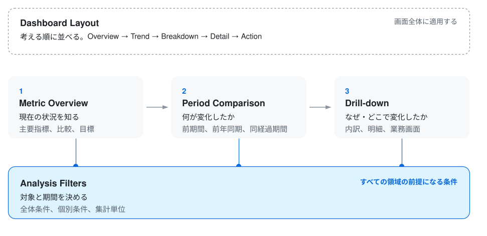

# Data Analysis

利用者が、現在の状況を知り、変化とその理由を確かめ、具体的な問題を見つけて次の行動に移るまでを扱う Patterns のグループ。Metric Overview、Dashboard Layout、Analysis Filters、Period Comparison、Drill-down の 5 種類からなる。

状態：v0.1 確定候補（最終調整の後、最終レビュー前。v0.1 承認済みではない）

<picture>
  <source media="(prefers-color-scheme: dark)" srcset="../../diagrams/data-analysis-dark.svg">
  
</picture>

## 考える順

データを並べることではなく、利用者の判断につながる情報の構成を目的とする。基本の順序は次のとおり。すべての画面に機械的に当てはめず、製品と目的に応じて判断する。

1. 現在の状況はどうなっているか（Metric Overview）
2. 何が変化したのか（Period Comparison）
3. なぜ変化したのか（内訳、増減の要因）
4. 具体的にどこに問題があるのか（Drill-down）
5. 次に何をするのか（業務画面への移動）

共通の方針：

- 表示すること自体を目的とした数値やグラフを加えない。
- 情報の重要度を、文字の大きさ、余白、配置で示す。すべての指標とグラフを Card で囲まない。
- データの意味を誤認させない。0、欠損、取得の失敗、未確定のデータを区別する。
- 全体条件と個別条件の適用範囲を明確にする。
- 分析から詳細へ、詳細から業務の操作への移動を自然にする。
- 安全性とアクセシビリティを保つ。
- 汎用の BI ツール、集計のエンジン、ダッシュボードのビルダーは作らない。

## Components と Patterns の関係

Chart（Recharts）、Table、Progress、Date Picker（`DateRangePicker`）、Calendar、Select、Popover、Sheet、Breadcrumb、Checkbox、Switch は Components（v0.1）である。App Structure の Page Layout、Page Header、Section Layout、App Shell と、Data Browsing の Data States（`useBrowseData`、`LoadingReveal`、`DataRefreshIndicator`、`DataRegionError`、`Loadable`）、Search & Filter（`useFilterDraft`）、List & Detail（`getRecordNeighbors`）、Data Table の `DataTableAppliedFilters` を組み合わせる。新しい依存パッケージは加えていない。

## 5 種類

| Pattern | 目的 | 資料 | 再利用できるコード（`registry/patterns/`） |
| --- | --- | --- | --- |
| Metric Overview | 現在の状況を指標で伝える | [metric-overview.md](metric-overview.md) | `metric.tsx`：`MetricGroup`、`Metric`、`MetricValue`、`ComparisonValue`、`MetricTarget`、`Sparkline`、`MetricDefinition`<br>`metric-format.ts`：`formatMetricValue` |
| Dashboard Layout | 考える順に並べる | [dashboard-layout.md](dashboard-layout.md) | `analysis-region.tsx`：`AnalysisRegion`、`AnalysisScopeNote` |
| Analysis Filters | 対象、期間、集計単位と適用範囲を決める | [analysis-filters.md](analysis-filters.md) | `analysis-query.ts`：`useAnalysisQuery`、`scopeFilters`、`useCrossFilter`<br>`analysis-period.ts`：`resolvePeriod`、`availableGranularities`、`reconcileGranularity`、`buildBuckets`、`toInstantRange` ほか<br>`analysis-time.ts`：`zonedStartOfDay`、`hourSlotsOf`、`hoursInDay`、`isValidTimeZone`<br>`analysis-controls.tsx`：`AnalysisPeriodFilter`、`GranularitySelect`、`ComparisonSelect` |
| Period Comparison | 公平な期間どうしで比べる | [period-comparison.md](period-comparison.md) | `comparison.ts`：`compareValues`、`describeComparison`、`formatDifference`、`getTargetProgress`<br>`analysis-period.ts`：`comparisonRange`（比較の方式 `basis`）、`alignBuckets`、`getPeriodElapsed` |
| Drill-down | 内訳、明細、詳細へ進み、戻る | [drill-down.md](drill-down.md) | `drill-down.tsx`：`DrillDownLink`、`drillPeriodFor`、`drillBucketPeriod`、`groupOther`、`captureAnalysisPosition`、`useAnalysisPositionRestore` |

### コードと資料の区分

| 区分 | 内容 | 理由 |
| --- | --- | --- |
| 再利用できるコード | 上の表の関数、hook、部品 | 数値の表記、増減と増減率の境界、同経過期間、月末・うるう年・夏時間、条件の継承と衝突、位置とフォーカスの復元は、製品ごとに書き直すと誤りやすい |
| 組み合わせの例（プレビュー） | 事業の状況（Strategic）、顧客維持の分析（Analytical）と Drill-down の 2 つの画面、処理の監視（Operational）、MRR の推移、増減差のグラフ、内訳の横棒（`BreakdownBars`）、数値の比較の表（`ComparisonTable`） | 画面とグラフの構成は、製品のデータと目的で変わる。Dashboard 専用の巨大な部品にしない |
| 設計の資料だけ | 3 つの型の構成、Chart と Table の配置、グラフの高さ、Waterfall Chart の使用の判断、表示の方法（同じ画面、Sheet、別ページ、Popover）の選び方、カスタマイズ | 画面ごとの判断であり、コードでは決められない |
| 製品の責務 | 指標の定義と集計、評価の方向と目標、API、会計期間とタイムゾーンの設定、認証と認可、ルーター、URL と保存、予測のモデル、リアルタイムの通信 | 製品の業務と基盤に依存する |

Period Comparison と Metric Overview は、増減の計算と表示を同じ `comparison.ts` と `ComparisonValue` で行い、重複して実装しない。

## v0.1 の最終調整で確定した仕様

| 項目 | 確定した仕様 |
| --- | --- |
| 期間の指定 | 期間の指定は「この期間で集計」で適用する。プリセットはすぐに適用する |
| 選択肢 | Select の選択肢を固定し、使えない選択肢を無効にする |
| 上限の目標 | 割合の割合ではなく、実数の差か pt で示す |
| Cross-filtering | 選択元の領域には適用しない。適用する領域は製品が選ぶ（`targets`）。主要な指標も連動させる場合は、絞り込んだ値であることを示す。選択は `source`、`field`、`value` の組で区別する。全体条件やスコープが変わった後に、前の選択を復元しない |
| 比較期間の重なり | 標準では許可しない（`overlap`） |
| 未来の日 | 実績の分析では、終了日を今日までに切り詰める |
| 欠損 | 0 として扱わない。期間の一部がデータの範囲の外の場合は値を null にする（部分的なデータを示す製品は、実際に集計した期間、欠損の範囲、比較の可否を示す） |
| Drill-down の期間 | 実際に集計した期間を、固定の日付で引き継ぐ |
| 新しいアラート | 閲覧の位置とフォーカスを動かさない |
| Waterfall Chart | 新しく実装しない（使用の判断だけを資料に書く） |
| 自動の変更 | 集計単位は期間に合わせて自動で変えてよい（知らせる）。比較の対象は分析の意味を変えるため、利用者の選択を維持し、使えなくなった場合は理由と変更の方法を示す |
| 再取得中の表示 | 内容を薄くしない。200ms 後から「更新中」と表示中の結果の条件を示す。比較の見出しと比較期間も、表示中の結果の条件で示す。条件の文は省略せずに折り返し、領域の `aria-describedby` で関連付ける（Patterns Integration Review で変更） |
| 今日のデータ | Registry は今日が確定しているとみなさない。分析の対象に今日を含み、集計済みの時刻（`asOf`）が今日の終わりより前か不明なら、比較を `fair: false` にする。製品は `asOf` を渡す |
| 公平でない比較 | `fair: false` の比較は、増減の代わりに理由を示す（期間の合計の指標は期間の比較、時点の指標は時点の比較の `fair` で判断する） |
| 集計単位 | 製品が提供する単位を `allowedGranularities` で選ぶ。復元した単位を使えない場合は知らせる |
| 日数の異なる比較期間 | 暦でずらした比較期間の日数が分析の対象と異なる場合（月末に合わせた、月末をまたぐ）は `fair: false`（Patterns Integration Review で変更） |
| スコープと画面の条件 | ワークスペースの条件と画面の条件は積集合。重ならない場合は取得せず、対象がないことを示す（Patterns Integration Review で追加） |

## Patterns Integration Review での仕様の変更

Patterns Integration Review の独立した検品（2026-11-28）の指摘への対処で、上の確定した仕様のうち次を変えた。

| 変更 | 理由 | 影響 | 検討した別の方法 |
| --- | --- | --- | --- |
| `comparisonRange` の `calendar` で、月の全体どうしでない期間を暦でずらした比較期間の日数が、分析の対象と異なる場合に `fair: false`、`reason`（「比較期間と分析の対象の日数が異なります（分析の対象は 30 日間、比較期間は 28 日間）」）、`truncated`（短い場合）を返す。従来は `fair: true` だった | 2025/03/30〜03/31 の前月が 2025/02/28 の 1 日になり、検証画面が売上を「+101.9%」と示した。2 日分と 1 日分の売上の差を増減として示していた。period-comparison.md の「月をずらすだけで同じ経過日数になるとは判断しない」と矛盾していた | 該当する比較期間で、期間を集計する指標（売上、新規の契約、解約率）は増減の代わりに理由を示す。時点の指標（`point-in-time`）は対象外。月の全体どうし（31 日と 30 日）の扱いは変えない | 比較期間を同じ日数に延ばす（3 月の日を 2 月の比較期間に含めることになり、`elapsed-days` の上限の規則と矛盾する）。`adjusted` だけで示す（製品が `fair` だけを見て増減を示すと、同じ誤りが残る） |
| `weekday` で、暦でずらした日数より 7 日を超えて前にずらす場合は `invalid`（`overlap`） | 85 日間の期間の前月が、重なりを避けて 91 日前（3 か月前）になり、「前月」の比較ではなくなっていた | 長い期間の前月・前四半期の同じ曜日の比較は選べなくなる（`ComparisonSelect` に `period` を渡すと無効になる）。31 日間の月の前月（35 日前）と前年同期（364 日前）は変わらない | 7 日ずらす処理を前年同期だけにする（前月の 31 日間の月で比較できなくなる） |
| `elapsed-time` で、`asOf` が分析の対象の始まり以前（経過時間 0）の場合は `fair: false` | 長さ 0 の区間どうしを `fair: true` としていた | 増減の代わりに理由を示す | `invalid` にする（`ComparisonRange` の無効の理由の型に値を加えることになり、製品の分岐が増える） |
| `alignBuckets` の `by: "elapsed"` は、区間の単位を `granularity` で判定する | 表示の名前（`fullLabel`）から単位を推測していた。製品が名前を変えると、月別の区間を日の差で対応付ける | 名前を変えない製品では結果は同じ | なし |
| `describeComparison` の `show: "auto"` で、符号が変わった場合（プラスからマイナス）は実数差を主に示し、補足に「プラスからマイナスに転換」 | 100 から −50 を「−150.0%」と示していた。period-comparison.md の符号の転換の扱い（実数差を主に示す）と一致していなかった | 増減率を主に示していた箇所が実数差になる。`show: "rate"` を指定すれば従来どおり | 資料だけを直す（−150.0% は値の大きさの変化として読みにくい） |
| `groupOther` の `includeSkippedInOther` で、欠損した分類がある場合は、まとめる値のある分類が 0〜1 件でも「その他」を作る | 「その他」を作らない場合に、欠損した分類の `key` が `members` から消え、明細へ進めなかった | 「その他」の値は値のある分類だけから求め、値のある分類がない場合は `null` | なし |
| `AnalysisRegion` の `staleLabel` を 1 行に省略せず折り返し、表示している間だけ領域の `aria-describedby` で参照する。`title` 属性を付けない | 省略した全文を `title` でしか確かめられず、タッチの操作、キーボード、支援技術で確かめられなかった | 狭い画面で、再取得中に見出しの部分が 1〜2 行高くなる | 2 行で省略し、「条件を表示」の Popover を置く（操作が 1 つ増え、再取得の間に Popover を開いたまま内容が変わる場合の扱いが必要になる） |
| Chart の `ChartContainer` は、描画する場所の幅か高さが 0 の間は `ResponsiveContainer` を描かない | `keepMounted` の Tabs と Accordion の非表示の内容の中で、Recharts が「width(0) and height(0)」の警告を出し、大きさ 0 で描いていた | サーバーでの描画と Hydration の最初の描画では、グラフを描かずに場所だけを出力する。もう一度隠すとグラフを外し、表示したときに描き直す | `initialDimension` を大きくする（非表示の間も誤った大きさで描く） |

検証画面（製品側のコード）の変更：

- ワークスペースの条件を、画面の条件で上書きしていた（`withScope`）。積集合（`scopeFilters`）にし、重ならない場合は取得せず「このワークスペースでは対象がありません」と、地域の条件を外す操作を示す。顧客維持の分析の地域の選択も、九州支店のワークスペースでは無効にする。
- 地域を 1 つだけ選べる画面で、URL の複数の地域（`region=kanto,kinki`）を、表示は 1 つ目、集計はすべてで行っていた。1 つ目だけを使い、使わなかった地域を `role="status"` の文で知らせ、URL からも除く。
- `staleLabel` を、取得の条件のキーの文字列から作っていた（九州支店のデータを「絞り込みなし」と示し、集計単位を示さなかった。MRR の推移の領域には `staleLabel` がなかった）。取得の結果に、実際に集計に使った条件（`ShownConditions`）を含め、その値から作る。
- 一覧の件数を示さない設定で、閲覧できない明細がない場合だけ件数を返していた（応答の形と文の違いから、閲覧できない明細の有無がわかった）。閲覧できない明細の有無にかかわらず、同じ応答と文にする。
- 権限のない企業の詳細の扱いを、検証用の操作で選べるようにした（「権限不足として示す」「存在しない場合と同じに示す」）。後者では、本当に存在しない場合と同じ表示にする。

## Registry の API の変更（初期実装 f5769d5 からの変更）

| ファイル | 変更 |
| --- | --- |
| `analysis-time.ts`（新規） | タイムゾーンの処理を分けた。`zonedStartOfDay`（存在しない日は RangeError）、`nextDayStart`、`hourSlotsOf`、`hoursInDay`、`localTimeAt`、`isoWithOffset`、`offsetLabel`、`isValidTimeZone`、`assertTimeZone` |
| `analysis-period.ts` | `PeriodContext` に `timeZone` と `asOf` を追加。`Bucket` に `start`、`end`、`offsetMinutes`、`days`、`durationMinutes`、`status`（complete、in-progress、future、unknown）を追加。時間別の区間はタイムゾーンでの実際の区間。`comparisonRange` に `basis`（6 種類）、`context`、`businessCalendar` を追加し、結果に `basis`、`truncated`、`fair`、`reason`、`instant` を追加。無効の理由に `as-of-required`、`business-calendar-required` を追加。`alignBuckets` に `by`、`allowDifferentLength` を追加し、行に `key`、`comparable`、`reason`（`index` は廃止）。`getPeriodElapsed` に `todayComplete` と、結果に `completeDays`、`todayInProgress` を追加。`defaultBasis`、`countBuckets`、`comparisonBasisLabels` を公開 |
| `analysis-query.ts` | `useAnalysisQuery` に `comparisonBasis`、`aggregationKey` を追加し、`status`、`invalidReason`、`granularity`（実際に使う単位）、`comparisonBasis` を返す。`key` は不正な条件で `null`、タイムゾーンなどを含む。比較の対象を自動で変えない。`setComparison` は不正な期間で `false`。`scopeFilters` の結果は `ready`／`conflict`（`filters` を持たない）／`invalid`（未知の条件）、`equals` を追加。`useCrossFilter` の選択に `targets`、`isSelected(source, field, value)`、`snapshot`、`initialSelection` は `{ selection, resetKey }` |
| `comparison.ts` | `compareValues` に `tolerance`。差が有限でない場合は `incomparable`、増減率が有限でない場合は `rateUnavailable: "not-finite"`。`describeComparison` は指標の種類と表示形式の不一致を示す。`getTargetProgress` は目標値が 0・負でも `ready`（`ratio`、`barValue` は null、`met` で判定）、無効の理由は `value-missing`、`target-missing`、`not-finite` |
| `metric-format.ts` | `parts` に `sign`、`signBeforePrefix`。不正な書式は RangeError。`exactText` は有効数字 15 桁。−0 は 0 |
| `metric.tsx` | `MetricTarget` は目標値が 0・負の場合に達成・未達と差を示す。`elapsed.todayInProgress`。`MetricDefinition` に `exact` |
| `analysis-region.tsx` | 再取得中に内容を薄くしない。`staleLabel` を追加 |
| `analysis-controls.tsx` | `ComparisonSelect` に `period`（重なる比較を無効にする）、`customRange`、`onCustomRangeChange`、`min`。比較できない理由と変更の方法を示す |
| `drill-down.tsx`（最終調整の 2 回目のレビューの後） | `drillRangeFor`（比較の系列の `instant` も返す）、`groupOther` の `includeSkippedInOther` と `aggregate` の実行時の検証 |
| `analysis-period.ts`（同） | `alignBuckets` の暦の位置のキーを最初の区間からの位置にし（年をまたいでも重複しない）、同じ側の重複を RangeError にした。経過の対応付けを、時間別は実際の分、週・月以上は順番にした。区間の長さは実際の時間で比べる。同じ曜日の比較で重なる場合は、さらに 7 日ずらす。今日を含む比較を、`asOf` が今日の終わりより前か不明なら `fair: false` にする。不正なタイムゾーンの理由 `invalid-time-zone` |
| `analysis-query.ts`（同） | `allowedGranularities`。復元した集計単位を使えない場合の `notice`。不正なタイムゾーンを `invalid` にする |
| `comparison.ts`、`metric-format.ts`、`metric.tsx`（同） | 丸めると 0 になる負の値・差を「−0.1〜0%」「−0.1〜0pt」と示す。`tolerance`、`currency` も `unit` もない通貨、`minimumFractionDigits` > `maximumFractionDigits` を RangeError。`MetricTarget` の小さな差 |
| `analysis-period.ts`（確認のレビューの後） | `Bucket` に `granularity`、`unitStart`。`ResolvedPeriod` の無効の理由に `unknown-period`、`ComparisonRange` に `future`、`unknown-mode`、`no-business-days`。今日が未確定の判定を、集計済みの時刻と期間の終わりで行い、`context` がない場合は期間の `inProgress` で判断する |
| `drill-down.tsx`（同） | `drillRangeFor` に `context`（現在の系列の時刻の範囲） |
| `analysis-controls.tsx`（同） | `ComparisonSelect` に `basis`、`context`。比較の方式と、公平でない理由（`comparison-unfair`）を示す。不正なタイムゾーンの理由と変更の方法 |
| `analysis-period.ts`（Patterns Integration Review） | API の形は変えていない。`comparisonRange` の結果の値（`fair`、`reason`、`truncated`、`note`）と `weekday` の `invalid` の条件、`alignBuckets` の単位の判定を変えた（上の「Patterns Integration Review での仕様の変更」） |
| `comparison.ts`、`drill-down.tsx`、`analysis-query.ts`、`analysis-region.tsx`（同） | API の形は変えていない。`describeComparison` の符号の転換の表示、`groupOther` の「その他」の作成、`scopeFilters` の未知の条件の判定（継承した名前を既知としない）、`staleLabel` の折り返しと `aria-describedby`。`useAnalysisQuery` は `initialQuery.filters` を検証しないことを型の説明に書いた |
| `components/ui/chart.tsx`（同） | API の形は変えていない。描画する場所の大きさを測れるまで `ResponsiveContainer` を描かない |
| `drill-down.tsx` | `drillPeriodFor` は実際に集計した期間を返す。`drillBucketPeriod` を追加。`groupOther` の `aggregate` を必須にし、検証を追加（`combine` は廃止）。`AnalysisPosition` に `scrollLeft`、`section`（`sectionTitleId` は廃止）。`captureAnalysisPosition` に `root`。フォーカスの復元は実際に移ったことを確かめる |

## 使い方の流れ

1. 分析の目的と、判断に必要な指標を決める（[metric-overview.md](metric-overview.md)）。
2. 考える順に領域を並べる（[dashboard-layout.md](dashboard-layout.md)）。
3. 全体条件と個別条件を決め、`useAnalysisQuery` で持つ（[analysis-filters.md](analysis-filters.md)）。
4. 比較の対象を決め、比較期間と比較値を求める（[period-comparison.md](period-comparison.md)）。
5. 詳細へ進む操作と、戻ったときの復元を加える（[drill-down.md](drill-down.md)）。

```tsx
const context = { today: todayIn("Asia/Tokyo"), weekStartsOn: 1, fiscalYearStartMonth: 4 }
const a = useAnalysisQuery<Filters>({ defaultQuery: { period: { kind: "relative", id: "this-month" }, comparison: "previous-month", filters }, context })
const overview = useBrowseData({ query: a.key, fetcher: (_, { signal }) => api.overview(a.period, a.comparison, a.query.filters, { signal }) })

<div role="group" aria-label="ページ全体の条件">
  <AnalysisPeriodFilter value={a.query.period} onValueChange={a.setPeriod} presets={["this-month", "last-month"]} resolved={a.period} context={context} />
  <ComparisonSelect value={a.query.comparison} onValueChange={(m) => a.setComparison(m)} options={["previous-month", "previous-year", "none"]} comparison={a.comparison} />
</div>
<AnalysisRegion title="主要な指標" status={overview.status}>
  <MetricGroup>
    <Metric label="売上" value={…} format={{ unit: "円" }} comparison={<ComparisonValue result={compareValues(…)} label="前月比" direction="increase" />} />
  </MetricGroup>
</AnalysisRegion>
```

## 状態管理の設計

| 状態 | 持つ場所 | 内容 |
| --- | --- | --- |
| 全体条件 | `useAnalysisQuery` | 期間（相対・固定）、集計単位と手動かどうか、比較、絞り込み。適用済みの値だけ |
| 入力中の条件 | `AnalysisPeriodFilter`（期間の指定）、`useFilterDraft`（まとめて適用） | 適用中の条件と区別して示す |
| 領域のデータ | 領域ごとの `useBrowseData` | 読み込み、再取得、失敗、古い応答の破棄 |
| 個別条件 | 領域ごと（製品）＋`scopeFilters` | 全体条件を引き継ぎ、絞り込む |
| Cross-filtering | `useCrossFilter` | 選択元、項目、値、名前 |
| 戻るための記録 | 製品（履歴の項目ごと） | Cross-filtering、表の並び順とページ、一覧の条件、`AnalysisPosition` |

Registry の部品は、どの状態も保存しない。保存と復元の値は、`query`、`initialQuery`、`initialSelection`、`position` などの引数で受け渡す。

## プレビュー

`npm run preview:dev` で開き、上部の「Patterns：Data Analysis」から選ぶ。

| ページ | URL | 内容 |
| --- | --- | --- |
| Metric Overview | `#/metric-overview` | 重要度と文字の大きさ、数値の表記（ロケールと省略）、増減と良否、目標（未達、超過、上限、0、マイナス、未設定）、データの状態（8 種類）、Sparkline、比較 |
| Dashboard Layout | `#/dashboard-layout` | 3 つの型、Chart と Table の配置、独立した領域の失敗と再試行、比較 |
| Analysis Filters | `#/analysis-filters` | 期間、集計単位、比較、週の始まり、半開区間とタイムゾーン、全体条件と個別条件、操作の区別、比較 |
| Period Comparison | `#/period-comparison` | 比較期間の決め方（月の途中、月末、うるう日、年をまたぐ）、比較値の算出の可否、比較のグラフ（重ね合わせ、並べた棒、増減差、表）、実績と予測、比較 |
| Drill-down | `#/drill-down` | 階層と条件の引き継ぎ（衝突を含む）、比較期間の系列から進む、「その他」、表示の方法、比較 |
| 営業管理の検証画面 | `#/analysis-app?page=business` | 5 種類を組み合わせた 3 つのダッシュボード。`page=business`（事業の状況）、`page=retention`（顧客維持の分析）→ `page=retention-accounts`（企業の一覧）→ `page=account`（企業の詳細）、`page=operations`（処理の監視）。下部の「検証用の操作」で、応答の時間、明細の権限、予測の有無、取得の失敗を切り替える |

検証画面の URL の引数：`page`、`period`（相対期間の id）または `from`・`to`（固定の期間）、`cmp`（比較）、`g`（手動で選んだ集計単位）、`region`、`plan`、`term`（全体の絞り込み）、`dplan`、`dterm`（Drill-down で加えた条件）、`id`（企業）。事業の状況と顧客維持の分析は、地域を 1 つだけ選べる。`region` に複数の値がある場合は 1 つ目だけを使い、知らせる（企業の一覧の画面は、複数の地域をそのまま示して集計する）。

売上の日割り（月額 × 12 ÷ 365）、原価率、地域の固定費、目標の設定は、検証のための例の業務の規則であり、Registry の標準の計算ではない。この模擬データは 1 社 1 契約のため、解約した企業の数と解約した契約の数は一致する（複数の契約を持つ製品では区別する）。

すべての数値は、架空の契約の記録（`preview/src/data/data-analysis/subscriptions.ts`、乱数の種から決まった手順で作る 986 社の契約）から集計する。指標、比較値、増減率、グラフ、明細を、それぞれ固定の値として持たない。画面には「架空のデータ」と示している。基準日は 2026 年 11 月 25 日、会計年度は 4 月始まり。模擬のサーバー（`analysis-server.ts`、`window.__fdAnalysisServer`）と運用の監視のデータ（`operations.ts`、`window.__fdOpsTicker`）も `preview/src/data/data-analysis/` にあり、Registry には含めない。

検証画面は Data Analysis の検証のためのものであり、正式な Pages の実装ではない。App Structure の `StructureSidebar`、`ProductMark`、`structureNav`、`PlaceholderScreen` を読み込んで使う（複製も変更もしない）。

## 集計値と権限

集計値は、閲覧できない明細を含んで計算される場合がある。権限を次の 4 つに分けて扱う。1 つの権限で、ほかの権限を兼ねさせない。

| 権限 | 内容 | 検証画面の例 |
| --- | --- | --- |
| 集計値を閲覧する権限 | 閲覧できない対象を含む集計値（全社の解約率、解約した企業の数、売上）を見る | 担当者も、主要な指標と内訳は全社の値を見る |
| 明細を閲覧する権限 | 個々の対象（企業の名前、月額、解約の理由）を見る | 担当者には、閲覧の権限が限られた取引先の明細を返さない（サーバーで除く） |
| 全件の件数を知る権限 | 一覧の全件の件数と、閲覧できない件数を知る | 「一覧では件数を示さない」設定では、一覧の応答に件数を含めない（閲覧できない明細の有無にかかわらず、同じ応答と文） |
| Drill-down を実行する権限 | 集計値から内訳、明細、詳細へ進む | 権限のない企業の詳細は、`forbidden`（権限不足）か、存在しない場合と同じ表示（検証用の操作で選ぶ） |

- Registry の部品は、これらの権限を判定せず、保護もしない。`useAnalysisQuery`、`scopeFilters`、`groupOther`、`AnalysisRegion` は、渡された値をそのまま示す。権限の判定と、応答に含める値の制限は、製品のバックエンドが行う。
- UI で明細、件数、操作を非表示にすることは、情報の保護にならない。応答に含めた値は、開発者ツールや API から読める。閲覧できない値は、応答に含めない。
- 集計値そのものを公開するかは、製品が判断する。公開した集計値から、閲覧できない情報が推測できる場合がある。
  - 集計値と、閲覧できる明細の差（主要な指標の「解約した企業」の数と、一覧に表示できる企業の数の差から、閲覧できない企業の数がわかる）
  - 複数の絞り込みの結果の差（地域 A と B の合計から地域 A を引くと、地域 B の値がわかる。絞り込みを 1 件ずつ変えて差を取る）
  - 少数の集計単位（1 社だけの区分の売上は、その企業の売上そのもの）
  - 応答の形、文、応答の時間の違い（件数を返す・返さない、権限不足と不存在の違い）
- 製品が必要に応じて行う対策（Registry では実装しない。汎用のプライバシー保護の集計の仕組みも作らない）：
  - 集計値の公開の範囲を、明細の権限とは別に定める（集計値を閲覧する権限を持たない利用者には、閲覧できる対象だけの集計値を返す）
  - 少数の集計単位の値を示さない、または丸める（最小の件数の基準を製品が決める）
  - 差を取れる絞り込みの組み合わせを制限する、または集計値に同じ基準を適用する
  - 権限のない対象の存在が機密の場合は、権限不足を不存在と同じ応答と表示にする（[permission-states.md](permission-states.md) の「ページへのアクセス」）
  - 一覧の件数を示さない場合は、閲覧できない明細の有無で、応答の形と文を変えない
  - Drill-down の先（明細、詳細、業務画面）でも、バックエンドが権限と対象を確かめる（分析の画面から渡した条件を、権限の根拠にしない）

## 製品の責務（共通）

- 指標の定義と集計（MRR、解約率の分母、粗利の原価）、評価の方向、目標と予算。
- データの取得（API）、集計の時点の管理、権限による明細の除外。
- 「今日」（`todayIn(timeZone)`）、タイムゾーン、週の始まり、会計年度。
- URL への同期、保存した分析の条件、戻るための記録、ルーター。
- 予測のモデル（基準日、方法、不確実性）。
- リアルタイムの通信、アラートの判定。
- 業務画面の対象と権限の検証。

## 既存の Components と Patterns への影響

| 対象 | 変更 | 互換性 |
| --- | --- | --- |
| Components（`registry/components/ui/`） | 最初の実装では変更なし。Patterns Integration Review で `chart.tsx` を直した（大きさが 0 の間は `ResponsiveContainer` を描かない） | 引数と出力の形は変わらない。サーバーでの描画の出力にグラフの `svg` を含めなくなった（`data-slot="chart"` の要素は出力する） |
| App Structure、Data Browsing（`registry/patterns/` の既存のファイル） | 変更なし。`useBrowseData`、`useDelayedFlag`、`LoadingReveal`、`DataRefreshIndicator`、`DataRegionError`、`Loadable`、`useFilterDraft`、`getRecordNeighbors`、Page Layout、Section Layout、App Shell をそのまま使う | |
| `preview/playwright.config.ts` | `tsconfig: "./tsconfig.json"` を追加した。Node.js の単体の検品で、registry のファイルの `@/` の別名を解決するため | 既存の spec はすべて preview/ の下にあり、同じ tsconfig を使っていた。検品の結果は変わらない（下の検品の結果） |
| `preview/src/catalog.ts` | 分類「Patterns：Data Analysis」と 6 ページを追加した | 既存のページの id と URL は変わらない |
| `package.json` | `test:patterns` に `data-analysis` を追加した | |
| `scripts/diagrams/build.sh` | 生成のスクリプトに `gen_data_analysis.py` を追加した | 既存の図の出力は変わらない |

## 並行している作業との関係

### Forms & Workflows との統合

Forms & Workflows（PR #1）は main に統合済みである（ebb0f24）。Data Analysis は、その後の `origin/main` を取り込んで統合した（373aa68、PR #2）。Forms & Workflows の Patterns は再実装していない。分析の画面と業務画面（登録・編集の流れ）の接続は、Patterns Integration Review の横断の検品で扱う。2026-11-28 時点の状況は次のとおり（Data Analysis の指摘への対処の作業では、下の「未確認」の項目を確かめていない）。

| 項目 | 状況 | 接続に必要なこと |
| --- | --- | --- |
| 分析から業務画面への移動 | 検証画面の `page=work` は、引き継いだ条件を示すだけ。Forms & Workflows の画面には接続していない | Forms & Workflows の一覧・編集の画面の URL と、受け取る条件の形 |
| 実際に適用していた条件の引き継ぎ | 期間（固定の日付）、プラン（Cross-filtering）、地域、契約期間、解約の理由を URL で渡す。地域は、ワークスペースの条件との積集合（実際に集計に使った条件）を渡す | 業務画面が条件を初期の絞り込みにだけ使い、権限と対象をバックエンドで確かめる |
| 対象のレコードの確認、閲覧・編集の権限 | 未確認 | 業務画面の権限の確認と、対象がない・権限がない場合の表示 |
| 未保存の変更 | 未確認 | Forms & Workflows の未保存の変更の確認（分析の画面へ戻る操作を含む） |
| 編集の後の再取得 | 未確認 | 戻ったときに分析のデータを取得し直す（`useBrowseData` は戻ると取得し直す） |
| 元の分析の画面への復帰、フォーカスとスクロール | 分析の画面どうし（Drill-down）では確かめている。業務画面からの復帰は未確認 | 業務画面から戻るときの履歴の記録（`fdParentKey`）の受け渡し |

- 検証画面の業務画面への移動（`page=work`）は、引き継いだ条件を示すだけの画面である。登録・編集の流れとの接続は、上の表の「接続に必要なこと」を Patterns Integration Review で確かめる。
- Data Browsing は、作業中に v0.1 確定候補（5dcd39a、aa7e664）が main に統合された。統合の候補で取り込み、検品した。`useBrowseData` の変更（`canOperate` の追加、取得しない間のスコープの変更、アンマウントの後の応答の破棄、`setData` の `guard`）は追加と修正だけで、Data Analysis の利用箇所（`status`、`data`、`isCurrent`、`reload`、`error`）の動作は変わらない。Data Analysis の画面には、データに依存する変更の操作（一括操作、削除）がないため、`canOperate` は使っていない。Data Browsing の部品は変更していない。
- 共有のファイル（`catalog.ts`、`package.json`、`build.sh`、`README.md`）は、統合の時に双方の変更を残す。

## 独自に判断した事項

指示書に定めのない点、または既存の仕様と関わる点を、次のように決めた。レビューで見直す。

| 事項 | 判断 | 理由 |
| --- | --- | --- |
| 省略表記の基準 | 既定は絶対値 1,000,000 以上で省略、有効数字 3 桁。値が変わる場合だけ「約」 | 指示書の例（3,680万円、約4.42億円、約512万件、428社）と一致する最小の規則。製品は `compactFrom`、`significantDigits` で変えられる |
| 評価の文字 | 減少が望ましい指標だけ「改善」「悪化」を表示し、増加が望ましい指標は色と矢印と読み上げで示す（`evaluationLabel="auto"`） | すべてに文字を付けると意味の重複が増える（原則 04）。向きと良否が逆になる指標だけは、色だけに頼らないよう文字を足す |
| 丸めると 0 になる差 | 「+0.1pt未満」と示す | 「+0.0pt」は変化がないと誤認させる |
| 目標の未達の色 | Progress の既定の色（`primary`）のまま | 指示書の「目標未達という理由だけで Destructive にしない」 |
| 上限の目標 | `direction: "decrease"` の指標は、現在値と上限を同じ単位の差で示す（「月の上限 1.5%まで あと 0.9pt」）。途中の期間では期間の経過を併記する | 小さい方が望ましい指標の「達成率」は意味が逆になる。割合の割合（42.6%）は、指標の値と誤読される（独立したレビューの指摘） |
| 期間の指定の適用 | 「この期間で集計」で適用する。プリセットはすぐに適用する | 開始日と終了日は欄ごとに確定するため、すぐに適用すると片方だけを変えた途中の期間で集計してしまう（独立したレビューの指摘）。Search & Filter の「複雑な条件では明示的な適用を許容する」に当たる |
| 期間の単位 | 暦の単位（月、四半期、年度）と一致する期間（単位の全体、または単位の初日から今日まで）だけが単位を持つ。単位がない期間では、目標、月の上限、期間の経過を示さない | 9/1〜11/25 を「9 月」として扱い、3 か月の売上を 1 か月の目標と比べていた（独立したレビューの指摘） |
| 未来の日 | 終了日が今日より後の期間は今日までに切り詰めて示し、開始日が未来の期間は不正とする。期間の選択は今日までに制限する | 未来の日を欠損や 0 として数え、途中の実績を比較期間の全体と比べていた（独立したレビューの指摘） |
| 比較期間の重なり | すべての比較で、分析の対象と重なる比較期間を不正とし、その比較を選べなくする | 3 か月の期間を前月と比べると、55 日を両方で数えていた（独立したレビューの指摘） |
| データの範囲の外 | 期間の一部でもデータの範囲（2023/01/01〜今日）の外を含む場合は、値を null（データなし）にし、明細も示さない | 範囲の外を 0 として合計し、「前年同期 0円」と比べていた（独立したレビューの指摘） |
| 売上の日割り | 月額 × 12 ÷ 365（模擬データ） | 月の日数で割ると、同経過期間の比較が暦の日数で偏る（独立したレビューの指摘） |
| 集計単位の初期値と使える単位 | 期間の日数による初期値と、実際の区間の数（2〜400。時間別はタイムゾーンがあり 7 日以内）による利用可否 | 指示書の目安を、期間の長さだけで決まる規則にした。固定ではなく製品が変えられる |
| 選択肢の固定 | 集計単位と比較の Select は、選択肢を入れ替えず、使えない選択肢を無効にする | Base UI の Select が、選択肢の一覧の変更の時点で値を最初の値に戻す（検証の途中で確認した事象） |
| 個別条件の衝突 | 全体条件と重ならない個別条件・Drill-down の条件は `conflict` とし、表示できる対象がないと示す | 黙って上書きすると適用範囲を誤認し、外すと全件を誤って示す |
| Drill-down の期間 | 相対期間を固定の日付にして引き継ぐ | 開いた日と戻った日で期間が変わらないようにする |
| Drill-down の URL | Drill-down で加えた条件を `dplan`、`dterm` とし、全体条件（`plan`、`term`）と分ける | 同じ名前だと全体条件を上書きしてしまう |
| Cross-filtering の範囲 | プラン別の内訳の選択を、契約期間別の内訳と企業の一覧に適用し、指標とプラン別の内訳（選択元）には適用しない。適用する領域を文で示す | 指標は全体の状況を示す領域であり、選択で変わると現在の状況を誤認する |
| Cross-filtering の要素 | グラフの棒を直接押す方式ではなく、HTML の横棒の行をボタンにした | キーボードとタッチで確実に選べ、Drill-down のリンクと別の要素にできる |
| 再取得中の表示 | 前の結果を薄くせずに残し、200ms 後から見出しの右に「更新中」と表示中の結果の条件を示す（v0.1 の最終調整で変更） | 数値と文字のコントラストを保つ。どの条件の結果かを誤認させない |
| 主要な指標の取得 | MRR、売上、契約企業数、解約率などを 1 回の要求で取得する | 比べる指標の集計の時点をそろえる |
| MRR の増減の内訳 | Waterfall Chart の代わりに、増減差のグラフと期首・期末の文、数値の表で示す | Waterfall Chart の汎用の部品化は対象外。使用の判断は Period Comparison の資料に書いた |
| 予測の色 | 予測は `chart-3` の破線と範囲、途中経過は `chart-1` の点線 | 実績と同じ色の破線だけでは、途中経過と予測を区別できない |
| 新しいアラート | 自動で一覧に加えず「新しいアラートを表示（n件）」のボタンで加える | 読んでいる位置とフォーカスを動かさない |
| 監視の指標 | 全体のエラー率と最も遅い応答時間をやめ、「エラー率が上限を超えたサービス」の数と名前にした | サービスごとに上限が異なり、全体の値では異常を示さない（独立したレビューの指摘） |
| 比較の自動の変更 | 変えない（v0.1 の最終調整で変更）。比較の対象を維持し、比較できない理由と変更の方法を示す | 比較の対象は分析の意味を変える |
| 時間別の区間 | ローカル時刻の時と時差で区切る（壁時計の時で区切る）。15 分ごとにローカル時刻を調べる | 1 時間ずつ足すと、30 分の夏時間の後の区間が 30 分ずれる |
| 区間の状態 | 集計済みの時刻がない場合、今日の時間別の区間は「不明」、今日を含む日以上の区間は「途中」 | 現在の時刻を知らない部品が、当日のデータを確定とみなさない |
| 同経過期間の上限 | 比較先の単位（月、四半期、年度）の終わりで切り詰め、公平な比較としない | 3/1〜3/30 と 2 月の比較で、3 月の日を比較先に含めない |
| 権限のない明細 | 模擬のサーバーが除き、件数だけを返す。企業の詳細は `forbidden` を返し、画面は再試行を置かない。Patterns Integration Review で、存在しない場合と同じに示す方式（`forbiddenDetail: "not-found"`）を検証用の操作で選べるようにした（既定は `forbidden`） | 指示書の「権限のない明細をクライアント側へ渡して非表示にする方式に依存しない」。`forbidden` の文（「集計には含まれています」）は企業の存在を明かすため、存在が機密の製品は不存在と同じに扱う（Permission States） |
| 検証画面 | App Structure と Data Browsing の検証画面を変更せず、別の画面 `analysis-app` として作った | 並行している作業との共有のファイルの変更を避けた |
| Node.js の単体の検品 | `preview/playwright.config.ts` に `tsconfig` を指定した | registry のファイルの `@/` の別名を Node.js で解決するため |

## 検品

- 実機（iOS Safari、Android）とスクリーンリーダー（VoiceOver、NVDA）による検品は行っていない。

| 対象 | 検品（`preview/tests/`） |
| --- | --- |
| 計算（Node.js） | `data-analysis-logic.spec.ts`：数値の表記（省略、約、ロケール、通貨と符号の位置、−0、負の小数の丸め、省略前の精度、極端な値、不正な書式）、比較値（実数差、増減率、pt、基準値 0、ともに 0、基準値が負、両方向の符号の転換、計算の結果の有限性、浮動小数点の誤差と意味のある小さい差、許容範囲、指標の種類と表示形式の不一致）、目標（100% 超、上限、目標値 0・負での達成の判定、欠損）、期間（相対・固定、未来の切り詰め、単位の判定、週の始まり、会計年度、四半期と年度の途中、月末、うるう年、年をまたぐ、重なり）、比較の方式（暦、同じ経過日数と切り詰め、同じ経過時間と夏時間、同じ曜日、同じ営業日数と不足、同じ時点）、期間の経過と当日の未確定、時間別の区間（Asia/Tokyo、UTC、America/New_York と Europe/Berlin の夏時間の開始・終了、30 分・45 分の時差、30 分の夏時間、年末年始、集計済みの時刻の有無、不正なタイムゾーン、存在しない日、実行環境のタイムゾーンへの非依存）、区間の位置合わせと比較の可否、`useAnalysisQuery`（不正な復元・既定値・制御された値・集計単位、描画の時点の集計単位、取得の条件のキー、比較の維持）、`scopeFilters`（値の組み合わせ、衝突、未知の条件、比較の方法）、Drill-down（実際の期間、区間の時刻、「その他」の検証）、模擬データの整合性（MRR の内訳、指標と明細、プラン別と全体、絞り込み、範囲の外、比較期間の一部の欠損、企業と契約、割合の再集計、ワークスペース、権限と件数の公開、固定の値） |
| 資料のページ（5） | `data-analysis.spec.ts`：h1 が 1 つ、操作の名前、横スクロールなし、数値の NaN・Infinity なし、320px と 2560px |
| Metric Overview | 数値の表記とロケール、増減と良否と色、目標、データの状態と高さの維持、Sparkline の欠損と点の不足、定義の Popover、動きを減らす設定、ブランドカラー |
| Dashboard Layout | 独立した領域の失敗と再試行 |
| Analysis Filters | プリセットの即時の適用、不完全・逆順の期間を適用しない、集計単位の維持と調整の知らせ、週の始まり、タイムゾーンと半開区間、全体条件と個別条件と衝突 |
| Period Comparison | 比較期間（月の途中、月末、うるう日、年をまたぐ）、比較値の算出の可否、重ね合わせの元の日付と未来の欠損、凡例と線の種類、実績・途中経過・予測、予測がない場合 |
| Drill-down | 条件の引き継ぎと衝突、比較期間の系列の期間、「その他」の分類 |
| 検証画面（Strategic） | 共通のデータとの一致、比較の対象の明示、全体条件と期間の変更、URL の保持と再読み込み、部分的な失敗とその領域だけの再試行、再取得中の表示、予測なし、表だけの比較、マイナスからプラスへの転換 |
| スコープの境界と古い応答 | ワークスペースの A→B→A（中止を無視する API の遅い応答）、取得しない間のスコープの変更、権限の変更と件数の公開、集計単位・タイムゾーン・Cross-filtering の変更の間の古い応答、横スクロールの位置の復元、見えない操作元の代わりのフォーカス |
| 資料のページの追加の例 | 夏時間の日の 23・25 区間と 30 分の区間、比較の方式の公平さ、区間の位置合わせの比較の可否 |
| 検証画面（Analytical） | 指標・一覧・内訳の一致、一覧だけの条件、Cross-filtering（選択元の維持、適用範囲、解除、キーボード）、まとめて適用とキャンセルと Chip、集計単位の調整、Drill-down と復帰（条件、選択、スクロール、フォーカス）、階層と Breadcrumb、比較期間の系列から進む、Sheet の前後の移動と素早い切り替え、明細の権限、権限のない詳細と存在しない詳細、条件の衝突、業務画面への条件の引き継ぎ |
| 検証画面（Operational） | リアルタイムの更新でフォーカスとスクロールを保つ、新しいアラートの保留、異常の文字の表示、対応済みの後のフォーカス、部分的な失敗と再試行、自動の更新の停止 |
| モバイル、WebKit | 1 列への再配置と横スクロールなし、詳細の全画面の Sheet、WebKit での描画と Cross-filtering |
| Patterns Integration Review の指摘 | `data-analysis-logic.spec.ts` の「Integration review」：日数の異なる暦の比較期間、同じ曜日の比較の上限、経過時間 0、経過の対応付けの単位、符号の転換の表示、「その他」の作成、未知の条件の判定、URL の複数の地域、表示中の結果の条件の文。「Mock data consistency」：ワークスペースと画面の条件の積集合、件数を示さない応答の形、権限のない詳細の扱い。`data-analysis.spec.ts` の「Integration review」：検証画面での日数の異なる比較期間、URL の複数の地域、ワークスペースの外の地域（事業の状況、顧客維持の分析、企業の一覧）、表示中の結果の条件の文（集計単位、ワークスペースの地域、推移の領域）、`staleLabel` の折り返しと `aria-describedby`、件数を示さない設定の文、権限のない詳細を不存在と同じに示す設定、Tabs と Accordion の中のグラフ（警告なし、表示したときの幅、キーボード、画面の幅の変更） |
| SSR と Hydration | `ssr-data-analysis.spec.ts`：window と document なしの描画、決定的な出力、Hydration の不一致なし、Hydration の後の操作、`"use client"` の境界 |

`data-analysis-logic.spec.ts`、`data-analysis.spec.ts`、`ssr-data-analysis.spec.ts` は `npm run test:components` と `npm run test:patterns` に含まれる。

### 検証の結果

- 実施日：2026-11-26
- 環境：macOS（Darwin 25.6）、Node.js 26.10.0、Playwright 1.65.1（Chromium 159、WebKit 27.x）

最新の `origin/main`（aa7e664、Data Browsing v0.1 確定候補）との統合の候補（dfd1095）での結果。

| 確認 | 結果 |
| --- | --- |
| `npm run typecheck` | 成功（exit 0） |
| `npm run preview:build` | 成功（exit 0）。チャンクの大きさの警告は従来どおり（範囲外） |
| `npm run test:tokens` | 成功（failed 0） |
| `npm run test:ssr` | 96 件成功（Data Analysis の 12 件を含む） |
| `npm run test:patterns` | 533 件成功、117 件 skip、失敗 0 件（3 ワーカー） |
| `npm run test:components` | 2044 件成功、266 件 skip、失敗 0 件（13.6 分、3 ワーカー） |

- 統合の前の `test:components` の一括の実行では、Components の既存のテスト `button.spec.ts` の「Tab reaches the button」が desktop と mobile で失敗した。原因は、プレビューの上部に Data Analysis の 6 つのリンクを加えたことで、ボタンに届くまでの Tab の回数が 84 回になり、テストの固定の上限（80 回）を超えたことである（main では 78 回）。ボタンの動作の不具合ではない。上限を広げるのではなく、ページの中の操作できる要素の数から上限を求めるように直した（テストの判定は変えていない）。
- 独立したレビューの指摘への対処の前の一括の実行（Data Analysis の検品）では、Base UI の Select が選択肢の一覧の変更の時点で値を最初の値に戻す事象により、集計単位の検品が失敗した。選択肢を固定し、使えない選択肢を無効にする方式に直した（「独自に判断した事項」）。
- 記録された例外は、Vite の HMR の接続のコンソールのエラー（SSR の検品、`consoleEnvironment`）だけである。製品の例外とコンソールのエラーは 0 件。
- 既存のテストの削除、skip の追加、許容誤差の拡大はしていない。新しいテストの skip は、既存の規則（Node.js の単体の検品は desktop だけ、デスクトップだけ・モバイルだけの表示、ハードウェアキーボードの操作）によるもの。

スクリーンショット（Git の管理外）：検証画面の事業の状況、顧客維持の分析、Cross-filtering の選択、企業の詳細、処理の監視、資料の 5 ページ（Chromium 1280×900）、事業の状況（Pixel 7）を撮り、目視で確かめた。WebKit と実機での目視の確認は行っていない。

### 検証の結果（v0.1 の最終調整の統合の候補）

- 実施日：2026-11-26〜2026-11-27
- 対象：932402c（`origin/main` の aa7e664 を統合済み。実行の時点の `origin/main` は aa7e664 のまま）
- 手順：typecheck → preview:build → test:tokens → test:ssr → test:patterns → test:components を 1 回とし、続けて 2 回実行した。各回の開始の前に、1 分間の負荷平均が 20 未満になるまで待った。実行中は `caffeinate -i -s` でスリープを止めた。

最後の 2 回の結果。

| 確認 | 1 回目（23:44 開始） | 2 回目（00:47 開始） |
| --- | --- | --- |
| `npm run typecheck` | 成功（exit 0） | 成功（exit 0） |
| `npm run preview:build` | 成功（exit 0） | 成功（exit 0） |
| `npm run test:tokens` | 成功（exit 0） | 成功（exit 0） |
| `npm run test:ssr` | 96 件成功 | 96 件成功 |
| `npm run test:patterns` | 588 件成功、3 件失敗、147 件 skip（5.7 分） | 591 件成功、失敗 0 件、147 件 skip（3.2 分） |
| `npm run test:components` | 2057 件成功、25 件失敗、296 件 skip、20 件未実行（34.2 分） | 2099 件成功、3 件失敗、296 件 skip（11.6 分） |

2 回続けて失敗 0 件という条件を満たしていない。このため main へは統合していない。

失敗の内訳：

| テスト | 回 | 内容 | 確認の結果 |
| --- | --- | --- | --- |
| `data-browsing.spec.ts:968`（Data Browsing の既存のテスト。A → B → A の後に完了の通知を出さない） | 1 回目の patterns と components、2 回目の components | 2 秒の待機の後に、完了の通知が 1 件残る | desktop と mobile で 25 回ずつ、10 ワーカーで実行した。失敗は、この branch で 100 回中 42 回、`origin/main`（aa7e664）で 100 回中 45 回。この branch で発生率は変わらない。Data Browsing の作業の範囲のため変更していない |
| `data-display.spec.ts:68`（Components の既存のテスト。data-table の操作の名前） | 両回 | 30 秒の制限時間の超過。370 個を超える操作の名前を 1 つずつ確かめる | 単独の実行（desktop と mobile、3 回ずつ）では、この branch で 8.9〜11.8 秒、`origin/main` で 8.9〜14.0 秒で、すべて成功。この branch では data-table のページと部品を変更していない |
| `data-analysis.spec.ts:242`（期間の指定） | 1 回目の components | 30 秒の制限時間の超過（終了日の入力の待機中） | 単独で 30 回（desktop と mobile、6 ワーカー）実行して 30 回成功（中央値 2.2 秒） |
| `data-browsing.spec.ts:1073`、SSR の `beforeAll`（Vite の起動、`transport was disconnected`）、overlays、forms、navigation、advanced、app-structure など、残りの 1 回目の失敗 | 1 回目 | すべて 30 秒の制限時間の超過 | 1 回目の開始の時点の 5 分間の負荷平均は 32.95 で、test:components に通常の約 3 倍（34.2 分）かかった |

- 実行の間、同じマシンの別の worktree のセッションが Playwright と Vite を動かしていた（負荷平均 18〜49 を確認）。制限時間の超過が負荷による、というのは推測である。単独の実行で再現しないことは確かめた。
- テストの制限時間の延長、skip の追加、既存のテストの変更はしていない。

この前の試行（同じ 932402c、またはその前の候補の b630709）：

| 試行 | 結果 |
| --- | --- |
| b630709 の 2 回 | 1 回目：patterns で 1 件失敗（Select の閉じる途中の選択肢の重複。テストの操作を直した）、components で Drawer の 1 件失敗。2 回目：components で `ssr-core.spec.ts:99`（WebKit のフォーカス）の 1 件失敗。どちらの失敗も `origin/main` で再現する |
| 932402c の 1 組目 | 2 時間の制限で停止した（負荷平均 46〜49） |
| 932402c の 2 組目 | 1 回目：components で `data-browsing.spec.ts:968` の 1 件失敗。2 回目：634 件失敗（`Could not connect to the server`。テスト用のサーバーが途中で応答しなくなった） |
| 932402c の 3 組目 | 2 回目の途中の 22:20:22 に、バッテリーの残量 1% で Mac が低電力のスリープに入り、23:30:14 に電源の接続で復帰した（`pmset -g log`）。patterns に 1.3 時間かかり 16 件失敗した（`net::ERR_NETWORK_CHANGED` など）。1 回目の components の 288 件の失敗（`Could not connect to the server`）の原因は確定していない。途中で停止した |

スクリーンショット（Git の管理外）：最終調整の後に、検証画面と資料のページを Desktop（1280×900）、Pixel 7、320px で撮り、目視で確かめた。ページの例外は 0 件、ページ全体の横スクロールは 0。320px では表の続きの方向の端に影が出る。

### 共通の検品の安定化の後の結果（29ee560）

上の失敗の原因になった共通の検品の時間依存は、PR #4（`test/stabilize-shared-tests`）で取り除いた。PR #4 は次の 2 つからなり、この branch に統合した（29ee560）。

- PR #3（694c8f6）の共通の検品の修正：Data Browsing の模擬のサーバーの応答の保留と解放、順序で結果が決まる 14 件の検品。ファイルの内容は 694c8f6 と同一で、System & Account の本体は含まない
- 既存の 3 件（`data-display.spec.ts:68`、`overlays.spec.ts:961`、`ssr-core.spec.ts:99`）の時間依存の修正。原因と再現の結果は PR #4 に記録した

`scripts/verify/full-pair.sh` の方式（下）で、29ee560 を 2 回続けて実行した結果（2026-11-27）。`origin/main` は aa7e664 のまま。

| 確認 | 1 回目（15:09 開始） | 2 回目（15:31 開始） |
| --- | --- | --- |
| `npm run typecheck`、`npm run preview:build`、`npm run test:tokens` | 成功（exit 0） | 成功（exit 0） |
| `npm run test:ssr` | 96 件成功 | 96 件成功 |
| `npm run test:patterns` | 591 件成功、147 件 skip、失敗 0 件（4.2 分） | 591 件成功、147 件 skip、失敗 0 件（4.1 分） |
| `npm run test:components` | 2102 件成功、296 件 skip、失敗 0 件（16.3 分） | 2102 件成功、296 件 skip、失敗 0 件（17.7 分） |

- 両回とも電源に接続し、HEAD と作業ツリーは実行の前後で変わっていない。開始の前に、Forms & Workflows の worktree の Playwright の実行が終わるまで 14:07〜15:09 に待った。
- Vite の標準出力に、再読み込みと依存の再最適化の記録はない。SSR の検品（Vite のサーバーを検品の中で起動するもの）で「Port 24678 is already in use」が各回 17〜18 回記録された。この記録のある検品は成功している。
- この結果は、PR #1 の統合の前の候補での結果である。PR #1 の統合の後に、最新の `origin/main` を取り込んだ最終統合候補で、同じ方式で 2 回続けて実行する。

### 最終統合候補での結果（337d8dd）

PR #1（Forms & Workflows v0.1）の統合の後の `origin/main`（ebb0f24）を取り込んだ（373aa68）。共有のファイルの競合は 4 つで、双方の変更を維持した（Forms & Workflows を先、Data Analysis を後にした）。

| ファイル | 解決 |
| --- | --- |
| `package.json` | `test:patterns` に `forms-workflows` と `data-analysis` の両方を含める |
| `preview/src/catalog.ts` | 両方の分類、ページの読み込み、ページの一覧 |
| `scripts/diagrams/build.sh` | 両方の図の生成 |
| `README.md` | 両方の Patterns の状態、表、資料への案内 |

取り込みの後の `preview/tests/` の共通の検品は、main と同じ内容である（違いは Data Analysis の 3 ファイルだけ）。

373aa68 の 2 回の実行では、両回とも test:components で同じ 4 件が失敗した（`overlays.spec.ts` の Sheet の 2 件、desktop と webkit）。

- 原因：プレビューの上部のページの一覧の高さが、main の 399px から 457px になった（Forms & Workflows と Data Analysis の両方のページ）。背景の行（`sheet-row-C-0015`）が y=926 から始まり、900px の画面の外に出た。画面の外の点では `elementFromPoint` が null を返すため、「背景を押せる」の確認が失敗し、「背景を押せない」の確認は何も確かめずに成功していた。main では行は y=868〜908 で、確かめる点（y=888）が画面の端にあった。
- 修正（337d8dd、検品だけ）：スクロールできる間（閲覧）に、背景の行を画面の高さの中央までスクロールする。確かめる点が画面の外にあるときは失敗にする。押せる・押せないの判定は変えていない。同じ前提の確認（`edit mode` と `nothing is left behind`）も同じように直した。
- `overlays.spec.ts` の全件：322 件成功、36 件 skip、失敗 0 件。直した 4 件を 5 回ずつ：70 件成功。

337d8dd で、`scripts/verify/full-pair.sh` で 2 回続けて実行した結果（2026-11-27、Node.js 26.10.0、Playwright 1.65.1）。

| 確認 | 1 回目（21:36〜22:04） | 2 回目（22:04〜22:32） |
| --- | --- | --- |
| `npm run typecheck`、`npm run preview:build`、`npm run test:tokens` | 成功（exit 0） | 成功（exit 0） |
| `npm run test:ssr` | 108 件成功 | 108 件成功 |
| `npm run test:patterns` | 1052 件成功、172 件 skip、失敗 0 件（7.7 分） | 1052 件成功、172 件 skip、失敗 0 件（7.7 分） |
| `npm run test:components` | 2563 件成功、321 件 skip、失敗 0 件（19.5 分） | 2563 件成功、321 件 skip、失敗 0 件（19.6 分） |

- 両回とも電源に接続し、画面のふたは開いていた。スリープの記録はない。HEAD と作業ツリーは実行の前後で変わっていない。ほかの worktree の Playwright の実行と重なっていない（待機 0 回）。
- Vite の標準出力に、再読み込みと依存の再最適化の記録はない。「Port 24678 is already in use」が各回 23〜24 回記録された（後続の課題）。
- 新しいテストの skip は、既存の規則によるもの。テストの削除、skip の追加、制限時間と許容誤差の変更はしていない。

### 検品の方式（`scripts/verify/full-pair.sh`）

全件検品を 2 回続けて実行するスクリプト。Patterns Integration Review でも同じ方式で使う。

```sh
# 検品する worktree の中で（出力先とポートは worktree ごとに分ける）
caffeinate -i -s scripts/verify/full-pair.sh /tmp/verify-$(git rev-parse --short HEAD) 5342
```

- 1 回 = typecheck → preview:build → test:tokens → test:ssr → test:patterns → test:components。Playwright は 3 ワーカー
- `PREVIEW_TEST_PORT` を第 2 引数で分ける。テストの成果物は回と段階ごとに `<出力先>/results-run<回>-<段階>` に分ける
- 各回の前に、電源の接続と、ほかの worktree の Playwright の実行がないことを 20 秒ごとに確かめ、満たすまで待つ。ほかのプロセスは終了しない
- 実行の前後の HEAD と作業ツリーの変更の有無を `events.log` に記録する。検品中は対象の worktree を編集しない
- Vite の標準出力は `playwright.config.ts` の `webServer.stdout: "pipe"` で各段階のログに残る
- 判定：`summary.jsonl` の 12 行がすべて exit 0 で、`counts` に failed と flaky がないこと
- 前提：macOS（`pmset`、`caffeinate`、`sysctl` を使う）。CI では使わない

### 後続の課題（Patterns Integration Review などへの引き継ぎ）

| 項目 | 状況 |
| --- | --- |
| Forms & Workflows との接続 | PR #1 は main に統合済み（ebb0f24）。接続は Patterns Integration Review で確かめる（上の「Forms & Workflows との統合」。2026-11-28 の Data Analysis の修正では未確認） |
| Permission States との接続 | 集計値、明細、全件の件数、Drill-down の権限の区別を「集計値と権限」に書いた。権限のない詳細を不存在と同じに示す方式を検証画面で選べるようにした（Patterns Integration Review） |
| 集計値から推測できる非公開の情報 | 扱いと製品の対策を「集計値と権限」に書いた。Registry では対策を実装しない（製品の責務） |
| 再取得中の条件の文の全文をタッチの操作で確かめる UI | 省略せずに折り返し、領域の `aria-describedby` で関連付けた（Patterns Integration Review）。Playwright の Chromium（320px と Pixel 7 の再現）で確かめた。WebKit、実機、読み上げでは未確認 |
| System States との連携、接続の回復の後の再取得 | 横断の検品で確かめる |
| worktree の間で共有する検品の排他ロック | 115f7c2 で、git の共通のディレクトリの `flock` を全 worktree で共有するロック（`scripts/verify/lock.pl`）を加えた。Data Analysis の修正の作業では、その動作を確かめていない |
| SSR の検品の Vite のサーバーの HMR のポート 24678 の競合 | 115f7c2 で、SSR の検品の Vite を `ws: false` で作るようにした。Data Analysis の修正の作業では、全件の検品で記録が消えたかを確かめていない |
| 同じ worktree での並行の編集と検品 | 2026-11-28 の Data Analysis の修正の検品で、同じ worktree の別の作業のファイルの変更が Vite の HMR で検品中のページに反映され、1 件（`data-analysis.spec.ts` の Cross-filtering の検品、desktop）が、押す対象のボタンが DOM から外れて 30 秒の制限時間を超えた。同じ検品を単独で 6 回実行して 6 回成功した。検品中は、対象の worktree のファイルを編集しない |
| Vite のキャッシュの分離 | 開発サーバーと一部の SSR の検品は、キャッシュの置き場所を分けている。worktree の間の分離は未確認 |
| Node.js LTS での検証 | Node.js 26.10.0 だけで確かめている |
| 背景の要素の位置に依存する検品 | プレビューの上部のページの一覧が増えるたびに、背景の要素の位置が変わる。`overlays.spec.ts` の Sheet の確認は直した。モバイルの `edit mode` の確認は、行を画面の中に入れていない（Sheet が画面全体を覆うため） |
| Select と Dialog を続けて操作した場合のフォーカスの競合 | `ssr-core.spec.ts` は、Select が閉じ終わるのを待つように直した。製品として、閉じ終わる前に Dialog を開いた場合の挙動は未対応 |
| 実機（iOS Safari、Android）、VoiceOver、NVDA、Next.js での導入 | Registry & Gallery の公開の前の課題 |

### 独立したレビュー

別のエージェント（Opus）が、実装の結論を渡さずに、指示書、差分、資料、テスト、デスクトップとモバイルのスクリーンショットを、8 つの設計原則と 8 つの美的基準、分析として誤った解釈を生じさせないかで確かめた。指摘は高 5 件、中 10 件、低 7 件、検品の弱点 3 件。

| 指摘 | 対処 |
| --- | --- |
| 高：1 日から始まる固定の期間を、長さに関係なく「月」と判定し、9/1〜11/25 の売上を 9 月の目標、3 か月の解約率を月の上限と比べる | 期間が暦の単位と一致する場合だけ単位を持つようにした（`naturalUnit`）。`fullPeriodOf` は単位がない場合に `null` を返し、目標、上限、期間の経過を示さない。検品を追加した |
| 高：終了日が未来の期間で、途中の実績を比較期間の全体と比べ「同じ経過日数」と示す。未来の日を「データなし」とする | 終了日を今日までに切り詰め（`truncated`、`requestedTo`）、そのことを示す。開始日が未来の期間は不正。期間の選択を `max`（今日）で制限した |
| 高：前月・前四半期の比較期間が分析の対象と重なっても不正にならない | すべての比較で重なりを不正（`overlap`）にし、`ComparisonSelect` に `period` を渡すと、その比較を選べなくした |
| 高：データの開始日より前を含む期間で、基準値を 0 円として比べる | 期間の一部でもデータの範囲の外を含む場合は `null` を返す（`sumRange`、`churnMrrIn`）。明細は返さず、画面に範囲の外であることを示す。期間の選択を `min` で制限した |
| 高：上限の目標を「上限 1.5%に対して現在 42.6%」と、割合の割合で示す | 現在値と上限を同じ単位の差で示す（「あと 0.9pt」「0.3pt 超過」）。途中の期間では期間の経過を併記する |
| 中：事業の状況から顧客維持の分析へ移ると、地域の絞り込みが失われる | 全体条件をすべて URL で引き継ぐ |
| 中：業務画面に契約期間の絞り込みを渡していない | 渡すようにした |
| 中：期間の指定で、片方の日付を変えた時点の期間が適用され、手動の集計単位が失われる | 「この期間で集計」で適用する方式に変えた |
| 中：売上の日割りが月の日数で偏り、同経過期間の比較が偏る | 日割りを月額 × 12 ÷ 365 にした。資料に書いた |
| 中：解約率の推移の目盛りの文字が実際の位置と異なる | 目盛りを 0.5% 刻み（大きい場合は 1%）で明示した。検品を追加した |
| 中：途中の区間を、確定した区間と同じ線で描く | 点線の別の系列（「途中の区間」）にし、表にも示す |
| 中：省略前の正確な値を、ホバーの `title` でしか確かめられない | `MetricDefinition` に `exact` を追加し、MRR と売上の定義で正確な値を示す |
| 中：期間を指定する比較の入力がない。顧客維持の分析に前月の比較がない | `ComparisonSelect` に期間の入力と「この期間と比較」を追加した。顧客維持の分析に前月を追加した（重なる期間では選べない） |
| 中：モバイルで、比較の表の増減の列が画面の外にある | 列を「指標・現在・増減・比較期間」の順にした |
| 中：契約企業数の比較の基準の時点を示していない | 「2026/10/25時点 624社」と示す |
| 低：0 でない小さな割合が 0% になる、浮動小数点の誤差、丸めていない値を省略として扱う | 「0.1%未満」と示し、正確な値を有効数字 15 桁にし、丸めの有無を数値で判定する |
| 低：時間別の区間が夏時間の日も 24 区間。週の途中から始まる区間を位置でそろえる | 区間に `future` を追加した。時間別の夏時間と、長さの異なる区間の位置合わせは、未検証の事項に記録した（変更していない） |
| 低：`groupOther` が「その他」を常に合計する | 合計の方法（`combine`）を引数にした |
| 低：同じ画面の中でハッシュだけが変わると、条件が反映されない | URL の条件ごとに画面を作り直す |
| 低：`AnalysisPeriodFilter` が外からの値の変更に追従しない | 値が変わったら、表示と入力中の値を合わせる |
| 低：監視の指標（全体のエラー率、最も遅い応答時間）が異常を示さない。口座振替の集計の時刻がない | 上限を超えたサービスの数と名前にした。口座振替の領域に集計の時刻を示す |
| 低：比較の条件が知らせなく変わる | `role="status"` の文で知らせる |
| 検品の弱点：上の高の不具合でも検品が通る。期間の指定の途中の適用を見ていない。整合性の検品が同じ関数どうしを比べている | 単位、未来、範囲の外、重なりの検品と、画面の目標・上限の表示の検品を追加した。期間の指定の適用の検品を書き直した。生成した記録から一度求めた固定の値（過去 12 か月の解約 104 社、986 社）の検品を追加した |

### 独立したレビュー（v0.1 の最終調整）

最終調整の実装の後に、別のエージェント（Opus）が、実装の結論を渡さずに、指示書、差分、資料、テスト、スクリーンショットを確かめた。指摘は高 5 件、中 6 件、低 11 件と、検品の弱点。

| 指摘 | 対処 |
| --- | --- |
| 高：`alignBuckets` の暦の位置のキーが、年をまたぐ期間や 13 か月の期間で重複し、別の月どうしを対応付ける | キーを最初の区間からの位置（月の数、日、週の数など）にした。同じ側でキーが重複する場合は RangeError。年末年始とうるう年の 2 月をまたぐ 4 か月、13 か月の検品を追加した |
| 高：経過でそろえる対応付けが、月の長さの違いで別の区間を対応付ける | 時間別は実際の分、週は週の順番、月以上は単位の順番で対応付ける |
| 高：検証画面が、比較の `fair: false` を無視して増減を示す | 期間の合計の指標と表は期間の比較、時点の指標は時点の比較の `fair` で判断し、公平でない場合は増減の代わりに理由を示す。長さの異なる任意の比較期間の検品を追加した |
| 高：再取得の間に、前の結果の値に新しい比較の見出しを付ける | 取得の結果に、集計に使った比較の条件を含め、見出しと比較期間をその条件で示す。検品を追加した |
| 高：解約率の推移が時間別を選べる（日単位の契約の状態から集計する指標）。集計のタイムゾーンを推移に渡していない | `useAnalysisQuery` に `allowedGranularities` を追加し、検証画面は時間別を提供しない。URL の `g=hour` は使わず、知らせる。推移に集計の文脈（タイムゾーン、集計済みの時刻）を渡す |
| 中：区間の長さを日数で比べ、夏時間の日の 23・25 時間を同じ長さとみなす | 時刻がある場合は実際の時間で比べる |
| 中：今日の途中までの値と、比較期間の確定した値を、公平な比較として示す | 分析の対象に今日を含み、`asOf` が今日の終わりより前か不明な場合は `fair: false`。検証画面は、模擬のデータを 2026/11/25 の終わりまで集計済みとして `asOf` を渡す。集計済みの範囲と、区間の単位が続いている区間（「途中の区間」）を分けた |
| 中：不正なタイムゾーンで、比較の理由が「集計済みの時刻が必要」になる | 理由 `invalid-time-zone` と、変更の方法を示す。`useAnalysisQuery` は不正なタイムゾーンを `invalid` にする |
| 中：一覧で件数を隠す設定でも、指標と一覧の件数の差から件数がわかる | 一覧の件数だけを隠す設定であることを操作の名前と説明に書き、集計の指標の公開の範囲は製品が決めることを資料に書いた（模擬のサーバーでは扱わない）。Patterns Integration Review で「集計値と権限」を加えた |
| 中：StrictMode で effect が 2 回実行されると、復元した一覧のページが 1 ページ目に戻る | 前回の条件と比べて、条件が変わった場合だけ 1 ページ目に戻す。並び順、ページ、理由の絞り込みの復元の検品を追加した |
| 中：同じ曜日の前年同期が、分析の対象と重なる場合がある | 重なる場合は、さらに 7 日ずらす |
| 低：`ComparisonSelect` が、製品の比較の方式と文脈を使わずに選択肢の可否を判断する | `basis` と `context` を渡せるようにし、比較の方式の名前と、公平でない理由を示す |
| 低：丸めると 0 になる負の値を「−0.1%未満」と示す（−0.1% より小さい意味になる） | 「−0.1〜0%」「−0.1〜0pt」と示す。目標との差も「0.0pt」と示さない |
| 低：`currency` も `unit` もない通貨、`minimumFractionDigits` > `maximumFractionDigits`、不正な `tolerance` を受け付ける | RangeError にした |
| 低：同じ経過時間の比較から Drill-down するとき、時刻の範囲を引き継げない | `drillRangeFor` を追加した |
| 低：`groupOther` で、欠損した分類の明細へ「その他」から進めない。`aggregate` の実行時の検証がない | `includeSkippedInOther` と、`aggregate` の検証を追加した |
| 低：MRR の Sparkline が、過去の期間でも今日で終わる | 期間の最終日で終わるようにし、最後の点が主要な値と一致する検品を追加した |
| 低：任意の比較期間が URL に残らない | `cfrom`、`cto` で残す。不正な値は使わない |
| 低：320px で、表の続きがあることがわからない | 検証画面と資料のページの表を `TableScrollArea` で囲み、続きがある方向の端に影を示す |
| 低：目標の Progress の読み上げ | `aria-valuetext` が、表示の範囲に収める前の実際の値の文（「月の上限 1.5% まで、あと 0.9pt」）であることを確かめた。変更していない |
| 低：再取得中の条件の文が、狭い画面で省略される | 1 行に収め、省略した場合は `title` で全文を示す。タッチの操作では全文を確かめにくいため、未検証の事項に記録した。Patterns Integration Review で、省略せずに折り返す方式に変えた |
| 検品の弱点：複数の月の位置合わせ、一覧の状態の復元、資料の例、固定の期待値が不足 | 上の検品を追加し、期待値を固定の値にした。period-comparison.md の位置合わせの説明を更新した |

### 確認のレビュー（上の指摘への対処の後）

別のエージェント（Opus）が、上の対処の後の差分を、指示書と照らして、実行と読解で確かめた。指摘は高 1 件、中 4 件、低 5 件。

| 指摘 | 対処 |
| --- | --- |
| 高：顧客維持の分析が、比較の `fair: false` を無視して増減を示す（過去 12 か月と 31 日間の任意の比較期間で「+1,385.7%」）。見出しが表示中のデータの条件でない | 事業の状況と同じく、公平でない比較は理由を示し、見出しを取得の結果の比較の条件で示す。検品を追加した |
| 中：「期間の比較」の表で、再取得中に新しい比較期間の見出しが前の値に付く | 取得の結果に比較の条件を含め、見出しと公平さをその条件で示す。表示中の結果の比較期間を `staleLabel` で示す。検品を追加した |
| 中：`alignBuckets` の暦の位置のキーが、週の始まりが月曜以外の週、期の途中から始まる四半期と会計年度で重複し、RangeError になる | `Bucket` に `granularity` と `unitStart`（区間の単位の本来の開始日）を追加し、キーを単位の開始日の位置で求める（表示の名前から単位を推測しない）。検品を追加した。経過（`by: "elapsed"`）の対応付けは、この時点でも表示の名前（`fullLabel`）から単位を推測していた。Patterns Integration Review で `granularity` による判定に直した |
| 中：未知の相対期間の id で `resolvePeriod` が例外になる。未知の比較の種類を ready として扱う | `resolvePeriod` は `unknown-period`、`comparisonRange` は `unknown-mode` を返す。`useAnalysisQuery` は、復元した値は既定に戻して知らせ、制御された値は `invalid`（`key: null`）にする。検品を追加した |
| 中：集計済みの時刻より後の日を含む期間（昨日の途中までの集計）と、`context` を省略した場合に、公平な比較とする | `asOf` とタイムゾーンがある場合は、対象の終わり（終了日の翌日の 0 時）が `asOf` より後なら `fair: false`。ない場合は、今日を含む期間（`context.today` がなければ期間の `inProgress`）を `fair: false` にする。資料のページの比較にも文脈を渡した。検品を追加した |
| 低：今日より後の日を含む任意の比較期間を受け付ける | `context.today` がある場合は `future` にする |
| 低：同じ経過時間の比較で、現在の系列の時刻の範囲を引き継げない | `drillRangeFor` に `context` を渡すと、現在の系列は期間の始まりから `asOf` までの半開区間を返す |
| 低：分析の対象に営業日がない場合に、営業日の 1 日と比べる | `no-business-days` にする |
| 低：重ね合わせのグラフの累計で、欠損を 0 として加える | 欠損の日以降の累計を求めない |
| 低：Cross-filtering の `targets` から企業の一覧を外しても、一覧に適用される | 一覧は `forRegion("accounts")` で選択を取り出し、`targets` に従う |

### 未検証の事項

| 項目 | 状況 |
| --- | --- |
| 実機の iOS Safari、Android | 未検証。Playwright の WebKit と Chromium のモバイルの再現だけ |
| VoiceOver、NVDA | 未検証。比較値の読み上げの文、`role="status"`、`role="alert"`、`aria-busy` を属性の検品だけで確かめている |
| Next.js での導入 | 未検証。`"use client"` の境界は規則で確かめている |
| 実際の API、分析用のデータベース | 模擬のサーバーだけで確かめている |
| Forms & Workflows との接続 | main に統合済み（ebb0f24）。接続は Patterns Integration Review で確かめる（Data Analysis の修正の作業では未確認） |
| 時間別の区間の夏時間をまたぐ比較の位置合わせ | 時間別の区間を夏時間の切り替えの日をまたいで比べる場合は、`alignBuckets` の `by: "calendar"`（ローカル時刻の時と、その日の何回目か）を使う。`by: "elapsed"` では切り替えの後の区間が 1 時間ずれて対応する。夏時間の終了日の 2 回目の 1 時は、対応する区間のない行になる（検品あり）。長さの異なる区間（週の途中から始まる最初の週）は、対応付けても `comparable: false` にする（検品あり）。製品の実際の集計の基盤との一致は未検証 |
| 1970 年より前と、時差が 15 分の倍数でないタイムゾーン | 保証しない（現在の IANA のタイムゾーンは対象の中） |
| 再取得中の条件の文（狭い画面） | 省略せずに折り返し、領域の `aria-describedby` で関連付けた。Playwright の 320px と Pixel 7 で、文が切れず `title` に頼らないことを確かめた。実機と読み上げは未検証 |
| 集計の指標から推測できる件数 | 一覧の件数を隠しても、集計の指標との差からわかる。扱いと製品の対策を「集計値と権限」に書いた。模擬のサーバーは集計値の公開の範囲を扱わない |
