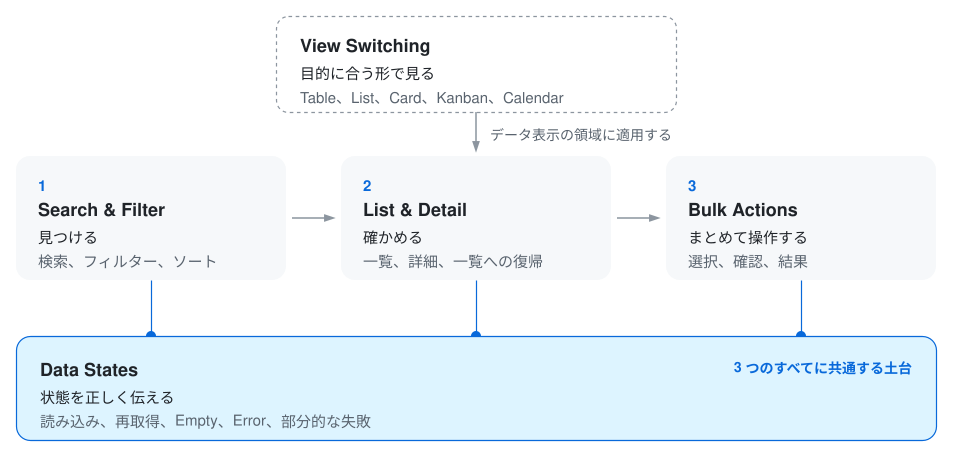

# Data Browsing

利用者が目的の情報を見つけ、確かめ、必要な操作を行うまでを扱う Patterns のグループ。Search & Filter、List & Detail、Bulk Actions、View Switching、Data States の 5 種類からなる。

状態：v0.1 確定候補（最終レビュー前。v0.1 確定ではない）

<picture>
  <source media="(prefers-color-scheme: dark)" srcset="../../diagrams/data-browsing-dark.svg">
  
</picture>

## Components と Patterns の関係

Data Table、Input、Select、Combobox、Multi Select、Date Picker、Checkbox、Popover、Sheet、Drawer、Dialog、Alert Dialog、Dropdown Menu、Skeleton、Empty、Alert、Toast、Progress は Components（v0.1）である。Data Browsing は、これらと App Structure の Page Layout、Page Header、Section Layout を組み合わせる。

既存の機能を再実装しない。Data Table の検索欄（`DataTableSearch`）、適用中の条件（`DataTableAppliedFilters`）、選択の Checkbox、件数と一括操作のバー（`DataTableSelectionBar`）、Pagination、データの状態（`status`）は、そのまま使う。Data Browsing の再利用できるコードは、次の 2 つを担う。

- 表の外で持つ状態（検索語、フィルター、ソート、ページ、選択、取得の状態）を、Data Table の `useTable` の `state` と `on*Change` に渡せる形で持つ hook。Data Table の状態の仕組みを置き換えない。
- Components にない、パターンに固有の小さな部品（表示形式の切り替え、横スクロールの手がかり、一括操作の結果、欠損値の表示など）。

## 5 種類

| Pattern | 目的 | 資料 | 再利用できるコード（`registry/patterns/`） |
| --- | --- | --- | --- |
| Search & Filter | 目的の情報を見つける | [search-and-filter.md](search-and-filter.md) | `browse-query.ts`：`useBrowseQuery`、`useFilterDraft`、`countActiveFilters` |
| List & Detail | 一覧から詳細を確かめ、一覧に戻る | [list-and-detail.md](list-and-detail.md) | `list-detail.ts`：`getRecordNeighbors`、`captureListPosition`、`useListPositionRestore`<br>`table-scroll-area.tsx`：`TableScrollArea`、`HorizontalScrollArea` |
| Bulk Actions | 選んだ複数の行にまとめて操作する | [bulk-actions.md](bulk-actions.md) | `bulk-selection.ts`：`useBulkSelection`、`useBulkAction`、`BulkRequestError`、`reconcileBulkResults`、`isBulkFullySucceeded`<br>`bulk-actions.tsx`：`BulkRunStatus`、`BulkResultAlert` |
| View Switching | 作業の目的に合う表示形式で見る | [view-switching.md](view-switching.md) | `view-switcher.tsx`：`ViewSwitcher`、`ViewSwitcherMenu`、`resolveInitialView`、`useViewScopedState` |
| Data States | データの状態を正しく伝える | [data-states.md](data-states.md) | `browse-data.ts`：`useBrowseData`、`useDelayedFlag`、`getBrowseViewState`<br>`data-states.tsx`：`LoadingReveal`、`DataRefreshIndicator`、`DataRegionError`、`DataValue` |

### コードと資料の区分

| 区分 | 内容 | 理由 |
| --- | --- | --- |
| 再利用できるコード | 上の表の hook と部品 | 古い応答の破棄、選択の範囲、対象の固定、フォーカスとスクロールの復元、IME と Debounce は、製品ごとに書き直すと誤りやすい。Registry で品質を保つ |
| 組み合わせの例（プレビュー） | 顧客の一覧（`CompanyBrowser`）、詳細の Sheet と別ページ、編集の Sheet、Kanban と Calendar の閲覧、Split View、Inline Expansion、営業管理の検証画面 | 画面の構成は、製品のデータと作業で変わる。1 つの巨大な Data Browsing の部品にせず、組み合わせ方を示す |
| 設計の資料だけ | 表示方式（Sheet、別ページ、Split View、Inline Expansion）の選び方、固定列を使う条件、全件の選択を元の条件に固定する方式、表示形式の選び方、詳細の情報の順序、確認の方法の選び方 | 画面ごとの判断であり、コードでは決められない |
| 製品の責務 | データの取得（API）、URL への同期と保存、権限、一括操作の実行と冪等性、対象の確定と件数の検証、ルーターとの接続 | 製品の基盤に依存する |

## 使い方の流れ

1. 検索の対象と、よく使う条件を決める（[search-and-filter.md](search-and-filter.md)）。`useBrowseQuery` で条件を持つ。
2. 条件に対応するデータを取得する（[data-states.md](data-states.md)）。`useBrowseData` に取得の処理を渡すか、製品のデータ取得の仕組みで同じ規則を守る。
3. 一覧を Data Table で描画し、詳細の表示方式を選ぶ（[list-and-detail.md](list-and-detail.md)）。
4. 一括操作が必要な場合だけ、選択と操作を加える（[bulk-actions.md](bulk-actions.md)）。
5. 異なる作業の目的がある場合だけ、表示形式の切り替えを加える（[view-switching.md](view-switching.md)）。

```tsx
const browse = useBrowseQuery<Filters>({ defaultFilters, debounceMs: 300 })
const data = useBrowseData({
  query: browse.query,
  fetcher: (q, { signal }) => api.listCustomers(q, { signal }), // 製品の API
  scopeKey: workspaceId,
})
const rows = data.data?.rows ?? []
const total = data.isCurrent ? (data.data?.total ?? null) : null
const selection = useBulkSelection({
  queryKey: JSON.stringify({ search: browse.query.search, filters: browse.query.filters }),
  query: browse.query,
  scopeKey: workspaceId,
  visibleIds: rows.map((r) => r.id),
  total,
})
const table = useTable({
  ...dataTableDefaults,
  features: dataTableFeatures,
  columns,
  data: rows,
  getRowId: (r) => r.id,
  state: { sorting: browse.query.sorting, pagination: browse.query.pagination, rowSelection: selection.rowSelection },
  onSortingChange: browse.onSortingChange,
  onPaginationChange: browse.onPaginationChange,
  onRowSelectionChange: selection.onRowSelectionChange,
  manualFiltering: true,
  manualSorting: true,
  manualPagination: true,
  rowCount: total ?? undefined,
  autoResetPageIndex: false,
})

<DataTableSearch placeholder="会社名・電話番号で検索" value={browse.searchInput} onValueChange={browse.setSearchInput} />
<LoadingReveal loading={data.status === "loading"}>
  <TableScrollArea>
    {/* 行に依存する操作は、canOperate（最新の取得に成功した）で許可する。isCurrent や status === "ready" だけで判断しない */}
    <DataTable
      table={table}
      status={data.status === "idle" ? "loading" : data.status}
      locked={!data.canOperate}
      filtered={browse.isFiltered}
      …
    />
  </TableScrollArea>
</LoadingReveal>
```

## 状態管理の設計

| 状態 | 持つ場所 | 内容 |
| --- | --- | --- |
| 条件 | `useBrowseQuery` の `query`（`BrowseQuery`） | 適用した検索語、フィルター、ソート、ページ番号、ページサイズ。`query` と `onQueryChange` で製品が制御し、URL などと同期できる |
| 検索欄の入力値 | `useBrowseQuery` の `searchInput` | 適用した検索語とは別に持つ。Debounce の後、または `applySearch` で適用する |
| 編集中の条件 | `useFilterDraft` の `draft` | Sheet や Drawer でまとめて適用する条件。開いたときに適用済みの条件を写し、閉じたときに破棄する |
| データ | `useBrowseData` | 表示するデータ、そのデータの条件のキー（`dataKey`）、状態（`idle`、`loading`、`refreshing`、`ready`、`error`）、同じ条件の再取得の失敗（`refreshFailed`）、表示と操作の可否（`isCurrent`、`canOperate`。下の表） |
| 一括操作の選択 | `useBulkSelection` | 行の ID（`ids`）か、検索条件と除外した ID（`all`）。詳細を表示中の行（`activeRowId`）とは別に持つ |
| 一括操作の実行 | `useBulkAction` | 実行中の操作と固定した対象、実際の進捗、最後の結果（対象との照合の結果 `integrity` を含む）。どれもスコープと組で持ち、現在のスコープの値だけを返す |
| 表示形式 | 製品（`useState` など） | 最初の値は `resolveInitialView` で決める |
| 表示形式ごとの状態 | `useViewScopedState` | Kanban のグループ、Calendar の表示期間など。Table のページ番号は `BrowseQuery` の `pagination` で持つ |
| 一覧の位置 | `captureListPosition` の値を製品が保存する | 縦と横のスクロールの位置、フォーカスしていた行の ID と位置 |

Registry の部品は、どの状態も保存しない（LocalStorage、セッションのストレージ、データベース、URL に依存しない）。保存と復元の値の受け渡しは、`initialQuery`、`query`、`initialData`、`position` などの引数で行う。

### データの表示と操作の可否

`useBrowseData` は、表示できることと、操作してよいことを分けて返す。

| 値 | 意味 | 使う場所 |
| --- | --- | --- |
| `data` | 表示できるデータ。再取得中は前の条件のデータのことがある。`status` が `error` のときは結果として表示しない | 描画 |
| `isCurrent` | `data` が現在の条件の結果として表示できる。同じ条件の再取得に失敗した場合も `true`（前の結果が、その条件の最後の確定した結果のため） | 件数の確定、読み上げ、一覧への復帰の時期 |
| `refreshFailed` | 同じ条件の再取得に失敗し、前の結果を表示している | 再取得の失敗の Alert |
| `canOperate` | 現在の条件の結果で、かつ最新の取得に成功している。再取得中、取得失敗、同じ条件の再取得の失敗では `false` | 一括操作、行の操作、選択（`DataTable` の `locked={!canOperate}`、`DataTableSelectionBar` の `disabled`） |

- 条件を変えて、新しい要求を送る前の描画でも、前の条件の状態を返さない（最後に送った要求のキー `requestKey` で判断する）。
- スコープ（`scopeKey`）が変わったら、取得しない間（`enabled: false`）も含めて、1 回の描画でも前のスコープのデータを返さない。
- 古い要求、古いスコープの要求、アンマウントの後に届いた応答は、成功・失敗のどちらも反映しない（要求ごとの番号。`AbortSignal` を無視する取得の処理でも反映しない）。

## プレビュー

`npm run preview:dev` で開き、上部の「Patterns：Data Browsing」から選ぶ。

| ページ | URL | 内容 |
| --- | --- | --- |
| Search & Filter | `#/search-filter` | サーバー側の検索と追加の条件（Sheet）、入力値と適用した検索語、古い応答の破棄、Popover の即時適用、比較 |
| List & Detail | `#/list-detail` | 非モーダルの Sheet、編集の Sheet、Split View、Inline Expansion、横スクロールの手がかり、比較 |
| Bulk Actions | `#/bulk-actions` | ページをまたぐ選択、全件の選択、一部失敗と再試行、結果が不明な場合、進捗、比較 |
| View Switching | `#/view-switching` | 5 つの表示形式、セグメント型とアイコンだけの切り替え、検証画面の組み合わせ、比較 |
| Data States | `#/data-states` | 状態の区別（8 つの結果）、部分的な失敗、欠損値、長時間の処理、アカウントの切り替え、比較 |
| 営業管理の検証画面 | `#/browsing-app?page=customers` | 5 種類を組み合わせた顧客の一覧と詳細ページ（`page=customer&id=C-00001`）。下部の「検証用の操作」で、応答の時間、件数の有無、一括操作の結果、ワークスペース、取得の失敗を切り替える |

検証画面の URL の引数：`page`、`id`、`ws`（ワークスペース）、`status`、`owner`、`regions`、`feeMin`、`feeMax`、`renewalFrom`、`renewalTo`、`sort`（`monthlyFee.desc` の形）、`p`（ページ番号）、`size`、`view`（`table`、`board`、`calendar`）。検索語は、電話番号を含みうるため URL に入れない（履歴の項目ごとの記録にだけ持つ）。

検証画面は Data Browsing の検証のためのものであり、正式な Pages の実装ではない。App Structure の検証画面（`structure-app`）は変更せず、同じ Sidebar（`StructureSidebar`、`structureNav`）を使う別の画面として作った。

プレビューのページは、Registry の `@/patterns/*` と `@/components/ui/*` を読み込み、複製しない。模擬のサーバーと例のデータは `preview/src/data/data-browsing/` にあり、Registry には含めない。検証のための遅延と失敗は、模擬のサーバー（`window.__fdBrowseServer`）だけで設定する。

## 確定した仕様

v0.1 の最終調整で、次の仕様を正式に採用した。Pagination、Data Table、Search & Filter の資料も、この仕様にそろえている。

### ページ番号

| 操作 | ページ番号 |
| --- | --- |
| 検索語の変更 | 1 ページ目に戻す |
| フィルターの変更 | 1 ページ目に戻す |
| ソートの変更 | 1 ページ目に戻す |
| ページサイズの変更 | 変更の前に表示していた先頭の行を含むページへ移る（`useBrowseQuery` の `pageSizeChange: "keep-position"`、標準。Pagination の `pageForPageSize`）。`"first-page"`（1 ページ目に戻す）は例外の用途のために残す |
| 同じ条件の再取得 | 現在のページを維持する |
| 最終ページの行をすべて削除 | 存在する最後のページへ移る。0 行と未登録・検索結果 0件を混同しない（総件数がわかる場合は最後のページ、わからない場合は前のページ） |

### 一括削除の確認

- 確認の Dialog（Alert Dialog）は、実行のボタンを押したとき（実行の開始時）に閉じ、一覧の一括操作の領域（`DataTableSelectionBar` の中の `BulkRunStatus`）で処理中を示す。実行前の確認、実行中の進捗、実行後の結果を、それぞれ別の場所で示す。
- 確認した時点で対象を固定する（`selection.snapshot()`）。実行中に選択や条件を変えても、対象は変わらない。
- 二重実行を防ぐ（`useBulkAction` の `start` は実行中の呼び出しを無視する。実行中は操作のボタンを置かない）。
- 実行中は、表示中の行に依存する操作を制限する（一括操作のボタンを置かず、終了後の再取得の間は `canOperate` が `false`）。
- Dialog を閉じることは、処理の中止ではない。待機の中止（`cancel()`、`AbortSignal`）も、サーバーでの処理の取り消しを保証しない。
- 実行後は、押したボタンが消えた場合でも、フォーカスを `<body>` に落とさない（実行の開始時は `BulkRunStatus`、すべて完了した後は最初の行の名前のボタン、それ以外は結果の表示）。
- すべての行が完了し、結果に不足も矛盾もない場合（`isBulkFullySucceeded`）は Toast で知らせる。部分的な失敗、すべての失敗、結果が不明、結果の不足・矛盾は、一覧の上の `BulkResultAlert` に残す。
- 短時間で終わる単一のレコードの操作などでは、Dialog の中で実行のボタンを Loading にし、成功の後に閉じる方式も認める。Data Table v0.1 のプレビューの一括削除（複数の行を Dialog の中で処理中にする）は、部品の組み合わせを示す Components 単体の例であり、この Pattern の標準ではない。

## 製品の責務（共通）

- データの取得（API の呼び出し、認証、権限）。`useBrowseData` には取得の処理を渡す。
- URL への同期と保存。個人情報を含みうる値（電話番号での検索語など）を、無条件に URL に入れない。
- 一覧の位置の保存（履歴の項目ごと）と、ルーターとの接続。
- 一括操作の実行、冪等性の保証、対象の確定、権限の確認、件数の検証、処理の対象の固定（バックエンド）。
- 一括操作の API の契約：ID の対象では、対象のすべての ID について結果を 1 つずつ返す。全件の選択（検索条件の対象）では、バックエンドが確定した対象の件数（`confirmedCount`）と、処理した行の ID ごとの結果を返す。返さない場合、Registry は結果の完全性を確かめられないため、すべて完了として扱わない。
- `AbortSignal` はクライアントの待機の中止であり、サーバーでの処理の取り消しを保証しない。取り消しが必要な場合は、製品の API で扱う。
- 不変のデータの契約：検索条件（`query`）と操作の内容（`payload`）を、作った後に書き換えない。製品が独自の値を使う場合は、`start` に渡す前にスナップショットを作る（`structuredClone` など）。
- 表示形式の保存（URL、前回の値）。
- ページの移動を含む未保存の変更の管理（Forms & Workflows で扱う）。

## 既存の Components と App Structure への影響

| 対象 | 変更 | 互換性 |
| --- | --- | --- |
| `DataTableSelectionBar`（`registry/components/ui/data-table.tsx`） | 初期実装：`selectAll` に `matchingCount` の省略（件数がわからない場合）、`excludedCount`（全件の選択から外した件数）、`hasMore`（件数がわからない場合に、ページの外にデータがあるか）を追加した。v0.1：`disabledReason`（無効の理由の文。既定は「更新が終わるまで操作できません」）を追加した | 既存の呼び出しの表示と動作は変わらない。既存の文言も変えていない |
| `DataTable`（同） | v0.1：`locked`（表示中の行に依存する操作を受け付けない。既定は `status !== "ready"`）を追加した。同じ条件の再取得に失敗して前の行を表示している場合に、`status` が `ready` のまま操作を止めるため | 省略した場合は従来どおり |
| `PaginationControls`（`registry/components/ui/pagination.tsx`） | v0.1：ページ番号の並びが置かれた領域に収まらない場合（Container Query）、番号と省略記号の代わりに「3 / 29」（支援技術には「29ページ中 3ページ目」）を示し、最初と最後のページへの移動を置く。必要な幅は、並びのボタンの数 × 48px と間 4px から求める（ボタンの数が 3〜11 の場合の 9 段階）。フォーカスの維持（`useKeepFocus`）は、表示していないボタンを除いて移す | 並びが収まる幅では、表示と動作は変わらない。操作は減らさず、ボタンの大きさ（指で操作する端末では 48px）も変えない |
| `DateRangePicker`（`registry/components/ui/date-picker.tsx`） | v0.1：並べ方を、画面の幅ではなく置かれた領域の幅（24rem、Container Query）で決める。24rem 以上は 1 行（開始日 〜 終了日 カレンダーのボタン）、24rem 未満は開始日と終了日を同じ幅で縦に並べ、カレンダーのボタンを終了日の右に置く。「〜」は 1 行の並べ方だけで表示する。外側の要素（`data-slot="date-range-picker"`）の内側に、並べ方の要素を 1 つ追加した | `data-slot` と入力欄、ボタン、送信の値は変わらない。広い領域での表示は変わらない |
| その他の Components | 変更なし | |
| App Structure（`registry/patterns/` の 6 ファイル、資料、検証画面） | 変更なし | `AppShellMain` の既存の `scrollOnNavigate`、`focusOnNavigate`、`useAppShell().mainRef` を使う |
| プレビュー | `catalog.ts` に分類「Patterns：Data Browsing」と 6 ページを追加した。`package.json` の `test:patterns` に `data-browsing` を追加した | 既存のページの id と URL は変わらない |

既存のテストの変更（v0.1）：

- `data-display.spec.ts` の 4 件（Data Table の一括削除と Pagination、Pagination の多数のページ、1 ページ・無効・フォーカス）は、Pagination の並びが収まらない領域（`webkit-mobile` の iPhone 15 の表示で、資料のページの内容の幅 345px）では、番号の代わりに現在の位置、最初・最後と前後の移動を確かめる分岐を加えた。並びが収まる幅では、従来と同じ判定を行う。確かめる操作は減らしていない。
- `advanced.spec.ts` の「Select selected weight」は、ArrowUp を押す前に、選択中の項目にフォーカスが移ったこと（`toBeFocused()`）を待つ（「未検証の事項」の WebKit の不安定さ）。判定は変えていない。

### Registry の API の変更（v0.1）

| 対象 | 変更 |
| --- | --- |
| `bulk-selection.ts` | 追加：`reconcileBulkResults`、`isBulkFullySucceeded`、型 `BulkIntegrity`（`missing`、`duplicates`、`unexpected`、`unexpectedIds`、`invalid`、`confirmedCount`、`expectedCount`、`countChanged`、`unreported`、`overReported`、`reconciled`、`complete`）、`BulkRunResponse`。`BulkSummary` に `integrity`、`BulkTarget` に `selectionRevision` を追加した。`run` は結果の配列のほかに `{ items, confirmedCount }` を返せる。`start` は、現在と異なるスコープの対象と、0 件の ID の対象を実行しない |
| `browse-data.ts` | `useBrowseData` の戻り値に `canOperate` を追加した。`setData(updater, { scopeKey, dataKey })` で、保存を始めたときのスコープと条件のデータにだけ反映できる。横断の検品：`initialData.scope`、`discardOnError` を追加した（下の「横断の検品の対処」） |
| `list-detail.ts` | 横断の検品：`useListPositionRestore` に `scrollReady`、`targetKey`、`dataKey` を追加し、復元の前の利用者の操作で復元を取りやめる。`watchUserInteraction` を追加した |
| `table-scroll-area.tsx` | `HorizontalScrollArea`（表ではない横に並ぶ内容のスクロールの領域）を追加した。`TableScrollArea` と測り方を共有する |

プレビューの検証画面は、App Structure の `StructureSidebar`、`ProductMark`、`structureNav`、`PlaceholderScreen`、Overlays の `DiscardAlert`、Data Display の `FilterSelect`、`StatusText`、`customers` を読み込んで使う（複製も変更もしない）。

## 独自に判断した事項

指示書に定めのない点、または既存の仕様と関わる点を、次のように決めた。レビューで見直す。

| 事項 | 判断 | 理由 |
| --- | --- | --- |
| 再取得の失敗 | 同じ条件の再取得の失敗は、前のデータを残し、warning の Alert と取得した時刻を示す（`refreshFailed`）。条件を変えた後の取得の失敗は `error` にし、前の条件のデータを結果として表示しない | 同じ条件の前のデータは、その条件の最後の確定した結果である。条件を変えた後の前のデータは、現在の条件の結果ではない |
| 結果が不明な行の選択 | 選択を解除し、結果の表示に件数と説明を残す。再試行のボタンを置かず、「最新の状態を確認」を置く | 選択を残すと、同じ操作をもう一度押して重複して実行するおそれがある |
| 全件の選択と条件の変更 | 条件を変えたら全件の選択を解除し、`notice`（「検索条件を変更したため、検索結果全件の選択を解除しました」）で知らせる方式を実装した。元の条件に固定する方式は、資料で示すだけにした | 選択の対象が暗黙に広がったり、変わったりしない。固定する方式は、表示中の行と選択の対象の関係を示す UI が別に必要になる |
| 検索語と URL | 検証画面では、検索語を URL に入れない。フィルター、ソート、ページ、表示形式だけを `history.replaceState` で同期する | 検索欄で電話番号を検索できるため。条件の変更のたびに履歴を増やさない |
| 確認した件数と処理の件数の差 | 全件の選択で、バックエンドが確定した件数が確認で示した件数と異なる場合は、すべて完了として扱わず、一覧の上に差を示す（`countChanged`） | 不可逆な操作で、確認した範囲より広い（または狭い）範囲が処理されたことを、Toast だけでは利用者が確かめられない。API の契約として、製品が `expectedCount` を送り、一致しない場合にバックエンドが拒否する方式も認める |
| 実行の宛先 | `run` は、要求の宛先を `target.scope` から決める。`start` は現在のスコープと異なる対象を実行しない。検証画面の「元に戻す」は、ワークスペースを切り替えた後は実行せず、そのことを知らせる | 描画の時点の値（現在のワークスペース）を使うと、スコープを切り替えた後に押された操作が、別のワークスペースに書き込む |
| 200ms の遅延 | 遅らせるのは表示（`LoadingReveal`、`DataRefreshIndicator`、`useDelayedFlag`）だけ。操作の制限（Data Table の locked、一括操作の無効化）は、取得の状態そのものですぐに行う | 指示書の「安全性に必要な処理を 200ms 遅らせない」 |
| 再取得中の件数 | 前の件数を残し、薄い色（`muted-foreground`）にする。件数の読み上げは、結果が確定したときだけ行う | 件数の文字が「件数を確認中」などに毎回入れ替わると、短い取得でちらつく。読み上げは検索のたびに重ねない |
| モバイルの一括操作のバー | 選択中だけ、main の中の `sticky` の要素として画面の下に置く。バーの高さを `--toast-offset-bottom` に設定し、Toast を上げる | `sticky` の要素は内容の流れの中に場所を取るため、最後の行と Pagination を隠さない。Toast との重なりは `toast.md` の方法で避ける |
| 横スクロールの手がかり | Table と DataTable を変更せず、`TableScrollArea` で囲み、中の `data-slot="table-container"` を測る | 既存の Table（v0.1）の DOM と API を変えない |
| 表示形式の切り替えのセマンティクス | セグメント型を `radiogroup`（1 つだけ選ばれ、矢印キーで移動して選ぶ）にした | 選択肢のうち常に 1 つが選ばれている状態であり、Tab で 1 回で抜けられる |
| 検証画面 | App Structure の検証画面を拡張せず、別の画面 `browsing-app` として作った | App Structure の v0.1 の最終調整と並行しているため、共有するファイルの変更を避けた |
| 全件の選択の件数 | 総件数がわからない場合は、「検索条件に一致するすべてのデータを選択中」と示し、件数を示さない。件数は実行の時点でバックエンドが確定する | 架空の件数を示さない |
| 一括操作がすべて完了したときの知らせ | 選択を解除し、Toast で知らせる（担当者の変更は「元に戻す」を示す）。失敗か結果の不明を含む場合だけ、`BulkResultAlert` を一覧の上に残す | すべて完了した結果は、確かめ直す必要がない。部分的な失敗は Toast だけで伝えない |
| 全件の選択の要求そのものの失敗 | `requestError.outcome` が `failed`（処理されていない）なら、選択を残し、同じ対象で「もう一度実行」できる。`unknown` なら選択を解除し、「最新の状態を確認」を置く | 処理されていない要求は安全に繰り返せる。処理されたかわからない要求は、重複のおそれがある |
| 一括操作の実行中のスコープの変更 | `useBulkAction` の `scopeKey` が変わったら、実行の待機を中止し、結果を表示しない。`BulkTarget` にスコープを持たせ、別のスコープの選択に結果を反映しない | 別のワークスペースの結果と選択を、新しいワークスペースに残さない |
| 範囲の外のページ | 0 行で `pageIndex > 0` の結果を受け取ったら、表を再取得中として表示し、最後のページへ戻して取得し直す（検証画面の製品側のコード） | 最後のページの行をすべて削除した後に、未登録や 0 件と誤って表示しない |
| 編集の Sheet | 閲覧の Sheet の中に入れ子にせず、独立したモーダルの Sheet として置く | Base UI の入れ子の Dialog は背景（Backdrop）を描かないため、編集の間に背景が暗くならず、モーダルであることが伝わらない |
| 一括操作の結果と対象の照合 | `reconcileBulkResults` で、結果を固定した対象と照合する。ID の対象で結果が返らなかった ID は結果が不明。同じ ID の重複は 1 つとして数え、異なる結果が重なった ID は結果が不明。対象ではない ID（全件の選択では外した ID）と形式が正しくない結果は数えない。応答そのものの形式が正しくない場合は、結果が不明の要求の失敗。全件の選択では、バックエンドが返す確定した件数（`confirmedCount`）と照合し、返さない場合は完全性を確かめられないものとして扱う。不足や矛盾がある場合は Toast にせず、一覧の上に件数と「最新の状態を確認」を示す | 結果が足りないときに、無条件にすべて完了と判断しない。重複や対象外の結果を完了の件数に含めない。クライアントは全件の選択の対象を確定できないため、件数の保証は API の契約にする |
| 実行の間の選択の変更 | `BulkTarget` に固定したときの選択の版（`selectionRevision`）を持たせる。利用者が実行の間に選択を変えた場合（版が異なる場合）、`settle` は選択を変えない | 以前の操作の結果で、利用者が新しく作った選択を変えない |
| スコープの変更とアンマウント | `useBulkAction` は、実行中の操作、進捗、結果をスコープと組で持ち、描画の時点で現在のスコープの値だけを返す。スコープの変更とアンマウントで世代を進め、それより前に始めた実行の結果、進捗、`onSettled`（Toast など）を無効にする。`useBrowseData` も、アンマウントの後の応答を反映しない | `AbortSignal` を無視する取得や実行の処理でも、古い結果が新しい状態を書き換えない。A → B → A と素早く切り替えた場合も、最初の A で始めた処理の結果を反映しない |
| 表示と操作の可否 | `useBrowseData` に `canOperate` を追加し、`DataTable` に `locked`、`DataTableSelectionBar` に `disabledReason` を追加した。同じ条件の再取得の失敗では、行を表示したまま操作を止め、「再取得するまで操作できません」と示す | `isCurrent`（表示できる）と `status === "ready"` だけでは、同じ条件の再取得に失敗した古いデータへの変更を許してしまう。既存の API は変えず、省略可能な値の追加にとどめた |
| 対象と操作の内容の固定 | ID の配列は `start` で写す。`query` と `payload` は深く写さず、書き換えない値として扱う（不変のデータの契約）。`useBrowseQuery` は条件を変えるたびに新しいオブジェクトを作る | 任意の型を深く写すと、型ごとに扱い（Date、Map など）が異なり、誤りやすい。製品が独自の値を使う場合は、製品がスナップショットを作る |
| Kanban の横スクロール | `HorizontalScrollArea` を追加し、`TableScrollArea` と測り方（`useScrollEdges`）を共有する。Kanban は Table の DOM（`data-slot="table-container"`）に依存しない | 横にスクロールする場合だけ、スクロールできる方向に影を示す。影は操作を妨げない（`pointer-events: none`） |
| DateRangePicker の並べ方 | 画面の幅ではなく、置かれた領域の幅（24rem）で並べ方を決める | 広い画面の中の狭い Sheet で、開始日の後に「〜」だけが残り、終了日の欄が狭くなっていた |
| Pagination の狭い領域 | ページ番号の並びが収まらない領域では、番号の代わりに「3 / 29」と、最初・最後のページへの移動を置く | 320px の製品の画面（左右の余白 16px、内容 288px）で、並び（48px × 7 と間、360px）が内容の領域からはみ出し、main の `overflow-x: hidden` で「29ページ目」と「次へ」が見えなかった。操作を減らさず、タッチの大きさも変えない |

## 検品

- 実機（iOS Safari、Android）とスクリーンリーダー（VoiceOver、NVDA）による検品は行っていない。

| 対象 | 検品（`preview/tests/`） |
| --- | --- |
| 資料のページ（5） | `data-browsing.spec.ts`：名前、h1 が 1 つ、横スクロールなし、操作の名前 |
| Search & Filter | 日本語の IME の変換中に検索しないこと、Debounce、短時間の連続した入力、古い応答の破棄、取得の失敗と再取得、即時の適用、まとめて適用とキャンセル、Chip の個別の解除、すべての解除、ページ番号のリセット、正確な件数と件数がわからない場合、モバイルの Drawer |
| List & Detail | 行全体のクリック、Checkbox、リンク、Dropdown Menu との分離、文字の選択、キーボードでの詳細の表示、非モーダルの Sheet からの切り替え、モーダルの編集、未保存の変更の確認、詳細の取得の競合、一覧への復帰とスクロールの位置とフォーカスの復元、横スクロールの手がかり、固定列、領域の幅の変化 |
| Bulk Actions | 個別の選択、ページ内の全選択と Indeterminate、ページをまたぐ選択、条件の変更の後の選択、表示していない件数、全件の選択と対象の固定、詳細の表示との分離、二重実行の防止、すべて成功、すべて失敗、一部失敗、失敗した行だけの再試行、結果が不明な場合、モバイルの操作のバー |
| View Switching | 表示形式の切り替え、データ領域の直上・右の配置、検索とフィルターの維持、選択の維持、表示形式ごとの状態、キーボードの操作、アクセシブルな名前、モバイルでの折り返し |
| Data States | 初回の読み込み、200ms 未満の取得、遅い取得、再取得中の既存のデータ、古いデータへの操作の制限、再取得の失敗、未登録と検索結果 0件、全体の失敗と部分的な失敗、欠損値と 0 の区別、実際の進捗、アカウントの切り替えでのデータの破棄、`aria-busy`、動きを減らす設定 |
| SSR と Hydration | `ssr-data-browsing.spec.ts`：window と document なしの描画、Hydration の不一致なし、`registry/patterns` の `"use client"` の境界 |
| 結果の完全性（v0.1） | `data-browsing-results.spec.ts`（ブラウザを使わない）：10 件の対象に 8 件の結果、同じ ID の重複（同じ結果・異なる結果）、対象外の ID、空の結果、形式が正しくない結果と応答、全件の選択での確定した件数との不一致（少ない、多い、返さない、負の値）、結果の写し。`data-browsing.spec.ts`：結果の不足・重複・対象外を含む応答で Toast を出さず、件数と「最新の状態を確認」を示す |
| スコープと非同期の競合（v0.1） | `data-browsing.spec.ts`：ワークスペースの A → B → A の素早い切り替えで別のワークスペースの行を 1 回も表示しない、取得しない間（表以外の表示形式）の切り替え、A で始めた実行の結果を A → B → A の後に反映しない、実行中のアンマウントの後に Toast を出さない、同じ条件の再取得の失敗で行を残して操作を止める（理由の文、現在のページの維持） |
| 対象と操作の内容の固定（v0.1） | 実行の間に利用者が変えた選択を結果で変えない、再試行が実行したときの対象と操作の内容を使う、全件の選択の実行の条件を開始時に固定する |
| レイアウト（v0.1） | Kanban の横スクロールの手がかり（方向、端、カードを押せる）、「その他の条件」の Sheet の DateRangePicker の入力欄の幅と位置、広い領域での 1 行の並べ方、320px の製品の画面での Pagination（内容の中に収まる、4 つの移動、48px） |

`data-browsing.spec.ts`、`data-browsing-results.spec.ts`、`ssr-data-browsing.spec.ts` は `npm run test:components` に含まれる。Patterns だけを実行する場合は `npm run test:patterns`。

### 検証の結果

- 実施日：2026-11-26
- 環境：macOS（Darwin 25.6）、Node.js 26.10.0、Playwright 1.65.1（Chromium 159、WebKit 27.x）
- 統合の候補：`5dcd39a`（最新の `origin/main` = 1882f2a の上の 1 コミット。`origin/main` は検品の間に変わっていない）

| 確認 | 結果 |
| --- | --- |
| `npm run typecheck` | 成功（exit 0） |
| `npm run preview:build` | 成功（exit 0）。チャンクの大きさの警告は従来どおり（範囲外） |
| `npm run test:tokens` | 成功（failed 0） |
| `npm run test:ssr` | 84 件成功 |
| `npm run test:patterns` | 368 件成功、82 件 skip、失敗 0 件 |
| `npm run test:components`（1 回目） | 2110 件のうち 1879 件成功、231 件 skip、失敗 0 件（12.3 分、3 ワーカー） |
| `npm run test:components`（2 回目、続けて実行） | 1879 件成功、231 件 skip、失敗 0 件（12.6 分、3 ワーカー） |

- 記録された例外は、Vite の HMR の接続のコンソールのエラー（SSR の検品、`consoleEnvironment`）だけである。製品の例外とコンソールのエラーは 0 件。
- 既存のテストの削除、skip の追加、許容誤差の拡大はしていない。既存のテストの変更は 2 か所：`advanced.spec.ts` の Select の検品に、フォーカスの移動を待つ判定を 1 つ加えた。`data-display.spec.ts` の Pagination と Data Table の 4 件は、置かれた領域の幅から狭い並べ方になるべきかを求めて表示の一致を確かめた後、それぞれの並べ方で同じ操作（移動、最後のページ、現在の位置）を確かめる。
- 候補の前の一括の実行で 1 件失敗した（`data-browsing.spec.ts` の再取得の失敗の検品、`mobile`）。実行中に、検品の文言と製品の文言を同時に変えたためであり、変更の後の実行では成功している。
- スクリーンショット（Git の管理外）：Chromium 1280×900（一覧、結果の照合の表示、再取得の失敗、カンバン、その他の条件の Sheet）、Pixel 7（一覧、一括操作のバー、Drawer）、320px（一覧の上部、Pagination）を撮り、目視で確かめた。WebKit と実機での目視の確認は行っていない。

### 独立したレビュー

#### v0.1 の最終調整の再レビュー

別のエージェント（Opus）が、結論を渡さずに、差分、資料、テスト、スクリーンショットを確かめた。重点：一括操作の結果の完全性、スコープの境界、非同期の処理の競合。指摘は高 1 件、中 6 件、低 9 件。重大な問題がないとされた領域：`useBrowseData`（スコープの変更の直後の描画、`enabled: false` の間のスコープの変更、古い応答、アンマウントの後の応答、A → B → A）、`selectionRevision` と `settle`、`TableScrollArea` の互換性、4 つの資料のページ番号の規則、`advanced.spec.ts` の変更。

| 指摘 | 対処 |
| --- | --- |
| 高：スコープを切り替えた後に Toast の「元に戻す」を押すと、`run` が描画の時点のワークスペースを使い、別のワークスペースに対して実行される | `start` は現在と異なるスコープの対象を実行しない。`run` は `target.scope` から宛先を決める。検証画面の「元に戻す」は、切り替えの後は実行せず、そのことを知らせる。検品を追加した |
| 中：ID の対象で要求そのものが失敗したとき、空の不足の一覧と「最新の状態を確認」が出る | `integrity.reconciled` を追加し、照合した結果だけを不足や矛盾として示す。示す行がないときは何も描画しない。検品を追加した |
| 中：全件の選択で、確認した件数とバックエンドが確定した件数が異なっても、Toast だけで知らせる | `integrity.countChanged` を追加し、すべて完了として扱わずに一覧の上に差を示す。単体の検品を追加した |
| 中：対象ではない ID の成功の結果を「件数に含めていません」とだけ示す | ID（名前）を示し、変更された可能性があることを伝える（`integrity.unexpectedIds`） |
| 中：Pagination のテストが、検査の対象の表示で分岐している | 置かれた領域の幅と必要な幅から狭い並べ方になるべきかを求め、表示が一致することを確かめてから分岐する（`expectPaginationMode`）。広い領域で狭い並べ方にならないことも確かめる。狭い並べ方でも、移動で表示する項目の数が変わらないことを確かめる |
| 中：狭い並べ方で最後のページに着くと、フォーカスが「最初のページ」へ移る | 現在の位置の表示（`tabIndex={-1}`）へ移す。検品を追加した |
| 中：Dialog の中で処理中にする例外の範囲が、資料の間で一致しない | 例外を「短時間で終わる単一のレコードの操作」に限り、Data Table のプレビューの一括削除は Components 単体の例であり Pattern の標準ではないと明記した |
| 低：0 件の実行を完了として知らせる。削除の確認のボタンが、再取得中や選択がないときも押せる | 0 件の ID の対象は実行しない。確認のボタンを `locked`、実行中、選択なしの間は無効にする |
| 低：前の実行から遅れて届いた進捗が、次の実行に反映される | 実行ごとの番号で照合する |
| 低：スコープの変更の直後、効果が走る前に結果が届くと `onSettled` が呼ばれる可能性 | 結果を反映する前に、開始したときのスコープと現在のスコープを比べる |
| 低：結果が 0 件のとき、狭い領域で「最初のページ」だけが描画される | 0 件のときは最初と最後への移動を置かない |
| 低：`DateRangePicker` の `className` が付く要素が変わった | 資料（date-picker.md）の互換性に記載した |
| 低：結果の `message` の型を確かめていない | `message` と `retryable` の型を確かめ、正しくない値を捨てる。単体の検品を追加した |
| 低：結果の表示で、結果が返らなかった行と結果が不明な行が同じ 1 件を 2 回説明する | 結果が不明な行の説明の中に「うち N件は、結果が返されませんでした」と 1 回だけ示す。同じ案内の文を重ねない |
| 低：再取得の失敗のテストが、削除を含むその他の一括操作の無効を確かめていない。単体の検品の不足 | 検品を追加した（`confirmedCount: 0`、件数の差、型の正しくない値） |
| 低：`setData` が条件やスコープを確かめない | `setData(updater, { scopeKey, dataKey })` を追加し、検証画面の保存の反映にスコープを渡す |

#### 初期実装のレビュー

別のエージェント（Opus）が、実装の結論を渡さずに、差分、資料、図、テスト、スクリーンショットを 8 つの設計原則と 8 つの美的基準で確かめた。指摘は高 2 件、中 7 件、低 6 件。

| 指摘 | 対処 |
| --- | --- |
| 高：ワークスペースを切り替えた後も、前のワークスペースの一括操作の結果が残る。実行中に切り替えると、前のワークスペースの失敗した ID が新しい選択に入る | `useBulkAction` に `scopeKey` を追加し、変わったら待機を中止して結果を破棄する。`BulkTarget` に `scope` を持たせ、`settle` は別のスコープの結果を反映しない。検品を追加した |
| 高：最後のページの行をすべて削除すると「顧客はまだ登録されていません」と表示される | 0 行で `pageIndex > 0` の結果を再取得中として扱い、最後のページへ戻す（製品側のコード）。資料に書いた。検品を追加した |
| 中：全件の選択の要求そのものが失敗すると、選択が消え、再試行もできない | `settle` は `requestError.outcome` が `failed` の場合に選択を変えない。`retryFailed` は同じ対象で再実行する。`BulkResultAlert` に「もう一度実行」を追加した。模擬のサーバーに「要求を受け付けない」を追加し、検品を追加した |
| 中：実行の開始と再試行で、押したボタンが消え、フォーカスが `<body>` に移る | 実行を始めたら `BulkRunStatus`（`tabIndex={-1}`）、すべて完了した後は最初の行の名前のボタン、失敗を含む場合は結果の表示へ移す。再試行の間は前の結果の表示を残す（`keepSummary`） |
| 中：再試行と「元に戻す」が、結果と結び付いていない操作の内容（ref）を読む。「元に戻す」に二重実行の防止がない | 操作の内容を `start(action, target, payload)` で渡し、`summary.payload` に保存する。「元に戻す」も `useBulkAction` で実行し、結果を同じ規則で示す |
| 中：ワークスペースの切り替えの直後に、前の詳細の ID で詳細を要求する | 詳細を表示中の行をワークスペースと組で持ち、描画の時点で一致を判定する |
| 中：Calendar の `role="grid"` に矢印キーの移動がない。セルの `aria-label` が中のボタンの名前を上書きする | role と `aria-label` をやめ、日付は支援技術向けの文で示す |
| 中：表示と同時に挿入する `role="status"` は読み上げられない場合がある。読み上げが重なる | `BulkRunStatus` の `role="status"` をやめ、常に置いている読み上げの領域で実行の開始を伝える。資料の読み上げの記述を、Data Table の既存の「更新中」と一致させた。実際のスクリーンリーダーでは未確認 |
| 中：テストの弱点（中止で古い要求を止めるだけ、条件付きの判定、Spinner の名前で Skeleton を見ていた、組み合わせの不足） | 中止に従わない模擬の要求で、古い応答が後から届いても表示しないことを確かめる。条件付きの判定を、実際にスクロールできるかとの一致の判定にした。Spinner の検品を追加した。スコープ、範囲の外のページ、要求の失敗、件数がわからない全件の選択の検品を追加した |
| 低：描画の時点の判定が `ready` と `idle` だけで、失敗や再取得中から条件が変わると 1 回の描画で古い状態を返す | 最後に送った要求のキー（`requestKey`）で判定する |
| 低：模擬のサーバーが中止で応答しない。原因の文が「通信が途中で切れた」に固定されている | 中止を結果が不明の要求の失敗として返す。原因を固定しない文にした |
| 低：図の「すべて成功は Toast」と実装（常に Alert）が一致しない | すべて完了は Toast にした（上の「独自に判断した事項」） |
| 低：描画中の `replaceState`、登録の失敗の扱い、長時間の処理の例のタイマー | 履歴のキーの書き込みを効果に移した。登録の失敗を Sheet の中に示す。タイマーをアンマウントで解除する |
| 低：SSR の検品の範囲 | `ViewSwitcherMenu` を SSR の画面に追加した。`initialData` と `useListPositionRestore` は、ブラウザの検品（一覧への復帰）で確かめている |
| 低：一括操作のボタンが件数の行の中央に離れて置かれる | 一括操作のバーの幅を内容に合わせ、件数のすぐ右に置いた |
| 低：Calendar の省略した会社名を確かめられない | `title` を付け、押すと詳細に全体を表示する |
| 低：Kanban の横のはみ出しに手がかりがない。「その他の条件」の `DateRangePicker` の入力欄の幅 | 変更していない。Kanban は `TableScrollArea` の対象外（表ではない）。`DateRangePicker` は Components の既存の表示。次のレビューで扱う |

### 横断の検品（Patterns Integration Review）の対処

独立した検品（Opus）の指摘と対処。指摘の再現は、検証画面（`#/browsing-app?page=customers`）で確かめた。

| 指摘 | 原因 | 対処 |
| --- | --- | --- |
| 致命的：一覧 → 詳細ページ → 戻る → ワークスペースを九州支店に切り替え → Sidebar の「ホーム」→ 戻る、で URL は `ws=kyushu` のまま、本社の行（C-00001…、580件）を表示した。取得の保留中も、取得の失敗の後も表示し続けた | 一覧の記録を履歴の項目のキー（`fdListKey`）だけで引いていた。ワークスペースの切り替え（`replaceState`）はキーを変えない。`useBrowseData` は `initialData` を現在のスコープのデータとして扱っていた | 記録に `scope`（ワークスペース）を入れ、URL のワークスペースと一致する場合だけ使う。切り替えたら、その履歴の項目の記録を破棄する。`useBrowseData` の `initialData` に `scope` を追加し、`scopeKey` と一致しない場合は使わない（二重の防止）。検品を追加した |
| 高：1024px と 1100px で行を選ぶ、1280px でページの全件を選ぶ・同じ条件の再取得に失敗すると、件数の行が折り返し、表が 48px 下がる。続けて押すと別の行に当たる | 件数の行が `flex-wrap` の 1 行で、一括操作のバーと表示形式の切り替えの合計の幅が行の幅を超えた | 件数の行を 2 つの列の grid にし、バーが入りきらない幅（行の容器の幅 70rem 未満。表示形式の切り替えがない場合は 50rem 未満）では、選択の前から 2 行にする（[bulk-actions.md](bulk-actions.md#操作のバー)）。文言と名前は省略しない。1024、1100、1280、1440px で、選択、ページの全件の選択、再取得の失敗の前後で行の高さと表の位置が変わらないことを確かめる検品を追加した（Chromium、WebKit） |
| 高：読み込み中に検索欄へ入力すると、復元がフォーカスを行のボタンへ移し、スクロールの位置を 0 から 381 に変え、入力した文字が失われる | `useListPositionRestore` が、データの表示が終わった時点で、利用者の操作に関係なく位置とフォーカスを戻していた | 復元の前の利用者の操作（`pointerdown`、`keydown`、`wheel`、`touchmove`、`focusin`）で取りやめる。保持していたデータの表示中に、スクロールの位置だけを先に戻す（`scrollReady`）。表示しているデータの条件が記録と異なる場合は戻さない（`targetKey`、`dataKey`）。検品を追加した |
| 中：一覧の表示中に Sidebar の「顧客」を押すと、URL は条件なし、表示は前の条件のまま（不一致）。その後の戻る操作の復元が壊れる | 同じ画面のまま URL だけが変わり、一覧の状態とキーを持ち越していた | 表示中が一覧でも、新しい履歴の項目（新しいキー）で一覧を作り直す。一覧の画面を履歴の項目のキーごとに作り直し、`AppShellMain` の `pageKey` にキーを含める（先頭と h1 から始める）。同じ URL の項目の間の移動のため、`popstate` でも画面を切り替える。検品を追加した |
| 中：同じ条件の再取得の失敗で、403 でも前のデータを残す | 失敗の種類を区別する手段がなかった | `discardOnError?: (error) => boolean` を追加した（省略した場合は従来どおり）。`#/data-states` に「再取得で権限を失う」の例と検品を追加した |
| 中：`DateRangePicker` を、幅が内容で決まる場所（`inline-flex`、`absolute`、grid の `auto` の列、`w-max` の Popover の中）に置くと幅が 0 になる | 外側の要素が Container Query の容器（`container-type: inline-size`）であり、内容の幅を自身の幅にしない（CSS の仕様） | 部品は変えず、資料に制約と対処（`className` で幅を指定する）を書いた（[date-picker.md](../components/date-picker.md)）。内側の要素を容器にしても、外側の幅は内容から決まらないため解決しない。外側に最小の幅（`contain-intrinsic-inline-size` など）を与える方法は、grid の `1fr` の列や flex の項目の最小の幅（`min-width: auto`）を変え、既存の配置で横にはみ出すおそれがあるため採らなかった |
| 中：一括削除の確認が、表示中の選択に従って文と件数が変わるのに、確かめ直させない。Forms & Workflows の顧客の一覧では、全件の選択の `targetKey` に件数がない | 検証画面は Alert Dialog を直接使っていた | 検証画面も `ConfirmActionDialog`（`progress="external"`）にし、`targetKey` にスコープ、ID の一覧、全件の選択は条件、除外した ID、件数を入れる。実行の時点の対象のキーが確かめたキーと異なる場合、再取得中、選択がない、実行中の場合は実行しない。Forms & Workflows の顧客の一覧の `targetKey` に、スコープと件数を追加し、実行の時点でも照合する |
| 低：戻った後の再取得の失敗で「前回の時点の内容」と示す | 記録に取得した時刻がなかった | 記録に `fetchedAt` を入れ、`initialData.fetchedAt` に渡す。検品を追加した |
| 低から中：戻ったときに選択を復元しない（8.1 の復元の対象） | 記録の対象ではなかった | ID の選択だけを、同じスコープ、同じ条件の場合に復元する。全件の選択は復元しない（対象を広げない）。[list-and-detail.md](list-and-detail.md#一覧への復帰) に規則を書いた。検品を追加した |
| 低：Forms & Workflows の顧客の一覧が、`restore=1` か履歴の印のどちらかで記録を使う | `restore=1` の URL だけで記録を使っていた | `restore=1` の場合は、記録したときに一覧から開いた画面から移ったこと（Router が記録する移動の元 `fdFormsFrom`）も確かめる。スコープ（ワークスペース）の一致は従来どおり確かめる |
| 低：Kanban と Calendar が、同じ条件の再取得の失敗を示さない | 表だけが `refreshFailed` を示していた | 表と同じ文（取得した時刻）と再試行で示す。検証画面の「同じ条件で再取得する」を、表示中の表示形式にも適用する。検品を追加した |
| 低：`loadingRowCount` が、少ない行が見込まれる場合もページサイズ。Data Table のプレビューのサーバー側の表は 8 行（表示件数 50） | 行数をページサイズで固定していた | 同じスコープと条件の総件数がわかっている場合は、そのページに表示する行数にする。わからない初回はページサイズ。Data Table のプレビューも同じ規則にした（初回は 50 行） |
| 低：固定の待機（`waitForTimeout`）による「起きないこと」の確認と、ホバーの色の測定 | | `navigation.spec.ts` の 13 か所と `data-browsing.spec.ts` の 2 か所を、`page.clock` で時計を進める方法、イベントの処理と描画の完了（MessageChannel のタスクと 2 フレーム）を待って状態（`data-state`）を確かめる方法、色の変化の完了（`getAnimations()`）を待って測る方法に置き換えた。資料の撮影（スクリーンショット）と、Sheet の中の Tab の連続の確認（`navigation.spec.ts` の 50ms）の待機は残した |
| 共有の hook：`reload()` の後、効果が走るまでの 1 回の commit で `status: "ready"`、`canOperate: true` を返す | reload の回数が要求の条件に含まれていなかった | 最後に送った要求の reload の回数を状態に持ち、描画の時点で現在の回数と比べる（`access.ts` と同じ考え方）。`#/data-states` に commit の記録と検品を追加した |
| 共有の hook：`fetcherRef`、`queryRef`、`keepRef` を描画の中で書き換える | | `useLayoutEffect` で書き換える。描画の中の判定には引数の値を直接使う |
| App Structure：モバイルの顧客の一覧で、表が横にスクロールできる手がかりがない | 表を `TableScrollArea` で囲んでいなかった | `TableScrollArea` で囲んだ。360px で、右の影と、右端での左の影を確かめる検品を追加した |

仕様の変更の記録：

| 変更 | 理由 | 影響 | 検討した代わりの方法 |
| --- | --- | --- | --- |
| 件数の行を、バーが入りきらない幅で選択の前から 2 行にする（v0.1 は `flex-wrap` の 1 行） | 選択の操作の直後に表が動くと、続けて押した位置が別の行になる | 行の容器の幅が 1120px（70rem）未満のとき（検証画面では、Sidebar を開いた状態で画面の幅が 1408px 未満、折りたたんだ状態で 1232px 未満）、件数の行が 48px 高くなる（表がその分下がる）。測定：1024、1100、1280px で 96px、1440px で 48px（Chromium）。モバイル（768px 未満）は変わらない | 表示形式の切り替えをアイコンだけにする：名前が見えなくなる（情報の省略）。バーの文言を短くする：同じく省略。切り替えを検索の行へ移す：データ領域の直上・右という配置の規則に反する。常に 2 行にする：広い画面で不要な余白になる |
| 戻ったときに、ID の選択を復元する（v0.1 は復元しない） | 8.1 の復元の対象に選択が含まれる | 一覧に戻ると、詳細を開く前の選択が残る。全件の選択は従来どおり残らない | 選択を復元しない：8.1 を満たさない。全件の選択も復元する：戻った時点の検索結果に対象が広がるおそれがある |
| 復元の前の利用者の操作で、位置とフォーカスの復元を取りやめる | 入力中の欄からフォーカスを奪わない（7.2） | 読み込み中に操作した場合は、記録した位置とフォーカスに戻らない（先に戻したスクロールの位置は残る） | 復元を続け、入力欄にフォーカスがある場合だけ移さない：スクロールの位置の飛びが残る |
| Sidebar から開く一覧を、表示中でも新しい履歴の項目にする | 戻る操作と新しく開く操作を区別する（8.1） | 同じ URL の履歴の項目が増える（戻るで前の一覧に戻る） | `replaceState` で現在の項目を置き換える：前の一覧の条件と記録が失われる |

引き継ぎ（この対処の範囲外のファイル）：

- `registry/patterns/drill-down.tsx` の `useAnalysisPositionRestore` に、同じ取りやめの規則（`watchUserInteraction`）を適用する。この変更では未適用（別の担当のファイル）。
- `docs/web/components/integration-review.md` の 262 行目（`loadingRowCount` の引き継ぎ）と、`preview/tests/data-display.spec.ts` の 885 行目付近の注記（「読み込み中の行が 50 行に変わる」）は、この変更で状況が変わった（プレビューの初回の読み込みは 50 行）。この変更では更新していない（範囲外のファイル）。

### 未検証の事項

| 項目 | 状況 |
| --- | --- |
| 再取得の失敗の理由の文と表示形式の切り替え | 対処した（横断の検品）。表示形式の切り替えは折り返さず、件数の行の高さは変わらない。残る移動：ページの全件の選択と再取得の失敗が重なり、全幅でも入りきらない場合は、バーが列の中で折り返す（警告の挿入と同じ描画で起きる）。実機の Safari と、ブラウザの文字の大きさの設定を変えた場合の幅は確かめていない |
| 実機の iOS Safari | 未検証。モバイルの一括操作のバーと Safe Area、ソフトウェアキーボードの表示中の編集の Sheet、Drawer を実機で確かめていない |
| Android の実機 | 未検証。IME の変換中の入力（Components の `advanced.md` の制限を含む） |
| VoiceOver、NVDA | 未検証。`aria-busy`、`role="status"`、`role="alert"`、`aria-live` の読み上げの回数を、Playwright の属性の検品だけで確かめている |
| Next.js での導入 | 未検証。`"use client"` の境界は規則で確かめている |
| 実際の API | 模擬のサーバーだけで確かめている。冪等性、対象の確定、権限の確認は製品の責務 |
| ページの移動での未保存の変更の確認 | Forms & Workflows で扱う |
| 資料のページの 320px の幅 | 製品の画面（App Shell の左右の余白 16px）では、Pagination の狭い領域の並べ方で内容の中に収まる（検品あり）。資料のページの例の枠（境界線と余白）は、狭い画面で外している。これはプレビューの枠の都合であり、製品の画面の問題ではない |
| 実機と支援技術 | iOS Safari、Android の実機、VoiceOver、NVDA による検品は、Gallery の公開の前の課題とする |
| WebKit の Select のテストの不安定さ | 既存の `advanced.spec.ts` の「Select selected weight」（`webkit-mobile`）が、一括の実行で 1 回失敗した（ArrowUp の後も、ハイライトが選択中の年額プランに残った）。原因の分析：Base UI 1.9 は、開いた直後に選択中の項目へのフォーカスを次のアニメーションのフレームで移す。フォーカスがまだポップアップの容器か trigger にある間に ArrowUp を押すと、ハイライトは最後の項目（= 選択中の年額プラン）に留まる。フォーカスの位置を強制すると、この症状は決まって再現した。自然な条件では、負荷（load average 最大 約 38）をかけた 360 回の実行で再現しなかった。対処：テストは ArrowUp の前に、選択中の項目のフォーカス（`toBeFocused()`）を待つ。残るリスク：失敗した時点の trace がないため、原因は確定していない |
