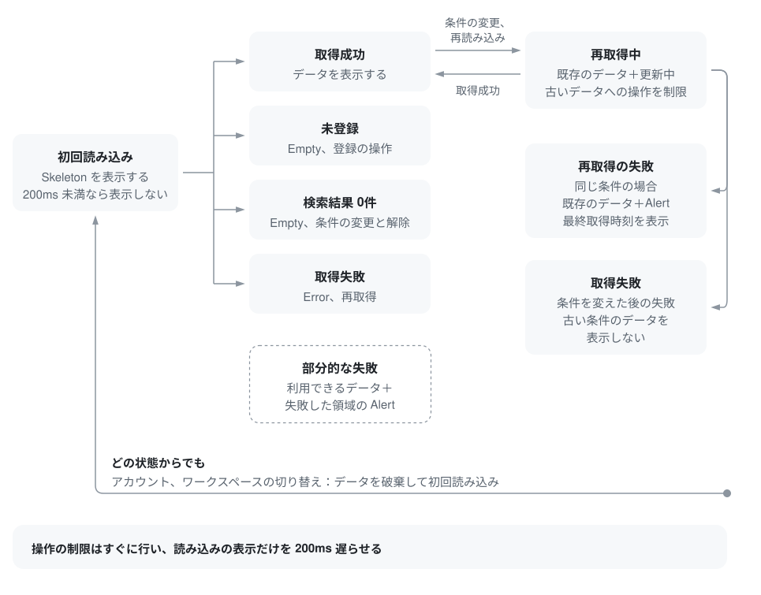

# Data States

データの読み込み、再取得、未登録、検索結果 0件、取得失敗、部分的な失敗を区別して伝える。

状態：初期実装 ・ 実装：[`registry/patterns/browse-data.ts`](../../../registry/patterns/browse-data.ts)、[`registry/patterns/data-states.tsx`](../../../registry/patterns/data-states.tsx) ・ 全体：[Data Browsing](data-browsing.md)

## 目的

利用者が、表示されている内容が現在の条件の最新の結果かどうかを、考えなくても判断できるようにする（原則 01）。古いデータを最新と誤認させず、失敗や欠損を 0 や空として示さない（原則 08）。

## 使用条件

サーバーやデバイスから取得するすべての領域（項目、Section、Chart、Table、ページ全体）に適用する。

## 構成

<picture>
  <source media="(prefers-color-scheme: dark)" srcset="../../diagrams/data-state-transitions-dark.svg">
  
</picture>

| 状態 | 表現 | 部品 |
| --- | --- | --- |
| 初回の読み込み | 表示予定の構造に合わせた Skeleton | `useBrowseData` の `loading`、`LoadingReveal`、`DataTable` の `status="loading"` と `loadingRowCount` |
| 再取得 | 既存のデータと、更新中の表示 | `refreshing`、`DataRefreshIndicator`、`DataTable` の `status="refreshing"` |
| 取得成功 | 通常のデータの表示 | `ready` |
| 未登録 | Empty | `getBrowseViewState` の `empty`、`DataTableMessage` |
| 検索結果 0件 | Empty と、条件の変更・解除 | `no-results` |
| 取得失敗 | Error と、必要な再取得の操作 | `error`、`DataTableMessage status="error"`、`DataRegionError` |
| 再取得の失敗 | 既存のデータと、warning の Alert、取得した時刻 | `refreshFailed`、`DataRegionError variant="warning"` |
| 部分的な失敗 | 利用できるデータと、失敗した領域の Alert | 領域ごとの `useBrowseData` と `DataRegionError` |

## 判断基準

### useBrowseData が守ること

- 最新の要求の応答だけを反映する。古い要求の成功・失敗で、現在の状態を上書きしない（要求ごとの番号）。新しい要求を始めたら、前の要求を `AbortController` で中止する。
- 条件を変えた直後の描画から、前の条件のデータを「最新の結果」として返さない（`status` は同じ描画で `refreshing` か `loading` になる）。
- `scopeKey`（アカウント、ワークスペース、権限）が変わったら、同じ描画から前のデータを返さず、初回の読み込みに戻す。
- 同じ条件の再取得に失敗したときは、前のデータを残し、`refreshFailed` で区別する。条件を変えた後の取得に失敗したときは、`status` を `error` にする（前の条件のデータを結果として表示しない）。
- 特定のデータ取得のライブラリに依存しない。キャッシュを持つライブラリを使う製品は、この hook を使わずに、同じ規則で状態を対応させる。

### 初回の読み込み

- 表示予定の構造に合わせた Skeleton を使う。数、高さ、幅は、実際に表示する領域から決める。
- 取得する件数やページサイズが既知の場合は、Data Table の `loadingRowCount` に渡す。すべての画面で機械的に 50 行の Skeleton を表示しない。
- 読み込みの前後で、領域の高さをできるだけ保つ。

### 再取得

- 原則として既存のデータを残す。
- 更新中であることを示す（`DataRefreshIndicator`）。
- 古い結果を最新の結果と誤認させない。件数などは薄い色にする。
- 古いデータに依存する一括操作と変更の操作を、すぐに制限する（Data Table の locked、`DataTableSelectionBar` の `disabled`、行の操作の `useDataTableStatus().locked`）。
- 検索の条件と選択は残す。
- アカウント、ワークスペース、権限が変わった場合は、古いデータを表示し続けない（`scopeKey`）。

### 短時間の読み込み

- 200ms を目安に、Skeleton と Spinner のちらつきを抑える。`useDelayedFlag(active, 200)` は、`active` が 200ms 続いたときだけ `true` を返す。
- 読み込みの状態そのもの（`status`）と、視覚的な読み込みの表示の開始を区別する。
- 操作の制限など、安全性に必要な処理は 200ms 遅らせない（`status` で判断する）。
- 取得が終わった後に、演出のために待たせない。最低の表示時間を設けない（`active` が `false` になったら、すぐに `false` を返す）。
- タイマーは、状態の変化とアンマウントで解除する。
- `LoadingReveal` は、200ms の間 Skeleton を `visibility: hidden` にする。要素は最初から置くため、表示の前後で領域の高さが変わらない。`DataRefreshIndicator` も、表示していない間の場所を確保する。

### Empty

- 未登録と検索結果 0件を区別する（`getBrowseViewState` の `filtered`）。
- 未登録の場合は、必要に応じて登録の操作を示す。Page Header に同じ操作（「顧客を登録」）がある場合は、Empty に CTA を重複させない。
- 検索結果 0件の場合は、条件の変更と解除を示す。
- 未読の通知が 0 件など、追加の操作が不要な場合は、ボタンを置かない。
- 日付の範囲で表示の対象が決まる表示形式（Calendar）では、0 件を未登録とせず、範囲の中に該当がないと示す。

### Error

失敗した領域に対応する範囲で示す。

| 範囲 | 例 |
| --- | --- |
| 個別の項目 | `DataValue` の「取得できません」 |
| Section、Chart | Section の中の `DataRegionError` |
| Table | `DataTable` の `error`（`DataTableMessage status="error"`） |
| ページ全体 | 詳細ページの本文の `DataRegionError` |

- 一部の情報の取得に失敗した場合、ほかの利用できる情報を隠さない。
- 重要なエラーを Toast だけで伝えない。
- 再取得できる場合は、失敗した領域だけを再取得できるようにする（領域ごとの `useBrowseData` の `reload`）。
- 権限不足など、単純な再取得で解決しないエラーには、再試行を置かない（`DataRegionError` に `onRetry` を渡さない）。次にすべきこと（管理者への依頼など）を示す。

### 欠損値

次を区別する。欠損値と取得の失敗を 0 に変換しない。集計値と Chart も同じ。

| 状態 | `DataValue` の値 | 表示 |
| --- | --- | --- |
| 取得済みの値 | `{ status: "ready", value: 1200 }` | 1,200円 |
| 実際の 0 | `{ status: "ready", value: 0 }` | 0円 |
| 未登録 | `{ status: "ready", value: null }` | 「—」（支援技術には `emptyLabel`、既定「未登録」） |
| 取得できない | `{ status: "unavailable" }` | 「取得できません」 |
| 取得中 | `{ status: "loading" }` | 小さな Skeleton（支援技術には「読み込み中」） |

### 長時間の処理

- 実際の進捗を取得できる場合だけ Progress を使う。
- 時間がかかる場合は、必要に応じて状況の説明と中止を示す。
- データの鮮度が重要な場合だけ、最終更新の時刻を示す（再取得の失敗の Alert の「14:32 の時点の内容」など）。
- 架空の進捗率や更新の時刻を示さない。

## 状態管理

| 値 | 内容 |
| --- | --- |
| `status` | `idle`（`enabled: false`）、`loading`、`refreshing`、`ready`、`error` |
| `data`、`dataKey` | 表示するデータと、そのデータの条件のキー |
| `isCurrent` | `data` が現在の条件の結果として確定している |
| `refreshFailed`、`error` | 同じ条件の再取得の失敗と、最新の要求の失敗 |
| `fetchedAt` | 取得した時刻（`Date.now()`）。サーバーで描画した値には含まれない |
| `reload()`、`setData()` | 同じ条件での再取得、保存の結果の反映 |
| `keepPreviousData` | 条件が変わったときに前のデータを残すか。一覧は `true`（既定）、詳細の別のレコードは `false` |
| `initialData` | サーバーで描画したデータや、一覧に戻ったときに製品が保持していたデータ |

`getBrowseViewState({ status, count, filtered })` は、Table 以外の表示形式で、表示する内容（`loading`、`refreshing`、`ready`、`empty`、`no-results`、`error`）を決める。

- ページ番号が範囲の外になった場合（最後のページの行を一括で削除した場合、ほかの利用者が削除した場合）、サーバーは 0 行と 1 以上の総件数を返す。これを未登録や検索結果 0件として表示しない。検証画面では、0 行で `pageIndex > 0` の結果を受け取ったら、表を再取得中として表示し、最後のページ（総件数がわからない場合は前のページ）へ戻して取得し直す。
- `status` は、最後に送った要求の状態を表す。条件が変わり、新しい要求を送る前の描画でも、前の条件の成功・失敗・再取得中を返さない（`requestKey` で区別する）。

## レスポンシブ

- Skeleton の数と高さは、画面の幅ごとの表示予定の領域から決める（モバイルの Calendar は一覧の形の Skeleton）。
- 狭い画面でも、領域のエラーと再試行を隠さない。

## アクセシビリティ

| 用途 | 指定 |
| --- | --- |
| 読み込み中の領域 | `aria-busy="true"`（`DataTable`、詳細の本文、Kanban、Calendar、部分的に取得する指標） |
| Skeleton | 装飾（`aria-hidden`）。読み込みは `aria-busy` と状態の文で伝える |
| 後から表示する重要なエラー | `role="alert"`（`DataRegionError`、`DataTableMessage status="error"`） |
| 補足の状態 | `role="status"`（全件の選択の解除の知らせ、長時間の処理の説明） |
| 件数 | 結果が確定したときだけ読み上げる。再取得中は件数の読み上げの領域を空にし、古い件数を読み上げない。DataTable は再取得の開始時に「更新中」を 1 回読み上げる（Data Table v0.1 の仕様） |

- 読み込みが終わったときに、不必要にフォーカスを移さない。
- 動きを減らす設定（Reduced Motion）では、Skeleton の明滅（`motion-safe:animate-pulse`）と Spinner の回転（`motion-safe:animate-spin`）を止める。

## 実装例

```tsx
const data = useBrowseData({
  query: browse.query,
  fetcher: (q, { signal }) => api.listCustomers(q, { signal }),
  scopeKey: workspaceId,
})

{data.refreshFailed && (
  <DataRegionError
    variant="warning"
    title="最新の内容を取得できませんでした"
    description={`${time(data.fetchedAt)}の時点の内容を表示しています。`}
    onRetry={data.reload}
  />
)}
<DataRefreshIndicator active={data.status === "refreshing"} />
<LoadingReveal loading={data.status === "loading"}>
  <DataTable table={table} status={data.status === "idle" ? "loading" : data.status} loadingRowCount={pageSize} … />
</LoadingReveal>
```

```tsx
// 部分的な失敗：失敗した領域だけを示し、その領域だけを再取得する
const sales = useBrowseData({ query: "sales", fetcher: api.getSales })
<DataValue value={sales.status === "error" ? { status: "unavailable" } : sales.isCurrent ? { status: "ready", value: sales.data ?? null } : { status: "loading" }} format={yen} />
{sales.status === "error" && <DataRegionError title="今月の売上を取得できませんでした" description="ほかの指標は表示しています。" onRetry={sales.reload} />}
```

プレビュー：`#/data-states`、`#/browsing-app?page=customers`（応答の時間、取得の失敗、件数の有無、ワークスペースの切り替え）。

## アンチパターン

| 避ける | 理由 | 代わりに |
| --- | --- | --- |
| 取得の失敗を 0 件や 0円として表示する | データがないと誤解される | Error と「取得できません」 |
| 未登録と検索結果 0件を同じ表示にする | 次にすべき操作が異なる | `empty` と `no-results` を分ける |
| 再取得のたびに表示を空にする | 内容が消えて読めない、領域が縮む | 既存のデータを残す |
| 再取得中に古いデータへの操作を受け付ける | 古い行に対して操作が行われる | すぐに制限する |
| 古い要求の応答で新しい結果を上書きする | 条件と結果が一致しない | 最新の要求の結果だけを反映する |
| アカウントを切り替えた後も前のデータを表示する | 別の範囲のデータを誤認する | `scopeKey` で破棄する |
| すべての画面で 50 行の Skeleton | 実際の表示と高さが合わない | 表示予定の行数 |
| 短い読み込みでも Skeleton を一瞬表示する | ちらつく | 200ms 遅らせる |
| 読み込みの表示に最低表示時間を設ける | 不要な待ち時間 | すぐに内容を表示する |
| 操作の制限まで 200ms 遅らせる | その間に古いデータへ操作できる | 制限は状態そのものですぐに行う |
| 重要なエラーを Toast だけで伝える | 消えた後に確かめられない | 失敗した領域に残す |
| 権限不足に再試行のボタンを置く | 押しても解決しない | 次にすべきことを示す |
| 架空の進捗率や更新の時刻を示す | 判断を誤らせる | わかる場合だけ示す |
| 読み込みが終わるたびにフォーカスを移す | 操作の位置を失う | フォーカスを動かさない |

## 製品側の責務

- 取得の処理（API）と、エラーの種類の判別（権限不足など、再試行で解決しないもの）。
- データのキャッシュと、サーバーで描画したデータの受け渡し（`initialData`）。
- 実際の進捗の取得。
- 最終更新の時刻を示すかの判断。
