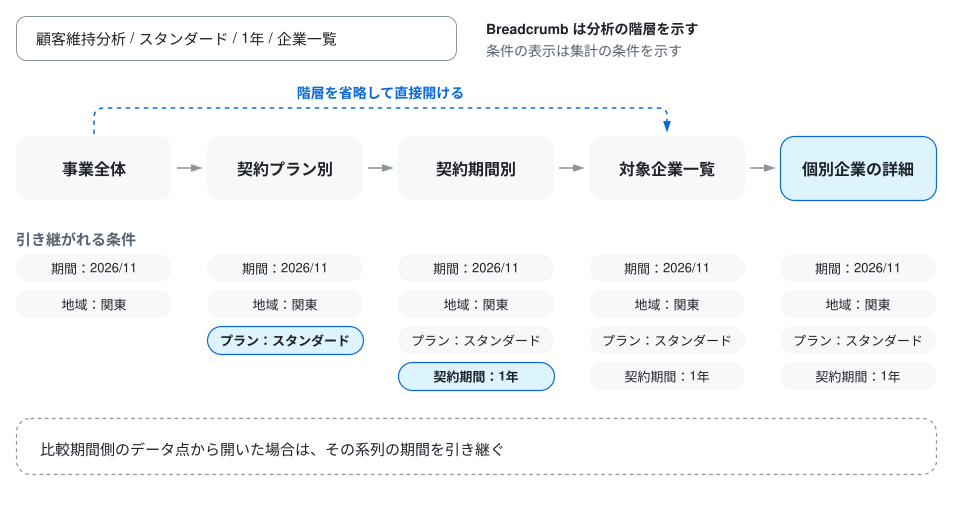
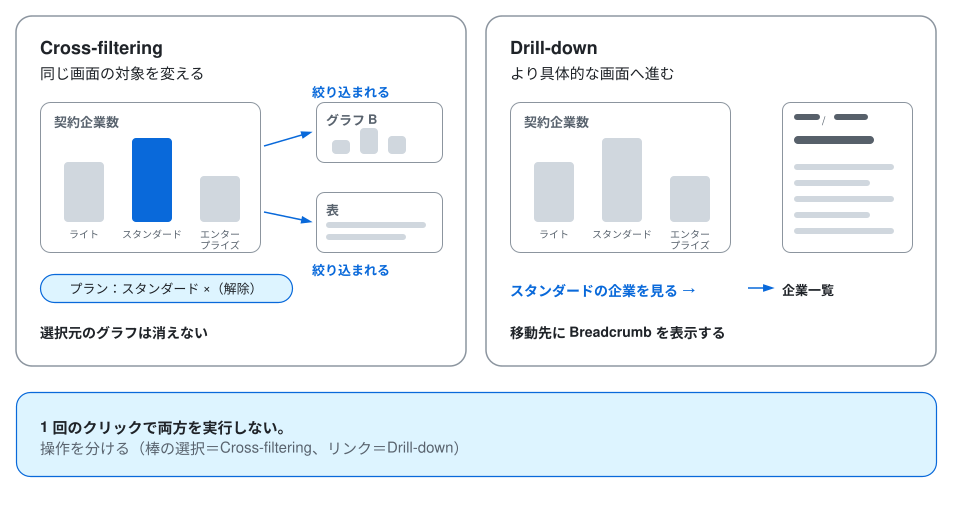
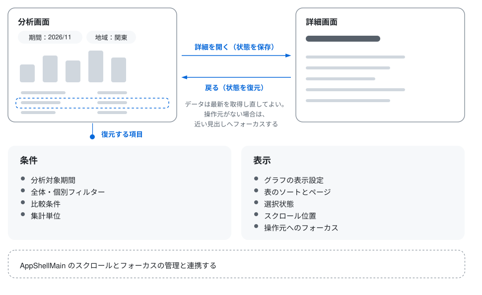

# Drill-down

利用者の疑問に沿って、全体から内訳、明細、個別の詳細へ進み、元の分析に戻る。

状態：初期実装（レビュー前） ・ 実装：[`registry/patterns/drill-down.tsx`](../../../registry/patterns/drill-down.tsx)（`DrillDownLink`、`drillPeriodFor`、`groupOther`、`captureAnalysisPosition`、`useAnalysisPositionRestore`）、`scopeFilters`（[`analysis-query.ts`](../../../registry/patterns/analysis-query.ts)）、Data Browsing の `getRecordNeighbors`（[`list-detail.ts`](../../../registry/patterns/list-detail.ts)） ・ 全体：[Data Analysis](data-analysis.md)

## 目的

「なぜ変化したのか」「具体的にどこに問題があるのか」に、少ない操作でたどり着けるようにする（原則 07）。進んだ先でも元の分析の条件を保ち、戻ったときに元の位置から続けられるようにする（原則 01、03）。

## 使用条件

集計の値から、内訳、明細、個別の詳細を確かめる価値がある場合に使う。不要な階層を強制しない。最初から明細を確かめたい場合は、途中の階層を省略して直接開ける構成を許容する（検証画面の「企業の一覧を見る」）。

## 構成

<picture>
  <source media="(prefers-color-scheme: dark)" srcset="../../diagrams/drill-down-hierarchy-dark.svg">
  
</picture>

例：事業全体 → 契約プラン別 → 契約期間別 → 対象企業の一覧 → 個別の企業の詳細

| 部分 | 部品 |
| --- | --- |
| 開始の操作 | `DrillDownLink`（KPI、グラフの数値の表、内訳の行）。表の行は会社名のボタン（Sheet）かリンク（別ページ） |
| 条件の引き継ぎ | `scopeFilters(global, { plans: [plan] })`、`drillPeriodFor(series, …)` |
| 「その他」 | `groupOther`（`members` に実際の分類） |
| 現在地 | Breadcrumb（分析の階層）と、集計の条件の文（Page Header の説明） |
| 復帰 | `captureAnalysisPosition`、`useAnalysisPositionRestore`、AppShellMain の `scrollOnNavigate` と `focusOnNavigate` |
| 連続した確認 | 非モーダルの Sheet、`getRecordNeighbors`、`useBrowseData` の `keepPreviousData: false` |

## バリエーション

| 表示の方法 | 使う場面 | 検証画面 |
| --- | --- | --- |
| 同じ画面 | 簡単な内訳や関連するデータ | 契約期間別の内訳 |
| 非モーダルの Sheet | 元の分析を見ながら詳細を確かめる | 解約した企業の行 → 企業の Sheet（前後の移動） |
| 別のページ | 本格的な詳細の分析 | プラン別、契約期間別の企業の一覧、企業の詳細 |
| Popover | 短い補足 | 指標の定義 |

List & Detail の設計方針（[list-and-detail.md](list-and-detail.md)）を保つ。Popover の中に複雑な分析の画面を作らない。

## 動作

### 開始の操作

- KPI、グラフ、表から直接、詳細へ進めるようにする。
- 押せる要素は、押す前に押せるとわかるようにする（下線と矢印の `DrillDownLink`、ボタンの形）。すべてのグラフの要素に機械的にアイコンを付けない。
- ホバー、カーソル、フォーカスの表示、リンクを使う。ホバーだけの操作にしない。
- グラフの上の操作が難しい場合は、凡例や数値の表から同じ情報へ進めるようにする（解約率の推移の「数値を表で見る（区間ごとの企業へ進む）」）。
- 別の操作（Cross-filtering の選択、行の中のボタン）や文字の選択で、意図せず Drill-down を実行しない。

### 条件の引き継ぎ

- 元の分析の対象に、選んだ対象の条件を加えることを基本とする（`scopeFilters`）。
- 期間、絞り込み、比較に必要な条件を保つ。期間は固定の日付で渡す（相対期間を渡すと、開いた日と戻った日で期間が変わる）。関係のある分析のページへ移る場合（事業の状況 → 顧客維持の分析）も、全体の絞り込み（地域など）を引き継ぐ。
- 詳細に適さないグラフの形式や集計単位などの表示の設定は、変えてよい。
- 全体条件と異なる条件のグラフから進む場合は、そのグラフに実際に適用している条件を引き継ぐ。
- 比較期間の側のデータ点から進む場合は、現在の期間と誤認させず、選んだ系列の期間を引き継ぐ（`drillPeriodFor("baseline", …)` は比較期間の固定の日付を返す）。
- 条件が重なる場合は、無条件に上書きしない。全体条件と重ならない場合は、条件を外して表示せず、対象がないことと理由を示す（検証画面の `dterm` と全体の `term` の衝突）。
- 検証画面では、Drill-down で加えた条件（`dplan`、`dterm`）と、全体条件（`plan`、`term`）を URL で別の名前にしている。

### 現在地

- 複数の階層の分析では、既存の Breadcrumb を使う。単純な 1 階層の移動では、戻るリンクでもよい。
- Sheet では、タイトル（企業の名前）と対象の条件（「解約した企業の 12 / 84 件目」）を示す。
- Breadcrumb は分析の階層、条件の文は現在の集計の条件を示す。同じ情報を繰り返して示さない。

### Cross-filtering との区別

<picture>
  <source media="(prefers-color-scheme: dark)" srcset="../../diagrams/drill-vs-cross-filter-dark.svg">
  
</picture>

- Cross-filtering は同じ画面の分析の対象を変える。Drill-down はより具体的な分析や明細へ進む。
- 1 回のクリックで両方を同時に実行しない。両方が必要な場合は操作を分ける（検証画面：内訳の行のボタン＝Cross-filtering、行の右のリンク「スタンダードの内訳を見る」＝Drill-down）。

### 元の画面への復帰

<picture>
  <source media="(prefers-color-scheme: dark)" srcset="../../diagrams/analysis-return-dark.svg">
  
</picture>

できるだけ次を復元する。

| 項目 | 検証画面での持ち方 |
| --- | --- |
| 分析の対象の期間、全体・個別の絞り込み、比較、集計単位 | URL（`history.replaceState`） |
| グラフの表示の設定、表の並び順とページ、Cross-filtering の選択、一覧だけの条件 | 履歴の項目ごとの記録（メモリ） |
| スクロールの位置、操作元へのフォーカス | `captureAnalysisPosition` の値を履歴の項目ごとに記録し、`useAnalysisPositionRestore` で復元 |

- 元のデータを古い状態に戻す必要はない。最新のデータを取得し直し、表示が終わってから位置を復元する（`ready`）。
- 操作元の要素がない場合は、操作元を含む領域の見出し、それもない場合は `fallbackFocus`（h1 など）にフォーカスする。
- AppShellMain のスクロールとフォーカスの管理を考慮する。復元する間は `scrollOnNavigate={false}`、`focusOnNavigate={false}` を渡し、「先頭へ戻す」「h1 へフォーカス」を止める。
- Breadcrumb の 1 つ上の階層へ戻る場合で、履歴に戻り先がある場合は、履歴を戻る（条件と位置を復元する）。
- 実際のルーター、履歴、永続化との接続は製品の責務。

### 連続した詳細の確認

- 必要な場合だけ、非モーダルの Sheet、Split View、前後の移動を使う。
- 前後の移動の順序は、元の一覧やグラフの並び順と一致させる（`getRecordNeighbors`、並び順を変えた一覧の順）。
- 選んだ対象が素早く切り替わった場合に、前の対象の詳細を現在の対象として表示しない（`keepPreviousData: false`。取得中は「読み込み中」）。

### 集計と明細の整合

- 対象の期間、絞り込み、集計の時点、指標の定義、データの単位、母集団をそろえる（検証画面の「解約した企業」の件数は、指標の「解約した企業」と同じ集計から求める）。
- 企業の数と契約の数など、異なる単位を混同しない。
- 割合、平均、一意の件数は、明細の単純な合計で再現できない場合がある。
- 「その他」から進む場合は、表示の文字ではなく、実際に含まれる分類（`groupOther` の `members`）で絞り込む。
- `groupOther` は「その他」の値を既定で合計する。割合、平均、一意の件数は合計できないため、`combine` に元のデータから求め直す関数を渡す（`null` を返すと値を示さない）。
- 権限や集計の時点の違いで、集計の値と閲覧できる明細の件数が異なる場合は、理由を示す（「表示できるのは 100社。4社は閲覧の権限がない取引先です」。検証画面の過去12か月、担当者の権限）。

### データの状態と権限

- [Data States](data-states.md) を適用する。
- 集計の閲覧の権限と、明細の閲覧の権限を区別する。
- 権限のない明細をクライアントに渡して非表示にする方式に頼らない。サーバーが除き、件数だけを返す（検証画面の模擬のサーバーの `churnedAccountList`、`accountDetail`）。
- 詳細の取得に失敗しても、使える元の分析の情報は残す。
- 存在しないデータ（「この企業は見つかりません」）、権限の不足（再試行を置かない）、取得の失敗（再試行を置く）を区別する。

### モバイル

- 全画面の Sheet か、別のページを使う。狭い画面に Split View を無理に収めない。
- 元の条件、戻る操作、必要な対象の切り替えを残す。
- 小さなデータ点だけに頼るタッチの操作を避ける（内訳は行全体のボタン、推移は数値の表のリンク）。

### 業務操作への接続

- 必要に応じて、分析の対象を引き継いだ状態で、既存の業務画面へ移る（検証画面の「この条件の解約した企業を、顧客の業務画面で開く」）。
- 分析の画面に、大量の編集の機能を加えない。
- 登録、編集、削除の操作は Forms & Workflows の設計方針に従う。
- 分析の対象の絞り込みを、そのまま操作の権限や一括の処理の対象として信頼しない。実際の権限と処理の対象は、バックエンドが確かめる。

## アンチパターン

| 避ける | 理由 | 代わりに |
| --- | --- | --- |
| 棒を押すと絞り込みと移動の両方を行う | 絞り込みたいだけの利用者が移動してしまう | 操作を分ける |
| 押せない要素を押せるように見せる、押せる要素を見分けられない | 迷う | リンクの形、矢印 |
| 相対期間をそのまま詳細に渡す | 後で戻ったときに期間が変わる | 固定の日付 |
| 比較期間の点から開いた詳細に、現在の期間を使う | 別の期間の明細を見る | その系列の期間 |
| 「その他」の文字で絞り込む | 該当する分類がない | `members` |
| 戻ったときに条件や位置が初期化される | 分析をやり直す負荷 | 条件、表示、位置、フォーカスを復元 |
| Sheet を切り替えた直後に前の企業の内容を表示する | 別の企業の情報と誤認する | `keepPreviousData: false` |
| 権限のない明細を受け取って画面で隠す | 情報が漏れる | サーバーで除く |
| 集計と明細の件数の違いを説明しない | データの誤りと疑う | 理由を示す |
| Popover の中に分析の画面を作る | 狭く、閉じやすい | 別のページか Sheet |

## 状態管理

| 状態 | 持つ場所 |
| --- | --- |
| 分析の条件 | `useAnalysisQuery` と URL |
| Drill-down で加えた条件 | 移動先の URL（全体条件と別の名前） |
| 戻るための記録 | 製品（履歴の項目ごと）。`AnalysisPosition`（スクロール、操作元、見出し） |
| 詳細の Sheet の対象 | 製品（`activeId`）。詳細は `useBrowseData`（`keepPreviousData: false`） |

## アクセシビリティ

| 対象 | 指定 |
| --- | --- |
| 詳細へ進む要素 | リンク（`a`）。Sheet を開く要素は `aria-haspopup="dialog"` のボタン |
| 操作元 | `data-drill-origin`。戻ったときにフォーカスを戻す |
| タッチの領域 | `DrillDownLink` は上下に広げて 24px 以上 |
| Breadcrumb | 既存の Breadcrumb（`nav` と現在のページ） |
| Sheet | タイトル、一覧の中の位置、前後の移動のボタン |
| 権限の不足 | `role="alert"` の領域のエラー。再試行を置かない |

## データの正確性

- 詳細の件数は、集計と同じ条件、同じ時点、同じ定義で求める。
- 引き継いだ条件は、詳細の画面の説明に示す（「期間：2025/11/01〜2026/10/31 ・ すべての地域」）。

## 製品側の責務

- 詳細の画面（URL、ルーター、履歴、記録の保存）。
- 明細の取得、権限による除外と件数、存在しないデータの判別。
- 業務画面の対象と権限の検証。

## 実装例

```tsx
// 内訳の行：選択（Cross-filtering）と移動（Drill-down）を別の要素にする
<button aria-pressed={cross.isSelected("by-plan", "standard")} onClick={() => cross.toggle({ source: "by-plan", field: "plan", value: "standard", label: "スタンダード" })}>スタンダード 20.4%</button>
<DrillDownLink origin="by-plan:standard" href={drillHref({ dplan: "standard" })}>スタンダードの内訳を見る</DrillDownLink>

// 離れるときに記録し、戻ったときに復元する（製品の責務：記録の保存と、履歴との接続）
const onClickCapture = (e) => {
  const link = (e.target as Element).closest("a[data-drill-origin]")
  if (link) records.set(historyKey, { ...viewState, position: captureAnalysisPosition({ scrollElement: mainRef.current, origin: link }) })
}
useAnalysisPositionRestore({ position: record?.position ?? null, ready: allRegionsReady, root: rootRef, scrollElement: mainRef, fallbackFocus: () => h1Ref.current })

// 比較期間の系列から進む
const period = drillPeriodFor("baseline", { period: a.query.period, comparison: a.comparison, current: a.period })
```

プレビュー：`#/drill-down`、`#/analysis-app?page=retention`。
