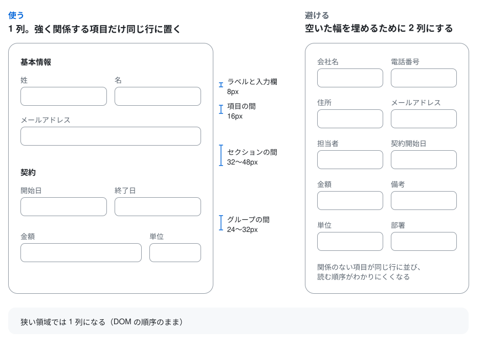

# Form Layout

フォームの項目の並び、まとまり、間隔、操作ボタンの位置を決める。

状態：v0.1 確定候補（設計と実装の方針は承認済み。Patterns Integration Review の前） ・ 実装：[`registry/patterns/form-layout.tsx`](../../../registry/patterns/form-layout.tsx) ・ 全体：[Forms & Workflows](forms-and-workflows.md)

## 目的

利用者が考える順に項目を並べ（原則 03）、必要な項目だけを、必要なときに示す（原則 04、07）。入力した内容を失わせず、入力の負荷を減らす（原則 07、08）。

## 使用条件

登録、編集、設定など、入力欄を含むフォームのすべてで使う。一覧の検索の条件は [Search & Filter](search-and-filter.md) で扱う。

## 構成

| 部分 | 部品 | 仕様 |
| --- | --- | --- |
| フォームの幅 | `PageLayout width="focused"`（App Structure） | 最大 40rem（640px、`--page-width-focused`）。既存の rem の指定を変えない |
| 入力項目 | Field、FieldLabel、Input、Select など（Components） | ラベルは入力欄の上。ラベルと入力欄の間は 8px（Field の `gap-2`） |
| 項目の並び | FieldGroup | 項目の間は 16px（`gap-4`） |
| 関係の強い項目の行 | `FormRow` | 姓と名、開始日と終了日、最小値と最大値、数値と単位だけ。置かれた領域が狭いと 1 列 |
| 意味のまとまり | FieldSet、FieldLegend（`variant="label"`） | 行にまとめた項目の名前（「担当者の氏名」「契約の期間」）。凡例と最初の行の間は 8px |
| 情報のグループ、セクション | Section、SectionStack（App Structure） | グループの間は 24〜32px（FieldSet を並べる、または `SectionStack spacing="group"` の 32px）。セクションの間は 32〜48px（`SectionStack` の既定 `section` の 48px） |
| 必須・任意 | `FieldOptionalMark`、`FieldRequiredMark` | 少ない方に印を付け、フォームの上に凡例を置く |
| 補足 | FieldDescription | 入力の形式や制約など、判断に必要なことだけ |
| 操作ボタン | `FormActions` | フォームの末尾。キャンセル（Secondary）を左、保存（Primary）を右 |
| 保存できない理由 | `SaveBlockerNotice`（`blockers`、`hidden`、`detail`、`detailLimit`、`goal`、`unchanged`、`onFocusField`） | 操作ボタンの近く。下の「保存できない理由」と [create-and-edit.md](create-and-edit.md) |
| フォーカスの移動 | `focusFormControl(id)` | 理由の一覧やエラーから、該当する入力欄へ移る |

### 列とまとまり

<picture>
  <source media="(prefers-color-scheme: dark)" srcset="../../diagrams/form-columns-dark.svg">
  
</picture>

## バリエーション

| 種類 | 指定 | 用途 |
| --- | --- | --- |
| 同じ重みの 2 項目 | `<FormRow>`（`columns="equal"`） | 姓と名、開始日と終了日、最小値と最大値。領域が 28rem（`@md/form-row`）以上で 2 列 |
| 値と短い項目 | `<FormRow columns="value-unit">` | 数値と単位、金額と通貨。`minmax(0,1fr)` と `minmax(0,10rem)` の 2 列 |
| 末尾の操作ボタン | `<FormActions>` | 標準 |
| 固定した操作ボタン | `<FormActions sticky>` | 長いフォーム、Sheet。画面の幅が 640px 以上のときだけ画面の下に固定する |
| 左に置くラベル | 部品を用意していない | 横幅が十分にあり、項目の数が多い専門的な業務の画面など、上下の移動を減らす理由がある場合だけ |
| 幅を狭めた入力欄 | 入力欄の `className`（例：顧客コード `max-w-48`、郵便番号 `max-w-40`、電話番号 `max-w-60`） | 短い数値、コード、単位。入力した内容が見えなくなるほど狭めない |

## 動作

### 列

- 原則は 1 列にする。空いた幅を埋めるためだけに複数の列にしない。
- `FormRow` は、画面の幅ではなく、置かれた領域の幅（Container Query）で列を切り替える。Sheet や 2 列のページの中でも、領域が狭ければ 1 列になる。
- 視覚の順序は DOM の順序と同じにする（左から右、狭い領域では上から下）。`order` などで入れ替えない。キーボードの移動の順序も同じになる。

### ラベルと必須・任意

- ラベルは入力欄の上に置く。プレースホルダーをラベルの代わりにしない。
- 必須と任意のうち、少ない方に印を付ける。同じフォームでは同じ方式にし、凡例で意味を示す（例：「「任意」と書かれていない項目は必須です。」）。
- 色だけで必須を伝えない。印は「任意」の文字か `*` にする。
- 視覚の印と実際の必須の条件を一致させる。`useFormState` の `inputProps` は、表示していて必須の項目にだけ `required` を付ける（条件で必須が変わる項目も、現在の値で判断する）。

### 項目の順序とまとまり

- 利用者が考える順に並べる（例：種類、会社名、担当者の氏名、顧客コード → 連絡先 → 契約）。
- 関連する項目を、意味のある単位でまとめる。見出しは Section の `SectionTitle` に置き、意味のない見出しは置かない。
- 区切りは余白から検討する（美的基準 03）。Card や区切り線を加えない。

### 補足の説明と条件付きの入力

- 補足の説明は、入力の形式や制約など、判断に必要なことだけにする。
- 条件によって不要になる入力欄は、表示しない。`useFormState` の項目の `active` に表示の条件を渡す。
- 表示していない項目の値は消さずに残し、条件が戻ったときに再び表示する。表示していない項目は、検証、保存の可否、送信する値（`getSubmitValues`）、未保存の判定から除く。
- 例：顧客の種類が「個人」のときは会社名を表示しない。請求先の送付の方法が「メール」のときは送付先のメールアドレス、「郵送」のときは郵便番号と住所を表示する（`#/form-layout`、送信する値を画面に示す）。

### 入力の負荷

- 自動補完、既存のデータの再利用、合理的な初期値を使う。自動補完した値は、利用者が直せる。
- 遅れて届いた自動補完の結果で、利用者が直した値を上書きしない。補完を始める時点で `captureEdits(["address"])` を記録し（`AutofillToken`）、結果を `applyAutofill(token, patch)` に渡す。その間に利用者が変えた項目、ほかの自動補完が値を入れた項目には入れない。`reset` とスコープの変更（`scopeKey`）の後に届いた応答では、値を変えない。同じ項目の自動補完を続けて実行した場合も、古い応答で新しい値を上書きしない。
- 例の郵便番号からの住所の補完は、補完を始める時点で住所に利用者が入力した値がある場合（前回の補完の値でない場合）は補完しない。結果は住所の下の `role="status"` の文で示す（「郵便番号から入力しました。番地を続けて入力してください」「入力した住所を残しました（郵便番号からの補完で上書きしていません）」など）。
- 自動補完で入れた値は、入力を終えた値として扱い、問題があればすぐにエラーを示す。利用者の編集の回数には数えない。
- 契約の条件、金額、権限などの重要な選択肢を、初期値で選ばない（例：契約プランは未選択から始める）。

### 操作ボタン

- フォームの末尾に置く。保存の対象が複数ある画面（設定など）では、各フォームの末尾に、そのフォームの `FormActions` を置く。
- キャンセルは Secondary、保存は Primary を基本にする。
- `notice` に渡した文（`SaveBlockerNotice` など）は、ボタンの左に表示する。`FormActions` の領域が 32rem（`@lg/form-actions`）より狭い場合は、ボタンの上に表示する。
- 画面の幅が 640px より狭い場合は、ボタンの文字を折り返さず（`whitespace-nowrap`）、幅を広げて並べ、収まらないボタンを次の行に送る。

固定した操作ボタン（`sticky`）：

- 画面の幅が 640px 以上（`STICKY_QUERY`、`(min-width: 40rem)`）のときだけ、スクロールの領域の下に固定する。狭い画面では、理由の文と折り返したボタンが画面の多くを覆うため、フォームの末尾に置く。
- 固定する間は、最も近いスクロールの領域（`AppShellMain` の main など）の `scroll-padding-bottom` に、操作ボタンの高さと 16px を設定する。フォーカスした入力欄、エラー、理由の一覧からの移動先が、固定した操作ボタンの下に隠れない。1 つのスクロールの領域に 1 つまで置く。
- 下の余白に Safe Area（`--app-safe-bottom`）を含める。
- タッチ操作の端末（`pointer: coarse`）で文字の入力欄にフォーカスがある間は、固定を解除する（`data-typing`）。ソフトウェアキーボードの上に固定の領域を残さない。固定を解除しても、フォームの末尾の位置は変わらない。

### 保存できない理由

`SaveBlockerNotice` は、保存ボタンが押せない理由を、操作ボタンの近くに示す。`id` を保存ボタンの `aria-describedby` に渡す。

| 状態 | 表示 |
| --- | --- |
| 未入力・入力の途中の項目がある（`missing`、`incomplete`） | 「あと N 項目を入力すると保存できます」 |
| エラーを表示している項目がある（`invalid`） | 「N 項目に修正が必要です」。未入力の項目もあれば「未入力の項目が N つ、修正が必要な項目が N つあります」 |
| 非同期の検証ができなかった項目がある（`check-failed`） | 「{項目の名前}を確かめられませんでした。確かめ直すと{goal}」。未入力や修正が必要な項目と同時の場合は、件数の文の後に「{項目の名前}を確かめられませんでした」 |
| 非同期の検証の結果を待っている（`checking`） | 「{項目の名前}を確認しています」 |
| 変更のない編集のフォーム（`unchanged`） | 画面には示さない。支援技術にだけ「変更がありません。変更すると保存できます」を伝える（`sr-only`） |
| 理由がない | 何も表示しない。要素は残し、`aria-describedby` の参照先を保つ |
| `hidden`（保存中、変換中など） | 理由を示さない |

- 文は上の表の順に 1 つだけ示す。「保存できます」の部分は `goal` で変える（ステップでは「次へ進めます」）。
- `detail` と `onFocusField` を渡すと、該当する項目へ移動するボタンを置く。理由の項目が `detailLimit`（既定 3）以下なら項目ごとに並べ（「会社名（未入力）」「顧客コード（確認できなかった）」）、超える場合は「最初の項目（会社名）へ移動」だけを置く。修正が必要な項目、確認できなかった項目、未入力と入力の途中の項目の順に並べる。
- 変更のない編集のフォームで、押せない理由を画面に足さない方式は、v0.1 でも維持する（[create-and-edit.md](create-and-edit.md) の「変更のない編集のフォーム」）。

### 検証

保存ボタンの有効と無効、検証のタイミング、Enter による送信、Focusable Disabled は [create-and-edit.md](create-and-edit.md) の仕様にそろえる。

## アンチパターン

| 避ける | 理由 | 代わりに |
| --- | --- | --- |
| 空いた幅を埋めるために 2 列にする | 関係のない項目が並び、読む順序がわからなくなる | 1 列。関係の強い項目だけ `FormRow` |
| 画面の幅だけで列を切り替える | Sheet や狭い領域の中で項目がつぶれる | 置かれた領域の幅で切り替える（`FormRow`） |
| `order` で視覚の順序を入れ替える | キーボードと読み上げの順序が視覚と一致しない | DOM の順序で並べる |
| プレースホルダーをラベルの代わりにする | 入力を始めると、何の欄かわからなくなる | ラベルを上に置く |
| 必須を色だけで示す | 色を区別できない利用者に伝わらない | 「任意」か `*` と凡例 |
| 項目ごとに Card で囲む、区切り線を多く引く | 区切りが多く、関係がわかりにくい | 余白と Section の見出し |
| 条件で不要になった項目を表示したままにする | 判断と入力の負荷が増える | `active` で表示しない |
| 表示していない項目の値を消す、または送信する | 条件を戻したときに入力が失われる。不要な値を送る | 値を残し、送信と検証から除く |
| 遅れて届いた自動補完で、利用者の修正を上書きする | 入力した値が失われる | `captureEdits` と `applyAutofill` |
| 変更のない編集のフォームに、押せない理由の文を画面に足す | 見ればわかることを示し、画面の情報が増える | `unchanged` で支援技術にだけ伝える |
| 金額や契約の条件を初期値で選ぶ | 意図しない契約や請求になる | 未選択から始める |
| 狭い画面で操作ボタンを固定する | 入力欄とエラーが隠れる | 640px より狭い画面では末尾に置く（`FormActions`） |

## 状態管理

- `FormRow` は状態を持たない。
- `FormActions` は、タッチ操作の端末での入力中かどうか（`typing`）だけを持つ。
- 項目の表示の条件、値、エラーは `useFormState` が持つ（`isActive`、`values`、`error`）。表示の条件は描画のたびに現在の値から計算する。

## アクセシビリティ

- ラベルと入力欄、説明、エラーの関連付けは Field が行う（`aria-describedby`、`aria-invalid`）。
- 行にまとめた項目は FieldSet と FieldLegend で囲み、まとまりの名前を伝える。凡例を見せない場合は `className="sr-only"`。
- 必須の項目には `required` を付ける。`*` は読み上げない（`aria-hidden`）。「任意」はラベルの一部として読み上げられる。
- 視覚の順序、DOM の順序、Tab の順序を一致させる。
- `SaveBlockerNotice` の id を保存ボタンの `aria-describedby` に渡し、押せない理由をボタンの説明にする。保存ボタンは Focusable Disabled（`focusableWhenDisabled`、`aria-disabled="true"`）にし、無効の間も Tab で移って理由を聞けるようにする（[create-and-edit.md](create-and-edit.md#focusable-disabled)）。
- `focusFormControl(id)` は、Checkbox と Switch のように id が隠れた input に付く部品では、同じ Field の操作部品（`role="checkbox"`、`role="switch"`、`role="radio"`）にフォーカスを移す。フォーカスの後に、入力欄を画面の中央へスクロールする。
- 固定した操作ボタンは、`scroll-padding-bottom` でフォーカスした要素を隠さない。

## 製品側の責務

- 項目の選び方、順序、まとまりの見出し。
- 表示の条件（`active`）と、条件で必須が変わる項目の規則。
- 自動補完の API と、補完を始める条件。
- 入力欄の id の決め方（`focusFormControl` に渡す id と、`blockers` の項目名の対応）。
- ラベルを左に置く場合のレイアウト（部品を用意していない）。

## 実装例

```tsx
const form = useFormState<BillingValues>({
  initialValues,
  fields: {
    lastName: { label: "姓", required: true },
    firstName: { label: "名", required: true },
    delivery: { label: "送付の方法", required: true },
    email: { label: "送付先のメールアドレス", required: true, active: (v) => v.delivery === "email" },
    zip: { label: "郵便番号", required: true, active: (v) => v.delivery === "post" },
    // …
  },
})
const id = (n: keyof BillingValues) => `billing-${n}`

<PageLayout width="focused">
  <form noValidate onSubmit={(e) => void save(e)} onKeyDown={(e) => submitOnEnter(e, save)} className="flex flex-col gap-8">
    <p className="text-ui text-muted-foreground">「任意」と書かれていない項目は必須です。</p>
    <SectionStack>
      <Section>
        <SectionHeader><SectionTitle>宛名</SectionTitle></SectionHeader>
        <FieldSet>
          <FieldLegend variant="label">氏名</FieldLegend>
          <FormRow>
            <Field invalid={!!form.error("lastName")}>
              <FieldLabel>姓</FieldLabel>
              <Input {...form.inputProps("lastName")} id={id("lastName")} autoComplete="family-name" />
              {form.error("lastName") && <FieldError>{form.error("lastName")}</FieldError>}
            </Field>
            <Field invalid={!!form.error("firstName")}>…</Field>
          </FormRow>
        </FieldSet>
      </Section>
      <Section>
        <SectionHeader><SectionTitle>送付先</SectionTitle></SectionHeader>
        <FieldGroup>
          <Field>
            <FieldLabel>送付の方法</FieldLabel>
            <Select items={deliveries} value={form.values.delivery} onValueChange={(v) => form.setValue("delivery", v, { commit: true })}>…</Select>
          </Field>
          {form.isActive("email") && <Field invalid={!!form.error("email")}>…</Field>}
        </FieldGroup>
      </Section>
    </SectionStack>
    <FormActions sticky notice={<SaveBlockerNotice id="billing-notice" blockers={form.blockers} hidden={form.composing} />}>
      <Button type="button" variant="secondary" onClick={cancel}>キャンセル</Button>
      <Button type="submit" disabled={!form.canSubmit} focusableWhenDisabled aria-describedby="billing-notice">請求先を登録</Button>
    </FormActions>
  </form>
</PageLayout>
```

プレビュー：`#/form-layout`、`#/forms-app?page=customer-new`（固定した操作ボタン）。
