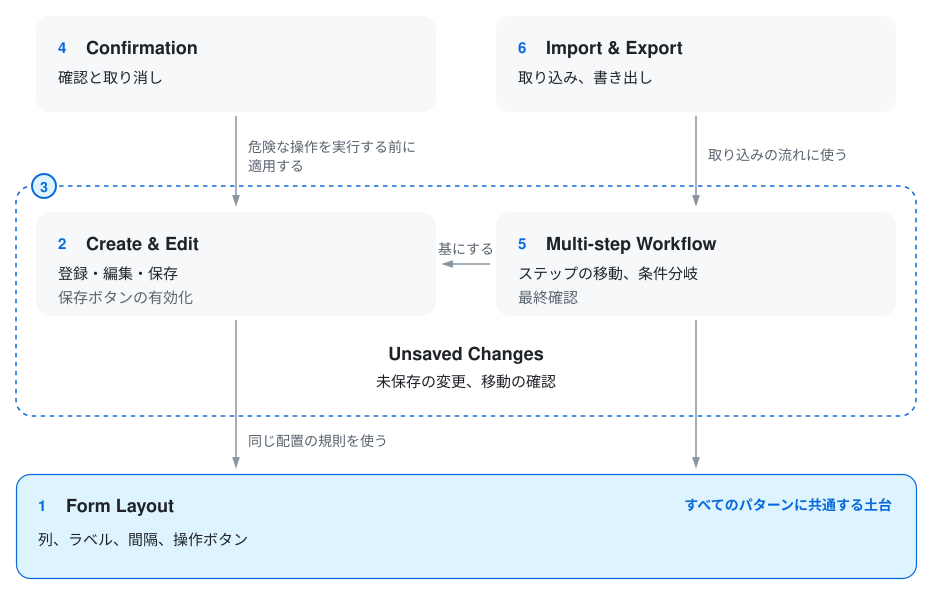

# Forms & Workflows

利用者が情報を入力し、保存し、手続きを終えるまでを扱う Patterns のグループ。Form Layout、Create & Edit、Unsaved Changes、Confirmation、Multi-step Workflow、Import & Export の 6 種類からなる。

状態：初期実装（レビュー前。v0.1 確定ではない）

<picture>
  <source media="(prefers-color-scheme: dark)" srcset="../../diagrams/forms-workflows-dark.svg">
  
</picture>

## Components と Patterns の関係

Field、Label、Input、Textarea、Select、Checkbox、Switch、Button、Dialog、Alert Dialog、Sheet、Drawer、Alert、Toast、Progress、Table、File Upload は Components（v0.1）である。Forms & Workflows は、これらと App Structure の Page Layout、Page Header、Section Layout を組み合わせる。

既存の機能を再実装しない。入力欄とラベルの関連付け、エラーの表示（Field の `invalid` と `FieldError`）、必須・任意の印（`FieldRequiredMark`、`FieldOptionalMark`）、Button の Loading、Alert Dialog の初期フォーカス（キャンセル）、Dialog・Sheet・Drawer の未保存の変更の保護（`unsavedChanges` と `onDiscardRequest`）、File Upload の形式とサイズの検査は、そのまま使う。Forms & Workflows の再利用できるコードは、次の 2 つを担う。

- フォーム、ステップ、移動の確認、対応付けの状態を持つ hook。特定のフォームのライブラリ、ルーター、API に依存しない。値は製品の型のまま持つ。
- Components にない、パターンに固有の小さな部品（関係の強い項目の行、操作ボタンの領域、保存できない理由、Stepper、確認の Dialog、取り込みの結果の表示など）。

巨大な汎用のフォームやワークフローの仕組みは作らない。項目、検証の規則、ステップの構成は、製品のコードに書く。

## 6 種類

| Pattern | 目的 | 資料 | 再利用できるコード（`registry/patterns/`） |
| --- | --- | --- | --- |
| Form Layout | 項目の並び、まとまり、間隔、操作ボタンの位置 | [form-layout.md](form-layout.md) | `form-layout.tsx`：`FormRow`、`FormActions`、`SaveBlockerNotice`、`focusFormControl` |
| Create & Edit | 登録と編集、保存ボタンの有効と無効、保存の結果 | [create-and-edit.md](create-and-edit.md) | `form-state.ts`：`useFormState`、`submitOnEnter`、`stableKey`、型 `FormFields`、`FormSaveResult`、`FormBlocker`、`FormState`<br>`save-modes.ts`：`useInstantSave`、`useAutosave` |
| Unsaved Changes | 未保存の変更がある間の、移動と閉じる操作の確認 | [unsaved-changes.md](unsaved-changes.md) | `unsaved-changes.tsx`：`UnsavedChangesProvider`、`useUnsavedChanges`、`useNavigationGuard`、`DiscardChangesAlert` |
| Confirmation | 操作の前の確認と、取り消し（Undo） | [confirmation.md](confirmation.md) | `confirm-action.tsx`：`ConfirmActionDialog`、`useUndoableAction`、型 `UndoHandle` |
| Multi-step Workflow | 複数のステップに分けた作業 | [multi-step-workflow.md](multi-step-workflow.md) | `step-flow.ts`：`useStepFlow`、型 `StepDefinition`、`StepItem`、`StepFlowSnapshot`<br>`stepper.tsx`：`Stepper` |
| Import & Export | ファイルからの取り込みと、ファイルへの書き出し | [import-and-export.md](import-and-export.md) | `import-mapping.ts`：`createImportColumns`、`normalizeHeader`、`autoMapColumns`、`getMappingIssues`、`useColumnMapping`、`importOutcome`、型 `ImportResult`<br>`import-review.tsx`：`ColumnMappingList`、`ImportValidationSummary`、`ImportIssueTable`、`ImportResultSummary`（`importOutcome` と `ImportResult` も公開する）<br>`export.ts`：`defaultExportScope`、`exportScopeLabel`、`exportFileName`、`escapeCsvCell` |

### コードと資料の区分

| 区分 | 内容 | 理由 |
| --- | --- | --- |
| 再利用できるコード | 上の表の hook と部品 | 保存の可否とエラーの表示の分離、IME の変換中の扱い、古い応答の破棄、遅れて届いた自動補完、正規化した値での未保存の判定、移動の要求の競合、二重の実行、確認の間の対象の変化、ステップの到達の規則、同じ見出しの列の区別は、製品ごとに書き直すと誤りやすい。Registry で品質を保つ |
| 組み合わせの例（プレビュー） | 顧客の登録と編集のフォーム（`CustomerForm`）、契約の登録（`ContractWizard`）、CSV の取り込み（`ImportWizard`）、エクスポートの設定（`ExportDialog`）、検証画面のルーター（`useFormsRouter`）、設定の画面の複数のフォーム、Inline の編集、編集の Sheet、登録の Dialog | 項目、検証の規則、ステップ、取り込む項目は、製品のデータと業務で変わる。部品の Variant にせず、組み合わせ方を示す |
| 設計の資料だけ | 表示の方法（Dialog、Sheet、別のページ、Inline）の選び方、ラベルを左に置く条件、ステップに分けるかどうか、最終の確認を置く条件、確認の要否、危険な操作の配置、下書きを置く条件、重複の扱いと部分登録の方式の選び方、CSV と XLSX の選び方、エクスポートを直接ダウンロードする条件 | 画面と業務ごとの判断であり、コードでは決められない |
| 製品の責務 | 検証の規則とサーバー側の検証、保存・取り込み・取り消しの API、冪等性、ルーターとの接続、下書きの永続化、ファイルの解析と生成、権限、再認証、承認、トランザクションの制御 | 製品の基盤に依存する |

## 使い方の流れ

1. 項目を利用者が考える順に並べ、まとまりを決める（[form-layout.md](form-layout.md)）。幅は `PageLayout width="focused"`。
2. 保存の単位ごとに `useFormState` で状態を持ち、保存ボタンを `canSubmit` で有効にする（[create-and-edit.md](create-and-edit.md)）。
3. 画面に `UnsavedChangesProvider` を 1 つ置き、保存の単位ごとに `useUnsavedChanges` で登録する。製品のルーターの移動を `confirmNavigation` に通す（[unsaved-changes.md](unsaved-changes.md)）。
4. 危険な操作には、影響と取り消せるかで確認の方法を選ぶ（[confirmation.md](confirmation.md)）。
5. 異なる判断を順に行う場合だけ、ステップに分ける（[multi-step-workflow.md](multi-step-workflow.md)）。
6. ファイルの取り込みは、Multi-step Workflow の流れで作る（[import-and-export.md](import-and-export.md)）。

```tsx
const form = useFormState<CustomerValues>({ initialValues, fields })
const save = form.handleSubmit((values) => api.saveCustomer(values), { // 製品の API。FormSaveResult を返す
  onBlocked: (blockers) => blockers[0] && focusFormControl(`customer-${blockers[0].name}`),
  onSuccess: (saved) => router.push(`/customers/${saved.id}`),
})
useUnsavedChanges({ dirty: form.isDirty, saving: form.submitting, canSave: form.canSubmit, onSave: () => save(), onDiscard: form.discard })

<form noValidate onSubmit={(e) => void save(e)}>
  …
  <FormActions notice={<SaveBlockerNotice id="customer-notice" blockers={form.blockers} hidden={form.submitting || form.composing} detail onFocusField={(n) => focusFormControl(`customer-${n}`)} />}>
    <Button type="button" variant="secondary" onClick={cancel}>キャンセル</Button>
    <Button type="submit" loading={form.submitting} disabled={!form.canSubmit} focusableWhenDisabled aria-describedby="customer-notice">登録する</Button>
  </FormActions>
</form>
```

## 状態管理の設計

| 状態 | 持つ場所 | 内容 |
| --- | --- | --- |
| 操作の履歴 | `useFormState`（`isInteracted`） | 利用者が値を変えた項目。フォーカスしただけの項目は含めない |
| 現在の値 | `useFormState` の `values` | 製品の型（`V`）のまま持つ |
| 入力の妥当性 | `useFormState` が描画のたびに計算する | 必須と同期の検証（`validate`）を、現在の値から計算する。Blur を待たない。`canSubmit` と `blockers` の元になる |
| エラーの表示 | `useFormState` の `error(name)` | 入力を終えた（Blur した）項目、選択を確定した項目（`setValue` の `commit: true`）、自動補完で入れた項目、`reveal` と `revealAll` で指定した項目だけに表示する |
| 未保存の変更 | `useFormState` の `isDirty`、`dirtyFields` | 基準値（`baseline`、最後に保存した値）と現在の値を、`normalize` の後の値（`stableKey`）で比べる。表示していない項目（`active` が false）は比べない |
| 非同期の検証 | `useFormState` の `asyncStatus(name)` | 値ごとに `idle`、`pending`、`validating`、`valid`、`invalid`、`unverified` を持つ。古い値の応答は使わない |
| サーバー側の検証のエラー | `useFormState`（内部の `server`） | 送信した値と組で持つ。項目の値を変えるまで、その項目のエラーとして保存を止める |
| IME の変換 | `useFormState` の `composing` | 変換中の項目がある間は、検証の表示と非同期の検証を行わず、保存できない |
| 保存の処理 | `useFormState` の `status`、`submitting`、`submittedValues`、`formError` | `idle`、`submitting`、`succeeded`、`failed`、`unknown`。送信した時点の値を `submittedValues` に確定する |
| 即時保存 | `useInstantSave` | 表示する値、`idle`、`saving`、`saved`、`failed`。失敗したら最後に保存できた値に戻す |
| 自動保存 | `useAutosave` | `saved`、`unsaved`、`saving`、`failed`、最後に保存できた時刻（`savedAt`） |
| 移動の確認の対象 | `UnsavedChangesProvider`（登録の一覧） | 保存の単位ごとの `dirty`、`saving`、`canSave`、保存と破棄の処理。アンマウントで解除する |
| 移動の要求 | `UnsavedChangesProvider` | 最後の 1 件だけ。段階は `waiting`（保存が終わるのを待つ）、`confirm`、`saving`（保存して移動の実行中） |
| ステップの状態 | `useStepFlow` | 現在のステップ、到達したステップ、完了したステップ。入力の値は持たない（`useFormState` が持つ） |
| 対応付け | `useColumnMapping` | ファイルの識別子（`sourceKey`）、列の key から項目の id への対応、利用者が選んだ列 |
| ファイル、検証の結果、取り込みの結果 | 製品（例では `ImportWizard` の state） | 検証の結果は、対応付けのキーと組で持つ |
| 確認の対象 | `ConfirmActionDialog`（`targetKey`） | 開いたときの対象と、現在の対象。変わったら知らせる |
| 取り消し | `useUndoableAction` | 実行ごとの通知の id、期限（`expiresAt`）、取り消しの状態 |
| エクスポートの設定 | 製品（例では `ExportDialog` の state） | 範囲、列、形式。範囲の初期値は `defaultExportScope` で決める |

Registry の部品は、どの状態も保存しない（LocalStorage、セッションのストレージ、データベース、URL に依存しない）。下書きの保存と再開の値の受け渡しは、`initialValues`、`reset`、`markSaved`、`useStepFlow` の `initial`、`snapshot`、`restore` で行う。

## プレビュー

`npm run preview:dev` で開き、上部の「Patterns：Forms & Workflows」から選ぶ。

| ページ | URL | 内容 |
| --- | --- | --- |
| Form Layout | `#/form-layout` | 請求先の登録（条件付きの入力、送信する値の表示）、列とまとまり、条件付きの入力と自動補完、操作ボタン、比較 |
| Create & Edit | `#/create-edit` | 顧客の登録（重複の確認、郵便番号からの補完、保存の結果の切り替え）、保存ボタンの有効と無効、表示の方法（登録の Dialog）、即時保存と自動保存、比較 |
| Unsaved Changes | `#/unsaved-changes` | 2 つの独立したフォームと例のページの移動、フォームの中の Tabs、Drawer の閉じる操作の確認、判定、確認の動作、下書き、比較 |
| Confirmation | `#/confirmation` | 確認しない操作（名前の変更）、取り消せる操作（Undo）、通常の確認、破壊的な確認、名前の入力による追加の確認、判断の基準、比較 |
| Multi-step Workflow | `#/multi-step` | 契約の登録（分岐、要確認、下書きの再開）、Stepper の横型・縦型・簡易・総数が決まっていない場合、移動の規則、比較 |
| Import & Export | `#/import-export` | CSV の取り込み、エクスポートの範囲（操作を始めた場所、件数がわからない場合）、ファイルの形式と安全、比較 |
| 営業管理の検証画面 | `#/forms-app?page=customers` | 6 種類を組み合わせた業務アプリケーション（下の表） |

検証画面のページ（`page`、`id`、`from` の引数）：

| ページ | URL の引数 | 確かめられること |
| --- | --- | --- |
| 顧客の一覧 | `page=customers` | 検索、行の選択、選んだ行の削除（対象の変化の知らせ）、行のメニュー（編集、アーカイブと「元に戻す」、削除）、表の右上と一括操作のバーからのエクスポート、「CSV から取り込む」 |
| 顧客の登録 | `page=customer-new` | 保存ボタンの有効と無効、重複の確認、郵便番号からの補完、条件付きの入力（種類が個人なら会社名を表示しない）、固定した操作ボタン、「登録して次へ」、保存の後の詳細への移動 |
| 顧客の詳細 | `page=customer&id=cu-1` | 連絡先の編集の Sheet（Sheet の破棄の確認）、社内のメモの Inline の編集 |
| 顧客の編集 | `page=customer-edit&id=cu-1&from=list`、`from=detail` | 保存の後の戻り先（一覧、詳細）、保存中の入力の扱い、サーバー側の検証のエラー |
| アーカイブ済みの顧客 | `page=archived` | 「元に戻す」の期限の後の戻し方 |
| 設定 | `page=settings` | 2 つの独立したフォーム（会社の情報、請求先）、即時保存の Switch、自動保存のメモ、ワークスペースの削除（名前の入力） |
| 契約 | `page=contracts` | 契約の登録への入口（一覧は範囲外） |
| 契約の登録 | `page=contract-new` | 複数のステップ、分岐、途中の離脱、下書きからの再開 |
| 顧客の取り込み | `page=import` | CSV の取り込みの全体の流れ |

Sidebar のそのほかの項目は、タイトルだけの画面（App Structure の `PlaceholderScreen`）を表示する。

画面の下部の「検証用の操作（模擬のサーバー）」で、次を切り替える。

- 保存の結果：成功、失敗、サーバー側の検証のエラー、結果が不明
- アーカイブと削除の結果：成功、失敗
- 元に戻すの結果：成功、失敗
- 取り込みの結果：すべて成功、一部失敗（既定）、すべて失敗、途中で通信が切れる
- 即時保存を失敗させる、自動保存を失敗させる
- 削除の確認の表示中に、ほかの利用者が対象の 1 件をアーカイブする（2 件以上を選んだとき。確認を開いた 2 秒後）

遅延の時間（ミリ秒）は `window.__fdFormsServer.latency`（`save` 700、`check` 500、`autofill` 900、`action` 600、`import` 1200、`draft` 300）で変える。

検証画面は Forms & Workflows の検証のためのものであり、正式な Pages の実装ではない。App Structure の検証画面（`structure-app`）と Data Browsing の検証画面（`browsing-app`）は変更せず、同じ Sidebar（`StructureSidebar`、`structureNav`）を使う別の画面として作った。

プレビューの制約：検証画面の外（プレビューの別のページ）へブラウザの戻る操作で移る場合は、プレビューの一覧が先に画面を切り替えるため、確認を出せない。製品では、アプリの外への移動を beforeunload で確認する。

プレビューのページは、Registry の `@/patterns/*` と `@/components/ui/*` を読み込み、複製しない。模擬のサーバー、例のデータ、CSV の簡易な分割（`parseCsv`）は `preview/src/data/forms-workflows/` にあり、Registry には含めない。検証のための遅延と失敗は、模擬のサーバー（`window.__fdFormsServer`）だけで設定する。保存した値はページを開いている間のメモリにだけ残り、実際には保存していない。

## 製品の責務（共通）

- 検証の規則の中身（`fields` の `validate`、`validateAsync`）と、サーバー側の検証（重複、同時の編集、権限の変更）。
- 保存、取り込み、取り消し、削除の API の実行と、冪等性の保証。結果を `FormSaveResult` などの形で返すこと。保存の処理の時間切れ（いつまでも応答しない処理を `failed` か `unknown` として返す）。
- ルーターとの接続（`confirmNavigation` を、リンク、Sidebar、戻る・進むの移動の前に呼ぶ）と、保存の後の移動。
- 下書きの永続化（アカウント、ワークスペース、レコードで分けたキー）と、機密の情報を含めない判断。
- ファイルの解析（CSV、Excel）、生成、文字コードの判定、サーバー側でのファイルの内容・形式・サイズの検証。
- 入出力の対象と項目の権限の確認、処理の対象の確定、トランザクションの制御（バックエンド）。
- 再認証と承認の流れ。
- 入力欄の id の決め方と、`focusFormControl` に渡す id の対応。

## 既存の Components、App Structure、Data Browsing への影響

| 対象 | 変更 | 互換性 |
| --- | --- | --- |
| Components（`registry/components/ui/`） | 変更なし | 既存の `unsavedChanges`、`onDiscardRequest`、`loading`、`focusableWhenDisabled`、`initialFocus` を使う |
| Components の資料 | `docs/web/components/forms.md` の「5. 検証のタイミング」に、保存ボタンの有効と無効は Create & Edit で定めることを示す 1 段落を加えた | 既存の記述と図は変えていない |
| App Structure（`registry/patterns/` の 6 ファイル、資料、検証画面） | 変更なし | `PageLayout`、`Section`、`SectionStack`、`AppShellMain` の `pageKey` を使う |
| Data Browsing（`registry/patterns/` の 7 ファイル、資料、検証画面） | 変更なし | |
| README | 進捗の表、Patterns の表、資料と図の生成の案内に Forms & Workflows を加えた | |
| プレビュー | `catalog.ts` に分類「Patterns：Forms & Workflows」と 7 ページ（資料の 6 ページと検証画面）を追加した。`package.json` の `test:patterns` に `forms-workflows` を追加した | 既存のページの id と URL は変わらない |
| 図の生成 | `scripts/diagrams/build.sh` に `gen_forms_workflows.py` を追加した | 既存の図の生成は変わらない |
| 既存の検品 | `preview/tests/button.spec.ts` の Tab を押す回数の上限を、ページのフォーカスできる要素の数にした（「検証の結果」） | 判定と期待する値は変えていない |

プレビューのページは、Data Browsing の資料のページの部品（`../data-browsing/doc-parts` の `Mock`、`AppLink`、`DemoFrame`、`Rules`、`DemoControls`、`Radio`）と、App Structure の `StructureSidebar`、`ProductMark`、`PlaceholderScreen`、`structureNav`、`structureLabels`、`structureSettingsItem`、`structureUser`、`../app-structure/parts` の `Bullets` を読み込んで使う（複製も変更もしない）。

## 独自に判断した事項

指示書に定めのない点、または既存の仕様と関わる点を、次のように決めた。レビューで見直す。

| 事項 | 判断 | 理由 |
| --- | --- | --- |
| 無効の保存ボタンのフォーカス | 保存ボタンに `focusableWhenDisabled` を付け、無効の間も Tab で移れるようにした（`aria-disabled`）。`aria-describedby` で `SaveBlockerNotice` の文を説明にする | キーボードと支援技術の利用者が、ボタンに移ったときに押せない理由を聞ける。[button.md](../components/button.md) の「無効」の行（フォーカスできない）とは異なるため、レビューで確認する |
| 保存できない状態での送信 | Enter キー（`submitOnEnter`）や `requestSubmit` で送信された場合、`handleSubmit` は保存の処理を呼ばず、すべての項目のエラーを表示し、`onBlocked` に理由を渡す。例では最初の項目にフォーカスを移す | ボタンの `disabled` だけでは、プログラムからの送信を止められない。`focusableWhenDisabled` の無効のボタンでは、Enter の暗黙の送信が起きず、何も起きないままになるため、`submitOnEnter` で送信の処理に渡す |
| 保存中に値を変えた場合の成功の後 | `handleSubmit` の `onSuccess` に `changedWhileSaving` を渡す。例では、保存中に変えた内容が残る場合は移動せず、「保存中に変えた内容は、まだ保存していません」と示す | 保存の後の移動で移動の確認を開くと、「変更を破棄」で利用者の入力が消える |
| 結果が不明の後の照合 | `submittedValues` に、結果が不明になった保存で送信した値を残す。例では、その値で保存されたかを確かめ、`markSaved(送信した値)` を呼ぶ | 結果が不明の後に入力した値を、保存した値として扱わない |
| IME の変換中 | 変換中の項目がある間は保存できない。エラーを表示せず、非同期の検証も始めない。`compositionend` で確定した値を検証する | 確定していない文字で検証と保存をしない（[forms.md](../components/forms.md) の検証のタイミング） |
| 非同期の検証の通信の失敗 | `unverified` にし、保存を止めない。「重複を確かめられませんでした。保存するときに確かめます」と示す | 確認の API の障害で、正しい入力が保存できなくならない。保存の時点でサーバーが確かめる |
| サーバー側の検証のエラー | 送信した値と組で持ち、利用者がその項目の値を変えるまで保存を止める。項目の近くに、すぐ表示する | 同じ値で再び保存しても、同じ理由で失敗する |
| 保存の結果が不明 | `useFormState` は、`status` が `unknown` の間、`canSubmit` を false にし、`handleSubmit`（Enter、`requestSubmit`、「保存して移動」を含む）も保存の処理を呼ばない。製品が状態を確かめ、保存されていれば `markSaved`、保存されていなければ `clearFormError` を呼ぶと、再び保存できる。例のフォームは「登録されているか確認」を置き、登録は同じ顧客コード、編集は保存した値がサーバーの値と一致するかで確かめる | 応答だけが失われた場合に、同じ顧客を二重に登録しない。無条件に再実行させない |
| 表示していない項目 | `active` が false の項目は、値を消さずに残し、検証、保存の可否、送信する値、未保存の判定から除く | 条件を戻したときに、利用者の入力を失わせない。表示していない項目の検証で、保存を止めない |
| 未保存の判定 | `normalize` の後の値を `stableKey`（キーの順序によらない構造の比較）で比べる。値を元に戻すと未保存でなくなる | オブジェクトの参照の違いや、前後の空白の違いで未保存にしない。順序に意味のない配列は `normalize` で並べる |
| 保存中の入力 | 送信した時点の値を確定し、保存の成功の後、基準値を送信した値にする。保存中に変えた項目は未保存のまま残し、「保存中に変えた内容は、まだ保存していません」と示す | 送信の後の新しい入力を、保存済みと誤って扱わない |
| 編集の保存ボタン | 例の編集のフォームでは、変更がない間も保存ボタンを無効にする。理由は見た目では示さず、`SaveBlockerNotice` の `unchanged` で支援技術にだけ「変更がありません。変更すると保存できます」と伝える | 変更のない保存は、結果がない操作になる。変更していないフォームの保存ボタンが押せないことは見ればわかるため、文を画面に足さない（原則 04）。支援技術の利用者には、ボタンの説明で理由を伝える |
| 移動の要求の競合 | 確認の表示中に別の移動の要求が来た場合は、最後の要求だけを残し、前の要求の `onCancel` を呼ぶ。「保存して移動」の実行中に来た要求は、取り消す。「保存して移動」の実行中も「移動をやめる」で移動だけを取りやめられる（保存は続き、結果はフォームに示す） | 利用者が最後に選んだ移動先に従う。保存の途中で移動先を変えない。保存が終わらない場合に、確認を閉じられなくならない |
| 保存中の移動の要求 | 保存が終わるまで待ち、成功して未保存の変更がなければ移動する。失敗したら確認に切り替える。待つ確認の Alert Dialog は 200ms 後に表示する（`WAITING_DIALOG_DELAY_MS`） | 保存の直後の移動など、すぐに終わる場合に Dialog を一瞬だけ表示しない |
| 確認の繰り返しの防止 | 「変更を破棄」と「保存して移動」の対象は、その単位の `dirty` が false になるまで確認の対象から外す（`released`） | 移動の処理の間に、同じ変更について再び確認が出ない |
| 戻る・進むの確認 | 例のルーター（`forms-router.ts`）は、`popstate` の時点で `history.go(-delta)` で元の履歴の項目に戻してから確認を開き、許可されたら `history.go(delta)` で移動する。`delta` は履歴の項目ごとに記録した位置（`history.state.fdFormsIdx`）から求める。この処理は Registry ではなくプレビューに置いた | 戻る・進むの止め方はルーターごとに異なる。Registry は特定のルーターに依存しない |
| Overlay の閉じる操作 | Sheet と Dialog を閉じる操作は、各部品の `unsavedChanges` と `DiscardChangesAlert` だけで確かめる。ページの移動のために `useUnsavedChanges` にも登録するが、閉じる操作では Provider の確認を出さない | 既存の Overlay の破棄の確認と、二重に確認しない |
| 固定した操作ボタン | `FormActions` の `sticky` は、画面の幅が 640px 以上のときだけ固定する（`STICKY_QUERY`、`(min-width: 40rem)`）。狭い画面ではフォームの末尾に置く。640px 以上のタッチ操作の端末では、文字の入力欄にフォーカスがある間は固定を解除する | 狭い画面では、理由の文と折り返したボタンが画面の多くを覆う。ソフトウェアキーボードの上に固定の領域を残さない |
| 保存できない理由の一覧 | `SaveBlockerNotice` の `detail` で、理由が 3 項目以下（`detailLimit`）なら項目ごとの移動のボタンを並べ、超える場合は「最初の項目（…）へ移動」だけを置く | 入力を始めたばかりのフォームで、未入力の項目の一覧が長くならない |
| Stepper の切り替え | `layout="auto"` は、置かれた領域の幅が 36rem 以上（`@xl/stepper`）で横型、狭ければ簡易表示にする | 画面の幅ではなく、Stepper を置いた領域の幅で決める |
| 後ろのステップへの直接の移動 | 到達したことがあり、手前のステップがすべて完了している場合だけ移れる。移るときに、通過したステップを完了として記録する | 直接の移動で検証と前提条件を飛ばさない |
| 不要になった現在のステップ | 分岐で表示中のステップが不要になった場合は、同じ位置のステップへ移る。手前に完了していないステップがあれば、そこへ戻る | 移動先がない状態にしない。完了していないステップを飛ばさない |
| 確認の対象の変化 | `ConfirmActionDialog` は、開いたときの `targetKey` と現在の値が異なれば警告を示し、名前の入力をやり直させる。`onConfirm` には、実行のボタンを押した時点で表示していた `targetKey` を渡す | 古い確認の内容で別の対象を実行しない。製品は、渡された対象と実行する対象の一致を確かめられる |
| 取り消しの期限 | `useUndoableAction` は、タイマーで通知を閉じ、取り消しの時点でも `Date.now()` で期限を確かめる | ポインターを重ねて通知が残った場合も、期限の後に取り消しを受け付けない |
| 列の識別子 | 列は位置から作る key（`col-0`、`col-1`…）で持ち、見出しの文字では照合しない。複数の列の見出しが同じ項目に一致する場合、または 1 つの列が複数の項目に一致する場合は、曖昧として自動で対応付けない | 同じ見出しの列（電話番号が 2 列など）を取り違えない |
| CSV Injection の対策 | `escapeCsvCell` は、`=`、`+`、`-`、`@`、タブ、復帰（`\r`）、改行（`\n`）で始まる文字列の先頭に `'` を付ける。数値の型の値（負の数を含む）には付けない | 数値の列の値を変えない。文字列の型の値は、表計算ソフトが数式として実行しうる |
| 取り込みの画面のステップ | 画面の Stepper は 5 つ（ファイルの選択、項目の対応付け、データの検証、内容の確認、処理の結果）。取り込みは「内容の確認」のステップのボタンで実行し、実行中の進捗をそのステップに示す。図（import-flow）は処理の段階として 6 つを示す | 取り込みの実行は利用者の判断のステップではない。実行中に別のステップへ移れない |
| 取り込みの一部失敗の模擬 | 「一部失敗」では、行番号が 6 の倍数の行のうち先頭の 3 行を、最初の試行だけ失敗させる。失敗した行だけの再処理は成功する | 失敗した行だけを再処理し、成功した行を再び取り込まないことを確かめる |
| 件数が合わない結果 | `importOutcome` は、新規登録、更新、スキップ、失敗、結果が不明の合計が処理の対象と一致しない場合、結果が不明として扱う | 件数の合計が処理の対象と一致しない結果を、成功として示さない |
| 重複の扱いの初期値 | 登録済みの顧客と顧客コードが同じ行は、既定で「登録しない」。更新を選んだ場合も、空欄で登録済みの値を消すのは明示的に選んだ場合だけ | 既存のデータを守る |
| 下書きの保存 | 下書きを保存したら、その値を基準値にする（`markSaved`）。下書きは、アカウント、ワークスペース、画面で分けたキー（例：`hanako.sato:hq:contract-new`）で、ページのメモリにだけ置く | 下書きとして残っている入力は、移動で失われない。境界を越えて下書きを共有しない |
| 契約の登録の完了 | 専用の完了の表示（「契約を登録しました」、契約番号）を出し、見出しにフォーカスを移す | 契約は重要な手続きであり、番号と次の操作を示す価値がある |
| 検証画面 | App Structure と Data Browsing の検証画面を拡張せず、別の画面 `forms-app` として作った | 並行する作業と、共有するファイルの変更を避けた |

## 検品

- 実機（iOS Safari、Android）とスクリーンリーダー（VoiceOver、NVDA）による検品は行っていない。

| 対象 | 検品（`preview/tests/`） |
| --- | --- |
| 資料のページ（6）と検証画面 | `forms-workflows.spec.ts`：h1 が 1 つ、操作の名前、横スクロールなし、320px と 2560px の幅 |
| Form Layout | 1 列と関係の強い項目の行、狭い領域での DOM の順序、ラベルと入力欄の 8px と項目の間の 16px、必須の凡例、条件付きの入力（表示していない項目の値を残し、検証も送信もしない） |
| Create & Edit | 未操作の項目にエラーを出さないことと、保存ボタンの近くの理由、入力中の不完全な値、Blur の後のエラー、修正中の再検証、最後の項目から離れずに有効になること、非同期の検証中の無効と古い応答の無視、IME の変換中（Chromium の CDP で再現）、Enter と `requestSubmit` での不正な送信の防止と最初の項目へのフォーカス、理由のボタンからの移動、二重の保存、保存の失敗の後の入力の保持、サーバー側のエラー、結果が不明の場合、即時保存の失敗での復元、自動保存の 4 つの状態、登録の Dialog の破棄の確認と保存の後の閉じ方、検証画面の登録の後の移動と見出しへのフォーカス、「登録して次へ」、一覧からの編集と保存中の入力、固定した操作ボタンとフォーカスした入力欄、狭い画面での固定の解除とボタンの折り返し、タッチ操作の端末での入力中の固定の解除、編集の Sheet と Inline の編集 |
| Unsaved Changes | フォーカスだけ、変えて戻した場合、Sidebar の移動の確認（初期フォーカス、Escape、破棄の後に再び確認しない）、複数のフォーム（1 つの保存、保存して移動、失敗で留まる）、「保存して移動」を示す条件、ブラウザの戻る・進む（取り消しで URL とページを残す）、連続した移動の要求、保存中の移動、beforeunload の登録と解除、資料のページの 2 つのフォーム、Tabs、Drawer の Escape |
| Confirmation | 安全な初期フォーカス、Enter、Escape、外側のクリック、通常と破壊的な確認、失敗と再試行、名前の入力の条件と入力欄での Enter、Undo の対象の区別と失敗、アーカイブ済みの一覧、Undo の期限、検証画面の一括の削除での対象の変化と 1 回の要求 |
| Multi-step Workflow | 分岐の前の総数、完了までの次へボタンの無効、移動の後の見出しへのフォーカス、戻る操作と値の保持、完了したステップへの直接の移動と未到達のステップ、前のステップの変更による要確認、分岐（更新に支払いがない）、確認からの修正、最終の処理の失敗と 1 回の成功、下書きの再開と現在の選択肢での再検証 |
| Import & Export | ファイルの選択だけで取り込まないこと、形式の誤り、自動の対応付けと別名、曖昧な列、重複の対応付け、必須の項目の不足、行番号と区分と絞り込みと表示の範囲、ファイルの変更での無効化、実行の前の件数、一部失敗の件数の合計、失敗した行だけの再処理、すべて正常な場合だけ取り込む方式、結果が不明の場合の状態の確認、エクスポートの初期の範囲、件数がわからない場合、表示中の列、ファイル名とダウンロード |
| 関数 | `escapeCsvCell`、`exportFileName`、`exportScopeLabel`、`defaultExportScope`、`autoMapColumns`、`getMappingIssues` |
| 共通 | ブランドカラーの上書き（Stepper と Primary のボタンに反映し、状態の色には反映しない）、動きを減らす設定での保存、無効の保存ボタンへの Tab での移動と説明 |
| SSR と Hydration | `ssr-forms-workflows.spec.ts`：window と document なしの描画、最初の描画でエラーを出さないこと、Hydration の不一致なし、Hydration の後の検証と Stepper と確認の Dialog、hook のファイルの `"use client"`（`export.ts` は付けない） |

`forms-workflows.spec.ts` と `ssr-forms-workflows.spec.ts` は `npm run test:components` に含まれる。Patterns だけを実行する場合は `npm run test:patterns`。

### 検証の結果

コミットする状態で、次をこの順に続けて実行した（2026-11-26、4 ワーカー、macOS（Darwin 25.6）、Node.js 26.10.0、Playwright 1.65.1（Chromium 159、WebKit 27.x））。origin/main（`1882f2a`）は作業の開始から変わっていないため、この状態が main との統合の候補である。

| 確認 | 結果 |
| --- | --- |
| `npm run typecheck` | 成功（exit 0） |
| `npm run preview:build` | 成功（exit 0）。チャンクの大きさの警告は従来どおり（範囲外） |
| `npm run test:tokens` | 成功（failed 0） |
| `npm run test:ssr` | 96 件成功（Forms & Workflows の 12 件を含む） |
| `npm run test:patterns` | 558 件成功、94 件 skip、失敗 0 件（3.4 分） |
| `npm run test:components` | 2069 件成功、243 件 skip、失敗 0 件（11.5 分） |

- 製品の例外とコンソールのエラーは 0 件。記録されたのは、SSR の検品での Vite の HMR の接続のコンソールのエラー（既存の条件で記録だけ）である。
- skip は既存の規則によるもの（`@webkit` のないテストの WebKit、デスクトップだけ・モバイルだけの表示、ハードウェアキーボードの操作、Chromium の CDP による IME の再現、ダウンロードの確認）。既存のテストの削除、不要な skip の追加、許容誤差の拡大はしていない。
- 既存のテストの変更は 1 件：`button.spec.ts` の「Tab reaches the button」は、Tab を押す回数の上限を固定の 80 回から、ページのフォーカスできる要素の数に変えた。プレビューの上部の一覧に 7 つのリンクを足したため、80 回では対象のボタンに届かなくなった（期待する値と判定は変えていない）。
- スクリーンショット（`preview/screenshots/desktop/`、`preview/screenshots/mobile/`、Git の管理外）：資料のページ 6 つ、検証画面 6 画面、操作の途中の状態 10 種類（`fw-state-*.png`）を、Chromium の 1280×900 と 390×844（タッチ）で撮り、目視で確かめた。自己レビューで、狭い画面の固定の操作ボタンが画面の約 4 割を覆うこと、縦型の Stepper のラベルが 1 文字ずつ折り返すこと、320px でボタンがはみ出すことを見つけ、直した。WebKit と実機での目視の確認は行っていない。

### 独立したレビュー

別のエージェントが、実装の結論を渡さずに、コード、要件、スクリーンショットを、8 つの設計原則と 8 つの美的基準に照らして確かめた（読み取りだけ）。あわせて、資料を書いたエージェントが、コードと要件の食い違いを 11 件報告した。

| 指摘 | 対処 |
| --- | --- |
| 中：保存ボタンが `aria-disabled` の間、Enter の暗黙の送信が起きず、何も起きない（資料と異なる） | `submitOnEnter` を追加し、すべての例のフォームの `onKeyDown` に指定した。Enter だけ、`requestSubmit` だけの検品に分けた |
| 中：結果が不明の後に値を変えてから確かめると、変えた値が保存済みになる | `submittedValues` に送信した値を残し、その値で照合して `markSaved` する。検品を追加した |
| 中：再処理が結果不明になった後の「状態を確認」が、成功済みの行を失敗として扱う | 結果を受け取れなかった行（`unknownRows`）を実行ごとに記録し、位置から推測しないようにした。検品を追加した |
| 中：同じ見出しの列の Select が同じ名前になる | 名前に列の位置を含めた（「3 列目「電話番号」の登録先」） |
| 中：Enter の検品が `requestSubmit` で常に成功する、保存中の変更の検品が条件分岐で常に成功する | 検品を分け、条件分岐をなくした |
| 中（資料の執筆者）：結果が不明の後に Enter と「保存して移動」で再実行できる | `useFormState` の `canSubmit` と `handleSubmit` が、`unknown` の間は保存しないようにした |
| 中（資料の執筆者）：「保存して移動」の実行中は確認を閉じられない | 実行中も「移動をやめる」で移動だけを取りやめられるようにした。検品を追加した |
| 低：状態が変わるたびに登録をやり直し、破棄の印（`released`）が消える | 登録の関数と状態を別の Context にし、登録はマウントとアンマウントだけで行う。保存して移動の印は id で引き直して付ける |
| 低：`applyAutofill` が状態の更新の関数の外の配列を書き換える | 入れる項目を最新の状態で同期に決め、更新の関数を副作用のないものにした |
| 低：保存中に値を変えた場合、保存の後の移動が確認を開く | `onSuccess` に `changedWhileSaving` を渡し、例では移動しない |
| 低：完了の見出しのフォーカス、下書きの再開での上書き、削除の確認の閉じる動きの間の「0件」、アーカイブ済みの一覧の二重の実行、名前の key、Undo の例の二重の追加 | 対処した（下書きの再開は、入力がある場合に置き換えを確かめる） |
| 低：「入力内容を消す」が確認なしにすべてを消す | ボタンを削除した |
| 低：エクスポートの「表示中のページ」と「検索結果のすべて」が同じ | ページに分けていない一覧では「表示中のページ」を選択肢にしない。「すべてのデータ」はアーカイブ済みを含む |
| 低：実行の前に「処理の対象」の件数を示していない | 内容の確認に「処理の対象」の件数を加えた |
| 低：文言（編集での「登録されているか確認」、サーバー側の検証の文、「進捗率は取得できません」） | 場面に合わせて直した |
| 低：保存の結果の切り替えが、同じページの即時保存と自動保存にも効く | 即時保存と自動保存は、それぞれの失敗の設定だけを使う |
| 低：取り込みの全件成功と全件失敗、`importOutcome`、Sheet の閉じるボタン、契約の登録の途中の離脱の検品がない | 検品を追加した |
| 低（資料の執筆者）：`SaveBlockerNotice` が確認中の項目だけで例外になる、編集で「確認」が常に保存済みになる、変更がない理由を示さない、空欄の扱いを送信しない、CSV の改行、コメント | 対処した（変更がない理由は `unchanged` で支援技術にだけ伝える） |
| 低：狭い画面で、簡易の Stepper の現在のステップの名前と、ステップの見出しが続けて表示される | 変更していない。Stepper は現在地、見出しはフォーカスの移動先として役割が異なる。「後続への引き継ぎ」に記した |
| 低：Drawer のスワイプの検品がない | 変更していない。Drawer の `unsavedChanges` のスワイプは Components の `overlays.spec.ts` で検品している |

### 未検証の事項

| 項目 | 状況 |
| --- | --- |
| 実機の iOS Safari | 未検証。固定した操作ボタンと Safe Area、ソフトウェアキーボードの表示中の入力欄の位置、Drawer のスワイプでの破棄の確認を、実機で確かめていない |
| Android の実機 | 未検証。IME の変換中の入力と保存ボタンの状態 |
| 実際の IME | 端末の IME では確かめていない。Chromium の CDP で再現した変換（`compositionstart`、`compositionend`）だけで確かめている |
| VoiceOver、NVDA | 未検証。`aria-describedby` による保存できない理由、`aria-current="step"`、`role="status"`、`role="alert"` の読み上げを、Playwright の属性の検品だけで確かめている |
| beforeunload の確認の表示 | 未検証。合成した `beforeunload` のイベントで、登録と解除（`preventDefault` の有無）だけを確かめている。ブラウザが実際に確認を表示するかは確かめていない |
| ファイルの文字コード | Shift_JIS などの UTF-8 以外のファイルには対応していない。プレビューの解析は UTF-8 の文字列として読む |
| 実際の API とルーター | 模擬のサーバーと例のルーターだけで確かめている。React Router、TanStack Router などとの接続は確かめていない |
| Next.js での導入 | 未検証。`"use client"` の境界は規則で確かめている |

## 後続への引き継ぎ

- 無効の保存ボタンを `focusableWhenDisabled` でフォーカスできるようにした判断と、[button.md](../components/button.md) の「無効」の仕様（フォーカスできない）の関係を、レビューで決める。
- 移動の確認と、Data Browsing の一覧の位置の復元（`captureListPosition`）の組み合わせ。検証画面の顧客の一覧は Data Browsing の部品を使わない簡単な Table で作った。
- エクスポートの入口と Data Table の `DataTableSelectionBar` の組み合わせ。
- 対象と形式が明確な場合に確認の Dialog を挟まずにダウンロードする例は、資料だけで示した（プレビューに例がない）。
- 下書きの永続化、再認証と承認、XLSX の生成、本格的な CSV の解析、Shift_JIS の判定は範囲外。製品の基盤で扱う。
- 狭い画面で、簡易の Stepper の現在のステップの名前と、ステップの見出し（h2）が続けて表示される。どちらを残すかを、レビューで決める。
- 実機とスクリーンリーダーでの検品。
