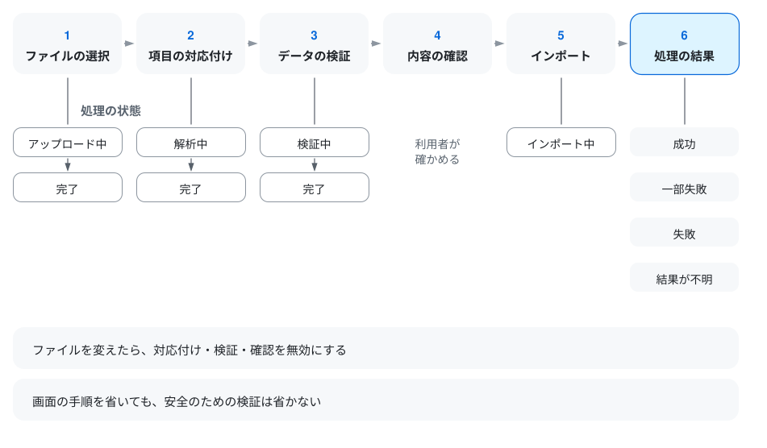

# Import & Export

ファイルからデータを取り込み、データをファイルに書き出す。

状態：v0.1 確定候補（設計と実装の方針は承認済み。Patterns Integration Review の前） ・ 実装：[`registry/patterns/import-mapping.ts`](../../../registry/patterns/import-mapping.ts)、[`registry/patterns/import-review.tsx`](../../../registry/patterns/import-review.tsx)、[`registry/patterns/export.ts`](../../../registry/patterns/export.ts) ・ 全体：[Forms & Workflows](forms-and-workflows.md)

## 目的

多くのデータを、1 件ずつ入力する負荷なしに登録・更新する（原則 07）。取り込む前に、何が登録され、何が登録されないかを正確に示し、既存のデータを意図せず変えない（原則 08）。書き出しでは、対象の範囲と列を誤解させない（原則 01）。

## 使用条件

- 取り込み：複数のデータをまとめて登録・更新する業務がある場合。
- 書き出し：一覧のデータを、ほかのシステムや表計算ソフトで使う業務がある場合。データの移行やバックアップは、専用の出力の形式にしてよい。
- 本格的な CSV の解析、Excel の生成、データベースへの登録は、Registry の対象外（製品の責務）。Registry は対応付け、検証の結果の表示、結果の表示、書き出しの範囲とファイル名とセルの値の扱いを持つ。

## 構成

| 部分 | 部品 | 仕様 |
| --- | --- | --- |
| 取り込みの流れ | `useStepFlow`、`Stepper`（[multi-step-workflow.md](multi-step-workflow.md)） | ファイルの選択 → 項目の対応付け → データの検証 → 内容の確認 → 処理の結果 |
| ファイルの選択 | File Upload（`FileUploadDropzone`、`FileUploadItem`） | 対応する形式、サイズの上限、条件を示す |
| 列 | `createImportColumns(headers, rows, sampleSize)` | 列ごとに `key`（`col-0` など）、`index`、`header`、`samples`（先頭の 3 行の空でない値） |
| 対応付け | `useColumnMapping({ sourceKey, columns, fields, initialMapping })`、`ColumnMappingList` | 列ごとに見出し、位置（「N 列目」）、値の例、登録先（Select）、状態。`key` は対応付けの状態のキー |
| 保存した対応付けの照合 | `sanitizeMapping(mapping, columns, fields)` | 存在しない列の対応付けを捨て、対象外の項目 ID を「取り込まない」にする |
| 検証の結果 | `ImportValidationSummary`、`ImportIssueTable` | 正常、要確認、エラーの件数と絞り込み。行番号、状態、項目、原因と直し方 |
| 実行の前の確認 | 製品の表示（`dl`） | 新規登録、更新、登録しない（重複）、取り込まない（エラー）の件数 |
| 結果の照合 | `reconcileImportResult(target, response)` | サーバーの応答を処理の対象と照合し、`result`（`ImportResult`）、`rows`（行ごとの結果）、`integrity`（`ImportIntegrity`）、`outcome`（`importOutcome(result, integrity)`）を返す |
| 結果 | `ImportResultSummary`（`result`、`integrity`）、`importOutcome` | 新規登録、更新、スキップ、失敗、結果が不明、処理の対象の件数。照合で矛盾があれば、成功として示さず、件数に含めなかった結果と理由を示す |
| 書き出しの設定 | 製品の Dialog（例：`ExportDialog`）、`defaultExportScope`、`exportScopeLabel`、`exportFileName`、`escapeCsvCell(value, { mode })` | 対象の範囲、出力する列、形式 |
| 直接のダウンロード | 製品のメニューの項目（例：「検索結果の 8件を CSV でダウンロード」） | 対象と形式が明確で、個人情報を含まない出力 |

<picture>
  <source media="(prefers-color-scheme: dark)" srcset="../../diagrams/import-flow-dark.svg">
  
</picture>

例の画面（`ImportWizard`）の Stepper は 5 つのステップで、取り込み（図の 5）は「内容の確認」のステップのボタンで実行し、実行中の進捗をそのステップに示す。

## バリエーション

### 操作の配置

| 操作 | 置く場所 | 例 |
| --- | --- | --- |
| 取り込み | Page Header の操作、追加のメニュー | 顧客の一覧の Page Header の「CSV から取り込む」 |
| 検索結果の書き出し | データの領域の直上の右側 | 一覧の上の「エクスポート」（Dropdown Menu の「項目を選んでエクスポート…」） |
| 選んだデータの書き出し | 一括操作のバー（Data Table の `DataTableSelectionBar`） | 「N件を選択中」の横の「エクスポート」 |
| システム全体の出力 | 設定の画面など | `#/import-export` の「設定の画面から開く」 |
| よく使う操作 | 直接表示する | |
| 低い頻度の操作 | Dropdown Menu にまとめる | |

- View Switching の切り替えも、データの領域の直上の右に置く（[view-switching.md](view-switching.md)）。両方を置く画面では、どちらも同じデータの領域に対する操作として、同じ行の右側にまとめる。並べる順序は、例の画面では確かめていない（検証画面に表示形式の切り替えがない）。
- 選んだデータの書き出しは、一括操作のバー（`DataTableSelectionBar`、件数の行と同じ位置、[bulk-actions.md](bulk-actions.md)）の中に置き、表の右上の書き出しとは別の入口にする。例の顧客の一覧では、選択のバーのエクスポートは行を ID で選んでいる間だけ押せる（検索結果の全件の選択の間と、`canOperate` が false の間は無効）。
- 一覧が最新の取得に成功していない間（`useBrowseData` の `canOperate` が false。再取得の失敗など）は、表の右上と選択のバーのエクスポートを無効にする。

### 重複の扱い

| 選択肢 | 動作 | 既定 |
| --- | --- | --- |
| 登録しない（登録済みのデータを残す） | 重複する行をスキップする | 既定 |
| 登録済みの顧客を更新する | 一致した登録済みのデータを更新する。空欄の扱いを別に選ぶ | |
| 新しい顧客として登録する | 新しいレコードとして登録する | |

### エラーの行の扱い

| 選択肢 | 用途 |
| --- | --- |
| 正常な行だけを取り込む | 1 件ずつ独立したレコード（例：顧客） |
| すべての行が正常な場合だけ取り込む | 行どうしが関係するデータ、整合性が重要な処理。エラーの行があれば実行できない |

## 動作

### ファイルの選択

- 既存の File Upload を使う。対応する形式、サイズの上限、条件を示す（例：「CSV（UTF-8、BOM 付きも可）、5 MB まで。1 行目に見出しを置きます」）。形式やサイズが合わないファイルは、選ぶ時点で理由を示して受け付けない。
- 必要に応じてテンプレートを用意する（「テンプレートをダウンロード」）。
- ファイルを選んだだけで、正式な登録を始めない。例では「選択済み（まだ読み込んでいません）」と示し、「ファイルを読み込む」でアップロードと解析を行う。
- アップロード、解析、検証、正式な登録を分けて示す。アップロードは実際の進捗を報告できる場合だけ進捗率を示し、解析中は進捗率を示さない。
- ファイルを変えたら、前のファイルの対応付け、検証の結果、確認した状態を使わない。例では、ファイルごとの識別子（`sourceKey`）が変わると `useColumnMapping` が自動の対応付けからやり直し、検証の結果も対応付けの状態のキー（`mapping.key`）が一致しないため使われない。以前のファイルの解析や検証の応答が後から届いても、ファイルの識別子と対応付けのキーが一致しないため使わない。

### 項目の対応付け（Column Mapping）

<picture>
  <source media="(prefers-color-scheme: dark)" srcset="../../diagrams/column-mapping-dark.svg">
  
</picture>

- 見出しが項目の名前、ID、既知の別名（`aliases`）と一致する場合だけ、自動で対応付ける。比較では、NFKC で全角と半角をそろえ、大文字と小文字、空白、記号（`_`、`-`、`・`、`/`、括弧、`:`）を無視する（`normalizeHeader`）。
- 1 つの列が複数の項目に一致する場合と、複数の列の見出しが同じ項目に一致する場合は、曖昧として自動で対応付けない。利用者が選ぶまで次へ進めない（「見出しから登録先を決められない列が N つあります。登録先を選ぶか、「取り込まない」を選んでください。」）。
- 自動の対応付けは利用者が直せる。各列に「取り込まない」を選べる。
- 元のファイルの見出しと、実際の値の例を示す。値の例はファイル全体の検証の結果ではないことを示す（「値の例は先頭の 3 行で、ファイル全体の検証の結果ではありません。」）。
- 必須の項目の不足を検出する（「必須の項目「会社名」に、列を対応付けてください」）。
- 1 つの項目に複数の列を対応付けた場合は、不正な重複として検出し、該当する列にエラーを示す（「「電話番号」に 2 つの列を対応付けています。1 つを選んでください」）。
- 登録先の項目とファイルの列を、安定した識別子（項目の `id`、列の位置から作る `key`）で持つ。同じ見出しの列が複数あっても、取り違えない。
- 次へは、必須の項目がそろい、重複がなく、曖昧な列が残っていない場合だけ押せる（`isComplete`）。理由はボタンの近くに示し、`aria-describedby` でボタンの説明にする。

#### 対応付けの状態のキーと、保存した対応付け

- `useColumnMapping` は、次のどれかが変わったら、前の対応付けを使わず、自動の対応付けからやり直す。
  - ファイルの識別子（`sourceKey`）。
  - 列の構成（列の `key` と見出し）。同じファイルの識別子のまま、列の構成が変わった場合を含む。
  - 登録先の項目の構成（項目の `id` と必須）。
- `key` は、この対応付けの状態（ファイル、列の構成、項目の構成、対応付け）を表す。検証の結果は `key` と組で持ち、`key` が変わったら古い検証の結果を使わない。対応付けを 1 つ変えても `key` は変わる。
- `setColumn(key, fieldId)` は、存在しない列と、対象外の項目 ID を受け付けない（false を返し、状態を変えない）。
- 保存した対応付け（前回の取り込みの設定など）は、そのまま信用しない。`initialMapping` に渡すと、`sanitizeMapping` で照合してから使う。存在しない列の対応付けは捨て（`unknownColumns`）、対象外の項目 ID は「取り込まない」にする（`unknownFields`）。使わなかった列と項目は `rejected` で読める。`initialMapping` を渡した場合は、曖昧な列の解決を求めない（保存した対応付けを利用者が選んだものとして扱う）。

### データの検証

- 対応付けた値で、すべての行を検証する。正常（登録できる）、要確認（登録済みのデータとの重複の候補など、判断が必要）、エラー（登録できない）を分ける。
- 元のファイルの行番号（見出しの行を 1 とする）、対象の項目、原因、直し方を示す（`ImportIssueTable`）。
- 件数と対象の範囲を正確に示す。件数はファイル全体の数を `ImportValidationSummary` に渡す。
- 行の表示が一部だけの場合は、そのことを示す（例：「先頭の 20 件を表示しています（全 N 件）。すべてはファイルでダウンロードできます。」）。
- エラーだけ、要確認だけの絞り込みを置く（`aria-pressed` のボタン）。エラーがある場合は、最初にエラーで絞り込む。
- エラーが多い場合に備えて、エラーと要確認の行をファイルで書き出せる（「エラーと要確認の行をダウンロード」）。
- 対応付けを変えた後は、検証をやり直す（「対応付けを変えたため、もう一度検証します。」）。検証の結果は、対応付けの状態のキー（`mapping.key`）と組で持つ。
- 検証の進捗率を取得できない場合は、進捗率を示さない（「検証しています（進捗率は取得できません）」）。

### 重複の扱いと空欄

- 既存のデータを守ることを優先する。既定は「登録しない」。
- 更新と新規の登録は、利用者が明示的に選んだ場合だけ行う。
- 更新するときの一致の判定（例：顧客コード）、更新する項目、空欄の扱いを示す。
- 空欄で既存のデータを消さない。空欄で消す必要がある場合は、明示的に選ばせる（「空欄の項目で、登録済みの値を消す」。選ばない場合、空欄は「変更しない」）。

### 部分的な登録

- 1 件ずつ独立したレコードでは、正常な行だけの登録を許す。行どうしが関係するデータや整合性が重要な処理では、すべて成功かすべて失敗の方式にする。
- エラーの行を黙って除かない。新規登録、更新、登録しない、取り込まない件数を、実行の前に示す。実行のボタンにも件数と除く行を書く（「35件を取り込む（エラーの 3件と重複の 2件を除く）」）。
- 「すべての行が正常な場合だけ取り込む」を選んでいてエラーの行がある場合は、実行できないことと次の操作を示す。
- 実際のトランザクションの制御はバックエンドの責務である。

### 処理と結果

- ファイルの選択済み、アップロード中・完了、解析中・完了、検証中・完了、取り込み中、成功、一部失敗、失敗、結果が不明を分ける。
- 正確な進捗を取得できる場合だけ、進捗率を示す（例：「取り込んでいます（20 / 35 行）」と Progress）。
- 新規登録、更新、スキップ、失敗の件数を分けて示す（`ImportResultSummary`）。件数の合計を処理の対象と一致させる。`importOutcome(result, integrity)` は、合計が処理の対象と一致しない場合と、件数の形式が正しくない場合（負の数、小数、NaN、Infinity、数ではない値）、結果が不明として扱う。`integrity`（`reconcileImportResult` の照合の結果）を渡すと、サーバーが返さなかった件数（`missingCounts`）、形式が正しくない件数（`invalidCounts`）、合計の不一致（`totalMismatch`）、結果が返らなかった行（`missingRows`）がある場合も、結果が不明として扱う。サーバーの応答を判定する場合は、必ず `integrity` を渡す（`reconcileImportResult` の戻り値の `outcome` は、`importOutcome(result, integrity)` の値）。`integrity` を省略した `importOutcome(result)` は、件数だけで判定する（返さなかった件数を 0 と区別できない）。

| `importOutcome` | 条件 | 表示 |
| --- | --- | --- |
| `success` | 失敗も結果が不明もない | 「取り込みが終わりました」（success、`role="status"`）。照合に矛盾がある場合（`complete` が false）は「取り込みが終わりました。サーバーの応答に矛盾がありました」（warning、`role="alert"`） |
| `partial` | 失敗があり、新規登録か更新が 1 件以上 | 「一部の行を取り込めませんでした」（warning、`role="alert"`） |
| `failed` | 失敗があり、新規登録も更新もない | 「取り込めませんでした」（destructive、`role="alert"`） |
| `unknown` | 結果が不明な行がある、件数の合計が合わない、または照合で件数を確かめられなかった（返さなかった件数、形式が正しくない件数、返らなかった行） | 「結果を確かめられていない行があります」（warning、`role="alert"`）と、事実に合う理由（「処理の途中で結果を受け取れなかった行があり…」「サーバーが「更新」「スキップ」「失敗」の件数を返さなかったため…」「結果の件数の合計が、処理の対象の件数と一致しません。」など） |

- `ImportResultSummary` の `integrity` を省略すると、件数を照合していないものとして扱い、件数の上で成功でも `unknown`（「処理の対象と結果を照合していないため…」）として示す。サーバーの応答を示す場合は、必ず `reconcileImportResult` の `integrity` を渡す。

- 失敗の理由と再処理の方法を示す。確定した失敗の行だけを再処理できる（「失敗した N件だけを再処理」）。成功した行と、結果が不明な行は再処理の対象にしない（製品が対象を絞る）。失敗した行はファイルで書き出せる。
- 結果が不明な場合は、再処理のボタンを置かず、状態の確認を優先する（「状態を確認」）。例では、行ごとの結果（照合の後）で結果が不明な行だけを確かめる。登録されていた行は成功として扱い、再処理の対象にしない。登録されていなかった行だけを失敗として扱い、再処理できるようにする。行の位置から推測しない。状態の確認そのものが失敗した場合は、結果が不明のまま残し、「状態を確認できませんでした。時間をおいて、もう一度確認してください。」を示す。
- 状態の確認の後に、結果が不明な行がなくなれば、件数で判定した結果（`success`、`partial`、`failed`）を示す。応答の矛盾（重なった結果、対象ではない行の結果、件数と行ごとの結果の不一致）は一覧に残し、成功の形にはしない。確定した失敗があれば、その行だけを再処理できる。「顧客の一覧へ」は、照合の結果で判定した `outcome` が `unknown` ではない場合だけ示す（件数だけの `importOutcome(result)` で判定しない）。検品：「inconsistent response: after the status check the counts decide the outcome, the inconsistencies stay listed, only confirmed failures are retried」。v0.1 の途中では、状態の確認の後も `unknown` のままで「合計が一致しません」と事実と異なる文を示し、「状態を確認」が何もせず、確定した失敗を再処理できなかった。
- 取り込みの要求が例外で終わった（応答がない）場合は、送ったすべての行を結果が不明として扱う（例では、すべての行を `unknown` とした応答を `reconcileImportResult` に渡す）。サーバーで処理が終わっている行があるかもしれないため、自動で再実行しない。進捗の表示は `finally` で必ず閉じる。
- 取り込みの実行中と実行の後は、Stepper から前のステップへ移れない。
- 安全に続けられる裏の処理がある場合だけ、処理中の画面からの離脱を許す。例では、実行中は Unsaved Changes の保存中として扱う。

#### 結果の照合（`reconcileImportResult`）

サーバーの応答は、そのまま件数として使わない。`reconcileImportResult({ total, rows }, response)` で処理の対象と照合する（Data Browsing の `reconcileBulkResults` と同じ考え方）。`rows` には処理の対象の行番号（元のファイルの行番号）を渡す。行ごとの結果を返さない API では省く。

| 応答 | 扱い | `ImportIntegrity` |
| --- | --- | --- |
| 件数だけの結果で、件数の形式が正しくない（負の数、小数、NaN、Infinity、数ではない値） | その件数を 0 として合計し、記録する。`outcome` は `unknown` | `invalidCounts`（項目の名前） |
| 件数だけの結果で、サーバーが件数を返さなかった（`created`、`updated`、`skipped`、`failed` のどれかがない。`unknown` は省略してよい） | その件数を 0 として合計し、記録する。残りの件数の合計が処理の対象と一致しても、`outcome` は `unknown`（返さなかった件数が 0 であることは確かめられていない） | `missingCounts`（項目の名前） |
| 件数だけの結果で、合計が処理の対象より少ない | 足りない件数を結果が不明に加える | |
| 件数だけの結果で、合計が処理の対象より多い | 矛盾として記録し、結果が不明として扱う | `totalMismatch` |
| 行ごとの結果で、結果が返らなかった行 | 結果が不明（「結果が返されませんでした」） | `missingRows` |
| 行ごとの結果で、同じ行の結果が重なった | 1 つとして数える。異なる結果が重なった行は結果が不明 | `duplicateRows` |
| 行ごとの結果で、処理の対象ではない行の結果 | 件数に含めない | `unexpectedRows` |
| 行ごとの結果と、サーバーが返した件数が一致しない | 行ごとの結果から数える | `countsDisagree` |

- `integrity.complete` は、`invalidCounts`、`missingCounts`、`totalMismatch`、`missingRows`、`duplicateRows`、`unexpectedRows`、`countsDisagree` のどれにも当たらない場合だけ true になる（`isIntegrityComplete`。製品が照合の結果を組み合わせ直す場合に使う）。件数だけの結果の合計の不足は `complete` を変えないが、足りない件数が `result.unknown` に入るため、`importOutcome` は `unknown` を返す。

部分的な件数の契約（Patterns Integration Review で明確にした）：

| `ImportIntegrity` | 対象の行の結果 | `outcome` | `ImportResultSummary` |
| --- | --- | --- | --- |
| `complete` が true | すべて確定 | 件数で判定 | 件数の結果。成功は success の形 |
| `invalidCounts`、`missingCounts`、`totalMismatch`、`missingRows` のどれか | 確定していない行か件数がある | `unknown` | 「結果を確かめられていない行があります」、理由、「状態を確認」。再処理のボタンは置かない |
| `duplicateRows`、`unexpectedRows`、`countsDisagree` だけ（結果が不明な行はない） | すべて確定（行ごとの結果で数え直している） | 件数で判定 | 件数の結果。成功の形（success の色、`role="status"`）にはせず、矛盾の一覧と「処理の対象のすべての行の結果は確定しています。応答の矛盾は、サーバーの記録で確認してください。」を示す |

- 変更の記録：以前は、件数だけの結果で返さなかった件数を `invalidCounts` に入れて 0 とし、合計が一致すれば `importOutcome(result)` が `success` を返していた（`complete` は false）。また、`ImportResultSummary` は `integrity` を省略すると件数だけで成功を示した。理由：不足している件数を無条件に 0 として成功させないため（Patterns Integration Review の確認事項）。影響の範囲：`ImportIntegrity` に `missingCounts`（省略できる）を加え、`importOutcome` に第 2 引数 `integrity` を加え、`reconcileImportResult` の戻り値に `outcome` を加えた（いずれも追加）。`integrity` を省略した `ImportResultSummary` は、件数の上で成功でも成功として示さない（動作の変更）。代替案：返さなかった件数を合計の不足として `unknown` に加える方式は、残りの件数の合計が処理の対象と一致する場合に加える件数がないため採らない。`ImportResultSummary` の `integrity` を必須にする方式は、型の互換を壊すため採らず、省略時に成功として示さない動作にした。
- `ImportResultSummary` に `integrity` を渡すと、件数に含めなかった結果と理由（「1行の結果が返されませんでした（結果が不明として数えています）」「サーバーが「更新」「スキップ」「失敗」の件数を返しませんでした（0 件とはみなしていません）」「取り込みの対象ではない 1行の結果が返されました（件数に含めていません）」など）を一覧で示す。
- 例：「検証用の操作」の「取り込みの結果」の「結果に矛盾がある」（同じ行の異なる結果、対象ではない行の結果、結果の不足、行の結果と合わない件数を返し、最後の行を確定した失敗にする）。「状態を確認」の後は「一部の行を取り込めませんでした」になり、矛盾の一覧が残り、失敗した 1 件だけを再処理できる。
- 検品：`forms-workflows-checks.spec.ts` の「reconcileImportResult: counts the server did not return are missing, not zero; the outcome is unknown」。

### 書き出しの対象

<picture>
  <source media="(prefers-color-scheme: dark)" srcset="../../diagrams/export-scope-dark.svg">
  
</picture>

- 選んだデータ（`selected`）、現在のページ（`page`）、検索結果のすべて（`results`）、すべてのデータ（`all`）を分ける。
- 操作を始めた場所で、初期の範囲を決める（`defaultExportScope`）。一括操作のバー（`selection-bar`）は選んだ行（選んだ行が 0 件でも選んだ行のまま。検索結果のすべてに広げない）、表の右上（`table`）は検索結果のすべて、設定の画面（`settings`）はすべてのデータ。
- 範囲の名前に件数を添え、利用者が範囲を誤解しないようにする（「検索結果のすべて（580件）」）。件数がわからない場合は、架空の件数を示さない（`exportScopeLabel(scope, null)` は「検索結果のすべて」）。
- 選んだ行がない場合は、「選んだ行」を選択肢に出さない（例の `ExportDialog`）。
- 対象と形式が明確で、追加の設定が不要で、個人情報を含まない出力は、確認の Dialog を挟まずに直接ダウンロードしてよい。例：顧客の一覧の表の右上の「エクスポート」の「検索結果の 8件を CSV でダウンロード」は、検索結果のすべてを、表示している列（顧客コード、名前、メールアドレス、プラン）だけで、BOM 付きの UTF-8 の CSV で出力する。列や範囲を選ぶ場合は「項目を選んでエクスポート…」で `ExportDialog` を開く。
- 一括操作のバーから始めた書き出しで、「選んだ行」を選んでいる間に選択がなくなった場合は、出力できないことを示す（「選んだ行がありません。一覧で行を選ぶか、対象を変えてください。」）。検索結果のすべてなど、ほかの範囲に暗黙に広げない。「選んだ行」の選択肢は残し、ダウンロードのボタンを無効にする。出力する行は、実行の時点の選択から決める。
- 初期の範囲（`defaultExportScope`）は、Dialog を開いた時点の初期値にだけ使う。開いた後の選択の変化で、範囲を変えない。「選んだ行」を選んでいる間に選択がなくなったら、出力できないことを示す。

### 出力する列

- 表からの書き出しでは、現在表示している列を初期値にする。必要に応じて、出力する列を変えられるようにする。列が 1 つもない場合は実行できない（「1 つ以上の列を選んでください」）。
- 権限のない情報や内部の管理用の情報を、無条件に出力しない。例では、権限のある列だけを選択肢に渡す（最終的な確認はサーバーが行う）。
- 個人情報を含む列（例：電話番号、住所。`ExportColumn` の `sensitive`）を選んだ場合は、ダウンロードの前に `ConfirmActionDialog` で確かめる（「個人情報を含む検索結果のすべて（8件）をダウンロードしますか？」「「電話番号」を含みます。ダウンロードしたファイルは、社内の規程に従って管理してください。」）。個人情報の列は、出力する列の初期値に含めない。

### ファイルの形式と安全

- CSV は UTF-8 を基本にする。Excel との互換が必要な場合は、BOM 付きの UTF-8 にする（例の形式の選択肢：「CSV（Excel で開く。BOM 付きの UTF-8）」が既定、「CSV（UTF-8。ほかのシステムへの取り込み）」）。
- 例では、「Excel で開く」の形式は `escapeCsvCell` の `"spreadsheet"`（式として解釈される値の前に `'` を付ける）、「ほかのシステムへの取り込み」の形式は `"raw"`（値を変えない）で書き出す。`"raw"` の形式を表計算ソフトで開くと、式として解釈される値がある。取り込む側が値を式として扱わないことを、製品が確かめる。
- 電話番号、郵便番号、識別子などを、意図せず数値にしない。CSV を Excel で直接開く場合、先頭の 0 などが保たれることは保証できない（例では「Excel で直接開くと、電話番号や郵便番号の先頭の 0 が消えることがあります」と示す）。保つ必要がある場合は、文字列の型を指定できる XLSX などを使う（製品の責務）。
- 日付、数値、文字コードによる意図しない変換を防ぐ。日付は `escapeCsvCell` で ISO 8601 の文字列にする。
- CSV Injection の対策を行う。`escapeCsvCell(value, { mode })` の `mode` で、出力の用途を分ける。

| `mode` | 用途 | 動作 |
| --- | --- | --- |
| `"spreadsheet"`（既定） | 表計算ソフトで開く出力 | 先頭（空白と制御文字の後を含む。全角の空白も空白に含む）が `=`、`+`、`-`、`@`、全角の `＝`、`＋`、`－`、`＠` の文字列と、タブ、復帰（`\r`）、改行（`\n`）で始まる文字列の先頭に `'` を付ける。数値の型の値（負の数を含む）には付けない |
| `"raw"` | データの移行やバックアップの生データ（表計算ソフトで開かない前提） | 値を変えず、区切り文字と引用符の扱いだけを行う |

- どちらも、区切り文字（`,`）、引用符（`"`）、改行を含む値は引用符で囲み、引用符を重ねる。null と undefined は空にする。
- `"spreadsheet"` は文字列の値を変えるため、取り込み直す用途（移行）には使わない。
- 表計算ソフトの解釈は製品と版によって異なるため、`escapeCsvCell` は、すべての表計算ソフトでの安全を保証しない。
- 例（`forms-workflows-checks.spec.ts`）：`" =1+1"` は `"' =1+1"`、`"＝SUM(A1)"` は `"'＝SUM(A1)"`、`"a=b"` は変えない、数値の `-5` は `"-5"`、`"=SUM(A1)"` は `raw` では変えない。
- ファイルの内容、形式、サイズを、サーバー側でも検証する。
- 入出力の対象と項目の権限を、バックエンドで確かめる。
- ファイル名から、データの種類と出力の日時がわかるようにする（`exportFileName`、例：「顧客_検索結果_20261126-1530.csv」）。ファイル名に使えない文字（`\ / : * ? " < > |` と空白）は「_」にする。

## アンチパターン

| 避ける | 理由 | 代わりに |
| --- | --- | --- |
| ファイルを選んだだけで登録を始める | 確かめる前にデータが変わる | 選択、対応付け、検証、確認の後に実行 |
| ファイルを変えた後も前の対応付けや検証の結果を使う | 別のファイルの内容で登録される | ファイルの識別子で無効にする |
| 見出しの文字で列を照合する | 同じ見出しの列を取り違える | 位置から作る key |
| 曖昧な対応付けを自動で確定する | 意図しない項目に値が入る | 利用者に選ばせる |
| 値の例をファイル全体の検証の結果として示す | 先頭の行だけ正しい場合に誤解させる | 値の例であることを示し、全体を検証する |
| 表示の一部だけの行を、すべてのように示す | 残りの問題を見逃す | 表示の範囲と全体の件数を示す |
| エラーの行を黙って除く | 登録されていない行に気付かない | 実行の前に件数を示す |
| 空欄で既存の値を消す | 意図せずデータが失われる | 明示的に選んだ場合だけ |
| 正確でない進捗率を示す | 誤った見通しを与える | 取得できる場合だけ |
| 件数の合計が処理の対象と合わない結果を成功として示す | 処理されていない行に気付かない | 結果が不明として扱う |
| 成功した行を含めて再処理する | 重複して登録される | 失敗した行だけ |
| 結果が不明な取り込みを再処理させる | 重複して登録される | 状態を確かめる |
| 件数がわからないのに件数を示す | 範囲を誤解させる | 件数を示さない |
| 権限のない列を書き出しの選択肢に出す | 見せてはいけない情報が出力される | 権限のある列だけ |
| 個人情報の列を確かめずに書き出す | 意図せず個人情報を含むファイルが残る | ダウンロードの前に確かめる |
| 選んだ行がなくなったときに、検索結果のすべてを書き出す | 確かめていない範囲が出力される | 出力できないことを示す |
| CSV のセルの値をそのまま書き出す | 表計算ソフトで数式として実行される | `escapeCsvCell`（表計算ソフトで開く出力は `"spreadsheet"`） |
| 先頭の文字だけを見て、空白や全角の記号の後の数式を見逃す | 表計算ソフトが空白を除いて数式として解釈することがある | `escapeCsvCell` |
| サーバーが返した件数を照合せずに成功として示す | 結果の不足、重複、対象外の行に気付かない | `reconcileImportResult` |
| 保存した対応付けをそのまま使う | 存在しない列や対象外の項目に対応付ける | `sanitizeMapping`（`initialMapping`） |

## 状態管理

| 状態 | 持つ場所 | 内容 |
| --- | --- | --- |
| ファイル | 製品 | ファイル、識別子（名前、サイズ、更新日時、通し番号）、状態（`selected`、`uploading`、`uploaded`、`processing`、`done`、`error`）、進捗 |
| 解析の結果 | 製品 | 見出し、行、ファイルの識別子 |
| 対応付け | `useColumnMapping` | `mapping`（列の key → 項目の id か null）、`key`（対応付けの状態のキー）、`issues`（`missingRequired`、`duplicates`）、`ambiguous`、`rejected`（`unknownColumns`、`unknownFields`）、`isAuto(key)`、`isComplete`、`setColumn`、`resetToAuto` |
| 検証の結果 | 製品 | 行ごとの区分と問題。対応付けの状態のキー（`mapping.key`）と組 |
| 重複の扱い、空欄、部分登録の方式 | 製品 | 既定は「登録しない」、空欄で消さない、正常な行だけ |
| 実行と結果 | 製品 | 実行中の件数、処理の対象の行、行ごとの結果（`ImportRowResult`。照合の後）、`ImportIntegrity`。`ImportResult`（`created`、`updated`、`skipped`、`failed`、`unknown`、`total`）は行ごとの結果から数える |
| 書き出しの設定 | 製品 | 範囲、列、形式。開くたびに、始めた場所に合わせた初期値に戻す |

`useColumnMapping` は、`sourceKey`、列の構成、項目の構成のどれかが変わったら、描画の中で前の対応付けを捨て、自動の対応付けからやり直す（`initialMapping` があれば、照合した保存の対応付けから始める）。利用者が選んだ列（`touched`）は、曖昧な列の解決として扱う。

`ImportResult`、`importOutcome`、`reconcileImportResult`、`isIntegrityComplete`、型 `ImportOutcome`、`ImportRowResult`、`ImportRowOutcome`、`ImportIntegrity` は `import-mapping.ts` にある（React を使わないため、サーバーの処理でも使える）。`importOutcome`、`ImportOutcome`、`ImportResult` は `import-review.tsx` からも公開する。

## アクセシビリティ

- 対応付けの Select は、列ごとに、列の位置を含む読み上げ用のラベル（「3 列目「電話番号」の登録先」）を持つ。同じ見出しの列が複数あっても、名前が重ならない。重複は FieldError、曖昧と自動の対応付けは FieldDescription で伝える。
- 絞り込みのボタンは `aria-pressed` で選んだ状態を伝え、`role="group"`（「表示する行」）でまとめる。
- 検証の結果の状態は、アイコンと文字（「登録できる」「確認が必要」「エラー」）で示す。色だけで区別しない。
- 問題の表は `caption`（読み上げ用）を持つ。
- 結果は、成功は `role="status"`、それ以外は `role="alert"`。実行中の進捗は `role="status"` の文と Progress の値（`aria-label`「取り込みの進捗」）。
- 書き出しの Dialog の出力する列は FieldSet と凡例「出力する列」でまとめる。選んだ行がなくなった場合の知らせは Alert（warning、`role="alert"`）。

## 製品側の責務

- ファイルの解析（CSV、Excel）、文字コードの判定（Shift_JIS など）、サーバー側の内容・形式・サイズの検証。
- 行の検証の規則、重複の判定、更新の一致の判定。
- 取り込みの API、トランザクションの制御、冪等性、実際の進捗の報告、結果が不明な行の状態の確認。行ごとの結果（元のファイルの行番号と結果）を返すこと（返さない場合、行ごとの照合はできない）。
- 失敗した行だけの再処理の対象の決定。
- 書き出しのデータの取得、XLSX の生成、権限のない列の除外とサーバーでの確認、移行やバックアップの専用の形式（`escapeCsvCell` の `"raw"` を使うかの判断）。
- 個人情報の列の判断（`sensitive`）と、出力の記録などの社内の規程への対応。
- 保存した対応付けの永続化と、`initialMapping` への受け渡し。

## 実装例

```tsx
const columns = useMemo(() => (sourceKey && parsed ? createImportColumns(parsed.headers, parsed.rows) : []), [sourceKey, parsed])
const mapping = useColumnMapping({ sourceKey, columns, fields: importFields, initialMapping: savedMapping }) // fields：{ id, label, required, aliases }
const validationCurrent = validation?.key === mapping.key ? validation : null // ファイル、列と項目の構成、対応付けを変えたら使わない

<ColumnMappingList
  columns={columns}
  fields={importFields}
  mapping={mapping.mapping}
  issues={mapping.issues}
  ambiguous={mapping.ambiguous}
  isAuto={mapping.isAuto}
  onChange={mapping.setColumn}
/>

<ImportValidationSummary counts={{ valid, review, error }} filter={filter} onFilterChange={setFilter} />
<ImportIssueTable issues={visibleIssues.slice(0, 20)} caption="確認が必要な行とエラーの行" />

// 実行：サーバーの応答を、処理の対象の行と照合する
const raw = await api.runImport(targets)
const { result, rows: rowResults, integrity, outcome } = reconcileImportResult({ total: targets.length, rows: targets.map((t) => t.row) }, raw)
// 次の画面への移動などは outcome（照合の結果で判定）で決める。importOutcome(result) だけで決めない

<ImportResultSummary
  result={result}
  integrity={integrity} // 矛盾があれば成功として示さない
  onRetryFailed={result.failed > 0 ? retryFailed : undefined} // 確定した失敗の行だけ
  onDownloadFailed={result.failed > 0 ? downloadFailed : undefined}
  onCheckStatus={checkStatus} // 結果が不明な場合だけ表示される
/>

// 書き出し
const [scope, setScope] = useState(() => defaultExportScope(origin, { selectedCount }))
const label = exportScopeLabel(scope, counts[scope]) // 件数が null なら件数を示さない
const fileName = exportFileName({ kind: "顧客", scope: "検索結果", date: new Date(), extension: "csv" })
// 表計算ソフトで開く出力（既定 "spreadsheet"）。移行やバックアップの生データは { mode: "raw" }
const lines = [chosen.map((c) => escapeCsvCell(c.label)).join(","), ...rows.map((r) => chosen.map((c) => escapeCsvCell(r[c.id])).join(","))]
// 個人情報の列を含む場合は、ダウンロードの前に確かめる
const request = () => (chosen.some((c) => c.sensitive) ? setConfirmSensitive(true) : void download())
```

プレビュー：`#/import-export`、`#/forms-app?page=import`、`#/forms-app?page=customers`（表の右上の「エクスポート」の直接のダウンロードと「項目を選んでエクスポート…」、一括操作のバーの「エクスポート」。下部の「検証用の操作」で取り込みの結果を切り替える）。
