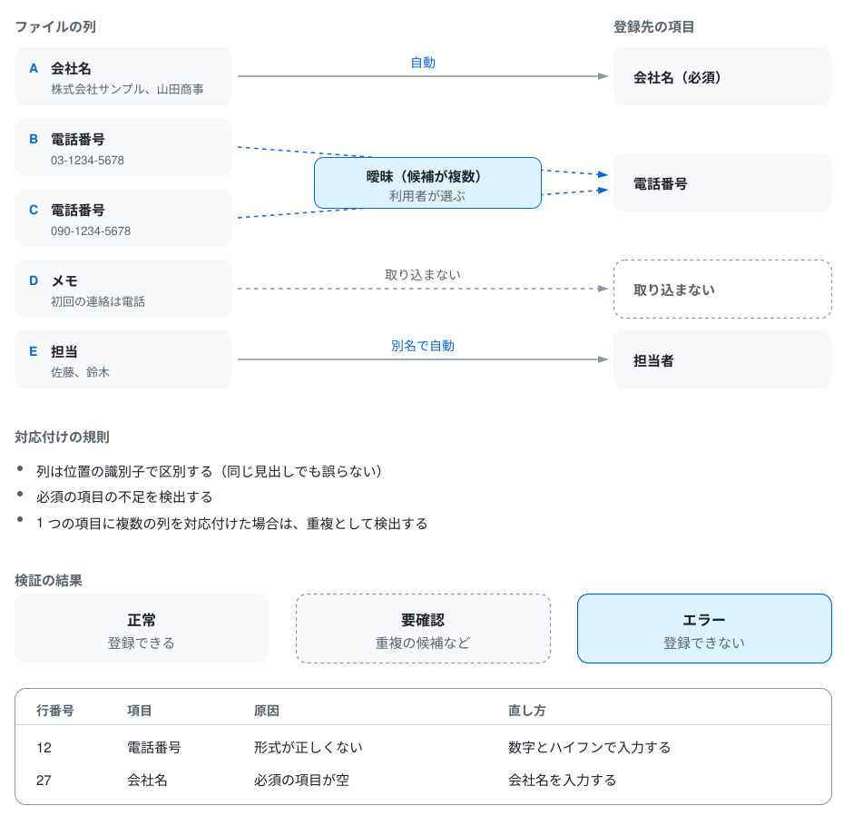
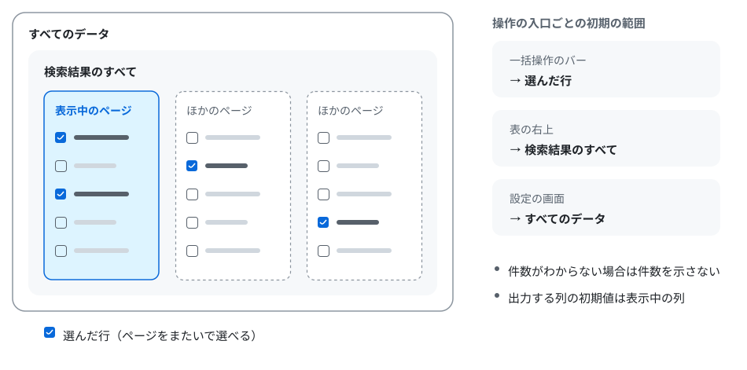

# Import & Export

ファイルからデータを取り込み、データをファイルに書き出す。

状態：初期実装 ・ 実装：[`registry/patterns/import-mapping.ts`](../../../registry/patterns/import-mapping.ts)、[`registry/patterns/import-review.tsx`](../../../registry/patterns/import-review.tsx)、[`registry/patterns/export.ts`](../../../registry/patterns/export.ts) ・ 全体：[Forms & Workflows](forms-and-workflows.md)

## 目的

多くのデータを、1 件ずつ入力する負荷なしに登録・更新する（原則 07）。取り込む前に、何が登録され、何が登録されないかを正確に示し、既存のデータを意図せず変えない（原則 08）。書き出しでは、対象の範囲と列を誤解させない（原則 01）。

## 使用条件

- 取り込み：複数のデータをまとめて登録・更新する業務がある場合。
- 書き出し：一覧のデータを、ほかのシステムや表計算ソフトで使う業務がある場合。データの移行やバックアップは、専用の出力の形式にしてよい。
- 本格的な CSV の解析、Excel の生成、データベースへの登録は、Registry の対象外（製品の責務）。Registry は対応付け、検証の結果の表示、結果の表示、書き出しの範囲とファイル名とセルの値の扱いを持つ。

## 構成

| 部分 | 部品 | 仕様 |
| --- | --- | --- |
| 取り込みの流れ | `useStepFlow`、`Stepper`（[multi-step-workflow.md](multi-step-workflow.md)） | ファイルの選択 → 項目の対応付け → データの検証 → 内容の確認 → 処理の結果 |
| ファイルの選択 | File Upload（`FileUploadDropzone`、`FileUploadItem`） | 対応する形式、サイズの上限、条件を示す |
| 列 | `createImportColumns(headers, rows, sampleSize)` | 列ごとに `key`（`col-0` など）、`index`、`header`、`samples`（先頭の 3 行の空でない値） |
| 対応付け | `useColumnMapping({ sourceKey, columns, fields })`、`ColumnMappingList` | 列ごとに見出し、位置（「N 列目」）、値の例、登録先（Select）、状態 |
| 検証の結果 | `ImportValidationSummary`、`ImportIssueTable` | 正常、要確認、エラーの件数と絞り込み。行番号、状態、項目、原因と直し方 |
| 実行の前の確認 | 製品の表示（`dl`） | 新規登録、更新、登録しない（重複）、取り込まない（エラー）の件数 |
| 結果 | `ImportResultSummary`、`importOutcome` | 新規登録、更新、スキップ、失敗、結果が不明、処理の対象の件数 |
| 書き出しの設定 | 製品の Dialog（例：`ExportDialog`）、`defaultExportScope`、`exportScopeLabel`、`exportFileName`、`escapeCsvCell` | 対象の範囲、出力する列、形式 |

<picture>
  <source media="(prefers-color-scheme: dark)" srcset="../../diagrams/import-flow-dark.svg">
  
</picture>

例の画面（`ImportWizard`）の Stepper は 5 つのステップで、取り込み（図の 5）は「内容の確認」のステップのボタンで実行し、実行中の進捗をそのステップに示す。

## バリエーション

### 操作の配置

| 操作 | 置く場所 | 例 |
| --- | --- | --- |
| 取り込み | Page Header の操作、追加のメニュー | 顧客の一覧の Page Header の「CSV から取り込む」 |
| 検索結果の書き出し | データの領域の直上の右側 | 一覧の上の「エクスポート」（Dropdown Menu の「項目を選んでエクスポート…」） |
| 選んだデータの書き出し | 一括操作のバー | 「N件を選択中」の横の「エクスポート」 |
| システム全体の出力 | 設定の画面など | `#/import-export` の「設定の画面から開く」 |
| よく使う操作 | 直接表示する | |
| 低い頻度の操作 | Dropdown Menu にまとめる | |

- View Switching の切り替えも、データの領域の直上の右に置く（[view-switching.md](view-switching.md)）。両方を置く画面では、どちらも同じデータの領域に対する操作として、同じ行の右側にまとめる。並べる順序は、例の画面では確かめていない（検証画面に表示形式の切り替えがない）。
- 選んだデータの書き出しは、一括操作のバー（件数の行と同じ位置、[bulk-actions.md](bulk-actions.md)）の中に置き、表の右上の書き出しとは別の入口にする。

### 重複の扱い

| 選択肢 | 動作 | 既定 |
| --- | --- | --- |
| 登録しない（登録済みのデータを残す） | 重複する行をスキップする | 既定 |
| 登録済みの顧客を更新する | 一致した登録済みのデータを更新する。空欄の扱いを別に選ぶ | |
| 新しい顧客として登録する | 新しいレコードとして登録する | |

### エラーの行の扱い

| 選択肢 | 用途 |
| --- | --- |
| 正常な行だけを取り込む | 1 件ずつ独立したレコード（例：顧客） |
| すべての行が正常な場合だけ取り込む | 行どうしが関係するデータ、整合性が重要な処理。エラーの行があれば実行できない |

## 動作

### ファイルの選択

- 既存の File Upload を使う。対応する形式、サイズの上限、条件を示す（例：「CSV（UTF-8、BOM 付きも可）、5 MB まで。1 行目に見出しを置きます」）。形式やサイズが合わないファイルは、選ぶ時点で理由を示して受け付けない。
- 必要に応じてテンプレートを用意する（「テンプレートをダウンロード」）。
- ファイルを選んだだけで、正式な登録を始めない。例では「選択済み（まだ読み込んでいません）」と示し、「ファイルを読み込む」でアップロードと解析を行う。
- アップロード、解析、検証、正式な登録を分けて示す。アップロードは実際の進捗を報告できる場合だけ進捗率を示し、解析中は進捗率を示さない。
- ファイルを変えたら、前のファイルの対応付け、検証の結果、確認した状態を使わない。例では、ファイルごとの識別子（`sourceKey`）が変わると `useColumnMapping` が自動の対応付けからやり直し、検証の結果も識別子と対応付けのキーが一致しないため使われない。

### 項目の対応付け（Column Mapping）

<picture>
  <source media="(prefers-color-scheme: dark)" srcset="../../diagrams/column-mapping-dark.svg">
  
</picture>

- 見出しが項目の名前、ID、既知の別名（`aliases`）と一致する場合だけ、自動で対応付ける。比較では、NFKC で全角と半角をそろえ、大文字と小文字、空白、記号（`_`、`-`、`・`、`/`、括弧、`:`）を無視する（`normalizeHeader`）。
- 1 つの列が複数の項目に一致する場合と、複数の列の見出しが同じ項目に一致する場合は、曖昧として自動で対応付けない。利用者が選ぶまで次へ進めない（「見出しから登録先を決められない列が N つあります。登録先を選ぶか、「取り込まない」を選んでください。」）。
- 自動の対応付けは利用者が直せる。各列に「取り込まない」を選べる。
- 元のファイルの見出しと、実際の値の例を示す。値の例はファイル全体の検証の結果ではないことを示す（「値の例は先頭の 3 行で、ファイル全体の検証の結果ではありません。」）。
- 必須の項目の不足を検出する（「必須の項目「会社名」に、列を対応付けてください」）。
- 1 つの項目に複数の列を対応付けた場合は、不正な重複として検出し、該当する列にエラーを示す（「「電話番号」に 2 つの列を対応付けています。1 つを選んでください」）。
- 登録先の項目とファイルの列を、安定した識別子（項目の `id`、列の位置から作る `key`）で持つ。同じ見出しの列が複数あっても、取り違えない。
- 次へは、必須の項目がそろい、重複がなく、曖昧な列が残っていない場合だけ押せる（`isComplete`）。理由はボタンの近くに示し、`aria-describedby` でボタンの説明にする。

### データの検証

- 対応付けた値で、すべての行を検証する。正常（登録できる）、要確認（登録済みのデータとの重複の候補など、判断が必要）、エラー（登録できない）を分ける。
- 元のファイルの行番号（見出しの行を 1 とする）、対象の項目、原因、直し方を示す（`ImportIssueTable`）。
- 件数と対象の範囲を正確に示す。件数はファイル全体の数を `ImportValidationSummary` に渡す。
- 行の表示が一部だけの場合は、そのことを示す（例：「先頭の 20 件を表示しています（全 N 件）。すべてはファイルでダウンロードできます。」）。
- エラーだけ、要確認だけの絞り込みを置く（`aria-pressed` のボタン）。エラーがある場合は、最初にエラーで絞り込む。
- エラーが多い場合に備えて、エラーと要確認の行をファイルで書き出せる（「エラーと要確認の行をダウンロード」）。
- 対応付けを変えた後は、検証をやり直す（「対応付けを変えたため、もう一度検証します。」）。検証の結果は、対応付けのキーと組で持つ。
- 検証の進捗率を取得できない場合は、進捗率を示さない（「検証しています（進捗率は取得できません）」）。

### 重複の扱いと空欄

- 既存のデータを守ることを優先する。既定は「登録しない」。
- 更新と新規の登録は、利用者が明示的に選んだ場合だけ行う。
- 更新するときの一致の判定（例：顧客コード）、更新する項目、空欄の扱いを示す。
- 空欄で既存のデータを消さない。空欄で消す必要がある場合は、明示的に選ばせる（「空欄の項目で、登録済みの値を消す」。選ばない場合、空欄は「変更しない」）。

### 部分的な登録

- 1 件ずつ独立したレコードでは、正常な行だけの登録を許す。行どうしが関係するデータや整合性が重要な処理では、すべて成功かすべて失敗の方式にする。
- エラーの行を黙って除かない。新規登録、更新、登録しない、取り込まない件数を、実行の前に示す。実行のボタンにも件数と除く行を書く（「35件を取り込む（エラーの 3件と重複の 2件を除く）」）。
- 「すべての行が正常な場合だけ取り込む」を選んでいてエラーの行がある場合は、実行できないことと次の操作を示す。
- 実際のトランザクションの制御はバックエンドの責務である。

### 処理と結果

- ファイルの選択済み、アップロード中・完了、解析中・完了、検証中・完了、取り込み中、成功、一部失敗、失敗、結果が不明を分ける。
- 正確な進捗を取得できる場合だけ、進捗率を示す（例：「取り込んでいます（20 / 35 行）」と Progress）。
- 新規登録、更新、スキップ、失敗の件数を分けて示す（`ImportResultSummary`）。件数の合計を処理の対象と一致させる。`importOutcome` は、合計が処理の対象と一致しない場合、結果が不明として扱う。

| `importOutcome` | 条件 | 表示 |
| --- | --- | --- |
| `success` | 失敗も結果が不明もない | 「取り込みが終わりました」（success、`role="status"`） |
| `partial` | 失敗があり、新規登録か更新が 1 件以上 | 「一部の行を取り込めませんでした」（warning、`role="alert"`） |
| `failed` | 失敗があり、新規登録も更新もない | 「取り込めませんでした」（destructive、`role="alert"`） |
| `unknown` | 結果が不明な行がある、または件数の合計が合わない | 「結果を確かめられていない行があります」（warning、`role="alert"`） |

- 失敗の理由と再処理の方法を示す。失敗した行だけを再処理できる（「失敗した N件だけを再処理」）。成功したデータを再び取り込まない（製品が対象を絞る）。失敗した行はファイルで書き出せる。
- 結果が不明な場合は、再処理のボタンを置かず、状態の確認を優先する（「状態を確認」）。例では、確かめて登録されていなかった行を失敗として扱い、再処理できるようにする。
- 取り込みの実行中と実行の後は、Stepper から前のステップへ移れない。
- 安全に続けられる裏の処理がある場合だけ、処理中の画面からの離脱を許す。例では、実行中は Unsaved Changes の保存中として扱う。

### 書き出しの対象

<picture>
  <source media="(prefers-color-scheme: dark)" srcset="../../diagrams/export-scope-dark.svg">
  
</picture>

- 選んだデータ（`selected`）、現在のページ（`page`）、検索結果のすべて（`results`）、すべてのデータ（`all`）を分ける。
- 操作を始めた場所で、初期の範囲を決める（`defaultExportScope`）。一括操作のバー（`selection-bar`）は選んだ行（選んだ行がなければ検索結果のすべて）、表の右上（`table`）は検索結果のすべて、設定の画面（`settings`）はすべてのデータ。
- 範囲の名前に件数を添え、利用者が範囲を誤解しないようにする（「検索結果のすべて（580件）」）。件数がわからない場合は、架空の件数を示さない（`exportScopeLabel(scope, null)` は「検索結果のすべて」）。
- 選んだ行がない場合は、「選んだ行」を選択肢に出さない（例の `ExportDialog`）。
- 対象と形式が明確で追加の設定が不要なら、確認の Dialog を挟まずに直接ダウンロードしてよい（例の画面には、この形の例はない）。

### 出力する列

- 表からの書き出しでは、現在表示している列を初期値にする。必要に応じて、出力する列を変えられるようにする。列が 1 つもない場合は実行できない（「1 つ以上の列を選んでください」）。
- 権限のない情報や内部の管理用の情報を、無条件に出力しない。例では、権限のある列だけを選択肢に渡す（最終的な確認はサーバーが行う）。

### ファイルの形式と安全

- CSV は UTF-8 を基本にする。Excel との互換が必要な場合は、BOM 付きの UTF-8 にする（例の形式の選択肢：「CSV（Excel で開く。BOM 付きの UTF-8）」が既定、「CSV（UTF-8。ほかのシステムへの取り込み）」）。
- 電話番号、郵便番号、識別子などを、意図せず数値にしない。CSV を Excel で直接開く場合、先頭の 0 などが保たれることは保証できない（例では「Excel で直接開くと、電話番号や郵便番号の先頭の 0 が消えることがあります」と示す）。保つ必要がある場合は、文字列の型を指定できる XLSX などを使う（製品の責務）。
- 日付、数値、文字コードによる意図しない変換を防ぐ。日付は `escapeCsvCell` で ISO 8601 の文字列にする。
- CSV Injection の対策を行う。`escapeCsvCell` は、`=`、`+`、`-`、`@`、タブ、復帰（`\r`）、改行（`\n`）で始まる文字列の先頭に `'` を付ける。数値の型の値（負の数を含む）には付けない。値が変わるため、データの移行やバックアップの形式では、製品が方針を決める。区切り文字、引用符、改行を含む値は引用符で囲む。
- ファイルの内容、形式、サイズを、サーバー側でも検証する。
- 入出力の対象と項目の権限を、バックエンドで確かめる。
- ファイル名から、データの種類と出力の日時がわかるようにする（`exportFileName`、例：「顧客_検索結果_20261126-1530.csv」）。ファイル名に使えない文字（`\ / : * ? " < > |` と空白）は「_」にする。

## アンチパターン

| 避ける | 理由 | 代わりに |
| --- | --- | --- |
| ファイルを選んだだけで登録を始める | 確かめる前にデータが変わる | 選択、対応付け、検証、確認の後に実行 |
| ファイルを変えた後も前の対応付けや検証の結果を使う | 別のファイルの内容で登録される | ファイルの識別子で無効にする |
| 見出しの文字で列を照合する | 同じ見出しの列を取り違える | 位置から作る key |
| 曖昧な対応付けを自動で確定する | 意図しない項目に値が入る | 利用者に選ばせる |
| 値の例をファイル全体の検証の結果として示す | 先頭の行だけ正しい場合に誤解させる | 値の例であることを示し、全体を検証する |
| 表示の一部だけの行を、すべてのように示す | 残りの問題を見逃す | 表示の範囲と全体の件数を示す |
| エラーの行を黙って除く | 登録されていない行に気付かない | 実行の前に件数を示す |
| 空欄で既存の値を消す | 意図せずデータが失われる | 明示的に選んだ場合だけ |
| 正確でない進捗率を示す | 誤った見通しを与える | 取得できる場合だけ |
| 件数の合計が処理の対象と合わない結果を成功として示す | 処理されていない行に気付かない | 結果が不明として扱う |
| 成功した行を含めて再処理する | 重複して登録される | 失敗した行だけ |
| 結果が不明な取り込みを再処理させる | 重複して登録される | 状態を確かめる |
| 件数がわからないのに件数を示す | 範囲を誤解させる | 件数を示さない |
| 権限のない列を書き出しの選択肢に出す | 見せてはいけない情報が出力される | 権限のある列だけ |
| CSV のセルの値をそのまま書き出す | 表計算ソフトで数式として実行される | `escapeCsvCell` |

## 状態管理

| 状態 | 持つ場所 | 内容 |
| --- | --- | --- |
| ファイル | 製品 | ファイル、識別子（名前、サイズ、更新日時、通し番号）、状態（`selected`、`uploading`、`uploaded`、`processing`、`done`、`error`）、進捗 |
| 解析の結果 | 製品 | 見出し、行、ファイルの識別子 |
| 対応付け | `useColumnMapping` | `mapping`（列の key → 項目の id か null）、`issues`（`missingRequired`、`duplicates`）、`ambiguous`、`isAuto(key)`、`isComplete`、`setColumn`、`resetToAuto` |
| 検証の結果 | 製品 | 行ごとの区分と問題。対応付けのキーと組 |
| 重複の扱い、空欄、部分登録の方式 | 製品 | 既定は「登録しない」、空欄で消さない、正常な行だけ |
| 実行と結果 | 製品 | 実行中の件数、`ImportResult`（`created`、`updated`、`skipped`、`failed`、`unknown`、`total`）、失敗した行と理由 |
| 書き出しの設定 | 製品 | 範囲、列、形式。開くたびに、始めた場所に合わせた初期値に戻す |

`useColumnMapping` は、`sourceKey` が変わったら、描画の中で前の対応付けを捨て、自動の対応付けからやり直す。利用者が選んだ列（`touched`）は、曖昧な列の解決として扱う。

## アクセシビリティ

- 対応付けの Select は、列ごとに読み上げ用のラベル（「「電話番号」の登録先」）を持つ。重複は FieldError、曖昧と自動の対応付けは FieldDescription で伝える。
- 絞り込みのボタンは `aria-pressed` で選んだ状態を伝え、`role="group"`（「表示する行」）でまとめる。
- 検証の結果の状態は、アイコンと文字（「登録できる」「確認が必要」「エラー」）で示す。色だけで区別しない。
- 問題の表は `caption`（読み上げ用）を持つ。
- 結果は、成功は `role="status"`、それ以外は `role="alert"`。実行中の進捗は `role="status"` の文と Progress の値（`aria-label`「取り込みの進捗」）。
- 書き出しの Dialog の出力する列は FieldSet と凡例「出力する列」でまとめる。

## 製品側の責務

- ファイルの解析（CSV、Excel）、文字コードの判定（Shift_JIS など）、サーバー側の内容・形式・サイズの検証。
- 行の検証の規則、重複の判定、更新の一致の判定。
- 取り込みの API、トランザクションの制御、冪等性、実際の進捗の報告、結果が不明な行の状態の確認。
- 失敗した行だけの再処理の対象の決定。
- 書き出しのデータの取得、XLSX の生成、権限のない列の除外とサーバーでの確認、移行やバックアップの専用の形式。

## 実装例

```tsx
const columns = useMemo(() => (sourceKey && parsed ? createImportColumns(parsed.headers, parsed.rows) : []), [sourceKey, parsed])
const mapping = useColumnMapping({ sourceKey, columns, fields: importFields }) // fields：{ id, label, required, aliases }
const mappingKey = `${sourceKey}:${JSON.stringify(mapping.mapping)}`
const validationCurrent = validation?.key === mappingKey ? validation : null // 対応付けを変えたら使わない

<ColumnMappingList
  columns={columns}
  fields={importFields}
  mapping={mapping.mapping}
  issues={mapping.issues}
  ambiguous={mapping.ambiguous}
  isAuto={mapping.isAuto}
  onChange={mapping.setColumn}
/>

<ImportValidationSummary counts={{ valid, review, error }} filter={filter} onFilterChange={setFilter} />
<ImportIssueTable issues={visibleIssues.slice(0, 20)} caption="確認が必要な行とエラーの行" />

<ImportResultSummary
  result={outcome.result}
  onRetryFailed={outcome.result.failed > 0 ? retryFailed : undefined} // 失敗した行だけ
  onDownloadFailed={outcome.result.failed > 0 ? downloadFailed : undefined}
  onCheckStatus={checkStatus} // 結果が不明な場合だけ表示される
/>

// 書き出し
const [scope, setScope] = useState(() => defaultExportScope(origin, { selectedCount }))
const label = exportScopeLabel(scope, counts[scope]) // 件数が null なら件数を示さない
const fileName = exportFileName({ kind: "顧客", scope: "検索結果", date: new Date(), extension: "csv" })
const lines = [chosen.map((c) => escapeCsvCell(c.label)).join(","), ...rows.map((r) => chosen.map((c) => escapeCsvCell(r[c.id])).join(","))]
```

プレビュー：`#/import-export`、`#/forms-app?page=import`、`#/forms-app?page=customers`（エクスポート。下部の「検証用の操作」で取り込みの結果を切り替える）。
