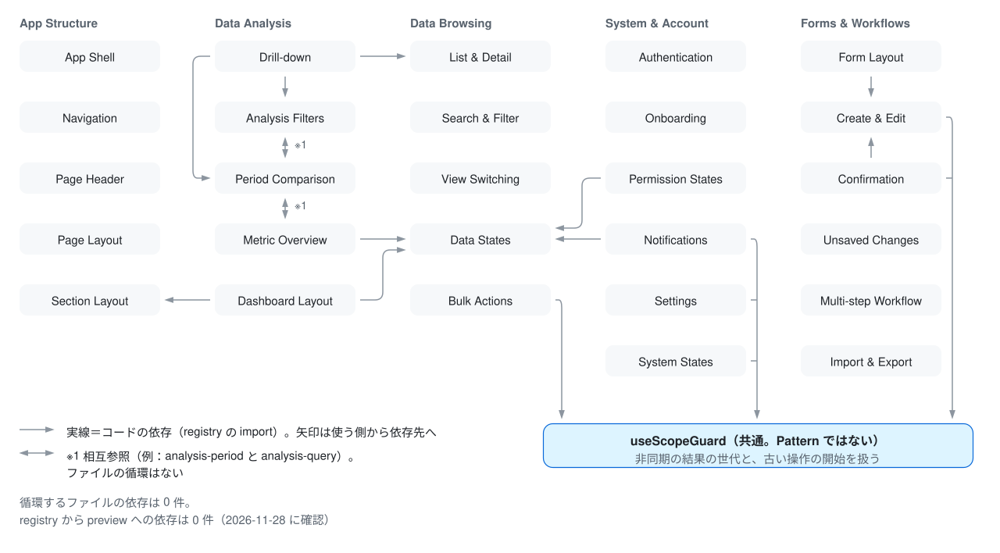
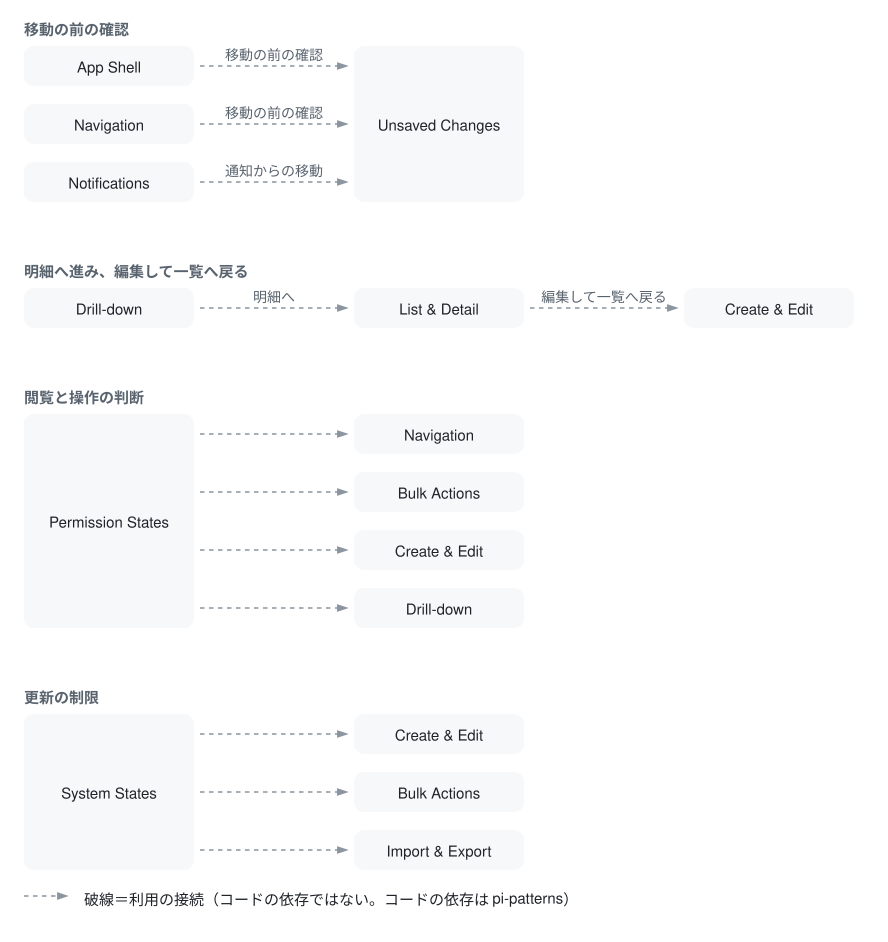
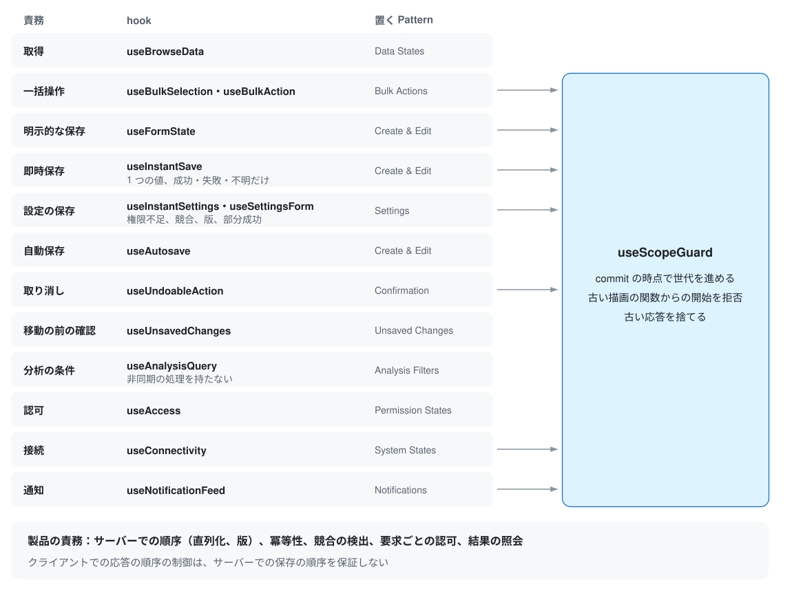
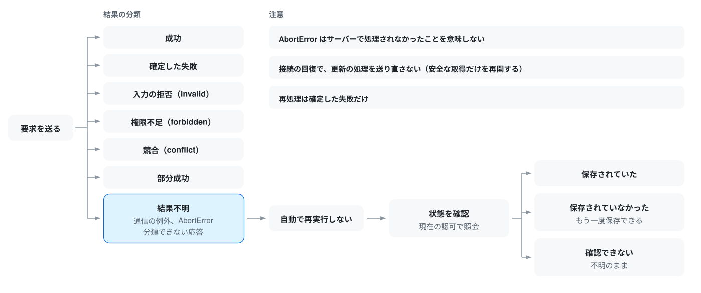
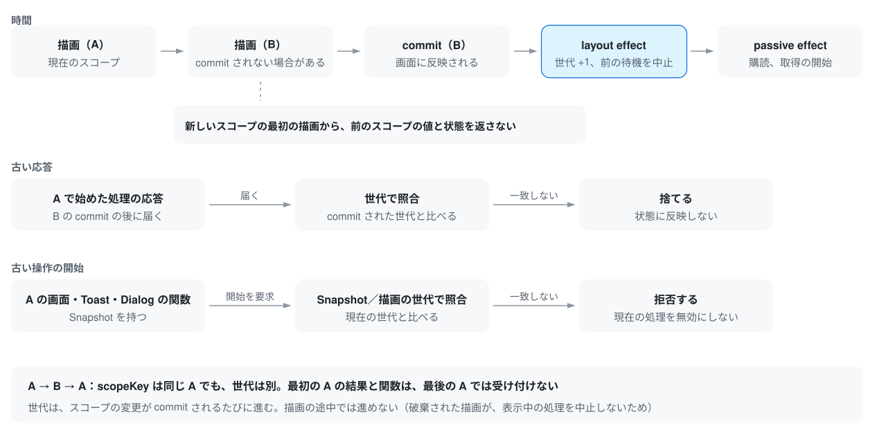
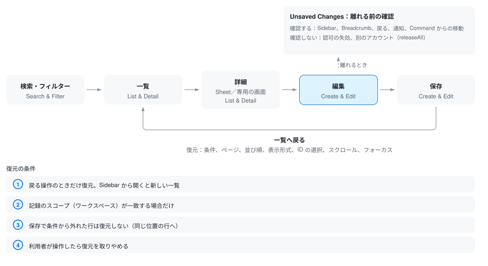
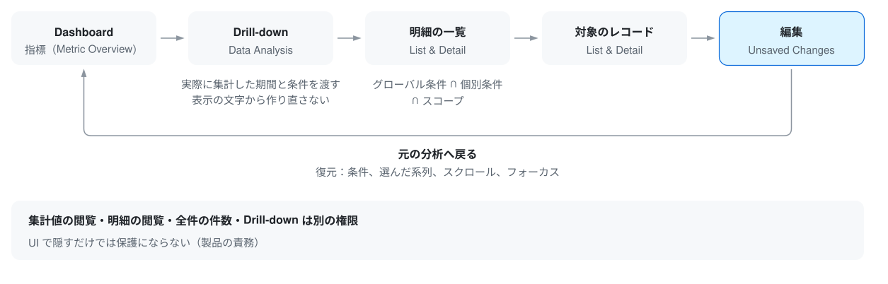

# Patterns v0.1 Integration Review

27 種類の Patterns（5 つのグループ）と 39 種類の Components を、組み合わせて使う状態で検品した記録。
Pattern ごとの設計、実装、検品は各グループの資料にある。この資料は、Pattern をまたぐ問題、共通の状態管理の責務、横断の検品、検品の環境、Pages への引き継ぎを扱う。

- 状態：Patterns v0.1 確定候補（Integration Review 完了・最終レビュー待ち）
- ブランチ：`fix/patterns-integration-v0.1`（`origin/main` の `1ae85eb` から作成）

## 1. 目的

各グループは別々の worktree で設計、実装、検品、独立したレビューを終えている。この Review では、単独の Pattern としての動作ではなく、複数の Pattern を組み合わせたときに、次の点が一貫していることを確かめる。

- ユーザーが目的を達成するまでの流れと、画面の間の移動
- 状態の管理（スコープ、認可、非同期の処理、保存の結果）
- 安全性（情報の保護、データの損失、意図しない破壊的な操作、二重の実行）
- アクセシビリティ、レスポンシブ、見た目の基準
- Registry としての再利用性（Pages の実装が、既存の問題を避けるための独自の実装を必要としないこと）

次の Pages のフェーズでは、ここで確定する Components と Patterns を基盤にして、20 種類の Reference Pages を作る。

## 2. 対象

### Components（39 種類）

Accordion、Alert、Alert Dialog、Avatar、Badge、Breadcrumb、Button、Calendar、Card、Chart、Checkbox、Combobox、Command、Data Table、Date Picker、Dialog、Drawer、Dropdown Menu、Empty、Field、File Upload、Input、Label、Multi Select、Pagination、Popover、Progress、Radio Group、Select、Separator、Sheet、Sidebar、Skeleton、Switch、Table、Tabs、Textarea、Toast、Tooltip（`registry/components/ui/`）

Components の設計はやり直さない。Pattern との組み合わせで見つかった不具合、仕様の矛盾、アクセシビリティの問題だけを、必要な最小の範囲で直す。

### Patterns（27 種類）

| グループ | Pattern | Registry のファイル（`registry/patterns/`） |
| --- | --- | --- |
| App Structure | App Shell | `app-shell.tsx` |
| | Navigation | `sidebar-nav.tsx`、`bottom-nav.tsx` |
| | Page Header | `page-header.tsx` |
| | Page Layout | `page-layout.tsx` |
| | Section Layout | `section-layout.tsx` |
| Data Browsing | Search & Filter | `browse-query.ts` |
| | List & Detail | `list-detail.ts`、`table-scroll-area.tsx` |
| | Bulk Actions | `bulk-selection.ts`、`bulk-actions.tsx` |
| | View Switching | `view-switcher.tsx` |
| | Data States | `browse-data.ts`、`data-states.tsx` |
| Forms & Workflows | Form Layout | `form-layout.tsx` |
| | Create & Edit | `form-state.ts`、`save-modes.ts` |
| | Unsaved Changes | `unsaved-changes.tsx` |
| | Confirmation | `confirm-action.tsx` |
| | Multi-step Workflow | `step-flow.ts`、`stepper.tsx` |
| | Import & Export | `import-mapping.ts`、`import-review.tsx`、`export.ts` |
| Data Analysis | Metric Overview | `metric.tsx`、`metric-format.ts` |
| | Dashboard Layout | `analysis-region.tsx` |
| | Analysis Filters | `analysis-query.ts`、`analysis-controls.tsx`、`analysis-time.ts` |
| | Period Comparison | `analysis-period.ts`、`comparison.ts` |
| | Drill-down | `drill-down.tsx` |
| System & Account | Authentication | `auth-flow.ts`、`auth-layout.tsx`、`auth-feedback.tsx`、`password-input.tsx`、`verification-code-input.tsx` |
| | Settings | `setting-save.ts`、`setting-resolve.ts`、`setting-status.tsx`、`settings-layout.tsx` |
| | Onboarding | `onboarding.ts`、`getting-started.tsx`、`contextual-help.tsx` |
| | Permission States | `access.ts`、`access-decision.ts`、`access-state.tsx`、`restricted-action.tsx` |
| | System States | `system-status.ts`、`system-status-hooks.ts`、`system-banner.tsx`、`service-state.tsx`、`job-status.tsx` |
| | Notifications | `notification-feed.ts`、`notification-state.ts`、`notification-center.tsx`、`notification-list.tsx`、`notification-indicator.tsx` |
| 共通 | （Pattern ではない） | `scope-guard.ts`（`useScopeGuard`） |

## 3. 開始時点のコミット

`origin/main` の `1ae85eb`（2026-11-28 に確認）。次の 4 つの PR の統合を含むことを `git merge-base --is-ancestor` で確かめた。

| PR | 内容 | マージのコミット |
| --- | --- | --- |
| #4 | Shared Test Fixes | `a132344` |
| #1 | Forms & Workflows | `ebb0f24` |
| #2 | Data Analysis | `215a9f4` |
| #3 | System & Account | `1ae85eb` |

## 4. Pattern 間の依存関係

<picture>
  <source media="(prefers-color-scheme: dark)" srcset="../../diagrams/pi-patterns-dark.svg">
  
</picture>

すべての Pattern を 1 つの仕組みにまとめていない。Pattern は、必要なファイルだけを導入できる。依存は `registry/` の `import` を解析して求めた（2026-11-28）。

| 確認 | 結果 |
| --- | --- |
| `registry/` から `preview/` への依存 | 0 件 |
| ファイルの循環する依存 | 0 件（`registry/` の 104 ファイル） |
| `registry/` の模擬のデータ、模擬の API、特定の製品の名前 | なし（`avatar.tsx` の法人格の正規表現と、`confirm-action.tsx` のコメントの例文だけ） |
| 外部のパッケージ | `react`、`@base-ui/react`、`lucide-react`、`class-variance-authority`、`react-day-picker`、`recharts`、`@tanstack/react-table`、`date-fns`、`tailwind-merge`、`clsx`。新しい依存は追加していない |

Pattern の間のコードの依存（使う側 → 使われる側）

| Pattern | 依存する Pattern |
| --- | --- |
| Dashboard Layout | Data States、Section Layout |
| Metric Overview | Data States、Period Comparison |
| Period Comparison ↔ Analysis Filters | `analysis-period.ts` と `analysis-query.ts` が互いの型と関数を使う（ファイルの循環はない） |
| Drill-down | Analysis Filters、Period Comparison、List & Detail（`watchUserInteraction`） |
| Form Layout、Confirmation | Create & Edit（`form-state.ts`） |
| Permission States、Notifications | Data States（`useBrowseData`） |
| Bulk Actions、Confirmation、Create & Edit、Notifications、Settings、System States | 共通の `useScopeGuard` |

<picture>
  <source media="(prefers-color-scheme: dark)" srcset="../../diagrams/pi-pattern-usage-dark.svg">
  
</picture>

App Structure、Search & Filter、View Switching、Unsaved Changes、Multi-step Workflow、Import & Export、Authentication、Onboarding は、ほかの Pattern のコードに依存しない。画面での組み合わせ（移動の前の確認、編集して一覧へ戻る、Drill-down から明細へ、認可と接続による操作の制限）は、製品が Pattern の API で接続する（6 章、7 章）。

## 5. 共通の状態管理の責務

<picture>
  <source media="(prefers-color-scheme: dark)" srcset="../../diagrams/pi-shared-state-dark.svg">
  
</picture>

`useScopeGuard` があることを理由に、既存の hook を置き換えていない。共通にしたのは、価値が確かめられた部分（commit の時点の世代、古い描画の関数からの開始の拒否、古い応答の破棄）だけである。

| hook | 管理するもの | 管理しないもの（製品の責務） | 古い応答 | 古い操作の開始 | スコープの変更 | 結果不明 |
| --- | --- | --- | --- | --- | --- | --- |
| `useBrowseData`（Data States） | 1 つの条件の取得の状態、`canOperate`、取得した時刻 | キャッシュ、重複の排除、認可の判断 | 要求ごとの番号で捨てる（`AbortSignal` に従わない応答も） | 対象外（取得だけ） | 同じ描画から前のスコープのデータを返さない。`initialData.scope` が異なる記録は使わない | 対象外。`discardOnError` で、権限の喪失などの失敗の後に前のデータを捨てる |
| `useBulkSelection`、`useBulkAction`（Bulk Actions） | 選択、対象の固定（`snapshot`）、実行、進捗、行ごとの結果、照合、入口の Snapshot（`capture`）、照会の結果の反映（`resolveUnknown`） | 対象の確定、冪等性、取り消し、宛先（`target.scope` から決める） | 世代で捨てる | 古い描画の `start`、古い Snapshot（`from`）を拒否 | 選択を解除し、待機を中止し、結果を消す（commit の時点） | 再試行の対象にしない。結果を捨てた場合は `undefined`（サーバーで処理された可能性がある） |
| `useFormState`（Create & Edit） | 入力値、基準値、検証、保存の状態、送信した値 | 保存の API、権限不足と競合の区別、版 | 世代（commit の時点）で捨てる | 古い描画の `handleSubmit`、`setValue`、`reset`、`resolveUnknown` は何もしない | 新しいスコープの最初の描画から、その描画の `initialValues` で始める。前のスコープの値は表示も送信もできない | 送信しない。`resolveUnknown` で、照会の結果で解く。保存中と結果不明の間は `discard` しない |
| `useInstantSave` | 1 つの値の即時保存（直列）、成功・失敗・不明 | 権限不足、競合、版、部分成功 | `useScopeGuard` で捨てる | 古い描画の `change`、`check` を拒否 | 最初の描画から `value` の値と `idle` を示す | 変更を受け付けない。`check()` か `value` の更新で解く |
| `useInstantSettings`、`useSettingsForm`（Settings） | 項目ごとの即時保存、フォームの保存、版の照合、`replace`、`verify` | サーバーの順序、冪等性 | `useScopeGuard` で捨てる | `isCurrent` で拒否 | 描画の中で前の状態を返さない | `whileUnknown` で送るかを選ぶ。`verify` で確かめる |
| `useAutosave` | 入力が止まった後の保存、保存中の最新値の再保存 | 冪等性の判断 | 世代（commit の時点）で捨てる | `flush` は commit された値と `save` を使う | その時点の値を保存済みとして始め直す | 自動で再実行しない。`retry` は冪等な保存だけに置く |
| `useUndoableAction`（Confirmation） | 実行の結果の Toast、取り消し、期限 | 取り消しの API | スコープと世代で照合する | A → B → A の最初の A の Toast から取り消さない | 前のスコープの Toast を閉じる。アンマウントでも閉じる | 取り消し直せる状態に戻さない。スコープが変わった場合は `stale` と実行の結果（`performed`）を返す |
| `useUnsavedChanges`（Unsaved Changes） | 保存の単位の登録、移動の前の確認、beforeunload | ルーターの阻止、保存の API | 対象外 | `onSave` は commit された関数 | `cancelNavigation()` で保留中の移動を取り消す | 結果不明の単位（`unknown`）は「保存されたかを確認できていません」と示し、保存して移動を出さない |
| `useAnalysisQuery`（Analysis Filters） | 適用済みの分析の条件、取得のキー | 取得、権限、スコープ、復元した `filters` の検証 | 非同期の処理を持たない | 対象外 | 製品がキーに含める | 対象外 |
| `useAccess`（Permission States） | 権限の取得、認可の世代（`revision`、`reload`）、`latest()` | 実際の認可、変更の検知 | `useBrowseData` と同じ | 実行の直前に `decideAccess(access.latest())` | 同じ描画から確認中にする | `stale` として扱う |
| `useConnectivity`（System States） | 接続の状態（`unknown`、`online`、`connecting`、`offline`）、疎通の確認、`lastOutage` | 疎通の確認の API、要求の再送 | `useScopeGuard(target)` で捨てる | ref は commit の時点で更新 | 描画の中で前の接続先の状態を返さない | 対象外。接続の回復で更新を送り直さない |
| `useNotificationFeed`（Notifications） | 通知の一覧、既読の更新、一括既読の範囲、購読の世代 | 通信、サーバーの順序 | `useScopeGuard` で捨てる | `isCurrent` で拒否。ref は commit の時点で更新 | 一覧と購読を作り直す（layout effect） | 確認中として取得し直す |

### 描画と commit

この Review で、次の hook の描画の中の ref の書き換えを、commit の時点（layout effect）の更新に直した：`useAutosave`、`useBulkAction`、`useBulkSelection`、`useNotificationFeed`、`useUnsavedChanges`、`useUndoableAction`、`useBrowseData`、`useAnalysisPositionRestore`。スコープの変更による世代の更新も、passive effect から layout effect に移した（`useFormState`、`useAutosave`、`useBulkAction`、`ConfirmActionDialog` の開閉）。

確かめた方法：`preview/tests/patterns-integration-hooks.spec.ts`。`preview/src/ssr/hooks-harness.tsx` を StrictMode で描画し、suspend して commit されない transition、Deferred の応答、保持した古い closure を使う。このうち 10 の検品は、修正の前（`a982b0f`）にすべて失敗し、修正の後にすべて成功する。11 件目（`resolveUnknown`）は、この Review で追加した API の検品である。Review C は、`bulk-selection.ts`、`notification-feed.ts`、`save-modes.ts`、`form-state.ts` を `1ae85eb` の版に戻すと、該当する検品がそれぞれ 4、1、3、3 件失敗することを確かめた。

`useFormState` の `fieldsRef` は、描画の中の検証（その描画の `fields` を使う）のため、描画の中で更新している。`useAnalysisQuery` の `queryRef`、`changeRef`、`contextRef` も描画の中で更新している。どちらも非同期の処理の開始に使わないため、変更していない（後続の課題）。

## 6. 推奨する hook の選び方

| 目的 | 使う hook | 使わない場合 |
| --- | --- | --- |
| 一覧と詳細の取得 | `useBrowseData`（`scopeKey` に認可の範囲を含める） | 取得以外の処理には使わない |
| 明示的な保存のフォーム（登録、編集、手続きの入力） | `useFormState` + `useUnsavedChanges`。スコープ（アカウント、ワークスペース、レコード）が変わる場合は `key` で作り直すことを推奨する | 設定の画面のフォームは `useSettingsForm` |
| サーバーに保存する設定（個人、組織、通知の設定）の即時保存 | `useInstantSettings`（1 項目でも） | 権限不足、競合、版、部分成功、`replace` が必要なため `useInstantSave` を使わない |
| 設定以外の 1 つの値の即時保存（成功、失敗、不明だけを区別すれば足りる） | `useInstantSave` | 同じ値を `useFormState` でも持たない |
| 文書やメモの継続的な入力 | `useAutosave` + `useUnsavedChanges`（`onSave: flush`） | 保存が冪等でない場合は `retry` を置かない |
| 一括の操作 | `useBulkSelection` + `useBulkAction` + `ConfirmActionDialog`（`progress="external"`、`targetKey` にスコープ、ID、件数） | 選択が空になったときに検索結果の全件へ広げない |
| 取り消せる操作 | `useUndoableAction` | 取り消せない操作は `ConfirmActionDialog` |
| 取得と保存以外の非同期の処理（既読の更新、権限の申請、再認証の後の確認） | `useScopeGuard`（`capture`、`beginIfCurrent`、`isLatest`） | 既存の hook が持つ処理を重ねて管理しない |

規則

- 1 つの保存の対象（サーバーのキー）は、1 つの hook のインスタンスだけが持つ。ページは、hook が返す値を表示に使い、保存済みの値を別の state に持たない（Pages で同じ保存を二重に管理しない）。
- `useInstantSave` の `value` と `useInstantSettings` の `replace` には、保存が終わった後に始めた取得の値だけを渡す。保存より前に始めた取得の値を渡すと、結果不明の保存を確かめたと誤って扱う。
<picture>
  <source media="(prefers-color-scheme: dark)" srcset="../../diagrams/pi-unknown-result-dark.svg">
  
</picture>

- 保存の結果の分類は、[Forms & Workflows](forms-and-workflows.md) の「保存と実行の結果の分類（hook の横断）」にまとめた。すべての hook で同じ型を使う必要はないが、同じ事象を異なる意味で扱わない。通信の例外と AbortError は、サーバーで処理されなかったことを意味しない。結果不明の処理は無条件に再実行しない。結果の照会にも現在の認可が必要である。

<picture>
  <source media="(prefers-color-scheme: dark)" srcset="../../diagrams/pi-scope-async-dark.svg">
  
</picture>

### スコープの変更が無効にするもの

すべてを 1 つの `scopeKey` にまとめることは強制しない。どの変更がどの状態を無効にするかを、次のように決める。

| 変更 | 無効にするもの | 方法 |
| --- | --- | --- |
| アカウント、ワークスペース | すべての取得、保存、選択、購読、Toast、未保存の確認の保留 | 各 hook の `scopeKey` に含める。フォームは `key` で作り直す。`cancelNavigation()` |
| 認可の世代（同じワークスペースの権限の変更） | 操作の可否、保護された情報の表示、通知の購読 | `useAccess` の `revision` と `reload`。`resolveContentAccess`（`whileUnverified: "hide"`）。通知の `scopeKey` に認可の範囲を含める。フォームの入力値は、閲覧の権限を失った場合だけ捨てる |
| レコード | フォームの値と検証、詳細の取得 | フォームの `scopeKey`（`${ワークスペース}:${ID}`）と `key`。詳細の取得は `keepPreviousData: false` |
| データの取得の条件 | 取得の結果、全件の選択 | `useBrowseData` の `queryKey`。`useBulkSelection` は全件の選択だけを解除する |
| 処理の実行の単位 | 同じキーの前の処理の結果 | `useScopeGuard` の `begin(key)` と `isLatest`。各 hook の要求の番号 |
| 購読の世代 | 前の購読から届いた通知 | `useNotificationFeed` の購読の集合（commit の時点で作り直す） |
| 接続先 | 接続の状態、疎通の確認 | `useConnectivity({ target })` |
| ログアウト、別のユーザーの認証 | 上のすべて。未保存の入力も保持しない | `scopeKey` にユーザーを含める。`releaseAll()` の後に移動する |
| 同じユーザーの再認証 | 何も無効にしない（認可の世代が変わった場合だけ上の「認可の世代」） | 現在の認可を確かめてから、前の作業を戻す（`planReauthentication`） |
| アンマウント、`reset`、`enabled=false` | 実行中の処理の結果 | 各 hook が世代を進める |

## 7. 横断シナリオ

横断の検証画面 `#/patterns-integration`（`preview/src/pages/patterns-integration/`、模擬のサーバーは `preview/src/data/patterns-integration/`）で、指示書の 36 のシナリオを操作できる。Pages の Reference Application ではない。1 つのデータモデル（同じ顧客が、一覧、詳細、指標、明細で同じ値になる）を使い、ワークスペース hq と kyushu には同じ ID の別の顧客がある。模擬のサーバーは `window.__fdPi` で、応答の保留と解放（AbortSignal を無視する応答を含む）、保存の結果（成功、確定した失敗、入力の拒否、競合、結果不明、権限不足）、一括操作の行ごとの結果、取り込みの件数の欠落、分析の障害、権限の変更、セッションの期限切れ、新着の通知を切り替える。

検品は 1 つの長い E2E にせず、シナリオごとに独立させた（新しいページ、ページの中の模擬のサーバー。保存の領域を使わない）。ファイルは `preview/tests/patterns-integration-*.spec.ts` で、`npm run test:patterns` と `npm run test:components` の両方に含まれる。

<picture>
  <source media="(prefers-color-scheme: dark)" srcset="../../diagrams/pi-browse-forms-dark.svg">
  
</picture>

<picture>
  <source media="(prefers-color-scheme: dark)" srcset="../../diagrams/pi-analysis-ops-dark.svg">
  
</picture>

| No. | シナリオ | 検品のファイル |
| --- | --- | --- |
| 1 | ログインして初回のセットアップ（Multi-step Workflow。必須と任意の区別） | auth-permission |
| 2 | App Shell と Navigation で一覧を開く（`aria-current`、h1 へのフォーカス） | browse-edit |
| 3 | 検索、フィルター、並び替え（変更で 1 ページ目へ） | browse-edit |
| 4 | 一覧から Sheet で詳細を確かめる | browse-edit |
| 5 | 専用の詳細の画面へ移る | browse-edit |
| 6 | 編集して保存し、一覧へ戻る | browse-edit |
| 7 | 戻る操作で、条件、位置、フォーカスを復元する（Sidebar から開いた場合は復元しない） | browse-edit |
| 8 | 未保存の変更があるときに Sidebar から移動する | browse-edit |
| 9 | 未保存の変更があるときに通知から移動する | browse-edit |
| 10 | 保存して移動する（保存の失敗では移動しない） | browse-edit |
| 11 | 一括操作の対象を確かめて実行する（`ConfirmActionDialog` の `progress="external"` と `targetKey`） | bulk |
| 12 | 一部が失敗した一括操作の結果を確かめる | bulk |
| 13 | 結果不明の操作を照会する | bulk |
| 14 | 確定した失敗だけを再実行する | bulk |
| 15 | 選んだ行をエクスポートする（選択が空になっても範囲を広げない。既定は表計算ソフト向け） | bulk |
| 16 | 取り込みの結果を照合する（件数の欠落を成功にしない） | bulk |
| 17 | Dashboard から指標の明細へ Drill-down する | analysis |
| 18 | 分析の条件を保ったまま対象のレコードを確かめる | analysis |
| 19 | 明細から編集し、元の分析へ戻る | analysis |
| 20 | 再取得中に表示している条件を確かめる | analysis |
| 21 | 認可の再確認中に保護された情報を表示しない | auth-permission |
| 22 | 権限を失った後に保存、削除、エクスポートを実行できない | auth-permission |
| 23 | A → B → A のワークスペースの変更の間に古い応答を届ける | auth-permission |
| 24 | 古い通知、Toast、Undo からの操作を始めない | auth-permission |
| 25 | セッション切れの後に同じ利用者で再認証する | auth-permission |
| 26 | 別の利用者で再認証し、前の作業を復元しない | auth-permission |
| 27 | オフラインの間は更新の処理を止める | system-notifications |
| 28 | 接続の回復の後に安全な取得を再開する | system-notifications |
| 29 | 結果不明の保存を無条件に再実行しない | system-notifications |
| 30 | 部分的な障害の間も影響のない機能を使える | system-notifications |
| 31 | 通知の設定を変える | system-notifications |
| 32 | 通知センターを開いている間に新着を受け取る（保留。フォーカスと位置を変えない） | system-notifications |
| 33 | 一括既読の間に個別の未読と新着を起こす（範囲は開始の時点に固定） | system-notifications |
| 34 | Drawer の中のフォームと Toast の重なり（390px、320px） | overlays-mobile |
| 35 | Select を閉じる途中で Dialog を開く | overlays-mobile |
| 36 | 320px で主な操作を終える（横方向のスクロールなし） | overlays-mobile |

共通の hook の横断の検品（描画と commit、古い closure）は `preview/tests/patterns-integration-hooks.spec.ts`（5 章）。

## 8. 発見した問題と優先度

最初の調査は、グループごとに 5 つに分けて行った（共通の hook、App Structure と Data Browsing、Forms & Workflows、Data Analysis、System & Account と Overlay）。各指摘には、実行して確かめたか、コードを読んで判断したかを付けた。優先度の定義は次のとおり。

- Critical：情報の漏洩、重大なデータの損失、意図しない破壊的な操作
- High：業務の操作を妨げる不具合、状態の管理の重大な矛盾
- Medium：操作性、アクセシビリティ、再利用性の問題
- Low：軽微な表示、資料、改善の余地

| 調査 | Critical | High | Medium | Low |
| --- | --- | --- | --- | --- |
| 共通の hook | 1 | 6 | 10 | 6 |
| App Structure、Data Browsing | 1 | 2 | 4 | 6 |
| Forms & Workflows | 1 | 2 | 7 | 8 |
| Data Analysis | 0 | 5 | 6 | 5 |
| System & Account、Overlay | 0 | 5 | 22 | 13 |

### Critical と High

| 指摘 | 内容 | 対処 |
| --- | --- | --- |
| Critical（共通の hook） | `useFormState`：前のスコープの描画で作った送信の処理が、新しいスコープの値を前のスコープの save に送る | 状態をスコープと組で持ち、古い描画の関数は何もしない（`38174eb`） |
| Critical（Data Browsing） | 一覧へ戻ると、別のワークスペースの行を表示する（履歴の記録と `initialData` にスコープの照合がない） | 記録にスコープを持たせ、`initialData.scope` を照合する（`49f60a1`） |
| Critical（Forms & Workflows） | ワークスペースを変えた後も前のワークスペースの入力値が残り、新しいワークスペースに登録できる | `useFormState` が新しいスコープの最初の描画から `initialValues` で始める（`38174eb`）。既存の検品の期待値を「引き継がない」に変えた |
| High（共通の hook） | 中断された描画の ref の書き換えで、表示中のスコープの操作が別のスコープの関数と値を使う（`useAutosave`、`useBulkAction`、`useNotificationFeed`）。`useInstantSave` と `useFormState` が新しいスコープの最初の commit で前の値を示す。古い closure の `change` と `check` が新しいスコープを変える | commit の時点で ref を更新し、`useScopeGuard` で照合する（`38174eb`）。回帰の検品（`2637995`） |
| High（Data Browsing） | 選択や再取得の失敗で件数の行が折り返し、表が 48px 下がり、続けて押すと別の行に当たる | 件数の行を 2 列の grid にした（`49f60a1`） |
| High（Data Browsing） | 一覧へ戻った後の位置の復元が、入力中の検索欄からフォーカスとスクロールを奪う | 復元の前の利用者の操作で復元を取りやめる（`49f60a1`、`94353c5`） |
| High（Forms & Workflows） | 認可の失効、アカウントの切り替えで、未保存の確認を省く手段がない | `releaseAll()`、`cancelNavigation()`（`62b28b3`） |
| High（Forms & Workflows） | 取り込みの件数の欠落を 0 として成功にする | `missingCounts`、`importOutcome(result, integrity)`（`62b28b3`） |
| High（Data Analysis） | 日数の異なる比較期間を公平として増減率を示す。復元した条件と表示が一致しない。スコープと条件の積集合をとらない。再取得中の条件の表示が表示中のデータと異なる。件数を示さない設定でも非公開の明細の有無がわかる | `04d4f95`（資料に仕様の変更を記録） |
| High（System & Account） | 権限の再確認中に組織の設定を表示し、保存を送る。ブラウザの戻るで未保存の入力を失う。結果不明のフォームを「保存されません」として破棄させる。組織の設定が挙動に反映されない。即時保存が新しいスコープで前の値を示す | `42b5588`（`useInstantSave` は `38174eb`） |

Medium と Low は、各グループの資料の「Patterns Integration Review での変更」（または「横断の検品（Patterns Integration Review）の対処」）に、指摘、原因、対処、対処しない理由を記録した。

## 9. 修正内容

| グループ | 主な修正 | 資料 |
| --- | --- | --- |
| App Structure | 移動の後の見出しへのフォーカスが、利用者が移動先の要素に移したフォーカスを奪わない。App Structure の検証画面の表を `TableScrollArea` で囲む | [app-structure.md](app-structure.md) |
| Data Browsing | 復元のスコープの照合、件数の行、位置の復元の取りやめ、Sidebar からの再表示、`discardOnError`、`reload` の直後の状態、一括削除の `ConfirmActionDialog`、ID の選択の復元、`loadingRowCount` | [data-browsing.md](data-browsing.md) |
| Forms & Workflows | `useFormState` のスコープの契約、`releaseAll`、`cancelNavigation`、結果不明の破棄の確認、取り込みの件数の契約、結果不明の Dialog のフォーカス、Focusable Disabled の理由、Date Picker の Enter、簡易の Stepper の現在地、Undo の Toast のアンマウント、`blockedReason`、エクスポートの対象のキーと raw CSV の注意、`asyncFailure: "allow"` の例、結果の分類の表 | [forms-and-workflows.md](forms-and-workflows.md) |
| Data Analysis | 比較の公平さ（日数、weekday、経過時間 0）、区間の対応付け、符号の転換、「その他」、スコープの積集合、再取得中の条件、`staleLabel` の折り返し、非表示の領域の Chart、集計値と権限の資料 | [data-analysis.md](data-analysis.md) |
| System & Account | 再確認中の設定の表示と操作、移動の保護と beforeunload、結果不明の破棄、組織の設定の正本、復帰先の判定、確認コードの画面のフォーカス、接続の状態と更新の制限、通知の既読と再確認、組織の作成を Multi-step Workflow の部品に置き換え、Checklist の対象と結果、タイムゾーンの正本、通知の設定の保存の方針、図（offline-recovery）に `unknown` を追加 | [system-and-account.md](system-and-account.md) |
| 共通 | 5 章の hook の描画と commit、`useBulkAction` の `capture`、`start` の `from`、`resolveUnknown` | この資料の 5 章、[bulk-actions.md](bulk-actions.md) |

### Components への変更

| Component | 変更 | 理由 |
| --- | --- | --- |
| Chart | 大きさが 0 の間は `ResponsiveContainer` を描かない | Tabs と Accordion の非表示の領域で警告が出る |
| Combobox（Multi Select を含む） | 後から開いた Modal の背後に下がる（`in-[[data-base-ui-inert]]:z-40`） | 一覧が Modal より前面に残り、背景の値を変えられた |
| Drawer、Sheet | Footer の表示中は `--toast-offset-overlay` を設定する。下から開く Drawer は面全体の高さ | Toast が Footer と入力欄を覆い、操作できなかった |
| Toast | `--toast-offset-bottom` と `--toast-offset-overlay` の大きい方を使う | 同上 |
| Date Picker | コードは変えず、幅が内容から決まる親の中で幅が 0 になる制約を資料に書いた | 最小の幅を与えると既存の配置が変わる |

## 10. API の変更

追加した公開 API（既存の呼び出しはそのまま動く）

| 対象 | 追加 | 必要な理由 |
| --- | --- | --- |
| `useBrowseData` | `initialData.scope`、`discardOnError` | 別のスコープの記録を使わない。権限の喪失などの失敗の後に前のデータを捨てる |
| `useListPositionRestore` | `scrollReady`、`targetKey`、`dataKey`、`watchUserInteraction` | 利用者の操作でフォーカスとスクロールを奪わない |
| `useBulkAction` | `capture`、`start` の `from`、`resolveUnknown` | 古い入口からの実行を止める。照会の結果を行ごとに反映する |
| `useUnsavedChanges`、`useNavigationGuard` | `unknown`、`cancelNavigation`、`releaseAll`、`labels.unknownDescription` | 認可の失効で確認を省く。スコープの変更で保留中の移動を取り消す。結果不明の入力を「保存されません」と示さない |
| `ConfirmActionDialog` | `blockedReason` | 認可と接続で確定を止め、理由を示す |
| `useUndoableAction` | 結果の `performed`（`stale` のとき） | スコープの変更の後でも、実行されたかを呼び出し側が区別する |
| `SaveBlockerNotice` | `reason` | 結果不明、保存中、変換中の理由を支援技術に伝える |
| Import & Export | `importOutcome` の第 2 引数、`ImportIntegrity.missingCounts`、`reconcileImportResult` の `outcome`、`isIntegrityComplete` | 件数の欠落を成功にしない |
| `settingAccess` | `unresolved`、`unresolvedReason` | 再確認中に保護された設定を表示せず、操作を止める |
| `decideAccess` | `Restriction` の `unresolved.missing` | 再確認中に「権限がありません」と示さない |
| Drawer、Sheet | CSS の変数 `--toast-offset-overlay` | 製品の `--toast-offset-bottom` と分ける |

動作の変更（互換性に注意）

| 対象 | 変更 | 移行 |
| --- | --- | --- |
| `useFormState` | `scopeKey` が変わったら、その描画の `initialValues` から始める（以前は値と基準値を変えなかった）。古い描画の関数は何もしない。保存中と結果不明の間は `discard` しない | 新しいスコープの値を `initialValues` で渡すか、`key` で作り直す（推奨） |
| `useBrowseData` | 取得し直す `initialData` は、最初の描画から `refreshing`（`canOperate` は false）。`reload()` の直後の commit も `refreshing` | `status === "ready"` だけで操作の可否を判断しない（以前からの規則） |
| `useNotificationFeed.setRead` | 一覧が現在の取得の結果でない間は送らない | 送れない間は既読の操作を出さない |
| `useBulkSelection.snapshot` | その描画の選択と版から作る（描画の中でも呼べる） | なし |
| `comparisonRange` | 日数が異なる `calendar` の比較、経過時間 0 は `fair: false`。`weekday` の大きなずれは無効 | 増減率を示さない場合の表示を用意する |
| `describeComparison` | `show: "auto"` で符号が変わる場合は実数差を主に示す | なし |
| `ImportResultSummary` | `integrity` がなければ成功として示さない | `integrity` を渡す |
| `decideReauthenticationRestore` | 閲覧の権限がなく結果不明の保存がある場合、`pendingMutation` は `"discarded"` | 結果を照会できないことを示す |

## 11. 既存の実装への影響

- 既存の画面（`1ae85eb` の `preview/src`）を新しい `registry/` で型検査し、型のエラーがないことを確かめた（Review C）。
- 期待値を変えた既存の検品は、仕様の変更に合わせたものだけである（スコープの変更で入力値を引き継がない、`withScope` の積集合、Stepper の支援技術向けの文、PERM-6、AUTH-7 など）。各グループの資料に理由、影響、ほかの方法を記録した。既存の検品の削除、不要な skip、許容誤差と制限時間の拡大はしていない。
- 固定の待機（`waitForTimeout`）は増やしていない。Data Browsing と Navigation の固定の待機は、`page.clock`、フレームの待機、動きの完了の確認に置き換えた。

## 12. 検品の環境

| 項目 | 対処 | 確かめたこと |
| --- | --- | --- |
| `scripts/verify/full-pair.sh` | 3 ワーカー、回と段階ごとの出力先、ポートの確認、電源の確認、`caffeinate`、前後の HEAD と作業ツリーの確認、Vite の出力の記録を保った。`env.json`（OS、Node.js と LTS の名前、npm、Vite、Playwright、ブラウザ、ワーカー、ポート）、段階ごとの件数・ページの例外・Vite の事象・環境の異常（`summarize-log.mjs`）、`verdict.json` を出す。失敗の場合は終了コード 1。空でない出力先では始めない | 試験用のデータで判定を確かめた |
| 排他ロック（`scripts/verify/lock.pl`） | git common directory の `flow-design-verify.lock` を `flock(2)` で取る。同じリポジトリのすべての worktree が共有する。コマンドを別のプロセスグループで実行し、ロックの記述子を子プロセスにも引き継ぐ。シグナルはグループに送り、残ったプロセスを終わらせてから解放する。待機の上限は既定で 3 時間（終了コード 75） | 同時の開始（直列になる）、正常の終了、`kill -9`（検品のプロセスが残る間は解放しない）、TERM（孫のプロセスまで終わる）、上限、終了コードの伝達。PID の再利用と他人のロックの誤った解放は、`flock` のため起きない。ロックを使わない検品は止められない（協調的なロック）。その分は、ほかの worktree の Playwright の実行を待つ確認で補う |
| Vite の HMR のポート | SSR の検品の Vite（middlewareMode）は `hmr: false` だけでは `*:24678` を listen する。`ws: false` にした（`preview/tests/ssr-server.ts`）。検品の開発サーバーの HMR は HTTP と同じポートを使うため、そのままにした（`ws: false` にすると、コンソールにエラーが出る） | lsof で確かめた |
| Vite のキャッシュ | 検品の開発サーバーは `node_modules/.vite-test`（手動の `preview:dev` と分ける）。SSR の検品は spec と project ごとに `node_modules/.vite-ssr/<spec>-<project>`。ブラウザ向けの依存の最適化をしない（約 710MB から約 8MB）。名前は固定で、実行のたびに増えない | SSR の検品 120 件 |
| Node.js | 26.10.0（Homebrew）は LTS ではない（`process.release.lts` がない）。公式の 26.13.1（LTS「Lithium」、2026-11-10）を nodejs.org から取得し、SHA-256 を確かめて使った。正式な固定は Registry & Gallery で決める | 14 章 |
| 時間に依存する検品 | Deferred の応答、要求の回数、`expect.poll`、`page.clock`、動きの完了、フォーカスの条件を使う。固定の時間の延長はしていない | Review C |

## 13. 独立したレビュー

実装の担当とは別のエージェントが、実装の担当の結論を渡されずに、`1ae85eb..2dee3e0` の差分を 3 つの観点で確かめた。指摘は、実際のコードと動作で確かめてから対処した（指摘を無条件に採用していない）。

| レビュー | 観点 | 指摘（Critical / High / Medium / Low） |
| --- | --- | --- |
| A | 安全性と状態の管理（スコープ、認証、認可、非同期の処理、結果不明、データの損失、二重の実行、情報の漏洩、サーバーの責務） | 1 / 4 / 2 / 5 |
| B | UI/UX とアクセシビリティ（設計の原則、見た目の基準、画面の間の一貫性、キーボード、フォーカス、モバイル、エラーと状態の表示） | 0 / 0 / 7 / 9 |
| C | Registry と検品（API、依存、再利用性、検品の妥当性、時間への依存、検品の環境、Pages への準備） | 0 / 1 / 3 / 8 |

### Review A

| 指摘 | 内容 | 再現 | 対処 |
| --- | --- | --- | --- |
| A-1 Critical | 横断の検証画面：認可の再確認中に、`ProtectedContent` の外にある顧客の情報（一覧の Sheet のメールアドレス、電話番号、月額。詳細の見出し、Breadcrumb、地域、プラン。Drawer と削除の確認の顧客の名前）を表示し続ける | 実行（Sheet を開き、権限の取得を保留して閲覧の権限を外す） | 確認中と閲覧の権限がない間は、Sheet を閉じ、見出しと Breadcrumb に顧客の名前を含めない。回帰の検品 `patterns-integration-recheck.spec.ts`（修正の前に失敗） |
| A-2 High | 再確認と、関係のない権限の変更で、編集中の入力を確認なしに失う（`ProtectedContent` が子をアンマウントし、画面の `key` に権限を含めていた） | 実行 | 画面とフォームのスコープを「利用者:ワークスペース」にし、権限はデータのスコープだけに含める。確認中は入力欄だけを描画しない |
| A-3 High | 保存の途中で再確認が起きると、保存の結果を捨て、保存の前の値を示す | 実行 | 再確認でフォームを作り直さない。外れたフォームの保存は記録し、照会するまで保存できない |
| A-4 High | 一括操作の実行中に関係のない権限が変わると、実行中の表示と結果（結果不明の行を含む）が消える | 実行 | A-2 と同じ |
| A-5 High | 自分の保存の後の 2 回目の保存が「ほかの利用者が変更しました」で拒否される（送る版を更新していなかった） | 実行 | 保存の応答の版、照会の版を使う |
| A-6〜A-12 | 再認証の入力の復元、取り込みとエクスポートの照会と認可、模擬のサーバーの ID の重複と認可の確認、描画の中のモジュールの状態の消費、削除の 403 の分類 | A-6 は実行、ほかはコードの読解 | すべて対処（`b71be07`） |

Registry の不具合の指摘はなかった。Review A は、`useScopeGuard`、`useFormState`、`useInstantSave`、`useAutosave`、`useBulkAction`、`useBulkSelection.snapshot`、`ConfirmActionDialog`、`useUndoableAction`、`useUnsavedChanges`、`useNotificationFeed`、`useBrowseData`、`decideAccess`、模擬のサーバーの版と照会、再認証の後の復元を、問題がないと確かめた。

### Review B

| 指摘 | 内容 | 対処 |
| --- | --- | --- |
| B-01 | 一括操作の完了の後、フォーカスが body に落ちる | 完了なら最初の行、失敗や不明を含むなら結果の表示へ移す |
| B-02、B-05 | 押せない理由が見える文で示されない。理由のない無効 | 理由を 1 回だけ示し、`aria-describedby` で参照する。Focusable Disabled にそろえる |
| B-03 | 編集の権限がなくても「CSV から取り込む」を表示する | 表示しない |
| B-04 | 操作の理由が横に伸び、同じ理由を繰り返す。同じ権限の操作で非表示と無効が混在する | 理由を 1 か所にまとめ、無効にそろえる |
| B-06 | 同じ意味の操作に異なる名前が付いている | 意味ごとの名前を決め（[button.md](../components/button.md) の「同じ意味の操作の名前」）、グループをまたいで直した |
| B-07、B-10 | 取得の失敗の後に前の条件を「集計しています」と示す。説明の重複 | 現在の条件の結果のときだけ示す。重複を除く |
| B-08、B-09、B-11、B-12、B-13、B-16 | 同じ名前のリンク、見出しと説明の重複と固定の領域に隠れるボタン、編集の画面の Breadcrumb、320px の高さ、ファイルの入力、見出しの途中の改行 | 対処 |
| B-14 | 未保存の確認の Dialog の 3 つのボタンが 2 つと 1 つに折り返す（Registry） | ボタンが 3 つの場合は標準の幅にした（`unsaved-changes.tsx`） |
| B-15 | 一覧を開いただけで「並べ替えを解除しました」が読み上げの領域に入る（Data Table。この Review の差分の外） | 未対処。StrictMode の effect の 2 回の実行による開発時の事象と推測している（本番のビルドで確かめていない）。17 章 |

Review B の補足（通知を押した後に「編集を続ける」を選ぶと、移動しないのに未読が減る）も確かめて直した（実際に移動したときだけ既読にする）。

### Review C

| 指摘 | 内容 | 対処 |
| --- | --- | --- |
| C-1 High | この資料と README がコミットされていない | この資料と README を仕上げた |
| C-2 | ロックを持つプロセスが止まると、検品が続いたままロックが解放される | プロセスグループとロックの記述子の継承（12 章）。実行して確かめた |
| C-3 | `full-pair.sh` の結果を終了コードで判定できない。出力先を再利用すると前回の行が残る | `verdict.json` と終了コード。空でない出力先を拒否 |
| C-4 | 横断の検証画面が Drawer と Toast の重なりを Registry の外で避けていた | 下から開く Drawer の面全体を避ける（Registry）。画面の処理を削除し、S34 が成功することを確かめた |
| C-5、C-6 | この資料の検品の件数、API の変更の一覧の不足 | 5 章と 10 章を直した |
| C-7、C-8、C-9 | `env.json` の LTS の記録と JSON の生成、入れ子の worktree の検出、中断の件数 | 対処 |
| C-10 | `snapshot` の選択と版の時点が異なる場合がある | その描画の版を返す |
| C-11 | 「要求を送らない」ことを描画の待機の後の 1 回で確かめている | 未対処（Low）。現在の実装では、変更を戻すと検出できることを Review C が確かめた |
| C-12 | 図の生成が `gen.py` の図も書き出す | 未対処（Low）。`sa_common.py` と同じ既存の方式で、出力は決定的である |

再レビュー：指摘の修正の後、修正した箇所の検品（横断の検品、Overlay、Forms & Workflows、Data Browsing、System & Account の設定）を実行して確かめた。修正の差分だけを対象にした別のエージェントによる再レビューは行っていない（17 章）。

Review の後の再レビュー：別のエージェントが、修正の差分（`2dee3e0..e6e4313`）だけを対象に、指摘の手順で問題が起きないかを確かめた。A-2、A-3、A-4、A-5、C-2 は解消を確かめた。A-1 は Toast の部分が残り、C-3、C-4、B-14 は一部だけが解消していた。修正が新しく入れた問題として High 2 件（N-1：照会で保存されていなかったと確かめた後の保存が、別の利用者の変更を上書きする。N-2：前の保存の照会が、その後の入力を破棄する）、Medium 2 件（N-3、N-4）、Low 2 件（N-5、N-6）があった。すべて対処した（`243d60c`、`fcc6dc5`、`085a451`）。High の回帰の検品は、修正の前に失敗することを確かめた。

## 14. 最終検品とスクリーンショット

### 最終検品

- 対象：`8899127`（`fix: finalize Flow Design patterns integration v0.1`）。最新の `origin/main`（`1ae85eb`。検品の直前の `git fetch` で確認）を含む。検品の後の差分は、この章と README の記録だけである（資料のみ）
- 方法：`scripts/verify/full-pair.sh`（6 つの確認を 2 回続けて実行。同じコード、検品、設定、依存）。検品の専用の worktree で、作業ツリーに変更がない状態で実行した
- 環境：macOS 26.6.2（Darwin 25.6.0、arm64、CPU 18）、Node.js 26.13.1（LTS「Lithium」。nodejs.org の公式の配布物を SHA-256 で確かめて使った）、npm 11.20.0、Vite 8.3.8、Playwright 1.65.1（Chromium 159.0.8154.6、WebKit 27.2）、3 ワーカー、ポート 5470
- 排他ロック：17:45:44 に取得（待機 0 秒）、19:28:41 に解放。解放の前に、同じプロセスグループに残っていたプロセス（`caffeinate`）を終了した
- 作業ツリー：2 回とも、開始と終了の HEAD は同じ（`8899127`）で、変更は 0 件
- 判定（`verdict.json`）：pass

| 確認 | 1 回目（17:46〜18:37） | 2 回目（18:37〜19:28） |
| --- | --- | --- |
| `npm run typecheck` | 成功（exit 0） | 成功（exit 0） |
| `npm run preview:build` | 成功（exit 0。チャンクの大きさの警告は従来どおり） | 成功（exit 0） |
| `npm run test:tokens` | 成功（failed 0） | 成功（failed 0） |
| `npm run test:ssr` | 120 件成功、失敗 0、skip 0（30 秒） | 120 件成功、失敗 0、skip 0（29 秒） |
| `npm run test:patterns` | 2960 件成功、失敗 0、skip 200、未実行 0（18.8 分） | 2960 件成功、失敗 0、skip 200、未実行 0（18.8 分） |
| `npm run test:components` | 4511 件成功、失敗 0、skip 353、未実行 0（31.4 分） | 4511 件成功、失敗 0、skip 353、未実行 0（31.5 分） |

- 製品の例外とコンソールのエラー（`unexplained`、`consoleProduct`）：2 回とも 0 件。記録だけのもの：Vite の HMR の WebSocket の接続のコンソールのエラー（`consoleEnvironment`。`ERR_BLOCKED_BY_LOCAL_NETWORK_ACCESS_CHECKS`）、WebKit の座標が NaN のイベント（`environment`）は 0 件
- Vite の HMR の更新、再読み込み、依存の再最適化：2 回とも 0 件
- 環境の異常（V8 の異常終了、SIGABRT、接続の失敗、ポートの使用中）：2 回とも 0 件
- skip は、`@webkit` の印のない検品の WebKit の project での除外と、モバイルの project で意味のない検品の除外（既存の方式）。この Review で追加した skip は、モバイルの project で条件が成り立たない 3 件だけである（件数の行に置く一括操作のバーの幅、ハードウェアキーボードの F6 と Tab、狭い画面で全幅に表示される Toast と左の Sheet）
- `test:patterns` の 2960 件は `test:components` の 4511 件に含まれる（`test:components` はすべての spec を実行する）。この Review で追加した spec（`patterns-integration-*.spec.ts`）は両方に含まれる

この前の同じ方法の実行（`243d60c` の `test:components` 1 回、4495 件成功、失敗 0）と、修正の途中の実行の失敗（検品の時間への依存 2 件、通知の検品の閉じる動きの途中の競合 1 件）は、13 章と各コミットに記録した。失敗の後に待機を延ばして成功させたものはない。

### スクリーンショット

Git の管理外に保存し、代表的なものを目視で確かめた。撮影したのは次の範囲（243 枚）。

| 対象 | 端末 |
| --- | --- |
| 27 種類の Pattern の個別のプレビュー、各グループの統合の検証画面（App Structure、Data Browsing、Forms & Workflows、Data Analysis、System & Account）、横断の検証画面 | Chromium 1280×900、1440×900、320×700、Pixel 7。WebKit Desktop（1280×900）、iPhone 15 |
| 横断の検証画面の状態：正常、再取得、検索の結果なし、取得の失敗、認可の再確認、閲覧だけの権限、Sheet、オフライン、部分的な障害 | Chromium 1280、320、Pixel 7。WebKit Desktop、iPhone 15 |
| 保存中、保存の結果不明、未保存の変更の確認、一括操作の部分的な失敗、Overlay（Drawer と Toast）、通知センター | 横断の検証画面の検品と独立したレビュー（Review B）で撮影し、目視で確かめた |

目視の結果：横方向のスクロール、要素の重なり、保護された情報の表示（認可の再確認中）はなかった。並び順の Select の表示（15 章）を見つけた。実機での目視は行っていない。

## 15. 未解決の事項と次の実施時期

この Review で直したものは、ここに重ねて残さない。

| 事項 | 状況 | 時期 |
| --- | --- | --- |
| iOS Safari、Android の実機 | 未検証。Playwright の機器のエミュレーション（Pixel 7、iPhone 15）だけで確かめた。ソフトウェアキーボードと Safe Area と固定の領域の関係も確かめていない | 公開前 |
| VoiceOver、NVDA | 未検証。`role`、`aria-*`、読み上げの領域の属性を Playwright で確かめただけ。Data Table の「並べ替えを解除しました」が一覧を開いただけで読み上げの領域に入る事象（Review B の B-15）は、開発時の StrictMode による推測で、本番のビルドで確かめていない | 公開前（B-15 は Pages 開始前に本番のビルドで確かめる） |
| 実際の日本語の IME | Chromium の CDP の変換の模擬だけ | 公開前 |
| パスワードマネージャー、SMS の確認コードの自動入力 | 属性と、1 回の入力で全桁が入る模擬だけ | 公開前 |
| 実際の表計算ソフトでの CSV | 未検証（式の先頭の `'`、BOM） | 公開前 |
| 実際の API、ルーター（React Router、TanStack Router）、Next.js App Router、React Server Components の境界 | 未検証。`"use client"` の境界は規則とファイルの検査だけ | Registry & Gallery |
| Node.js の LTS の正式な固定、CI | 推奨の版を 14 章に記録した。固定の方法と CI は決めていない | Registry & Gallery |
| 残っている環境の事象（V8 の異常終了、WebKit の座標が NaN のイベント） | この Review の実行では観測していない。原因は確定していない | Registry & Gallery |
| バンドルの大きさ、マージの競合の印の CI の検査、Registry の版の管理と配信、ライセンス、Gallery | 対象外 | Registry & Gallery、公開前 |
| `useFormState` の `fieldsRef`、`useAnalysisQuery` の ref の描画の中の更新 | 非同期の処理の開始に使わないため残した（5 章） | 将来の改善 |
| 横断の検証画面の並び順の Select が「標準」だけを表示する（ほかの絞り込みは「状態：すべて」） | Low。最終の検品の直前に、期待値の書き換えを伴う変更をしないため残した | Pages 開始前 |
| 横断の検証画面の、結果を受け取らなかった保存の記録 | ページのメモリだけで、再読み込みで失われる（製品は保存の要求の ID をサーバーで照会する） | 個別の製品の責務 |
| 集計値の公開の範囲（少数の集計の単位、条件の差分からの推測） | Registry は判断しない（[data-analysis.md](data-analysis.md) の「集計値と権限」） | 個別の製品の責務 |
| Review C の C-11（「要求を送らない」ことの確認の方法）、C-12（図の生成が `gen.py` の図も書き出す） | Low。現在の検品で変更の戻しを検出できること、出力が決定的であることを確かめた | 将来の改善 |
| `useStepFlow` に任意の手順の区別がない | ラベルと見出しの近くの文で示している | Pages フェーズ（必要になった場合に API を追加する） |

## 16. Pages への引き継ぎ

Pages のフェーズでは、20 種類の Reference Pages（Dashboard 2、Data Management 4、Analytics 3、Workflows 2、Settings 3、Authentication & Onboarding 4、Administration 2）を作る。最初に共通の基盤を作り、その後に 7 つの worktree で並行して開発する。Pages の共通のデータの基盤は、この Review では作っていない。

| 事項 | 決めたこと |
| --- | --- |
| 再利用する API | 2 章の表のファイル。Pattern の資料の API の表と、この資料の 10 章 |
| 推奨する状態の管理 | 5 章と 6 章。取得は `useBrowseData`、取得以外の非同期の処理は `useScopeGuard`。1 つの保存の対象は 1 つの hook だけが持ち、ページは保存済みの値を別に持たない |
| 保存の方式の選び方 | 6 章。設定は `useInstantSettings`、`useSettingsForm`。フォームは `useFormState`。1 つの値の即時保存は `useInstantSave` |
| スコープの契約 | 6 章の「スコープの変更が無効にするもの」。フォームは `key` で作り直す。画面の `key` に認可の範囲を含めない（権限の変更で入力を失うため）。取得したデータのスコープには認可の範囲を含める |
| 認証と認可の接続 | 閲覧は `resolveContentAccess`（再確認中は既定で保護された情報を表示しない。見出し、Breadcrumb、Sheet、Drawer、Dialog、Toast に名前を出さない）、操作は実行の直前に `decideAccess(access.latest())`。認可の失効と別のアカウントへの切り替えは `releaseAll()` の後に移動する |
| 画面の間の移動と状態の復元 | 戻る操作のときだけ復元し、Sidebar から開いたら新しい一覧にする。記録にスコープを持たせる。利用者が操作したら復元を取りやめる（[list-and-detail.md](list-and-detail.md)） |
| 集計の条件と明細の契約 | Drill-down は、実際に集計に使った期間と条件を渡す。全体の条件、個別の条件、スコープの積集合をとる（[drill-down.md](drill-down.md)、[analysis-filters.md](analysis-filters.md)） |
| 共通のエラーの分類と結果不明 | [forms-and-workflows.md](forms-and-workflows.md) の「保存と実行の結果の分類（hook の横断）」。結果不明は照会するまで再実行しない。照会は現在の認可で行う |
| 操作の名前 | [button.md](../components/button.md) の「同じ意味の操作の名前」 |
| Drawer と Toast | 下から開く Drawer の表示中は、Registry が Toast を Drawer の上に表示する。製品は `--toast-offset-bottom` を Drawer のために設定しない。Drawer の中で完結する結果は Drawer の中に示す |
| 共通の検品のスクリプト | `scripts/verify/full-pair.sh <空の出力先> <ポート>`。判定は `verdict.json` と終了コード |
| 並行の開発での検品の排他 | 同じリポジトリの worktree は `flow-design-verify.lock`（git common directory）を共有する。`full-pair.sh` を使わない全件の検品は、ほかの worktree の検品と同時に走らせない。各 worktree は `PREVIEW_TEST_PORT` を分ける |
| 実装の注意 | 描画の中で ref を書き換えない。古い描画の関数（Toast、Dialog、購読、タイマー）から新しいスコープの操作を始めない。遅れて動くフォーカスの移動は、利用者が移したフォーカスを奪わない。固定の時間で待つ検品を書かない |

## 17. Registry & Gallery への引き継ぎ

- Next.js App Router での導入（`"use client"` の境界、Server Components、SSR）、実際のルーターとの接続を確かめる。
- Node.js の LTS の正式な固定（`.nvmrc` か `engines`）と CI を決める。CI は `scripts/verify/full-pair.sh` と同じ段階にする。
- Registry の版の管理と配信、ライセンス、Gallery の構築、バンドルの大きさ（`preview:build` のチャンクの大きさの警告）。
- 15 章の公開前の検品（実機、スクリーンリーダー、IME、パスワードマネージャー、表計算ソフト）の計画。

## 18. v0.1 の確定の条件

1. Critical と High の指摘がすべて解消している（8 章、13 章）。
2. 最新の `origin/main` との統合の候補で、同じコード、検品、設定、依存で、6 つの確認（typecheck、preview:build、test:tokens、test:ssr、test:patterns、test:components）を 2 回続けて実行し、2 回とも失敗が 0 件である（14 章）。
3. 横断のシナリオ（7 章）の検品が、`test:patterns` と `test:components` に含まれている。
4. この資料、各グループの資料、README が、実装と矛盾しない。
5. 最終のレビューで承認される。承認の前に、v0.1 の正式な確定の記載と main への統合は行わない。
