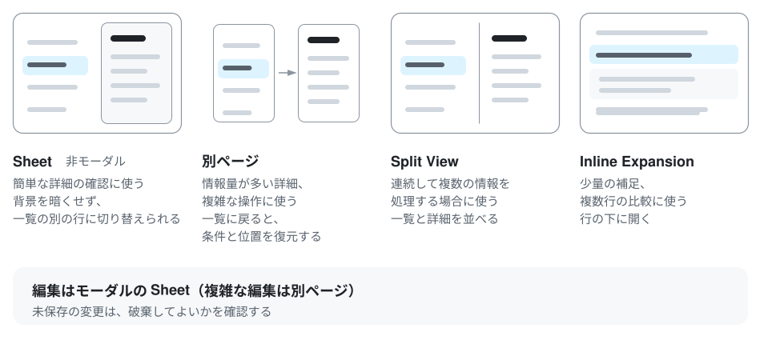
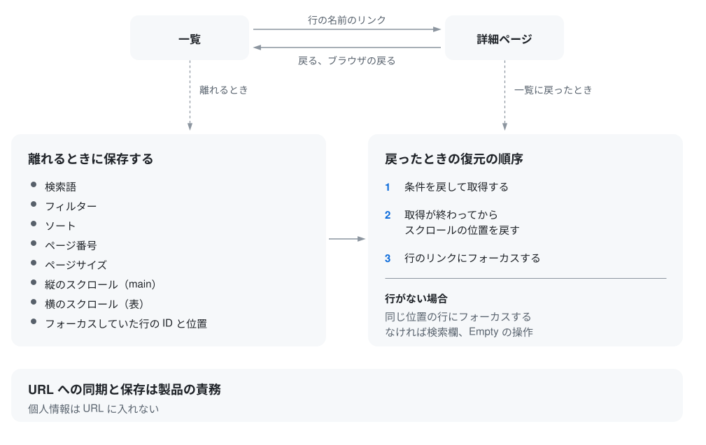

# List & Detail

一覧から詳細を確かめ、必要な操作へ進み、一覧に戻る。

状態：v0.1 確定候補（最終レビュー前） ・ 実装：[`registry/patterns/list-detail.ts`](../../../registry/patterns/list-detail.ts)、[`registry/patterns/table-scroll-area.tsx`](../../../registry/patterns/table-scroll-area.tsx) ・ 全体：[Data Browsing](data-browsing.md)

## 目的

利用者が、一覧の中の位置を失わずに詳細を確かめ、次の対象へ進めるようにする（原則 03、07）。詳細の表示方式は、情報の量と作業の流れから選ぶ。すべてを Sheet や別ページに統一しない（原則 02）。

## 使用条件

一覧の行に、一覧に表示しきれない情報や、行に対する操作がある場合に使う。

## 構成

<picture>
  <source media="(prefers-color-scheme: dark)" srcset="../../diagrams/list-detail-modes-dark.svg">
  
</picture>

| 表示方式 | 使う場面 | 部品 |
| --- | --- | --- |
| Sheet（非モーダル） | 簡単な詳細の確認 | `Sheet mode="view"` |
| 別ページ | 情報量が多い詳細、複雑な操作、URL で共有する必要がある場合 | ルーター（製品）、`PageLayout`、`PageHeader`、`Section` |
| Split View | 連続して複数の情報を処理する（問い合わせの対応など） | `PageColumns` か、製品の 2 列の配置 |
| Inline Expansion | 少量の補足、複数の行の比較（請求の明細など） | Table の行の下に、補足の行を開く（`aria-expanded`） |
| 編集 | 原則としてモーダルの Sheet。複雑な編集は別ページ | `Sheet mode="edit"`、`unsavedChanges`、`onDiscardRequest` |

## 判断基準

### 一覧から詳細を開く

- 行全体を押せる範囲にすることを標準とする（`DataTable` の `onRowOpen`）。
- 次の操作は、詳細の表示から独立させる。`DataTable` は、行の中の操作要素（`a[href]`、`button`、`[role=checkbox]` など）、`data-row-click-ignore` を付けた要素、文字の選択、Portal の中のクリックを、行のクリックとして扱わない。
  - Checkbox による選択
  - Dropdown Menu による行の操作
  - 電話番号や URL などのリンク
  - 文字の選択とコピー
  - インラインの編集
- キーボードで詳細を開く手段として、行の主要な列（会社名など）に `DataTableRowTrigger` を置く。
- ネイティブの Table のセマンティクス（`table`、`th`、`td`、`aria-sort`）を保つ。行に `role="button"` などを付けない。

### Sheet

閲覧のとき：

- 非モーダル。背景を暗くしない（`Sheet mode="view"`）。
- 一覧から別の行を選ぶと、Sheet を閉じずに詳細が切り替わる。
- 詳細を表示している行（`activeRowId`：先頭のセルの 2px の線と `aria-current`）と、一括操作の選択（面の色）を分ける。
- Sheet が一覧の右側を覆う場合でも、主要な列（会社名）を左に置いて固定し、別の行に切り替える経路を残す。

編集のとき：

- 原則としてモーダルの Sheet（`Sheet mode="edit"`）。複雑な編集は別ページ。
- 未保存の変更がある場合は、既存の Overlay の破棄の確認を使う（`unsavedChanges` と `onDiscardRequest` で、変更を破棄するかを確かめる Alert Dialog を開く）。
- 保存の成功と失敗を区別する。成功は Sheet を閉じて Toast で知らせる。失敗は Sheet を開いたまま、Sheet の中の Alert（`role="alert"`）で示し、入力を残す。
- ページの移動を含む、未保存の変更の包括的な管理は Forms & Workflows で扱う。

### 連続した詳細の確認

- 前後の移動は、必要な場合だけ置く。
- 前後は、現在のフィルターとソートの順に従う（`getRecordNeighbors` に、表示中の一覧の ID の順を渡す）。
- データがない方向の移動は無効にする。
- サーバー側のページ送りで、表示中のページの外の前後がわからない場合は、移動できるものとして扱わない（`getRecordNeighbors` は `null` を返す）。製品がページをまたいで取得できる場合は、製品が次のページを取得してから移動する。
- 位置がわかる場合は「128件中 12件目」のように示す。
- 詳細の再取得中に、別のレコードの情報を、選択中のレコードの情報として表示しない。`useBrowseData` に `keepPreviousData: false` を渡し、レコードを切り替えたら前のレコードの詳細を表示しない。対象を識別する情報（会社名、ID）は、一覧の行から先に示す。

### 詳細の情報の構成

基本の順序：

1. 対象を識別する情報（名前、ID）
2. 現在の状態（契約状況）
3. 判断や操作に必要な情報（担当者、月額、更新日）
4. その他の詳細の情報（連絡先、地域、業種）
5. 使用頻度の低い情報（メモ、履歴）

製品の目的に応じて順序を変えてよい。App Structure の Section Layout（`Section`、`SectionTitle`、`SectionStack`）で区切り、不必要な Card や折りたたみを置かない。Sheet の中の Section は h3（Sheet のタイトルが h2）、別ページの Section は h2 から始める。

### Table の横スクロール

- ページ全体ではなく、Table の領域の中でスクロールする（Table の既定）。
- `TableScrollArea` で囲むと、横に続く情報がある方向にだけ、端に薄い影（`foreground` 9% から透明への 16px の幅のグラデーション）を表示する。
  - スクロールできる方向にだけ表示し、端に着いたら、その方向の影を消す。
  - 横にスクロールしない場合は表示しない。
  - 左端に固定した列（`data-pinned="start"`）がある場合、左の影は固定した列の右端に表示する。
  - ネイティブのスクロールバーは隠さない。影はスクロールバーに重ねない（高さは `clientHeight`）。
  - 影は `pointer-events: none` と `aria-hidden` の装飾で、クリック、文字の選択、フォーカスを妨げない。
  - 内容の幅（列の表示・非表示、列の幅、行の差し替え）と、領域の幅（Sidebar の開閉、画面の幅）の変化に追従する（ResizeObserver と MutationObserver）。
- Table と DataTable は変更していない。`TableScrollArea` が、中の `data-slot="table-container"` を探して測る。
- 表ではない、横に並ぶ内容（Kanban の列など）には `HorizontalScrollArea` を使う。自身がスクロールの領域になり、同じ規則で影を示す（[view-switching.md](view-switching.md#レスポンシブ)）。

### 固定列

- 主要な列の固定（`columnPinning`）は、識別する情報（会社名など）を、スクロールの間も続けて参照する必要がある場合だけ使う。
- 固定した列で、残りの情報が見えなくならないようにする。狭い画面では、固定する列の幅を小さくするか、優先度の低い列を初めから隠す（隠した情報は詳細で確認できるようにする）。

### 一覧への復帰

<picture>
  <source media="(prefers-color-scheme: dark)" srcset="../../diagrams/list-return-dark.svg">
  
</picture>

復元する状態：

- 検索語、フィルター、ソート、ページ番号とページサイズ（`useBrowseQuery` の `initialQuery`）
- 縦のスクロールの位置（`AppShellMain`）と、横のスクロールの位置（Table の領域）
- 適切なフォーカス（詳細を開いた行の、フォーカスできる要素）

手順：

1. 離れる直前に `captureListPosition({ scrollElement, root, rowId })` で位置を記録し、条件とともに製品が保存する。
2. 戻ったときは、`AppShellMain` に `scrollOnNavigate={false}` と `focusOnNavigate={false}` を渡し、既定の「先頭へ戻す」と「h1 へフォーカス」を止める。
3. `useListPositionRestore({ position, ready, root, scrollElement, fallbackFocus })` が、データの表示が終わった後（`ready`）に 1 回だけ、スクロールの位置とフォーカスを戻す。
4. 対象の行がなくなった場合は、同じ位置の行（なければ最後の行）、行がない場合は `fallbackFocus`（検索欄、Empty の操作など）にフォーカスを移す。フォーカスした要素が表示範囲の外にある場合だけ、近くまでスクロールする。

ブラウザの戻る・進むに対応する構成（検証画面の例）：

- 一覧の履歴の項目に、`history.replaceState` でキー（`fdListKey`）を付け、そのキーで一覧の記録を保存する。
- 詳細を開くときは、記録を保存してから詳細へ移動し、詳細の履歴の項目に戻り先（`fdFromList`）を記録する。
- 詳細の Breadcrumb の「顧客」は、一覧から開いた場合は `history.back()` で戻る（ブラウザの戻ると同じ）。直接開いた場合は一覧へ移動する。
- 実際のルーターへの接続と、記録の永続化（セッションのストレージなど）は製品の責務である。

## 状態管理

| 状態 | 持つ場所 |
| --- | --- |
| 詳細を表示中の行 | 製品（`openId`）。`DataTable` の `activeRowId` に渡す。一括操作の選択とは別。スコープ（ワークスペース）と組で持ち、別のスコープに切り替えた描画から、前の行の詳細を開かない（検証画面は `{ workspace, id }` で持つ） |
| 詳細のデータ | `useBrowseData`（`keepPreviousData: false`、`enabled: openId !== null`、`scopeKey`） |
| 前後の移動 | `getRecordNeighbors({ ids, activeId, offset, total })` |
| 一覧の位置 | `captureListPosition` の値（`ListPosition`）を製品が保存する |
| 行に依存する操作の可否 | 一覧の `useBrowseData` の `canOperate`。再取得中と、同じ条件の再取得の失敗の間は、行の操作（Dropdown Menu）と選択を受け付けない（`DataTable` の `locked={!canOperate}`、行の中では `useDataTableStatus().locked`）。行の閲覧（詳細を開く）は受け付ける |

一覧への復帰の時期（`ready`）には、`isCurrent`（現在の条件の結果を表示できる）を使う。保持していたデータで先に表示し、取得し直した結果（行の削除などを反映した結果）が届いてから復元する。操作の可否には `canOperate` を使う（[data-browsing.md](data-browsing.md#データの表示と操作の可否)）。

## レスポンシブ

- 狭い画面では、詳細の閲覧は全画面の Sheet（`SheetContent` は画面の幅になる）か別ページにする。
- 少量の補足は、Drawer を許容する。
- 編集では、ソフトウェアキーボード、Safe Area、スクロールを考慮する（`SheetBody` だけがスクロールし、`SheetFooter` は Safe Area の分の余白を持つ）。
- 狭い画面では、前後の移動のボタンの文字を支援技術だけに残し、アイコンで示す。
- Split View は、領域が狭い場合に一覧と詳細を縦に並べる（Container Query）。

## アクセシビリティ

- キーボードでは、`DataTableRowTrigger`（`aria-haspopup="dialog"`、`aria-expanded`）で詳細を開く。
- 詳細を表示中の行は `aria-current="true"`。
- 閲覧の Sheet を閉じた後は、開いた行のボタンにフォーカスを戻す（`SheetContent` の `finalFocus`）。
- Inline Expansion の開閉のボタンは `aria-expanded` と `aria-controls` を持つ。
- 詳細の読み込み中の領域に `aria-busy` を付ける。

## 実装例

```tsx
const [openId, setOpenId] = useState<string | null>(null)
const detail = useBrowseData({
  query: openId,
  fetcher: (id, { signal }) => api.getCustomer(id!, { signal }),
  keepPreviousData: false, // 別のレコードの詳細を、現在のレコードとして表示しない
  enabled: openId !== null,
  scopeKey: workspaceId,
})
const neighbors = getRecordNeighbors({ ids: rows.map((r) => r.id), activeId: openId, offset: page.offset, total })

<TableScrollArea>
  <DataTable table={table} onRowOpen={(row) => setOpenId(row.id)} activeRowId={openId} locked={!data.canOperate} … />
</TableScrollArea>
<Sheet mode="view" open={openId !== null} onOpenChange={(open) => !open && setOpenId(null)}>
  <SheetContent finalFocus={() => rowTrigger() ?? true}>…</SheetContent>
</Sheet>
```

```tsx
// 一覧に戻ったとき
const { mainRef } = useAppShell()
useListPositionRestore({
  position: saved?.position ?? null,
  ready: data.isCurrent,
  root: listRef,
  scrollElement: mainRef,
  fallbackFocus: () => searchRef.current,
})
```

プレビュー：`#/list-detail`、`#/browsing-app?page=customers`（別ページの詳細と一覧への復帰）。

## アンチパターン

| 避ける | 理由 | 代わりに |
| --- | --- | --- |
| すべての詳細を Sheet、またはすべてを別ページにする | 情報の量と作業の流れに合わない | 表示方式を使い分ける |
| 閲覧の Sheet で背景を暗くする | 連続した確認のたびに閉じて開き直す | 非モーダルの Sheet |
| 行の右端の小さな「詳細」のリンクだけで開く | 押せる範囲が小さい | 行全体を押せる範囲にする |
| 行の中のボタン、リンク、Checkbox を押すと詳細も開く | 意図しない操作 | `DataTable` の行のクリックの判定に任せる |
| 行に `role="button"` を付けて Table のセマンティクスを壊す | 表の構造が伝わらない | `DataTableRowTrigger` |
| 詳細の再取得中に、前のレコードの情報を表示する | 別のレコードを現在のレコードと誤認する | `keepPreviousData: false` |
| ページの外の前後がわからないのに、前後の移動を有効にする | 移動先が存在しない | 無効にする |
| 一覧に戻ると先頭に戻り、条件が消える | 探し直す必要がある | 条件、位置、フォーカスを復元する |
| 詳細の情報を Card や折りたたみで細かく区切る | 区切りが多く、読む順序がわかりにくい | Section Layout の余白と見出し |
| 横スクロールの手がかりのために、スクロールバーを隠す | スクロールできることが伝わらない | 端の影とネイティブのスクロールバー |
| すべての列を固定する | 残りの情報が見えない | 識別に必要な列だけを固定する |

## 製品側の責務

- 詳細の取得と、レコードが存在しない場合の扱い。
- 別ページへのルーティング、履歴の項目ごとの一覧の記録の保存、ブラウザの戻る・進むとの接続。
- 編集の保存（API）と、保存の結果の一覧への反映。
- 前後の移動で、ページをまたいで取得するかの判断。
