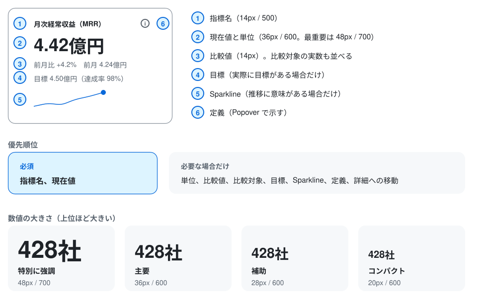
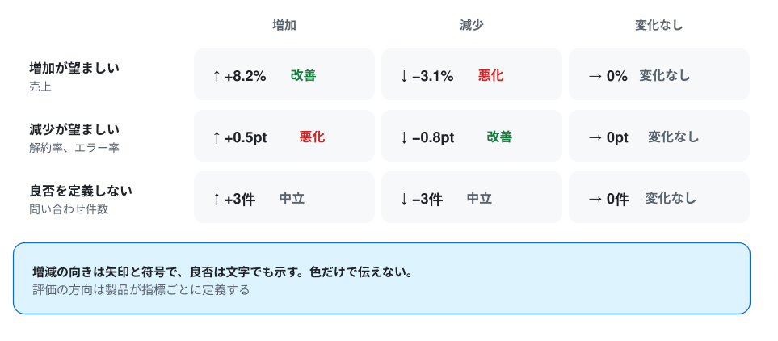

# Metric Overview

現在の状況を、判断に必要な指標の名前と値から伝える。

状態：初期実装（レビュー前） ・ 実装：[`registry/patterns/metric.tsx`](../../../registry/patterns/metric.tsx)、[`metric-format.ts`](../../../registry/patterns/metric-format.ts)、[`comparison.ts`](../../../registry/patterns/comparison.ts) ・ 全体：[Data Analysis](data-analysis.md)

## 目的

利用者が、画面を開いてすぐに「現在の状況はどうなっているか」を、考えなくても理解できるようにする（原則 01）。すべての指標を同じ重要度で並べず、判断に必要な指標を大きく、先に示す（基準 04）。数値の意味を誤認させない（原則 08）。

## 使用条件

ダッシュボードやレポートの最初の領域（Overview）に置く。指標が 1 つだけの場合や、詳しいグラフがすぐ下にある場合は、グラフの見出しと数値で足りることがある。

- 主要な指標は 3〜5 個を目安にする。固定の上限ではない。
- 補助の指標は、関連する分析の領域（内訳、収益性など）に置く。
- 比較値、目標、推移、定義、詳細への移動は、意味がある場合だけ加える。すべての指標に機械的に付けない。

## 構成

<picture>
  <source media="(prefers-color-scheme: dark)" srcset="../../diagrams/metric-anatomy-dark.svg">
  
</picture>

| 部分 | 部品 | 内容 |
| --- | --- | --- |
| 指標の並び | `MetricGroup` | `dl`。Card で囲まず、余白（列の間 48px、行の間 40px）と文字の強弱で区切る。幅が足りない場合は折り返す（横にスクロールしない） |
| 指標 | `Metric` | 名前（`dt`）と値（`dd`）。`size` で重要度を表す |
| 値 | `MetricValue` | 数値と単位。単位は数値より小さくする。取得中、取得できない、値がない、算出できない値を区別する |
| 比較値 | `ComparisonValue` | 比較の名前（前月比）、増減、比較の対象の値（前月 4,240万円） |
| 目標 | `MetricTarget` | 目標に対する割合と Progress。期間の経過は別の文 |
| 推移 | `Sparkline` | 推移の要約（読み上げ）と、装飾の折れ線 |
| 定義 | `MetricDefinition` | 押すと開く Popover。集計方法と省略前の値 |
| 詳細への移動 | `DrillDownLink`（[drill-down.md](drill-down.md)） | 実際の詳細がある場合だけ |

### 文字の大きさ

既存のトークンを使い、新しいトークンを追加しない。数値には `tabular-nums` を付ける。

| 用途 | 大きさ | `Metric` の `size` | トークン |
| --- | --- | --- | --- |
| 特に強調する指標 | 48px / 700 | `hero` | `text-display` |
| 主要な指標 | 36px / 600 | `primary`（既定） | `text-metric` |
| 補助の指標 | 28px / 600 | `secondary` | `text-page-title` |
| コンパクトな指標 | 20px / 600 | `compact` | `text-heading` |
| 指標名 | 14px / 500 | | `text-ui font-medium` |
| 比較値 | 14px | | `text-ui` |
| 補足 | 12px | | `text-caption` |

単位は数値より 1 段小さくする（`hero` の単位は 28px、`primary` と `secondary` は 20px、`compact` は 14px / 600）。長い単位でも数値の読み取りを妨げない。数値は `overflow-wrap: anywhere` で、領域の幅を超えない。

## バリエーション

| 種類 | 使う場面 |
| --- | --- |
| 余白と文字の強弱だけ（既定） | ほとんどの場合 |
| 特に強調する 1 つ＋主要な指標 | 判断の中心となる指標が明確な場合（MRR、売上）。`hero` を `col-span-full` で 1 行に置く |
| Card で囲む | 指標が独立したグラフや操作を持ち、囲むことで操作の範囲が明確になる場合だけ。Card を入れ子にしない |

## 動作

### 数値の表記（`formatMetricValue`）

計算に使う値（number）と、表示用の文字（`FormattedValue`）を分ける。丸めた文字から増減率を計算しない。

| 値 | 指定 | 表示 | 省略前の値（`exactText`） |
| --- | --- | --- | --- |
| 36,800,000 | `{ unit: "円" }` | 3,680万円 | （同じ） |
| 441,600,000 | `{ unit: "円" }` | 約4.42億円 | 441,600,000円 |
| 5,120,374 | `{ unit: "件" }` | 約512万件 | 5,120,374件 |
| 0.032 | `{ style: "ratio" }` | 3.2% | （同じ） |
| 428 | `{ unit: "社" }` | 428社 | （同じ） |
| 441,600,000 | `{ style: "currency", currency: "USD", locale: "en-US" }` | ~$442M | $441,600,000 |

- 既定の `notation: "auto"` は、絶対値が `compactFrom`（既定 1,000,000）以上のときだけ省略表記にする。有効数字は 3 桁（`significantDigits`）。
- 省略で値が変わる場合だけ「約」（`approximateLabel`、ja 以外は「~」）を付ける。
- 割合（`style: "ratio"`）の値は、常に 0〜1 で受け取る。0〜100 の値を渡さない。
- マイナスは表示用のマイナス記号（−、U+2212）にする。
- 0 でない値が丸めて 0 になる場合は「0.1%未満」のように示し、実際の 0 と区別する。正確な値（`exactText`）は有効数字 15 桁までにし、浮動小数点の誤差（30.000000000000004%）を示さない。
- NaN、Infinity、null、undefined は `null` を返す。`MetricValue` は「算出できません」「データなし」などの文字にする。
- ロケール、通貨、単位、桁数、省略の閾値は製品が指定する。
- 同じ表の同じ列では、省略表記と通常の表記を混在させない（プレビューの `ComparisonTable` の `notation`）。

### 増減と良否（`compareValues`、`describeComparison`、`ComparisonValue`）

<picture>
  <source media="(prefers-color-scheme: dark)" srcset="../../diagrams/change-evaluation-dark.svg">
  
</picture>

- 増減の向き（`change`）と、業務上の評価（`evaluation`）を分ける。評価の方向（`direction`：`increase`、`decrease`、`neutral`）は製品が指標ごとに定義する。
- 向きは矢印（↗ ↘ →）と符号、評価は色（`success`、`destructive`、`muted-foreground`）で示す。色だけで伝えない。
- 減少が望ましい指標は、向きと評価が逆になるため、評価の文字（「改善」「悪化」）も表示する（`evaluationLabel="auto"`）。読み上げには常に向きと評価を含める（「+7.0%（増加、改善）」）。
- 変化がない場合は「変化なし」と示す。丸めると 0 になるが実際は 0 でない差は「+0.1pt未満」と示す。
- 比較値は Period Comparison と同じ関数で計算し、表示する（[period-comparison.md](period-comparison.md)）。

### 目標（`getTargetProgress`、`MetricTarget`）

- 実際に目標がある場合だけ示す。
- 達成率（現在値 ÷ 目標値）は 100% を超えてもそのまま示す（111.9%）。Progress の表示の範囲（0〜100）とは区別し、Progress の読み上げの値（`aria-valuetext`）にも実際の割合を入れる。
- 期間の経過（「期間の経過 25 / 30日（83.3%）」）は、達成率とは別の文で示す。
- 目標に届かないことだけを理由に Destructive にしない。Progress は既定の色のまま。
- 減少が望ましい指標（`direction: "decrease"`）は上限の目標として示す。割合の割合（「上限 1.5% に対して 42.6%」）を示さず、現在値と上限を同じ単位の差で示す（「月の上限 1.5%まで あと 0.9pt」「月の上限 1.5%を 0.3pt 超過」）。
- 途中の期間の値を期間の全体の目標と比べる場合（今月の解約率と月の上限など）は、期間の経過を必ず併記する。月の初めほど、目標から遠く、上限の内に見えるため。
- 目標と期間の経過は、期間が暦の単位（月、四半期、年度）と一致する場合だけ示す。9/1〜11/25 のように単位と一致しない期間では、どの目標と比べるかが決まらないため示さない（`fullPeriodOf` が `null`）。
- 目標値が 0、マイナス、欠損の場合は割合を算出せず、理由を示す。

### Sparkline

- 推移を把握する価値がある場合だけ使う。固定の値、データ点が足りない場合（値のある点が `minPoints` 未満、既定 4）、同じ内容の詳しいグラフが直下にある場合、推移が判断に関係しない場合は使わない（部品は点が足りない場合に何も描かない）。
- 欠損（null）は 0 として描かず、線を途切れさせる。
- 正確な比較が必要な場合は、通常のグラフ（Chart）を使う。

### 指標の定義

- MRR、解約率など、定義によって結果が変わる指標は、`MetricDefinition`（押すと開く Popover）で集計方法を示す。
- 省略表記の指標は、`MetricDefinition` の `exact` に正確な値を渡し、キーボードとタッチでも確かめられるようにする（`MetricValue` の `title` はホバーの補助であり、それだけに頼らない）。
- 判断に必要な情報を、ホバーだけの Tooltip に置かない。

### 詳細への移動

- 実際の詳細があり、移動に価値がある場合だけ `action` に `DrillDownLink` を渡す。
- 指標の全体をリンクにしない。閲覧だけの指標を押せるように見せない。

### データの状態

[Data States](data-states.md) を適用する。

| 状態 | `value` | 表示 |
| --- | --- | --- |
| 正常 | `{ status: "ready", value: 384000 }` | 384,000円 |
| 実際の 0 | `{ status: "ready", value: 0 }` | 0円 |
| 欠損 | `{ status: "ready", value: null }` | データなし（`emptyLabel`） |
| 初回の読み込み | `{ status: "loading" }` | 数値と同じ高さの Skeleton、`aria-busy` |
| 再取得中 | 前の値 | 領域（`AnalysisRegion`）を薄くし「更新中」 |
| 取得失敗 | `{ status: "unavailable" }` | 取得できません |
| 古いデータ | 前の値と `status={{ kind: "stale", text: "14:32 の時点の値" }}` | 値と時刻 |
| 未確定 | 値と `status={{ kind: "provisional", text: "途中経過" }}` | 値と「途中経過」 |
| 算出できない値 | `{ status: "ready", value: NaN }` | 算出できません |

- 取得できない値、値がない値、算出できない値は、数値と同じ大きさで強調しない。行の高さは数値と同じにし、読み込みの前後と状態の変化でレイアウトを保つ。

### モバイル

- 重要度の順を保ったまま、1 列に並べ直す（`MetricGroup` の最小の幅で折り返す）。
- 原則として、指標の横スクロールやカルーセルを使わない。
- 画面の幅だけを理由に、重要な指標を削らない。

## アンチパターン

| 避ける | 理由 | 代わりに |
| --- | --- | --- |
| すべての指標を同じ大きさの Card に入れる | 重要度がわからない。区切りの手段が重なる | 余白と文字の大きさ |
| すべての指標に比較値、アイコン、グラフ、Tooltip を付ける | 意味のない要素が増える | 意味がある場合だけ |
| 何と比べたかを示さない比較値（+2.1%） | 判断を誤る | 「前月比」と比較の対象の値 |
| 増減の向きで自動的に Success・Destructive を決める | 解約率の減少が赤になる | 評価の方向を指標ごとに定義する |
| 色だけで良否を示す | 色の見分けにくい人に伝わらない | 矢印、符号、評価の文字 |
| 丸めた値から増減率を計算する | 実際と異なる値になる | 丸める前の値で計算する |
| 取得できない値を 0 と表示する | 0 だったと誤認する | 「取得できません」 |
| 過剰な小数（3.21547%） | ない精度を示す | 判断に必要な桁 |
| 目標の達成率を 100% で止める | 超過がわからない | 実際の割合と、表示の範囲を区別 |
| 目標の未達を Destructive にする | 途中の期間でも失敗に見える | 既定の色と、期間の経過 |
| 欠損を 0 として Sparkline を描く | 急な落ち込みに見える | 線を途切れさせる |
| 閲覧だけの指標を押せるように見せる | 押しても何も起きない | 詳細がある場合だけリンク |

## 状態管理

`Metric` は状態を持たない。値（`Loadable<number>`）は、製品のデータ取得（`useBrowseData` など）の状態から作る。

```tsx
const value = (status, v) => (status === "loading" ? { status: "loading" } : status === "error" ? { status: "unavailable" } : { status: "ready", value: v ?? null })
```

比較に必要な値（現在値と基準値）は、同じ要求で取得し、集計の時点をそろえる（[dashboard-layout.md](dashboard-layout.md)）。

## アクセシビリティ

| 対象 | 指定 |
| --- | --- |
| 指標の並び | `dl`、`dt`（名前）、`dd`（値と補足） |
| 値 | `data` 要素（`value` に計算の値）。読み上げは画面の文字と同じ（「約4.42億円」） |
| 比較値 | 支援技術向けの文で、向きと評価を読み上げる（「（増加、改善）」） |
| 目標 | Progress の `aria-valuetext` に実際の割合と状態（「目標 9,710万円 に対して 111.9%、目標を超えています」）。上限は「月の上限 1.5% まで、あと 0.9pt」 |
| Sparkline | 折れ線は `aria-hidden`。推移の要約を支援技術向けの文で示す |
| 読み込み中 | 指標に `aria-busy`。Skeleton は `aria-hidden` |
| 定義 | ボタンの名前は「MRRの定義」。Popover は Esc で閉じ、ボタンにフォーカスを戻す |
| 動きを減らす設定 | Skeleton の明滅を止める（`motion-safe:`） |

## データの正確性

- 時点の指標（MRR、契約企業数）は、いつの時点の値か（「2026/11/25時点」）と、比較の基準の時点を示す。
- 途中の期間の累積の指標（売上）は「途中経過」と示し、同じ経過の期間と比べる（[period-comparison.md](period-comparison.md)）。
- 割合の内部の値は 0〜1 に統一する。
- 表示の値と計算の値を分ける（`formatMetricValue` は文字だけを返す）。

## 製品側の責務

- 指標の定義と集計（MRR、解約率の分母など）。
- 評価の方向（`direction`）、目標値、ロケール、通貨、単位、桁数。
- データの取得、古いデータや未確定の判定。
- 詳細の画面の有無と URL。

## 実装例

```tsx
<MetricGroup>
  <Metric
    className="col-span-full"
    size="hero"
    label="MRR（月額の契約金額）"
    value={{ status: "ready", value: mrr }}
    format={{ style: "currency", unit: "円" }}
    status={{ kind: "partial", text: "2026/11/25時点" }}
    definition={<MetricDefinition label="MRR">その日に有効な契約の月額の合計（税抜き）。</MetricDefinition>}
    comparison={
      <ComparisonValue
        result={compareValues({ current: { status: "ready", value: mrr }, baseline: { status: "ready", value: mrrLastMonth } })}
        label="前月比"
        baseline={`2026/10/25時点 ${formatMetricValue(mrrLastMonth, { unit: "円" })?.text}`}
        direction="increase"
        format={{ unit: "円" }}
      />
    }
    sparkline={<Sparkline data={last12Months} label="過去 12 か月で 8,430万円から 1.01億円に増加" />}
  />
  <Metric
    label="解約率"
    value={{ status: "ready", value: 0.006 }}
    format={{ style: "ratio", maximumFractionDigits: 1, minimumFractionDigits: 1 }}
    comparison={<ComparisonValue result={churnComparison} label="前月比" direction="decrease" kind="ratio" format={ratioFormat} />}
    target={<MetricTarget value={0.006} target={0.015} direction="decrease" format={ratioFormat} label="月の上限" />}
    action={<DrillDownLink origin="metric-churn" href="#/analysis-app?page=retention">解約の内訳を見る</DrillDownLink>}
  />
</MetricGroup>
```

プレビュー：`#/metric-overview`、`#/analysis-app?page=business`。
