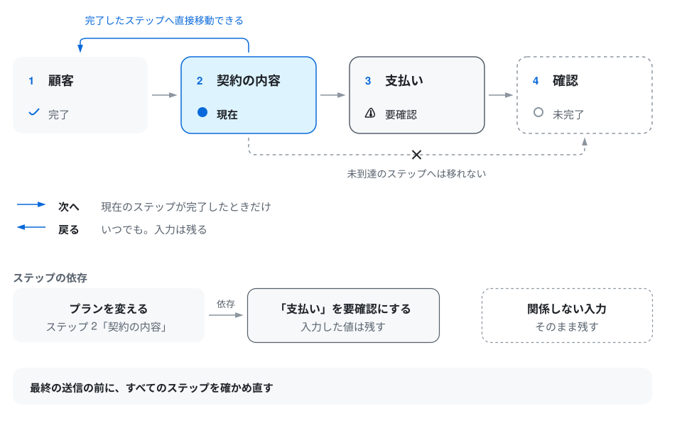
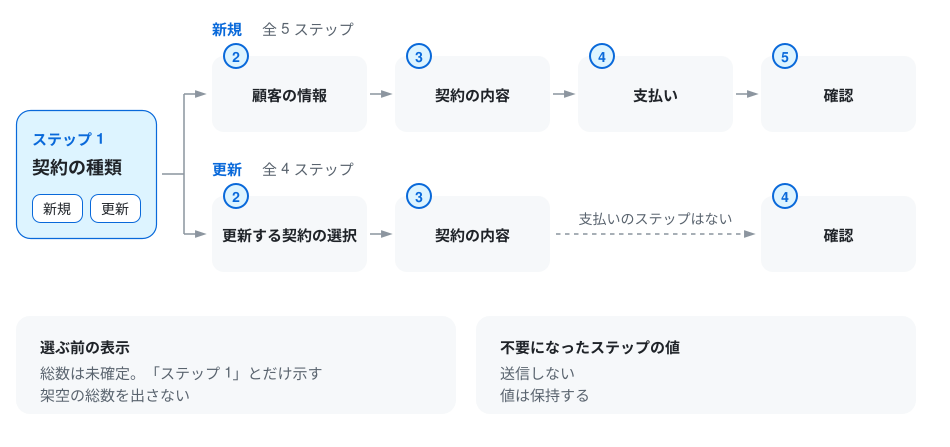

# Multi-step Workflow

異なる判断や処理を順に行う作業を、複数のステップに分ける。

状態：v0.1 確定候補（設計と実装の方針は承認済み。Patterns Integration Review の前） ・ 実装：[`registry/patterns/step-flow.ts`](../../../registry/patterns/step-flow.ts)、[`registry/patterns/stepper.tsx`](../../../registry/patterns/stepper.tsx) ・ 全体：[Forms & Workflows](forms-and-workflows.md)

## 目的

1 度に考えることを、意味のある作業の単位に分ける（原則 01、03）。現在地と残りの手順を伝え、入力した内容を、ステップの移動と途中の離脱で失わせない（原則 08）。

## 使用条件

- 単一のページで自然に終わる作業は、分けない。
- 異なる判断や処理を順に行う場合（契約の種類 → 顧客 → 契約の内容 → 支払い → 確認、ファイルの選択 → 対応付け → 検証 → 確認）に、意味のある作業の単位で分ける。
- 項目が多いことだけを理由に、ステップにしない（[form-layout.md](form-layout.md) のまとまりで分ける）。
- 汎用の業務のワークフローの仕組みは作らない。ステップの構成と各ステップの内容は、製品のコードに書く。

## 構成

| 部分 | 部品 | 仕様 |
| --- | --- | --- |
| ステップの状態 | `useStepFlow({ steps, isComplete, stepsKnown, initial })` | 現在地、到達したステップ、完了したステップ。入力の値は持たない |
| 入力の値と検証 | `useFormState`（[create-and-edit.md](create-and-edit.md)） | すべてのステップの値を 1 つのフォームで持つ。ステップごとの完了は、そのステップの項目の `blockers` で判断する |
| 現在地の表示 | `Stepper`（`items`、`total`、`onSelect`、`layout`、`currentLabel`） | 上部の横型が標準。簡易の表示の現在のステップの名前は `currentLabel` で決める |
| ステップの見出し | h2 に `flow.headingRef` | 移動の後にフォーカスを移す |
| 操作ボタン | `FormActions` | 次へ（Primary）、戻る（Secondary）、キャンセル（Ghost）、下書きを保存（Secondary、必要な場合だけ）、最終の確定（Primary、具体的な操作の名前） |
| 次へ進めない理由 | `SaveBlockerNotice`（`goal="次へ進めます"`、確認のステップは `"登録できます"`） | 現在のステップの項目の理由だけ |
| 最終の確認 | 製品の閲覧の表示（`dl`）と「変更」のボタン | まとまりごとに入力のステップへ戻る |

<picture>
  <source media="(prefers-color-scheme: dark)" srcset="../../diagrams/step-navigation-dark.svg">
  
</picture>

## バリエーション

### Stepper の形

| `layout` | 形 | 用途 |
| --- | --- | --- |
| `horizontal` | 上部の横型。印（完了はチェック、要確認は警告の形、ほかは番号）とステップの名前 | 標準 |
| `vertical` | 縦型 | ステップが多い、横に余裕がある |
| `compact` | 「ステップ 2 / 4」と現在のステップの名前（`currentLabel="hidden"` では番号と総数だけ）、「すべての手順」で一覧を開く | 狭い画面 |
| `auto`（既定） | 置かれた領域の幅が 36rem 以上（`@xl/stepper`）で横型、狭ければ簡易表示 | 画面の幅が変わる場合 |

- Stepper は Tabs ではない。ステップは順序を持ち、未到達のステップへは移れない。Progress Bar でもない。ステップの数の割合を、処理の進捗率として扱わない。
- 簡易表示でも、完了したステップへの直接の移動を削らない（一覧を開いて選ぶ。選ぶと一覧を閉じる）。

### Stepper と見出し

| `currentLabel` | 簡易の表示（`compact`、`auto` の狭い領域）の内容 | 使う場合 |
| --- | --- | --- |
| `"visible"`（既定） | ステップの番号と総数、現在のステップの名前、「すべての手順」 | Stepper をステップの見出しと離して置く場合、Stepper の近くにステップの名前の見出しがない場合 |
| `"hidden"` | 見た目：ステップの番号と総数（総数が決まっていない場合は番号だけ）、「すべての手順」。支援技術：番号の後に「（現在のステップ：顧客）」 | Stepper の直後に、同じステップの名前の見出し（h2）が続く場合だけ |

- `"hidden"` にしても、総数が決まっていない場合に架空の総数を示さない（「ステップ 1」）。
- 横型と縦型の表示は、`currentLabel` で変わらない（ステップの名前を並べる）。
- 現在地（`aria-current="step"`）と、移動の後のステップの見出しへのフォーカスは、どちらの値でも変わらない。
- 簡易の表示で一覧を閉じている間は、`aria-current="step"` の要素も隠れる（`hidden`）。`"hidden"` でも、現在のステップの名前を支援技術に伝えるため、番号の後に `sr-only` で「（現在のステップ：{名前}）」を置く（`"visible"` では、見えている名前の後に「（現在のステップ）」を置く）。v0.1 の途中では、`"hidden"` の簡易の表示で、支援技術から現在のステップの名前を確かめられなかった（一覧を開くまで）。見た目は変えていない。検品：「unknown total before the branch; next disabled until complete; heading focus after moving」（モバイル）。
- 例の契約の登録と取り込みは `"hidden"` を使う（狭い領域では「ステップ 2 / 5」と「すべての手順」の下に、見出し「顧客」が続く）。初期実装のレビューで、簡易の Stepper の現在のステップの名前と、ステップの見出しが続けて表示されることを指摘され、v0.1 で `currentLabel` を追加した。

### 分岐

<picture>
  <source media="(prefers-color-scheme: dark)" srcset="../../diagrams/workflow-branching-dark.svg">
  
</picture>

- `steps` には、現在の条件で必要なステップだけを渡す。不要なステップは省く。
- 分岐で総数が決まらない間は `stepsKnown={false}` にする。`total` が null になり、Stepper は総数を示さず（簡易表示は「ステップ 1」）、「この後の手順は、選んだ内容で決まります」と示す。架空の総数や進捗率を示さない。
- 不要になったステップの項目は、`useFormState` の `active` で送信と検証から除く。値は残す（条件を戻したときに再び使う）。

## 動作

### ステップの移動

| 操作 | 規則 | 関数 |
| --- | --- | --- |
| 次へ | 現在のステップの必須の項目と検証が完了している場合だけ押せる | `canNext`、`next()` |
| 戻る | 入力の妥当性に関係なく戻れる。入力は残る | `back()` |
| 完了したステップ | Stepper から直接移れる | `goTo(id)`、`items[].reachable` |
| 未到達のステップ | 直接移れない。到達したことがあっても、手前に完了していないステップがあれば移れない | `canGoTo(id)` |
| 最終の送信 | すべてのステップを確かめ直す。完了していないステップがあれば、そのステップへ移る | `firstIncomplete()` |

- 直接の移動で、必要な検証や前提条件を飛ばせない。後ろのステップへ移る場合は、通過したステップを完了として記録する（`canGoTo` で完了を確かめている）。
- 移動の後は、ステップの見出しにフォーカスを移す（最初の表示では移さない）。見出しに `tabindex="-1"` を付ける。
- 1 行の入力欄の Enter で次へを求めたが、現在のステップが完了していない場合は、そのステップの項目だけエラーを表示し（`form.reveal(stepFields[current])`）、最初の問題の項目へフォーカスを移す。「次へ」は無効の間 Focusable Disabled（`aria-disabled`）のため、Enter の暗黙の送信が起きない。form の `onKeyDown` で `submitOnEnter` を使う。送信にしない Enter（Select、日付、Textarea など）は [create-and-edit.md](create-and-edit.md#enter-による送信) の規則に従う。

### ステップの状態

| `status` | 意味 | 表示 |
| --- | --- | --- |
| `complete` | 次へで進んだことがあり、今も完了している | チェックの印（Primary の面）。読み上げは「（完了）」 |
| `current` | 表示中 | 太い枠と太字。`aria-current="step"` |
| `needs-review` | 完了していたが、前のステップの変更などで完了していない | 警告の印と「要確認」の文字（warning） |
| `upcoming` | まだ完了していない | 番号の印（muted）。読み上げは「（未完了）」 |

### 入力の値と依存

- 前後のステップへ移っても、入力を残す（値は `useFormState` が持つ）。
- 前のステップの変更で影響を受ける項目だけを、確かめ直す。無関係な入力を一律に消さない。
- 後続のステップが完了でなくなった場合は、完了として扱わない（`needs-review`）。例：契約の内容でエンタープライズを選ぶと、支払いの方法は請求書だけになる。クレジットカードを選んでいた場合は、支払いのステップが要確認になり、「エンタープライズは請求書での支払いだけです。支払い方法を選び直してください」と理由を示す。ほかの入力は残す。
- 値を捨てる必要がある場合は、理由を示す。

### 前のステップの値に依存する非同期の検証

前のステップの値で結果が変わる非同期の検証は、`asyncDeps` で依存する値を渡す（[create-and-edit.md](create-and-edit.md#非同期の検証)）。依存する値が変わると、対象の項目の値が同じでも以前の結果を使わず、確かめ直す。

- 例：契約の登録の利用人数（`seats`）は、プランごとの上限をサーバーで確かめる（ライトは 10 人、スタンダードは 100 人まで）。`asyncDeps: (all) => all.plan` を指定するため、利用人数を 12 人にしたままプランをライトに変えると、確かめ直して「ライト（月額 9,800円）の利用人数は 10 人までです。プランか人数を変えてください」を示し、次へ進めない。スタンダードに変えると、次へ進める（`#/multi-step` の「提供を終えたプランを含む下書きを用意する」から確かめられる）。
- 利用人数を確かめられなかった場合（通信の失敗、応答しない）は、次へ進めない。項目に理由（`asyncMessage("seats")`）と「もう一度確かめる」（`revalidate("seats")`）を示し、操作の近くに「利用人数を確かめられませんでした。確かめ直すと次へ進めます」を示す。
- 確かめられなかった場合（通信の失敗、期限切れ）は、`asyncFailure` の既定（`"block"`）により次へ進めない。

### 条件で現在のステップが不要になった場合

表示中のステップが条件で不要になった場合は、同じ位置のステップへ移る。手前に完了していないステップがあれば、そこへ戻る。

### 最終の確認

- 契約、決済、申請など、内容を確かめる価値がある場合だけ置く。
- 読みやすい閲覧の形（項目名と値の `dl`）で示し、情報を意味のある単位（ステップごと）にまとめる。各まとまりに「変更」のボタン（`aria-label`「契約の内容を変更」など）を置き、該当する入力のステップへ戻れるようにする。
- 最終の確認の後に、同じ内容の確認の Dialog を重ねない。

### 操作ボタン

- 次へは Primary、戻るは Secondary、キャンセルは Ghost などの控えめな表現にする。
- 戻る（前のステップへ）と、ワークフローの全体のキャンセルを分ける。
- 下書きの保存は、必要な場合だけ置く。
- 最終の確定のボタンは、具体的な操作の名前にする（「契約を登録する」）。
- フォームの末尾を基本にし、必要に応じて固定した操作ボタン（`FormActions sticky`）を使う。

### 最終の処理

- 原則として、正式な登録は最後のステップで行う。途中のステップの完了と、正式な登録の完了を分ける（次へで進むことは登録ではない）。
- 本人確認やファイルのアップロードなど、途中で処理を確定する必要がある場合は、そのステップの完了と正式な登録の完了を分けて示し、確定したことを戻る操作で取り消せるように見せない。例：取り込みでは、「内容の確認」のステップで取り込みを実行し、実行中と実行の後は Stepper から別のステップへ移れない（[import-and-export.md](import-and-export.md)）。
- 二重の実行を防ぐ（`handleSubmit`）。最終の処理が失敗したら、入力を残し、原因を示す（「登録できませんでした」の Alert）。確定した失敗（`FormSaveError` の `failed`）だけを、もう一度登録できる状態にする。それ以外の例外は結果が不明として扱い、「登録されたかを確かめられていません」（warning）を示し、再び登録させない（[create-and-edit.md](create-and-edit.md#保存の結果)）。
- 重要な手続きの完了は、専用の完了の表示にしてよい（「契約を登録しました」、契約番号、「続けて契約を登録」「契約の一覧へ」）。完了の見出しにフォーカスを移す。

### 途中の離脱と下書き

- 途中の離脱は [Unsaved Changes](unsaved-changes.md) で確かめる。
- 長いワークフローでは、下書きを用意する。再開のときは、入力、現在のステップ、到達したステップ、完了したステップを戻す（`flow.snapshot()` を保存し、`flow.restore(snapshot)` と `form.reset(values)` で戻す）。
- 再開の時点の権限、選択肢、契約の条件で、到達していたステップの項目を確かめ直す（`form.reveal`）。例：提供を終えたプランを含む下書きを再開すると、「選んでいたプランは提供を終了しました。別のプランを選んでください」を契約の内容のステップ（下書きの現在のステップ）に示し、選び直すまで次へ進めない（`#/multi-step` の「提供を終えたプランを含む下書きを用意する」）。

### モバイル

- 現在のステップの番号と、決まっている場合は総数（「ステップ 2 / 4」）を優先する（簡易表示）。ステップの名前は、直後の見出しが示す場合は Stepper に重ねない（`currentLabel="hidden"`）。
- 必要に応じて、ステップの一覧を開けるようにする（「すべての手順」）。
- 完了したステップへの直接の移動など、必要な操作を削らない。

## アンチパターン

| 避ける | 理由 | 代わりに |
| --- | --- | --- |
| 1 ページで終わる作業をステップに分ける | 移動の操作が増え、全体を見渡せない | 1 ページのフォーム |
| 項目の数だけでステップに分ける | 意味のない区切りになる | 判断や処理の単位で分ける |
| Stepper を Tabs として作る | 検証を飛ばして移動できる | 到達の規則を持つ Stepper |
| ステップの割合を進捗率として示す | 処理の進捗と誤解させる | 進捗率を示さない |
| 分岐の前に架空の総数を示す | 実際の手順と異なる | 総数を示さない（`stepsKnown={false}`） |
| 戻ると入力が消える | 入力をやり直させる | 値をすべてのステップで持つ |
| 未完了の次へを押させてからエラーを示す | 押した結果がない | 完了まで次へを無効にし、理由を示す |
| 前のステップの変更で、後続の入力をすべて消す | 無関係な入力も失われる | 影響を受ける項目だけ確かめ直す |
| 変更で完了でなくなったステップを完了のまま示す | 確かめていない内容で登録される | 要確認 |
| 最終の確認の後に確認の Dialog を重ねる | 同じ確認を 2 回させる | 確定のボタンだけ |
| 戻るとキャンセルを同じ見た目と言葉にする | 全体をやめてしまう | 戻るは Secondary、キャンセルは Ghost |
| 状態を色だけで示す | 色を区別できない利用者に伝わらない | 形と文字（チェック、警告、「要確認」） |
| 狭い画面でステップへの直接の移動を削る | 完了したステップへ戻れない | 簡易表示の一覧 |
| 簡易の Stepper と直後の見出しに、同じステップの名前を続けて示す | 同じ情報を繰り返し、狭い画面で内容が下がる | `currentLabel="hidden"` |
| 前のステップの値に依存する検証の結果を、その値が変わった後も使う | 現在の条件で確かめていない値で登録される | `asyncDeps` |

## 状態管理

| 状態 | 値 | 内容 |
| --- | --- | --- |
| 現在のステップ | `current`、`index` | 不要になった場合は、移動先を描画の中で決める |
| 総数 | `total` | `stepsKnown` が false なら null |
| 各ステップの状態 | `items`（`id`、`label`、`index`、`status`、`reachable`） | Stepper に渡す |
| 先頭・末尾 | `isFirst`、`isLast` | `isLast` は総数が決まっている場合だけ true |
| 次へ進めるか | `canNext` | `isComplete(current)` |
| 保存する値 | `snapshot()` | `{ current, reached, completed }`。現在の `steps` にない id は除く |

- `isComplete(id)` は描画のたびに現在の値で判断する。例では、ステップの項目のいずれかが `form.blockers` に含まれていれば未完了とする。
- `initial` で下書きから始められる。`restore` で状態を置き換える（下書きの再開、最初からやり直す）。
- 入力の値、下書きの保存、最終の送信は `useStepFlow` が持たない。

## アクセシビリティ

- Stepper は `nav`（既定の名前「手順」、`aria-label` で変える）の中の `ol`。現在のステップの `li` に `aria-current="step"` を付ける。
- 状態の名前を文字で伝える（「（完了）」「（現在のステップ）」「（未完了）」は読み上げ用の文字、要確認は見える文字「要確認」）。色だけで区別しない。
- 直接移動できるステップだけをボタンにする。それ以外は文字だけで、押せる形にしない。横型の印のボタンは `tabIndex={-1}` と `aria-hidden` で、支援技術にはラベルのボタンだけを示す（重複させない）。押せる範囲は高さ 40px 以上（`min-h-10`）。
- 簡易表示の「すべての手順」は `aria-expanded` と `aria-controls` を持つ。`currentLabel="visible"` では、現在のステップの名前に読み上げ用の「（現在のステップ）」を添える。`"hidden"` では、現在のステップの名前は直後の見出しで伝える（移動の後に見出しへフォーカスを移す）。
- 移動の後は、ステップの見出しにフォーカスを移し、現在のステップを伝える。
- 次へと確定のボタンは、無効の間も Tab で移れ（`focusableWhenDisabled`）、`aria-describedby` で進めない理由を説明にする。

## 製品側の責務

- ステップの構成と分岐の条件、各ステップの項目と検証の規則。
- 最終の処理の API、冪等性、失敗の原因。
- 途中で処理を確定するステップの設計（本人確認、ファイルのアップロード）。
- 下書きの永続化、保存のキー（アカウント、ワークスペース、画面）、再開の時点の権限と選択肢の確認。

## 実装例

```tsx
type StepId = "type" | "customer" | "renewal" | "terms" | "payment" | "review"
const stepFields: Record<StepId, (keyof ContractValues)[]> = {
  type: ["contractType"], customer: ["customerId"], renewal: ["renewalOf"],
  terms: ["plan", "seats", "start"], payment: ["payment", "billingEmail", "cardHolder"], review: [],
}
const fields: FormFields<ContractValues> = {
  // …
  seats: {
    label: "利用人数",
    required: true,
    validate: (v) => (/^[1-9]\d{0,2}$/.test(v) ? null : "利用人数は 1〜999 の整数で入力してください"),
    validateAsync: (v, all, { signal }) => api.checkSeats(all.plan, v, { signal }), // 上限はプランで決まる
    asyncDeps: (all) => all.plan, // プランを変えると、人数が同じでも確かめ直す
  },
}

const form = useFormState<ContractValues>({ initialValues: emptyContract, fields }) // customerId、payment は active: isNew
const steps = stepsFor(form.values) // 新規：type, customer, terms, payment, review。更新：type, renewal, terms, review。未選択：type
const blocked = new Set(form.blockers.map((b) => b.name))
const flow = useStepFlow<StepId>({
  steps,
  isComplete: (id) => !stepFields[id].some((f) => blocked.has(f)),
  stepsKnown: form.values.contractType !== null,
})
const current = flow.current ?? "type"
const submit = form.handleSubmit((values) => api.submitContract(values), {
  onBlocked: () => { const target = flow.firstIncomplete(); if (target) flow.goTo(target) },
})

// 次へ、または確認のステップでは登録。完了していない場合は、このステップの項目だけエラーを示す
const advance = () => {
  if (current === "review") void submit()
  else if (!flow.next()) form.reveal(stepFields[current])
}

<Stepper items={flow.items} total={flow.total} onSelect={(id) => flow.goTo(id)} currentLabel="hidden" aria-label="契約の登録の手順" />
<form noValidate onSubmit={(e) => { e.preventDefault(); advance() }} onKeyDown={(e) => submitOnEnter(e, advance)}>
  <h2 ref={flow.headingRef} className="text-section outline-none">{steps.find((s) => s.id === current)?.label}</h2>
  …
  <FormActions notice={<SaveBlockerNotice id="contract-notice" blockers={form.blockers.filter((b) => stepFields[current].includes(b.name))} goal={current === "review" ? "登録できます" : "次へ進めます"} />}>
    <Button type="button" variant="ghost" onClick={cancel}>キャンセル</Button>
    <Button type="button" variant="secondary" onClick={saveDraft}>下書きを保存</Button>
    {!flow.isFirst && <Button type="button" variant="secondary" onClick={() => flow.back()}>戻る</Button>}
    {current === "review"
      ? <Button type="submit" loading={form.submitting} disabled={!form.canSubmit} focusableWhenDisabled aria-describedby="contract-notice">契約を登録する</Button>
      : <Button type="submit" disabled={!flow.canNext} focusableWhenDisabled aria-describedby="contract-notice">次へ</Button>}
  </FormActions>
</form>
```

プレビュー：`#/multi-step`、`#/forms-app?page=contract-new`（途中の離脱と下書きからの再開）。
