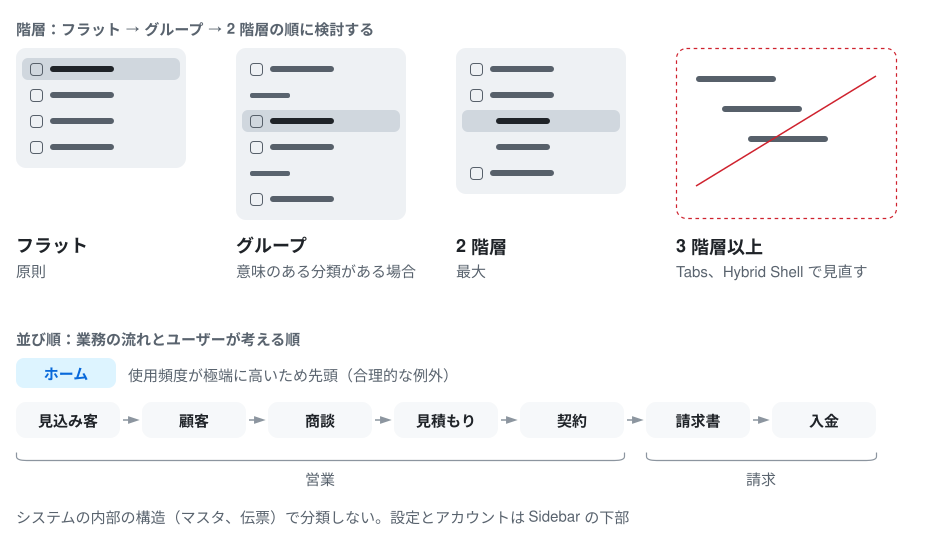

# Navigation

主要な機能への移動。項目を業務の流れの順に並べ、階層は 2 つまでにし、現在地を明確に示す。

状態：v0.1 確定 ・ 実装：[`registry/patterns/sidebar-nav.tsx`](../../../registry/patterns/sidebar-nav.tsx)、[`registry/patterns/bottom-nav.tsx`](../../../registry/patterns/bottom-nav.tsx) ・ 全体：[App Structure](app-structure.md)

## 目的

利用者が、次にする作業の場所を考えずに見つけられるようにする（原則 01、03）。現在地を見失わず、少ない操作で目的の機能へ移動できるようにする（原則 07）。

## 使用条件

| 部品 | 使う場面 |
| --- | --- |
| `SidebarNav` | Sidebar Shell と Hybrid Shell のメインメニュー。モバイルでは Sidebar の Sheet の中にそのまま表示される |
| `SidebarNavItem` | 子の項目を持たない項目を、`SidebarNav` の外（Sidebar の下部の設定など）に置く場合 |
| `SidebarNavParent` | 子の項目を持つ項目を、個別に組み立てる場合（`SidebarNav` の中では自動で使う） |
| `findNavTrail` | 現在地の項目、親、グループを求める（Breadcrumb、モバイルのヘッダーの表示） |
| `BottomNav`、`BottomNavItem` | 一般消費者向けで、主要な機能が 3〜5 個のサービスのモバイル |

## 構成

### 階層と並び順

<picture>
  <source media="(prefers-color-scheme: dark)" srcset="../../diagrams/navigation-order-dark.svg">
  
</picture>

| 階層 | 使う場面 |
| --- | --- |
| フラット | 原則。項目が少ない場合は見出しを付けずに並べる |
| グループ | 意味のある分類（業務の段階など）がある場合。グループの見出し（`label`）は、分類に意味がある場合だけ付ける |
| 2 階層 | 最大。子の項目は文字だけにする |
| 3 階層以上 | 使わない。画面の中の Tabs、Hybrid Shell などで情報の構造を見直す。型（`NavChildItem`）は子の項目を受け付けない |

並び順は、機能の分類ではなく業務の流れとユーザーが考える順にする。使用頻度が極端に高い機能（ホームなど）を先頭に置くなど、合理的な例外は許容する。

### データの形

```ts
type NavGroup = { label?: string; items: NavItem[] }
type NavItem = NavLinkItem | NavParentItem

// 子の項目を持たない項目：href は必須
type NavLinkItem = {
  id: string
  label: string
  icon: ComponentType
  href: string
} & (
  | {}
  | { badge: string; badgeLabel: string }   // badge の表示は視覚だけ。意味（例：進行中 18 件）を説明として支援技術に伝える
)

// 子の項目を持つ親：href を省略すると、親は自身のページを持たない（押すと子を開閉する）
type NavParentItem = {
  id: string
  label: string
  icon: ComponentType
} & (
  | { href: string; pageLabel?: string; children: NavChildItem[] }   // ページを持つ親。子が空なら通常の項目として描画する
  | { href?: undefined; children: [NavChildItem, ...NavChildItem[]] }   // ページを持たない親は、子が 1 つ以上必要
)   // pageLabel はページを持つ親だけ。badge は持たない

type NavChildItem = { id: string; label: string; href: string }   // 3 階層目は持たない
```

型で次を保証する（`preview/tests/sidebar-nav-types.ts` で、誤りを型の検査が検出することを確かめている）。

- 子の項目を持たない項目には `href` が必要。`href="#"` などへの暗黙の置き換えはしない。
- `href` を持たない親は、子の項目が 1 つ以上ある場合だけ書ける（空の配列は型の誤り）。ページを持つ親の子の項目が空の場合は、親のページへの通常の項目として描画する。
- `pageLabel` はページを持つ親だけ、`badge` は子の項目を持たない項目だけに付けられる。`badge` を付ける場合は `badgeLabel` が必須。
- 3 階層目は書けない。

## 設計の判断基準

### 視覚表現

- 主要な項目はアイコン（20px）と文字（14px）を併用する。子の項目は文字だけで、親の文字の位置にそろえる。
- 現在地は、ニュートラルの面（`sidebar-accent`）と文字の太さ 600 で示し、`aria-current="page"` を付ける。ブランドカラーで全面を塗らない。主要な操作（Primary のボタン）と区別できなくなるためである。

### 子の項目を持つ親の現在地

親のページ自体が現在地でない場合は、親に `aria-current="page"` を付けない。状態は `data-nav-current` で取得できる。

| 状態 | 親の表示 | 親の属性 | 子 |
| --- | --- | --- | --- |
| 親のページ自体が現在地 | `sidebar-accent` の面、太さ 600 | `aria-current="page"`、`data-nav-current="page"` | 現在地ではない |
| 子が現在地で、子を表示している | 面なし、文字は `sidebar-accent-foreground`、太さ 500 | `data-nav-current="child-open"`（`aria-current` なし） | 現在地の子に `sidebar-accent` の面、太さ 600、`aria-current="page"` |
| 子が現在地で、子を閉じている | 面なし、文字は `sidebar-accent-foreground`、太さ 600 | `aria-current="true"`、`data-nav-current="child-closed"` | 表示しない |
| 現在地を含まない | 通常（面なし、太さ 400） | なし | 通常 |
| Sidebar を折りたたんでいる | 子か親のページが現在地のとき、`sidebar-accent` の面、太さ 600 | `aria-current="true"`、`data-nav-current="collapsed"` | Dropdown Menu の中で `aria-current="page"` とチェックのアイコン |

- 子を閉じているときは、子の `aria-current="page"` が画面にも支援技術にも出ないため、親に `aria-current="true"`（集合の中の現在の項目）を付ける。名前は変えない。
- 4 つの状態は、面と文字の太さの組み合わせで区別する。親のページ自体が現在地：面あり・600。子を閉じている：面なし・600。子を表示している：面なし・500（現在地の子が面を持つ）。現在地を含まない：面なし・400・`muted-foreground`。
- 子を閉じた状態に面を付けない理由：`sidebar-accent` を薄めた面は、親のページ自体が現在地の面と見分けにくい（両者のコントラスト比は約 1.07）。ホバーの表示は通常の項目と同じ。
- 寸法、余白、アイコン、選択の状態は [Sidebar](../components/sidebar.md) の仕様をそのまま使う。

### 開閉

| 場面 | 動作 |
| --- | --- |
| 現在地がグループに入ったとき | そのグループを開く（サーバーでの描画でも、現在地を含むグループは開いている） |
| グループの中で移動したとき | 開閉の状態を変えない（利用者が閉じた状態を保つ） |
| ほかのグループ | 利用者が任意に開閉できる |
| 親が自身のページを持つ（`href` あり） | 親はリンクで、押すと移動する。右の開閉のボタン（「〈名前〉の下の項目」、`aria-expanded`）で子を開閉する |
| 親が自身のページを持たない | 親はボタン（`aria-expanded`）で、押すと子を開閉する |
| 折りたたみ時（64px） | 親を Dropdown Menu のボタンにし、右側に子の項目を表示する。親がページを持つ場合は、最初に `pageLabel` の項目を置く。子が現在地の場合は、親を現在地の面で示し、`aria-current="true"`（集合の中の現在の項目）を付ける。名前は変えない |
| モバイル（Sheet） | 展開時と同じ |

開閉の状態は、`open`、`defaultOpen`、`onOpenChange`（`SidebarNavParent`）で制御もできる。

子の項目の領域の id は `useId` で作る。同じ画面に複数の `SidebarNav` を置いても重複しない。開閉のボタンの `aria-controls` は、子の項目を表示している間だけ付け、その領域を指す。

### 現在地の判定

特定のルーティングのライブラリに依存させない。製品が自分のルーターから項目の id を求め、`currentId` に渡す。詳細や登録の画面は、親の一覧の項目（例：顧客）を現在地にする。リンクの要素は `renderLink` で差し替える（既定は `<a href>`）。

| 使い方 | 必要なもの |
| --- | --- |
| 通常のリンク（ページの読み込みやハッシュで移動する） | `href` と `currentId` だけ。`onNavigate` は不要 |
| 製品のルーターのリンク要素 | `renderLink` でリンクの要素を返す。クリックの処理はその要素に任せる |
| クリックを製品が処理する | `onNavigate` で `event.preventDefault()` を呼び、製品の方法で移動する |

修飾キー付きのクリックと中ボタンでは `onNavigate` を呼ばず、モバイルの Sheet も閉じない（新しいタブで開く）。キーボードでは、リンクは Enter、開閉のボタンは Enter と Space で操作する。

```tsx
// React Router の例
const { pathname } = useLocation()
const currentId = pathname.startsWith("/customers") ? "customers" : pathname.slice(1)

<SidebarNav
  groups={groups}
  currentId={currentId}
  renderLink={({ href }) => <Link to={href} />}
/>

// クライアント側で移動を処理する場合
<SidebarNav
  groups={groups}
  currentId={currentId}
  onNavigate={(id, event) => {
    event.preventDefault()
    router.push(hrefFor(id))
  }}
/>
```

`onNavigate` は、修飾キー（Ctrl、⌘、Shift、Alt）付きのクリックと中ボタンでは呼ばない。ブラウザの既定の動作（新しいタブで開く）に任せる。項目を選んで移動したら、モバイルでは Sheet を閉じる。

## Bottom Navigation

次の条件をすべて満たす場合だけ使う。

- 一般消費者向けのサービス
- 主要な機能が 3〜5 個
- 機能の間を頻繁に移動する

| 仕様 | 内容 |
| --- | --- |
| 項目 | アイコン（24px）と短いラベル（12px）を併用する。高さ 64px 以上 |
| 現在地 | `aria-current="page"`、アイコンの背景のニュートラルの面（`sidebar-accent`）、文字の太さ 600。ブランドカラーで塗らない |
| 置き方 | `AppShellBody` の最後（`AppShellMain` の後）。`position: fixed` にせず、メインの内容を隠さない |
| Safe Area | 下端に `--app-safe-bottom`（既定は `env(safe-area-inset-bottom)`）の余白、左右にも余白 |
| 幅 | 768px 以上では表示しない。デスクトップでは上部のナビゲーション（Header Shell）を使う |
| ソフトウェアキーボード | タッチ操作の端末（`pointer: coarse`）で文字の入力欄にフォーカスがある間は隠す（`hideWhileTyping`、既定は true）。キーボードそのものは検出しない（下記） |

業務アプリケーションのモバイルは、左から開く Sheet（Sidebar のモバイルの表示）を標準とする。

### 入力中に隠す判定

ソフトウェアキーボードそのものは検出しない。「タッチ操作の端末（`pointer: coarse`）で、文字を入力する要素にフォーカスがある」ことから、キーボードが表示されていると推定する。実機での検出（`visualViewport` の高さの変化など）は、端末とブラウザで挙動が異なり、実機で検証していないため使わない。

| フォーカスした要素 | Bottom Navigation |
| --- | --- |
| 文字の入力欄（`text`、`search`、`email`、`tel`、`url`、`password`、`number`） | 隠す |
| `textarea`、`contenteditable` の要素 | 隠す |
| 入力できる Combobox（開いたときの検索欄の `input`） | 隠す |
| 読み取り専用（`readonly`）と無効（`disabled`）の入力欄 | 表示する |
| 日付と時刻の入力欄（OS の選択の部品が開く） | 表示する |
| Select、Combobox のトリガー（`role="combobox"` のボタン）、Checkbox、ボタン、リンク | 表示する |
| 入力欄からフォーカスが離れた後、ページを移動した後（フォーカスは h1） | 表示する |

- ハードウェアキーボードを付けたタブレットなどでは、キーボードが表示されていなくても隠れる（推定の限界）。製品が常に表示する場合は `hideWhileTyping={false}` にする。
- 320px の幅でも 5 項目を表示できる（1 項目 64px、高さ 64px 以上）。長いラベルは 2 行まで表示し、それを超える部分は省略して表示する。名前（アクセシブルな名前）は省略しない。

## 操作とレスポンシブ

- デスクトップ：Sidebar の中に表示する。折りたたみ時は Dropdown Menu（Enter、Space、↓ で開き、↑ ↓ で移動、Enter で移動、Escape で閉じて親へ戻る）。
- モバイル：Sidebar の Sheet の中に、展開時と同じ表示で表示する。項目を選ぶと閉じ、移動先の h1 にフォーカスが移る（[App Shell](app-shell.md)）。
- 長いメニュー名は折り返す（240px の中）。省略して名前を隠さない。

## アクセシビリティ

- `SidebarNav` は `<nav aria-label="メインメニュー">`。名前は `aria-label` で変えられる。
- 現在地は `aria-current="page"`。開閉は `aria-expanded` と、開いている間の `aria-controls`。
- 折りたたみ時は、項目の名前を視覚的に隠し、アクセシブルな名前として残す。子を持たない項目は、700ms 後に Tooltip で名前を表示する（Sidebar の仕様）。
- 件数の `badge` は `aria-hidden`。数字だけでは意味が伝わらないため、`badgeLabel`（例：進行中 18 件）で意味を書く。項目の説明（`aria-describedby`）として支援技術に伝え、項目の名前（「商談」）は変えない。意味を説明できない数字は表示しない。
- 機能群を切り替えるリンク（Hybrid Shell の上部）は、リンク先のページではなく機能群が現在地であることを示すため、`aria-current="true"` にする。

## 実装例

```tsx
<Sidebar>
  <SidebarHeader>…製品名…</SidebarHeader>
  <SidebarContent>
    <SidebarNav groups={groups} currentId={currentId} onNavigate={go} />
  </SidebarContent>
  <SidebarFooter>
    <SidebarMenu>
      <SidebarNavItem item={settingsItem} currentId={currentId} onNavigate={go} />
      {/* アカウントのメニュー */}
    </SidebarMenu>
  </SidebarFooter>
</Sidebar>
```

```tsx
<AppShellBody>
  <AppShellMain pageKey={pathname}>…</AppShellMain>
  <BottomNav>
    <BottomNavItem icon={House} label="ホーム" href="/" isActive={pathname === "/"} />
    <BottomNavItem icon={Compass} label="さがす" href="/explore" isActive={pathname === "/explore"} />
    …
  </BottomNav>
</AppShellBody>
```

プレビュー：`#/navigation`、`#/structure-app?page=home`、`#/shell-examples?type=bottom`。

## アンチパターン

| 避けること | 理由 |
| --- | --- |
| システムの内部の構造（マスタ、伝票、トランザクション）で分類する | 利用者は次の作業から考える。分類を覚える負荷が増える |
| 3 階層以上のメニュー | 現在地と移動先を覚える負荷が増える |
| 現在地をブランドカラーで塗る | 画面の中で最も強い要素になり、主要な操作と競合する |
| 意味のないグループの見出し、項目が 1 つのグループ | 読む量が増えるだけで、判断に役立たない |
| アイコンだけの Bottom Navigation、6 個以上の項目 | 意味を覚える必要があり、押す領域も小さくなる |
| 権限のない項目を無効の状態で並べる | 使えない項目を読む負荷が増える。使えない項目は表示しない |

## 製品側の責務

- 項目の一覧（`groups`）と並び順を、業務の流れに沿って決める。
- 現在地の判定（`currentId`）とリンク先（`href`）。ルーターとの接続（`renderLink`、`onNavigate`）。
- 項目の id の一意性。1 つの `SidebarNav` の中で、主要な項目と子の項目の id を重複させない（`currentId` との比較と React の key に使う）。同じ id の項目が 2 つあると、両方が現在地になる。
- `currentId` に、項目にない id を渡さない（どの項目も現在地にならない）。詳細や登録の画面では、親の一覧の項目の id を渡す。
- `badge` を付ける場合の `badgeLabel`（数字の意味）。
- 権限による項目の表示と非表示。
- `badge` の値の取得と更新。
- Bottom Navigation の項目の数（3〜5）と、短いラベルの文言。
