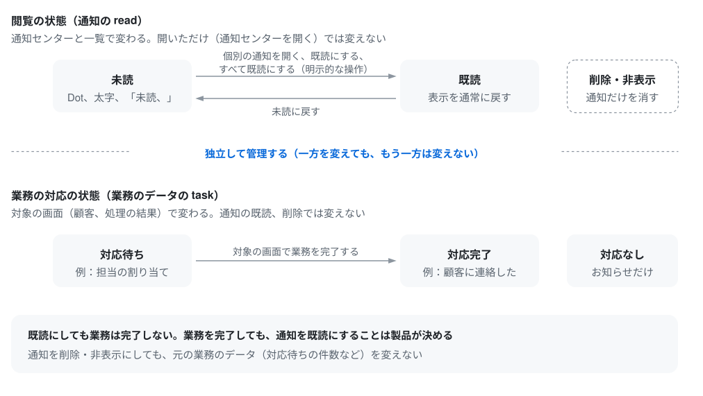

# Notifications

利用者が知る価値のあるイベントを、作業を不必要に中断させずに、適切な方法で知らせる。既読と業務の対応を区別し、確認できない状態を推測しない。

状態：初期実装（レビュー前。v0.1 確定ではない） ・ 実装：[`registry/patterns/notification-state.ts`](../../../registry/patterns/notification-state.ts)、[`notification-feed.ts`](../../../registry/patterns/notification-feed.ts)、[`notification-indicator.tsx`](../../../registry/patterns/notification-indicator.tsx)、[`notification-list.tsx`](../../../registry/patterns/notification-list.tsx)、[`notification-center.tsx`](../../../registry/patterns/notification-center.tsx) ・ 全体：[System & Account](system-and-account.md)

## 目的

知らせる必要のあるイベントだけを、情報の性質に合う方法で示し、利用者が考えなくても「何が起きたか」「自分が何をすればよいか」を判断できるようにする（原則 01）。通知によって現在の作業を不必要に中断させない（基本思想）。既読、配信、業務の対応を混同せず、確認できていない状態を事実として示さない（原則 08）。

## 使用条件

- 利用者が知る価値のあるイベント（担当の割り当て、メンション、長時間の処理の完了、契約の更新のリマインダー、新しい端末からのログイン）がある製品。
- 通知センターは、通知の履歴を後から確かめる必要がある製品だけに置く。操作の結果を知らせるだけなら、Inline Feedback と Toast で足りる。
- すべてのシステムのイベントを通知に変換しない。通常の自動の更新など、知らせる必要がないイベントは、必要に応じて履歴（監査ログなど）に記録するだけにする。

### 分類（判断の基準）

次の分類は、表示方法、保存期間、配信の対象、無効にできるかを決めるための判断の基準である。固定の必須の仕様にしない。

| 分類 | 例 | 主な判断 |
| --- | --- | --- |
| 操作の結果 | 保存しました、送信しました | Inline Feedback か Toast。通知センターには残さない |
| 処理の完了 | 書き出し、取り込みの完了 | 通知センター。部分的な失敗は結果の画面の Alert にも残す |
| 業務の通知 | 担当の割り当て、メンション | 通知センター。必要に応じてメール・Push |
| リマインダー | 契約の更新日 | 通知センター。関連するものは集約してよい |
| セキュリティ | 新しい端末からのログイン | 集約しない。組織のポリシーで無効にできない場合がある |
| システム | 障害、メンテナンス | System States の Banner。通知センターに重複させない |
| 製品の情報 | 新しい機能 | 通知センターだけ、または Digest。無効にできる |

### 重要度と緊急性

<picture>
  <source media="(prefers-color-scheme: dark)" srcset="../../diagrams/notification-channels-dark.svg">
  
</picture>

- 重要度（知らなければ困る度合い）と緊急性（すぐに認識や対応が必要か）を別々に持つ。具体的な値と段階は製品が定義する。Registry の部品は値を持たない。
- 重要だというだけで Dialog で作業を中断させない。すぐに判断しないと先へ進めない場合だけ、強い表現（Dialog、Push）を使う。

## 構成

| 部分 | 部品 | 内容 |
| --- | --- | --- |
| 未読の表示 | `NotificationIndicator`、`NotificationButton` | Dot または Count。0 件では表示しない。名前に未読の状態を含める |
| 通知センター | `NotificationCenter` を Popover、Sheet、専用のページに置く | 見出し、範囲（ワークスペース）、すべて既読、すべて・未読の切り替え、状態、一覧、移動 |
| 一覧 | `NotificationList` | タイトル、対象、発生した時刻、既読・未読、既読の操作。集約の展開 |
| 状態 | `useNotificationFeed` | 取得、新着、既読の更新、一括既読、スコープ |
| 判断の関数 | `notification-state.ts` | 重複、集約、件数の表示、一括既読の範囲、時刻、Quiet Hours、配信の状態 |

### 通知方法

| 方法 | 使う情報 | 部品 |
| --- | --- | --- |
| Inline Feedback | 操作に直接関係する情報（入力の誤り、保存した項目の状態） | Field の説明とエラー、状態の文 |
| Toast | 一時的な操作の結果。画面に結果が表れない操作の成功 | `useToast`（[toast.md](../components/toast.md)） |
| Alert | 継続して認識する必要がある情報（一括操作の部分的な失敗、更新できなかったこと） | `Alert`、`DataRegionError` |
| Banner | 広い範囲に関係する情報（障害、メンテナンス、契約の期限） | System States の System Banner（[system-states.md](system-states.md)） |
| 通知センター | 後から確かめる必要がある情報 | この資料の部品 |
| Dialog | すぐに判断しないと先へ進めない場合だけ | `AlertDialog`、`Dialog` |
| メール・Push | 製品の外へ知らせる必要がある場合 | 製品の配信の基盤（対象外） |

- 部分的な失敗、重大なエラー、結果の不明を Toast だけで伝えない。結果の画面の Alert に残し、後から確かめる必要があれば通知センターにも記録する。
- 同じ情報を、すべての方法（Toast、Banner、通知センター、メール）で重複して知らせない。1 つの方法を選び、履歴が必要な場合だけ通知センターを加える。
- 障害とメンテナンスは System States の Banner で示し、通知センターに同じ内容を重複させない（Banner は別の担当の実装。統合時に確認する）。

### 通知センターの配置

- Header の右側に置く。Header がない構成（Sidebar Shell だけ）では、Sidebar の下部に置く。
- 少量の通知は Popover（デスクトップ）。モバイル（md 未満）は全画面の Sheet。詳細な確認には Sheet、大量の履歴には専用のページを使う。
- 開いたときは見出しにフォーカスを移す。Tab で、すべて・未読、すべて既読、一覧の順に進む。

### 通知の情報構成

| 項目 | 内容 |
| --- | --- |
| タイトル | 内容を理解できる文。タイトルだけで何が起きたかがわかる（「青葉商事の担当者に設定されました」。「更新があります」にしない） |
| 対象 | 顧客の名前、処理の名前など。移動先がわかる |
| 発生した時刻 | 相対時刻（「4 分前」）。`<time dateTime>` と `title` で正確な日時を確かめられる。専用のページでは正確な日時も画面に示す |
| 既読・未読 | Dot、太字、読み上げの「未読、」。色だけで示さない |
| 必要な操作 | 開く（対象へ移動）、既読にする・未読に戻す。専用のページでは削除を加える |

- 必要性なくアイコン、Badge、操作のボタンを足さない。業務の対応の状態（「対応待ち」）は文字で示す。
- 相対時刻は、製品が渡す基準の時刻（`now`）から求める。描画中に `Date.now()` を読まない（サーバーでの描画と Hydration の結果を一致させる）。正確な日時は、利用者のタイムゾーンを必ず渡して求める。

## バリエーション

| 種類 | 使う場面 | 実装の例（プレビュー） |
| --- | --- | --- |
| Popover | デスクトップで、少量の通知を確かめる | `NotificationHeaderCenter` |
| 全画面の Sheet | モバイル | `NotificationHeaderCenter`（md 未満） |
| 専用のページ | 大量の履歴、正確な日時、削除 | `NotificationInbox` |
| Count | 件数に意味がある（対応が必要な件数） | `display="count"` |
| Dot | 未読があることを知らせれば足りる | `display="dot"` |
| 設定の Switch の一覧 | 種類とチャネルが少ない | 既存の `Switch` |
| 設定の Matrix | 複数の種類と配信チャネル | `NotificationSettingsMatrix` |

## 動作

### 既読・未読と業務の対応

<picture>
  <source media="(prefers-color-scheme: dark)" srcset="../../diagrams/notification-read-task-dark.svg">
  
</picture>

- 通知センターを開いただけでは、通知を既読にしない。
- 個別の通知を開いた場合は既読にする。プレビューでは、移動が完了したとき、または対象を開けないと確かめたとき（削除、権限なし）に既読にする。未保存の変更を破棄せずに移動を取りやめた場合は既読にしない。
- すべて既読は明示的な操作とし、対象の範囲をボタンの名前と説明（`aria-describedby`）、画面の文で実際の範囲どおりに示す。

| 範囲（`readAllBy`） | 状況 | ボタンの名前 | 範囲の文 |
| --- | --- | --- | --- |
| ids | 未読をすべて読み込んでいる | すべて既読にする | 対象：本社営業部の未読 3 件 |
| ids | 読み込んでいない未読がある | 読み込んだ 3 件を既読にする | 対象：読み込んだ未読 3 件（ほかの未読 9 件は対象外） |
| cursor | 読み込んでいない通知を含む | すべて既読にする | 対象：本社営業部の未読 12 件（いま表示している最新のお知らせまで。この後に届くものは含めない） |

- 表示した範囲だけを既読にする方式（ids）で、「すべて」と表示しない。cursor では、成功した後に取得し直し、未読の件数と結果をサーバーの結果で確定する（読み込み済みの通知だけで件数を差し引かない）。
- 未読に戻す操作を提供する（個別の通知の「未読に戻す」）。
- 業務の対応の状態（`task`）は、閲覧の状態（`read`）とは別に管理する。通知を削除・非表示にしても、元の業務のデータを変えない。
- 未読の絞り込みの中で既読にして通知が消える場合は、次の通知（なければ前の通知）の「開く」へフォーカスを移す。最後の通知が消えたら、通知センターの見出しへ移す。利用者が一覧の外へフォーカスを移した後は、フォーカスを動かさない。

### 未読の表示

| 状態 | 表示 | アクセシブルな名前 |
| --- | --- | --- |
| 3 件（Count） | 3 | お知らせ、未読 3 件 |
| 120 件（Count） | 99+ | お知らせ、未読 120 件 |
| 3 件（Dot） | Dot | お知らせ、未読 3 件 |
| 0 件 | 表示しない | お知らせ、未読なし |
| 件数が不明、未読があることはわかる | Dot（架空の件数を作らない） | お知らせ、未読あり |
| 件数が不明（取得中、取得失敗） | 表示しない | お知らせ |

- 通常の未読に Destructive の赤を使わない。ブランドの色（`primary`）で示す。
- 件数の数字と Dot は支援技術から隠し、未読の状態はボタンの名前で伝える（重複して読み上げない）。

### グループ化と重複の防止

- 同じ処理や、関連する連続したイベント（同じ週の契約の更新のリマインダー）は、`groupKey` で集約してよい。集約は 2 件以上のときだけ行い、最も新しい通知の位置に置く。
- 個別の対応が必要な通知と、重要なセキュリティの通知は集約しない（`canGroup` で製品が判断する。プレビューではセキュリティの通知と、権限で内容を伏せた通知を除く）。
- 集約した後も、含まれる通知を展開して個別に開ける（`aria-expanded`）。
- 重複は、安定した通知の ID とイベントの ID で判定する。同じタイトルの文字列だけで、別のイベントを除かない。
- 実際のイベントの重複排除と通知の生成は、製品のサーバーの責務である。画面の重複の判定は、同じ通知が二度配信された場合の防止である。

### 通知から対象への移動

- 通知の内容に直接関係する画面へ移動する。対象の検索を最初からやり直させない。
- 通知のリンクを認可済みとして信頼しない。移動先で、対象の存在と閲覧の権限を製品が確かめる（プレビューでは `resolveTarget`）。
- 対象が削除されている場合は移動せず、通知センターの中に理由を示す（「〜は削除されています。お知らせは残しています」）。
- 閲覧の権限がない場合は移動せず、次にすべきこと（管理者への依頼）を示す。通知を取得し直し、権限のない内容（タイトル、対象の名前）を通知の本文に残さない。
- 対象のワークスペースが現在のワークスペースと異なる場合は、製品が切り替えの確認を行う。プレビューの通知はワークスペースごとに取得するため、別のワークスペースの通知は表示されない。
- 未保存の変更がある場合は、移動の前に破棄するかを確かめる（プレビューでは `DiscardAlert`。Unsaved Changes は Forms & Workflows で扱う）。
- 元の通知の画面への復帰：通知センターから移動した場合は、もう一度開いたときに、開いた通知へフォーカスとスクロールを戻す。専用のページから移動した場合は、`captureListPosition` と `useListPositionRestore`（List & Detail）で位置を戻す。集約の中の通知は、集約を展開して戻す。

### 通知の設定

- 通知の種類と配信チャネル（アプリ内、メール、プッシュ通知）を区別する。
- 種類とチャネルが少ない場合は既存の Switch の一覧にする。複数の種類とチャネルがある場合は、設定の Matrix を使う。Matrix の各 Switch の名前には種類とチャネルの両方を含める（「コメントでのメンション：プッシュ通知」）。狭い画面では、種類ごとにチャネルを縦に並べる（Container Query）。
- 個人の設定（アカウント単位）と、組織のポリシー（ワークスペース単位）を区別する。組織のポリシーで使えないチャネルは、理由を示し、個人の設定は残す。
- 必須の通知は無効にできない理由を、Switch の説明（`aria-describedby`）と画面の文で示す。Switch は読み取り専用（`readOnly`）にし、フォーカスできるようにする。サーバーでも無効にする要求を拒否する。
- OS やブラウザの通知の許可と、製品の配信の設定を混同しない。許可の状態を文で示し、製品の Switch とは別にする。許可を求める操作は、許可がまだ決まっていない場合だけ置く。
- Switch は即時に保存する。保存に失敗したら元の値に戻し、その種類の行に理由を示す。結果が不明なら、設定を取得し直して実際の値を示す。

### 通知疲れの防止

必要に応じて、次を提供する。すべてを標準で必須にしない。

| 手段 | 内容 |
| --- | --- |
| Digest | メールを 1 日 1 回まとめる。緊急の通知はまとめずにすぐ届ける |
| Quiet Hours | 通知を控える時間。利用者のタイムゾーンで判定し、日をまたぐ範囲（22:00〜翌 07:00）を扱う。緊急の通知は遅らせない |
| グループ化、重複排除 | 上の「グループ化と重複の防止」 |
| 配信の頻度、不要な通知の無効化 | 設定の Matrix |
| 対象の利用者の限定 | 製品が配信の対象を決める（担当者だけ、メンションされた人だけ） |

`isWithinQuietHours` と `planDelivery` は、判断の例を示す純粋な関数である。実際の保留と配信は製品のサーバーが行う。

## 状態管理

### 取得と表示の状態

Data States を適用する（`useNotificationFeed` は `useBrowseData` を使う）。

| 状態 | 表示 |
| --- | --- |
| 初回の取得 | Skeleton（200ms 未満は表示しない）と `aria-busy`。「お知らせはありません」と表示しない。未読の件数は表示しない |
| 通知なし | 「お知らせはありません」 |
| 未読なし | 未読の絞り込みで「未読のお知らせはありません」。通知なしと区別する。追加のボタンを置かない |
| 再取得中 | 既存の通知と「更新中」。既読の操作を受け付けない（ボタンはフォーカスできるまま無効にする） |
| 取得失敗 | `DataRegionError` と再試行。未読の件数を表示しない |
| 再取得の失敗 | 前の通知と warning の Alert |
| 新着 | 保留して「新着 N 件を表示」（見出しの行の右に、最初から確保した場所に置く）。未読の件数には含める |
| 既読の更新の失敗 | 元の状態に戻し、Alert で示す。結果が不明なら取得し直す |
| 権限の変更、スコープの変更 | 前の通知、未読の件数、保留中の新着、更新中の状態を破棄し、初回の取得に戻す |

### 新着と閲覧の位置

- 新着の追加で、閲覧の位置とフォーカスを失わせない。通知センターを開いている間、または専用のページの表示中は新着を保留し（`holdIncoming: true`）、「新着 N 件を表示」を押したときに一覧へ加える。押した後は、加えた最も新しい通知へフォーカスを移す（利用者の操作の結果）。
- 「新着 N 件を表示」は見出しの行の右に置き、行の高さを最初から確保する（`min-h-12`）。ボタンが現れても、表示中の通知の位置は動かない。新着のボタンを表示している間は、同じ場所の「更新中」の表示を出さない（取得の状態は `aria-busy` で伝える）。
- 通知センターを閉じていて、専用のページも表示していない間は、新着をすぐに一覧へ加える（`holdIncoming: false`）。
- 新着の読み上げは件数だけ（「新着のお知らせが 1 件あります」）にし、内容を強制的に読み上げない。

### 既読の更新と競合

- 既読・未読の更新は、すぐに画面に反映し（更新中の値）、応答で確定する。
- 通知の ID ごとに `useScopeGuard` の ticket を取り、最後に始めた更新の応答だけを反映する。既読にする（応答が遅い）→ 未読に戻す（応答が速い）と続けても、古い応答で新しい状態を上書きしない。
- 失敗（処理されなかったことが確か）なら元の状態に戻す。結果が不明（応答が届かなかった）なら、元の状態に戻したうえで取得し直し、実際の状態を示す。
- 一括既読は、開始した時点の範囲に固定する（`createReadAllRange`）。処理中に届いた新着は範囲に含めず、未読のまま残す。
  - `readAllBy: "ids"`（既定）：読み込み済みの未読の通知の ID。
  - `readAllBy: "cursor"`：開始した時点の最も新しい通知まで（読み込んでいない古い通知も含める。`markAllRead` が必要）。比べる値は、サーバーが通知を受け付けた順の番号（`sequence`、単調に増える数値）。すべての通知に `sequence` がある場合だけ使い、ない場合は発生時刻（`createdAt`）で比べる。発生時刻で比べる場合は、処理中に届いた発生時刻の古い通知（遅れて届いたイベント）も範囲に含まれる制約がある。製品のサーバーは `sequence` を返す。
  - cursor の成功の後は、読み込み済みの通知を既読として扱い、読み込んでいない通知の未読は 0 とみなして（範囲の中のため）、取得し直して確定する。結果の文の件数は、サーバーが返した件数（`updated` または `count`）を使う。
- 確定した既読の状態を、確定より前に始めた取得の応答で上書きしない。取得を始めた時点の順番と、確定の順番を比べ、確定の方が新しければ確定した状態を重ねる（`useNotificationFeed` の内部）。取得の応答の時点の一覧を返すサーバーと、処理が遅れるサーバーの両方で、表示と件数を一致させる。
- サーバーは、同じ通知への更新を受け付けた順に処理するか、版で古い要求を拒否する（製品の責務）。プレビューの模擬のサーバーは、要求を受け付けた時点で処理し、応答だけを遅らせる。

### 通知の状態の区別

<picture>
  <source media="(prefers-color-scheme: dark)" srcset="../../diagrams/notification-lifecycle-dark.svg">
  
</picture>

- 生成済み、送信済み、配信済み、既読、業務の対応完了を区別する。
- 確認できない状態を推測しない。`describeDelivery` は、送信済みを配信済みとして扱わず、配信を確認できないチャネル（メール）では「送信済み（届いたかは確認できません）」を返す。
- メールの開封を既読として扱わない。既読はアプリ内での閲覧の状態である。

### スコープ

- ワークスペース、アカウント、権限が変わったら、`scopeKey` を変える。前の通知、未読の件数、保留中の新着、非同期の応答（取得、既読の更新、一括既読、移動の結果）を破棄する。A → B → A と戻っても、最初の A で始めた処理の結果を反映しない。AbortSignal に従わない処理の応答も反映しない。
- 新着の購読は、購読を始めたときの `scopeKey` を `receive` に渡す。切り替えの後に届いた古いスコープの通知は捨てる。
- アンマウントの後に届いた応答は反映しない。

## アクセシビリティ

| 用途 | 指定 |
| --- | --- |
| 通知センターを開くボタン | `aria-label`「お知らせ、未読 3 件」。数字と Dot は `aria-hidden` |
| 通知センター | Popover と Sheet の `aria-labelledby` に見出し。開いたときは見出し（`tabIndex={-1}`）へフォーカス |
| すべて・未読 | `aria-pressed` の 2 つのボタン（`role="group"`、「表示するお知らせ」） |
| すべて既読 | `aria-describedby` で対象の範囲 |
| 通知の「開く」 | ボタンの名前の先頭に「未読、」。対象と時刻を含む |
| 既読の操作 | 「「タイトル」を既読にする」「「タイトル」を未読に戻す」。`title` で短い説明 |
| 新着、一括既読の結果 | 常に置いた `role="status"` の中身を変える（件数だけ） |
| 移動できなかった理由、更新・削除の失敗 | 常に置いた `aria-live="polite"` の領域（`data-slot="notification-notice"`。空の間も `display: none` にしない）の中の Alert |
| 設定の保存の結果 | 常に置いた `role="status"` で、成功、失敗、結果の不明を伝える。画面では失敗を destructive、結果の不明を warning の文で示す |
| 取得失敗 | `DataRegionError`（`role="alert"`） |
| 読み込み中 | `aria-busy` と「読み込み中」 |

- 新着でフォーカスを奪わない。未読を色だけで示さない。
- キーボードで、開く、既読にする、未読に戻す、すべて既読にする、を操作できる。
- 操作の対象の大きさ：一覧の行と操作は 40px 以上、指で操作する端末では 48px（`pointer-coarse`）。
- Toast は画面の下、通知センターは Header の下に開くため、互いに覆わない。Banner の位置は System States と統合時に確認する。
- 動きを減らす設定では、Popover の大きさの変化、Sheet の移動、集約の矢印の回転を止める。
- 音や振動を唯一の通知の手段にしない。使う場合は利用者の設定と製品の必要性に従う（Registry の部品は音を出さない）。

## セキュリティ上の注意

- 通知のリンク（対象の ID）を認可済みとして信頼しない。移動先で、対象の存在と閲覧の権限を確かめる。外部のリンクと移動先の検証は製品が行う。
- 閲覧の権限を失った対象の内容を、通知の本文に残さない。サーバーは内容を伏せて返し（プレビューでは「閲覧できない対象に関するお知らせ」）、画面は権限の変更を `scopeKey` の変更として扱って取得し直す。
- アカウントやワークスペースを切り替えた後に、前の通知と未読の件数を、1 回の描画でも表示しない。
- 必須の通知の制限は、画面の制限だけに頼らず、サーバーでも拒否する。

## アンチパターン

| 避ける | 理由 | 代わりに |
| --- | --- | --- |
| すべてのイベントを通知にする | 重要な通知が埋もれる | 知る価値があるイベントだけ |
| 重要だというだけで Dialog | 作業が中断される | 通知センター、必要なら Banner |
| 部分的な失敗を Toast だけで知らせる | 消えた後に確かめられない | 結果の画面の Alert ＋ 通知センター |
| 同じ情報を Toast、Banner、通知センター、メールで重複 | 通知が多すぎる | 1 つの方法 ＋ 必要なら履歴 |
| 開いただけで、すべて既読にする | 確かめていない通知が既読になる | 個別に開いたときと、明示的なすべて既読 |
| 既読で業務の対応を完了にする | 対応していない作業が消える | `read` と `task` を分ける |
| 通常の未読を赤い Badge | 異常のように見える | `primary` の Count か Dot |
| 件数が不明なときに 0 や架空の件数 | 判断を誤らせる | Dot、または表示しない |
| 「更新があります」のタイトル | 開くまで何が起きたかわからない | 何が起きたかがわかる文 |
| 本文の文字列で重複を判定 | 別のイベントが消える | 通知の ID、イベントの ID |
| セキュリティの通知を集約する | 個別に確かめられない | 集約しない |
| 通知のリンクをそのまま開く | 削除された対象、権限のない対象を開く | 移動先で確かめる |
| 新着を先頭に挿入してスクロールを動かす | 読んでいた位置とフォーカスを失う | 保留して「新着 N 件を表示」 |
| 一括既読の処理中に届いた新着も既読にする | 見ていない通知が既読になる | 開始した時点の範囲に固定する |
| メールの送信を「配信済み」と表示する | 確認できない状態を推測している | 送信済み（届いたかは確認できません） |
| ブラウザの許可を製品の Switch として扱う | 何が保存されたかわからない | 許可の状態と製品の設定を分ける |

## 製品側の責務

- 通知にするイベントの判断、通知の生成、イベントの重複排除、配信（メール、Push）、Digest と Quiet Hours の実行（通知の配信の基盤は対象外）。
- 重要度と緊急性の値の定義と、通知方法の選択。
- 通知の取得、既読の更新、一括既読の API。サーバーでの既読の順序の保証（受け付けた順の処理、版）。
- リアルタイムの受信（WebSocket、ポーリング）と、受け取った新着の `receive` への受け渡し。
- 通知から対象への移動：対象の存在と権限の確認、ワークスペースの切り替え、未保存の変更の確認、ルーターとの接続、位置の保持。
- 権限の変更の検出と `scopeKey` の変更、権限のない内容を伏せた応答。
- 通知の設定の保存、組織のポリシー、必須の通知、ブラウザ（OS）の通知の許可の取得（`Notification.requestPermission()` など）。
- 業務の対応の状態（業務のデータ）の管理。

## 実装例

```tsx
// 通知の状態。scopeKey にアカウント、ワークスペース、権限の版を含める
const feed = useNotificationFeed({
  scopeKey: `${userId}:${workspaceId}:${permissionVersion}`,
  fetcher: ({ signal }) => api.notifications.list({ signal }), // { items, unreadCount, hasMore }
  updateRead: (ids, read, { signal }) => api.notifications.setRead(ids, read, { signal }),
  markAllRead: (range, { signal }) => api.notifications.readAll({ ids: range.ids }, { signal }),
  holdIncoming: open || inboxVisible, // 通知センターを開いている間と、専用のページの表示中は新着を保留する
})
// 受け取った新着を渡す（購読を始めたときのスコープと一緒に）
useEffect(() => socket.subscribe(scopeKey, (items) => feed.receive(items, { scopeKey })), [scopeKey])

<Popover open={open} onOpenChange={setOpen}>
  <PopoverTrigger render={<NotificationButton count={feed.unreadCount} hasUnread={feed.hasUnread} display="count" />} />
  <PopoverContent align="end" aria-labelledby={headingId} className="max-h-[min(36rem,calc(100dvh-6rem))] w-[22.5rem] gap-0 overflow-hidden">
    <NotificationCenter
      feed={feed}
      headingId={headingId}
      scopeLabel={workspace.name}
      now={now}                 // 基準の時刻（描画中に Date.now() を読まない）
      timeZone={user.timeZone}
      onOpen={openNotification} // 対象を確かめてから移動する
      hasTarget={(n) => n.target !== null}
      getTargetLabel={(n) => n.target?.label}
      renderMeta={(n) => (n.task === "open" ? <span>対応待ち</span> : null)}
      canGroup={(n) => n.type !== "security"}
      scrollClassName="overflow-y-auto -mx-4 px-4"
    />
  </PopoverContent>
</Popover>
```

- Popover の高さは `--available-height` から決めず、固定の上限にする。位置の再計算で高さが変わると、ResizeObserver の通知が続く（Chromium の `ResizeObserver loop completed with undelivered notifications` を確認した）。
- プレビュー：`#/notifications`。画面の部品は [`preview/src/pages/system-account/notification-screens.tsx`](../../../preview/src/pages/system-account/notification-screens.tsx)（`NotificationHeaderCenter`、`NotificationInbox`、`NotificationSettingsMatrix`、`useMockNotificationFeed`）。模擬のサーバーは [`notifications-server.ts`](../../../preview/src/data/system-account/notifications-server.ts)（`window.__fdSaNotificationsServer`）。

## コードと資料の区分

| 区分 | 内容 | 理由 |
| --- | --- | --- |
| Registry のコード | `notification-state.ts`（純粋な関数）、`useNotificationFeed`、`NotificationIndicator`、`NotificationButton`、`NotificationList`、`NotificationCenter` | 古い応答の破棄、一括既読の範囲、重複の判定、件数の表示、消えた項目のフォーカスは、製品ごとに書き直すと誤りやすい |
| 組み合わせの例（プレビュー） | Header の通知センター（Popover と Sheet の切り替え、移動からの復帰）、専用のページ、通知の設定の Matrix、対象への移動（削除、権限、未保存の変更） | 容器、移動、設定の項目は製品のデータとルーターで変わる。1 つの巨大な部品にしない |
| 設計の資料だけ | 通知の分類、重要度と緊急性、通知方法の選び方、Digest と Quiet Hours の運用、対象の利用者の限定、音と振動 | 製品ごとの判断であり、コードでは決められない |
| 製品の責務 | 上の「製品側の責務」 | 製品の基盤に依存する |

Notification Item（構成候補）は `NotificationList` の中の行として実装し、別の部品にしていない。行だけを使う場面がなく、集約とフォーカスの管理が一覧の単位で必要なため。

## 独自に判断した事項

| 判断 | 理由 |
| --- | --- |
| 開いた通知は、移動が完了したとき（または対象を開けないと確かめたとき）に既読にする。未保存の変更で移動を取りやめた場合は既読にしない | 利用者が内容を確かめていない通知を既読にしないため |
| 未読の絞り込みで既読にした通知は、すぐに一覧から消す（次の通知へフォーカスを移す） | 絞り込みの条件と表示を一致させるため。「表示を切り替えるまで残す」方式は、条件と表示が一致しない |
| 新着は、通知センターを開いている間、または専用のページの表示中は保留し、どちらでもない間はすぐに加える | 表示していない間は失う位置とフォーカスがないため |
| 「新着 N 件を表示」を見出しの行の右に置き、場所を最初から確保する | 一覧の上に挿入すると、表示中の通知が 56〜64px 下に動いた（統合の検証画面の検品で確認） |
| 一括既読のボタンの名前を範囲に合わせる（ids で未読を読み込みきっていない場合は「読み込んだ N 件を既読にする」） | 表示した範囲だけを既読にするのに「すべて」と表示すると、実行後も未読が残る理由がわからない |
| cursor の比較は受け付けた順の番号（`sequence`）。ない場合だけ発生時刻 | 発生時刻と ID の文字列の比較は、遅れて届いたイベントを範囲に含め、"n-10" < "n-9" になる |
| 「新着 N 件を表示」を押した後は、加えた最も新しい通知へフォーカスを移す | 押したボタンが消えてフォーカスが `<body>` に落ちるのを防ぎ、加えた内容へ導くため |
| 件数が不明（`unreadCount: null`）でも一覧をすべて読み込んでいれば数える | 一覧から正確に数えられるため。読み込んでいない通知がある場合は数えない |
| 0 件の名前は「お知らせ、未読なし」、取得中・取得失敗は「お知らせ」 | 0 件と不明を区別するため |
| 既読の操作のボタンはアイコン（Check と Mail）にし、名前と `title` を付ける | 一覧の行ごとに文字のボタンを置くと、情報構成の「操作を足さない」に反する。名前で操作を伝える |
| 再取得中は既読の操作を無効にする（`focusableWhenDisabled`） | Data States の「古いデータへの操作を制限する」に合わせる。フォーカスは失わせない |
| 必須の通知の Switch は `disabled` ではなく `readOnly` | フォーカスでき、`aria-describedby` の理由を読み上げられるようにするため |
| 組織のポリシーで使えないチャネルは、実際に届くかどうか（オフ）を示し、個人の設定はサーバーに残す | 個人の設定と組織のポリシーを区別するため |
| 通知の設定の Switch は即時に保存する | Switch は即時に反映する設定に使う（[switch.md](../components/switch.md)） |
| 模擬のサーバーは、要求を受け付けた時点で既読を処理し、応答だけを遅らせる | 実際のサーバーの「受け付けた順に処理する」を再現し、画面と状態の一致を検品するため |
| 集約は、セキュリティの通知と権限で内容を伏せた通知を除き、`groupKey` が同じ 2 件以上で行う | 個別に確かめる必要がある通知を集約しないため |
| 相対時刻は 7 日以上前を日付にする | 「30 日前」より日付の方が判断しやすいため |

## 統合時に確認する事項

| 項目 | 内容 |
| --- | --- |
| Unsaved Changes（Forms & Workflows） | 通知から移動するときの未保存の変更の確認は、プレビューの `DiscardAlert` で代替している。Forms & Workflows の Unsaved Changes の部品（移動の保護）に置き換える |
| System States の Banner | 障害とメンテナンスの通知は System Banner で示し、通知センターに重複させない。Banner と通知センター（Popover）、Toast の重なりを統合の検証画面で確かめる |
| Settings | 通知の設定の Matrix を、Settings の Layout と保存状態の部品（`setting-status.tsx` など）と合わせるか。即時保存の失敗の表示の文と位置を揃える |
| Permission States | 権限の変更の検出（`scopeKey` の版）と、権限のない対象の表示（Access State）を合わせる |
| App Shell | 通知センターのボタンを `AppShellHeader` の右側（Header がない場合は Sidebar の下部）に置く。モバイルの Sheet と Bottom Navigation の重なり |
| 状態の共有 | Header の通知センターと専用のページで 1 つの `useNotificationFeed` を共有する場合は、`feed` を props で渡す。`holdIncoming` は、通知センターを開いている間、または専用のページの表示中に true にする |
| 全体の資料 | `system-and-account.md` の通知の節と、この資料のリンク |

## 検品

`preview/tests/system-account-notifications.spec.ts`（ブラウザ）と `preview/tests/system-account-notifications-logic.spec.ts`（ブラウザを使わない単体の検品）。

| 対象 | 検品 |
| --- | --- |
| 通知センターの開閉 | Popover（デスクトップ）、全画面の Sheet（モバイル）、見出しへのフォーカス、Escape でボタンへ戻る |
| Dot・Count・99+・0 件、正確な未読件数 | 例の表示と名前、実際のボタンの名前（`未読 3 件`）、Dot の名前の件数、すべて既読の後に表示が消える。色が `primary` で `destructive` でない |
| 個別既読、未読に戻す | キーボードだけで、画面、件数、サーバーの状態 |
| 開いただけで既読にしない | 開いた後に既読の要求がない |
| すべて既読 | 範囲の文と説明、要求の ID が開始時の未読と一致、見出しへのフォーカス、結果の読み上げ。読み込んでいない未読がある場合の ids の名前（「読み込んだ N 件」）とサーバーに残る件数、cursor の名前、件数、結果の文、取得し直し、処理中の新着 |
| 処理中の取得との競合 | 応答の時点で処理するサーバーと、要求の時点の一覧を返す取得で、確定した既読が取得の応答で上書きされない |
| 削除 | 失敗の表示と再試行、処理中に二度目の要求を送らない |
| 読み上げの領域 | 空の間もアクセシビリティツリーにある（`display: none` でない）。設定の失敗と結果の不明を読み上げる。結果の不明は warning |
| 新着の保留と位置 | 通知センターを開いている間に新着が届いても、表示中の通知の位置が動かない（1px 未満） |
| 一括既読中の新着 | 処理中に届いた新着が画面とサーバーで未読のまま、要求の範囲に含まれない |
| 既読と業務対応状態の分離 | 既読、削除で業務の対応待ちの件数が変わらない。対応を完了しても既読・未読が変わらない |
| 未読フィルター、通知なしと未読なし | 消えた通知の次へフォーカス、最後は見出し、「未読のお知らせはありません」と「お知らせはありません」の区別 |
| グループ化 | 集約の展開と個別の通知、セキュリティの通知を集約しない |
| 重複通知の防止 | 同じ通知の再配信を無視、同じ文の別のイベントを残す |
| 通知の対象への移動 | 移動、既読、対象の確認の要求、戻ったときのフォーカス（Popover）、スクロールとフォーカス（専用のページ） |
| 対象の削除・権限不足 | 移動しない、理由の表示、権限を失った内容を残さない、スコープの変更で取得し直す |
| 未保存の変更による移動制限 | 編集を続けると移動せず既読にしない、破棄すると移動する |
| 通知設定、必須通知の制限理由 | 即時保存、名前、読み取り専用、説明の理由、組織のポリシー、ブラウザの許可、保存の失敗と結果の不明、Quiet Hours の文 |
| 通知取得失敗、初回の取得 | エラーと再試行、件数を作らない、`aria-busy` |
| 既読更新失敗、連続した既読更新 | 元に戻す、結果の不明で取得し直す、遅い古い応答が新しい状態を上書きしない（AbortSignal を無視） |
| 新着通知時のスクロールとフォーカス | スクロールの位置とフォーカスが変わらない、件数だけの読み上げ |
| ワークスペース・アカウントの切り替え | A → B → A（AbortSignal を無視、応答の時間を変える）、切り替えた後の既読の応答を反映しない、アカウントを切り替えた後のすべての描画に前の件数が現れない、アンマウントの後の応答 |
| 配信状態と既読の区別 | アプリ内は配信済み、メールは送信済み（確認できない）、プッシュは確認待ち。既読にしても配信の表示は変わらない |
| 共通 | h1 が 1 つ、操作の名前、比較の見本が inert、320px で横スクロールなし、Reduced Motion |
| 単体の検品 | 並び順、重複、集約、件数の表示、件数の計算、一括既読の範囲（ID とカーソル）、消えた項目のフォーカス、相対時刻と正確な日時（タイムゾーン）、Quiet Hours（日をまたぐ、タイムゾーン）、緊急の通知の配信、配信の状態 |

### 未検証の事項

| 項目 | 状況 |
| --- | --- |
| VoiceOver、NVDA | 未検証。`role="status"`、`aria-live`、`aria-describedby` の読み上げは、属性と文の検品だけで確かめている |
| 実機の iOS Safari、Android | 未検証。Playwright の WebKit（webkit、webkit-mobile）で基本の検品だけを行った |
| 実際の通知の配信、ブラウザの通知の許可 | 対象外。模擬の処理だけで確かめている |
| SSR と Hydration | 指揮役の SSR の検品で確かめる。部品は描画中に `window` と `Date.now()` を読まない |
