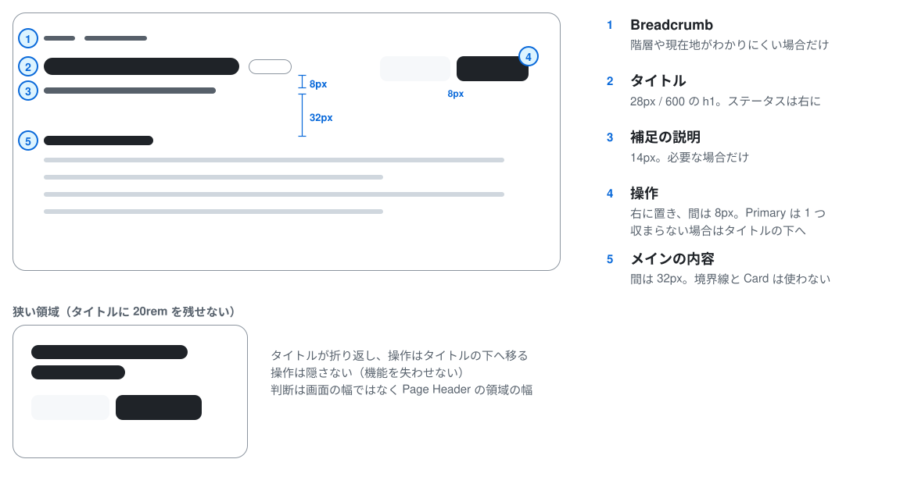

# Page Header

ページの目的（タイトル）と、ページ全体に対する操作をまとめる。

状態：v0.1 確定 ・ 実装：[`registry/patterns/page-header.tsx`](../../../registry/patterns/page-header.tsx) ・ 全体：[App Structure](app-structure.md)

## 目的

利用者が、ページを開いた直後に「どこにいて、何ができるか」を理解できるようにする（原則 01）。最初にすべき操作を 1 つに絞り、判断の負荷を減らす（原則 07）。

## 使用条件

Minimal Shell の画面を含め、すべてのページの最初に 1 つ置く。補足の説明、Breadcrumb、操作は、必要な場合だけ置く。

## 構成

<picture>
  <source media="(prefers-color-scheme: dark)" srcset="../../diagrams/page-header-anatomy-dark.svg">
  
</picture>

| 部分 | 部品 | 仕様 |
| --- | --- | --- |
| Breadcrumb | `PageHeader` の `breadcrumb` | 階層や現在地がわかりにくい場合だけ。タイトルの上 8px |
| タイトル | `PageHeaderTitle` | 28px / 600（`text-page-title`）の `<h1>`。長い文字は折り返す |
| ステータス | `Badge` など | 必要な場合だけ、タイトルの右に置く |
| 補足の説明 | `PageHeaderDescription` | 14px（`text-ui`）、`muted-foreground`。必要な場合だけ。タイトルとの間は 8px |
| 操作 | `PageHeaderActions` | 右に置き、間は 8px。主要な操作（Primary）は原則 1 つで、最後（右端）に置く。補助の操作は Secondary か Ghost |
| 内容との間 | `PageLayout` | 32px（仕様の 24〜32px のうち 32px を既定にした） |

背景はメインの内容と同じ（`background`）。境界線と Card は使わない。

## 設計の判断基準

### Breadcrumb

階層や現在地がわかりにくい場合だけ表示する。すべてのページに機械的に追加しない。

| ページ | Breadcrumb |
| --- | --- |
| Sidebar の項目のページ（顧客の一覧など） | 置かない。現在地は Sidebar で伝わる |
| 一覧から開いた詳細、登録、編集 | 置く（顧客 › 株式会社山田商事）。戻り先を示す |

### スクロール

通常は内容と一緒にスクロールさせる。常に確認する必要のある情報（件数、合計）や、頻繁に使う操作（一括の確認）がある場合だけ `sticky` にする。

`sticky` のとき：

- スクロールの領域の上端に固定する。ページの上の余白を Page Header の内側に含め、内容が上の余白に見えないようにする。
- 固定している間（ページの上の余白を越えてスクロールした後）だけ、下に細い境界線（`border`）を引く。
- 1 つのスクロールの領域に置く Sticky の Page Header は 1 つまで（`scroll-padding-top` を 1 つの値で設定するため）。
- Page Header の高さが変わる場合（補足の説明の表示、文字の折り返し、文字の大きさの設定）は、`ResizeObserver` で `scroll-padding-top` と `--app-shell-sticky-top` を更新する。
- Sticky をやめた場合（`sticky` を false にする、Page Header を取り除く）は、`scroll-padding-top` と `--app-shell-sticky-top` を取り除く。
- スクロールの領域に `scroll-padding-top`（Page Header の高さ）を設定し、Tab でフォーカスした要素が Page Header の下に隠れないようにする（WCAG 2.4.11）。

### 使用例

| 画面 | 構成 |
| --- | --- |
| 一覧 | ページ名と登録の操作（Primary）。書き出しなどは Secondary |
| 詳細 | Breadcrumb、対象の名前、必要に応じてステータス、編集の操作 |
| 設定 | タイトルと、必要に応じて下に Tabs |
| 分析 | タイトルと、期間などのページ全体の条件（Select） |

## 操作とレスポンシブ

- 操作がタイトルの右に収まる場合は右に置き、収まらない場合はタイトルの下に置く。
- 判断は画面の幅ではなく Page Header の領域の幅で行う。タイトルに 20rem（320px）を残せない場合に、操作が下へ移る（flex の折り返し）。Sidebar を開閉すると、同じ画面の幅でも配置が変わる。
- 長いタイトルと翻訳による文字数の増加：タイトルは折り返す（`word-break: auto-phrase`、長い英単語は `overflow-wrap: anywhere`）。省略記号で切らない。
- 操作は隠さない。下へ移った操作も、領域より広い場合は折り返す。操作を Dropdown Menu の中へ移すのは、操作の数が多い場合に製品が判断する。

## アクセシビリティ

- タイトルは `<h1>`。ページに 1 つ。資料の中の例など、文書の見出しの階層に合わせる場合だけ `as` で変える。
- ページを移動した後、`AppShellMain` がタイトルにフォーカスを移す（`tabindex="-1"`）。操作の対象ではないため、フォーカスの枠は表示しない。
- Page Header は `<header>`（main の中のため、banner のランドマークにはならない）。
- Sticky の場合は、フォーカスした要素が隠れないことを確かめている（「スクロール」）。

## 実装例

```tsx
<PageHeader
  breadcrumb={
    <Breadcrumb>…顧客 › 株式会社山田商事…</Breadcrumb>
  }
>
  <PageHeaderContent>
    <div className="flex flex-wrap items-center gap-x-3 gap-y-2">
      <PageHeaderTitle>株式会社山田商事</PageHeaderTitle>
      <Badge variant="success">契約中</Badge>
    </div>
    <PageHeaderDescription>卸売業・関東・担当 佐藤 花子</PageHeaderDescription>
  </PageHeaderContent>
  <PageHeaderActions>
    <Button variant="secondary">メールを作成</Button>
    <Button>編集</Button>
  </PageHeaderActions>
</PageHeader>
```

```tsx
// 常に確認する情報と頻繁な操作がある場合だけ
<PageHeader sticky>…</PageHeader>
```

プレビュー：`#/page-header`、`#/structure-app?page=customers`。

## アンチパターン

| 避けること | 理由 |
| --- | --- |
| タイトルを繰り返すだけの説明（「顧客管理」の下に「顧客の情報を管理できます。」） | 読む量を増やすだけで、判断の役に立たない（原則 04） |
| Primary の操作を複数置く | 最初にすべき操作がわからない |
| すべてのページに Breadcrumb を置く | Sidebar で現在地がわかるページでは、同じ情報を重ねるだけ |
| Page Header を Card で囲む、常に下に線を引く | 区切りは余白で足りる（美的基準 03） |
| 狭い画面で操作を隠す、タイトルを 1 行に切る | 必要な機能と情報を失わせる（原則 08） |
| すべてのページを Sticky にする | 内容の領域が狭くなる。固定する理由がある場合だけ |

## 製品側の責務

- タイトルの文言と、`document.title` の更新。
- Breadcrumb の階層とリンク先（ルーティング）。
- 操作の権限による表示。
- Sticky にするかどうかの判断。
