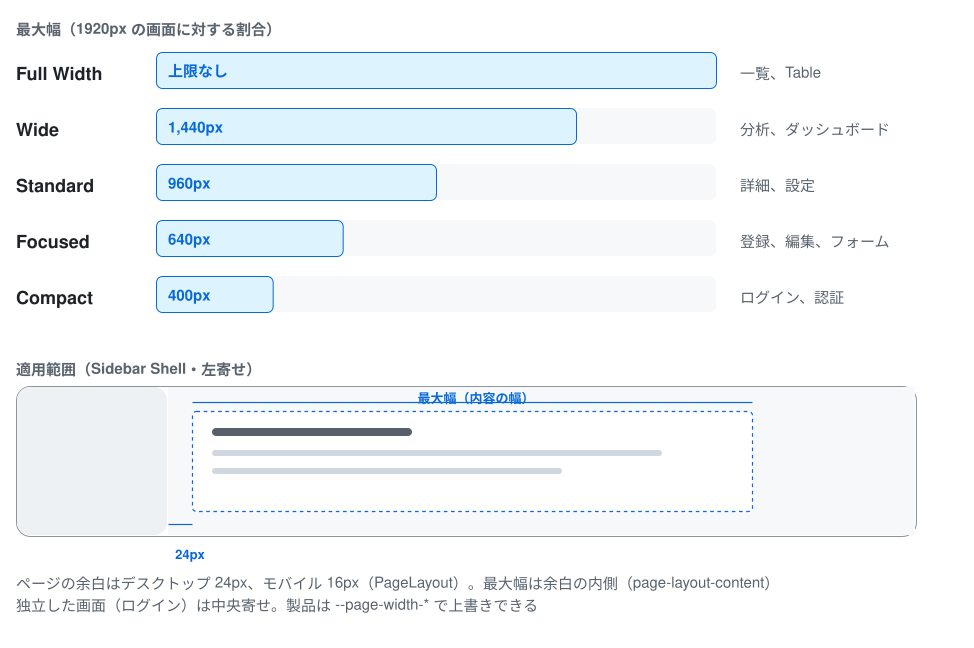

# Page Layout

ページの内容の最大幅、配置、余白、列の構成、スクロールを決める。

状態：v0.1 確定 ・ 実装：[`registry/patterns/page-layout.tsx`](../../../registry/patterns/page-layout.tsx) ・ 全体：[App Structure](app-structure.md)

## 目的

読む、入力する、比べるという画面の目的に合う幅で内容を示し、視線の移動と 1 行の長さを適切にする（原則 01）。ページの間で内容の開始位置をそろえ、画面を移っても位置を探さなくてよいようにする（原則 06）。

## 使用条件

`AppShellMain` または `MinimalShell` の直下に、ページごとに 1 つ置く。中に Page Header と内容を置く。

## 構成

<picture>
  <source media="(prefers-color-scheme: dark)" srcset="../../diagrams/page-layout-widths-dark.svg">
  
</picture>

### 最大幅

| 種類（`width`） | 最大幅 | 主な用途 | CSS 変数 |
| --- | ---: | --- | --- |
| `full` | 上限なし | 一覧、Table | なし |
| `wide` | 1440px（90rem） | 分析、ダッシュボード | `--page-width-wide` |
| `standard`（既定） | 960px（60rem） | 詳細、設定 | `--page-width-standard` |
| `focused` | 640px（40rem） | 登録、編集、フォーム | `--page-width-focused` |
| `compact` | 400px（25rem） | ログイン、認証 | `--page-width-compact` |

- 製品全体で変える場合は、`:root` などで CSS 変数を上書きする。ページごとに変える場合は `maxWidth`（CSS の長さ）を渡す。
- 値は rem。ブラウザの文字の大きさの設定を大きくした利用者にも、1 行の文字数を保つ。既定の文字の大きさ（16px）で表の px の値になる。ページの余白（1rem / 1.5rem）も文字の大きさに合わせて広がる。
- 最大幅が領域より広い場合は、領域の幅（余白を除く）になる。ページ全体は横にスクロールしない（ルートの文字の大きさを 20px、24px、32px にして、1920px、1280px、390px の幅で確かめた）。

### 適用範囲

| 要素 | 持つもの |
| --- | --- |
| `PageLayout`（`data-slot="page-layout"`） | メインの領域の幅いっぱい。ページの余白（左右と上。デスクトップ 24px、モバイル 16px）と、下の余白 64px |
| 内側（`data-slot="page-layout-content"`） | 最大幅。Page Header と内容を縦に並べ、間を 32px にする。Container Query の基準（`@container/page`） |

最大幅は、ページの余白を除いた内容の幅である。たとえば Standard の画面の横幅は、960px + 左右の余白になる。

### 配置

| `align` | 使う画面 |
| --- | --- |
| `start`（既定） | Sidebar のある業務画面。ページの間で内容の開始位置がそろう |
| `center` | 独立した画面（ログイン、Minimal Shell） |

## 設計の判断基準

### 情報の構造と列

| 構成 | 使う場面 | 部品 |
| --- | --- | --- |
| 1 列 | 順序のある情報、入力、手続き | そのまま並べる |
| メインと補足 | 中心の情報と、参照の頻度が高い補足 | `PageColumns layout="main-aside"`。1 つ目の子がメイン、2 つ目が補足（18rem）。領域が 56rem 以上で横に並べる |
| 均等な複数列 | 同等の重要性を持つ情報の比較 | `PageColumns layout="equal" columns={2 \| 3}`。42rem 以上で 2 列、64rem 以上で 3 列 |

- 列の数は、画面の幅ではなく、置かれた領域の幅（Container Query）で切り替える。Sidebar の開閉で、同じ画面の幅でも内容の幅が変わるためである。
- 狭い領域では、DOM の順序のとおり 1 列に並べる。重要な情報を DOM の先頭に置き、視覚の順序だけを入れ替えない（`order`、grid の配置）。
- 空いた領域を埋めるためだけに複数列にしない。
- 画面の幅で切り替える場合は、Tailwind CSS の既存のブレークポイント（`sm`、`md`、`lg`、`xl`）を使う。

### スクロール

- 縦のスクロールは原則 1 つ（`AppShellMain`）。Sidebar、Sheet、Table など、必要な場合だけ独立したスクロールを許容する。
- ページ全体の横スクロールは禁止。列の多い Table などは、その領域の中で横にスクロールする（[Table](../components/table.md)）。
- 固定したヘッダーやフッターを安易に重ねない。Sticky の領域では、フォーカスした要素が隠れないようにする（[Page Header](page-header.md#スクロール)）。

## 操作とレスポンシブ

- 余白は 768px（`md`）以上で 24px、未満で 16px。上の余白も同じ値にし、ページの間で内容の開始位置をそろえる。
- 320px の画面でも、ページ全体は横にスクロールしない。Full Width の一覧の表は、表の領域の中で横にスクロールする。
- 1920px 以上の画面では、Full Width 以外は最大幅で止まり、左寄せの場合は右に余白が残る。

## アクセシビリティ

- 列を切り替えても DOM の順序は変わらない。読み上げの順序と Tab の順序は、視覚の順序と一致する。
- 補足の領域を `<aside aria-label="…">` にすると、支援技術の利用者が補足へ移動できる。
- 最大幅を rem で指定し、文字を大きくした場合に 1 行が短くなりすぎないようにする。

## 実装例

```tsx
<PageLayout width="standard">
  <PageHeader>…</PageHeader>
  <PageColumns layout="main-aside">
    <div>…メイン…</div>
    <aside aria-label="補足の情報">…</aside>
  </PageColumns>
</PageLayout>

<PageLayout width="compact" align="center">…ログイン…</PageLayout>
```

```css
/* 製品全体で最大幅を変える */
:root {
  --page-width-standard: 64rem;
}
```

プレビュー：`#/page-layout`、`#/shell-examples?type=layout&width=standard`（5 種類の幅と配置の切り替え、余白と内容の幅の測定）。

## アンチパターン

| 避けること | 理由 |
| --- | --- |
| 詳細やフォームを画面の幅いっぱいに広げる | 1 行が長くなり、視線の移動が増える |
| ページごとに内容の開始位置が変わる（中央寄せと左寄せが混在する） | 画面を移るたびに位置を探す |
| 画面の幅だけで列を切り替える | Sidebar を開いたときに、狭い領域に複数列が残る |
| 視覚の順序だけを入れ替える | 読み上げと Tab の順序が、見た順序と一致しない |
| 縦のスクロールの領域を並べる、入れ子にする | どこをスクロールしているかわからなくなる |

## 製品側の責務

- 画面の目的に合う最大幅の選択。
- 製品全体で最大幅を変える場合の CSS 変数の上書き。
- 列の順序（DOM の順序）を、情報の重要度の順にすること。
