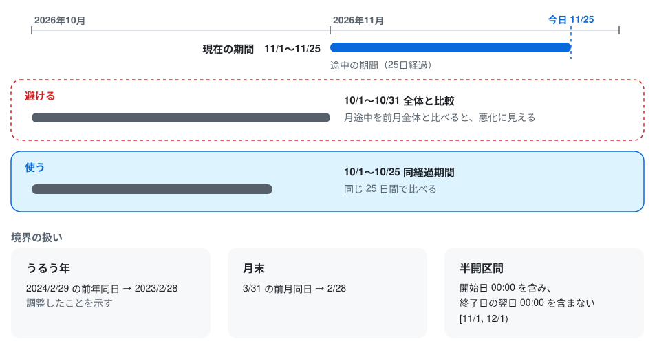
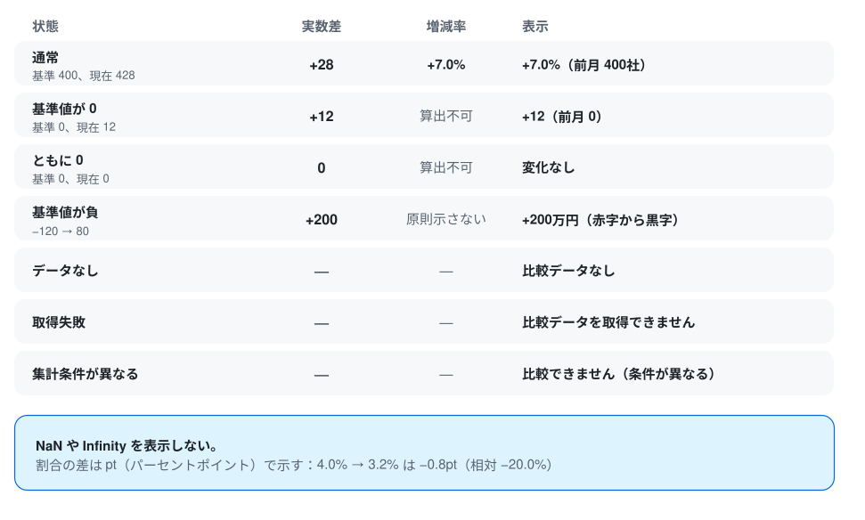
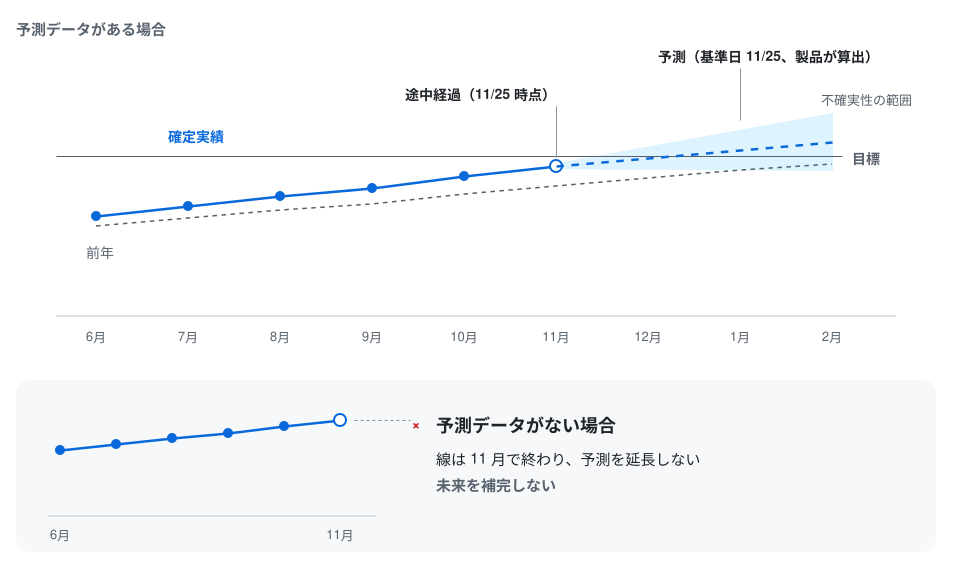

# Period Comparison

何が変化したかを、公平な期間どうしで比べて示す。

状態：初期実装（レビュー前） ・ 実装：[`registry/patterns/comparison.ts`](../../../registry/patterns/comparison.ts)（`compareValues`、`describeComparison`、`formatDifference`、`getTargetProgress`）、[`analysis-period.ts`](../../../registry/patterns/analysis-period.ts)（`comparisonRange`、`alignBuckets`）、`ComparisonValue`（[`metric.tsx`](../../../registry/patterns/metric.tsx)） ・ 全体：[Data Analysis](data-analysis.md)

## 目的

利用者が、変化の大きさと向きを、誤った比較の条件で判断しないようにする（原則 08）。何と比べたかを常に示し（原則 01）、比較できない場合は理由を示す。

## 使用条件

変化が判断に関わる指標、グラフ、表に使う。比べる意味がない指標（固定の設定値など）には比較値を付けない。

比較の対象は、分析の目的に応じて選ぶ。すべての選択肢を必須にしない。

| 比較の対象 | `ComparisonMode` | 例 |
| --- | --- | --- |
| 前日・前週 | `previous-period`（1 日、7 日の期間） | 日次の監視 |
| 前月 | `previous-month` | 月次の売上 |
| 前四半期 | `previous-quarter` | 四半期の業績 |
| 前年同期 | `previous-year` | 季節の変動がある指標 |
| 直前の同じ長さの期間 | `previous-period` | 過去 30 日間など |
| 目標・予算 | `MetricTarget`（比較とは別に示す） | 売上の目標 |
| 期間の指定 | `custom`（`ComparisonSelect` の `onCustomRangeChange` で入力し、「この期間と比較」で適用する） | キャンペーンの前後 |
| 比較なし | `none` | |

## 構成

| 部分 | 部品 |
| --- | --- |
| 比較の条件 | `ComparisonSelect`（解決した比較期間と、調整の理由を文で示す） |
| 比較期間の計算 | `comparisonRange({ period, mode, custom })` |
| 比較値の計算 | `compareValues({ current, baseline, kind, incomparableReason })` |
| 比較値の文字 | `describeComparison(result, options)`、`ComparisonValue` |
| 位置をそろえた重ね合わせ | `alignBuckets(current, baseline)` |
| 比較のグラフの例 | プレビューの `MrrTrendChart`、`DiffBarChart`、`ComparisonTable`、Period Comparison のページの重ね合わせと並べた棒 |

## バリエーション

### 比較のグラフ

| 種類 | 使う場面 | 例 |
| --- | --- | --- |
| 比較の折れ線 | 推移を前の期間と重ねる | 累計の売上の今月と前月（経過日でそろえる）、MRR の今年と前年 |
| 並べた棒 | 項目ごとに 2 つの期間を比べる | プラン別の売上の今月と前月の同じ 25 日間 |
| 増減差のグラフ | 正と負の増減を 0 から左右に示す | プラン別の売上の増減、MRR の増減の内訳 |
| 数値の比較の表 | 正確な値を確かめる | 期間の比較の表、地域別の営業利益 |

### Waterfall Chart の使用の判断

期首から期末までの増減の内訳（新規、増額、減額、解約）を、順に積み上げて示す場合に有効である。今回は汎用の部品にしない。検証画面では、増減差のグラフ（`DiffBarChart`）と、期首・期末の値の文、数値の表で示している。製品が作る場合は、次を守る。

- 棒の始点を、前の棒の終点にそろえる。期首と期末の棒は 0 から描き、増減の棒と区別する。
- 増減の向きを位置と符号で示し、良否の色（Success、Destructive）を機械的に使わない。
- 数値の表を併記する。
- 期間の中で始まり終わった契約など、内訳に含めないものを説明する。

## 動作

### 比較の公平性

<picture>
  <source media="(prefers-color-scheme: dark)" srcset="../../diagrams/period-alignment-dark.svg">
  
</picture>

| 指標の種類 | 比べ方 | `comparisonRange` の `alignment` |
| --- | --- | --- |
| 期間の途中の累積（売上、新規の契約） | 過去の同じ経過の期間（11/1〜11/25 と 10/1〜10/25） | `same-elapsed` |
| 時点の指標（MRR、契約企業数） | 比較の基準の時点を示す（「2026/10/25時点」） | 期間の最終日どうし |
| 割合、平均 | 母集団、分母、集計の方法をそろえる | |
| 確定した月の実績 | 月の全体どうし（31 日間と 30 日間）。日数の違いを許容し、注記する | `full` |
| 日付をずらした期間 | 同じ長さ、同じ日付 | `shifted` |

- 月の途中の実績と前月の全体を比べて、悪化と評価しない。
- 必要に応じて、曜日、営業日、営業時間をそろえた比較も許容する（製品が比較期間を `custom` で渡す）。

### 期間の境界

Analysis Filters と同じ時間の定義を使う（[analysis-filters.md](analysis-filters.md)）。

| ケース | 扱い | 例 |
| --- | --- | --- |
| 月末の日数の差 | 比較先に同じ日がない場合は月末に合わせ、`adjusted` と `note` で示す | 3/1〜3/30 の前月 → 2/1〜2/28 |
| うるう年 | 2/29 の前年は 2/28。月の全体は月の全体どうし | 2024/2/29 → 2023/2/28 |
| 年をまたぐ期間 | 暦の日付で数える | 2025/12/15〜2026/1/14 の直前の期間 → 2025/11/14〜12/14 |
| タイムゾーン、夏時間 | 半開区間を集計のタイムゾーンの時刻で渡す | `toInstantRange` |
| 暦月と会計月 | `fiscalYearStartMonth` | 2026年度 Q3 |
| 月の途中 | 同経過期間 | |
| 日付の境界の重なりや欠け | 直前の期間は開始日の前日で終わる。どの比較でも、比較期間が分析の対象と重なる場合は `invalid`（`overlap`）。`ComparisonSelect` に `period` を渡すと、その比較を選べなくする | 9/1〜11/25 の前月（8/1〜10/25）、今年の前月 |
| 終了日が未来の期間 | 今日までに切り詰め、同じ日数で比べる（Analysis Filters） | 11/1〜12/31 → 11/1〜11/25 と前年の 11/1〜11/25 |
| データの範囲の外 | 期間の一部でもデータのない日を含む場合は、値を `null`（データなし）とし、0 と比べない | 2022/6〜2023/5（データは 2023/1 から） |

比較期間を自動で調整した場合は、その定義（「2026/03/30 に対応する日がないため、2026/02/28 までと比べます」）を示す。

### 増減の表し方

| 値 | 定義 | 例 |
| --- | --- | --- |
| 実数差 | 現在値 − 基準値 | +28社 |
| 増減率 | (現在値 − 基準値) ÷ 基準値 | +7.0% |
| パーセントポイント差 | 割合どうしの差 | 4.0% → 3.2% は −0.8pt（相対の増減率は −20.0%） |

- 割合を示す指標どうしの差は、原則としてパーセントポイントを示す（`kind: "ratio"` の既定）。
- 両方を示すのは、判断に役立つ場合だけ。
- 計算は丸める前の値で行い、表示のときだけ丸める。丸めると 0 になるが実際は 0 でない差は「+0.1pt未満」と示す。
- 割合の内部の値は 0〜1 に統一する。API で 0〜100 と混在させない。

### 比較できない場合

<picture>
  <source media="(prefers-color-scheme: dark)" srcset="../../diagrams/comparison-availability-dark.svg">
  
</picture>

| 状態 | `compareValues` | 表示（`describeComparison`） |
| --- | --- | --- |
| 通常 | `ready` | +7.0% |
| 基準値が 0 | `ready`、`rate: null`、`rateUnavailable: "baseline-zero"` | +12件（補足：基準が 0 のため増減率は算出できません） |
| ともに 0 | `ready`、`change: "unchanged"` | 変化なし |
| 基準値がマイナス | `ready`、`rate: null`、`rateUnavailable: "baseline-negative"` | 実数差（補足：基準がマイナスのため増減率は示しません） |
| マイナスからプラス（赤字から黒字） | `signChange: "negative-to-positive"` | 実数差（補足：マイナスからプラスに転換） |
| データが存在しない | `no-baseline` | 比較データなし |
| 取得失敗 | `baseline-unavailable` | 比較データを取得できません |
| 集計の条件が異なる | `incomparable`（`incomparableReason`） | 比較できません（理由） |
| 現在値を取得できない | `current-unavailable` | 取得できません |

NaN、Infinity を表示しない（計算の結果に含めない）。

### 色と線

<picture>
  <source media="(prefers-color-scheme: dark)" srcset="../../diagrams/actual-forecast-dark.svg">
  
</picture>

| 系列 | 表し方 |
| --- | --- |
| 現在の実績 | グラフの主要な色（`chart-1`）、実線 |
| 途中経過（今月） | 同じ色の点線と白抜きの点。凡例と表に「途中経過」 |
| 過去の実績 | Neutral（`border-strong`）、破線 |
| 目標 | 区別できる参照線（`ReferenceLine`）と文字 |
| 予測 | 実績と異なる色（`chart-3`）の破線と範囲。凡例、説明、表に「予測」と基準日 |

- 色だけで系列を区別しない（凡例の印の形、線の種類、数値の表）。
- 既存の Chart のトークンと、製品のブランドカラーの上書きを保つ。
- 意味のない Success、Destructive、Warning を使わない。増減差のグラフは、正と負を位置と符号で示す（色は `chart-1` と `chart-3`）。
- 棒グラフは 0 から始める。増減差のグラフは正と負の値を扱い、0 の位置に線を引く。

### 比較の位置

- 実際の日付の順と、期間の中の位置をそろえた比較を使い分ける。
- 経過日、週、曜日、営業日など、意味のある基準で位置をそろえる（`alignBuckets`）。
- 異なる期間の値を重ねる場合は、Tooltip と数値の表で元の日付を確かめられるようにする（「25日目（今月 2026/11/25、前月 2026/10/25）」）。
- 比べるグラフを並べる場合は、原則として軸の範囲と単位をそろえる。

### 目標との比較

- 過去の実績との比較と、目標の達成率を区別する。両方が必要な場合だけ並べる（[metric-overview.md](metric-overview.md)）。
- 小さい方が望ましい指標は、上限の目標として示す（通常の達成率を使わない）。

### 実績、途中経過、予測

- 確定した実績、進行中の実績、予測を区別する。推移のグラフで今日を含む区間（今月など）は、確定した区間と同じ線で描かず、点線の別の系列にする（日数が少なく、値が低く見えるため）。数値の表にも「途中の区間」と示す。
- 予測のデータがない場合に、未来のデータを補完しない（線を延ばさない）。
- 予測の算出は製品の責務。予測の基準日、算出の方法、不確実性（範囲）を確かめられるようにする。

### 操作の位置

- ページ全体の比較の条件は、期間の選択の近くに置く。
- 表やグラフだけの比較は、その見出しの右に置き、「この表だけの条件」と示す。
- モバイルでも、比較の対象と変更の操作を残す。

## アンチパターン

| 避ける | 理由 | 代わりに |
| --- | --- | --- |
| 月の途中の累積を前月の全体と比べる | 悪化に見える | 同経過期間 |
| 何と比べたかを示さない | 判断を誤る | 比較の名前と比較の対象の値 |
| 割合の差を増減率だけで示す | 4.0% → 3.2% が −20% に見え、変化を大きく感じる | pt を主に示す |
| 基準値 0 の増減率を ∞ や NaN と示す | 意味のない値 | 実数差と理由 |
| 丸めた値から増減率を計算する | 実際と異なる | 丸める前の値 |
| 予測を実績と同じ線で続ける | 予測を確定値と誤認する | 色、線の種類、凡例 |
| 予測がないのに線を延ばす | 存在しない未来を示す | 線を止める |
| 並べたグラフの軸の範囲が異なる | 差を誤って読む | 軸をそろえる |
| 比較期間を調整したことを示さない | 期間が異なることに気づかない | `note` |
| 増減の向きで良否の色を決める | 解約率の減少が赤になる | 評価の方向 |

### 日割りの規則（検証画面の模擬データ）

検証画面の売上は、月額を `月額 × 12 ÷ 365` で日割りにしている。月の日数で割ると、同じ 25 日間でも 30 日の月と 31 日の月で 1 日の売上が変わり、同経過期間の比較が暦の日数の差で偏る（独立したレビューの指摘。11/1〜25 と 10/1〜25 で、MRR は +2.3% なのに売上は +5.0% になっていた）。製品の売上の計上の規則は製品が決めるが、同経過期間で比べる指標が暦の日数で偏らないかを確かめる。

## 状態管理

比較の条件は `useAnalysisQuery` の `comparison`（全体）か、領域の状態（表だけの比較）で持つ。比較期間は描画のたびに `comparisonRange` で求める（保存しない）。比較値は丸める前の値から `compareValues` で求める。

```ts
const range = comparisonRange({ period, mode: "previous-month" })
// { status: "ready", range: { from: 2026/10/01, to: 2026/10/25 }, days: 25, alignment: "same-elapsed", adjusted: false, note: null }
const result = compareValues({ current: { status: "ready", value: 0.032 }, baseline: { status: "ready", value: 0.04 }, kind: "ratio" })
describeComparison(result, { kind: "ratio", direction: "decrease" }) // { text: "−0.8pt", evaluationLabel: "改善", … }
```

## アクセシビリティ

| 対象 | 指定 |
| --- | --- |
| 比較値 | 向きと評価を文で読み上げる（「−0.8pt（減少、改善）」） |
| 比較できない場合 | 記号ではなく理由の文 |
| 比較のグラフ | 目的の名前、凡例の文字、数値の表（「数値を表で見る」） |
| 比較期間 | `ComparisonSelect` の `aria-describedby` に解決した比較期間 |

## データの正確性

- 比較期間と分析の対象の期間は、同じタイムゾーン、週の始まり、会計期間で求める。
- 比較のデータの取得の失敗と、データがないことを区別する。
- 集計の定義が期間によって異なる場合は、`incomparableReason` で比較できないと示すか、違いを示す。

## 製品側の責務

- 分析の目的に合う比較の対象と初期値。
- 比較期間のデータの取得、集計の定義の変更の管理。
- 曜日や営業日をそろえた比較の期間の算出（必要な場合）。
- 予測の算出、基準日、方法、不確実性。
- 目標・予算の値。

## 実装例

```tsx
<ComparisonSelect value={a.query.comparison} onValueChange={(m) => a.setComparison(m)} options={["previous-month", "previous-year", "none"]} comparison={a.comparison} />

<ComparisonValue
  result={compareValues({ current: { status: "ready", value: revenue }, baseline: base.status === "ready" ? { status: "ready", value: prevRevenue } : undefined })}
  label="前月比"
  baseline={`前月の同じ 25 日間 ${formatMetricValue(prevRevenue, { unit: "円" })?.text}`}
  direction="increase"
  format={{ unit: "円" }}
/>
```

プレビュー：`#/period-comparison`、`#/analysis-app?page=business`（期間の比較の表、MRR の推移と予測、地域別の営業利益のマイナスからプラスへの転換）。
