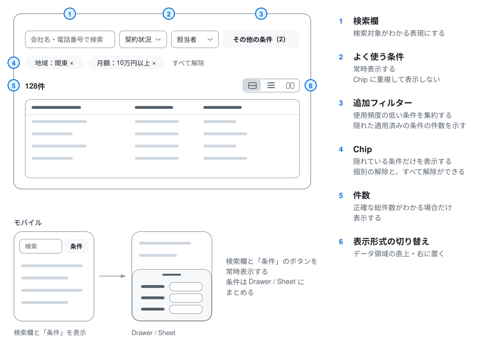
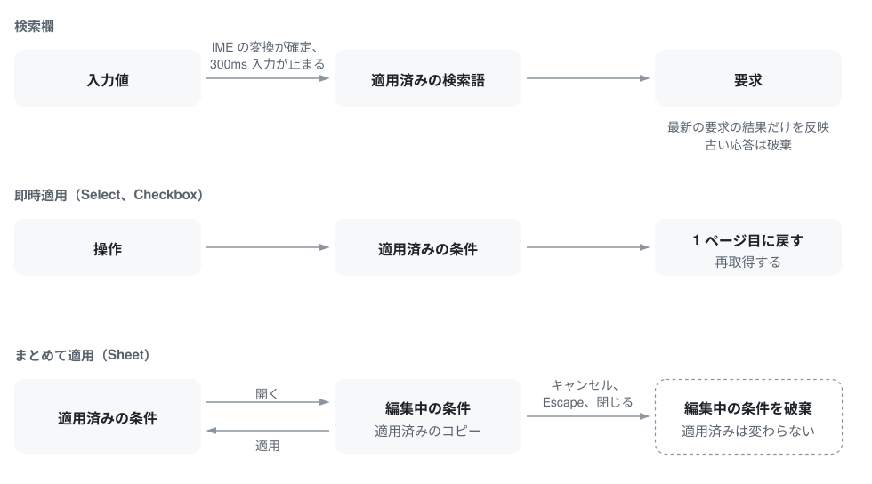

# Search & Filter

目的の情報を見つけるための検索、フィルター、ソート、ページ送り。

状態：v0.1 確定候補（最終レビュー前） ・ 実装：[`registry/patterns/browse-query.ts`](../../../registry/patterns/browse-query.ts) ・ 全体：[Data Browsing](data-browsing.md)

## 目的

利用者が、目的の情報を少ない操作で見つけられるようにする（原則 07）。何で検索でき、どの条件が適用されているかを、考えなくてもわかるようにする（原則 01）。

## 使用条件

一覧の件数が、目で探せる量を超える場合に置く。検索欄とよく使う条件は常に表示し、使う頻度の低い条件はまとめる。

- 条件が少ない場合は、すべてを 1 つの Popover にまとめる形も許容する。
- 条件の指定そのものが製品の主要な機能である場合（物件の検索など）は、常に表示するフィルターのパネルも許容する。

## 構成

<picture>
  <source media="(prefers-color-scheme: dark)" srcset="../../diagrams/search-filter-layout-dark.svg">
  
</picture>

| 部分 | 部品 | 仕様 |
| --- | --- | --- |
| 検索欄 | `DataTableSearch`（Data Table） | プレースホルダーに検索の対象を書く（「会社名・電話番号で検索」）。IME の変換中は値を渡さない |
| よく使う条件 | Select（単一選択）、Combobox（候補が多い単一選択）、Checkbox・Multi Select（複数選択） | 常に表示し、欄の中に「契約状況：契約中」のように名前と値を示す |
| 追加の条件 | Popover（少数）、Sheet（多数）、Drawer か Sheet（モバイル） | ボタンに、隠れている適用済みの条件の数を添える（「その他の条件（2）」） |
| 日付・期間、数値の範囲 | Date Picker（`DateRangePicker`）、Input | 追加の条件の中に置く |
| 適用中の条件 | `DataTableAppliedFilters`（Data Table） | 隠れている条件だけを、解除できる Chip で示す |
| 解除 | Button（`ghost`、`xs`） | 解除する範囲を名前で示す（「条件をすべて解除」「検索語と条件をすべて解除」「条件だけを解除」） |
| 件数 | 文字 | 正確な総件数がわかる場合だけ示す |

### 入力中の条件と適用済みの条件

<picture>
  <source media="(prefers-color-scheme: dark)" srcset="../../diagrams/filter-draft-dark.svg">
  
</picture>

## 判断基準

### 検索の実行

| 検索 | 実行 |
| --- | --- |
| サーバー側の検索 | 自動。入力が止まってから 300ms 後に適用する（`debounceMs` の既定） |
| クライアント側の軽い検索 | 自動。待たない（`debounceMs: 0`） |
| 高負荷・高コストな検索 | 検索ボタンと Enter で実行してよい（`manualSearch: true` と `applySearch`） |

- 日本語の IME の変換中は検索しない。`DataTableSearch` が変換中の値を `onValueChange` に渡さないため、`useBrowseQuery` にも届かない。
- 検索語は前後の空白を除いて適用する。空白だけを足しても、要求は増えない。
- 古い要求の応答で、新しい検索の結果を上書きしない（`useBrowseData` が要求ごとの番号と `AbortController` で守る。[data-states.md](data-states.md)）。

### フィルターの適用

- 原則として即時に適用する（`setFilters`）。
- 複数の条件を組み合わせる場合は、編集中の条件と適用済みの条件を分け、「適用する」でまとめて反映する（`useFilterDraft`）。
- キャンセル、Escape、外側のクリック、閉じるボタンで閉じた場合は、編集中の条件を破棄する。確認は出さない（適用済みの条件は変わらず、失われるのは選択の操作だけのため）。

| 条件の種類 | Components |
| --- | --- |
| 単一選択 | Select |
| 多数の候補から単一選択 | Combobox |
| 複数選択 | Checkbox、Multi Select |
| 日付・期間 | Date Picker |
| 数値の範囲 | Input（下限と上限） |
| 少数の追加条件 | Popover |
| 多数の追加条件 | Sheet |
| モバイルの追加条件 | Drawer、Sheet |

### 適用中の条件の表示

- 常に表示している条件（Select の中に値が見える）を、Chip に重複して表示しない。
- 隠れている条件だけを Chip で示す。隠れている適用済みの条件の数を、追加の条件のボタンに示してよい。
- 個別の条件を解除できるようにする。Chip は状態を示す Badge と区別し、解除の名前（「地域：関東の条件を解除」）と押せる範囲（高さ 32px、指の操作では 40px）を持たせる。
- すべてを解除する操作を置く。検索語まで解除するのか、フィルターだけを解除するのかを、ボタンの名前で示す（`clearAll` は検索語とフィルター、`resetFilters` はフィルターだけ）。
- 条件がない場合は、Chip も解除のボタンも表示しない。
- 解除のボタンは押すと消えるため、製品が検索欄へフォーカスを移す。

### 件数

- 正確な総件数を取得できる場合だけ示す。
- 総件数がわからない場合は、架空の件数を示さない。表示中の範囲（「1〜20件目を表示中」）と、次のページの有無で移動を制御する。
- 再取得中は、前の件数を薄い色で示し、新しい条件の結果と誤認させない。件数の読み上げは、結果が確定したときだけ行う。

## 状態管理

`useBrowseQuery` は、次を 1 つの値（`BrowseQuery`）として持つ。

| 値 | 内容 |
| --- | --- |
| `search` | 適用した検索語。要求にはこの値を使う |
| `filters` | フィルター（製品が型を決める） |
| `sorting` | ソート（TanStack Table の `SortingState`） |
| `pagination` | ページ番号とページサイズ（`PaginationState`） |

検索欄の入力値（`searchInput`）は、適用した検索語とは別に持つ。`isSearchPending` で、まだ適用していないことがわかる。

| 変更 | ページ番号 |
| --- | --- |
| 検索語の変更 | 1 ページ目に戻す |
| フィルターの変更 | 1 ページ目に戻す |
| ソートの変更 | 1 ページ目に戻す |
| ページサイズの変更 | 変更の前に表示していた先頭の行を含むページへ移り、閲覧の位置を保つ（`pageSizeChange: "keep-position"`、標準。Pagination v0.1 の `pageForPageSize`）。`pageSizeChange: "first-page"` は、1 ページ目に戻す必要がある例外の用途のために残す |
| 同じ条件の再取得 | 現在のページを維持する（`useBrowseData` の `reload`。条件は変えない） |
| 最終ページの行をすべて削除 | 存在する最後のページへ移る（製品側。[data-browsing.md](data-browsing.md#確定した仕様)） |

この表は Data Browsing の確定した仕様であり、Pagination（[pagination.md](../components/pagination.md)）と Data Table（[data-table.md](../components/data-table.md)）の資料と同じである。

- `sorting` と `pagination`、`onSortingChange` と `onPaginationChange` は、Data Table の `useTable` にそのまま渡す。Data Table の状態の仕組みを置き換えない。
- 一覧から詳細に移動して戻ったときは、保存した値を `initialQuery`（または `query`）で渡して復元する（[list-and-detail.md](list-and-detail.md)）。
- 共有や再読み込みが必要な場合は、URL で状態を管理することを推奨する。`query` と `onQueryChange` で制御し、製品が URL と同期する。電話番号や個人情報を含みうる値は、無条件に URL に入れない。

## レスポンシブ

- 狭い画面（`md` 未満）では、検索欄を優先して表示する。よく使う条件も含めて、検索欄以外の条件を「条件」のボタンから開く Drawer にまとめる。このとき、Chip には隠れたすべての条件（契約状況、担当者を含む）を示す。
- 必要な検索の機能を、モバイルという理由だけで削らない（原則 08）。
- Drawer の中の条件は、まとめて適用する（「適用する」）。

## アクセシビリティ

- 検索と条件の領域を `role="search"` で囲み、名前（「顧客の検索と絞り込み」）を付ける。
- 検索欄の名前は `aria-label`（既定はプレースホルダー）。
- Chip の解除のボタンには、条件の名前と値を含む名前を付ける。解除した後は、同じ位置の Chip（なければ前の Chip、最後は解除のボタン）にフォーカスを移す（`DataTableAppliedFilters`）。
- 件数は、結果が確定したときだけ読み上げる（`aria-live="polite"`）。入力のたびに読み上げない。

## 実装例

```tsx
type Filters = { status: Status | null; owner: string | null; regions: string[] }
const defaultFilters: Filters = { status: null, owner: null, regions: [] }

const browse = useBrowseQuery<Filters>({ defaultFilters, debounceMs: 300 })
const draft = useFilterDraft({ value: browse.query.filters, defaultValue: defaultFilters, onApply: browse.setFilters })
const hiddenCount = countActiveFilters(browse.query.filters, defaultFilters, ["regions"])

<div role="search" aria-label="顧客の検索と絞り込み">
  <DataTableSearch ref={searchRef} placeholder="会社名・電話番号で検索" value={browse.searchInput} onValueChange={browse.setSearchInput} />
  <FilterSelect label="契約状況" value={browse.query.filters.status} onChange={(status) => browse.setFilters({ status })} />
  <Button variant="outline" onClick={() => draft.onOpenChange(true)}>
    その他の条件{hiddenCount > 0 && `（${hiddenCount}）`}
  </Button>
</div>

<Sheet mode="edit" open={draft.open} onOpenChange={draft.onOpenChange}>
  <SheetContent>
    …draft.draft を編集し、draft.set で変更する…
    <SheetFooter>
      <Button variant="ghost" onClick={draft.clear}>条件をクリア</Button>
      <Button onClick={draft.apply}>適用する</Button>
    </SheetFooter>
  </SheetContent>
</Sheet>
```

プレビュー：`#/search-filter`、`#/browsing-app?page=customers`。

## アンチパターン

| 避ける | 理由 | 代わりに |
| --- | --- | --- |
| 検索欄のプレースホルダーを「検索」だけにする | 何で検索できるかがわからない | 検索の対象を書く |
| 入力のたびにサーバーに要求する | 要求が増え、結果が何度も入れ替わる | 300ms の Debounce |
| クライアント側の軽い検索でも待たせる | 不要な待ち時間 | `debounceMs: 0` |
| IME の変換中に検索する | 変換前の文字で検索される | `DataTableSearch` |
| 古い要求の応答で結果を上書きする | 入力した検索語と結果が一致しない | 最新の要求の結果だけを反映する |
| 見えている条件を Chip に重複させる | 同じ情報を 2 回読む | 隠れている条件だけを Chip にする |
| 「すべて解除」が検索語を消すかどうかわからない | 意図しない解除 | 範囲を名前で示す |
| 条件を変えてもページ番号を保つ | 結果の少ない条件で、空のページが表示される | 1 ページ目に戻す |
| 件数がわからないのに推測した件数を示す | 判断を誤らせる | 表示中の範囲だけを示す |
| モバイルで条件の機能を削る | 必要な機能を失う | Drawer にまとめる |

## 製品側の責務

- 検索の処理（サーバー側の検索、対象の項目、表記の揺れの扱い）。
- URL への同期と保存。個人情報を含みうる値の扱い。
- 条件の候補（担当者の一覧など）の取得。
- 高コストな検索に検索ボタンを使うかの判断。
