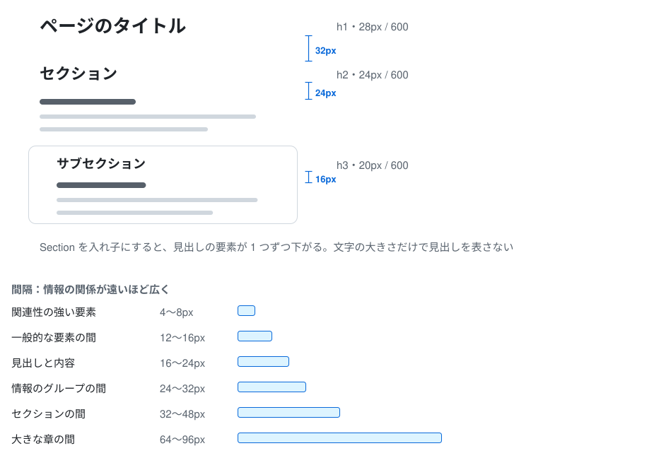
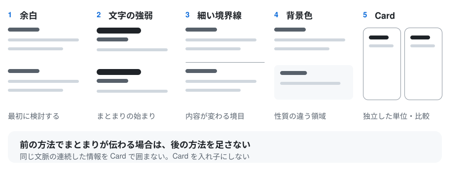

# Section Layout

ページの中の情報のまとまり（セクション）を、見出し、間隔、区切り方で表す。

状態：初期実装 ・ 実装：[`registry/patterns/section-layout.tsx`](../../../registry/patterns/section-layout.tsx) ・ 全体：[App Structure](app-structure.md)

## 目的

情報の関係を、見た目の装飾ではなく配置で伝える（原則 03、美的基準 02、03）。関係の近い情報を近く、遠い情報を離し、見出しの強弱で階層を示す（美的基準 04）。

## 使用条件

Page Layout の中で、内容を意味のまとまりに分ける場合に使う。まとまりが 1 つだけのページでは、Section を使わずに内容を置いてよい。

## 構成

<picture>
  <source media="(prefers-color-scheme: dark)" srcset="../../diagrams/section-hierarchy-dark.svg">
  
</picture>

| 部品 | 役割 |
| --- | --- |
| `Section` | `<section>`。見出しの階層（`level`）を子へ伝える。`divider` で前の内容との間に細い境界線を引く。`landmark` を付けると、見出しの id で `aria-labelledby` を付け、region のランドマークにする |
| `SectionHeader` | 見出しと操作の行。操作は右に置き、収まらない場合は見出しの下へ移す |
| `SectionHeading` | 見出しと補足の説明のまとまり（説明や操作がある場合） |
| `SectionTitle` | 見出し。要素（h2〜h6）と大きさは階層から決まる |
| `SectionDescription` | 補足の説明（14px）。必要な場合だけ |
| `SectionActions` | セクションの中の操作。Secondary か Ghost を基本とする |
| `SectionStack` | 同じ関係のまとまりを、同じ間隔で縦に並べる |

### 見出し

| 階層 | 要素 | 大きさ | 見出しと内容の間 |
| --- | --- | --- | --- |
| セクション | h2（ページの h1 の下の `Section`） | 24px / 600（`text-section`） | 24px |
| サブセクション | h3 以下（`Section` の中の `Section`） | 20px / 600（`text-heading`） | 16px |
| 補足の説明 | `<p>` | 14px（`text-ui`） | 見出しの下 8px |

`Section` を入れ子にすると、見出しの要素が 1 つずつ下がる（h2 → h3 → h4）。文字の大きさだけで見出しを表さない。Card の中など、階層を変える必要がある場合は `level` を指定する。

### 余白

既存の Spacing のトークン（4px 単位の 13 段階）から選ぶ。

| 情報の関係 | 間隔 | 部品の既定 |
| --- | --- | --- |
| 関連性の強い要素 | 4〜8px | 見出しと説明 8px |
| 一般的な要素の間 | 12〜16px | — |
| 見出しと内容 | 16〜24px | セクション 24px、サブセクション 16px |
| 情報のグループの間 | 24〜32px | `SectionStack spacing="group"`（32px） |
| セクションの間 | 32〜48px | `SectionStack`（48px） |
| 大きな章の間 | 64〜96px | `SectionStack spacing="chapter"`（64px、`md` 以上 96px） |

すべての間隔を同じにせず、情報の関係を間隔で表す。

## 設計の判断基準

### 情報の区切り

<picture>
  <source media="(prefers-color-scheme: dark)" srcset="../../diagrams/section-separation-dark.svg">
  
</picture>

次の順に検討し、前の方法で十分にまとまりが伝わる場合は、後の方法を追加しない。

1. 余白
2. 文字の強弱
3. 細い境界線（`Section divider`）
4. 背景色（`bg-muted` など。補足や操作の領域）
5. Card

### Card

独立した情報の単位や、並べて比べることに意味がある場合に使う。

- 料金のプラン
- 独立したプロジェクト
- 複数の選択肢

同じ文脈にある連続した情報を、機械的に Card で囲まない。Card を入れ子にしない。

### 列の構成

| 構成 | 使う場面 |
| --- | --- |
| 1 列 | 順序のある情報、入力、手続き |
| 均等な複数列 | 同等の重要性を持つ情報の比較（`PageColumns layout="equal"`） |
| メインと補足 | 中心の情報と、参照の頻度が高い補足（`PageColumns layout="main-aside"`） |

空いた領域を埋めるためだけに複数列にしない。列の切り替えは [Page Layout](page-layout.md#情報の構造と列) を参照。

### 折りたたみ

- 原則として情報は常に表示する。
- 詳細の設定、使う頻度の低い情報、長い補足だけを [Accordion](../components/accordion.md) で折りたたむ。
- 重要な情報と入力のエラーを、初期の状態で隠さない。エラーがある項目を含む場合は開いた状態で表示する。
- 折りたたんでも入力した内容を失わない（Accordion の `keepMounted` の既定は true）。

## 操作とレスポンシブ

- セクションの中の操作は見出しの右に置く。見出しに 16rem を残せない場合は、見出しの下へ移す。
- 列は領域の幅で 1 列に戻り、DOM の順序を保つ。

## アクセシビリティ

- 見出しは HTML の見出しの要素で、階層を飛ばさない（h1 → h2 → h3）。
- 見出しは常に HTML の見出しの要素で、支援技術の見出しの一覧から移動できる。
- `<section>` を region のランドマークにするのは、`landmark` を付けた場合だけ（見出しの id による `aria-labelledby`）。小さなまとまりまでランドマークにすると、ランドマークで移動する候補が増えすぎるためである。付ける場合は `SectionTitle` を必ず置く。
- 文字の大きさと見出しの要素が一致するため、見た目の階層と支援技術に伝わる階層が同じになる。

## 実装例

```tsx
<SectionStack>
  <Section>
    <SectionHeader>
      <SectionHeading>
        <SectionTitle>請求の設定</SectionTitle>
        <SectionDescription>顧客に送る請求書の内容と送り方。</SectionDescription>
      </SectionHeading>
      <SectionActions>
        <Button variant="secondary" size="sm">既定に戻す</Button>
      </SectionActions>
    </SectionHeader>
    <SectionStack spacing="group">
      <Section>
        <SectionHeader>
          <SectionTitle>差出人</SectionTitle>
        </SectionHeader>
        …
      </Section>
    </SectionStack>
  </Section>
  <Section divider>…</Section>
</SectionStack>
```

プレビュー：`#/section-layout`、`#/structure-app?page=customer&id=C-00002`。

## アンチパターン

| 避けること | 理由 |
| --- | --- |
| あらゆる情報を Card で囲む、Card を入れ子にする | 枠が増えるだけで、関係は伝わりにくくなる（避けるべきパターン 01） |
| すべての間隔を同じにする | 情報の関係が見えない（美的基準 02、07） |
| 文字の大きさだけで見出しを表す（`<div class="text-section">`） | 支援技術に階層が伝わらない |
| 見出しと同じ意味の説明を添える | 読む量が増えるだけ（原則 04） |
| エラーのある入力欄を、閉じた Accordion の中に隠す | どこを直せばよいかわからない |
| 空いた領域を埋めるための複数列 | 読む順序が不明確になる（避けるべきパターン 07） |

## 製品側の責務

- 見出しの文言。見出しと同じ意味の説明を添えない。
- 背景色と Card を使う理由（区切り方の順序のどの段階か）。
- 見出しの階層を変える必要がある場合の `level` の指定。
- ランドマークにする Section の選択（`landmark`）。
- 補足の列など、メインより弱く示す領域の見出しの階層（例：支援技術にだけ示す h2 の下に h3 を置く）。
- エラーのある項目を含む Accordion を開く処理。
