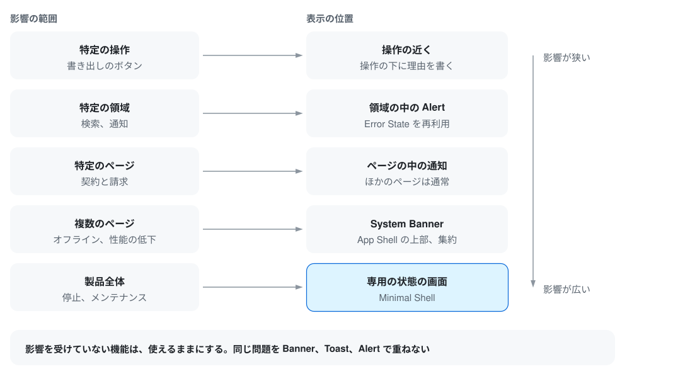
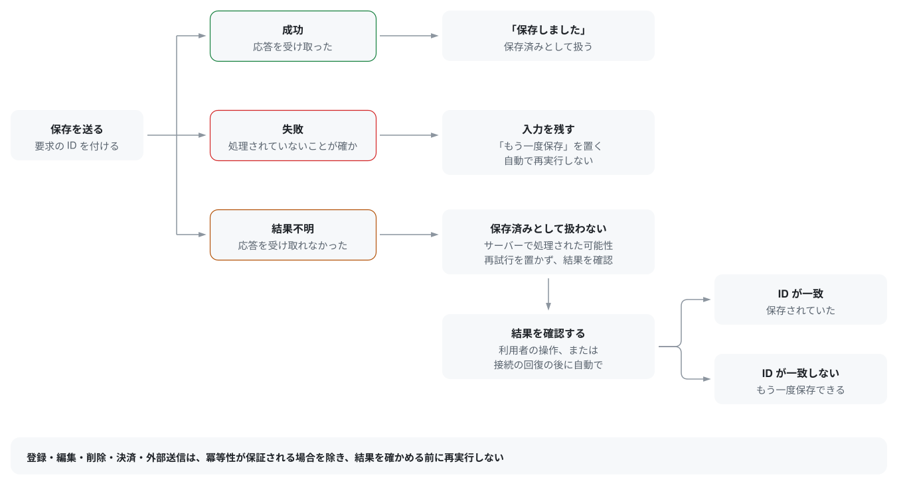

# System States

サービスとの接続、サービスの稼働、データ、保存、長時間の処理の状態を区別して伝える。影響の範囲に合う場所に示し、影響を受けていない機能は使えるままにする。

状態：v0.1 確定候補（設計と実装の方針は承認済み。Patterns Integration Review の前） ・ 実装：[`registry/patterns/system-status.ts`](../../../registry/patterns/system-status.ts)、[`system-status-hooks.ts`](../../../registry/patterns/system-status-hooks.ts)、[`system-banner.tsx`](../../../registry/patterns/system-banner.tsx)、[`service-state.tsx`](../../../registry/patterns/service-state.tsx)、[`job-status.tsx`](../../../registry/patterns/job-status.tsx) ・ 全体：[System & Account](system-and-account.md)

## 目的

障害やオフラインの間も、利用者が「何が起きているか」「何ができて、何ができないか」「何をすればよいか」を考えなくても判断できるようにする（原則 01）。確かめられていない処理の結果を成功として示さず、障害の影響を受けていない機能まで使えなくしない（原則 08）。システムの都合を必要以上に意識させない（正常の状態は示さない）。

## 使用条件

- サーバーと通信するすべての製品。接続、サービスの稼働、保存、長時間の処理の状態を、それぞれ別の値で持つ。
- System Status Indicator（接続の状態の常時表示）は、電話、機器の操作、リアルタイムの監視など、接続の状態が利用者の判断に必要な製品だけで使う。
- Status Page は、必要な製品だけが提供する。
- オフライン登録（端末に保存し後で同期する）は、製品が同期の安全性を保証できる場合だけの例外。

## 構成

### 状態の分類

1 つの error にまとめない。`SystemCondition` で次を区別する。

| 状態 | 値 | 内容 |
| --- | --- | --- |
| 正常 | `operational` | 通常の業務の画面では表示しない |
| 接続中 | `connecting` | 接続・再接続の確認中。確認できるまで、保存と削除を受け付けない |
| オフライン | `offline` | 端末がネットワークに接続していない（`reason: "browser"`）、または自動の確認の上限まで接続できない（`"unreachable"`）。既存のデータは残す |
| 動作が遅い | `degraded` | 性能の低下。利用はできる |
| 一部の障害 | `partial-outage` | 一部の機能を利用できない |
| 停止中 | `outage` | サービス（機能）を利用できない |
| メンテナンス中 | `maintenance` | メンテナンスで利用できない |
| 復旧を確認中 | `recovering` | 接続やサービスは回復したが、再取得や保存の結果の確認が終わっていない |
| 状態を確認できません | `unknown` | 状態を取得できない。正常として扱わない |

`unknown` は指示書 7.1 の 8 分類に加えた値である（「状態の取得に失敗している場合、正常と表示しない」を型で表すため。独自に判断した事項を参照）。

### 独立して持つ状態

<picture>
  <source media="(prefers-color-scheme: dark)" srcset="../../diagrams/offline-recovery-dark.svg">
  
</picture>

| 状態（指示書 10 章） | 値 | 管理する部品 |
| --- | --- | --- |
| Connectivity | `ConnectivityStatus`（`unknown`、`online`、`connecting`、`offline`）と `reason`、`attempt`、`confirmedBy`、`lastOutage` | `useConnectivity` |
| Service Health | 機能ごとの `ServiceHealth`。取得の結果は `ServiceStatusReport`（`loading`、`failed`、`ready`） | 製品の取得の処理と `healthOf`、`overallHealth` |
| Data State | 取得と鮮度 | Data Browsing の `useBrowseData`（再実装しない） |
| Mutation State | `MutationStatus`（`idle`、`saving`、`saved`、`failed`、`unknown`、`checking`、`blocked`） | 製品（`useScopeGuard` と組み合わせる） |
| Job State | `JobState`（`queued`、`running`、`cancel-requested`、`cancelled`、`succeeded`、`partial`、`failed`、`unknown`） | 製品の取得の処理と `mergeJobUpdates`、`displayJobState` |

同時に複数の状態がありうる（オフライン、かつ検索の一部の障害、かつメンテナンスの予定、など）。問題は `SystemIssue` の配列で持ち、1 つにまとめない。

次の 3 つは別の事実であり、混同しない（型と値を分ける）。

| 事実 | 表す値 | 意味しないこと |
| --- | --- | --- |
| 疎通の確認の成功、製品の要求に応答が届いた | `ConnectivityStatus` の `online`（`confirmedBy` が `probe`、`request`、`initial`） | サービスが正常に稼働していること、業務のデータを取得できたこと |
| サービスの正常な稼働 | `ServiceHealth` の `operational`（状態の API の結果） | 利用者の端末から接続できること、データの取得の成功 |
| 業務のデータの取得の成功 | Data State（`useBrowseData` の `status`、`fetchedAt`） | ほかの機能の稼働、保存できること |

プレビューでは、状態の API に応答が届いたことを `reportReachable()` で接続の確認に使うが、サービスの稼働は応答の内容（機能ごとの状態）で判断する。HTTP のエラーの応答（サーバーの失敗）も、経路に届いたため `reportReachable()` を呼ぶ（接続の失敗として扱わない）。

### 部品

| 部品 | 内容 |
| --- | --- |
| System Banner（`SystemBanner`） | App Shell の上部。複数のページに影響する問題を集約して示す |
| System Status Indicator（`SystemStatusIndicator`） | 接続の状態の常時表示（接続が判断に必要な製品だけ） |
| Service State（`ServiceUnavailable`、`ServiceHealthLabel`、`ConditionIcon`） | 製品全体が使えない場合の画面の内容、機能の状態の表示 |
| Background Job Status（`JobStatusList`、`JobStatusItem`、`JobStateLabel`） | 長時間の処理の一覧 |

## バリエーション

### 影響範囲と表示位置

<picture>
  <source media="(prefers-color-scheme: dark)" srcset="../../diagrams/system-impact-scope-dark.svg">
  
</picture>

| 影響の範囲（`ImpactScope`） | 表示の位置（`placementOf`） | 部品 |
| --- | --- | --- |
| 特定の操作（`action`） | 操作の近く（`inline`） | 操作の下の文。Button の `aria-describedby` で関連付ける |
| 特定の領域（`region`） | 領域の中の Alert・Error State（`region`） | Data States の `DataRegionError` |
| 特定のページ（`page`） | ページの中の通知（`page`） | `DataRegionError`、Alert |
| 複数のページ（`pages`） | 共通の Banner（`banner`） | `SystemBanner` |
| 製品全体（`product`） | 停止・メンテナンスは専用の状態の画面（`screen`）。オフラインなど、既存のデータを使えるものは Banner | `MinimalShell` と `ServiceUnavailable` |

- 障害の影響を受けていない機能まで利用不能にしない（検索の障害の間も、一覧の表示と編集、書き出しは使える）。
- 機能ごとの影響の範囲は製品が決める（プレビューの `componentScope`）。

### System Banner

- App Shell の上部を基本とする。常に認識する必要がある問題（オフライン、操作の制限）は、スクロールの領域（`AppShellMain`）の外に置いて固定する。任意のお知らせ（メンテナンスの事前のお知らせ）は main の先頭に置き、内容と一緒にスクロールさせる。部品は位置を持たず、置く場所で決める。
- Neutral の背景（`bg-muted`）と、意味のあるアイコン、文。問題（`title`）、影響の範囲（`impact`）、必要な行動（`action`）を示す。行動が不要なら書かない。
- 高さは内容に合わせる（固定の高さにしない）。
- 複数の問題は、最も重大な 1 つを示し、ほかは「ほか N 件の問題」にまとめる（`aria-expanded` で開閉）。並びは `compareIssues`（現在の問題を予定より前にし、停止、メンテナンス、オフライン、一部の障害、再接続、性能の低下、復旧の確認、不明の順）。
- 同じ問題を Banner、Toast、Alert で重ねて示さない。領域や操作の近くに示す問題は、Banner に出さない（`summarizeIssues`）。
- Destructive の赤は、サービスの停止のアイコンだけに使う。背景を赤にしない。

### 正常状態と System Status Indicator

- 通常の業務の画面では、正常の状態を表示しない（「すべてのシステムは正常です」を置かない）。
- 接続の状態が判断に必要な製品（電話、機器の操作、リアルタイムの監視）は、`SystemStatusIndicator` で常に表示する。
- 接続を確認していない（`ConnectivityStatus` が `unknown`）、または状態を取得できない場合は、条件を `unknown`（「接続を確認しています」「接続を確認していません」）とし、正常と表示しない。
- 接続先（通話のサーバーなど）を切り替えたら、前の接続先の確認の結果を示さない（`useConnectivity` の `target`）。プレビューの通話の例は、東京と大阪の通話のサーバーを切り替えられる。

#### 接続の状態を判断に使う製品の安全な既定値

電話、機器の操作、リアルタイムの監視など、接続の状態で利用者が判断する製品では、次を既定にする。

| 項目 | 既定 | 理由 |
| --- | --- | --- |
| 最初の状態 | `unknown`（`initialConfirmedAt` を渡さない） | 確認していない接続を、確認済みとして示さないため |
| 疎通の確認 | `probe` を渡す。`timeout` を短くする（プレビューの通話の例は 3 秒） | 応答のない経路で待ち続けないため |
| 操作の可否 | `getMutationAvailability` の `unconfirmed` を指定しない（既定の `block`）。`online` の間だけ操作を受け付ける | `unknown` と `connecting` の間に、通話の開始や機器の操作を受け付けないため |
| 表示 | `SystemStatusIndicator` を常に置き、`unknown`、`connecting`、`offline` を正常と区別して示す。確認した時刻と方法（`confirmedAt`、`confirmedBy`）を示す | 利用者が接続の状態を判断できるようにするため |
| 確認の鮮度 | `online` は「`confirmedAt` の時点で経路に届いた」ことだけを意味する。継続して確かめる必要がある製品は、製品が定期的に `check()` を呼ぶか、通話の信号など製品の通信の失敗で `reportFailure()` を呼ぶ | この部品は、確認の後の経路の変化を自分では検出しない（ブラウザの offline の通知を除く） |
| 接続先の切り替え | `target` を渡す | 前の接続先の確認の結果で、新しい接続先の操作を受け付けないため |

### メンテナンスの事前通知

- 開始の日時、終了の予定の日時、タイムゾーン、影響の範囲、取るべき行動、詳細（Status Page など）を、必要に応じて示す。例：「12月3日(木) 2:00〜4:00（日本時間）に、書き出しと契約の管理のメンテナンスを行います」「この間、書き出しと契約と請求を利用できません。ほかの機能は利用できます。」「書き出しが必要な場合は、開始の前に済ませてください。」
- 利用に影響しない内部のメンテナンスは知らせない。
- 任意のお知らせは閉じられる（`dismissible`、`timing: "upcoming"`）。閉じた状態の保持は製品の責務。
- 重大な利用の制限は、閉じた後も必要な場所で確認できるようにする（プレビューでは、書き出しの操作の下と Status Page に残す）。

### メンテナンス中・サービス停止中

- 製品全体が使えない場合は Minimal Shell の専用の画面にする（`MinimalShell` と `ServiceUnavailable`）。
- 簡潔な説明と、実際に利用できる操作だけを置く（「状態を再確認」）。
- 判明していない復旧の予定時刻を作らない。`schedule` は製品がわかっている予定だけを渡す。
- 実在する Status Page や問い合わせ先がある場合だけ案内する（`links`）。

### オフラインの新規登録の 3 方式

| 方式 | 動作 | 使う場面 |
| --- | --- | --- |
| 登録不可 | オンラインの接続が必要。オフラインの間は入力も受け付けない | 入力しても登録できず、入力の保持に意味がない場合 |
| 入力のみ可能 | 入力した内容を安全に保持し、接続が回復した後で利用者が登録する。入力できることと、登録できることを区別して示す | 標準的な業務 SaaS の標準 |
| オフライン登録 | 端末に保存し、後からサーバーと同期する | 製品が同期を安全に提供できる場合だけの例外 |

オフライン登録では、次の状態を区別して示す。端末に保存しただけで、正式な登録が完了したとは表示しない。

| 状態 | 表示の例 |
| --- | --- |
| 端末への保存 | 端末に保存しました（まだ登録されていません） |
| 同期待ち | 同期を待っています（まだ登録されていません） |
| 同期中 | サーバーに送っています |
| 同期成功 | 登録しました |
| 同期失敗 | 登録できませんでした |
| 競合 | 同じ名前の顧客が、ほかの利用者によって登録されています |
| 結果不明 | 登録されたかを確認できません（送り直す前に確かめる） |

型は `OfflineEntryMode`（3 方式）と `OfflineSyncState`（上の 7 つの状態）。サーバーで正式に登録された状態は `synced` だけで、`isRegisteredOnServer` で判定する（端末への保存、同期待ち、同期中、結果不明を登録済みとして扱わない）。プレビューの一覧の項目は `data-registered` でこれを示す。

接続を確認していない間（最初の確認の間、`unknown`）は、登録不可と入力のみ可能の方式では登録を受け付けず、「接続を確認しています。確認できるまで登録できません。」と示す（オフラインとは示さない）。オフライン登録の方式では端末に保存し、接続を確認できたら送る。

登録の操作は、送っている間と、結果が不明で確かめる前は受け付けない（同じ描画の中の 2 回目の押下も止める）。重複の防止のキー（端末の ID）は、登録が確定するか入力を変えるまで同じ値を使う。

同期の認証・認可、データの競合、重複の防止、保存の期間、端末上の機密データの保護は製品の責務である。今回は、オフライン同期のエンジンと永続的なローカルのデータベースを実装しない（プレビューの例は画面のメモリだけで模擬する）。

### 長時間処理（Background Job Status）

- 既存の Button、Progress と、Data Browsing の Bulk Actions の考え方（実際の進捗だけを示す、実行ごとの番号、結果を一覧に残す）を使う。一括操作の実行中の表示は `BulkRunStatus` を使う。Import & Export は未統合（統合時に確認する事項）。
- 待機中、処理中、キャンセルの要求中、キャンセルの完了、成功、部分的な失敗、失敗、結果不明を区別する（`jobStateLabels`）。
- 実際の進捗が取得できる場合だけ、進捗率と件数を示す（`normalizeJobProgress`）。進捗は `{ done, total }`（処理した件数と全体の件数）か `{ percent }`（0 から 100）。
- 正しくない値を、成功や進捗として扱わない。上限や下限に丸めない（100 % を超える値を 100 % として完了と誤解させない）。

| 値 | 正しい条件 | 正しくない場合 |
| --- | --- | --- |
| `done`、`total` | 0 以上の整数。`total` は 1 以上。`done` は `total` 以下 | 進捗を示さず「進み具合を確認できません」（`JobStatusItem` の `data-progress="invalid"`） |
| `percent` | 0 以上 100 以下の有限の数 | 同上 |
| 件数（`counts` の `succeeded`、`failed`） | 0 以上の整数。合計が全体の件数（`counts.total` か進捗の `total`）以下 | 成功と部分的な失敗を「結果を確認できません」（`unknown`）にする |
| 成功（`succeeded`） | 失敗の件数が 0、成功の件数が全体と等しい、進捗が全体に達している | `unknown` |
| 部分的な失敗（`partial`） | 失敗の件数が 1 以上 | `unknown` |
| 状態の値 | `JobState` のいずれか | `unknown`（`normalizeJobState`） |
| 版（`revision`） | 有限の数 | その応答を反映しない（`mergeJobUpdates`） |

- 処理中のジョブの進捗が正しくない場合は、状態は処理中のまま、進捗だけを示さない。
- Toast と読み上げは、`displayJobState` の結果（示す状態）で決める。正しくない値の成功を「完了しました」と伝えない。
- キャンセルの要求によって、実際の処理が停止したとは判断しない（`displayJobState`）。サーバーが停止を確かめたら「キャンセルしました」、停止の前に完了したら「完了」。
- ページを離れても継続できる処理は、後から処理状況を確認できることを前提にする（戻ったときに一覧を取得し直す）。
- 古い進捗の通知や Toast を、新しい処理に反映しない（ジョブの ID と版で照合する `mergeJobUpdates`。Toast の `id` も処理ごと）。
- 開始の要求中の状態と、開始・キャンセルの失敗の知らせは、ワークスペースと組で持ち、現在のワークスペースの値だけを示す。切り替えた後に応答が届いても、開始の要求中の状態は必ず解除し、そのワークスペースの一覧を取得し直してサーバーの状態を示す。開始の要求はスコープの変更で中止しない（サーバーで処理が始まる場合があるため）。
- 終わった処理の知らせを Toast で伝える場合も、失敗、部分的な失敗、結果不明は、一覧の読み上げの領域で伝える（`JobStatusList` の `announce` に、Toast で伝える状態を除く関数を渡す）。Toast で伝えるのは成功とキャンセルの完了だけで、一覧の読み上げに重ねない。

## 動作

### 接続の確認（未確認と確認済み）

- `useConnectivity` の最初の状態（SSR を含む）は `unknown`（確認していない）。ブラウザでマウントした後に、ブラウザが offline なら `offline`（`browser`）、online なら疎通を確認する（`probe` がある場合）。サーバーには `navigator` がないため、描画の中では読まない（SSR と Hydration の描画が一致する）。
- 製品が確認済みの初期状態を持つ場合（例：サーバーで描画するときの取得が成功し、その時刻を画面と一緒に渡す）は、`initialConfirmedAt` にその時刻を渡す。最初の描画から `online`（`confirmedBy: "initial"`）になり、マウントの後の疎通の確認を行わない。サーバーとブラウザで同じ値を渡す。確認していない場合は渡さない。
- 疎通の確認の API（`probe`）は必須ではない。省略した場合は、製品の要求に応答が届いたとき（`reportReachable()`）だけ `online` にする。通信の失敗（`reportFailure()`）の後は `unknown` に戻し（`lostAt` を記録する）、次の応答まで確認していない状態にする。`probe` がない場合、自動の確認と `check()` は行わない（`check()` は `false` を返す）。製品は「再読み込み」などの取得の操作を置く。
- 確認していない間（`unknown`）は、`getMutationAvailability` が既定で登録・更新・削除を受け付けない（`reason: "unconfirmed"`）。確認の前に送った要求の失敗を安全に扱える製品だけが `unconfirmed: "allow"` を指定できる。プレビューは既定の `block` を使う。
- 最初の確認の間も、Banner の表示は `useStableIssues` の遅延（1 秒）に従う（すぐに確認できた場合は何も示さない）。操作の制限はすぐに行い、操作の近くに「接続を確認しています。確認できるまで、〜できません。」と示す。この問題は切断（`connectivity`）と別の ID（`connectivity:unconfirmed`）にし、最初の確認の経過を後の切断の表示に引き継がない。最初の確認から `online` になったことは、回復ではないため復旧を知らせない。
- 最初の確認の間に業務の要求が通信の失敗で終わった場合は、`lostAt` を記録する。確認できた後に `lastOutage` が変わり、再取得が行われる（プレビューでは、最初の表示でサービスに届かなかった一覧を、接続を確認した後に取得し直す）。
- 接続先（`target`）が変わったら、前の接続先の状態、要求中の確認、予定した確認を捨て、`unknown` から確かめ直す。変わった描画から、前の接続先の状態を返さない。前の接続先の確認の応答は反映しない（`useScopeGuard` の世代で照合する。A → B → A でも最初の A の応答を反映しない）。`reportReachable` と `reportFailure` に `{ target }` を渡すと、現在の接続先と異なる場合は反映しない。
- 確認の応答は、最新の確認のものだけを反映する。利用者の「再接続を試す」（`check()`）、ブラウザの offline、`reportReachable()` は、要求中の確認を止める（`AbortSignal` を中止し、後から届いた応答を反映しない）。`timeout` を超えたら失敗として扱い、`probe` が `AbortSignal` に従わずに後から応答しても反映しない。
- アンマウントの後は、要求中の確認の応答、予定した確認のタイマー、`reportReachable` と `reportFailure` を反映しない（タイマーは止める）。
- 接続先を変えた後も、ブラウザの online / offline の通知、自動の確認のタイマー、effect から始める確認は、変更の後の接続先で始まり、結果が反映される。`useConnectivity` の内部の関数（`sync`、`runProbe`、`cancelPending` など）は描画ごとに作り直さず、最新の `useScopeGuard` の値と options を ref から読む。ref は描画の中では書き換えず、commit の後（layout effect）に更新する（破棄された描画の値を使わないため）。v0.1 の最終調整の独立レビュー（H1）で、購読（`browserOnline.subscribe`）に最初の描画の関数を渡していたため、接続先を変えた後の offline → online で確認が無効な Ticket で始まり、`connecting` と `checking: true` のまま止まる不具合が見つかり、この構成に直した。
- 確認の応答の最後の照合（`isLatest`）に失敗した Ticket が、要求中の確認として残っていた場合も、`checking` と要求中の記録を解除する（結果は反映しない）。解除しないと、online の通知、`reportFailure`、自動の確認が「要求中」として何もしない状態が続くため。照合の後に `release` でキーの記録を消す。
- ブラウザが online の通知を出しても、それだけで `online` にしない（`connecting` にして確認する）。`navigator.onLine` が `false` の間は、`reportReachable()` も反映しない。
- `online` の間の `reportReachable()` は状態を変えない（`confirmedAt` は、その接続を確認した時刻のまま。要求の成功のたびに再描画しない）。

### オフライン

- 安全に表示できる既存のデータがある場合は残す（`useBrowseData` の再取得の失敗として残る）。必要に応じて取得した時刻を示す（「10:02の時点の内容」）。
- ブラウザの online 状態（`navigator.onLine`）だけで、サービスへの接続を保証しない。online の通知を受けたら `connecting` にし、製品が渡す疎通の確認（`probe`）が成功するか、製品の要求の応答（`reportReachable()`）が届いてから `online` にする。`navigator.onLine` が `false` の場合は、確実に接続していないため、すぐに `offline` にする。
- 接続の回復と、データの取得の成功を区別する。回復した後、再取得と結果が不明な保存の確認が終わるまで「復旧を確認中」を続ける。
- 標準的な業務 SaaS では、オフラインの間のサーバーへの新規登録、更新、削除を制限する（`getMutationAvailability`）。

### 再試行と自動復旧

| 処理 | 自動の再試行 |
| --- | --- |
| 疎通の確認、安全な取得 | 行う。間隔を 2 倍ずつ延ばし（`retryDelay`）、上限の回数で止めて、利用者の「再接続を試す」を待つ |
| 登録、編集、削除、決済、外部送信 | 行わない。冪等性（同じ要求を何度送っても 1 回だけ処理される）が API の契約で保証される場合だけ許容する |
| 結果が不明な処理 | 結果を確認する前に再実行しない。接続が回復したら、自動で結果を確かめる（安全な取得） |
| 権限不足、認証切れ、入力の誤り | 行わない（`canAutoRetry` が `false`）。次にすべきことを示す |

再試行の制御（要求の再送、冪等性のキー）と通信の処理そのものは製品の責務である。`useConnectivity` は疎通の確認だけを再試行する。

- 再試行の設定は `normalizeRetryPolicy` で使える値にする（`useConnectivity`、`retryDelay`、`canAutoRetry` が内部で使う）。`baseDelay`、`maxDelay` は 0 より大きい有限の数だけを使い、負、0、`NaN`、`Infinity` は既定の値（2000、30000）にする（0 を許すと、間隔なしで要求を繰り返すため）。`maxDelay` が `baseDelay` より小さい場合は `baseDelay` にそろえる。`maxAttempts` は有限の数を切り捨てて使い、1 より小さい値（0、負）は 1（自動の再試行をしない）、`NaN` と `Infinity` は既定の値（5）にする（上限のない再試行をしないため）。`timeout` は 0 以下、`NaN`、`Infinity` を 8000 にする。
- 正しい形の値でも、下限と上限の範囲に収める（`retryPolicyLimits`）。間隔（`baseDelay`、`maxDelay`）は 100ms 以上 1 時間（3,600,000ms）以下、`maxAttempts` は 100 回以下にする。例：`baseDelay: 0.001` は 100、`maxDelay: 1e12` は 3,600,000、`maxAttempts: 1e9` は 100。下限は、極端に小さい間隔で要求を繰り返さないため。間隔の上限は、`setTimeout` が 2^31 - 1ms（約 24.8 日）を超える値をすぐに実行するため。回数の上限は、事実上上限のない再試行をしないため。`fallback`（第 2 引数）も同じ規則で確かめる。これより長い間隔や多い回数が必要な製品は、この部品の自動の確認ではなく、製品の処理で制御する。
- `canAutoRetry` は、`attempt` が数でない、または負の場合に `false` を返す（回数を確かめられないため、再試行しない）。
- 自動の確認の上限に達した後（`offline`、`unreachable`）と、再接続の確認の間（`connecting`）は、プレビューの状態の API の定期的な取得とジョブの一覧の定期的な取得も送らない（自動の再試行の上限を、ほかの定期的な取得で超えないため）。利用者の「再接続を試す」を待つ。

### 未保存データと結果不明

<picture>
  <source media="(prefers-color-scheme: dark)" srcset="../../diagrams/failure-vs-unknown-dark.svg">
  
</picture>

- Forms & Workflows（Unsaved Changes）と Data Browsing（Bulk Actions の結果不明）の設計を適用する。
- 入力内容を、安全な範囲で保持する（画面のメモリ。失敗、結果不明、オフラインの間）。
- 保存の成功を確認できない場合は、保存済みとして扱わない。通信の切断の後も、サーバー上では処理が完了している可能性を考慮する。
- 接続の回復の後に結果を確認する。要求の ID がサーバーの記録と一致すれば保存済み、一致しなければ「保存されていませんでした。もう一度保存できます。」。
- 結果が不明な間は、同じ保存を重ねない（保存のボタンを止め、「保存されたかを確認」を置く）。
- アカウント、ワークスペース、権限の変更時は、情報の保護を優先する。入力と結果を破棄し、前のスコープで始めた処理の結果を反映しない（`useScopeGuard`。A → B → A でも反映しない）。

### 障害と復旧の通知

- 短時間の通信の失敗が自然に解消された場合、通知も不要な成功の通知も出さない（`useStableIssues`：問題が `showDelay`＝1 秒続いてから表示する）。
- 即時の認識が必要な重大な障害と、操作を止める必要がある問題は、表示を遅らせない（`SystemIssue` の `immediate: true`）。`SystemBanner` も、新たに加わった `immediate` の問題を `announceDelay` を待たずに読み上げる。プレビューでは、機能の停止（`outage`）とメンテナンス中（`maintenance`）の問題を `immediate` にする（顧客の閲覧と編集の停止は、保存を止めるため）。性能の低下と一部の障害は遅らせる。
- 表示の判定（`advanceStableIssues`、純粋な関数）は次を区別する。

| 場合 | 表示 |
| --- | --- |
| 表示する前に自然に解消した問題 | 表示しない |
| 表示する前に消えて、`hideDelay` より短い間に再び現れた問題 | 続いているものとして扱い、最初に現れた時刻から `showDelay` の後に 1 回だけ表示する |
| 表示中に一時的に解消した問題 | `hideDelay` の間は表示を残す（`settlingIds`、読み上げない）。その間に再び現れたら、表示を続ける |
| 同じ ID で重要度が変わった問題 | 表示する前に `immediate` に変わったら、その時点で表示する。表示した後に重要度が下がっても、表示を続ける（内容は新しい値） |
| 別のスコープの問題 | `scopeKey` が変わった描画から、前のスコープの問題（残している問題を含む）を示さない。前のスコープの経過を引き継がない |
| 完全な復旧 | 表示していた問題は `hideDelay` の後に表示をやめる |
| 別の障害の継続 | 解消した問題だけを残す期間の後に除き、続いている問題の表示を続ける |

- 障害の情報に機密性がある場合（ワークスペースごとの障害、顧客の情報を含む文など）は、`useStableIssues` と `SystemBannerArea` に `scopeKey` を渡す。渡さない場合、スコープを区別しない。
- 長時間の障害やオフラインからの復帰では、必要に応じて復旧を知らせる。プレビューでは、表示した接続の問題が解消し、ほかの問題が残っていない場合だけ「接続が回復しました」を Banner に 6 秒示す。
- 接続が回復しても、データの再取得や保存結果の確認が必要な場合は「復旧を確認中」を続ける。
- 復旧の知らせで「最新の内容を表示しています」と示すのは、回復の後の再取得に成功した場合だけ。失敗した領域がある場合は「最新の内容を取得できなかった領域があります」と示し、その領域に再取得の失敗（`DataRegionError variant="warning"`、取得した時刻、再試行）を残す。
- 保存の対象の内容を取得できない間は、入力を受け付けず、理由（取得の失敗、オフライン）と「もう一度取得」を示す。「入力した内容は残ります」と示さない。接続が回復したら取得し直す。
- 別の部分障害が残っている場合は、すべての通知を解除しない（Banner は残っている問題を示し続ける）。
- 短時間に接続と切断を繰り返す場合は、視覚の表示と読み上げの連続した発生を抑える。問題が消えても `hideDelay`（2 秒）の間に再び現れた場合は続いているものとして扱い、表示を残す（`settlingIds`。残している間は「接続を確認しました。接続が安定しているかを確かめています。」と示し、読み上げない）。
- 安全性に必要な操作の制限は遅らせない。制限には `useConnectivity` の値をそのまま使い、`useStableIssues` の値を使わない。

### Status Page


| 構成 | 内容 |
| --- | --- |
| 全体の稼働状況 | `overallHealth`。取得できない場合は「状態を取得できません」（正常と表示しない） |
| 機能ごとの状態 | `ServiceHealthLabel` |
| 現在の障害と対応状況 | 調査中、原因を特定、復旧を確認中、解決済み。対応の経過（時刻と、公開してよい文） |
| メンテナンスの予定 | 日時（タイムゾーン）、影響する機能、取るべき行動 |
| 過去の障害の履歴 | 必要に応じて |
| 最終更新の日時 | 状態を更新した時刻 |

- 製品全体の障害のときにも確認する必要がある場合は、主要なサービスと異なる障害の境界（別の基盤、別のドメイン）で運用することを推奨する。
- 内部のインフラの機密情報（ホスト名、構成）や Stack Trace を、そのまま公開しない。

## アンチパターン

| 避ける | 理由 | 代わりに |
| --- | --- | --- |
| すべての状態を 1 つの error にする | 何が起きていて、何ができるかがわからない | 接続、稼働、データ、保存、処理を別の値で持つ |
| 状態の取得の失敗を「正常」と表示する | 障害を見落とす | `unknown`。最後に取得した状態を時点つきで残す |
| `navigator.onLine` だけで接続できたとする | サービスに届かなくても保存を受け付ける | 疎通の確認が成功してから接続とする |
| 確認していない接続を、最初から「接続済み」とする | 確認の前に、通話の開始や機器の操作を受け付ける | 最初の状態を `unknown` にし、確認できてから操作を受け付ける |
| 疎通の確認の成功を、サービスの稼働やデータの取得の成功として扱う | 停止中の機能や取得に失敗した領域を、正常と示す | 接続、稼働、データを別の値で持つ |
| 停止やメンテナンスの表示まで、ちらつきの防止のために遅らせる | 利用者が、操作できない理由をすぐに知れない | `immediate` を付ける |
| 前のワークスペースの障害の情報を、切り替えた後も残す | 機密性のある障害の情報が、別のスコープで見える | `scopeKey` を渡す |
| 100 % を超える進捗や、合計を超える件数を丸めて「完了」と示す | 正しくない値を成功と誤解させる | 不明として示す |
| 検索の障害で画面全体を使えなくする | 影響のない機能まで止まる | 検索の領域だけに示す |
| 同じ障害を Banner、Toast、Alert で重ねる | 何度も同じことを伝え、注意を奪う | 影響の範囲に合う 1 か所 |
| 業務の画面に「すべて正常です」を常に置く | 判断に使わない情報が場所を取る | 問題があるときだけ示す |
| 判明していない復旧の予定時刻を示す | 誤った見通しで待たせる | わかっている予定だけ示す |
| 存在しない Status Page や問い合わせ先に案内する | 利用者が行き場を失う | 実在する場合だけ案内する |
| 結果が不明な保存を「保存しました」と示す | 保存されたと誤解する | 「保存できたかを確認できません」と結果の確認 |
| 登録・削除・決済を自動で再実行する | 重複して処理される | 冪等性が保証される場合だけ |
| 権限不足に再試行のボタンを置く | 押しても解決しない | 次にすべきことを示す |
| 再試行のたびに読み上げる | 作業を妨げる | 問題の分類が変わったときだけ 1 回 |
| 端末に保存しただけで「登録しました」と示す | サーバーに登録されたと誤解する | 「まだ登録されていません」を示す |
| キャンセルを押しただけで「キャンセルしました」と示す | 処理が続いていても止まったと誤解する | 「キャンセルを要求しました」 |
| 進捗がわからないのに進捗率を示す | 誤った見通しを与える | 進捗率を示さない |
| 古いジョブの進捗や Toast を新しい処理に反映する | 別の処理の結果を示す | ジョブの ID と版で照合する |
| 短い切断が直るたびに「回復しました」を出す | 不要な通知が続く | 表示した問題の解消だけを知らせる |
| 表示の安定のために操作の制限まで遅らせる | 切断中に保存を受け付ける | 制限はすぐに行う |

## 状態管理

### `useConnectivity({ probe, retry, timeout, browserOnline, now, initialConfirmedAt, target })`

すべての引数を省略できる（`probe` も省略できる）。

| 引数 | 内容 |
| --- | --- |
| `probe({ signal, target })` | 疎通の確認。届いたら resolve、届かなければ reject。省略すると `reportReachable()` だけで確認する |
| `retry`、`timeout` | 自動の確認の間隔と上限、待ち時間の上限。不正な値は既定の値（「再試行と自動復旧」） |
| `initialConfirmedAt` | 製品が確認済みの初期状態の時刻。渡すと最初の描画から `online` |
| `target` | 接続先。変わったら `unknown` から確かめ直す |
| `browserOnline`、`now` | ブラウザのオンラインの状態（`{ get, subscribe }`。既定は `navigator.onLine` と `window` の `online` / `offline`、effect の中でだけ読む）、時刻 |

| 返す値 | 内容 |
| --- | --- |
| `status` | `unknown`、`online`、`connecting`、`offline`。最初の描画（SSR を含む）は `unknown`（`initialConfirmedAt` がある場合は `online`） |
| `reason` | `offline` の理由（`browser`、`unreachable`） |
| `attempt`、`nextCheckAt`、`checking` | 現在の切断の間に失敗した確認の回数、次の自動の確認の時刻、確認の要求を送っている |
| `lostAt`、`confirmedAt`、`confirmedBy` | 通信の失敗かブラウザの offline を検出した時刻、現在の接続を確認できた時刻、確認した方法（`probe`、`request`、`initial`） |
| `lastOutage` | 直前の切断（`lostAt`、`restoredAt`、`seq`）。`seq` の変化で、再取得と結果の確認を始める |
| `target` | この状態の接続先 |
| `check()` | 利用者の「再接続を試す」。回数を 0 に戻して確認する。確認を始めた場合 `true`（`probe` がない、ブラウザが offline の場合は `false`） |
| `reportFailure({ target }?)` | 製品の要求が通信の失敗で終わったときに呼ぶ。`online` か `unknown` なら確認する（`probe` がない場合は `unknown` にする）。確認中は重ねない（失敗の時刻だけ記録する） |
| `reportReachable({ target }?)` | 製品の要求に応答が届いたとき（成功、HTTP のエラーの応答）に呼ぶ。要求中の確認と予定した確認を止めて `online` にする |

`check`、`reportFailure`、`reportReachable` は、描画ごとに作り直さない（同じ関数を返す）。製品が購読、タイマー、依存配列 `[]` の effect に保持しても、最新の接続先と状態で動く。

### `useStableIssues(issues, { showDelay, hideDelay, scopeKey, immediate, now })`

表示と読み上げのための安定した問題の一覧（`{ issues, settlingIds }`）。判定は `advanceStableIssues`。`immediate`（既定は `issue.immediate === true`）の問題は、同じ描画から示す。`scopeKey` が変わった描画から、前のスコープの問題を示さない。最初の描画（SSR を含む）は `immediate` の問題だけ。操作の制限には使わない。`showDelay`、`hideDelay` が負、`NaN`、`Infinity` の場合は既定の値（1000、2000）。

### 純粋な関数（`system-status.ts`）

| 関数 | 内容 |
| --- | --- |
| `healthOf(report, component)` | 取得に失敗、取得中、項目がない場合は `unknown` |
| `overallHealth(healths)` | 全体の状態。`unknown` を含み、ほかに問題がなければ `unknown` |
| `placementOf(issue)`、`summarizeIssues(issues, { dismissed })` | 表示の位置と、位置ごとの一覧。`screen` がある場合は Banner を使わない。閉じられない問題は `dismissed` にあっても除かない |
| `compareIssues` | 並びの順 |
| `getMutationAvailability({ connectivity, health, unconfirmed })` | 登録・更新・削除を受け付けてよいか。`offline`、`connecting`、確認していない `unknown`（`unconfirmed` が既定の `block` の場合）、対象の機能の停止・メンテナンスでは受け付けない。サービスの `degraded`、`partial-outage`、`unknown` では受け付ける |
| `normalizeRetryPolicy(policy, fallback?)`、`retryPolicyLimits`、`retryDelay(attempt, policy)`、`canAutoRetry({ kind, failure, attempt, idempotent, policy })` | 再試行の設定の正規化（下限と上限を含む）、間隔と可否 |
| `advanceStableIssues(state, { scope, present, now, showDelay, hideDelay })` | 表示の安定の判定（`useStableIssues` が使う） |
| `mergeJobUpdates(current, updates)` | ジョブの状態の反映。版が新しいものだけ。版が有限の数でない応答は反映しない。届いた値をそのまま持つ |
| `displayJobState(job, cancelRequested)` | 示す状態。成功と部分的な失敗は、進捗と件数が正しい場合だけ（正しくなければ `unknown`） |
| `normalizeJobProgress`、`jobProgressRatio`、`normalizeJobCounts`、`normalizeJobState`、`assessJobReport` | 進捗、進捗の割合、件数、状態の値の確かめ。正しくない値は `null`（状態は `unknown`） |
| `isRegisteredOnServer(state)` | オフライン登録の状態が、サーバーで正式に登録された状態（`synced`）か |

スコープ（アカウント、ワークスペース、権限）の境界は `useScopeGuard`（共通の部品）と `useBrowseData` の `scopeKey` で守る。System States の部品は、スコープの値を持たない。

## アクセシビリティ

| 用途 | 指定 |
| --- | --- |
| Banner の読み上げ | 常に置いた `role="status"`（`aria-live="polite"`、`aria-atomic`）の中身を変える。問題の集合と分類が `announceDelay`（1 秒）変わらなかったときだけ更新する。自動の再試行の回数の変化、表示を残している問題では更新しない。新たに加わった `immediate` の問題は遅らせずに更新する |
| Banner の領域 | `<section aria-label="システムの状態" tabIndex={-1}>`。お知らせを閉じたときは、この領域にフォーカスを移す（`<body>` に落とさない） |
| まとめた問題 | 「ほか N 件の問題」の `aria-expanded`、`aria-controls` |
| 状態の画面 | 見出し（製品の画面では h1）、確認の結果は常に置いた `role="status"` |
| ジョブ | 終わった状態とキャンセルの完了を、常に置いた `role="status"` で 1 回だけ伝える（最初の表示で既にある処理は伝えない）。進捗は Progress の値で伝える。製品が Toast で一部の状態を伝える場合は、`announce` にその状態を除く関数を渡す（失敗、部分的な失敗、結果不明は除かない） |
| 操作の制限 | 理由の文を `aria-describedby` で関連付ける |

- 通知と状態の変化で、フォーカスを奪わない。
- 重要な操作の領域を覆わない。Banner は上部の流れの中に置き（`position: static`）、Toast（下部）、Bottom Navigation、Drawer と重ならない。画面の下に固定の操作がある場合は、Toast を `--toast-offset-bottom` で上げる（`toast.md`）。
- 狭い画面では、障害の通知を「ほか N 件」に集約する。
- 色だけで状態を伝えない（アイコンと文）。
- 動きを減らす設定では、再接続と処理中のアイコンの回転を止める（`motion-safe:animate-spin`）。
- 実際のスクリーンリーダーで、読み上げの回数と順序は確かめていない（属性と、読み上げの領域の文の変化だけを自動で確かめた）。

## セキュリティ上の注意

- Status Page と障害の文に、内部のインフラの機密情報（ホスト名、構成、エラーの詳細）や Stack Trace を含めない。
- オフライン登録で端末に保存するデータは、機密データの保護、保存の期間、アカウントを切り替えたときの破棄を製品が保証する。Registry は永続化に依存しない。
- アカウント、ワークスペース、権限が変わったら、入力と保存の結果、ジョブの一覧を破棄し、前のスコープの応答を反映しない（`useScopeGuard`）。
- 結果が不明な登録・決済・外部送信を自動で送り直さない（重複した処理と二重の請求を防ぐ）。
- 障害の表示は、認可の判断に使わない。サーバーでの認可は製品の責務。

## 製品側の責務

- 疎通の確認の API（軽い取得の要求。任意）、サービスの状態の取得、障害の監視、Status Page の運用（異なる障害の境界）。
- `reportReachable()`（要求に応答が届いた）と `reportFailure()`（通信の失敗で終わった）を、通信の処理から呼ぶこと。応答の種類の判別（通信の失敗、HTTP のエラーの応答、結果不明）。
- 確認済みの初期状態（`initialConfirmedAt`）を渡す場合、その時刻に実際に経路に届いたことの保証。サーバーとブラウザで同じ値を渡すこと。
- 接続の状態を判断に使う製品の、確認の鮮度（定期的な `check()`、製品の通信の失敗の報告）。
- 障害の情報に機密性がある場合の `scopeKey` の指定。
- 機能ごとの影響の範囲（`ImpactScope`）と、問題の文。
- 通信の処理、エラーの種類の判別（通信の失敗、結果不明、権限不足など）、要求の再送と冪等性の保証。
- 保存の結果の確認の API（要求の ID の照会）。
- ジョブの実行と管理の基盤、状態の取得（ポーリングや通知）、キャンセルの処理、実際の進捗の取得。進捗、件数、版を正しい値で返すこと（正しくない値は、この部品が不明として示す）。
- オフライン同期を提供する場合の、同期の認証・認可、競合、重複の防止、保存の期間、端末上の機密データの保護。
- 閉じたお知らせの保持、Banner を固定するかの判断（置く位置）。

## 実装例

```tsx
// probe は省略できる（省略した場合は、要求の応答だけで確認する）。最初の状態は unknown
const connectivity = useConnectivity({ probe: ({ signal }) => api.ping({ signal }) })
// 製品の通信の処理から、応答が届いたか、通信の失敗で終わったかを伝える
const res = await fetch(url, { signal }).catch((e) => { if (isNetworkError(e)) connectivity.reportFailure(); throw e })
connectivity.reportReachable() // 成功と HTTP のエラーの応答の両方
const issues = buildIssues(connectivity, statusReport) // 製品が文と影響の範囲を決める
const { banner, screen, region } = summarizeIssues(issues, { dismissed })
const stable = useStableIssues(banner, { scopeKey: workspaceId }) // 停止など操作を止める問題は issue.immediate = true

if (screen) return (
  <MinimalShell header={<Logo />}>
    <ServiceUnavailable condition={screen.condition} title="メンテナンス中です" actions={<Button onClick={recheck}>状態を再確認</Button>} status={checkedText} />
  </MinimalShell>
)

<AppShell>
  <AppShellBody>
    {/* 常に認識する必要がある問題は、main の外（固定） */}
    <SystemBanner issues={stable.issues} settlingIds={stable.settlingIds} notice={recoveredNotice} onDismiss={dismiss} />
    <AppShellMain>…</AppShellMain>
  </AppShellBody>
</AppShell>

// 操作の制限は、表示の遅延と分けてすぐに行う
const save = getMutationAvailability({ connectivity: connectivity.status, health: healthOf(statusReport, "customers") })
<Button disabled={!save.allowed} aria-describedby="save-reason">保存</Button>
```

```tsx
// 長時間の処理：ID と版で古い状態を捨て、キャンセルの要求を停止として扱わない
setJobs((jobs) => mergeJobUpdates(jobs, await api.listJobs({ signal })))
<JobStatusList jobs={views}>
  {views.map((j) => (
    <JobStatusItem key={j.id} name={j.name} state={displayJobState(j, cancelRequested.has(j.id))} progress={j.progress} onCancel={() => cancel(j)} />
  ))}
</JobStatusList>
```

プレビュー：`#/system-states`。画面の部品は `preview/src/pages/system-account/system-screens.tsx`（`useSystemMonitor`、`SystemBannerArea`、`SystemSimulatorControls`、`SystemAppExample`、`ServiceUnavailableScreen`、`BackgroundJobsPanel`、`UnknownSaveExample`、`StatusPageExample`、`OfflineRegistrationExample`、`CallConnectionIndicator`）。模擬のサーバーは `preview/src/data/system-account/system-server.ts`（`window.__fdSaSystemServer`）。

## コードと資料の区分

| 区分 | 内容 |
| --- | --- |
| Registry のコード | `system-status.ts`（型、分類、表示の位置、操作の制限、再試行、ジョブの照合）、`system-status-hooks.ts`（`useConnectivity`、`useStableIssues`）、`system-banner.tsx`（`SystemBanner`）、`service-state.tsx`（`ConditionIcon`、`ServiceHealthLabel`、`SystemStatusIndicator`、`ServiceUnavailable`）、`job-status.tsx`（`JobStatusList`、`JobStatusItem`、`JobStateLabel`、`useJobAnnouncement`） |
| 組み合わせの例（プレビュー） | 影響の範囲ごとの表示（`DataRegionError` の再利用）、オフラインの登録の 3 方式と同期の状態、結果が不明な保存の確認、ジョブの一覧のポーリング、Status Page の構成、復旧の知らせ、接続と切断の繰り返し |
| 設計の資料だけ | Banner を固定するかの判断（置く位置）、メンテナンスの事前通知の内容、Status Page の障害の境界、オフライン同期の方式の選択 |
| 製品の責務 | 「製品側の責務」の節 |

領域とページの問題は、Data States の `DataRegionError` で足りるため、新しい部品にしていない。Status Page は製品ごとに構成が大きく異なり、運用の基盤が対象外（14 章）のため、構成の例（プレビュー）にとどめた。

## 独自に判断した事項

| 判断 | 理由 |
| --- | --- |
| 分類に `unknown`（状態を確認できません）を加えた | 「状態の取得に失敗している場合、正常と表示しない」を型で表すため。8 分類のどれにも当てはまらない |
| `useConnectivity` の最初の状態は `unknown`（v0.1 の最終調整で `online` から変更） | 確認していない接続を確認済みとして扱わないため。SSR と Hydration は、どちらも `unknown` で一致する。読み込みのたびに Banner を出さないよう、最初の確認の Banner は 1 秒の遅延に従う。操作の制限はすぐに行う |
| `getMutationAvailability` は `unknown` を既定で止める（`unconfirmed: "block"`） | 確認していない接続で保存を受け付けないため。最初の表示では、取得の応答（`reportReachable`）か疎通の確認ですぐに `online` になるため、通常の業務の画面への影響は、最初の確認の時間に限られる |
| `probe` を省略できる（`reportReachable` で確認する） | 通常の業務 SaaS に、独立した疎通の確認の API を必須にしないため |
| `maxAttempts` の 0 と負の値は 1、`NaN` と `Infinity` は既定の値 | 0 を指定した意図（自動の再試行をしない）を保ち、上限のない再試行をしないため |
| 自動の確認の上限の後と `connecting` の間は、状態とジョブの一覧の定期的な取得を送らない | 自動の再試行の上限を、ほかの定期的な取得で超えないため |
| 最初の確認の問題の ID を `connectivity:unconfirmed` にした | 最初の確認の経過（表示の遅延の起点）を、後の切断の表示に引き継がないため |
| `online` の間の `reportReachable()` は状態を変えない | 要求の成功のたびに、画面全体を再描画しないため。`confirmedAt` は、その接続を確認した時刻 |
| 機能の停止とメンテナンスを `immediate` にした（プレビュー） | 保存などの操作を止める問題のため（指示書 8 章「即時の認識が必要な重大障害」） |
| 進捗の合計を超える値を丸めない（`normalizeJobProgress` の変更） | 100 % を超える値を 100 % として、完了と誤解させないため（以前は合計に丸めていた） |
| `mergeJobUpdates` は届いた値をそのまま持つ（以前は進捗を正規化していた） | 正しくない値を正しい値に変えて残すと、表示で不明と判断できないため |
| 疎通の確認はネットワークの経路を確かめ、サービスの稼働は状態の取得で確かめる | 停止中のサービスを「オフライン」と誤って示さないため。停止は状態の API（別の障害の境界）で判断する |
| 状態の取得に失敗した間は、最後に取得した状態を時点つきで残す | 問題が消えたように見せないため（障害の終了と誤認させない） |
| `getMutationAvailability` は `degraded`、`partial-outage`、`unknown` では止めない | 状態の取得の失敗や一部の障害だけで、利用できる機能を止めないため。拒否はサーバーが返す |
| 表示の遅延（1 秒）、表示を残す時間（2 秒）、読み上げの遅延（1 秒） | Data States の 200ms は読み込みのちらつき、こちらは切断の連続を対象にするため長くした。数値は初期値で、レビューで確定する |
| 復旧の知らせは、表示した接続の問題が解消し、ほかの問題がない場合だけ | 「短時間の失敗に不要な成功通知を出さない」「別の障害が残っている場合はすべてを解除しない」を同時に満たすため |
| 復旧の知らせは Toast ではなく Banner の位置で示す | 同じ問題（接続）を Banner と Toast で重ねないため |
| ジョブの開始の要求に、スコープの AbortSignal を渡さない | 中止しても、サーバーでは処理が始まっている場合があるため。古いスコープの結果は `useScopeGuard` で反映せず、要求中の状態だけを解除する |
| 結果不明の応答を受け取っただけでは `reportFailure` を呼ばない | 1 回の応答の欠落では切断と判断しない。接続の確認は、次の失敗と定期的な取得に任せる |
| ジョブの完了の Toast は成功とキャンセルの完了だけ | 部分的な失敗と結果不明は一覧に残す（Toast だけで伝えない）。Toast と一覧の読み上げを重ねない（`announce` で成功とキャンセルの完了だけを除く） |
| 純粋な関数（`system-status.ts`）と hook（`system-status-hooks.ts`）を分けた | `"use client"` のない `service-state.tsx` から定数を読み込むため（Server Components で、`"use client"` のモジュールの値はクライアントの参照になる）。ブラウザを使わない検品からも読み込める |

## 統合時に確認する事項

- Forms & Workflows（Unsaved Changes、Create & Edit）：結果が不明な保存の確認と入力の保持を、Unsaved Changes の部品と照合する。現在は既存の Textarea、Button と画面のメモリで模擬している。
- Forms & Workflows（Import & Export）：ジョブの一覧（`JobStatusList`）と、取り込みと書き出しの進捗・結果の表示を照合する。部分的な失敗の行の確認の操作は、Import & Export の部品に置き換える。
- Data Analysis：集計の取得の失敗とデータの鮮度の表示を、Data States と合わせて確認する。
- 統合の検証画面（`account-app.tsx`）：`ServiceUnavailableScreen` を `embedded` なしで使い、Minimal Shell の画面全体で表示する。`SystemBannerArea` は `AppShellMain` の外に置く。
- 統合の検証画面（`account-signed-in.tsx`）：顧客の編集と制限の例に `offline={!monitor.mutation("customers").allowed}` を渡している。接続の最初の確認の間（`unknown`）も `allowed` が `false` になるため、最初の確認の時間（模擬の応答の時間）だけ、オフラインの文言で制限が示される場合がある（推測。統合の検証画面の表示は確かめていない）。`reason` が `unconfirmed` の場合の文言の分岐は統括の判断に任せる。
- `SystemBannerArea` の `scopeKey`：統合の検証画面では渡していない（障害の情報はワークスペースに依存しない模擬のため）。ワークスペースごとの障害を示す製品では渡す。
- 通知センター（Notifications）との関係：通知の取得の失敗は Notifications の領域に示し、System Banner に重ねない。
- Status Page を製品が持たない場合は、`onShowDetails` と `onOpenStatusPage` を渡さない。

## 検品

`preview/tests/system-account-system.spec.ts`（ブラウザ）と `system-account-system-logic.spec.ts`（ブラウザを使わない）。

| 対象（13 章） | 検品 |
| --- | --- |
| 正常状態 | Banner と読み上げの領域が空で、例の画面に「正常」がない。接続の常時表示は、確認する前は「接続を確認していません」 |
| 接続・再接続 | online の通知だけでは接続とせず、疎通の確認が成功するまで `connecting` で保存を受け付けない |
| オフライン | 制限がすぐに反映され、Banner は 1 秒後に表示される。既存の一覧と取得の時刻、フォーカスが残る |
| 性能低下、部分障害 | 性能の低下は Banner、検索の障害は検索の領域だけ。一覧、書き出し、通知は使える |
| 製品全体の停止、メンテナンス | 状態の画面に置き換わり、時刻と問い合わせ先を作らない。再確認の結果を示す |
| 復旧確認 | 回復の後に一覧を再取得し、終わるまで「復旧を確認中」、その後に復旧の知らせ |
| 複数の障害通知の集約 | 1 つの項目と「ほか 2 件の問題」（キーボードで開閉）。領域とページの問題は Banner に出さない |
| 新規登録・編集・削除の制限、入力内容の保持 | 3 方式の動作、オフラインの間の保存の制限と入力の保持 |
| 端末保存と正式登録の区別 | 端末への保存の後もサーバーの登録は 0 件、回復後に 1 回だけ同期。結果不明は確かめてから送り直す。競合 |
| 安全な再試行 | 疎通の確認が 4 回で止まり、その後は送らない。失敗した保存を自動で送り直さない |
| 処理結果不明 | 保存済みと示さず、再試行のボタンを置かない。確認で保存済みになる。回復の後に自動で確かめる |
| 長時間処理、実際の進捗 | 進捗を返す場合だけ Progress。返さない場合は進捗率を示さない |
| キャンセル要求と完了 | 要求の直後は「キャンセルを要求しました」、停止の後に「キャンセルしました」、停止の前に完了する場合 |
| 通知の連続発生防止 | 5 回の切断と接続で、制限は 4 回以上反映し、Banner の表示は 1 回、読み上げの更新は 1 回以下 |
| 状態取得失敗時に正常表示しないこと | Status Page が「状態を取得できません」。最後の問題を時点つきで残す |
| 横断的 | ワークスペースの A → B → A と AbortSignal を無視する保存、別のワークスペースのジョブの Toast、ページを離れた後の処理の継続、順序が入れ替わったジョブの応答 |
| 独立レビューの指摘 | 開始の要求中にワークスペースを切り替えた場合の要求中の状態とエラー、直接の登録と端末への保存の二重の実行（結果不明を含む）、Toast を使う設定での失敗・部分的な失敗・結果不明の読み上げ、メモの取得の失敗とオフラインの表示と回復後の再取得、回復後の再取得の失敗の知らせ |
| 共通 | h1、操作の名前、inert の見本、320px、Reduced Motion、Banner の位置（static） |
| 接続の確認（v0.1 の最終調整） | 最初の状態が未確認（通話の例：確認するまで「接続を確認しています」、通話を開始できない）、最初の表示でブラウザが offline（疎通の確認を送らず、回復の後に一覧を取得）、最初の表示でサービスに届かない（書き出しが一度も有効にならず、確認の後に取得）、疎通の確認のタイムアウトと `AbortSignal` に従わない応答、利用者の再確認より古い応答、接続先の A → B → A、疎通の確認の API がない場合（業務の要求の応答だけで確認、通信の失敗で未確認に戻る、古い接続先の応答を反映しない）、アンマウントの後の確認とタイマー、機能の停止の即時の表示と読み上げ（性能の低下は遅延）、正しくないジョブの進捗と件数 |
| 接続先の変更の後の offline → online（独立レビュー H1） | 通話の例で、東京 → 大阪（A → B）と、東京 → 大阪 → 東京（A → B → A）の後に、ブラウザを offline → online にする。疎通の確認の結果が反映されて `online` になり、通話を開始でき、「接続を確認」が `aria-disabled` でない。確認の失敗の後の自動の確認（タイマー）も、変更の後の接続先で始まり、成功が反映される。修正の前の `system-status-hooks.ts` で、この検品が失敗する（`connecting` のまま）ことを確かめた |
| 純粋な関数（表） | 確認していない接続の操作の制限、再試行の設定の正規化（負、0、`NaN`、`Infinity`、小数）と下限・上限（0.001ms、99.9ms、100ms、1e12ms、2^31ms、1 時間、1e9 回、100 回、101 回、`Number.MAX_SAFE_INTEGER`、不正な `fallback`）、表示の安定の 6 つの場合と `immediate`、ジョブの進捗・件数・状態の表、版が有限でない応答、オフライン登録の状態 |

時間に依存する検品の扱い：応答の順序を決める検品は、模擬のサーバーの保留と解放（`hold`、`release`、`releaseAll`。`probe`、`list`、`save`、`job-list`）で行う。表示の遅延と接続の繰り返しの検品（オフラインの表示の遅延、短時間で解消した失敗、接続と切断の繰り返し、タイムアウト、機能の停止の即時の表示、アンマウントの後）は `page.clock` で時計を止めて進める。ワークスペースの A → B → A の保存と、ジョブの順序が入れ替わった応答は、固定の応答時間から保留と解放に変えた。

「一定の時間に起きないこと」の検品は、実時間の固定の待機（`waitForTimeout`）を使わない（v0.1 の最終調整の独立レビュー M5 で、固定の待機より長い間隔で起きる不具合を検出できないと指摘され、`system-account-system.spec.ts` から `waitForTimeout` をすべて除いた）。次のどちらかで確かめる。

| 検品 | 方式 |
| --- | --- |
| 自動の確認の上限の後に確認を送らない | `page.clock` で時計を止め、30 秒（間隔の上限 8 秒の 3 倍を超える）進めた後に、疎通の確認の要求が 4 回のままで、`offline` のまま |
| 結果が不明な同期を送り直さない | 時計を止めて 5 秒（送る前の待機 300ms と、自動の再送の間隔の上限 4 秒を超える）進めた後に、登録の要求が 1 回のままで、`unknown` のまま |
| 結果が不明な保存、失敗した保存を送り直さない | 時計を止めて 5 秒進めた後に、保存の要求が 1 回のまま。その間に状態の取得の要求が増えたこと（時計が進み、定期的な処理が動いたこと）も確かめる |
| 正常の状態で何も示さない | 接続を確認した後に時計を止めて 1.5 秒（表示の遅延 1 秒を超える）進め、状態の取得の要求が 4 回以上増えた後も Banner が空 |
| 状態の取得の失敗の間に解消を示さない | 解消した後に、状態の取得の要求が 2 回以上増えるのを待ってから（`expect.poll`）、最後の問題が残っていることを確かめる |
| 再接続の確認の失敗の後も接続としない | 失敗した確認の回数が 1 回以上になる（失敗の応答が届いた）のを待ってから、`connecting` のままであることを確かめる |
| ジョブの完了の Toast を別のワークスペースで出さない | 時計を止めて 1 秒進め、切り替える前に送った状況の取得（`AbortSignal` に従わない）の応答が届いた後も、Toast がない |
| ページを離れた後も処理が続く | 離れている間に、サーバーのジョブの版が増えたことを待ってから戻る |

`page.clock` で時計を止める検品は、確かめた後に `page.clock.resume()` で時計を戻す。止めた時計は `advance`（時計を少しずつ進め、React の描画を待つ）で進める。

実機、実際のスクリーンリーダーによる検品は行っていない。`useStableIssues` の `scopeKey` の描画の中の破棄は、純粋な関数（`advanceStableIssues`）の表で確かめ、ブラウザの検品はない（プレビューにスコープの異なる障害の例がない）。
