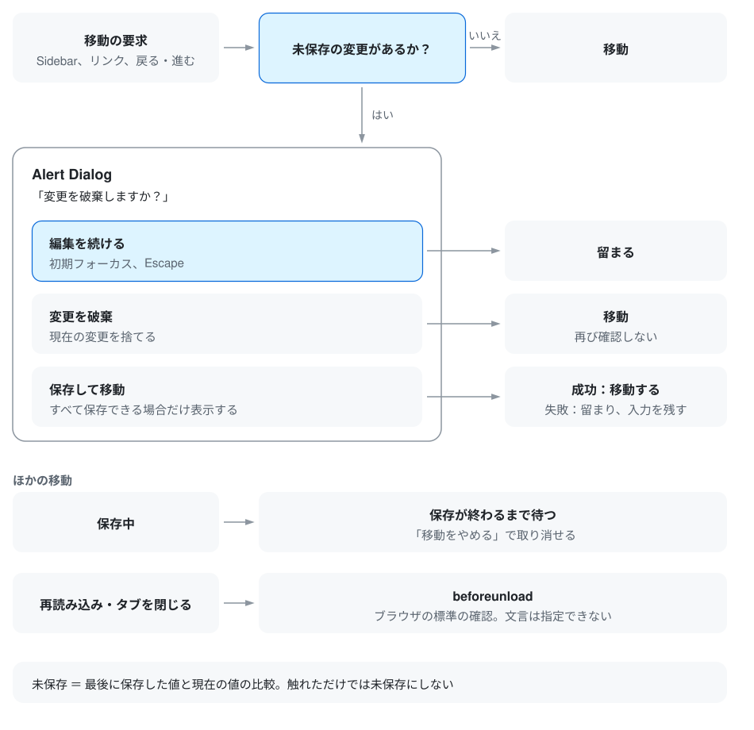

# Unsaved Changes

未保存の変更がある間の、ページの移動、Overlay を閉じる操作、再読み込みを確かめる。

状態：初期実装 ・ 実装：[`registry/patterns/unsaved-changes.tsx`](../../../registry/patterns/unsaved-changes.tsx) ・ 全体：[Forms & Workflows](forms-and-workflows.md)

## 目的

入力した内容を、意図しない移動で失わせない（原則 08）。入力が失われない操作（フォームの中の Tabs、Accordion、補足の閲覧）は妨げない（原則 07）。App Structure から引き継いだ課題（ページの移動の前の未保存の変更の確認）を扱う。

## 使用条件

明示的な保存のフォームと、自動保存の保存中・未保存の状態がある画面で使う。即時保存の項目は、切り替えた時点で保存するため対象にしない。

## 構成

| 部分 | 部品 | 仕様 |
| --- | --- | --- |
| 確認の仕組み | `UnsavedChangesProvider` | 画面（App Shell の外側など）に 1 つ置く。保存の単位ごとの状態を集め、移動の確認の Alert Dialog と beforeunload の登録を持つ。`labels` で文言を変える |
| 保存の単位の登録 | `useUnsavedChanges({ dirty, saving, label, canSave, onSave, onDiscard })` | フォームごとに呼ぶ。アンマウントで登録を解除する |
| ルーターとの接続 | `useNavigationGuard()` | `confirmNavigation(proceed, { onCancel })`、`hasUnsavedChanges`、`saving`、`pending` |
| 移動の確認 | Alert Dialog（`data-slot="unsaved-changes-dialog"`） | 「変更を破棄しますか？」。「編集を続ける」「変更を破棄」、必要な場合だけ「保存して移動」 |
| 保存を待つ確認 | 同じ Alert Dialog（`data-phase="waiting"`） | 「保存しています」「保存が終わると移動します。」「移動をやめる」 |
| Overlay を閉じるときの確認 | `DiscardChangesAlert` | Dialog、Sheet、Drawer の `onDiscardRequest` から開く。`onSave` を渡すと「保存して閉じる」を加える |

<picture>
  <source media="(prefers-color-scheme: dark)" srcset="../../diagrams/unsaved-navigation-dark.svg">
  
</picture>

## バリエーション

| 場面 | 確かめ方 |
| --- | --- |
| アプリの中の移動（Sidebar、リンク、ボタン） | Provider の Alert Dialog |
| ブラウザの戻る・進む | 製品のルーターが元の履歴の項目に戻してから、Provider の Alert Dialog |
| 再読み込み、タブを閉じる、別のサイトへの移動 | beforeunload によるブラウザの標準の確認 |
| Dialog、Sheet、Drawer を閉じる | 各部品の `unsavedChanges` と `DiscardChangesAlert` |
| 保存中の移動 | 保存が終わるまで待つ（200ms 後に「保存しています」を表示） |
| 保存の単位が複数ある画面 | 1 つの確認で、未保存のすべての単位を対象にする |

## 動作

### 判定

- 最後に保存した値と現在の値を比べる（`useFormState` の `isDirty`）。入力欄に触れただけでは未保存にしない。値を元に戻したら、未保存でなくなる。
- 実際に保存するデータの形で比べる。`normalize`（前後の空白を除く、順序に意味のない配列を並べるなど）の後の値を、キーの順序によらない比較（`stableKey`）で比べる。オブジェクトの参照や配列の並び順だけで判定しない。
- 保存の成功の後に、基準値を保存した値にする。保存中に入力を変えた場合は、送信した値を基準値にし、送信の後の入力を保存済みとして扱わない。
- 例：Inline の編集は「編集中で、下書きの値が保存した値と異なる」、自動保存は `hasUnsavedChanges`（保存中を含む）、取り込みは「ファイルを選び、取り込みが終わっていない」を `dirty` にしている。

### 状態の表示

- 保存ボタンの状態（変更がない間は無効）を基本にする。
- 必要な場合は、保存ボタンの近くやタイトルの近くに未保存の状態を示す（「保存していない変更があります」）。
- 検証のエラーで保存ボタンが無効の場合は、ボタンだけで未保存の状態を伝えない。

### 確認の条件

- 入力した内容が失われる場合だけ確かめる。
- フォームの中の Tabs、Accordion、補足の情報の閲覧など、入力が残る操作は妨げない（`confirmNavigation` を通さない）。

### 移動の確認

- Alert Dialog を使う。通常は「編集を続ける」と「変更を破棄」の 2 択にする。
- 「保存して移動」は、未保存のすべての単位に `onSave` があり、`canSave` が true の場合だけ表示する。単位を順に保存し、1 つでも失敗したら残りを保存せずに止め、移動しない（現在の画面と入力を残す）。すべて成功した場合だけ移動する。
- 初期フォーカスは「編集を続ける」（Alert Dialog の既定）、Escape も「編集を続ける」と同じ。外側のクリックでは閉じない。
- 確認の文には、保存の単位の `label` を並べる（「「会社の情報」「請求先」の変更は保存されていません。」）。`label` がなければ「入力した内容は保存されません。」。
- 「変更を破棄」は、各単位の `onDiscard` を呼んでから移動する。同じ画面に残る場合に再び確かめないよう、`onDiscard` では値を基準値に戻す（`form.discard`）。

### 複数の移動の要求

- 確認の表示中に別の移動の要求が来た場合は、最後の要求だけを残す。前の要求の `onCancel` を呼ぶ。
- 「保存して移動」の実行中に来た要求は受け付けず、その要求の `onCancel` を呼ぶ。実行中も「移動をやめる」で移動を取りやめられる。保存は続き、成功すれば未保存の状態が解除され、失敗すればフォームにエラーが残る。
- 「編集を続ける」の後は、要求を捨てる（`onCancel`）。取り消した後に、遅れて移動しない。

### 確認の繰り返しの防止

- 「変更を破棄」と「保存して移動」の対象の単位は、その単位の `dirty` が false になるまで、確認の対象から外す。移動の処理の間に、同じ変更で再び確認が出ない。
- 戻る・進むの例のルーターは、元に戻すための `popstate` と、許可された移動の `popstate` では確認を開かない。

### 保存中の移動

- 通常の短い保存の間は、移動を待たせる。保存が終わるのを待ち、成功して未保存の変更がなければ移動する。失敗したら、確認（「変更を破棄しますか？」）に切り替える。
- 待つ確認は、200ms 後に表示する（`WAITING_DIALOG_DELAY_MS`）。保存の直後の移動など、すぐに終わる場合は表示しない。
- 待つ間も「移動をやめる」で取り消せる（通信の障害で操作できなくならない）。
- 通信の中断は、サーバーの処理の取り消しを意味するとは限らない。結果が不明な場合は、未保存の状態を解除しない（`useFormState` は `unknown` で基準値を変えない）。
- 安全な処理として裏で続けられる保存（製品が保証する場合）は、移動を許してよい。その場合は `saving` を渡さない。

### ルーターとの接続

Registry は特定のルーターに依存しない。実際の移動の阻止と再開は、製品のルーターが行う。

- リンクと Sidebar の移動：既定の移動を止め、`confirmNavigation(() => router.push(href))` を呼ぶ。修飾キー付きのクリック（新しいタブ）は止めない。
- 移動を止めて「続ける」と「戻す」の処理を渡すルーター（React Router、TanStack Router の blocker など）：止める条件に `hasUnsavedChanges || saving` を使い、止めた移動を `confirmNavigation(proceed, { onCancel: reset })` に渡す。`proceed` を第 1 引数に、`reset` を `onCancel` に対応させる。
- ブラウザの戻る・進む：`popstate` の時点では URL がすでに変わっている。例のルーター（`preview/src/pages/forms-workflows/forms-router.ts`）は、履歴の項目ごとに位置（`history.state.fdFormsIdx`）を記録し、`history.go(-delta)` で元の項目に戻してから確認を開く。許可されたら `history.go(delta)` で改めて移動する。
- `confirmNavigation` は、未保存の変更も保存中の処理もなければ、すぐに `proceed` を呼んで true を返す。あれば確認を開いて false を返す。

### App Shell との関係

- 画面の状態（ルート）は、確認が許可された後にだけ変える。`AppShellMain` の `pageKey` は実際に移動したときだけ変わり、移動の後のフォーカスとスクロールの処理（[app-shell.md](app-shell.md)）は、取り消した移動では起きない。
- 戻る・進むの確認では、元の履歴の項目に戻してから確認を開くため、取り消した場合は URL と画面が移動の前のまま残る。

### Overlay を閉じる操作

既存の Dialog、Sheet、Drawer の仕組み（`unsavedChanges`、`onDiscardRequest`、[overlays.md](../components/overlays.md)）を使う。未保存の変更がある場合：

| 操作 | 動作 |
| --- | --- |
| 外側のクリック | 閉じない |
| 閉じるボタン、キャンセル、Escape | `DiscardChangesAlert` で確かめる |
| Drawer のスワイプ | `DiscardChangesAlert` で確かめる |
| 保存の成功 | 確かめずに閉じる |

- Overlay の中のフォームをページの移動から守るために `useUnsavedChanges` にも登録してよい（例：連絡先の編集の Sheet は `dirty: open && form.isDirty`）。閉じる操作は Overlay の確認だけが扱い、Provider の確認と二重にしない。
- `DiscardChangesAlert` は親の Overlay の中に置く。Escape はこの確認だけを閉じ、入力は残る。

### 再読み込みとタブを閉じる操作

- beforeunload は、未保存の変更か保存中の処理がある間だけ登録し、なくなったら解除する。
- ブラウザの標準の確認が出る。独自の文言は指定できない。ブラウザによっては、利用者がページを操作していない場合などに確認を出さない。

### 下書き

- 長い時間の入力や複雑なフォームでは、下書きを用意する（例：契約の登録）。
- 正式な保存と下書きを分ける。下書きの保存は「下書きを保存」、正式な保存は「契約を登録する」。
- 下書きの保存の日時、再開、破棄を示す（「保存した下書きがあります」「下書きから再開」「下書きを破棄」）。
- 下書きを保存したら、その値を基準値にする（`markSaved`）。下書きとして残っている入力は、移動で失われない。
- 機密の情報やパスワードを、安易に下書きに含めない（例ではカードの番号を入力させない）。
- アカウント、ワークスペース、レコードの境界を越えて下書きを共有しない（例のキー：`hanako.sato:hq:contract-new`）。
- 実際の永続化は製品の責務である。例では、ページのメモリにだけ置く。

### 複数のフォーム

- 実際の保存の単位ごとに `useUnsavedChanges` で登録する。1 つのフォームを保存しても、ほかのフォームの未保存の状態は残る。
- ページの移動では、未保存のすべての単位を対象にする。
- アンマウントしたフォームの登録は解除する（古い登録を残さない）。

## アンチパターン

| 避ける | 理由 | 代わりに |
| --- | --- | --- |
| 入力欄に触れただけで未保存にする | 変更していないのに確認が出る | 基準値と現在の値の比較 |
| オブジェクトの参照で比べる | 同じ値でも未保存になる | `normalize` と `stableKey` |
| フォームの中の Tabs や Accordion で確かめる | 入力が残る操作を妨げる | ページの移動だけ確かめる |
| 確認の後に、取り消した移動を実行する | 利用者の判断と異なる | `onCancel` で要求を捨てる |
| 確認の後の移動で、再び確認が出る | 同じ判断を繰り返させる | 破棄した単位を対象から外す |
| 保存に失敗しても移動する | 入力が失われる | 保存がすべて成功した場合だけ移動 |
| 保存中の移動を、ずっと止める | 通信の障害で操作できなくなる | 待つ間も「移動をやめる」で取り消せる |
| Overlay の確認と移動の確認を二重に出す | 同じ判断を 2 回させる | 閉じる操作は Overlay の仕組みだけ |
| beforeunload を常に登録する | 変更がないのに確認が出る | 未保存か保存中の間だけ |
| beforeunload で独自の文言を出そうとする | 表示されない | 標準の確認に任せる |
| 確認の前にルートの状態を変える | フォーカスとスクロールが先に動く | 許可の後に変える |
| 下書きをアカウントやワークスペースを越えて共有する | 別の利用者や別のデータに入力が漏れる | 境界ごとのキー |

## 状態管理

| 状態 | 持つ場所 | 内容 |
| --- | --- | --- |
| 保存の単位 | Provider の登録の一覧（`useUnsavedChanges` の id ごと） | `label`、`dirty`、`saving`、`canSave`（`onSave` がない場合は false）、`save`、`discard`、`released` |
| 移動の要求 | Provider | `proceed`、`onCancel`、段階（`waiting`、`confirm`、`saving`）。最後の 1 件だけ |
| 未保存の変更があるか | `useNavigationGuard().hasUnsavedChanges` | `dirty` で `released` でない単位がある |
| 保存中か | `useNavigationGuard().saving` | `saving` の単位がある |
| 確認を表示しているか | `useNavigationGuard().pending` | 移動の要求がある |

- `useUnsavedChanges` は、マウントで登録し、アンマウントで解除する。値の変化は登録を保ったまま反映する。Provider の外では何もしない。
- `useNavigationGuard` は Provider の外では、常に `proceed` を呼んで true を返す。

## アクセシビリティ

- 確認は Alert Dialog（`role="alertdialog"`）。初期フォーカスは「編集を続ける」（安全な選択肢）。
- 「変更を破棄」は Destructive。「保存して移動」は Primary で、実行中は Loading。実行中は「変更を破棄」を無効にし、「編集を続ける」を「移動をやめる」に変える（移動だけを取りやめ、保存は続く）。
- 待つ確認の「移動をやめる」は、保存中も押せる。

## 製品側の責務

- ルーターとの接続（リンク、Sidebar、戻る・進む、ルーターの blocker）。
- 保存の処理（`onSave`）が、成功した場合だけ true を返すこと。いつまでも応答しない保存を、時間切れとして `failed` か `unknown` で終わらせること（確認は「移動をやめる」で閉じられるが、保存ボタンは保存中のままになる）。
- 裏で安全に続けられる処理かどうかの判断。
- 下書きの永続化、保存の時期、機密の情報の除外、境界ごとのキー。
- アプリの外への移動（beforeunload の対象）と、プレビューのような別のアプリの領域との境界。

## 実装例

```tsx
// 画面に 1 つ
<UnsavedChangesProvider>
  <AppShell>…</AppShell>
</UnsavedChangesProvider>

// 保存の単位ごと
const form = useFormState<CompanyValues>({ initialValues, fields })
const save = form.handleSubmit((v) => api.saveCompany(v))
useUnsavedChanges({
  dirty: form.isDirty,
  saving: form.submitting,
  label: "会社の情報",
  canSave: form.canSubmit,
  onSave: () => save(), // 保存できた場合だけ true
  onDiscard: form.discard,
})

// 製品のルーター
const guard = useNavigationGuard()
const linkProps = (href: string) => ({
  href,
  onClick: (e: React.MouseEvent) => {
    if (e.button !== 0 || e.metaKey || e.ctrlKey || e.shiftKey || e.altKey) return
    e.preventDefault()
    guard.confirmNavigation(() => router.push(href))
  },
})

// 移動を止めて proceed と reset を渡すルーターの場合
// shouldBlock: () => guard.hasUnsavedChanges || guard.saving
// onBlocked: (blocker) => guard.confirmNavigation(blocker.proceed, { onCancel: blocker.reset })

// Sheet を閉じる操作
<Sheet mode="edit" open={open} onOpenChange={(o) => !form.submitting && setOpen(o)} unsavedChanges={form.isDirty} onDiscardRequest={() => setConfirm(true)}>
  <SheetContent>
    …
    <DiscardChangesAlert open={confirm} onOpenChange={setConfirm} onDiscard={() => { setConfirm(false); form.discard(); setOpen(false) }} />
  </SheetContent>
</Sheet>
```

プレビュー：`#/unsaved-changes`、`#/forms-app?page=settings`（2 つのフォーム）、`#/forms-app?page=customer-edit&id=cu-1&from=list`（ブラウザの戻る・進む）。
