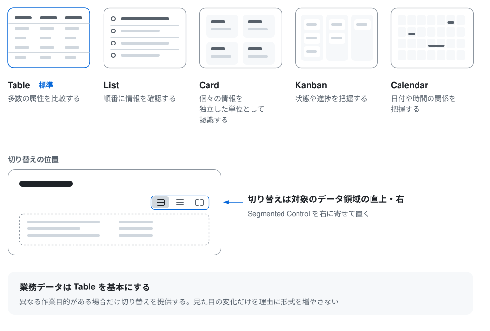
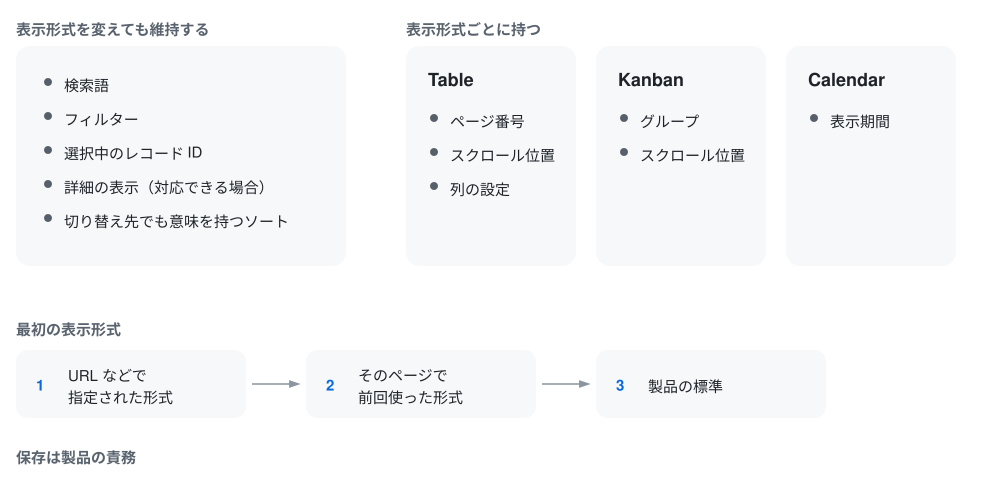

# View Switching

同じデータを、作業の目的に合う表示形式で見る。

状態：v0.1 確定候補（最終レビュー前） ・ 実装：[`registry/patterns/view-switcher.tsx`](../../../registry/patterns/view-switcher.tsx) ・ 全体：[Data Browsing](data-browsing.md)

## 目的

比較する、順番に確かめる、状態を把握する、日付の関係を把握する、という異なる作業に、それぞれ適した形で情報を示す（原則 02、03）。表示形式の切り替えで、検索の条件や選択を失わないようにする（原則 07）。

## 使用条件

- 業務データは Table を基本にする。
- 異なる作業の目的が存在する場合だけ、切り替えを提供する。
- 見た目の変化だけを理由に、複数の形式を提供しない。

## 構成

<picture>
  <source media="(prefers-color-scheme: dark)" srcset="../../diagrams/view-choice-dark.svg">
  
</picture>

| 形式 | 目的 | 例 |
| --- | --- | --- |
| Table | 多数の属性を比較する（標準） | 顧客の一覧 |
| List | 順番に情報を確認する | 更新の予定、通知 |
| Card | 個々の情報を独立した単位として認識する | 画像や要約を見て選ぶ物件、担当者 |
| Kanban | 状態や進み具合を把握する | 契約状況ごとの顧客 |
| Calendar | 日付や時間の関係を把握する | 更新日 |

| 部品 | 用途 |
| --- | --- |
| `ViewSwitcher` | 2〜3 種類のセグメント型。`radiogroup` |
| `ViewSwitcherMenu` | 選択肢が多い場合や、領域が不足する場合の Dropdown Menu（`DropdownMenuRadioGroup`） |
| `resolveInitialView` | 最初に表示する形式の優先順位 |
| `useViewScopedState` | 表示形式ごとの状態 |

高度な Kanban と Calendar の汎用の部品は、このパターンの範囲外である。プレビューの Kanban と Calendar は閲覧のための簡単な例で、ドラッグによる状態の変更、予定の変更、仮想スクロールは行わない。表示形式の変更と、実際のデータの変更を区別する。新しい依存のライブラリは追加していない。

## 判断基準

### 切り替えのボタンの配置

**切り替えのボタンは、対象となる Table やデータ表示の領域の直上・右側に置く。**

- 何の表示形式を変える操作なのかを、位置で伝える。
- Page Header の主要な操作や、離れた位置の全体の操作の領域に置かない。
- 検索やフィルターと同じ行に置く場合も、対象のデータ領域との位置の関係を明確にする。検証画面では、件数（左）と同じ行の右に置き、その直下にデータ領域を置く。
- 狭い画面では、必要に応じて折り返す（件数の行は `flex-wrap`）。

### 切り替えの部品

- 2〜3 種類はセグメント型（`ViewSwitcher`）を基本にする。
- 選択肢が多い場合や、領域が不足する場合は Dropdown（`ViewSwitcherMenu`）にする。プレビューの 5 種類の例は Dropdown を使う。
- 選択中は、ニュートラルの面（`foreground` 10%）と太さ（500）で示す。ブランドカラーは使わない。強制カラーモードでは、選択中を枠で示す。
- 意味が伝わるアイコンを使う（Lucide の `Table2`、`List`、`LayoutGrid`、`Kanban`、`CalendarDays`）。
- アイコンだけでは意味が伝わりにくい場合は、名前を並べて表示する（既定）。
- アイコンだけにする場合（`iconOnly`）は、ボタンにアクセシブルな名前（`aria-label`）と Tooltip を付ける。検証画面では、狭い画面だけアイコンだけにしている。

### 表示形式の保存

最初に表示する形式の優先順位（`resolveInitialView`）：

1. URL などで明示的に指定された形式
2. 利用者がそのページで前回使った形式
3. 製品の標準の形式

`available` に含まれない値（権限や画面の幅で使えない形式、古い保存値）は飛ばす。保存は製品の責務であり、Registry は LocalStorage やデータベースに依存しない。

### モバイル

- 作業の目的に応じて表示形式を選ぶ。
- Table を無条件に Card に変えない。比較が重要な場合は Table を残す。
- 月の格子を読めない幅では、Calendar は日付の順の一覧として描画してよい（表示形式は Calendar のまま）。

## 状態管理

<picture>
  <source media="(prefers-color-scheme: dark)" srcset="../../diagrams/view-state-scope-dark.svg">
  
</picture>

| 区分 | 状態 | 持つ場所（検証画面） |
| --- | --- | --- |
| 表示形式を変えても維持する | 検索語、フィルター、選択中のレコードの ID、対応できる詳細の表示、切り替え先でも意味を持つソート | `useBrowseQuery`、`useBulkSelection`、`openId` |
| 表示形式ごとに持つ | ページ番号、スクロールの位置、Table の列の設定 | `BrowseQuery` の `pagination`、列の設定 |
| | Kanban のグループ | `useViewScopedState`（View Switching のページの例） |
| | Calendar の表示期間 | `useViewScopedState` |

- 表示形式に固有の条件によって表示の対象が変わる場合は、その範囲を明示する（「各列の先頭 12件を、現在の並べ替えの順に表示しています」「この月に更新を迎える 23件（表示期間の中だけ）」）。
- 一括操作に対応しない表示形式では、選択を無言で隠さない。「3件を選択中。一括操作は表で行えます」と示し、「表に切り替える」と「選択を解除」を置く。
- 表示形式の切り替えは、表示の変更である。切り替えで、検索語、フィルター、選択、権限、データを変えない。

## レスポンシブ

- 件数の行は折り返す。切り替えの部品は `shrink-0` で、狭い画面ではアイコンだけにしてよい。
- 指で操作する端末では、セグメントの高さを 48px にする（`pointer-coarse:h-12`）。
- Kanban の列は、領域の中で横にスクロールする（ページ全体はスクロールさせない）。`HorizontalScrollArea`（`registry/patterns/table-scroll-area.tsx`）で囲み、列が領域に収まらない場合だけ、スクロールできる方向の端に薄い影を表示する。端に着いたら、その方向の影を消す。影は `pointer-events: none` の装飾で、カードを押す操作、文字の選択、フォーカスを妨げない。ネイティブのスクロールバーは隠さない。`TableScrollArea` と同じ測り方（`useScrollEdges`）を使い、Table の DOM（`data-slot="table-container"`）には依存しない。

## アクセシビリティ

- `ViewSwitcher` は `role="radiogroup"` と名前（既定「表示形式」）。各項目は `role="radio"` と `aria-checked`。
- Tab で 1 回だけ入り、矢印キー（← → ↑ ↓）で移動して選ぶ。Home と End で最初と最後。RTL では左右を入れ替える。選択中の項目（なければ最初の有効な項目）だけが `tabindex="0"`。
- アイコンだけの場合は `aria-label` と Tooltip。
- `ViewSwitcherMenu` のボタンの名前は「表示形式：表」のように、現在の形式を含む。
- 切り替えた後、フォーカスは切り替えの部品に残る（移動しない）。

## 実装例

```tsx
const options: ViewOption<"table" | "board" | "calendar">[] = [
  { value: "table", label: "表", icon: <Table2 /> },
  { value: "board", label: "カンバン", icon: <Kanban /> },
  { value: "calendar", label: "カレンダー", icon: <CalendarDays /> },
]
const [view, setView] = useState(() =>
  resolveInitialView({ requested: params.get("view"), remembered: saved, fallback: "table", available: options.map((o) => o.value) })
)
const [month, setMonth] = useViewScopedState<"calendar", string>("calendar", () => "2026-12")

<div className="flex min-h-12 flex-wrap items-center gap-x-4 gap-y-2">
  <p>{count}件</p>
  <div className="ms-auto">
    <ViewSwitcher value={view} onValueChange={setView} options={options} iconOnly={isMobile} />
  </div>
</div>
{view === "table" ? <DataTable … /> : view === "board" ? <Board … /> : <Calendar month={month} onMonthChange={setMonth} … />}
```

プレビュー：`#/view-switching`、`#/browsing-app?page=customers&view=board`。

## アンチパターン

| 避ける | 理由 | 代わりに |
| --- | --- | --- |
| 見た目の変化だけのために形式を増やす | 選ぶ負荷が増え、得られる情報は変わらない | 作業の目的が異なる場合だけ提供する |
| 切り替えを Page Header の右上に置く | ページ全体の操作と区別できない | データ領域の直上・右 |
| 選択中をブランドカラーで塗る | 主要な操作と区別しにくい | ニュートラルの面と太さ |
| アイコンだけで名前がない | 何に切り替わるかが伝わらない | `aria-label` と Tooltip、または名前を表示 |
| 切り替えると検索語や選択が消える | 探し直す必要がある | 共通の状態を維持する |
| 一括操作に対応しない形式で、選択を無言で隠す | 選択が残っていることに気づかず操作する | 選択の件数と、表への切り替えを示す |
| モバイルで Table を無条件に Card にする | 比較ができなくなる | 目的で選ぶ |
| 表示形式の切り替えでデータを変更する（ドラッグで状態を変えるなど） | 表示の操作とデータの変更が混ざる | 変更は別の明示的な操作にする |

## 製品側の責務

- 表示形式の保存（URL、前回の値）。
- 表示形式ごとのデータの取得（Kanban の列ごとの件数、Calendar の表示期間）。
- 高度な Kanban と Calendar の機能（ドラッグ、予定の変更）。
